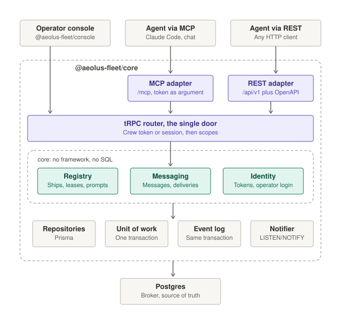
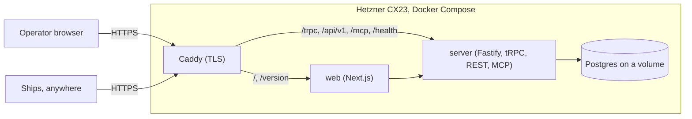

# Aeolus: solution and technical architecture (v0)

Owner: Thomas Hendrickx. Last updated 2026-10-07.

## Summary

Aeolus is three npm packages and one Postgres database. `@aeolus-fleet/core` exposes one API, a tRPC router, that every client uses: the operator web app, and ships through MCP or through REST generated from the same router. `@aeolus-fleet/console` is a Next.js operator console that calls only that API. `@aeolus-fleet/common` holds what both share: schemas, ids and types.

Inside the server, the three domain contexts from the blueprint (Registry, Messaging, Identity) are built as ports and adapters, so the domain never imports a framework or the database. Every record belongs to a fleet (the tenant), so one installation can later host several fleets at no extra cost.

The delivery guarantee lives in Postgres, not in application memory: a message is stored with its deliveries in one transaction before the sender gets an OK, and a delivery is claimed with row locks so two sessions can never take the same one. Postgres `LISTEN/NOTIFY` wakes waiting receivers and feeds live updates over WebSockets.

How it runs is not part of the product. Your own setup (Hetzner, Docker Compose, Caddy) lives in a separate private infra repository; anyone else can run the packages wherever they like, within the hosting constraints described under Deployment.

Companion document: [the product and domain blueprint](blueprint.md).

## Solution architecture

The server has exactly one API door: a tRPC router. The web app calls it like any other client, so there is no private back door for the console. For ships, the same procedures are also reachable as REST (with an OpenAPI spec generated from the router) and as MCP tools, so an agent gets identical behaviour whichever way it connects. Behind the door, the domain core is built as ports and adapters.

<picture>
  <source media="(prefers-color-scheme: dark)" srcset="images/architecture-dark.svg">
  
</picture>

### The router

| Procedure group | Authenticated by | Reachable as | Examples |
| --- | --- | --- | --- |
| Ship procedures | `register`: ship id and secret. Every other call: the crew token `register` returned (a header for tRPC and REST, a tool argument for MCP) | tRPC, REST, MCP | Register, whoami, receive, push receive, handed, handled, not handled, send, acknowledge, pong, report, turn, report log, inbox, deregister |
| Fleet procedures | Any actor (see Actors below): a crew token or console session, an account token, or the installation in a fleet; plus the `fleet:read` or `fleet:manage` scope, `fleet:manage` checked against the caller's manage reach on its target ship (decision 0034); commissioning takes `fleet:commission` for an agent ship, with `fleet:on-behalf` for an app ship, or `fleet:person` for a person ship, which owns itself, granting only scopes the commissioner holds and giving only label values (`valueIds`) of labels it defined or values it carries (decision 0053), an account's commission owned by its person ship, which core commissions first, as the installation would under `person-<account id>`, when the account has none (decisions 0052, 0057), and naming at commission the ship that asked for it, whose owner the new ship gets (`ownerOf`), takes `fleet:on-behalf` as well (decision 0045); resending and dismissing a delivery take `messages:resend` for a message the caller reads; setting a ship's owner takes `fleet:owner`, and granting scopes on a live ship `scopes:grant` with each scope granted held, both checked against manage reach (decision 0053); assigning a crew request and writing its reason take `crew:assign`; for the ships of crew requests assigned to the caller, reading one ship, getting a starting prompt, releasing, writing the status and confirming a release take `crew:run`, as does reading those requests; defining a label, changing its values and deleting it take `labels:define`, assigning and unassigning a value `labels:assign` on the caller's own ship or one it commissioned, or with `labels:any` on any ship within its manage reach, and reading the labels and finding a value `fleet:read`; reading, drafting and applying the fleet's own network rules take `fleet:network` (decision 0035), as do reading the declared network rules and the built-in rules and turning the viewer's read rule off; connecting a plugin takes `fleet:connect`; setting verified facts about a ship takes `fleet:verify`, checked against manage reach (decision 0059); declaring network rules on the labels the caller owns, a ship or the installation, takes `labels:define` (decision 0037); reading the reach refusals of the ships the caller reads and explaining reach from a ship it reads take `fleet:explain` (decision 0053); every `fleet:read` read answers only what the caller's read reach gives it, and with `fleet:on-behalf` and the `Aeolus-On-Behalf-Of` header what the named ship's read reach gives it (decision 0034) | tRPC; the fleet actions (list, ship, commission, get starting prompt, release, re-crew, retire, ping, follow, crew request, remove crew request, assign crew, explain crew request, report crew status, confirm crew release, assigned crew requests, labels, define label, change label values, assign label, unassign label, delete label, find label value, network rules, save and discard the network rules draft, the network rules draft changes, apply network rules, set built-in rule, declare network rules, declared network rules, set verified facts) also REST (`/api/v1/fleet/<call>`) and MCP (`fleet_<call>` tools) for a crewed ship with those scopes | Commission, rename, release, retire, get starting prompt, request crew, remove a crew request, resend, dismiss, fleet snapshot |
| Console procedures | Email and password, then the console session cookie | tRPC | Sign in (starts a console session crewing `argo`), sign out, and `console.session`: another service's server forwards the browser's cookie and learns whether the operator or a viewer is signed in (fleet, the fleet's name for the header's title, expiry, kind and scopes, or `UNAUTHORIZED`, with the `SIGNED_IN_ELSEWHERE` refusal when a sign-in elsewhere ended the session), so it serves its pages beside the console without a login of its own; `console.presentAccountToken` takes the account token pagasae gave the console's server and sets the `aeolus_account_token` cookie (httpOnly, Secure, SameSite=Strict, the session cookie's domain, for as long as the token lasts), from then on an account's sign-in, which `console.session` answers as kind `account` with its id; sign out clears it too; a browser on another site cannot present one (the console's server sends no Origin, a browser always does). `console.argoSignIn` answers an account its token allows as argo (`argo` claim, decision 0058), and no other caller, whether someone is signed in as argo and by which account, by its id, or none for argo's own sign-in, so the console warns before the account signs in as argo |
| Installation procedures | The installation token, in the `x-aeolus-installation-token` header; never a crew token or console session | tRPC only | `installation.fleets.create`, `list`, `get`, `delete`: see Installation below |
| Live subscriptions | Console session | tRPC over WebSocket | Fleet snapshot changes, inbox changes, delivery state changes |
| Following the fleet | Any actor, plus `fleet:read` | tRPC, REST (`/api/v1/fleet/follow`), MCP (`fleet_follow`) | `fleet.follow`: the events after an event number, the same numbers the live subscription sends, waiting up to 25 seconds while none has come, woken by the same `NOTIFY` |

The only procedures that exist purely for the web app are sign-in and live updates.

### Actors

Every call is authorised for its actor (decision 0057): a ship, an account or the installation, each by its scopes and its reach in the same way. The console is `argo` holding every scope, or an account signed in as itself.

- **A ship:** its crew token, or a console session crewing `argo` or the viewer. Its scopes live on the server with the ship.
- **An account:** the account token pagasae signed (decision 0058), in the `Aeolus-Account-Token` header on tRPC and REST, or in the console's `aeolus_account_token` cookie on tRPC and its WebSocket, where a change comes only from the console's origin. A crew token beside it, in `Authorization`, names the ship that presented it, such as a plugin's page or the gateway; a wrong one is refused. Core stores nothing of the account. On every call it checks the token: a JWT of type `at+jwt`, signed EdDSA or ES256 by a key pagasae publishes at `<issuer>/.well-known/jwks.json` (`ACCOUNT_TOKEN_ISSUER`; unset, no account token is trusted), held a minute and fetched again on the next call after it, so a new key works within a minute and pagasae is asked at most once a minute; the held keys stay while pagasae does not answer; naming that issuer; for the fleet of the ship that presented it, or else a fleet the installation hosts; not ended, with 30 seconds of allowance; living no longer than 10 minutes and 30 seconds and not issued more than 30 seconds ahead; and not issued before a cut-off of its account. A token that ended answers `UNAUTHORIZED` saying so; any other refusal answers `UNAUTHORIZED` naming no reason. Its scopes are the token's `scope`; it reaches by the values of the label `group` its token's `group` carries, matched by text, and as the owner of what its person ship (`person_ship`) owns.
- **The installation:** the installation token with the `Aeolus-Fleet` header naming a fleet it hosts, on tRPC only (`NOT_FOUND` for a fleet it does not host). It holds `fleet:read`, `fleet:manage`, `labels:define`, `labels:assign`, `fleet:person` and `labels:any` in every fleet, and manages person ships and the ships they own by its built-in rule, `installation`, which is never off.
- **What only a ship makes:** a call that sends, receives or stores something on the calling ship, such as declaring scopes, refuses an account and the installation with `FORBIDDEN`, since an agent ship can make each of them; the ship procedures take a crew token alone. A label and declared network rules belong to a ship or the installation, never an account (decision 0031). Today an account and the installation make `fleet.list`, `fleet.rename`, `fleet.release`, `fleet.retire`, `fleet.commission`, `fleet.setOwner`, `fleet.grantScopes`, `fleet.connectPlugin`, `fleet.setVerifiedFacts`, `fleet.setBuiltInRule`, `fleet.builtInRules`, the network rules calls, `fleet.explainReach`, `fleet.reachRefusals`, `fleet.scopes`, the label calls, `fleet.declareNetworkRules`, `fleet.declaredNetworkRules`, `fleet.follow` and the `fleet.events` subscription, and the console's calls on ships and deliveries: `fleet.ping`, `fleet.recrew`, `fleet.crewRequest`, `fleet.removeCrewRequest`, `fleet.assignCrew`, `fleet.explainCrewRequest`, `fleet.clearWorktree`, `fleet.dismiss` and `fleet.resend`; a ping and a clear request an account makes are argo's, with the account as the actor of their events. An account gets a starting prompt for its own person ship (`fleet.getStartingPrompt`) and releases it with no scope for either, the owner's right over its own ship that a ship has by the owner rule (decision 0052), so the app it uses, such as the gateway, crews it.
- **Events and refusals:** every event names its actor (`actor_kind`): a ship by its id, with the account signed in to the console as it when argo is signed in by one (`actor_signed_in_account_id`, decision 0054), an account by its id only with the ship that presented its token, the installation, or the system. A reach refusal names an account by its id, with the group values it carried and its person ship.

### Installation

One server may host many fleets for a hosting service such as pagasae (decision 0020; the behaviour and the four measures are in the blueprint, "Installation"). The service calls the installation procedures on the same tRPC router:

- **The token:** `INSTALLATION_TOKEN` (at least 32 characters) in the server's environment. Unset, every installation procedure answers `NOT_FOUND`, so a self-hosted server shows nothing new. Set, a request must present exactly that token in `x-aeolus-installation-token` (compared in constant time), or it is refused with `UNAUTHORIZED`. REST and MCP never serve these procedures.
- **Shapes:** every installation procedure's input and output is a schema in common: `schemas/installation.ts` (fleets, settings, limits, sign-in tickets), `schemas/notice.ts` and `schemas/guide.ts`. The bullets below say what each does, never its fields.
- **`installation.fleets.create`** creates a fleet and its argo, with the viewer ship when asked, and answers their ids; `CONFLICT` for an email an operator already has, or a request id used for another request.
- **`installation.fleets.list`** answers every fleet, oldest first; **`installation.fleets.get`** answers one, or `NOT_FOUND`. Each with its operator, its four measures, its messages per UTC day for the last 7 days, the limits that apply, and its health (decisions 0041 and 0042). The 0041 figures are subqueries of the same one statement over the fleet's open deliveries (a partial index `deliveries (fleet_id, state, created_at)` over the open states, which no foreign key check can pick), `overdue_deliveries` and, for the oldest in flight, the delivery's events; no lock, so a figure may be one commit behind, as the measures are. Beside them, the fleet's stuck deliveries as `fleet.health` reads them (operation 9).
- **`installation.settings.get`** and **`installation.settings.set`** read and write the default ship limit, the default daily message limit, the default schedules per ship limit, the default minimum schedule interval (seconds) and the fleet cap, each a whole number or none, kept in `installation_settings` (one row, none until set). **`installation.fleets.limits`** and **`installation.fleets.setLimits`** read and set a fleet's limits (columns on `fleets`); a set writes FleetLimitsChanged.
- **`installation.notices.get`** and **`installation.notices.set`** read and replace the notices, in order (decision 0023). Kept in `notices` (no fleet, no event). The console reads **`console.notices`**, the notices of its session's audience less those it dismissed, and calls **`console.dismissNotice`**: `NOT_FOUND` for a notice the session does not see, `BAD_REQUEST` for one that is not dismissible, OK again for one already dismissed.
- **`installation.guide.get`** and **`installation.guide.set`** read and replace the one guide, or remove it (decision 0024). Kept in `guides` (one row or none, no fleet, no event). The console reads **`console.guide`**, its steps and the session's progress, or none when no guide is for its session's audience, and calls **`console.recordGuideProgress`** (`open`, `skipped` or `finished`): `NOT_FOUND` when no guide is for the session, `BAD_REQUEST` for a step the guide does not have.
- **Enforcement:** commission (`SHIP_LIMIT_REACHED`), send, reply, ping and resend (`MESSAGE_LIMIT_REACHED`), schedule (`SCHEDULE_INTERVAL_TOO_SHORT`, then `SCHEDULE_LIMIT_REACHED`, the ship's active and paused schedules counted under a per-ship advisory lock), and `installation.fleets.create` (`FLEET_LIMIT_REACHED`) answer `FORBIDDEN` with a message naming the limit. Where a limit applies, the count (for the daily message limit, the fleet's row of `message_days` for today) is taken under a per-fleet advisory lock (the installation-wide lock for the cap) held until the new row is stored, so racing calls never overshoot it; with no limit nothing is counted or locked. The console reads `fleet.limits` (`fleet:read`): each limit with its count, and when the daily count starts again.
- **`installation.fleets.delete`** deletes a fleet; `NOT_FOUND` for a fleet the installation does not host.
- **`installation.operators.issueSignInTicket`** issues a ticket for the operator, by default, or the viewer (`NOT_FOUND` for a viewer ticket of a fleet without the viewer ship). An operator ticket may name the account it signs in as argo, by its id only (`account: { id }`; on a viewer ticket `BAD_REQUEST`, `VIEWER_TICKET_NAMES_NO_ACCOUNT`); the console session keeps it, `console.account` answers it, and every event argo writes in that session names it. The console shows it by the name pagasae gives it, in the account menu and beside the time of each timeline row argo wrote in such a session (`fleet.shipTimeline` gives each entry its `signedInAccountId`): its web app's server asks pagasae's `/api/console/account-name` with its app credentials (`AEOLUS_PAGASAE_CLIENT_ID`, `AEOLUS_PAGASAE_CLIENT_SECRET`) each time, once per account, and stores nothing. Without one it is argo's own sign-in. One use, valid 2 minutes, stored as its hash, with whom it signs in, in `sign_in_tickets` (a fleet's table, deleted with it); writes SignInTicketIssued. A server command issues the same kind of operator ticket, valid 15 minutes, as a link: `fleet:init` and `aeolus-core sign-in` print `CONSOLE_ORIGIN/sign-in/ticket?ticket=...` (accounts design, A1). The hosting service sends the browser to the console's `/sign-in/ticket?ticket=...`; the web app's server redeems it with `console.redeemSignInTicket` (no console origin: the ticket is the credential), passes the session cookie on and redirects to `/`. A used, expired or unknown ticket answers `UNAUTHORIZED`, and the console shows `/sign-in/failed`, linking back to `AEOLUS_HOSTED_SIGN_IN_URL`.
- **`installation.accounts.cutOff`** cuts off an account pagasae disabled (decision 0058), by its id: every token of it issued until then is refused in every fleet here, and every console sign-in as argo by it ends in every fleet, with argo's lease (`LeaseRevoked` by the installation, reason `accountCutOff`). Kept in `account_cut_offs` (no fleet, no event) 11 minutes, past the longest such token; a later cut-off of the same account wins.
- **`installation.accounts.signOut`** says an account signed out in the account app, by its id: sign-out anywhere is sign-out everywhere, so every console sign-in as argo it opened ends in every fleet here, with argo's lease (`LeaseRevoked` by the installation, reason `signedOut`). argo's own sign-in and an argo sign-in another account holds stay; its tokens stay good.
- **Request ids:** `installation_requests` keeps one row per create and delete, by request id, with the request's hash. A create's row names the fleet and argo it answered with and is deleted with that fleet; a delete's row names nothing of the fleet.
- **Delete:** one transaction deletes every row with the fleet's `fleet_id`, children first. Events stay append-only through a trigger; the one exception is this transaction, which names the fleet in the transaction-local setting `aeolus.deleting_fleet`, so only that fleet's events may go.

### Use cases (inbound ports)

| Context | Use cases |
| --- | --- |
| Registry | Initialise fleet (creates `argo`), commission ship, rename ship, register session (claim lease), release ship, re-crew ship (release and a new starting prompt in one transaction), retire ship (removing its crew request), request crew, remove a crew request (releasing it when assigned), assign crew (optimistic claim), explain a crew request (the reason it can not be placed), report crew status, confirm a crew release and read a trierarch's assigned crew requests (decision 0029), define a label, change its values, delete it, assign and unassign its values, list the labels and find a value's ids by its texts (decision 0031; a retire retires the labels its ship owns and removes those it carries), issue starting prompt (core issues the secret only; the tRPC adapter presents the prompt, one crew line per harness and the secret, decision 0019), list fleet (all ships, or those carrying every label value given), get one ship |
| Messaging | Send message, receive deliveries, push receive and hand over, report a delivery handled or not handled (decision 0040), check the inbox (count what the next receive would hand the crew, claiming nothing), acknowledge delivery, ping a ship and answer a ping with pong, resend or dismiss undeliverable or not handled, mark a message to `argo` read or done |
| Shared (read models) | Read the fleet's events after a position (live updates); read a ship's timeline (events naming it or caused by it), its messages (sent, sent to it, or claimed by it as a ship of their type), Needs attention and an inbox, each a page at a time by cursor (docs/design/performance/performance.md, decision 4); count an inbox's open messages; read one message of an inbox by its delivery, and the messages to it that withdraw or replace a question, by the question's uuid; and one message with its delivery's history from the event log |
| Identity | Verify crew token (returns ship, fleet, kind and scopes), console sign in with email and password (takes `argo`'s lease over), sign out, reset operator password (server command), verify console session |

### Outbound ports

| Port | Purpose | v1 adapter |
| --- | --- | --- |
| Repositories per aggregate (Ship, CrewRequest, Label, Message, Delivery, Credential, OperatorAccount, ConsoleSession) | Load and store aggregates, always scoped to one fleet | Prisma on Postgres |
| `UnitOfWork` | Run a use case in one database transaction | Prisma interactive transaction |
| `EventLog` | Append domain events: timeline, audit, live updates | Postgres table, written in the same transaction |
| `Notifier` | Wake receivers and live subscriptions after commit | Postgres `LISTEN/NOTIFY` |
| `SecretHasher`, `PasswordHasher` | Hash ship secrets, crew tokens and session tokens (SHA-256); hash the operator password (Argon2id) | Node crypto for both (`crypto.argon2` for Argon2id) |
| `Clock`, `IdGenerator` | Time and prefixed ids, injectable so tests are deterministic | System clock, id library |

The cross-context calls, Messaging asking Registry to resolve a selector, check that a ship is not retired, name a delivery's sender, hold a crew's lease during a receive, find a crewed ship to ping and mark a lease seen on pong, go through a Registry port, never through Registry's tables.

## Deployment

The product is the npm packages; how they run is up to whoever installs them. Your own setup lives in a separate private infra repository: one Hetzner CX23 running Docker Compose with Caddy, the `core` and `console` processes, and Postgres on a volume. Every client, operator or ship, connects outward over HTTPS, so a ship can run anywhere that reaches the server.

| Path | Served by | Used by | What |
| --- | --- | --- | --- |
| `/` | web | Operator | The Next.js console |
| `/trpc` | server | Web app, TypeScript clients | The tRPC router, including WebSocket subscriptions |
| `/api/v1` | server | Ships | REST generated from the ship procedures, with an OpenAPI spec whose description opens with the ship protocol |
| `/api/v1/docs` | server | Operator, ship builders | The ship REST API as a readable page (Scalar), rendered from the OpenAPI spec at `/api/v1/openapi.json`. Its assets are served by the server, not a CDN, and the page talks only to the fleet's own server |
| `/mcp` | server | Ships | The ship procedures as a remote MCP server (streamable HTTP), with the ship protocol as its instructions. The connection carries no ship identity; each conversation registers and passes its crew token in the tool arguments (decision 0015) |
| `/health` | server | Monitoring | Server up and database reachable. Nothing about fleets |
| `/health` (web) | web | Monitoring | Web up and the server's health (`web`, `server`, `database`). No authentication: nothing about plugins (not which the console has, nor how they are configured) and nothing about fleets. Each plugin answers its own `/api/health` |
| `/version` | web | Operator, monitoring | The live versions of the components running, so a deploy that failed halfway shows. Without a signed-in operator (no session, a viewer's, or one the server refuses): the web process's own, plus the server process's own and common's from `/api/version` (`server: null` when it does not answer), nothing about plugins or migrations. To the operator's session, which the server's `system.version` takes (#478): the web process's own, the server's and common's with the latest migration from `system.version`, and each plugin the console has by its own `/api/version` (`squadrons`, `trierarchPlugin`, `gateway`; `null` when it does not answer; a plugin the console does not have is left out). Never configuration metadata: no URLs, connected fleets or installation state, and no fleet data. Caddy routes `/version` to web |
| `/api/version` | server | The web app's `/version` | The server process's own version and the version of the common package it loaded. Nothing else: no migrations, configuration or fleet data |
| `system.version` | server (`/trpc`) | The web app's `/version`, for a signed-in operator | The server process's own version, common's, and the latest migration applied to its database (`null` before the first or when the database does not say). Needs `fleet:manage`: the operator's session holds it, a viewer's does not |

Only ports 80 (redirect) and 443 are open, and the fleet is reachable over public HTTPS: ship secrets carry the security. Postgres listens on the Compose network only. Estimated cost stays as in the blueprint: about €12.50 a month including VAT.

### Running elsewhere

Anyone can run the packages on other hosting, within two constraints that come from the design:

| Package | Hosting requirement | Works on |
| --- | --- | --- |
| `console` | Any Next.js host | Vercel, any Node host, a container |
| `core` | A long-running Node process: it holds WebSockets, long-poll receives and a `LISTEN` connection. Serverless functions cannot do this | Any VM or container host (Fly.io, Railway, Render, a VPS); not Vercel functions |
| `squadrons` (optional) | A long-running Node process with its own Postgres database (it may share the fleet's Postgres server), serving every fleet of the server with one connection each, switched per fleet by a hosting service with squadrons' own installation token (decision 0021), and no files of its own: it reads template repositories from `api.github.com`. It needs no public address: only the web app's server and the fleet's API talk to it or it to them, and it calls out to GitHub | Any VM or container host, next to the server |
| `trierarch-plugin` (optional) | A long-running Node process beside squadrons, with a small Postgres database of its own holding only each fleet's connection and switch (it may share squadrons' Postgres server, in its own schema), serving every fleet of the server with one connection each, switched per fleet as squadrons is (decisions 0021, 0030). It needs no public address: only the web app's server and the fleet's API talk to it or it to them | Any VM or container host, next to the server |
| `trierarch` (optional) | A long-running Node process on the machine where the sessions it crews run, kept alive by launchd or a systemd user unit, with its files under the operator's home folder. It needs no public address: it calls the fleet's API | The operator's own machine (a Mac, a Linux host) |
| Database | Postgres 16 or newer, with a direct connection for `LISTEN/NOTIFY` (a transaction pooler breaks it) | Supabase or Neon via their direct or session connection, any managed Postgres |

## Technology choices

The stack mirrors your other projects (Next.js, tRPC, Prisma), with the few additions a long-running broker needs. All decided.

| Layer | Choice | Note |
| --- | --- | --- |
| Runtime | Node.js 26, TypeScript, npm workspaces | Node 26 becomes the LTS line in October 2026 |
| API | tRPC, one router for every client | The web app uses it directly; ships use it through REST or MCP |
| REST for ships | Generated from the ship procedures, with an OpenAPI spec | For ships that are not TypeScript or not MCP-capable |
| MCP | Official MCP TypeScript SDK, streamable HTTP, tools mapped onto the same procedures. Ship identity per conversation through the crew token argument, never through the connection | Mounted in the server process |
| Server host | Fastify with the tRPC adapter and WebSocket support | Mature tRPC integration, including subscriptions over WebSocket |
| Web app | Next.js (App Router), React, shadcn/ui on Base UI, tRPC client with TanStack Query | Same pattern as Hemma; talks only to the server's router |
| Database access | Prisma with Prisma Migrate | The row-locking claim query and `LISTEN/NOTIFY` are written as typed raw SQL inside the Postgres adapter; the core never sees them |
| Queue | Own tables with row locks | Deliveries are domain objects with their own states and history; no job library |
| Validation | Zod schemas in `common` | One schema per message shape for tRPC, REST, MCP and web forms |
| Live updates | tRPC subscriptions over WebSocket, fed by `LISTEN/NOTIFY` | Possible because the server is a dedicated long-running process |
| Operator auth | Email and password (Argon2id) for one operator account. Sign-in gives a random session token, stored as SHA-256, sent as an httpOnly secure cookie, valid 30 days after last use. The session crews `argo`; `argo` has no secret. No auth library | Decision 0012 |
| Ship auth | Opaque secret `aeolus_sk_v1_…`, stored as SHA-256, used only to `register`; `register` returns a crew token `aeolus_ct_v1_…`, stored as SHA-256 with the lease, which every later call carries as a bearer token | Decisions 0002, 0015 |
| Ids | Prefixed, time-ordered ids (decision 0005: `flt_`, `shp_`, `msg_`, `dlv_`, `evt_`, `lse_`, `crd_`, `opr_`, `ses_`, `lbl_`, `lbv_`, `rfs_`, `req_` for the gateway's pending requests, `mtg_` for meetings, `sch_` for schedules) with a lowercase ULID body | Every id shows what it refers to and sorts by creation time |
| Logging | pino, structured JSON to stdout | Never logs secrets or payloads |
| Tests | Vitest; integration tests on a real Postgres (Testcontainers); Playwright for the web app | The guarantee lives in SQL, so it is proven against a real Postgres |
| License | Apache-2.0 | Includes an explicit patent grant |

## How the delivery guarantee is implemented

Every promise in the blueprint maps to one Postgres transaction. Nothing the guarantee depends on is held only in memory, so a crash of the Node process loses nothing.

A call waits up to 10 seconds for a connection from the pool (pg's default size), wherever it asks for one: its transaction, or a query outside one such as the crew-token lookup. Its transaction may then run up to 5 seconds before it is rolled back; a bulk operation, whose work grows with the fleet's history, may run up to 30 seconds (`BULK_TRANSACTION_TIME_MS` in the Prisma adapter): a fleet delete and a ship retire. A call the database is too busy for stores nothing: one that gets no connection in that wait, whether none came free or a new one was not made, one whose new connection Postgres refuses because it holds too many, and one whose transaction runs past its time. Each is refused as `SERVICE_UNAVAILABLE` (HTTP 503 over REST, the same code over MCP and `/trpc`), saying the fleet is busy, nothing was stored and to make the same call again (a send with the same idempotency key). It is never answered as a server failure. The fleet's own callers (the plugin's `aeolus-fleet.sh`, squadrons, the trierarch and the trierarch plugin) make the same call again by themselves, with the same body, after 1, 2, 4 and 8 seconds (`FLEET_BUSY_WAITS_MS` in common), each wait drawn between half and all of it (`busyWaitMs`) so callers refused together do not call again together; after that the refusal stands as any other. A bulk operation they make (squadrons' retire) is made once: busy, it ran past its time, and made again it would only put another such transaction on a database that is already slow.

### Core tables

Every table except `fleets` and the installation's `installation_requests`, `installation_settings`, `notices`, `guides` and `account_cut_offs` carries a `fleet_id`, and every uniqueness rule is per fleet. Every foreign key has an index leading with its columns, so deleting a referenced row (deleting a fleet deletes all of its rows) checks the rows that reference it with an index, never a scan. A self-hosted server creates one fleet at first run; a hosting installation creates more through the installation procedures.

| Table | Holds | Key constraints |
| --- | --- | --- |
| `fleets` | The tenant: name, created date, the number of its last committed event, and how its ship, daily message, schedules per ship and minimum schedule interval limits are set (its own, null for none, or the installation default) | One row on a self-hosted server |
| `ships` | Name, type, kind (`operator`, `viewer`, `agent`, `person` or `app`, decision 0044), owner (a ship of the same fleet, none for argo and the viewer, decision 0045), scopes, note, retired date; for a commissioned ship, the actor that commissioned it (`commissioned_by_kind`: a ship, an account by its id, or the installation), its idempotency key and the request's hash | Name unique per fleet among ships that are not retired (partial unique index); exactly one `operator` ship per fleet, named `argo`; at most one `viewer` ship per fleet, named `viewer`; an idempotency key unique per commissioning actor |
| `crew_requests` | A ship's crew request (decision 0029): its settings (JSONB, at most 16 KB, crew settings the server checks but never acts on), their version (one more on every request), when they were last requested, the trierarch ship it is assigned to, its status (crewing, running, restarting, crashed, releasing) with the restart attempt and when the session started, whether its crew is final (set by the first running, restarting or crashed, kept whatever status follows, cleared on every new settings version), and the trierarch plugin's reason while unassigned; its give-backs in `crew_request_give_backs` | At most one per ship: the ship's id is its key; the assignee is a ship of the same fleet, indexed for a trierarch's query; removed with its ship's retire |
| `crew_request_give_backs` | A trierarch that gave a crew request back before its crew was final (#382): the trierarch ship, the settings version it tried, the reason and when | One per request and trierarch (the primary key with the fleet and ship); cleared on every new settings version and removed with the request |
| `worktree_clear_requests` | A pending clear request (decision 0032): the trierarch ship, the worktree by the ship it belonged to and its repository, who asked and when | One per trierarch, ship and repository (the primary key with the fleet); every ship is of the same fleet. A request locks the trierarch ship first, so two never both pass its limit; removed with its trierarch's retire |
| `labels` | A label (decision 0031), id `lbl_`: its key and its owner (`owner_kind`): a ship, or the installation, which owns `group` (decision 0052). A retired or deleted label's row is deleted; its events stay | The key is unique per fleet; a ship owner is a ship of the same fleet, indexed for a retire, and the installation's names no ship. Defining takes an advisory lock on the fleet and the key |
| `label_values` | A label's values (at most 50), id `lbv_`: the label, the value and its place in the label's order. A value keeps its row, and so its id, while the label has it | A value once per label; the label is one of the same fleet |
| `ship_labels` | The values each ship carries: ship, label and value | One row per ship and value (the primary key with the fleet), so a ship holds a set; the label and the value are of the same fleet, indexed for a change of values, a delete and a retire. The ship is locked first, then the label: an assignment holds the label (`FOR SHARE`) and reads it again after the lock, a change of values and a delete lock it (`FOR NO KEY UPDATE`) and a retire of its owner (`FOR UPDATE`), so none of them crosses another |
| `network_settings` | A fleet's own applied network rules (JSONB, each naming its verb, or null for all-to-all, which is open on), whether the viewer read is on, and their version, once they first changed (decisions 0034, 0035) | The fleet's id is its key. A check and a change take turns on a per-fleet advisory lock, shared for a check and exclusive for an apply, a built-in turned, a declaration or a withdrawal, so each check uses one version and checks never starve a change |
| `network_rules_drafts` | The fleet's one draft of its own rules (decision 0035): the rules (JSONB, or null for all-to-all), when it was saved and the settings version it was saved against | The fleet's id is its key; deleted by an apply or a discard, never read by a check |
| `declared_network_rules` | The network rules a ship declared on the labels it owns (decision 0037), JSONB, one row per declaring ship | Keyed by fleet and ship; no row when it declares none; removed when the ship retires |
| `installation_declared_network_rules` | The network rules the installation declared on the labels it owns (decisions 0037, 0052), JSONB | Keyed by fleet; no row when it declares none |
| `scope_namespaces` | A plugin's namespace (decision 0046): the declaring ship, the namespace, its scopes with their descriptions | The namespace unique per fleet; one per declaring ship; removed, with its scopes on every ship, when the ship retires |
| `verified_facts` | One writer's verified facts about a ship (decision 0059): the writer (a ship or an account by id, or the installation), the facts as JSONB in common's shape, and when they were written | Keyed by fleet, ship and writer; no row while the writer holds none; indexed by writer; removed, with `VerifiedFactsRemoved`, when the ship or a writer ship retires. A set by a writer ship holds a shared advisory lock on it after locking the ship written about; its retire takes it exclusively after every ship it locks, so a set racing the retire commits first and goes with it, or is refused |
| `reach_refusals` | A call the network rules refused, id `rfs_`: when, the sender and the recipient (a ship, or a type with each ship of it) as JSONB with their names and the label values they carried then, the verb, both ships' owners then, the ship that read on behalf of the sender if one did, and the settings version | Written in the transaction that refuses, which commits nothing else; indexed on fleet and time for argo's read, the latest first |
| `leases` | Which ship is crewed, since when, its crew's last call (every authenticated call by its crew token, or by argo's console session, marks it in the statement that authenticates it; observation only), the hash of its crew token, its crew's statement and its version (decision 0047), the session's location (`DEVICE`, `CLOUD`, `SERVER`, `OTHER` plus a description), the harness it stated (none for argo's console lease), and its crew's report: state, note, when it last reported, details (JSONB, at most 16 KB, decision 0028) and their version, when its first push receive made it pushed, and its session's turn (idle or busy) with the time its hooks saw it (decision 0040) | At most one open lease per ship (partial unique index); the crew token hash is unique across all fleets, so the crew token lookup is not scoped by fleet either |
| `credentials` | Hashed ship secrets, issued, claimed and invalidated dates | At most one valid secret per ship (partial unique index); the hash is unique across all fleets, which makes the secret lookup one of the queries that are not scoped by fleet |
| `messages` | Sender ship, selector (for a send to a label its value ids as sent, decision 0063), payload, content type, the model the sender's session stated (none from argo, for pings, and before models were stated; a resend keeps the original's), sender's idempotency key, hash of the request it was sent with (selector as sent, payload, content type, in-reply-to), optional in-reply-to and resend-of message, the meeting it was sent to or tells of, and the schedule and send time it was sent for | Payload at most 64 KB (serialized bytes); in-reply-to names a message in the same fleet; unique on sender plus idempotency key; a repeat of the key must match the request hash (the model is no part of it); indexed on sender and time, for a ship's current model, and on fleet and time, for the installation's messages of the last 7 days |
| `message_days` | Per fleet and UTC day: the messages stored and their payloads' UTF-8 bytes (performance design, decision 1) | Added to in the transaction that stores the message, as its last statements after the event numbers; storage is the sum of a fleet's days, the messages per UTC day and the daily message limit read its days; every message from before it counted once by its migration |
| `deliveries` | Recipient ship or recipient type, state (pending, received, handed, acknowledged, handled, notHandled, undeliverable, dismissed, abandoned), claimed-by ship and lease (who it is received by or handed to), attempts (the hand-overs so far, the refused fifth included), the last hand-over number its pushed crew reported, when it was handed once more, whether its message was forced (decision 0040), read date for messages to `argo`, and for a type under network rules the ships of it its sender may reach (empty for any ship of the type) | One row per recipient; indexed on fleet, recipient and state, and on the claiming lease; a received, handed, acknowledged, handled or not handled delivery names the ship and lease it was received by or handed to, a pending one neither; the claiming lease belongs to the same fleet |
| `meetings` | A meeting (decision 0061), id `mtg_`: its optional title, its owner and moderator ships, the ship that opened it with its idempotency key and the request's hash, when it opened and when it ended, the ship holding its mic and the mic's pattern | An idempotency key unique per opener; owner, moderator, opener and mic holder are ships of the same fleet |
| `meeting_participants` | The ships of a meeting, when each last joined, and when it left and whether the owner revoked it | One row per meeting and ship (the primary key with the fleet); the ship is of the same fleet, indexed for its meetings |
| `meeting_mic_requests` | The participants waiting for a meeting's mic, each with its time and place on the list | One row per meeting and ship, a participant of that meeting |
| `schedules` | A ship's scheduled message (decision 0062), id `sch_`: its ship, the send input as given (selector, payload, content type, in-reply-to, force) with the model stated at creation, its timing (once an instant; every a duration, or a cron and its zone, each with an optional start, end and count), its refusal strategy and retry window, its missed strategy and grace, its idempotency key and the request's hash, its state, next send time and next attempt, its last outcome (the message, the refusal's code, or missed, with the send time and when), when it was created, ended or cancelled | An idempotency key unique per ship; the ship and a ship selector are ships of the same fleet; the timing whole for its kind, a count at least 1 and an end after its start; indexed on the fleet and next attempt of active schedules, for the claim, and on the fleet, ship and id, for a ship's list |
| `health_snapshots` | The stuck snapshot (decision 0042), one row per closed hour: the last event folded into it (`seq`), the deliveries stuck at its hour mark by cause, place and message parties with each oldest since, the waits from send to acknowledgement in the hour by message parties as counts per log-spaced duration bucket (JSONB each), and each lease's latest turn as of `seq` | The primary key is the fleet and the hour, so an hour is written once (`ON CONFLICT DO NOTHING`); 168 hours kept |
| `health_snapshot_deliveries` | The fleet's open deliveries as of its latest snapshot, each at its latest step: message, sender, recipient, claimer, reachable ships, sent date, and the state, since, ship and lease of the step | One row per fleet and delivery, replaced whole by each close; a copy for the fold, so no foreign key but the fleet's |
| `overdue_deliveries` | A delivery argo was told is overdue by the 10 and 60 minute clocks (decision 0040): its lease and ship, the state it was told in (pending, received, handed), which clock (notConfirmed, idle, busy), after how many minutes, and when argo was told | One row per lease and delivery, so argo is told once; it stands while the delivery is still in that state on that open lease, and is never changed |
| `events` | Append-only log of every state change: type, time, its actor (`actor_kind`: a ship, with the account signed in as argo when there is one, an account by its id with the ship that presented its token, the installation, or the system), ship, message and delivery it concerns, small details, and its number in the fleet's stream | Never updated or deleted: timeline, audit trail and live-update source; the number is unique per fleet, in commit order without gaps |
| `operators` | argo's own sign-in: email and Argon2id password hash, neither until argo sets them in Settings (a hosting installation's operator has an email and no password), the console theme (light, dark, system; system until chosen) | Email unique across the installation (looked up before the fleet is known); one operator in v1 |
| `installation_settings` | The installation's default ship, daily message, schedules per ship and minimum schedule interval limits for fleets and its cap on fleets, each null for no limit | One row at most; belongs to no fleet (decision 0020) |
| `notices` | The installation's notices: id, place in its order, audience (`everyone`, `operators`, `viewers`), text, links, whether dismissible | At most 5 (checked where they are set); belongs to no fleet (decision 0023) |
| `installation_requests` | The installation's creates and deletes of fleets, by the caller's request id, with the request's hash; a create also names the fleet and argo it answered with | The one table that belongs to the installation, not to a fleet (decision 0020): a create's row goes with its fleet, a delete's names nothing of the fleet |
| `console_sessions` | Console sessions crewing `argo` or the viewer ship: ship, token hash, the device it signed in from (from the sign-in's User-Agent: "Mac · Chrome"; also argo's lease location, as OTHER), the lease it holds (none for a viewer session), last used, expiry, how long it stays valid after use, the time it ends by at the latest (viewer sessions only), the account signed in as argo by its id (none for argo's own sign-in and a viewer), and why it ended (taken over by a sign-in elsewhere, signed out, password reset, account cut off) | At most one live session holding a lease per fleet (signing in ends the previous one); only an ended session has a reason |
| `notice_dismissals` | Which notices a console session dismissed, and when | One row per session and notice; no foreign key to `notices`, so replacing the notices keeps dismissals of an id that comes back |
| `account_notice_dismissals` | Which notices an account signed in to the console as itself dismissed in the fleet, and when, by its account id (accounts design, A9) | One row per fleet, account and notice; core stores no account, so no foreign key for it |
| `account_cut_offs` | An account pagasae cut off (decision 0058): its id, when, and until when it is kept | One row per account; belongs to no fleet: a cut-off holds in every fleet |
| `guides` | The installation's guide: its audience and its steps (path, anchor, title, text) | One row or none; belongs to no fleet (decision 0024) |
| `guide_progress` | Where a console session is in the guide: its step, and open, skipped or finished | One row per session, replaced on each move; no foreign key to `guides` |
| `account_guide_progress` | Where an account signed in to the console as itself is in the guide in the fleet, by its account id | One row per fleet and account, replaced on each move |

A message is the travelling ticket, not the cargo. The 64 KB limit is deliberate: real content lives where it belongs (a repo path, a pull request, a storage URL), and the payload carries the reference plus the instruction.

### The operations

1. **Send.** In one transaction: verify the sender, resolve the selector (a ship by id or name that is not retired, a type with at least one active ship, or a label selection into its active ships but the sender, each held in id order, decision 0063), insert the message and its delivery (one per ship for a label), append the event, and queue a `NOTIFY` for the recipient. Postgres releases the notification only when the transaction commits, so no receiver is ever woken for a message that does not exist. Only after the commit does the sender get OK. A repeated send with the same idempotency key and the same request returns the original message instead of a new one; the same key with a different request is refused. A forced send (`isForced`, decision 0040) needs `messages:force`, checked before the transaction, and rides send reach; its delivery stores that it was forced and `MessageAccepted` says so (`forced: true`). Force is part of the request: the same key with and without it is a different request.
2. **Receive.** In one transaction: select up to the ship's `max` (1 to 10, default 1) in one statement: forced deliveries first (decision 0040), then this crew's own unacknowledged in-flight deliveries, then the oldest pending deliveries for this ship, or for its type, each oldest first, with `FOR UPDATE SKIP LOCKED`, mark them handed at once, write `DeliveryHanded` and increase the attempt count (handing a crew's own handed delivery again counts as an attempt too, so a lost reply is recovered without the operator). Each comes with its message, whether it was forced, and its sender's id, name and type, read in the same transaction, so a renamed sender goes by its new name. `SKIP LOCKED` is what makes it impossible for two ships of the same type to claim the same delivery. The transaction holds the crew's lease (`FOR SHARE`): a release or takeover ending it waits, then returns what the receive claimed, so nothing stays claimed by an ended lease. When nothing is pending, the call waits on `LISTEN` for up to about 25 seconds and then returns empty (long poll). The fifth attempt of a delivery never acknowledged is refused: it becomes undeliverable instead and is handed to no one.
   On a pushed lease a plain receive hands nothing, its pending deliveries included: it waits as an empty receive does, then returns empty.
3. **Push receive** (decision 0040). As a receive, for the computer side: in one transaction, first mark the lease pushed (an update before the lease is held `FOR SHARE`, so two marks take turns on the row lock and never deadlock; the first writes `LeasePushed`), then hold the lease, then select up to `max` in the same order: forced first, then this crew's own received or handed deliveries, then the oldest pending, `FOR UPDATE SKIP LOCKED`. A pending one becomes received, claimed by the crew's ship and lease, with no attempt counted (`DeliveryReceived`); one the crew holds already changes nothing (`DeliveryReceived` with `again: true`). It waits on `LISTEN` as a receive does.
4. **Hand-over** (`handed`). In one transaction: hold the lease, lock the delivery, and apply the hand-over number. A number higher than the last stored one counts one attempt, stores the number and writes `DeliveryHanded`; the fifth attempt makes it undeliverable instead. The same or a lower number changes nothing, also on an acknowledged delivery. The lock makes a hand-over, an ack and a receive of one delivery take turns.
5. **Acknowledge.** A single guarded update: the delivery moves to acknowledged only if it is received by or handed to the calling ship. Acknowledging twice is harmless and returns OK.
6. **Once more, handled and not handled** (decision 0040). Each in one transaction: hold the lease, lock the delivery, apply the report and write its event. `handed` with `isOnceMore` stores when an acknowledged delivery was handed once more and its number, with `DeliveryHanded` marked `onceMore` and no attempt; `handled` moves an acknowledged delivery to handled (`DeliveryHandled`); `notHandled` moves one handed once more to notHandled (`DeliveryNotHandled`). The lock makes a handled and a not handled report of one delivery take turns, so only one of them lands. **Turn**: lock the open lease, keep its turn and the time the hooks saw it, and write `TurnReported` at that time, unless the turn is the same or the report older than the one held.
7. **Release** (operator) **and deregister** (the ship itself). Only a crewed ship other than `argo`; a crew deregisters only its own lease. In one transaction, locking the ship, then its secret, then its lease: invalidate the secret, close the lease and with it the crew token, and return the deliveries the lease held in flight (received or handed) to pending, their attempts kept and their hand-over number cleared, queueing a `NOTIFY` for each as a send does. Direct deliveries go back to the ship's inbox; type deliveries lose their claim and go back to the type queue, where a waiting receive of another ship of the type takes one at once. Events: `CredentialRevoked`, `LeaseRevoked` (caused by the operator or the ship) and one `DeliveryReturned` per returned delivery; every other lease end (sign-in takeover, sign-out, password reset, account cut-off) writes `DeliveryReturned` and its `NOTIFY` too. A receive holding the lease makes the release wait, then the release returns what the receive claimed. A receive waiting on an empty inbox holds no lock while it waits, so it never holds a release up, and once the lease has ended it hands out nothing. Retiring does the same, then marks the remaining direct pending deliveries abandoned (one `DeliveryAbandoned` each, with `ShipRetired`) and the ship retired; an undeliverable one stays for the operator. Type deliveries are never abandoned by a retire, because other ships of that type can still take them.
8. **The 10 and 60 minute clocks** (decision 0040, #586). Core passes every 30 seconds, one pass at a time, from the moment it serves until it stops; a pass that fails is logged and the next one runs. A pass lists the fleets and, per fleet, reads its open pushed leases with their turn and the deliveries waiting for them: pending for the ship or its type, or received or handed with the lease, each since its latest return, receipt or hand-over (from the event log), else since it was stored. Per lease it takes the oldest such delivery whose clock ran out: handed and not confirmed for 10 minutes, or pending or received for 10 minutes while the turn is idle and 60 while it is busy, counted from the latest of its state, the turn and the push (no turn reported: idle since the push). In one transaction it inserts the `overdue_deliveries` row, only while the delivery is still in that state on that open lease, `ON CONFLICT DO NOTHING`, and writes `DeliveryOverdue` (system) when a row went in. So two passes at once, or one after a restart of core, tell argo once. Then the pass closes the stuck snapshot (decision 0042), per fleet, one repeatable read transaction per hour: take `pg_try_advisory_xact_lock` on the fleet's snapshot (held: skip the fleet, the other instance closes it); read the latest hour; if it is the last hour mark, stop; else fold the events after its `seq`, read a page at a time in `seq` order, up to the first that occurred past the next mark, apply the rule at that mark, insert the hour (`ON CONFLICT DO NOTHING`), replace `health_snapshot_deliveries`, delete the hours past 168, and commit. Missed hours close one at a time, oldest first. A fleet with no snapshot, or whose latest hour is 168 hours old, starts at the oldest of its 168 hours: the deliveries sent by then and open then (open now, or with an event after it: the open states' partial index and the events by time), each at its latest step by then, and each lease's last `TurnReported` by then (the partial index of turn reports), as of the event before the first one past that hour by number, looked for in the minute after the first one past it by time; the hours after it then close one by one as missed ones do. A new fleet starts with an empty hour at its creation hour, in the transaction that creates it.
9. **The health reads** (decision 0042). `fleet.health` (`fleet:read`), each part of it on its own (performance design, decision 2), and each fleet on `installation.fleets.list` and `get` read, without a lock, the latest stuck snapshot with its open deliveries in one statement, the events after its `seq` (the unique index on (`fleet_id`, `seq`) serves it), the hours of the last 168, the fleet's ships and leases not over since the latest hour (a lease never seen as last seen when it started), and the trierarch each crew request is assigned to. One pure fold beside the rule in `core/src/domain/shared/stuck.ts` folds the events into the snapshot's open deliveries and turns; the rule then classifies them at now, the pushed clocks shared with the overdue pass. An hour the pass has not closed yet is folded as a close would, writing nothing. Stuck per hour is the 167 closed hours before now and now; acknowledged counts the 24 closed hours before the open one and the open one, the median read from their summed buckets, and shows the last 23 of those hours and the open one per hour. Each part reads only what it answers. `fleet.stuckCount` (how many now and the oldest since) and `fleet.stuck` (by cause and place, a page at a time by the cursor of its last place's oldest delivery) read the latest snapshot, the events after it, and only the ships and leases the open deliveries touch: their ships, the ships of their types and the leases holding them, so the cost follows the open deliveries, never the fleet's ships. Only `fleet.stuck` reads the machines. `fleet.stuckHistory` reads the same and the hours of the last 168. `fleet.acknowledged` reads the latest snapshot, the events after it and the hours of the last 24, no ships or leases. Each count keeps only the message parties the caller reads (decision 0034). A fleet with no snapshot yet is replayed as its first snapshot is: its ships and leases not over 168 hours ago, its deliveries open now or with an event since then with every state change from their events, the turns from `TurnReported`, classified at now and at each of the 168 hours, and the acknowledged counted from `DeliveryAcknowledged` and the send times; the events index on (`fleet_id`, `occurred_at`) serves that read.

Resend and dismiss (operator, from Health or a ship's page) each lock the undeliverable or not handled delivery first, so they take turns. A dismiss sets it to dismissed with `DeliveryDismissed`; dismissing it again is OK and changes nothing. A resend then locks its idempotency key (`resend-<delivery id>`, the original sender's) and the ship it is addressed to, as a send does, and in one transaction stores a new message with `resend_of` the original, its pending delivery and `MessageAccepted`, sets the original to dismissed with `DeliveryDismissed` (both events caused by whoever resends it, argo or an account), and queues the `NOTIFY`. A second resend finds the key and answers the same message.

The operator inbox (argo only, through its console session, whose caller carries the lease the session holds on `argo`): mark read sets the delivery's read date, keeping an earlier one, or clears it, with no event. Mark done holds the session's lease (`FOR SHARE`, as a receive does) and locks the delivery, then hands and acknowledges it at once, one attempt counted, writing `DeliveryHanded` and `DeliveryAcknowledged`; again is OK. Reply sends as a send does (the key, then the sender's ship, held against a retire), plain text unless it gives a content type, and then marks the message done in the same transaction, the acknowledgement naming the reply in its details; any refusal rolls both back. `fleet.inbox` lists each message with argo's replies to it (content type, payload, time), read in the same query. Questions (decision 0038) are the console's alone: its server reads them from `fleet.inbox` as the console read `questions` and answers through `fleet.reply` with the answer content type, from a server function, refusing a question its asker withdrew or replaced.

Ping (`fleet.ping`, `fleet:manage`): in one transaction, lock the ship (`FOR UPDATE`, so two pings of one ship take turns), hold its open lease (`FOR SHARE`), refuse `argo`, a retired ship or one awaiting crew, then look for the ship's open ping (a message with the content type `application/vnd.aeolus.ping` whose delivery is pending or in flight). If there is one, answer with it and store nothing; otherwise send a new one as a send does, with a fresh idempotency key. A ping is argo's message whoever asks; when an account or the installation pings, `MessageAccepted` names that actor. `send` refuses that content type for every caller, so pings exist only this way. Pong locks the ping delivery, acknowledges it as `ack` does with `answer: pong` in the event's details, and marks the crew's lease last seen, in one transaction. A resend refuses a ping (`PING_NOT_RESENT`): it is dismissed, and the ship pinged again.

The same event rows feed three things at once: ship and message timelines, the audit trail, and live updates to the web app (through `NOTIFY` and tRPC subscriptions over WebSocket).

## Other release trains

Squadrons, the trierarch plugin and the trierarch each live in their own repository (decision 0049), reach the fleet only through its public API and are described there: [squadrons](https://github.com/ThomasHendrickx/aeolus-fleet-squadrons/blob/main/docs/squadrons.md), [the trierarch plugin](https://github.com/ThomasHendrickx/aeolus-fleet-trierarch-plugin/blob/main/docs/trierarch-plugin.md), [the trierarch and the aeolus plugin](https://github.com/ThomasHendrickx/aeolus-fleet-trierarch/blob/main/docs/architecture.md). The crew request itself lives in the fleet core (decision 0029). The server never imports any of them and knows nothing about them beyond their ships.

## Code structure

Seven parts. The first six are npm packages under the `aeolus-fleet` organisation, in public Apache-2.0 repositories, one per release train (decision 0049; `squadrons`, `trierarch-plugin` and `trierarch` are optional). The seventh is your private setup and consumes the packages like any other installer would.

| Part | Where | Contains | Depends on |
| --- | --- | --- | --- |
| `@aeolus-fleet/common` | Public repo `aeolus-fleet`, `packages/common` | Zod schemas for every procedure, prefixed id helpers, shared types, error codes, event names | Nothing but Zod |
| `@aeolus-fleet/core` | Public repo `aeolus-fleet`, `packages/core` | Domain core, use cases, ports; adapters for Prisma, tRPC, REST, MCP, WebSocket; start command | `common` |
| `@aeolus-fleet/console` | Public repo `aeolus-fleet`, `packages/console` | The Next.js operator console, vertical by feature: each `features/<feature>/` holds its own `ui/` (atoms, molecules, organisms), `state/`, `hooks/` and `services/` (web-frontend skill; a feature still in the old atoms, molecules, organisms and lib folders moves when a change touches it); `components/` holds the shared ones, props only, with shadcn/ui on Base UI as atoms; `app/` holds the routes and their route layouts, which compose features. The Claude Design canvas is the visual reference; behaviour comes from the blueprint. Published as Next.js's standalone output, so it installs no dependency | `common`, bundled at build time: its schemas on the server, only types and the zod-free `@aeolus-fleet/common/rules` in the browser (decision 0033), and the server's router type (type-only) |
| `@aeolus-fleet/squadrons` | Public repo `aeolus-fleet-squadrons` | Forms squadrons of ships from blueprints and leads them (decision 0017): its own core, ports and Prisma adapter, its own database and migrations, the fleet's public REST API as its management ship (`fleet:read`, `fleet:commission`, `fleet:manage`, `labels:define`, `labels:assign`, `fleet:on-behalf`, `scopes:declare`), and GitHub's REST API for the template repositories, with no clone and no files on disk. Optional | `common` |
| `@aeolus-fleet/trierarch-plugin` | Public repo `aeolus-fleet-trierarch-plugin` | The trierarchs' plugin on the server side (decision 0030): its own core and ports, the fleet's public REST API as its ship (`fleet:read`, `fleet:commission`, `crew:assign`, `crew:run`, `labels:define`, `labels:assign`, `scopes:declare`), tRPC for the web app's server, and a Prisma adapter with its own small database and migrations (each fleet's connection and switch). Optional | `common` |
| `@aeolus-fleet/trierarch` | Public repo `aeolus-fleet-trierarch`, with the aeolus plugin and the session image | Crews ships on its machine from the crew requests assigned to it (decision 0026): its own core and ports, adapters for the fleet's REST API (as its own ship, with `crew:run`), tmux, git and the harnesses, and its command `aeolus-trierarch`. Optional | `common` |
| Infra | Private repo `aeolus-fleet-infra` | Docker Compose, Caddyfile, environment, backup scripts, deploy workflow for Hetzner | The published packages |

Layers, not folders (the code shows the folders):

- `core/src/domain`: domain, use cases, ports, per context (`registry`, `messaging`, `identity`, `shared`). Other contexts import a context only through its `public.ts`.
- `core/src/adapters`: everything that touches a technology (Prisma, tRPC, HTTP, CLI, crypto, REST, MCP). Depends on `src/domain`, never the reverse. REST and MCP go through the tRPC router.
- Composition: the server's entry points build the adapters and inject them into the use cases.
- `console`: reaches the server only through the tRPC router and imports only its type. Shared code (`components/`, `lib/`) never imports a feature, and no feature imports another.
- Every repository call takes a fleet scope (exception: decision 0007).

Lint and CI enforce these rules (slice 1b).

## Cross-cutting concerns

| Concern | Approach |
| --- | --- |
| Tenancy | Every record belongs to a fleet. A ship secret, a crew token or a console session resolves to exactly one ship and fleet, an account token names its one fleet, and the installation names the fleet it acts in (the lookups that are not scoped by fleet), and the API sets that fleet scope before any use case runs. v1 has one fleet; hosting several is a data change later |
| Configuration | Environment variables (database URL, public URL), validated into one typed config object at startup. A bad config stops the process with a clear message. The web app reads the server's address when it runs and passes it to the browser, never at build time, so one published build serves any fleet |
| Running from npm | Each package has a `bin` command for what an operator runs: `aeolus-core start`, `migrate`, `fleet:init`, `sign-in` and `operator:reset-password`; `aeolus-console start`. The infra repo installs a pinned version and runs these, knowing nothing of the source |
| Migrations | Prisma Migrate, run at startup (`aeolus-core start`) under a Postgres advisory lock so two starting processes never migrate at once; also available as a separate command (`aeolus-core migrate`) |
| First run | A server command initialises the fleet: it creates the fleet, `argo` and the operator account, asking for email and password. There is no setup page on the public web |
| Forgotten password | A server command resets the operator password and ends every console session |
| Signed out | The web app's server checks every console page request's session with `console.session` before it renders, and redirects one without a live session at once: to `/sign-in?notice=signed-in-elsewhere` when a sign-in elsewhere ended it, hosted or not; otherwise to `AEOLUS_HOSTED_SIGN_IN_URL` when set, to `/sign-in` when not. Nothing of the console shows first. When the server does not answer the check, the page renders and the console sends the browser to sign in as soon as a call is refused |
| Console across hosts | The server sets the session cookie for a configured domain and allows a configured console origin (CORS with credentials), so web and server may run on different hosts under one domain. Unset, the console origin is the public URL's |
| Time | All timestamps stored as UTC; the web app shows local time |
| Payloads | Text with a content type (any well-formed media type, passed on untouched; `text/plain` when the sender gives none), at most 64 KB, never parsed by the core. Content travels by reference |
| Live updates | Event ids are taken before their transaction commits, so they are not in commit order. Each event therefore also gets a number per fleet: a unit of work writes its events as its last statements, taking their numbers from its fleet's row, whose lock it holds until commit, so a lower number always commits first and there are no gaps. Its `NOTIFY` names the fleet and the last number. The `fleet.events` subscription (tRPC over WebSocket on `/trpc`, from the console's origin only) sends each event with its number as the tracked id; a reconnecting browser sends back the last number it applied and the server replays the rest from the `events` table. A browser without a number, or more than 1000 behind, is told to load the fleet again and follow from the number given. A notice is only a wake-up: the table is the truth, so a listener that reconnects loses nothing |
| Security baseline | Public HTTPS only; secure httpOnly SameSite cookies plus an origin check: sign-in, sign-out and every change made with the session cookie come only from the console origin, since hosts under one domain are one site; rate-limited sign-in and failed `register` attempts; every call checked against the caller's scopes; secrets, crew tokens and payloads never logged; no error response carries a stack trace; server failures return a generic message with a request id, and the full error is logged under that id; no text input holds U+0000: one check at the API door refuses it as a bad request |
| Observability | Structured logs to stdout, a `/health` endpoint, and the events table as the full history. Traces and metrics of every call and query over OpenTelemetry, only when the standard `OTEL_*` settings name an endpoint (core README, Telemetry) |
| Testing | Unit tests on the core with in-memory adapters; integration tests on a real Postgres; the v1 acceptance test end to end (two ships exchange messages over MCP; one is released mid-delivery, the message is claimed again, nothing is lost); a Playwright smoke test for the console |
| CI and release | GitHub Actions: lint, typecheck, tests on every push. Each release train's repository publishes its packages (decision 0008) to npm with trusted publishing (the same OIDC setup as Tiphys) and tags the released commit `v<version>`, so a version on npm always matches a tag in git (decision 0011). The server's container images are your infra repo's concern, not the product's |
| Versioning | Ship REST lives under `/api/v1`. Each release train has one semantic version, and every package outside core checks a minimum core version at start (decision 0049, docs/compatibility.md). Before 1.0.0, breaking changes are allowed |

## Decision record

| Decision | Outcome |
| --- | --- |
| Web app framework | Next.js, as in your other projects |
| Database access | Prisma, with typed raw SQL for the locking and notify queries |
| API style | tRPC as the single API; REST and MCP generated or mapped from the same procedures |
| Live updates | WebSockets (tRPC subscriptions) |
| Packages | `core`, `console` and `common` as separate npm packages; infra in a separate private repo |
| Runtime | Node.js 26 |
| Tenancy | Built in from the start: every record belongs to a fleet |
| Id format | Prefixed, time-ordered ids |
| Network exposure | Public HTTPS, kept simple for now |
| Payload size | 64 KB maximum; messages carry references, not content |
| License | Apache-2.0 |
| Repository | One public repo per release train, `aeolus-fleet` for core (decision 0049), plus private `aeolus-fleet-infra` |
| Operator | The ship `argo`, crewed only through the operator's email and password login; scopes on the server |

Still open, deliberately later: heartbeats and wake-ups (likely a ship class concern), and operator-editable scopes.
