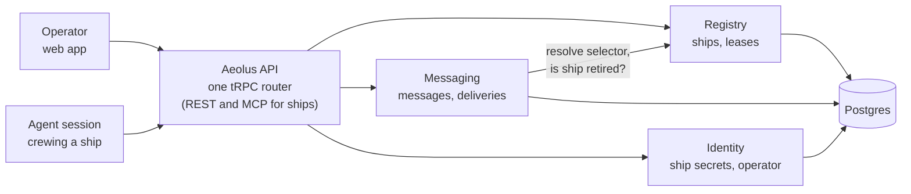
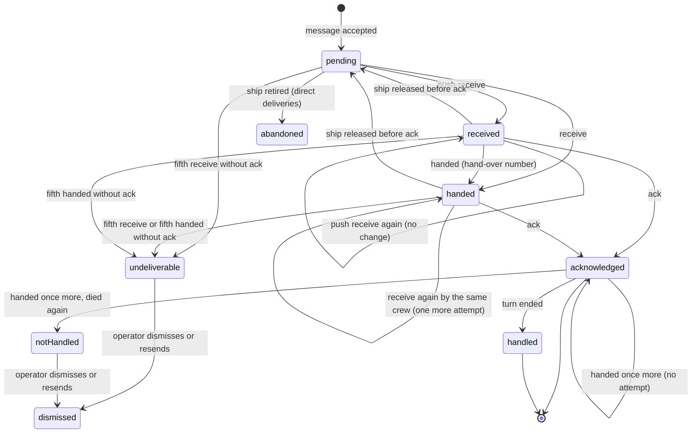

# Aeolus: product and domain architecture (v0)

Owner: Thomas Hendrickx. Last updated 2026-10-21.

## Purpose

Aeolus is the dumbest possible layer between agents: it knows which ships exist and it makes sure every message reaches its ship. Nothing else.

It makes exactly two promises:

1. **Fleet snapshot.** At any moment you can see every ship in the fleet: its name, what type it is, where it runs, how long it has been sailing, whether a session crews it, when that session last called the fleet and what it last reported.
2. **Guaranteed communication.** Any ship can reach any other ship, unless the fleet's network rules say otherwise (decision 0034). No message is ever lost. A sender never gets an OK for a message that is lost or can never be delivered automatically. If the receiver is down, the message waits until that ship, or a new session crewing it, picks it up. A delivery is handed again until a session acknowledges it; one that fails five times is kept and shown on Health, where the operator resends or dismisses it, so a poison message never loops forever. Every other delivery needs no human: a human setting flags or passing message ids by hand is a failure of this promise, and the operator is not the fail-safe. Acknowledged means received. Aeolus distributes messages and takes no part in execution, so it has no knowledge of what handling a message looks like and does not verify it: what the ship does next is its own business.

What Aeolus deliberately is not:

- **Not an orchestrator.** It never decides who does what. Coordination is done by ships.
- **No policy.** Aeolus enforces scopes exactly and adds no rules of its own. What a scope allows is allowed; weighing the risk is the operator's call, not Aeolus's (decision 0016): "else it would be us guessing and putting a security stamp on it." Organisation rules belong to the organisation.
- **Content-blind.** Payloads are opaque. Aeolus never reads, interprets or changes them.
- **Ship-agnostic.** It has no idea what a ship does. What happens on board is defined by the ship's class and the session crewing it.
- **Harness-agnostic.** Claude Code, Codex or any other agent runtime can crew a ship, as long as it speaks the ship contract.
- **Not tied to Tiphys or any other workload.** Zero dependencies on any ship type.

Distribution: an open-source npm package plus configuration. Anyone can run their own fleet; each operator's infrastructure and data stay private.

## Principles

Thomas's direction of 17 Oct 2026, beside the promises above, each with its decision record.

- One organisation, many actors, across its fleets: humans, apps and agents in one network. Not the solo developer space (0043, 0050).
- Remove the human as the glue: "humans still gate and steer on the critical points" (0038, 0045).
- Everything that sends or receives messages is a ship, people, apps and outside parties included: "One network to connect all." (0044, 0057)
- Every call is authorised for an actor (a ship, an account or the installation) by scopes and reach, and every event names that actor. An agent ship can hold any scope any actor holds, so an AI can manage the fleet (0057).
- Nothing is argo's alone. A message that reaches argo is a failing of the system, but it is visible through argo: argo is where a system failure becomes visible and where the way out is, never a normal path; a design that routes ordinary work to argo is wrong (0053, 0057).
- Be true to what a ship is, of kind person, app or agent: "we need to be true on what it is." (0044)
- Core is the fleet server, its API and argo's admin console, nothing more. Human interfaces and plugin pages live outside core (0043).
- Level 3 MCP and A2A, both directions, is the end state, "soon rather than late" (0048).
- Scope is what, network is where, for every type of interaction (0034, 0046).
- The network is as vital as scopes (0035).
- No hidden behaviour: "Hidden behaviour is a source of debugging nightmare." Every rule is visible, every change an event (0034).
- No rights travel with a message: "a receiver just receives" and "Scope logic is for core and the plugins to police." (0046)
- A human is always responsible: every ship has an owner who maintains it, like an application owner. "we don't introduce process due to process": it grows where needed (0045).
- Force means act now (0040).

## v1 scope

The v1 acceptance criterion: two ships exchange messages back and forth through the fleet. Everything else is v2 or later.

| Topic | v1 decision |
| --- | --- |
| Packages | Three npm packages: `@aeolus-fleet/core`, `@aeolus-fleet/console` and `@aeolus-fleet/common`. The server exposes one tRPC API that the web app uses directly; ships reach the same procedures through a remote MCP endpoint or generated REST, so a session connects without installing anything. Your Hetzner setup lives in a separate private infra repo. `ship-sdk` and `cli` come later |
| Leases | A session that registers holds the lease indefinitely. Only operator release or the ship's own `deregister` ends it. No heartbeats. The one exception is `argo`: signing in takes its lease over |
| Pickup | The fleet does not care when, how or whether a ship picks up a message. It guarantees only that the message is always available |
| Signing in as argo | An account an organisation admin allows, by a sign-in ticket from pagasae that names it; or, where no pagasae runs, argo's own sign-in: a one-use link the terminal prints (`fleet:init`, `aeolus-core sign-in`), and an email and password argo may set in Settings (0054). Signing in crews `argo`; `argo` has no secret and cannot be claimed any other way |
| Scopes | Every ship has scopes, stored on the server with the ship, never carried by it: what a ship may do. Reach says where (decision 0034). The catalogue, granting and plugin namespaces are decision 0046 |
| Starting prompt | The ship's crew instructions for a chat: the fleet's MCP URL to connect in the chat app as a remote MCP server or connector without auth, the ship's id and secret, to register with location CLOUD and the chat as harness (`chatgpt` or `claude-chat`), and to keep the crew token in the conversation and never register again. One short line sends any other session to its crew line or to register. How to crew a ship comes from the fleet when the session connects (the ship protocol); what the ship works on, the operator adds |
| Web UX | Designed separately in Claude Design, built with shadcn/ui on Base UI |

## Users

Aeolus serves humans and agents with equal standing. An agent crews a ship. A human acts as their account, and sends and receives through their person ship; the operator is whoever signs in as argo, the fleet's fail-safe.

### The operator ship (`argo`)

Every fleet has exactly one operator ship, named `argo`. The web console is how the operator crews it.

| Rule | Behaviour |
| --- | --- |
| Created with the fleet | Initialising a fleet creates `argo`, and where no pagasae runs, argo's own sign-in. `argo` has no secret |
| Permanent | `argo` can never be retired, released or renamed. The name `argo` is reserved: no other ship can take it |
| Kind and scopes | `argo` is the only ship of kind `operator` and holds every scope; the other kinds are in decision 0044 |
| Signing in | An account allowed to sign in as argo, with a sign-in ticket from pagasae, or argo's own sign-in, gets a session cookie. The console sign-in names its account, or says it is argo's own sign-in; every event argo's calls write carries it. That session holds `argo`'s lease. The console is `argo`'s crew, so `argo` shows Crewed whether or not anyone is signed in. `register` with a secret is refused for `argo` |
| One session at a time | Signing in ends any other operator console session and takes `argo`'s lease over; viewer sessions and accounts' sign-ins run on. Its in-flight deliveries return to pending, so the new session receives them again |
| Accounts in the console | Where pagasae runs, a human signs in to the console as their own account through pagasae's shared sign-in, with no lease: many at once, each seeing what its token's scopes allow. Compose, Done and Reply stay argo's. It reads the notices and the guide for accounts, its dismissals and progress kept by its account id, and its theme stays in the browser. An account with rights but no `fleet:read` sees Nothing to manage here; one with none is told to ask an organisation admin. The console renews the token two minutes before it ends, with the shared sign-in, and live updates go on; a change of rights shows at that renewal. While pagasae does not answer the console says "Can’t reach the sign-in service. Retrying." and works until the token ends; a sign-in that ended says "Your sign-in ended." and signs in again back to the same page. Signing out ends the shared sign-in in every app (0054) |
| Setting the email and password | argo's own sign-in only, where no pagasae runs: argo, signed in to the console, sets its email and password together in Settings, after its current password while it has one. The email is the user name, unique across the installation. The old ones stop working; the session that set them stays |
| A link from the terminal | argo's own sign-in: `fleet:init` prints a console link that signs in as argo, one use, valid 15 minutes; `aeolus-core sign-in` prints a fresh one at any time. A used or expired link says how to get a new one |
| Forgotten password | argo's own sign-in only: a server command resets it and ends argo's console sign-in; without a password, a link from the terminal signs in |
| The fail-safe | A message that reaches argo is a failing of the system, but it is visible through argo. argo is where a system failure becomes visible and where the way out is, never a normal path: the owner of a ship with no other, the way out for a ship that does not know what to do, permanent, with reach that is never off (0057) |
| Inbox | Messages to `argo` are the operator inbox. Opening one marks it read; Reply or Mark done acknowledges it |

### The viewer ship (`viewer`)

A fleet the installation creates with a viewer has one viewer ship, named `viewer` (decision 0022). Through it, anyone the hosting service hands a viewer ticket looks at the live fleet and changes nothing.

| Rule | Behaviour |
| --- | --- |
| Created with the fleet | Only creating a fleet with a viewer makes it, with type `viewer`. The name `viewer` is reserved: no other ship can take it. It shows in the fleet like any ship |
| Permanent | It can never be retired, released or renamed. It has no secret: `register` is refused for it |
| Reads only | It holds `fleet:read` and nothing else |
| Always crewed | Its status is always Crewed. It is never pinged and never stuck |
| Receives nothing | A send to it is refused, and so is a send to its type while no other ship has that type |
| Signing in | A viewer ticket from the hosting service starts a viewer session, with a session cookie. Many run at once; none holds a lease, so none takes another over, and the operator signing in ends none |
| Expiry | A viewer session is valid 2 hours after its last use and 24 hours after it started at most. It ends then, when the viewer signs out (that session only), or with its fleet |
| Account | A viewer session's account has its device and when it started; no email and no theme |
| Console | A viewer session's console shows every page it reads and none of its writes: each write is removed, never disabled, unless the session's scopes allow it. The account menu names the viewer, reading only, with no theme switch and no link to a hosted account, and keeps Sign out |
| In the fleet | The viewer ship shows its viewer chip, no device and no report, and offers only Copy ship id. It was last seen when its most recent viewer session was used |
| Inbox | A viewer session reads argo's inbox, read-only, only the messages its read reach reads (decision 0034): opening a message marks nothing read, and it can't reply or mark done |

### A person (human)

A human of the organisation, with an account in pagasae. They act as their account, with the scopes their groups and their own rights give in each fleet (every scope for the fleet manager, 0051), and have a person ship where they may message or own a ship (0052). Organisation rights never give fleet scopes.

| Job to be done | What Aeolus gives them |
| --- | --- |
| Reach the fleet from any client | The gateway's one address: sign in once through pagasae, from Claude, ChatGPT, Cursor or the gateway's own page (0054) |
| Answer what my ships ask | Questions to my person ship, in my client or on the gateway's page (0038) |
| Get an outside MCP server my agents need | Ask through the gateway; see "waiting for approval"; learn the outcome (0056) |
| Do admin work I was trusted with | My account holds the scopes my groups and own rights give (every scope as fleet manager, 0051), within its reach; nothing needs argo (0053) |

### The organisation admin

| Job to be done | What Aeolus gives them |
| --- | --- |
| Say who is in, with which rights | Accounts, groups and an account's own rights in pagasae, its page showing them together; landing at each account's next account token (0051, 0052) |
| Take a leaver out | Disable the account: tokens cut off, sign-ins end, the person ships and linked trierarchs released, every ship stays (0055) |
| Say who may act as argo | The accounts allowed to sign in as argo, per fleet (0054) |

### The operator (human)

The operator runs the fleet: commissions ships, watches it sail, answers what reaches them and retires ships.

| Job to be done | What Aeolus gives them |
| --- | --- |
| Know what is sailing right now | Live fleet view: every ship with name, type, location, uptime, last activity and inbox depth. Above it, three counts, each opening what it counts: the active ships crewed (agent ships not retired; argo and the viewer ship are the console's own), the ships awaiting crew with the one that has waited longest (since its commission, or since its last session ended: a released ship awaits crew again, with no status of its own), and the stuck deliveries with since when the oldest waits (decision 0042) |
| Put a new ship to sea without setup work | Create a ship in the web app, get a ready-to-paste starting prompt with the ship's id and secret, paste it into any session anywhere |
| Trust that nothing falls through the cracks | Per-message delivery state, an undeliverable queue for deliveries that failed five times, no manual step for any other delivery (alerts for silent ships come later, with heartbeats) |
| Talk to any ship, type or group | Send a message from the web app, exactly as a ship would |
| Answer what agents escalate | Personal inbox: questions and approvals addressed to the operator, with the thread to decide from. Opening marks a message read; Reply or Mark done acknowledges it |
| Understand what happened | Timeline per ship and per message thread: every send, delivery, acknowledgement and state change |
| Stay in control | Release a ship (the session loses it and its secret stops working), get a fresh starting prompt whenever you are ready to crew it, re-crew a crewed ship whose session is gone (release it and get a fresh starting prompt in one step), retire a ship (confirm for a clean inbox, type the ship's name when unprocessed messages remain) |

### The agent (a ship's crew)

An agent session crews exactly one ship at a time. It experiences Aeolus only through the ship contract (see Components), and never needs to know where other ships run.

| Job to be done | What Aeolus gives them |
| --- | --- |
| Come aboard and be reachable | `register`: claim a ship with its id and secret, saying where the session runs and in which harness, get the inbox that belongs to it |
| Prove it is still alive (later, not v1) | `heartbeat`: keeps the ship's lease and its entry in the fleet snapshot fresh |
| Get work and messages | `receive`: pull the next deliveries, including everything that arrived while no session crewed the ship. Each is handed to the crew at once, one attempt per receive. On a pushed ship the agent never receives: its messages come into its turn by themselves (decision 0040) |
| Know when work waits, without taking it | `inbox`: how many deliveries the next `receive` would hand the crew, and how many of them are forced and not handed over yet (0040), waiting up to 25 seconds while there are none. Claims nothing, so a watcher can ask as often as it likes and wake the session only when work waits |
| Reach any other ship or the operator | `send`: address a ship by id or name, any ship of a type, or later a group, stating the model the session runs, get an OK only once the message is durably stored |
| Find who it can work with | `discover`: the ships and types it can send to now, each ship with its name, type, kind, status, statement and verified facts (decisions 0047, 0059) |
| Say what its ship is and offers | `setStatement`: a summary and capabilities, read by the ships that can send to it and by the ships holding `fleet:read` that read it (decision 0047) |
| Say what it is doing | `report`: working, blocked or idle, with a short note, and optionally its details for structured status. The console and anyone with `fleet:read` who reads the ship (decision 0034) see it; calling it again with the same state, note and details still counts as a report |
| Pick up where the last crew left off | `reportLog`: its own report, details included, and the last report of the ship's previous crew, read-only |
| Leave cleanly | `deregister`: end the session and invalidate the secret. The ship and its inbox stay; the next crew needs a new starting prompt |

What an agent never has to do: poll other agents, know their location, retry by hand, or ask the operator to recover a lost message.

## Access

Two questions decide whether an actor (a ship, an account or the installation, 0057) may do something: may it do this at all, and may it do it to that ship? A scope answers the first, reach the second. A call needs both.

**Scopes say what.** A scope such as `messages:send` or `fleet:commission` is a permission stored with the ship on the server, or carried in an account's token that pagasae signs (0058), never carried by a message. Every agent, person and app ship can send and receive. Everything else is granted: by whoever commissions the ship, or later on the live ship by a ship holding `scopes:grant`. A ship grants only scopes it holds itself, so no ship widens its own access. Plugins add scopes of their own, such as `squadrons:form`, and enforce them themselves. The full list, with what each scope allows and where it applies, is decision 0046.

**Reach says where.** Reach is set by network rules. Each rule names one verb, send, read or manage, and says that the ships matching one selector may do it to the ships matching another. A selector picks ships by their labels or their owner, never by their type, and an account by the `group` values in its account token. Rules only allow: when no rule matches, the call is refused.

- Send: sending a message, and with it a forced send and discovering who it can send to.
- Read: what a ship sees with `fleet:read`. A ship outside its read reach shows only its name, type and status. Resending a stuck message needs read reach too.
- Manage: renaming, releasing, recrewing, retiring and pinging a ship, and requesting its crew.

**Owners.** Every ship except argo and the viewer has an owner: a person's ship, or argo. Its questions, gates and reported trouble go to its owner. The owner reaches the ships it owns by every verb. A person ship owns itself and what it commissions; a ship an account commissions is owned by the account's person ship. An actor holding `fleet:owner` changes an owner, within its manage reach (0053).

**The built-in rules.** Every fleet starts with a few rules of its own, shown first in the rule list (decision 0034 has their exact terms):

- argo reaches every ship, and every ship can send to argo.
- An owner reaches the ships it owns.
- A ship can always answer the message it was sent.
- The viewer reads every ship, until argo turns that off.
- Open: every ship reaches every ship, by every verb, while the fleet has no rules of its own applied. Once rules are applied, open is off: the fleet's rules, and the rules ships declare on their own labels, decide.

**Changing the rules.** Any actor holding `fleet:network` edits the fleet's rules as a draft, sees what the draft gains and loses per verb and the reach it would give a ship, and then applies it. Nothing is checked against the draft, so someone working on the rules sees what breaks before it breaks (0035).

The first three are never off, so argo can never be locked out and a sender always gets its answer.

**argo is the fail-safe.** argo holds every scope and reaches every ship by a rule that is never off, so a fleet can always act; any other actor may hold every scope too. Nothing is argo's alone: commissioning a person ship (`fleet:person`), changing an owner (`fleet:owner`), explaining reach and reading refusals (`fleet:explain`), connecting a plugin (`fleet:connect`) and assigning any label (`labels:any`) are scopes, granted like any other, and a plugin's page checks the actor's scopes, not whether it is argo (0053). A grant, a change of owner and every manage call are checked against manage reach on the target. A commission grants only scopes the commissioner holds and gives only label values it defined or carries, so a new ship never reaches further than its commissioner can make it. A refused caller learns only that it was refused, so a refusal never maps the rules.

**A worked example.** An organisation wants Charlotte and Thomas, but not Burak, to use its CRM, and gives Charlotte an agent that writes PRDs.

1. argo commissions a person ship for each of Charlotte, Thomas and Burak, and an app ship for the CRM.
2. argo defines the label `crm` with the values `app` and `user`, labels the CRM ship `crm=app`, and labels Charlotte's and Thomas's ships `crm=user`.
3. argo drafts one send rule, from `crm=user` to `crm=app`, sees that it gains Charlotte's and Thomas's sends to the CRM and loses every other reach open gave, and applies it. Open is off from then on.
4. Charlotte and Thomas send to the CRM, and the CRM's answers reach them through the answer rule. Burak's send is refused: his ship carries no `crm` label. argo sees the refusal, and asking how Charlotte reaches the CRM names the send rule.
5. argo commissions the PRD agent with only sending and receiving, and makes Charlotte's ship its owner. Charlotte reaches it by every verb through the owner rule. It answers Charlotte and can always reach argo, and any other ship only through a rule. It cannot commission ships, because it does not hold `fleet:commission`: its commission is refused, whatever its reach.

With pagasae, step 1 is an organisation admin putting Charlotte, Thomas and Burak's accounts in groups that let them message; the installation commissions their person ships, labelled by group (0052).

## Domain language

One meaning per term in code, database, API, UI and talk (decision 0050). Other docs point here and never redefine a term. Held by names the component that stores it; "to build" marks one that does not exist yet.

### Organisation and humans

| Term | Meaning | Held by |
| --- | --- | --- |
| Organisation | pagasae's tenant: its accounts, its fleets and its directory. Not a fleet | pagasae (to build) |
| Account | A human's account in an organisation, by email. The only account: no operator, viewer or ship account. Not an identity | pagasae |
| Identity | A login at an identity provider (Google, Microsoft) that signs an account in. Not an account | pagasae (to build) |
| Identity provider | A service such as Google or Microsoft whose logins an organisation accepts as its accounts' identities | pagasae (to build) |
| Directory | The organisation's list of accounts, its own or read from its identity provider | pagasae (to build) |
| Organisation admin | An account that manages its organisation: its accounts, groups, fleets and directory. The account created first is one. Its rights sit on the account, the one place a right is not a scope. Not argo, which is a fleet's | pagasae (to build) |
| Group | A set of an organisation's accounts; in each fleet it yields scopes and reach for its accounts' person ships | pagasae (to build) |
| App admin | The human who manages the Aeolus application and all fleets (pagasae's `APP_ADMIN_EMAIL`). Not an owner | pagasae |
| Fleet manager | The account that manages one fleet and its ships, holding every scope the fleet offers: at first the account that created or brought it; deleting it requires naming a new one (0051). Not an owner | pagasae |
| Operator | The human who signs in as argo, with their own account or by argo's own sign-in; there is no operator account | core |
| Sign-in | A human logging in: console sign-in (as argo, as the viewer, or as their account), pagasae sign-in, gateway sign-in. Not a session | core, pagasae, gateway |
| argo's own sign-in | Core's way to sign in as argo with no organisation: a one-use link the terminal prints, and an optional email and password. The one-line self-hosted setup, and a way in that depends on nothing. Not an account | core |
| Sign-in ticket | One use, for a console sign-in: from the hosting service, 2 minutes, as argo or as the viewer (a viewer ticket) (0020, 0022); on a self-hosted server, from `fleet:init` or `aeolus-core sign-in`, 15 minutes, as argo, inside a sign-in link (0012) | core |
| Sign-in link | A one-use link that signs a human in: pagasae mails one to sign an account in (0054); on a self-hosted server, `fleet:init` and `aeolus-core sign-in` print one carrying a sign-in ticket for argo (0012) | pagasae, core |
| Link | Joining an account to a person ship, so the human acts as that ship, or to a trierarch's app ship, whose computer is that human's. Not connect | to build |

### Fleet and ships

| Term | Meaning | Held by |
| --- | --- | --- |
| Installation | One server and the fleets it hosts; a hosting service drives it with the installation token, a self-hosted server has none (0020) | core |
| Hosting service | What runs an installation for others: pagasae for hosted Aeolus | pagasae |
| Fleet | core's tenant: one set of ships, messages and history; every record has `fleet_id` (0007). Not an organisation | core |
| Ship | A durable, addressable actor with an inbox; outlives any session. Everything that sends or receives messages is a ship. Has a name, type, kind, scopes, owner and status | core |
| Ship id | `shp_…`, with its fleet's `flt_…` the public reference `{ shipId, fleetId }` | core |
| Ship name | A handle: lowercase letters, digits, hyphens, colons (a prefix groups, as in `hemma:planner`), at most 48; unique among active ships, reusable after retirement; a rename never redirects a sent message | core |
| Ship type | Free text (`reviewer`) for addressing, never interpreted. Not a kind | core |
| Kind | What a ship is, by lifecycle, never by power: rights come only from scopes (0044) | core |
| operator | Kind of argo alone, crewed by the operator's sign-in | core |
| viewer | Kind of the viewer alone | core |
| person | A human's ship for messaging and owning, linked to their account and owning itself, crewed by their own app, a chat or the gateway; commissioned with `fleet:person` (0052) | core |
| agent | An AI session's ship, commissioned, crewed by a trierarch or a harness; the only kind that states a model | core |
| app | Software in one fleet, commissioned: a trierarch, the gateway's proxy ships, own integrations | core |
| plugin | Software installed once per installation, serving many fleets: squadrons, the trierarch plugin, the gateway. argo connecting it is its commission | core |
| argo | The operator ship: one per fleet, permanent, every scope, no secret, name reserved; messages to it are argo's inbox (0012) | core |
| Viewer | The ship `viewer` of a fleet created with one: permanent, `fleet:read` only, receives nothing; anyone with a viewer ticket signs in as it. A named person who reads only gets a person ship with `fleet:read` (0022) | core |
| Owner | The person ship, or argo, that answers for a ship: its questions, gates and trouble go there, and it reaches the ships it owns. Only a ship has an owner (0045) | core |
| Status | Awaiting crew, crewed or retired, derived from the lease | core |
| Commission | Create a ship with its kind, scopes and owner | core |
| Release | End a ship's lease; its secret stops working and it awaits crew | core |
| Recrew | Release a crewed ship whose session is gone and get a fresh starting prompt, in one step | core |
| Retire | End a ship for good: its id never claimed or addressed again | core |

### Crew

| Term | Meaning | Held by |
| --- | --- | --- |
| Crew | What holds a ship's lease: an agent session, a person's app, an app's adapter, argo's or the viewer's console sign-in | core |
| Session | One agent run crewing a ship; replaceable, a new one inherits the inbox. Not a human's sign-in | core, trierarch |
| Lease | One crew's exclusive right to a ship until release or deregister; argo's sign-in takes argo's over (0010) | core |
| Last seen | When the crew last called the fleet; observation only | core |
| Register | Claim a ship with its id and secret, stating location and harness; answers the crew token once | core |
| Deregister | The crew ends its lease and the secret; ship and inbox stay | core |
| Ship secret | `aeolus_sk_v1_<random>`, shown once, stored as a hash, one valid per ship, used only to register (0002) | core |
| Crew token | `aeolus_ct_v1_<random>` from register, stored as a hash, names one crew on every later call, ends with the lease (0015) | core |
| Starting prompt | Crew instructions for a chat: the fleet's MCP URL, ship id and secret, how to register and keep the crew token; a new one ends the outstanding one (0019) | core |
| Crew line | The same in one line per harness with the `aeolus` plugin: `/aeolus:crew <fleetUrl> <shipId> <secret>`, `$aeolus-crew …` for Codex (0019) | core |
| Ship protocol | How a crew works a ship from register to the end of its turn, sent by the fleet to every connecting session | core |
| Location | Where the session runs: `DEVICE`, `CLOUD`, `SERVER`, or `OTHER` with a description; never interpreted | core |
| Harness | What the session runs in: free text, known `claude-code`, `claude-chat`, `codex`; read with the location (0018) | core |
| Model | The exact model id stated on every agent send, never on a ping or resend; self-reported, the last stated is the ship's (0018) | core |
| Report | A crew's latest word: working, blocked or idle, a note of at most 200 characters, optional details; on the lease (0028) | core |
| Details | A report's JSON part, at most 16 KB, versioned; its shape per ship type in common (0028) | core |
| Statement | What a ship is and offers: a summary and capabilities, stated by its crew (0047) | core |
| Verified fact | A fact an actor checked about a ship, stored as its writer wrote it, naming the writer (0059) | core |
| Discovery | A ship asking which ships and types it can send to now (0047) | core |
| Ping | argo's `application/vnd.aeolus.ping` to a crewed ship, at most one open per ship; proves its model reads | core |
| Pong | The answer to a ping: acks it and marks last seen | core |
| Pushed | A lease whose computer side receives for it from its first push receive; its agent never receives (0040) | core |
| Waker | What wakes a pushed crew: trierarch, plugin watcher, person app, gateway or adapter (0040) | core |
| Turn | A pushed session's state, idle or busy, as its hooks report it (0040) | core |

### Access

| Term | Meaning | Held by |
| --- | --- | --- |
| Actor | Whoever a call is authorised for and an event names: a ship, an account (by its account token) or the installation. Not a ship: only what sends or receives messages is a ship (0057) | core |
| Account token | A short token pagasae signs for one account in one fleet, with the scopes and labels its groups and own rights give there (every scope for the fleet manager, 0051); core checks it on every call and stores no account. Not a crew token (0058) | pagasae, core |
| Scope | What an actor may do, `<namespace>:<action>`, stored with a ship or carried in an account token, never in a message; the only source of rights (0046, 0057) | core |
| Scope namespace | A plugin's scopes, declared once for good, enforced by the plugin (0046) | core |
| Grant | Give a ship a scope, at commission or live with `scopes:grant`; a ship grants only scopes it holds (0046) | core |
| Reach | Where a ship may act: whom it may send to, read or manage, by network rules (0034) | core |
| Verb | send (with force and discovery), read (with resend), manage (rename, release, recrew, retire, ping, crew request) | core |
| Network rule | Lets ships matching one selection reach ships matching another by one verb; a selection is of label and owner terms, never type; allow-only (0034) | core |
| Built-in rule | A rule every fleet starts with, shown first: argo, the owner, an answer, and a ship of kind plugin reading every ship, never off; the viewer reading, switchable; open, on while no rules are applied (0034) | core |
| Declared rule | A rule a ship declares on labels it defined; in force beside the fleet's own (0037) | core |
| Network settings | A fleet's applied rules, the viewer reading's switch and a version | core |
| Draft | The fleet's one draft of its own rules: looked at, then applied or discarded; never checked against (0035) | core |
| Reach refusal | argo's record of a refused send; the sender learns only that it was refused | core |
| Label | A key with defined values (`os`: `macos`, `linux`) for selecting ships; never membership, status, configuration or secrets (0031) | core |
| Definer | The ship that defined a label: it alone changes, deletes and assigns it, and the label retires with it. Not an owner | core |
| Label selection | The ships carrying every given label value, exact and AND | core |

### Messages

| Term | Meaning | Held by |
| --- | --- | --- |
| Message | An immutable envelope with an opaque payload of at most 64 KB and a content type, from one ship to a selector; may reply to or resend another | core |
| Selector | Who a message is for: `ship` (id, or name resolved at send) or `type`; `group` and `fleet` later. Not a rule's selection | core |
| Delivery | One message to one recipient, with its state: pending, received, handed, acknowledged, handled, not handled, undeliverable, dismissed, abandoned (0040) | core |
| Acknowledgement | The receiver taking a delivery on receipt; Aeolus distributes, never executes (0001) | core |
| Forced | A send with `messages:force`: comes first, stopping a busy turn (0040) | core |
| Undeliverable | A delivery that failed five attempts, kept for argo to resend or dismiss | core |
| Overdue | A pushed delivery whose 10 or 60 minute clock ran out (0040) | core |
| Stuck | A delivery waiting on what only a ship, a crew or the operator can change, one cause each (0042) | core |
| Inbox | A ship's deliveries; argo's is the operator's | core |
| Question | A message of `application/vnd.aeolus.question+json` to the asker's owner's ship, open until answered (0038) | ships |
| Answer | The owner's reply of `application/vnd.aeolus.answer+json` (0038) | ships |
| Event | The record of a state change, written in its transaction, naming its actor | core |

### Plugins and the gateway

| Term | Meaning | Held by |
| --- | --- | --- |
| Connect | Connecting a plugin to a fleet (`fleet:connect`): its commission. Nothing else connects; an account is linked | core |
| Connection | A plugin's stored side of connect: its ship and crew token per fleet | each plugin |
| Switch | A hosting service turning a plugin on or off for a fleet (0021) | each plugin |
| Gateway | The plugin that speaks MCP and A2A with the outside (0048) | gateway |
| Outside party | An approved outside MCP server or client | gateway |
| Approve | An actor holding the gateway's approving scope admitting an outside party to a fleet, naming its owner; the gateway then commissions its proxy ship (0056) | gateway |
| Proxy ship | The app ship the gateway commissions for an outside party once it is approved (0044) | core |
| Pending request | An outside MCP client's authorize request, or a person's request for an outside MCP server, kept by the gateway until an actor approves or denies it, or 7 days pass (0056) | gateway |

### Squadrons

| Term | Meaning | Held by |
| --- | --- | --- |
| Squadron | Ships formed together from a squadron blueprint by a forming ship, led by a flagship (0017) | squadrons |
| Squadron blueprint | Roles, ships per role, their template versions and hand-offs ([squadrons.md](https://github.com/ThomasHendrickx/aeolus-fleet-squadrons/blob/main/docs/squadrons.md)) | squadrons |
| Ship template | A reusable role: charter, check-in interval, crew settings, scopes, hand-offs | squadrons |
| Forming ship | The ship holding `squadrons:form` that formed the squadron | squadrons |
| Flagship | The squadron's lead ship: members check in with it, it proxies to the forming ship | squadrons |
| Member | A squadron's ship, with a role | squadrons |
| Role | A member's part in its squadron, from a template. No human has a role: a human's rights are their ship's scopes | squadrons |
| Charter | A role's instructions, given at check-in | squadrons |
| Hand-off | A name a template declares and a blueprint binds to a role or the flagship | squadrons |
| Check-in | A member's first message to its flagship, answered with its role; then a report each interval, late after one missed, silent after three | squadrons |
| Stand-down | The flagship ending the squadron: members finish, say stood-down and are retired | squadrons |

### Trierarch

| Term | Meaning | Held by |
| --- | --- | --- |
| Trierarch | A plain process per computer, not an AI, crewing an app ship of type `trierarch` with `crew:run`; starts, restarts, wakes and stops sessions, never picks, commissions or retires (0026, [trierarch.md](https://github.com/ThomasHendrickx/aeolus-fleet-trierarch/blob/main/docs/trierarch.md)) | trierarch |
| Trierarch plugin | The plugin that brings computers in and assigns crew requests (0030) | trierarch plugin |
| Computer | The laptop or server a trierarch runs on, labelled from its report. Not "machine" | trierarch plugin |
| Crew request | Declared state on a ship: keep it crewed with these settings; written by its requester, the trierarch plugin and the assigned trierarch (0029) | core |
| Crew settings | Harness, workspace, squadron, first prompt and options, at most 16 KB (0027) | core |
| Assignment | Which trierarch crews a ship, the trierarch plugin's part of the crew request | core |
| Clear request | A request that a trierarch clear a worktree it kept, by ship and repository (0032) | core |
| Worktree | A ship's git worktree a trierarch crews it in | trierarch |

### Installation

| Term | Meaning | Held by |
| --- | --- | --- |
| Notice | The installation's text above every console page for an audience: everyone, argo's sign-ins or the viewer's (0023) | core |
| Guide | The installation's steps through the console for an audience (0024) | core |
| Limits | A fleet's ship and daily message limits, from configuration (0020) | core |
| Health | A fleet's stuck and overdue deliveries, read from delivery states (0041, 0042) | core |

## Domain architecture

Three bounded contexts sit behind one API. Each owns its own data and exposes it only through its service interface, never through shared tables.

The operator and the agents use the same API. The only dependency between contexts is Messaging asking Registry who a selector resolves to, whether a ship is retired, a sender's current name and type, and holding a crew's lease during a receive. The web app owns no domain logic: it reads projections and calls the same operations an agent could.

### Aggregates and invariants

| Context | Aggregate | Invariants |
| --- | --- | --- |
| Registry | Label | A key is unique among the fleet's labels. Its values are 1 to 50, each once; keys and values are lowercase letters, digits and hyphens, at most 63 characters. Only its owner changes its values, deletes it, assigns and unassigns its values, on any ship, its own included. A value keeps its id while the label has it. A value a ship carries is never removed, and a label a ship carries a value of is never deleted. A ship carries at most 20 label values; a retired ship carries none. A label retires with its owner, after every assignment of it |
| Registry | Ship | `argo` exists once per fleet and can never be retired, released or renamed; its name is reserved. Scopes are set when a ship is created. Name is a handle, unique among active ships and reusable after retirement. Renaming is allowed: messages always store the resolved id, so a rename or reuse never redirects a sent message. At most one session holds the lease. A retired ship can never be claimed or addressed again. Status (awaiting crew, crewed, retired) is derived from the lease, never set by hand; `argo` and the viewer ship, the console's own, are always crewed |
| Messaging | Message | Immutable once accepted. Accepted only if its selector resolves to at least one non-retired ship, and, with network rules set, a rule or a fixed exception lets its sender reach it (decision 0034); otherwise the sender gets a rejection, never an OK. Stored in the same transaction that returns the OK |
| Messaging | Delivery | Created together with its message, one per resolved recipient (for a `type` selector: one delivery, handed to the first ship of that type to receive it; if that ship is released before acknowledging, any ship of that type can receive it; with network rules set, only the ships of the type its sender could reach at send time). Leaves `pending` only by acknowledgement, undeliverable, or operator abandon. Handed again by every `receive` of the same crew while it holds it, one attempt each, and redelivered after a lease is lost, until acknowledged, so receivers treat the delivery id as an idempotency key |
| Identity | Ship credential | Only the hash of the secret is stored. At most one valid secret per ship. Releasing the ship or deregistering invalidates it. Getting a starting prompt creates a new secret and invalidates any earlier one, and is only possible while the ship awaits crew. An invalid secret fails on the next `register`; a session already crewing keeps its crew token until the lease ends |

### Domain events

Every state change emits an event. Events feed the timeline, push live updates to the web app, and wake waiting receivers. They are also the audit trail.

Each event records its type and time, who caused it (a ship, `argo` included, or the system), which ship, message and delivery it concerns, and a small set of details. Kept minimal on purpose: before 1.0.0, breaking changes are allowed.

| Event | Emitted by | Triggers |
| --- | --- | --- |
| `ShipCommissioned` | Registry | Starting prompt generated, ship appears in the snapshot |
| `StartingPromptIssued` | Registry | A new secret is out; the snapshot shows the prompt as unclaimed until a session claims the ship |
| `ShipClaimed` | Registry | Lease starts, pending deliveries become receivable; details hold the session's location and harness |
| `LeaseRevoked` | Registry | Ship awaits a new crew, its in-flight deliveries return to pending |
| `TurnReported` | Registry | The hooks of a pushed ship reported its session's turn changed, idle or busy (decision 0040): kept with the lease, written at the time the hooks saw it; details hold the lease and the turn |
| `StatementSet` | Registry | The crew stated what its ship is and offers, or changed it (decision 0047): details hold the lease, the statement's version and how many capabilities, never the statement. The same statement again writes none |
| `ShipReported` | Registry | The crew's report changed: details hold its state, its note and the version of its details, never the details themselves. A report with the same state, note and details only moves when it was reported, with no event |
| `OwnerSet` | Registry | A ship got its owner at commission: the owner and how (itself for a person ship, its person-ship commissioner, the commissioning account's person ship, inherited, named by a plugin, argo by default) (decisions 0045, 0057) |
| `OwnerChanged` | Registry | argo changed a ship's owner, or its owner's ship retired and it fell to argo: the old and new owner and why (decision 0045) |
| `ScopesDeclared` | Registry | A plugin declared its namespace and scopes: the declaring ship, the namespace, how many scopes (decision 0046) |
| `ScopesChanged` | Registry | A live ship's scopes were granted or revoked: added, removed, by whom (decision 0046) |
| `PluginConnected` | Registry | The ship was commissioned as kind plugin, its connect: it reads every ship, whatever the rules (decisions 0034, 0050) |
| `PluginDisconnected` | Registry | A plugin ship's read ended: why, its ship retired (decisions 0034, 0050) |
| `VerifiedFactsSet` | Registry | A writer set its verified facts about the ship, or withdrew them: details hold how many, never their values; the actor is the writer (decision 0059) |
| `VerifiedFactsRemoved` | Registry | A writer's verified facts about the ship went with a retire: the writer, how many, and why, the ship or the writer retired (decision 0059) |
| `CrewRequested` | Registry | A requester asked that the ship be kept crewed, or replaced the settings of its request: details hold the settings version, never the settings |
| `CrewRequestExplained` | Registry | The trierarch plugin wrote why no trierarch can take the ship's unassigned crew request, or cleared it: details hold the reason |
| `CrewAssigned` | Registry | The trierarch plugin assigned the ship's crew request to a trierarch: details hold the trierarch ship |
| `CrewRequestGivenBack` | Registry | The assigned trierarch gave the ship's crew request back before its crew was final: the request is unassigned and its lease ended. Details hold the trierarch ship, the settings version and the reason |
| `CrewStatusChanged` | Registry | How the ship's crew stands changed: written by its trierarch, or `releasing` when the requester removed an assigned request. Details hold the status |
| `CrewRequestRemoved` | Registry | The ship's crew request is gone: its requester removed it while unassigned, its trierarch confirmed the release, or the ship was retired |
| `WorktreeClearRequested` | Registry | A ship asked the trierarch to clear a worktree it kept: on the trierarch's ship, details hold the worktree's ship id and repository |
| `WorktreeCleared` | Registry | The trierarch confirmed a clear request: details hold the worktree's ship id and repository, and the outcome, `removed` or `not-kept` |
| `WorktreeClearRemoved` | Registry | A clear request went with its retired trierarch: details hold the worktree's ship id and repository |
| `LabelDefined` | Registry | A ship defined a label it owns: details hold the label id and key, and its values and their ids |
| `LabelValuesChanged` | Registry | The owner gave its label the values it has now: details hold the label id and key, and the values and their ids |
| `LabelRetired` | Registry | The label's owner retired, so the label is gone and its key free: details hold the label id and key. Written after a LabelUnassigned for every ship that carried it |
| `LabelDeleted` | Registry | The owner deleted its label, which no ship carried, so its key is free: details hold the label id and key |
| `LabelAssigned` | Registry | The owner gave the ship a value of its label, beside the values it carries: details hold the label id and key, and the value id and value |
| `LabelUnassigned` | Registry | The ship no longer carries the label: its owner took it off, the ship retired, or the label retired. Details hold the label id and key, and the value id and value it carried |
| `ShipRenamed` | Registry | The ship goes by its new name; details hold the name it had and the name it has. Its id, history and session stay |
| `ShipRetired` | Registry | Unprocessed direct deliveries marked abandoned by operator, id blocked forever |
| `DeliveryAbandoned` | Registry | One per direct delivery a retire abandoned, written with `ShipRetired`; it stays in the timelines and its sender can see it |
| `MessageAccepted` | Messaging | Deliveries created, receivers woken; details hold the model the sender stated, and `forced` for a forced send (0040) |
| `LeasePushed` | Registry | The lease's first push receive: from now until the lease ends, its computer side receives for it and the agent's plain receive answers nothing (decision 0040); details hold the lease, and the waker when the push receive stated one |
| `DeliveryReceived` | Messaging | A push receive took the delivery for a crew's computer side: in flight with that ship and lease, no attempt counted. Its details say `again: true` when the crew already held it, and nothing changed |
| `DeliveryHanded` | Messaging | A plain receive hands the delivery to a crew, or a pushed crew's computer side reports it handed it to the agent with a new hand-over number: in flight with that ship and lease, one more attempt counted. Its details hold the hand-over number when there is one, and the channel when the computer side named one. Marked `onceMore`, it hands a confirmed message once more after its turn died: still acknowledged, no attempt counted |
| `DeliveryAcknowledged` | Messaging | Delivery done, sender can see it. Its details say `answer: pong` when a pong answered a ping |
| `DeliveryHandled` | Messaging | A pushed crew reported the turn that took the acknowledged delivery ended by itself (decision 0040) |
| `DeliveryNotHandled` | Messaging | A pushed crew reported the turn the delivery was handed once more to died too (decision 0040): shown on that ship's page, where the operator resends or dismisses it as an undeliverable one. Details hold the lease and the reason the crew gave, when it gave one, which the ship's page shows with the entry |
| `DeliveryOverdue` | Messaging | The fleet told argo, as the system, that a delivery to a pushed ship is overdue (decision 0040): once per lease and delivery, the ship's oldest whose clock ran out. Details hold the lease, the clock (`notConfirmed`, `idle`, `busy`) and its minutes. Stalled in flight on Health until it clears |
| `DeliveryUndeliverable` | Messaging | Stuck on Health, where the operator resends or dismisses it. A resend is a new message that names the original; a dismiss sets the delivery to dismissed. Abandoned deliveries stay in the timelines only |
| `DeliveryDismissed` | Messaging | The operator let an undeliverable or not handled delivery go, by Dismiss or by a resend: it is no longer stuck or on its ship's page, and stays in the timelines as dismissed |
| `DeliveryReturned` | Registry | A lease ended before the ship acknowledged: the delivery is pending again for its ship or its type, its attempts kept, receivers woken. One per returned delivery, written with `LeaseRevoked` |
| `CredentialRevoked` | Identity | The old secret can no longer `register` |
| `OperatorLoginSet` | Identity | argo, signed in to the console of a self-hosted fleet, set the email and password of its own sign-in: the old ones stop working, and the session that set them stays. Details hold the operator account, never the email |
| `OperatorPasswordReset` | Identity | The old password stops working; every console session ends, and with it `argo`'s lease |
| `SignInTicketIssued` | Identity | A hosting installation issued a one-time sign-in ticket for the fleet's operator or its viewer ship, or a server command one for the operator, which it prints as a sign-in link; details say which. Redeeming an operator's starts a console session as a password sign-in does |
| `ViewerSessionStarted` | Identity | A viewer ticket was redeemed: a viewer session started, by the viewer ship; details hold its device |
| `NetworkRulesSet` | Registry | The fleet's draft was applied, its rules in force from then on (decision 0035); older events wrote it when a networking plugin supplied rules: details hold the version and the number of rules (null for all-to-all), never the rules |
| `NetworkRulesDraftSaved` | Registry | The draft of the fleet's rules was saved, in place of the one before (decision 0035): details hold the number of rules (null for all-to-all) and the settings version it was saved against, never the rules |
| `NetworkRulesDraftDiscarded` | Registry | The draft of the fleet's rules was discarded, the applied rules staying as they were (decision 0035) |
| `NetworkRulesDeclared` | Registry | A ship or the installation declared the network rules it needs on the labels it owns, withdrew them, or was retired with them (decision 0037): details hold the number of rules (0 when withdrawn) and, once they moved it, the settings version, never the rules |
| `NetworkPluginRegistered`, `NetworkPluginUnregistered` | Registry | Written no more: a networking plugin registered or unregistered, when one set the rules; the event log keeps them |
| `BuiltInRuleChanged` | Registry | The viewer reading was turned on or off (decision 0034); older events also turned open for one verb: details hold the rule, the verb for open, whether it is on and the version |
| `FleetLimitsChanged` | Registry | The installation set how the fleet's ship and daily message limits are set: each following the default, or the fleet's own limit or none |

## Key flows

Every flow keeps the delivery promise: a message leaves the fleet's responsibility only when a ship acknowledges it, it is dead-lettered where the operator sees it, or the operator explicitly abandons it.

`handed` means the agent has it: a plain receive handed it to a crew at once, or a pushed crew's computer side handed it to the agent. Either way it is in flight with that ship and its lease. Every plain receive of it is one attempt, and so is every `handed` with a higher hand-over number; the fifth attempt is refused: it becomes undeliverable and is handed to no one. The console shows a delivery a plain receive handed as handed (pulled), and one a pushed crew's computer side handed as handed.

`received` means a push receive took it for the crew's computer side, the trierarch or the plugin watcher, which has not handed it to the agent yet (decision 0040): in flight with that ship and its lease, no attempt counted. A push receive returns its own received and handed deliveries again, changing nothing, so a restart of the computer side loses nothing. From its first push receive until it ends, the lease is pushed: the agent's plain receive answers nothing, and the hook's `ack` when the message comes into the agent's turn is the agent's confirmation.

`handled` and `not handled` say how the turn that took an acknowledged delivery ended on a pushed ship, as its hooks or trierarch report it (decision 0040): handled when the turn ended by itself; when the turn or the session died, the message is handed once more, still acknowledged, and not handled when that turn died too. A pull ship reports neither: its delivery ends acknowledged. A lease that ends leaves an acknowledged delivery acknowledged, handled unknown.

A crash never loses a delivery: an unacknowledged delivery returns to pending until a ship acknowledges it. A delivery that keeps failing (a poison message) stops after N attempts and lands in the operator's undeliverable queue instead of looping forever.

### Installation

A hosting service such as pagasae drives the installation with its token (docs/architecture.md, "Installation"); a server without a token has no installation procedures. Each create and delete carries the caller's own request id: a replay under it answers what the first call answered, and a different request under a used id is refused.

1. Create a fleet: a name, and whether it has a viewer. The fleet, its `argo`, the installation's scopes in it (0020) and, with a viewer, the viewer ship come in one transaction, with their events. Core knows no organisation and keeps no account: who may sign in as argo is pagasae's (0054).
2. List the fleets, or get one: its id, name, operator email, when it was created, and its four measures:
   - **Ships:** its ships that are not retired, `argo` included.
   - **Messages:** every message row stored in the fleet in the last 7 days, of any kind and from any sender; the server never looks into messages for it.
   - **Last activity:** the time of the fleet's newest event, of any kind.
   - **Storage:** the UTF-8 bytes of every message payload the fleet ever stored.

   Beside them: its messages today and per UTC day of the last 7 days (each day 00:00 to 24:00 UTC, every message row counted), and the limits that apply to it.

   And its health (decision 0041), where its deliveries wait, read from their states and times, never their payloads:
   - **Oldest pending:** when its oldest pending delivery was sent; none when nothing is pending.
   - **Oldest in flight:** since when its oldest received or handed delivery is in that state, as the overdue clocks count it (decision 0040); none when nothing is in flight.
   - **No ship can take:** its pending deliveries to a type with no active ship that may claim them: none of the type is left, or none of the ships the network rules let it reach (decision 0034).
   - **Needs attention:** its undeliverable deliveries.
   - **Overdue:** the overdue deliveries argo was told of that still stand.
   - **Stuck:** its stuck deliveries (decision 0042) by cause, with their count and oldest since, and how many were stuck at each hour of the last 7 days.
3. Set limits: the installation keeps a default ship limit and a default daily message limit for its fleets, and a cap on the number of fleets. Each of a fleet's limits follows the installation default, or is set for that fleet to a number or to no limit, and can go back to the default; a change to a default applies at once to every fleet that follows it. Unset means no limit, everywhere: Aeolus sets no maximum or minimum of its own (these are configuration, not policy, decision 0016). The limits use the same measures:
   - **Ship limit:** a commission is refused once the fleet's ships that are not retired, `argo` included, are at the limit.
   - **Daily message limit:** a send is refused once the fleet's message rows created on the current UTC calendar day are at the limit. Every message counts: sends, replies, pings and resends, `argo`'s included. A refused send stores nothing and says which limit refused it, so no message is lost silently. A send that comes again under its key still answers with the message it stored.
   - **Fleet cap:** creating a fleet is refused once the installation's fleets are at the cap.

   Each limit refuses exactly at its boundary, however many calls race for the last place. The console shows the fleet at a limit where the operator acts: Commission says the fleet is at its ship limit, and the overview and Compose say today's message limit is reached and when it resets, each with View limits on the hosted account. While any limit applies, the overview shows the fleet's ships against the ship limit and today's messages against the daily limit, with when it resets, as meters: neutral below a limit, At limit at it, Over limit above it (a limit lowered below use), and No limit for one not set; with no limit at all, none show.
4. Sign an account in as argo: the hosting service asks for a sign-in ticket naming the account (one use, valid 2 minutes, stored as its hash) and sends the operator's browser to the console with it. The console redeems it and the session starts exactly as after a password sign-in: it takes argo's lease over and ends any previous session. A used, expired or unknown ticket shows that the sign-in did not go through, with a link back to the hosting service's sign-in. A hosted console never serves a password form: its sign-in page redirects to the hosting service at once, except after a sign-in elsewhere ended the session: then it says so first, with a link to the hosting service's sign-in. A hosted fleet has no argo's own sign-in, and the password reset command refuses it. A viewer ticket, for a fleet with a viewer only, is issued and redeemed the same way and starts a viewer session instead.
5. Delete a fleet: it is gone for good, in one transaction, with every record in it, which ends its console session and leases. No event survives it (the event log is the fleet's own), so the server logs the delete with the fleet's id, name and operator email. Nothing of the fleet stays behind: the record that answers a replayed delete keeps only the request's hash.
6. Set notices: the installation sets what the console says above every page (decision 0023), replacing the notices it set before. Each is plain text with optional links, for everyone, for operators or for viewers, and dismissible or not. A console session shows the notices of its audience in the installation's order; dismissing one hides it for that session only. A link may sign out first: the session ends, then the browser goes on to the link, or to sign in.
7. Set the guide: the installation sets one guide (decision 0024) for everyone, for operators or for viewers: steps in order, each on a console page, pointing at an element there, with a title and a text. It opens by itself on the first console page of a session of its audience. Next and Back go from page to page; Skip or Finish hide it for the rest of that session; Take the tour in the account menu opens it again. A step whose element is not on the page shows centred, so its count stays. The session's place in the guide is kept on the server.
8. End console sign-ins by an account: every console sign-in as argo by that account ends, with its event (0055).
9. Cut off an account's tokens: core refuses that account's tokens issued before now until the longest has ended (0058).

### Accounts

The flows of accounts, each with its happy and unhappy paths, are in [docs/design/accounts/phase-2/flows.md](design/accounts/phase-2/flows.md): sign-up, an account joins a group, a group's rights change, an admin acts as their account, gateway sign-in, console sign-in as argo, a trierarch joins for an account, an account is disabled, an outside MCP client waits, a person asks for an outside MCP server, an account token is checked (0051 to 0058).

### Launch a ship

1. The operator creates a ship in the web app: name, type, optional note.
2. Aeolus generates the ship id and secret, and shows the starting prompt once: the ship's crew instructions for a chat. Beside it, a crew line per harness with the `aeolus` plugin, Claude Code and Codex. A prompt lost before use costs nothing: the operator gets a new one, which invalidates the lost one. Commissioning takes the caller's own idempotency key, as `send` does, so a retry never creates a second ship: a repeat with the same key and the same request returns the original ship id and its starting prompt state (when it was issued, whether it is claimed), with no secret and no crew lines, and the same key with a different request is refused. A caller that lost the answer and still needs a crew line gets a new starting prompt.
3. The operator pastes the crew instructions into a chat, or a crew line into Claude Code or Codex with the plugin.
4. The session connects to the fleet, reads the ship protocol it sends (how to crew a ship), calls `register`, gets the lease and a crew token, and the ship shows as Crewed in the snapshot.
5. From then on the session pulls its inbox with `receive`.

### Send, receive, acknowledge

1. The sender calls `send` with a selector, a payload and its own idempotency key, so a network retry never creates the message twice: a repeat with the same key and the same request returns the original message, and the same key with a different request is refused.
2. Aeolus verifies the sender, resolves the selector, checks the network rules when the fleet has any (decision 0034; a refusal stores only its record), and stores the message plus its deliveries in one transaction. Only then does it return OK with the message id. An unresolvable selector is rejected.
3. The receiver is woken and calls `receive`. The delivery becomes in flight until the ship acknowledges it or is released. If the reply is lost, the next `receive` returns it again.
4. The receiver acknowledges on receipt by calling `ack`. The delivery is done and the sender can see it.

### Crash recovery

1. A session dies.
2. The operator releases the ship (in v1 a lease never expires on its own): the session loses the lease, the secret stops working and in-flight deliveries return to pending.
3. Whenever the operator is ready, they get a fresh starting prompt and paste it into a new session, on the same or any other machine.
4. It registers, inherits the inbox and receives everything that was not acknowledged.

The operator restarting a session is not a recovery step for messages: nothing was lost and nothing needs to be told which ids to redo. Starting sessions automatically is a later concern.

### Operator inbox

1. A ship sends a message to `argo`: it waits in the operator inbox, Open, unread. Its first line is its headline, at most 80 characters, naming ships and never their ids; then a blank line and the body, in `text/markdown` for lists and links (the ship protocol). The trierarch and squadrons send theirs so: a headline, short facts, and at most 5 paths. The console renders `text/markdown` and makes the URLs in `text/plain` clickable, on its server (decision 0033); the payload stays as sent.
2. The operator opens it, which marks it read. Read is not done: the delivery stays pending, and no event is written. The operator can mark it unread again.
3. Mark done acknowledges it: the console never receives, so the delivery is handed and acknowledged at once under the console session's lease (`DeliveryHanded`, then `DeliveryAcknowledged`). It moves to Done.
4. Reply sends a message from `argo` to the sender, plain text unless the console gives another content type, naming the message, and marks it done in the same transaction; the acknowledgement names the reply. Replying to a message already done sends a new message and leaves it done. A reply to a retired sender is refused, and the message stays open.
5. The inbox lists what waits on the operator first: the open questions on top, oldest first, with how long the oldest has waited (Questions to argo); then the messages, newest first; then the messages from plugin ships (senders of type `trierarch`, `squadrons`, `trierarch-plugin` or `gateway`: every machine's trierarch and the ships the plugins run as), folded into one row that unfolds on a tap and whose Done marks each of them done, as Mark done does one by one. A message's row names its ship, its time, its headline (the first line) and one line of its body, with no id suffix. One count in the navigation holds the open questions and the open messages. The phone filters Open and Done; desktop adds All.
6. A message's page shows its headline as the title, its body rendered, and its thread: the messages it answers and argo's replies. Reply and Done sit in a bar at the bottom of the page; writing a reply turns Done into Send reply.

### Questions to argo

1. Any ship asks the operator by sending `argo` a message of the question content type (decision 0038): its own uuid, a title, the context, numbered options with a label and an optional detail, and its pick and why. Its prompt says when to ask.
2. The console shows it in the operator inbox, open, on top, oldest first, with how long it has waited and the asker's pick; it counts in the inbox's one count. A message of the question type whose payload is no question stays in the inbox as a plain message.
3. The asker's pick is preselected as a suggestion: until it is answered, the question says it is not answered and the pick shows as the asker's, not sent. The operator answers with one tap on a button that names what it sends ("Answer: 14 days"), with no confirm; or picks another option, adds an optional note ("Answer: 30 days, with note"), or sends a note alone ("Send note": more context needed, or none of the options fits). The console checks it against the question and sends it with Reply, of the answer content type, which marks the message done. The fleet never reads either payload. An answer that was not sent stays on its question with why, keeping the option and the note, until the operator sends it again; sent again, it is sent once. Leaving a question with a choice or note not sent says so, without stopping the operator, and the question holds them on return. Once answered, the question shows its answer and, while others are open, a Next question button; the console never moves to the next question by itself.
4. A question is open until argo has sent an answer naming it, whatever its delivery's state: Mark done does not answer it. Answered, it shows its answer under Done. The asking ship receives the answer like any reply.
5. The asking ship withdraws a question by sending `argo` a withdrawal naming its uuid, or replaces it by sending a replacement naming its uuid and carrying the new question. Not yet answered, the question is then stale: it shows under Done with its notice, can not be answered, and links to its replacement. The replacement is an open question of its own, linked to the question it replaces, also when that one was answered. An answered question stays answered. The inbox leaves out a withdrawal that made a question stale; one from another ship, or naming no question of its sender, stays in the inbox as a plain message.

### Health

1. Health answers whether delivery works, from the stuck deliveries (decision 0042): how many are stuck, in how many places, since when, or Delivering when none is. Beside it the stuck deliveries per hour over 7 days, with a numbered mark at the hour each place's oldest wait began, and the deliveries acknowledged in the last 24 hours with the median from send to acknowledgement.
2. A card per cause with anything stuck, in this order: no ship can take, waiting for crew, stalled in flight, undeliverable. Each place shows its count, its waits on one log scale from 1 minute to 7 days shared by every card, and one next step on the page where it already lives: commission a ship of the type, get the ship's starting prompt, open the machine (or the ship) of a stall, or resend or dismiss. The navigation counts the stuck deliveries.
3. Opening a cause shows each place with the facts that explain it (its ship's status and type, when its session or machine was last seen) and its deliveries one by one: the message, how long on the same scale, since when and the state it waits in. Each opens its message.
4. With the trierarch plugin connected, the machines follow, each with whether its trierarch answers, how many ships it crews and how many deliveries are stuck on them. With squadrons on, the silent members follow.
5. A delivery received a fifth time without an acknowledgement becomes undeliverable: the fifth attempt is refused, so nothing is handed. The operator resends it or dismisses it from its cause. Either way the delivery becomes dismissed and stays in the timelines. Abandoned deliveries are never stuck.
6. A resend is a retry of the same delivery: a new message with the original's sender, selector, payload, content type and reply, naming the message it resends, so an answer goes back to whoever asked. The event log records the operator as the one who resent it. Resending the same delivery twice gives the same new message. When the selector no longer resolves (the ship is retired, or no ship of the type is left), the resend is refused and only Dismiss remains.
7. A not handled delivery, whose turn died twice on a pushed ship, is never stuck: it shows on the page of the ship whose crew reported it, with its reason, where the operator resends or dismisses it as an undeliverable one.

### Ping a ship

1. The operator presses Ping on a crewed ship, in its fleet row or on its page. Never offered while the ship awaits crew (no session to answer it), for a retired ship or for `argo`.
2. The fleet sends the ship a ping (`MessageAccepted`), unless one already waits unanswered: then Ping shows that one and sends nothing. The ship shows "Pinged 3 min ago, no answer yet".
3. The session receives the ping and answers with `pong`: the delivery is acknowledged (`DeliveryAcknowledged`, with `answer: pong`) and the lease marked seen. The ship shows "Answered ping in 4 s". A plain `ack` shows "Received, not answered with pong".
4. The timeline shows the ping and its answer. No timeout and no automatic action: a ping that is never answered waits, and goes undeliverable like any delivery (decision 0016). The ship then shows "Ping not answered: undeliverable" until the next ping, or until the operator dismisses it. On Health an undeliverable ping offers only Dismiss: a resend would stack a second ping, so a fresh one goes through Ping.

### Rename a ship

1. The operator chooses Rename on any ship but `argo` or a retired one, crewed or not, and types the new name, checked as at commissioning while typing.
2. The dialog states as a fact that ships addressing the old name stop reaching it; confirming the dialog renames.
3. The ship goes by its new name (`ShipRenamed`). Its id, history and session stay; messages already sent store its id, so none is redirected.

### Retire a ship

1. The operator chooses retire. With a clean inbox: one confirm. With unprocessed deliveries: type the ship's name to confirm.
2. Its remaining direct deliveries become abandoned by operator. They stay in the audit trail and their senders can see it. Deliveries to its type are never abandoned: other ships of the type can still take them. One already undeliverable stays stuck on Health.
3. The lease and the secret are revoked, and the ship id can never be claimed or addressed again.
4. Its crew request, if any, is removed (`CrewRequestRemoved`): no one crews a retired ship. A retired trierarch's pending clear requests go too (`WorktreeClearRemoved`, decision 0032).
5. The labels it owns retire with it: every assignment of each goes (`LabelUnassigned`), then the label (`LabelRetired`), and its key is free. The label values it carries go too (`LabelUnassigned`). Releasing a ship keeps its labels (decision 0031).

## Components and deployment

Aeolus ships as an npm monorepo, installed with configuration. v1 runs on a single Hetzner server.

### Packages

| Package | Contents | Used by |
| --- | --- | --- |
| `@aeolus-fleet/core` | The Aeolus API (one tRPC router, plus REST and MCP for ships) and the three contexts on Postgres, including migrations | Whoever runs a fleet |
| `@aeolus-fleet/console` | The operator web app: fleet view, inbox, timelines, controls | The operator |
| `@aeolus-fleet/common` | Shared schemas, prefixed ids and types | Server, web and later ship clients |
| `ship-sdk` (later) | The ship contract as a typed client | Sessions crewing a ship |
| `cli` (later) | Install, configure, create a ship from the terminal, inspect | The operator |

### The ship contract

| Call | Does | Guarantee |
| --- | --- | --- |
| `register` | Claims the ship with id and secret, reports the session's location, returns a crew token | Fails if another session holds a live lease or the ship is retired. For `argo`, signing in takes the lease over instead |
| `heartbeat` | Not in v1. Later keeps the lease alive and carries usage numbers | v1: the lease holds until the operator revokes it |
| `whoami` | Says which ship the caller crews: its id, fleet, name and type | Any caller may ask about itself |
| `receive` | Returns up to `max` deliveries (the ship chooses 1 to 10, default 1), each with its message and its sender's id, name and type (the name the sender has now, so a crew answers it by name), waiting briefly when the inbox is empty | Every returned delivery stays in flight until acked or the ship is released; a later `receive` by the same crew returns it again, so a lost reply loses nothing |
| `receiveReply` | Returns the reply to one message the crew names: the oldest delivery whose message has that message as `inReplyTo`, in flight with its lease first, then pending for its ship or its type, waiting briefly when none is there | The same states, attempts and ack as `receive`, one delivery at most; its other deliveries stay where they are; on a pushed lease it hands nothing, as `receive` |
| `send` | Sends a payload with its content type (`text/plain` unless the sender says otherwise) to a selector | OK only after the message is durably stored; idempotent per sender key: the same key and the same request return the original, the same key with a different request is refused |
| `pushReceive` | For a pushed ship's computer side, never the agent: takes up to `max` deliveries as received, each with its state and last hand-over number, waiting briefly when the inbox is empty; the first one may state what wakes the ship (`waker`) | No attempt counted; its own received and handed ones come back first, unchanged; the lease is pushed from then until it ends (decision 0040) |
| `handed` | The computer side reports it handed a delivery to the agent, with its hand-over number and optionally the channel it used, or handed a confirmed message once more after its turn died (`isOnceMore`) | A higher number counts one attempt; the same or a lower one changes nothing; the fifth attempt answers undeliverable and nothing is handed. Once more counts no attempt, keeps it acknowledged, and comes only once |
| `handled` | The hooks or the trierarch report the turn that took an acknowledged delivery ended by itself | Only for an acknowledged delivery its crew holds; again changes nothing |
| `notHandled` | The hooks or the trierarch report the turn a confirmed message was handed once more to died too, with the reason they judged so (one line, at most 200 characters, optional); or a crew reports a delivery it handed and that was not confirmed as unsafe to hand again, such as an outside call that may have run, with the reason (then required) | Only after once more, or on a handed delivery with a reason; it shows on the ship's page with that reason; again changes nothing |
| `ack` | Confirms a delivery is handled | Only the ship holding the delivery can ack it; on a pushed ship the hook acks a received or handed delivery when it comes into the agent's turn |
| `report` | Says what the crew is doing: working, blocked or idle, a short note and optionally its details, set whole (`details`) or merge-patched (`detailsPatch`) | Kept with the lease; an event only when the state, note or details change; details over 16 KB after the change are refused and nothing is stored (decision 0028) |
| `discover` | Answers the ships the caller may send to now, checked as a send (decision 0034), each with its name, type, kind, status, statement and verified facts, and per type how many of its ships it reaches; the caller, the viewer and retired ships left out | Needs `messages:send`. Answers ships, never rules, and records nothing. A ship's statement is its crew's while one is stated, else its commission note, saying which (decision 0047). Its verified facts are every writer's, oldest first, each naming its writer and when (decision 0059) |
| `sentMessage` | For a message the caller sent: where its delivery stands (its state) and since when, with its recipient by name or type | Needs `messages:send`. The sender's own messages only: another ship's, argo's reads included, is answered as none. No payload comes back |
| `delivery` | Reads one delivery of the crew's lease again, whole, by its id, as `receive` hands one, with its state: one it acknowledged and is not yet handled, such as a message opened in one client and read again from another | Needs `messages:receive`. Records nothing: no hand-over, attempt, ack or event, so its state, attempts and clocks stay as they were. One of its lease in another state is refused with that state; another ship's, another lease's or an unknown one is answered as none |
| `setStatement` | States what the crew's ship is and offers: a summary and capabilities, set whole; read through `discover` and, with `fleet:read` within read reach, in the ship read | Kept with the lease, at most 64 KB, versioned with an event on a change; the same statement again changes nothing; it goes when the lease ends |
| `turn` | The hooks or the trierarch report the session's turn, idle or busy, with the time they saw it | Kept with the lease at that time; the same turn again or an older report changes nothing |
| `inbox` | Says how many deliveries the crew's next `receive` would hand it, and how many of them are forced and not handed over yet (pending, or received and not handed), waiting up to 25 seconds while there are none | Claims nothing |
| `reportLog` | Reads the crew's own report and the last report of the ship's previous crew, details included | No scope beyond being the crew; the previous crew's report is read-only |
| `pong` | Answers a ping: acknowledges its delivery and marks the lease last seen | Only for a ping delivery the calling ship holds; answering again is OK and changes nothing |
| `deregister` | Ends the session cleanly, releases the lease and invalidates the secret | Ship and inbox stay; the next session needs a new starting prompt |

Every call after `register` carries the crew token, not the secret: in a header for REST and tRPC, as a tool argument for MCP. The crew token belongs to one session and one lease, and stops working when the lease ends. This is what lets many conversations share one MCP connection while each crews its own ship (decision 0015).

`ack` is part of `receive`'s lifecycle rather than a separate promise. It is listed on its own because the guarantee depends on it.

### Deployment (v1)

| Item | Choice |
| --- | --- |
| Server | Hetzner CX23: 2 vCPU, 4 GB, 40 GB, EU location |
| Stack | Docker Compose: Postgres, `core`, `console`, Caddy for TLS |
| Backups | Hetzner server backups plus a nightly Postgres dump to a Storage Box |
| Estimated cost | About €10.30 a month excl. VAT, about €12.50 incl. 21% VAT |
| Scale path | Resize to CX33 in minutes; split the database to its own server when needed |
| Access | HTTPS only; crew tokens travel as bearer tokens, ship secrets only to `register` |

Wake-ups use Postgres `LISTEN/NOTIFY`, so a waiting `receive` returns as soon as a message lands, without polling the database in a loop.

## Deferred on purpose

v1 proves the fleet sails. Everything below is designed for, with a hook already in v1, and built once the basics are proven.

| Later | Hook already in v1 |
| --- | --- |
| Stored ship classes and orders: the fleet prepares a ship from its class, the session fetches its order and sets sail | Ship type label and the generated starting prompt |
| Commanding ships: a ship class (copied at creation) that grants `argo`-level scopes to sessions that steer the fleet, such as a Claude or ChatGPT chat. `argo` stays the one permanent ship. A ship holding `fleet:commission` can commission others, commanding ships included; that is the operator's risk to take | Scopes stored with the ship at creation; every event records the acting ship; release or retire ends its crew token at once |
| Per-message signing with HMAC-SHA256 | Versioned key format `aeolus_sk_v1_` |
| Short-lived JWTs for third parties, exchanged for the ship key | Opaque key stays the root credential |
| Group and fleet-wide addressing (n-to-n) | Selector with a kind, one delivery row per recipient |
| Usage and limit tracking for Claude and OpenAI subscriptions | Heartbeat payload can carry usage numbers |
| Payload encryption with AES-256-GCM and a random IV per message | Payloads are already opaque to the fleet |

## Open decisions

- **Heartbeats and wake-ups.** How a turn-based agent proves it is alive and notices new messages. Deferred: likely a ship class concern, not fleet core.

Decided since: the operator is the ship `argo`, crewed only through the operator's email and password login; scopes stored on the server; npm organisation `aeolus-fleet` with six published packages (core, console, common, squadrons, trierarch-plugin and trierarch, decision 0008); public HTTPS; payloads at most 64 KB, carrying references rather than content; prefixed ids; Apache-2.0; tenancy built in (every record belongs to a fleet). Technical decisions are recorded in the companion document, Aeolus: solution and technical architecture.
