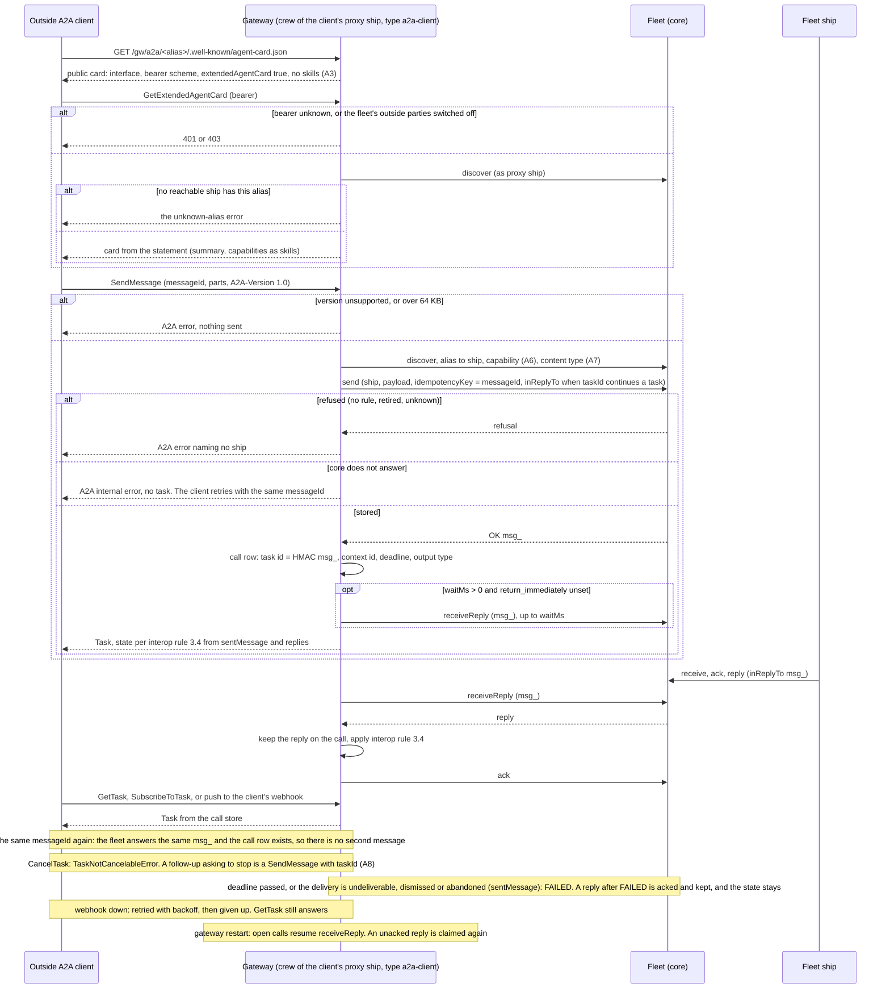

# A2A in and out through the gateway

Design for [#878](https://github.com/ThomasHendrickx/aeolus-fleet/issues/878), the 0.30.0 part of level 3 (0048). New core fleet functionality, so it goes purpose first. Thomas agreed the purpose and decided every question on 21 Oct (part 3). No code.

It brings two earlier designs up to date with what is built: the interop design (branch `design/interop`, `docs/design/interop/interop.md`, questions I-1 to I-9 decided on 17 Oct, slice order 3.6) and the A2A study (branch `design/interop-a2a`, `docs/design/interop-a2a/interop-a2a.md`). Every point they decided stays. What conflicted was raised as a question and is decided in part 3.

## 1. Purpose (agreed 21 Oct)

Thomas: "I agree with the purpose".

An outside A2A agent talks to fleet ships with no Aeolus client. Fleet ships talk to outside A2A agents as they talk to any ship. Network rules gate both directions as they gate any ship. No send answers OK before the message is stored.

- **A2A in.** A supplier's A2A agent, built on any A2A SDK, reads a card for the procurement ship and sends it a message. It follows the task until the ship's reply completes it. It sees one gateway address and an opaque alias, never a ship name. It reaches nothing the rules do not allow.
- **A2A out.** An outside A2A agent becomes a ship. A fleet ship finds it through discovery and sends it a message. The outside task's status and artifacts come back as replies. No session holds the outside agent's credential.
- **Every outside A2A party is a proxy ship with an owner.** A human answers for it (0045, 0056).

Not the purpose:
- Task state in core. The gateway keeps it (0048, 0001).
- A2A for person ships. People keep the gateway's MCP tools (0054).
- gRPC, signed cards, and a registry of cards.

## 2. Lessons to check against

### Decided, kept as is

| Point | Rule | Source |
| --- | --- | --- |
| Every caller is a ship | Each outside party gets its own proxy ship. The gateway decides no reach of its own | 0057, interop 2 |
| Policy stays in core | Network rules decide every send and every discovery (0034). Only a capability's own statement holds per-call timing (0047) | 0016, 0034 |
| Stored before OK | The gateway answers an outside call only after the fleet's `send` answered OK | 0003 |
| Completion rule | A call is completed by the first reply of the capability's output content type. A reply of `application/a2a+json` drives the state it carries. A question means input needed. A delivery failure or the deadline means failed | I-2, interop 3.4 |
| One wake pattern | The gateway is the computer side and reports `handed` with its channel (waker `gateway`) | I-1, 0040 |
| Delivery to outside agents | The gateway acks a delivery when the outside agent accepts it. A call that died before it was confirmed is handed again only when it is repeatable, otherwise `notHandled` with "the call may have run". A2A agents are repeatable by default | I-7, 0040 |
| One waiting call per proxy ship | No core call that waits on many ships | I-8 |
| Async by default | `waitMs` per capability, 0 by default, capped by the gateway | I-9, 0047 |
| One gateway, two adapters | One train, one repository | I-6, 0049 |
| The gateway commissions | It commissions a proxy ship once an outside party is approved | I-5, 0044, 0056 |
| Verified apart from stated | `a2aCardDomain` is already a check in the closed list | I-4, 0059 |
| Federation | Through pagasae, not a federation of the gateway's own. 0054 changed I-4 here; A2A is not affected | 0054 |
| One switch for outside parties per fleet | Off by default. Turning it on with no network rules applied warns | I-3, 0056 |
| NAT both ways | Outside, the gateway shows an opaque alias and HMAC ids. Inside, it shows the proxy ship's name, type and labels | A2A study 1 |
| 64 KB | A larger message is refused or carried as a reference | 0006 |
| Spec source | The proto is normative where the text disagrees. The gateway pins `A2A-Version: 1.0` | A2A study 13 |

### Built since 17 Oct

- **Core.** Everything in interop slice P is built:
  - the statement with `waitMs`, `deadlineMs` and `repeatable`, and discovery (0047);
  - kinds and owners (0044, 0045);
  - `receiveReply` and `sentMessage`;
  - the waker and the channel of `handed`;
  - `notHandled` with a reason;
  - verified facts (0059);
  - the re-read `delivery` (0040).
- **Gateway** (`aeolus-fleet-gateway`). MCP in and MCP out, and people. Parts A2A reuses:

  | Part | Where |
  | --- | --- |
  | Connection per fleet; the gateway's ship with `fleet:read`, `fleet:commission`, `fleet:on-behalf`, `scopes:declare`, `fleet:verify`; it declares `gateway:approve` | `src/core/connection` |
  | Parties (`mcpServer`, `mcpClient`): approval, commission, crew token, state | `src/core/parties` |
  | Proxy ship loops: `pushReceive`, `handed` (channel `mcp`), `ack`, `handled`, `notHandled` for a server; `receiveReply` per open call for a client | `src/core/mcp-out`, `src/core/mcp-in` |
  | Aliases: HMAC of fleet and ship, 8 characters. Handles: HMAC of the message id | `src/adapters/crypto` |
  | Call store (`client_calls`, `client_call_replies`) with deadline and output content type | `src/core/mcp-in` |
  | Statement written from an outside party's offer, with tool marks for `repeatable`; verified facts | `src/core/mcp-out` |
  | The vault: a bearer or OAuth client credentials | `src/core/vault` |
  | The outside-parties switch per fleet, with the warning | `outside_party_switches` |
  | `aeolus_ships` (discover) and `aeolus_send` (send by ship or type) for people | `src/adapters/http/person-tools.ts` |

  Nothing of A2A exists: no adapter, card, task view, webhook, A2A client or A2A party kind.

### The A2A specification on 21 Oct

- **No release after v1.0.1** (2026-05-28). On main, the proto changed only a comment, and the text got editorial fixes. Version 1.1 work sits on branch `dev-1.1` (task `generation`, `SendLiveMessage`, client-written artifacts).
- **SubscribeToTask verb: still open at v1.0.1.** The proto says GET, the text says POST. `dev-1.1` settles it as GET (#2068). Issue #1574 is open, and both official SDKs accept GET and POST on the server. **So the gateway serves both.**
- **Push config fields: settled.** `whats-new-v1.md` dropped `configId` and `createdAt` (#2056). The proto's `TaskPushNotificationConfig` (`tenant`, `id`, `task_id`, `url`, `token`, `authentication`) is the shape.
- **Unchanged:**
  - `SendMessage` blocks by default unless `return_immediately` is set;
  - `tenant`;
  - the `A2A-Version` header, which a client must send;
  - the card at `/.well-known/agent-card.json`;
  - an extended card only when the public card sets `capabilities.extendedAgentCard`.
- **Tooling:**
  - `@a2a-js/sdk` v1.3.0 implements 1.0 for server and client, over JSON-RPC, REST and gRPC.
  - The conformance kit `a2a-tck` targets 1.0. It has tags only; the latest is `1.0.0.alpha3`, from 20 Oct.

## 3. Decisions (Thomas, 21 Oct)

Each decision is the rule as it stands, with why.

| # | Rule | Why |
| --- | --- | --- |
| A1 | **An outside party is an approved outside MCP server or client, or A2A agent or client.** Every rule of 0056 applies to A2A parties unchanged: approval, the pending list, the switch and the owner core keeps | 0057 makes no job argo's alone, and the gateway's page already shows each party's protocol as a tag on one list |
| A2 | **An approver adds an outside A2A client on the gateway's page.** The approver names it and sets its owner and scopes. The gateway commissions an `a2a-client` proxy ship and shows a bearer once. The card declares an HTTP bearer scheme | An A2A client is a machine with no browser, so it cannot sign in through OAuth as an MCP client does |
| A3 | **The public card carries no summary and no skills.** It names the gateway as provider and states the interface, the bearer scheme and `extendedAgentCard: true`. The extended card carries the statement for that caller, from `discover` as its proxy ship | It keeps 0047's rule: only the ships that can send to a ship, and argo, read its statement |
| A4 | **The party's detail on the gateway's page lists the card address of each ship its proxy ship reaches now**, from `discover`. The party's owner hands the addresses over | A2A has no registry, and the list follows the rules in force |
| A5 | **One switch per fleet covers MCP and A2A** (0056) | Approval already gates each party |
| A6 | **An inbound message calls the first capability whose first input mode equals its content type** (A7). When none matches, there is no wait and no deadline, and the first reply completes the call | An A2A message names no skill, and standard clients send only standard fields |
| A7 | **Content type of an inbound message:** one text part travels as its text, with its `mediaType` (`text/plain` when none). One data part travels as JSON, with its `mediaType` (`application/json` when none). Anything else travels as the whole message, as `application/a2a+json` | A ship that knows nothing of A2A still reads plain text or JSON |
| A8 | **The gateway's A2A adapter does not support cancellation.** It supports only follow-up messages that ask for cancellation through their content. `CancelTask` answers `TaskNotCancelableError`. A message with the task's `taskId` that asks to stop is sent to the ship like any follow-up, and the ship decides | Thomas: "Out gateway a2a adapter does not support cancellation, it only supports follow up messages that ask for cancellation through content." Aeolus cannot withdraw a stored message |
| A9 | **Any actor holding `gateway:approve` marks an outside A2A agent not repeatable**, on the party's detail, as MCP tool marks are set | 0053: nothing is argo's alone |
| A10 | **AUTH_REQUIRED from an outside agent goes back to the sender as a reply carrying that state, then the delivery is handled. The proxy ship's owner is also notified.** What notified means waits for the notifications work; 0.30.0 builds no owner notification | Credentials stay in the vault and never travel in a message |
| A11 | **The A2A bindings use `@a2a-js/sdk` behind the gateway's ports, pinned**, with the gateway's call store in place of the SDK's task store. Its A2A client calls outside agents. The A2A endpoints sit on Fastify beside `/mcp`: the pages stay in Next.js (`web/`), and the protocol endpoints and crew loops stay on Fastify, in the same process | Spec changes land in one dependency, and the SDK serves both verbs of SubscribeToTask |

### How the gateway finds the internal ship (A3, Thomas's question)

Thomas: "How can the gateway the capability to the right internal ship?"

1. **The path names the alias.** Each card's interface address is `/gw/a2a/<alias>`. The alias is the gateway's existing HMAC of the fleet id and ship id (`src/adapters/crypto/ship-aliases.ts`). It is derived, never looked up in a table, so a rename changes nothing outside.
2. **The bearer names the party**, and the party belongs to one fleet and has one proxy ship.
3. **`discover` as that proxy ship** answers the ships it may send to now, with their ids. The gateway computes the alias of each and takes the one that matches. No match means the ship is unknown or unreachable, and both get the same error, so an outside party learns nothing about ships it cannot reach.
4. **The send** goes to that ship by name, as the proxy ship. Core checks the network rules again at the send (0034).
5. **The capability** is chosen by A6, from that ship's statement in the same `discover` answer.

### Where the gateway runs (A11, Thomas's question)

Thomas: "Gateway runs on nextjs no?"

Only its pages do. The gateway is one Node process (`aeolus-gateway start`) built on **Fastify**:
- **Fastify** serves `/mcp`, the OAuth endpoints, `/authorize`, `/token`, the `/.well-known` metadata, `/trpc` and `/api/version`, from `src/adapters/http` and `src/adapters/trpc`.
- **The Next.js app in `web/`** serves the pages: overview, requests and parties. The same server hands it every address with no route of its own (`src/adapters/http/front-door.ts`).

The A2A endpoints are protocol endpoints, like `/mcp`, so they belong in Fastify, in `src/adapters/http`. A11 stands: the SDK's transport handlers are called from Fastify routes. Its Express integration is not used, and no Next.js route handler serves A2A.

## 4. Flows

### 4.1 A2A in



### 4.2 A2A out

```mermaid
sequenceDiagram
  participant S as Fleet ship
  participant F as Fleet (core)
  participant G as Gateway (crew of the agent's proxy ship, type a2a-agent)
  participant A as Outside A2A agent
  S->>F: discover, then send to the proxy ship
  F-->>S: OK (stored)
  G->>F: pushReceive (waker gateway), up to the concurrency limit
  F-->>G: delivery (received)
  G->>F: handed n, channel a2a
  G->>A: SendMessage (messageId = HMAC msg_, vault credential, return_immediately)
  alt answered with a Task or a Message
    G->>F: ack (the promise ends)
    loop until a terminal or interrupted state
      G->>A: SubscribeToTask when the card states streaming, else GetTask
      A-->>G: status or artifact
      G->>F: reply to S (inReplyTo msg_, key = HMAC of task id and event)
    end
    G->>F: handled
  else no answer (stream broke, gateway crashed)
    alt repeatable (A2A's default, A9)
      G->>F: handed n+1
      G->>A: SendMessage, same messageId
    else marked not repeatable
      G->>F: notHandled, "the call may have run; its answer was lost"
    end
  else refused (4xx, credential refused)
    G->>F: ack, then a reply to S carrying FAILED or REJECTED, then handled
  end
  Note over G,A: INPUT_REQUIRED: a reply to S. S answers inReplyTo it, which arrives as a new delivery and goes out as SendMessage with the same taskId and contextId
  Note over G,A: AUTH_REQUIRED: a reply to S carrying the state, then handled. The owner is notified once the notifications work lands (A10)
  Note over G,A: task gone (not found) while followed after the ack: notHandled
  Note over G,F: the fifth attempt: undeliverable, Needs attention (0040)
  Note over G,F: restart: pushReceive gives back its own received and handed deliveries. Acked ones are followed again from the call row, and derived keys send no duplicate reply
```

## 5. Slices for 0.30.0

A2A in before out. Each slice is gateway work unless it says otherwise, and each ends usable and green.

| # | Slice | Acceptance criteria |
| --- | --- | --- |
| 0 | **Docs (aeolus-fleet)** | 0050, 0056 and the blueprint define an outside party as A1 does. A decision file records A2 to A11 as current state. The gateway's row in `compatibility.md` gains `receiveReply`, `sentMessage` and `delivery` |
| 1 | **A2A in: admit a client, serve cards** | An approver adds an A2A client (A2): an `a2a-client` proxy ship is commissioned with the owner and scopes chosen, and a bearer is shown once. With the switch off, nothing can be added and every A2A call is refused. The public card per alias has no skills (A3). `GetExtendedAgentCard` answers the statement for a reachable alias and the unknown-alias error otherwise, the same for an alias that does not exist. The party's detail lists card addresses (A4). The routes are Fastify's |
| 2 | **A2A in: SendMessage, GetTask, ListTasks, CancelTask**, over JSON-RPC and HTTP+JSON, through `@a2a-js/sdk` (A11) | The answer comes only after `send` is OK, proven by tests with core refusing and core down. The same `messageId` gives one `msg_`. The task id is an HMAC of `msg_`. States follow interop rule 3.4, from `sentMessage` and `receiveReply`. Capability and content type follow A6 and A7. `waitMs` and `return_immediately` are honoured. FAILED comes from the deadline or a failed delivery. A `taskId` continues with `inReplyTo`. Over 64 KB, or a missing or unsupported `A2A-Version`, gives an A2A error. CancelTask gives `TaskNotCancelableError` (A8). ListTasks shows only the caller's own tasks. A restart loses no reply. `a2a-tck` 1.0 mandatory tests pass for these methods; if blocking with `waitMs` 0 fails the kit, a blocking send waits the gateway's cap (I-9) |
| 3 | **A2A in: streaming** | `SendStreamingMessage` and `SubscribeToTask` on GET and POST send the stored task first and close at a terminal state. A dropped stream loses nothing on resubscribe. Subscribing to a terminal task gives the spec's error. The kit's streaming tests pass |
| 4 | **A2A in: push to the client's webhook** | The push config calls take the proto's `TaskPushNotificationConfig` shape. Each change is POSTed with retries and backoff, then given up, and GetTask still answers. A config names only the caller's own task |
| 5 | **A2A out: add an agent** | An approver adds an agent by its card address. The gateway reads the card first, and an invalid one is not added. An `a2a-agent` proxy ship is commissioned. Its statement carries the skills, without interfaces, schemes or signatures, and every capability is `repeatable` unless marked (A9). The verified fact is `a2aCardDomain`. The credential is a bearer or client credentials, in the vault |
| 6 | **A2A out: hand over and follow** | As flow 4.2: `pushReceive` within the concurrency limit; `handed` on channel `a2a`; a stable `messageId`; an ack only on an accepting answer; follow by `SubscribeToTask` or `GetTask`; each status or artifact as a reply with a derived key, so a restart sends no duplicate; `handled` at a terminal state. Repeat follows A9, and not repeatable gives `notHandled` with the reason. INPUT_REQUIRED continues through a reply. AUTH_REQUIRED is a reply, then handled (A10). A task gone gives `notHandled` |
