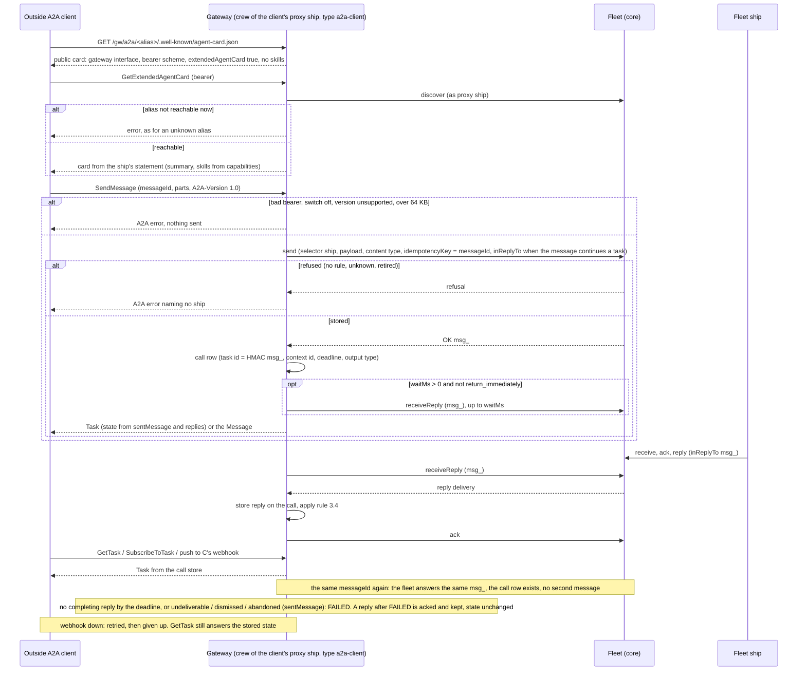

# A2A in and out through the gateway

Design for [#878](https://github.com/ThomasHendrickx/aeolus-fleet/issues/878), the 0.30.0 part of level 3 (0048). New core fleet functionality, so it goes purpose first. Thomas agreed the purpose on 21 Oct. The questions in part 4 are open. No code.

It brings two earlier designs up to date with what is built: the interop design (branch `design/interop`, `docs/design/interop/interop.md`, questions I-1 to I-9 decided on 17 Oct, slice order 3.6) and the A2A study (branch `design/interop-a2a`, `docs/design/interop-a2a/interop-a2a.md`). Every point they decided stays. Anything that now conflicts is raised as a question in part 4.

## 1. Purpose (agreed 21 Oct)

Thomas: "I agree with the purpose".

An outside A2A agent talks to fleet ships with no Aeolus client. Fleet ships talk to outside A2A agents as they talk to any ship. Network rules gate both directions as they gate any ship. No send answers OK before the message is stored.

- **A2A in.** A supplier's A2A agent, built on any A2A SDK, reads a card for the procurement ship and sends it a message. It follows the task until the ship's reply completes it. It sees one gateway address and an opaque alias, never a ship name. It reaches nothing the rules do not allow.
- **A2A out.** An outside A2A agent becomes a ship. A fleet ship finds it through discovery and sends it a message. The outside task's status and artifacts come back as replies. No session holds the outside agent's credential.
- **Every outside A2A party is a proxy ship with an owner.** A human answers for it (0045, 0056).

Not the purpose:
- Task state in core. The gateway keeps it (0048, 0001).
- A2A for person ships. People keep the gateway's MCP tools (0054).
- gRPC, signed cards, and a registry of cards. See Later.

Later, in Thomas's words:
- **gRPC.** "gRPC we can support later"
- **Signed cards.** "Signed cards is acceptable for now, but we can investigate what we can do with that later (maybe a trust signal or so)"
- **Card registry.** "Card registery, we can check later if we can use this in some way as a just in time registry creation for discovery within the A2A protocal. But again later"

## 2. Lessons to check against

### Decided, kept as is

| Point | Rule | Source |
| --- | --- | --- |
| Every caller is a ship | Each outside party gets its own proxy ship. The gateway decides no reach of its own | 0057, interop 2 |
| Policy stays in core | Network rules decide every send and every discovery (0034). Only a capability's own statement holds per-call timing (0047) | 0016, 0034 |
| Stored before OK | The gateway answers an outside call only after the fleet's `send` answered OK | 0003 |
| Completion rule | A call is completed by the first reply of the capability's output content type. A reply of `application/a2a+json` drives the state it carries. A question means input needed. A delivery failure or the deadline means failed | I-2, interop 3.4 |
| One wake pattern | The gateway is the computer side and reports `handed` with its channel (waker `gateway`) | I-1, 0040 |
| Delivery to outside agents | The gateway acks a delivery when the outside agent accepts it. A call that died before it was confirmed is handed again only when it is repeatable, otherwise `notHandled` with "the call may have run". A2A agents are repeatable by default | I-7, 0040 |
| One waiting call per proxy ship | No core call that waits on many ships | I-8 |
| Async by default | `waitMs` per capability, 0 by default, capped by the gateway | I-9, 0047 |
| One gateway, two adapters | One train, one repository | I-6, 0049 |
| The gateway commissions | It commissions a proxy ship once an outside party is approved | I-5, 0044, 0056 |
| Verified apart from stated | `a2aCardDomain` is already a check in the closed list | I-4, 0059 |
| Federation | Through pagasae, not a federation of the gateway's own. 0054 changed I-4 here; A2A is not affected | 0054 |
| One switch for outside parties per fleet | Off by default. Turning it on with no network rules applied warns | I-3, 0056 |
| NAT both ways | Outside, the gateway shows an opaque alias and HMAC ids. Inside, it shows the proxy ship's name, type and labels | A2A study 1 |
| 64 KB | A larger message is refused or carried as a reference | 0006 |
| Spec source | The proto is normative where the text disagrees. The gateway pins `A2A-Version: 1.0` | A2A study 13 |

### Built since 17 Oct

- **Core.** Everything in interop slice P is built:
  - the statement with `waitMs`, `deadlineMs` and `repeatable`, and discovery (0047);
  - kinds and owners (0044, 0045);
  - `receiveReply` and `sentMessage`;
  - the waker and the channel of `handed`;
  - `notHandled` with a reason;
  - verified facts (0059);
  - the re-read `delivery` (0040).
- **Gateway** (`aeolus-fleet-gateway`). MCP in and MCP out, and people. Parts A2A reuses:

  | Part | Where |
  | --- | --- |
  | Connection per fleet; the gateway's ship with `fleet:read`, `fleet:commission`, `fleet:on-behalf`, `scopes:declare`, `fleet:verify`; it declares `gateway:approve` | `src/core/connection` |
  | Parties (`mcpServer`, `mcpClient`): approval, commission, crew token, state | `src/core/parties` |
  | Proxy ship loops: `pushReceive`, `handed` (channel `mcp`), `ack`, `handled`, `notHandled` for a server; `receiveReply` per open call for a client | `src/core/mcp-out`, `src/core/mcp-in` |
  | Aliases: HMAC of fleet and ship, 8 characters. Handles: HMAC of the message id | `src/adapters/crypto` |
  | Call store (`client_calls`, `client_call_replies`) with deadline and output content type | `src/core/mcp-in` |
  | Statement written from an outside party's offer, with tool marks for `repeatable`; verified facts | `src/core/mcp-out` |
  | The vault: a bearer or OAuth client credentials | `src/core/vault` |
  | The outside-parties switch per fleet, with the warning | `outside_party_switches` |
  | `aeolus_ships` (discover) and `aeolus_send` (send by ship or type) for people | `src/adapters/http/person-tools.ts` |

  Nothing of A2A exists: no adapter, card, task view, webhook, A2A client or A2A party kind.

### The A2A specification on 21 Oct

- **No release after v1.0.1** (2026-05-28). On main, the proto changed only a comment, and the text got editorial fixes. Version 1.1 work sits on branch `dev-1.1` (task `generation`, `SendLiveMessage`, client-written artifacts).
- **SubscribeToTask verb: still open at v1.0.1.** The proto says GET, the text says POST. `dev-1.1` settles it as GET (#2068). Issue #1574 is open, and both official SDKs accept GET and POST on the server. **So the gateway serves both.**
- **Push config fields: settled.** `whats-new-v1.md` dropped `configId` and `createdAt` (#2056). The proto's `TaskPushNotificationConfig` (`tenant`, `id`, `task_id`, `url`, `token`, `authentication`) is the shape.
- **Unchanged:**
  - `SendMessage` blocks by default unless `return_immediately` is set;
  - `tenant`;
  - the `A2A-Version` header, which a client must send;
  - the card at `/.well-known/agent-card.json`;
  - an extended card only when the public card sets `capabilities.extendedAgentCard`.
- **Tooling:**
  - `@a2a-js/sdk` v1.3.0 implements 1.0 for server and client, over JSON-RPC, REST and gRPC.
  - The conformance kit `a2a-tck` targets 1.0. It has tags only; the latest is `1.0.0.alpha3`, from 20 Oct.

## 3. Flows

These follow the picks in part 4, which are still open. "Gateway" means the gateway acting as the crew of the proxy ship named.

### 3.1 A2A in



### 3.2 A2A out

```mermaid
sequenceDiagram
  participant S as Fleet ship
  participant F as Fleet (core)
  participant G as Gateway (crew of the agent's proxy ship, type a2a-agent)
  participant A as Outside A2A agent
  S->>F: discover, then send to the proxy ship
  F-->>S: OK (stored)
  G->>F: pushReceive (waker gateway)
  F-->>G: delivery (received)
  G->>F: handed n, channel a2a
  G->>A: SendMessage (messageId = HMAC msg_, vault credential, return_immediately)
  alt Task or Message answered
    G->>F: ack (the promise ends)
    loop until terminal
      G->>A: SubscribeToTask, or GetTask by polling
      A-->>G: status or artifact
      G->>F: send reply to S (inReplyTo msg_, key = HMAC task id and event)
    end
    G->>F: handled
  else no answer (stream broke, gateway crashed)
    alt repeatable (default for A2A)
      G->>F: handed n+1
      G->>A: SendMessage, same messageId
    else marked not repeatable
      G->>F: notHandled, "the call may have run; its answer was lost"
    end
  else refused (4xx, bad card, credential refused)
    G->>F: ack, reply to S carrying TASK_STATE_FAILED or REJECTED, handled
  end
  Note over G,A: INPUT_REQUIRED: a reply to S. S answers inReplyTo that reply; it arrives as a new delivery and goes out as SendMessage with the same taskId and contextId
  Note over G,A: AUTH_REQUIRED: a reply to S carrying the state, then handled. The owner fixes the credential on the gateway's page
  Note over G,A: task gone (not found) while followed after the ack: notHandled
  Note over G,F: fifth attempt: undeliverable, Needs attention (0040)
```

## 4. Questions

Each question can be read alone: its context, numbered options, and my pick with why. Background for all of them: the gateway is the plugin beside core that speaks MCP and A2A with the outside. It acts in a fleet only as ships: its own ship, plus one proxy ship per outside party, which it commissions once an actor holding its approving scope (`gateway:approve`) approves the party (0056). Today it speaks MCP only.

### A1. Does "outside party" cover A2A?

**Context.** 0050, 0056 and the blueprint define an outside party as "an approved outside MCP server or client". The rules hang on that term:
- approval and the list of pending requests;
- the switch per fleet;
- the owner core keeps;
- the gateway's page.

As written, an outside A2A agent or A2A client is none of these, so no rule says who admits it.

**Options.**
1. Widen the term to "an approved outside MCP server or client, or A2A agent or client". Every rule of 0056 then applies unchanged, with one line changed in each of 0050, 0056 and the blueprint.
2. Keep the term MCP only and let argo add A2A parties in the console, outside the approval flow.

**Pick 1.** 0057 makes no job argo's alone, and 2 would route ordinary work to argo. The gateway's page already shows each party's protocol as a tag on one list, so A2A fits there with no new rule.

### A2. How is an outside A2A client admitted, and how does it get its credential?

**Context.** An A2A client is usually a machine, such as a supplier's agent, with no browser and no human present when it connects. MCP clients are admitted through OAuth: a signed-in account of the fleet makes the authorize request, which waits for approval (0056). An outside MCP server never asks; an approver adds it. A2A lets a card declare several security schemes, including an HTTP bearer and OAuth client credentials. The gateway is already an OAuth server and already holds bearers for MCP out.

**Options.**
1. An approver adds the A2A client on the gateway's page, as an MCP server is added. The approver names it and sets its owner and scopes. The gateway commissions an `a2a-client` proxy ship and shows a bearer once. The card declares an HTTP bearer scheme.
2. OAuth authorization code through a signed-in account of the fleet, the same path as an MCP client.
3. OAuth client credentials with a client the gateway registered beforehand.

**Pick 1 now, 3 in a later slice.** 1 needs nothing the gateway lacks, and an approver still decides each party. 2 needs a human at a browser, which an A2A client does not have. 3 is the better long-term credential because it expires and rotates, but it adds a token endpoint flow the first slice does not need.

### A3. What does the public card show?

**Context.** A2A publishes an agent card that anyone can fetch. The card may set `capabilities.extendedAgentCard: true`, and an authenticated client then fetches a fuller card with `GetExtendedAgentCard`. In Aeolus a ship's statement (summary and capabilities) is read only by the ships that can send to it, and argo (0047). The gateway serves one card per exposed ship, at an opaque alias.

**Options.**
1. The public card names the gateway as provider and states the interface, the bearer scheme and `extendedAgentCard: true`, with no summary and no skills. The extended card carries the statement, built from `discover` as the caller's proxy ship, so it shows only what that caller can reach.
2. The public card carries the ship's statement.

**Pick 1.** It keeps 0047's reader rule, and the extended card is the spec's own place for content that depends on the caller. 2 shows a statement to anyone who has the alias.

### A4. How does an A2A client learn which cards it can use?

**Context.** A2A has no registry: a client needs each card's address. The gateway serves one card per reachable ship at an opaque alias. Network rules decide which ships an outside party's proxy ship reaches, and that can change.

**Options.**
1. The party's detail on the gateway's page lists the card address of each ship its proxy ship reaches now, from `discover`. The party's owner hands the addresses to the outside party.
2. One gateway card whose skills are the reachable ships. An A2A message names no skill, so the gateway could not tell which ship a message is for, and the A2A study rejected it.

**Pick 1.** It works with any standard client and always follows the rules in force. A registry is on the Later list.

### A5. One switch for outside parties, or one per protocol?

**Context.** The interop design (3.1) said "each adapter is switched on per fleet". Decision 0056, decided later, made outside parties one switch per fleet, off by default, turned by `fleet:network`, with a warning when no network rules apply. The gateway has built that one switch.

**Options.**
1. The one switch covers both MCP and A2A.
2. A switch per protocol per fleet.

**Pick 1.** Approval already gates each party one by one, so a fleet that wants MCP but not A2A simply approves no A2A party. A second switch is a gate nobody asked for.

### A6. Which capability does an inbound A2A message call?

**Context.** A ship's statement lists capabilities. Each may state:
- `waitMs`: how long the gateway may hold a call for its reply;
- `deadlineMs`: after this the call fails;
- an output content type: the reply that completes the call.

These come from 0047 and interop I-2 and I-9. In MCP the tool name picks the capability. An A2A message carries only `messageId`, parts, and an optional `taskId`, `contextId` and `metadata`. It never names a skill.

**Options.**
1. The first capability whose first input mode equals the message's content type (A7). When none matches, there is no wait and no deadline, and the plain-text completion rule applies: the first reply from the ship completes the call.
2. A skill id in `Message.metadata`, a key of Aeolus's own. A standard client never sets it, so it would fall back to 1 anyway.

**Pick 1.** It uses only standard fields. A ship that wants a wait or a deadline for A2A callers states an input mode they send.

### A7. What content type does an inbound A2A message travel as?

**Context.** A fleet message is one payload of at most 64 KB with one content type. An A2A message holds one or more parts, each one of `text`, `data` (JSON), `raw` (bytes) or `url`, with an optional `mediaType`. `application/a2a+json` is A2A's own media type for a whole A2A message.

**Options.**
1. Map by shape:
   - One text part travels as its text, with its `mediaType` (`text/plain` when none).
   - One data part travels as JSON, with its `mediaType` (`application/json` when none).
   - Anything else (several parts, `raw` or `url`) travels as the whole A2A message, as `application/a2a+json`.
2. Always send the whole A2A message as `application/a2a+json`.

**Pick 1.** A ship that knows nothing of A2A still gets plain text or JSON it can read. The A2A study proposed this mapping, and it loses nothing because the full form is kept for every other shape.

### A8. What does CancelTask do?

**Context.** A2A lets a client cancel a task. Aeolus cannot withdraw a sent message: once it is stored, it is delivered. The task lives only in the gateway, as a view over a fleet message and its replies.

**Options.**
1. Always answer `TaskNotCancelableError`, the spec's error for this.
2. Send the ship a cancel request as a message and report what it answers. That needs a content type of Aeolus's own, and every ship would have to learn it.

**Pick 1.** It is true to what Aeolus does and adds no vocabulary. A ship that wants cancellation can state it as a capability of its own.

### A9. Who marks an outside A2A agent not repeatable?

**Context.** When a call to an outside agent dies before the agent confirmed it, the gateway hands it again only if repeating is safe (I-7). A2A gives each message a stable `messageId` that agents may deduplicate on, so A2A agents count as repeatable by default. I-7 says "argo's mark" makes an agent an exception. Decisions 0053 and 0057, decided later, make no job argo's alone. For MCP the gateway already lets any holder of `gateway:approve` mark tools.

**Options.**
1. Any actor holding `gateway:approve` sets the mark on the party's detail, as MCP tool marks are set today.
2. argo only, as I-7 worded it.

**Pick 1.** It follows 0053, and it is the mechanism already built for MCP.

### A10. What happens when an outside agent answers AUTH_REQUIRED?

**Context.** An outside A2A agent may move its task to `TASK_STATE_AUTH_REQUIRED`, asking for a credential. The fleet ship that sent the message holds no outside credential. The gateway's vault holds them, and an approver sets them on the gateway's page.

**Options.**
1. The gateway sends the fleet ship a reply carrying that state, then reports the delivery handled. The proxy ship's owner fixes the credential on the gateway's page, and the fleet ship sends again when it chooses to.
2. The gateway asks the proxy ship's owner with a question (0038) and holds the task until they answer.

**Pick 1 for 0.30.0.** Credentials stay in the vault and never travel in a message, and no work waits on a human by default. 2 can follow if this turns out to be common.

### A11. Build on `@a2a-js/sdk`, or write the bindings ourselves?

**Context.** The gateway must serve A2A over JSON-RPC and HTTP+JSON, with SSE streams, and call outside agents as a client. The official TypeScript SDK, `@a2a-js/sdk` v1.3.0, implements spec 1.0 for server and client, and accepts both verbs of SubscribeToTask. The spec still moves: 1.1 is in preparation. The gateway runs on Fastify with ports and adapters.

**Options.**
1. Use the SDK behind the gateway's ports, pinned, with the gateway's call store in place of the SDK's task store. Slice 2 proves the SDK answers only after the fleet's `send` is OK.
2. Write JSON-RPC, HTTP+JSON and SSE on Fastify ourselves.

**Pick 1.** Spec changes then land in one dependency, and the bindings and streams come already tested against the spec. If the SDK cannot hold the answer until `send` is OK, slice 2 falls back to 2 for the server side only.

## 5. Slices for 0.30.0

A2A in before out. Each slice is gateway work unless it says core. Each ends usable and green, and the acceptance criteria follow the picks.

| # | Slice | Acceptance criteria |
| --- | --- | --- |
| 0 | **Docs (core repo).** Outside party covers A2A (A1). The gateway's row in `compatibility.md` gains `receiveReply`, `sentMessage` and `delivery` | 0050, 0056 and the blueprint say MCP or A2A. No other decision changes |
| 1 | **A2A in: admit a client, cards** | An approver adds an A2A client: an `a2a-client` proxy ship is commissioned with the owner and scopes chosen, and a bearer is shown once. With the switch off, no add. The public card per alias carries no skills (A3). `GetExtendedAgentCard` answers the statement for a reachable alias and an unknown-alias error for an unreachable one. The party's detail lists card addresses (A4) |
| 2 | **A2A in: SendMessage, GetTask, ListTasks, CancelTask** over JSON-RPC and HTTP+JSON | The answer comes only after `send` OK (a test with core refusing and core down). The same `messageId` gives one `msg_`. The task id is an HMAC of `msg_`. States follow rule 3.4 from `sentMessage` and `receiveReply`. Content types follow A7. `waitMs` and `return_immediately` are honoured (A6). FAILED comes from the deadline or a failed delivery. `taskId` continues with `inReplyTo`. Over 64 KB, or without `A2A-Version: 1.0`, gives an A2A error. CancelTask gives `TaskNotCancelableError`. ListTasks shows only the caller's own. `a2a-tck` 1.0 mandatory tests pass for these methods. If blocking with `waitMs` 0 fails the kit, the wait is the gateway's cap (I-9's open risk) |
| 3 | **A2A in: streaming** | `SendStreamingMessage` and `SubscribeToTask`, on GET and POST, send the stored task first and close at a terminal state. A dropped stream loses nothing on resubscribe. Subscribing to a terminal task gives the spec's error |
| 4 | **A2A in: push to the client's webhook** | The push config calls on the proto's shape. Each change is POSTed with retries and backoff, then given up. GetTask still answers. The webhook gets no payload of a call that is not the client's |
| 5 | **A2A out: add an agent** | An approver adds an agent by its card address. The gateway reads the card first; an invalid card is not added. An `a2a-agent` proxy ship is commissioned. Its statement carries the skills, without interfaces, schemes or signatures, and every capability is `repeatable` unless marked (A9). The verified fact is `a2aCardDomain`. The credential is a bearer or client credentials in the vault |
| 6 | **A2A out: hand over and follow** | As in flow 3.2: `pushReceive`, `handed` with channel `a2a`, a stable `messageId`, an ack only on an accepting answer, following by `SubscribeToTask` when the card states streaming and by `GetTask` otherwise, each status or artifact as a reply with a derived key (a restart sends no duplicate), and `handled` at a terminal state. The concurrency limit holds. Not repeatable gives `notHandled` with the reason. INPUT_REQUIRED continues through a reply. AUTH_REQUIRED follows A10. A task gone gives `notHandled` |

After 0.30.0: push from outside agents to the gateway's webhook, OAuth client credentials for A2A clients (A2 option 3), and A2A 1.1 once it is released.
