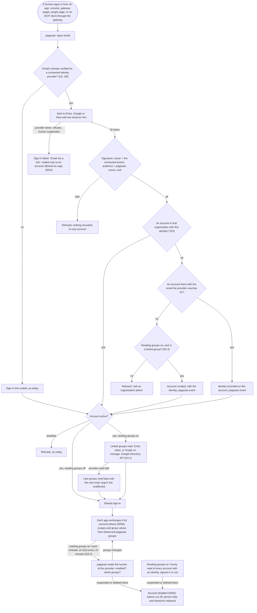
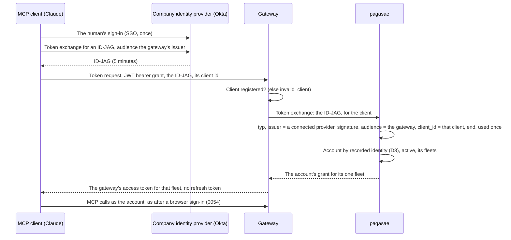

# Company sign-in: Entra ID and Google, and ID-JAG

Design by designer-identity. Decided by Thomas on 21 Oct: the purpose, and every question (D1 to D7). On 22 Oct: Okta, the fleet of an ID-JAG and where xaa.dev is trusted (D8 to D10). Part 5 cuts the slices; part 6 holds what is still open. No code. Terms are the blueprint's Domain language (0050): account, identity, identity provider, directory, organisation, organisation admin, sign-in link.

Inputs: pagasae issue #78; decisions 0050 to 0058; [`accounts.md`](accounts.md) 1.3 and questions 8, 9, 14, 15; [`actors.md`](actors.md) 3; the interop design's slice 6 and I-4 (branch `design/interop`, `docs/design/interop/interop.md`); the pagasae and gateway READMEs.

## 1. Purpose

### 1.1 Today (built)

- pagasae signs every account in by a sign-in link mailed to its email, and keeps the shared sign-in (`aeolus_account_session`) every Aeolus app uses. Apps exchange it for account tokens of one fleet (0058); the gateway, the console, plugin pages and people's MCP clients through the gateway all sign in through pagasae (0054).
- An account is an email in one organisation. It has no identity: pagasae knows no identity provider.
- Disabling an account in pagasae ends its access within one token's life (0055).

### 1.2 The purpose (agreed)

An organisation connects Entra ID or Google Workspace to pagasae as its identity provider, and its accounts sign in with their company identity. Nothing else changes for the apps: they already sign in through pagasae, so the console, the gateway, plugin pages and MCP clients get company sign-in by that one change.

Reading its groups is an option the organisation admin turns on or off when connecting, and changes later: an admin who does not want pagasae reading the directory connects for sign-in alone (Thomas: "To bypass the 'admin dont want this' argument"). With it on, the admin links a group of its Entra tenant or Google Workspace to what it gives in a fleet (scopes, and reach through network rules), and membership then comes from the provider alone. Nobody copies a group or its members by hand.

pagasae stays the account unit. The identity provider proves who the human is and which of its groups they are in; pagasae decides which account that is and what it may do (0051, 0052). The sign-in link stays the way in that never depends on an outside provider, for the accounts allowed to sign in as argo (0054). Entra and Google plug in; they are not the foundation (Thomas, 19 Oct).

### 1.3 The jobs

| # | Job |
| --- | --- |
| C1 | An organisation admin connects the organisation's Entra tenant or Google Workspace, and only an admin of that tenant or Workspace can make it so |
| C2 | A human signs in with their company identity and lands on their own account, never another's, without typing anything but their email |
| C3 | A human the company suspends in its identity provider loses access without anyone in pagasae remembering it |
| C4 | When the identity provider fails or is misconfigured, the accounts allowed as argo still sign in by link |
| C5 | With reading groups on, an organisation admin links a provider group to what it gives in a fleet; joining or leaving that group in the provider changes the account's rights within minutes, with nothing changed by hand in pagasae |
| C6 | A person's MCP client that the company manages (enterprise-managed authorization, ID-JAG) reaches the gateway without a browser sign-in, where the identity provider supports it |

### 1.4 A good outcome

At Acme, Mathilde connects Acme's Entra tenant from the organisation's page; Entra asks her, a tenant admin, to consent once. She links Acme's Entra group "Sales" to `messages:send` and `group=sales` in Acme's fleet. Charlotte opens the console, types charlotte@acme.com, signs in at Microsoft as every morning, and is in her account with what "Sales" gives. Acme's IT moves her to "Finance" in Entra; minutes later her account tokens carry finance's rights. Burak is disabled in Entra when he leaves; minutes later he can no longer renew anything. Globex connects Google Workspace with reading groups off: Google asks only for sign-in, its admin adds accounts and fills groups in pagasae as today, and a leaver suspended in Google is out at the end of their sign-in's life. One morning Entra refuses Acme's sign-ins; Mathilde, allowed as argo, signs in by link and acts.

### 1.5 Not this design's

- Pushed provisioning (SCIM, change notifications): reading the provider is enough (D4.2).
- SAML, and identity providers besides Entra, Google and Okta. Okta comes in only as far as ID-JAG needs it (D7, D8).
- What an account may do once signed in (0052, 0057, 0058: unchanged).

## 2. Lessons to check against

### 2.1 From Aeolus

| Lesson | Source |
| --- | --- |
| pagasae is the one identity provider of every Aeolus app; nothing federates to a company identity provider but pagasae | 0054 |
| Once connected, every account signs in with its identity; only accounts allowed as argo keep the sign-in link | 0054, `accounts.md` 14 (a) |
| An email may hold accounts in several organisations; a sign-in asks which | 0051 |
| The organisation decides who is in it: an admin adds an account; no guests; a contractor is an account of the hiring organisation | 0051, `accounts.md` 11, 15 |
| Groups are pagasae's; a change lands at the next account token, within 10 minutes | 0052, 0058 |
| A leaver is out within one token's life of being disabled in pagasae | 0055, 0058 |
| Core stores no account and no email; the account token is the only thing core sees | 0058 |
| Every state change writes its event; pagasae keeps its own | architecture, 0057 |
| Thin designs for few people | 0013 |

### 2.2 From the field

| Lesson | What they do | Source |
| --- | --- | --- |
| One multi-tenant registration serves every tenant; the token says which | Entra's `organizations` endpoint signs in any tenant; the ID token's `tid` names it and the issuer carries it, so the app checks the issuer per tenant. A tenant admin consents once for the tenant | [multi-tenant apps](https://learn.microsoft.com/en-us/entra/identity-platform/howto-convert-app-to-be-multi-tenant), [admin consent](https://learn.microsoft.com/en-us/entra/identity-platform/v2-admin-consent) |
| Key an identity by its subject, never by a mutable email | Microsoft: use `oid` with `tid`; `email` can be changed by the user or an admin and is not proof of ownership unless from a verified domain (`xms_edov`). Google: `sub` is the stable id; trust `email` only with `email_verified`, and `hd` names the Workspace domain | [Entra claims](https://learn.microsoft.com/en-us/entra/identity-platform/id-token-claims-reference), [claims validation](https://learn.microsoft.com/en-us/entra/identity-platform/claims-validation), [Google OpenID Connect](https://developers.google.com/identity/openid-connect/openid-connect) |
| Route by verified domain | Home realm discovery sends an email to its tenant by domain, and trusts a domain only once verified | [home realm discovery](https://learn.microsoft.com/en-us/entra/identity/enterprise-apps/home-realm-discovery-policy) |
| Group claims are partial | Entra's `groups` claim carries group object ids, not names, set once on the app registration (security groups, or only groups assigned to the app); past 200 groups in a JWT it sends an overage marker instead, and the app reads the groups from Microsoft Graph (`getMemberObjects`, application permission `GroupMember.Read.All`, which a tenant admin consents to). Google's ID token carries no groups: the Admin SDK Directory API reads them, with a read-only groups scope a super admin grants to the app's service account (domain-wide delegation) or an admin role given to it | [group claims](https://learn.microsoft.com/en-us/entra/identity/hybrid/connect/how-to-connect-fed-group-claims), [overage](https://learn.microsoft.com/en-us/troubleshoot/entra/entra-id/app-integration/get-signed-in-users-groups-in-access-token), [getMemberObjects](https://learn.microsoft.com/graph/api/directoryobject-getmemberobjects), [Google domain-wide delegation](https://support.google.com/a/answer/162106) |
| A suspension at the provider stops new sign-ins, not sessions the app keeps | Most apps re-check at the provider on a timer or rely on a push (SCIM); see `accounts.md` 2.2 | `accounts.md` 2.2 |
| ID-JAG: the client asks the company identity provider, not the app, for access | The client signs the human in at the company identity provider, exchanges that for an ID-JAG whose audience is the app's authorization server (RFC 8693), and posts it there with the JWT bearer grant (RFC 7523); no browser reaches the app. The app trusts an issuer list per tenant, checks audience, issuer and end, needs pre-registered clients. The ID-JAG's header `typ` is `oauth-id-jag+jwt`; it carries `iss`, `sub`, `aud`, `client_id`, `resource`, `scope` and an end about 5 minutes out, and the app issues no refresh token for it. MCP's extension is stable (June 2026); Okta issues ID-JAGs (Cross App Access); no source found that Entra or Google do. Claude supports it. xaa.dev is Okta's open playground: a test identity provider (`https://idp.xaa.dev`) issuing ID-JAGs, a test requesting app, and a page to register one's own resource and its authorization server, with no account | [MCP enterprise-managed authorization](https://modelcontextprotocol.io/extensions/auth/enterprise-managed-authorization), [WorkOS on its general availability](https://workos.com/blog/enterprise-managed-auth-ga-mcp-server-builders), [xaa.dev: your own authorization server](https://xaa.dev/docs/byor-auth-server) |

## 3. The flows

### 3.1 A sign-in by identity

From any app, with the decisions of part 4.

Unhappy paths:

| What goes wrong | What happens |
| --- | --- |
| The provider is down or misconfigured | Nobody signs in by identity; accounts allowed as argo sign in by link (C4). Account tokens already given work until they end (0058) |
| The tenant withdraws consent, or the organisation admin disconnects | Identity sign-ins fail at the provider or at pagasae's issuer check; every account of the organisation signs in by link again |
| An ID token from a tenant no organisation connected | Refused at the issuer check, even if the email matches an account |
| A linked group is deleted in the provider | Its link shows broken on the organisation's page; it gives nothing until the admin links another; its `group` value stays defined so rules do not move |
| A human is in more linked groups than one account may carry (20 values, 0031) | The token carries none of the excess and the account's page says which; the admin narrows the links |
| The human's email changes in the directory | The recorded identity still finds the account; the account's email stays what the admin set |
| The admin typed an email the provider does not vouch for (an alias) | No account found: refused, "ask an organisation admin"; the admin corrects the account's email |
| The email has accounts in several organisations | The organisation is the connected tenant's; the others are asked as today, each by its own way in |
| An unknown email | The same answer as today's link page, so the page never says whether an account exists; a connected domain is routed to its provider whatever the account |

### 3.2 An MCP client by ID-JAG

Unhappy paths:

| What goes wrong | What happens |
| --- | --- |
| The ID-JAG's issuer is no organisation's connected provider, or its signature, audience, client or end fails | pagasae refuses; the gateway answers `invalid_grant`; nothing recorded on any account |
| The same ID-JAG is presented twice | The second is refused (`invalid_grant`) |
| No account has that identity yet | Refused, `invalid_grant`: the human signs in by browser once, which records it (D3) |
| The account is disabled, or has rights in no fleet | Refused, as a browser sign-in is (0054, 0055) |
| The account has rights in several fleets | Refused, `invalid_grant` (D9) |
| The client is not registered at the gateway | `invalid_client`: ID-JAG needs a registered client; there is no dynamic registration (gateway README) |
| The provider is down | The client gets no ID-JAG and signs in by browser, or not at all; accounts allowed as argo keep the link (0054) |
| The access token ends | The client asks the provider for a fresh ID-JAG; no refresh token is kept anywhere |

## 4. Decisions (Thomas, 21 Oct)

Each is the current rule, why, and what was rejected.

**D1 One registration per installation.** pagasae has one multi-tenant Entra app registration and one Google OAuth client; each organisation's admin consents. A self-hosted pagasae registers its own pair. The credential is a key, rotated. Okta is the exception (D8). Why: connecting is one consent, and pagasae holds no secret of an organisation's. Rejected: a registration per organisation; both.

**D2 The provider's own proof of the domain.** Entra: a tenant admin's consent, and the tenant's verified domains. Google: a sign-in of the Workspace domain (`hd`) and a DNS TXT record pagasae gives, on each domain. One identity provider per organisation, one organisation per domain. With reading groups off, the admin consents to sign-in alone (`openid`, `profile`, `email`), and nothing is granted to pagasae's service account; with it on, also D4.1's read access. Why: each provider already verified the domain; Aeolus asks only for what the token cannot show, and nobody claims another's domain by asking first. Rejected: DNS for both; a sign-in of the domain alone.

**D3 An identity finds its account.** The admin adds the account; the first identity sign-in with the email the provider vouches for (Google's with `email_verified`, Entra's from a verified domain) records the identity on the account; after that the identity alone finds it. With reading groups on, D4.4 also brings accounts. Why: the organisation decides who is in (0051); a mutable email keys nothing after the first sign-in. Rejected: an account for every identity of the tenant; invitations.

**D4 Provider groups, when reading groups is on.** Reading groups is a switch the organisation admin sets when connecting and changes later. With it off, groups are pagasae's alone (0052).

- **D4.1 How pagasae learns groups.** Entra: the `groups` claim (security groups) at sign-in; on overage and between sign-ins, Microsoft Graph (`getMemberObjects`) with `GroupMember.Read.All`, and `User.Read.All` for whether the user is enabled, both consented by the tenant admin. Google: the Admin SDK Directory API with pagasae's service account, granted read-only group and user scopes by the super admin (domain-wide delegation). Rejected: the token alone; the human's own delegated permission.
- **D4.2 When.** At sign-in, again at each account token renewal at most every 10 minutes per account, and every hour for every account with an identity. A changed membership lands in the next token (0058), so a live sign-in changes within about 20 minutes, with nothing rescoped in the fleet (0052). A user suspended or deleted in the provider disables the account (0055). When the provider cannot be read, the last groups read are kept until a read succeeds. Rejected: at sign-in only; a push.
- **D4.3 The link.** A pagasae group is linked to one provider group by its id, shown by its name; its members come from the provider only. Its scopes per fleet, its value of `group`, the default rule and other rules are 0052's as built. Hand-made groups stay beside linked ones; only linked groups count toward the label's limits (0031). Rejected: a provider group straight to scopes; mirroring every provider group.
- **D4.4 Who gets an account.** A member of a linked group gets an account at their first identity sign-in; someone in no linked group is refused, "ask an organisation admin". An admin may still add accounts by hand. The organisation's page shows where each account came from. Rejected: an admin still adding each account.
- **D4.5 Turning it on or off.** On: the admin consents to the read access then and links groups from that moment. Off: pagasae drops the read access, every linked group loses its members and gives nothing, accounts stay with their hand-made groups and own rights; before confirming, the page says how many accounts lose rights. Rejected: freezing the last members; refusing off while a group is linked.

**D5 A sign-in by identity lasts 8 hours.** Then the human signs in at the provider again, usually without a prompt; refused there, the shared sign-in ends and every renewal with it. With reading groups on, D4.2 disables a suspended user within minutes. With it off, sign-ins end within 8 hours and an account's person ship and trierarchs stay crewed until an admin disables it; the connect page says so beside the switch. Why: no company secret kept, one number. Rejected: keeping the provider's refresh token; nothing.

**D6 Accounts outside the connected domains keep the sign-in link.** 0054's identity rule applies to emails in the connected domains. Why: contractors (0051) go on working; routing is by domain already. Rejected: Entra guests; refusing them.

**D7 ID-JAG at the gateway, through pagasae.** The gateway takes the JWT bearer grant and hands the ID-JAG to pagasae by token exchange; pagasae checks it against the organisation's connected provider and finds the account as in D3, answering the account's grant (flow 3.2). The gateway federates only through pagasae (0054). It applies to people's MCP clients only: browsers keep the redirect sign-in, outside parties are approved (0056), core sees account tokens only (0058). It is tested against xaa.dev and an Okta developer organisation. Why: Thomas, "supporting ID-JAG feels like a nice buzzword thing to use in talks with CTO / CIO". Rejected: pagasae as the gateway's authorization server; waiting until Entra or Google issue ID-JAGs.

**D8 Okta connects as a third provider, registered per organisation.** The organisation's Okta admin creates pagasae's app in Okta and enters its domain, client id and secret on the organisation's page. Okta serves sign-in (flow 3.1) and ID-JAG (flow 3.2), with reading groups off: Okta has no groups path. It is the exception to D1: pagasae holds a client secret per organisation. Why: an ID-JAG names an Okta issuer, and an identity is recorded only by a sign-in (D3), so Okta must sign in to make an ID-JAG find its account; Okta has no multi-tenant registration without a listing in its integration network. Rejected: Okta only as an ID-JAG issuer (no account is ever found); Okta groups too (a third groups path for no customer asking).

**D9 An ID-JAG is for accounts in one fleet.** When the account has rights in several fleets, the token request is refused with `invalid_grant`, "choose a fleet by signing in at the gateway's address". Thomas: "We document that Id Jag is only available for accounts in one fleet." Why: the JWT bearer grant has no browser to ask which fleet (0054), and pagasae never guesses; most organisations have one fleet (0051). Rejected: the fleet last chosen at a browser sign-in with that client; the organisation's first fleet.

**D10 xaa.dev is trusted in tests and the test installation only.** Its identity provider (`https://idp.xaa.dev`) is configured as an issuer for the end-to-end tests and for a test installation; a hosted pagasae never trusts it. Why: it issues an ID-JAG for any email with no account, so it must never reach a real fleet; demonstrations use the Okta developer organisation. Rejected: also hosted, for one demonstration organisation.

## 5. Slices

Each ends usable and tested: unit tests with in-memory ports, integration tests against Postgres (Testcontainers), end-to-end tests against a fake provider that signs as the real one does. Each provider slice also passes one manual sign-in against a real test tenant before it ships.

| # | Slice | Repository | Rough size |
| --- | --- | --- | --- |
| 1 | Entra sign-in, reading groups off | pagasae | 2 |
| 2 | Google sign-in, reading groups off | pagasae | 1 |
| 3 | Entra groups | pagasae | 2 |
| 4 | Google groups | pagasae | 1 |
| 5 | Okta sign-in | pagasae | 1 |
| 6 | ID-JAG | pagasae, gateway | 2 |

**Slice 1: Entra sign-in, reading groups off** (D1, D2, D3, D5, D6, flow 3.1)

- An organisation admin connects Entra from the organisation's page: Entra's admin consent for sign-in alone; pagasae records the tenant and its verified domains, and an event. A domain another organisation holds is refused with its reason.
- An email at a connected domain goes to Entra with the email as hint; one at any other domain gets the link page as today; an unknown email gets the same page as a known one.
- The ID token is refused unless its signature, its issuer for that tenant, its audience, nonce and end hold; a token from a tenant no organisation connected is refused even when the email matches.
- The identity (tenant and object id) finds the account; the first time, the verified email does, and the identity is recorded with an event. No account: refused, "ask an organisation admin".
- At a connected domain, only accounts allowed as argo get a sign-in link; accounts outside the connected domains keep theirs (D6).
- A sign-in by identity ends after 8 hours; a refusal at Entra then ends the shared sign-in and every app's renewal.
- Disconnecting returns every account of the organisation to the link.

**Slice 2: Google sign-in, reading groups off** (as slice 1, for Google)

- Connecting needs a sign-in of the Workspace domain (`hd`) and the DNS TXT record pagasae gives, checked on each domain before it routes.
- The identity is Google's `sub`; the first match needs `email_verified`.
- Every criterion of slice 1 holds for Google.

**Slice 3: Entra groups** (D4, flow 3.1's group paths)

- The connect page has the reading groups switch, off by default; on asks for `GroupMember.Read.All` and `User.Read.All`, later as well as at connect.
- An admin links a pagasae group to an Entra group, picked by name, kept by id; its members cannot be edited by hand; a deleted Entra group shows the link broken and gives nothing.
- Groups are read from the claim at sign-in, from Graph on overage, again at renewal at most every 10 minutes, and every hour for every account with an identity; a moved member's next account token carries the new scopes and `group` values.
- A user disabled or deleted in Entra disables the account (0055) at the next read.
- A failed read keeps the last groups read.
- A member of a linked group with no account gets one at first sign-in, marked as from the provider; someone in no linked group is refused.
- Turning off shows how many accounts lose rights, then empties every linked group; more than 20 values on one account are left out and shown on its page.

**Slice 4: Google groups** (as slice 3, for Google)

- On asks the super admin to grant pagasae's service account the read-only group and user scopes; pagasae checks the grant before the switch shows on.
- Groups and suspension are read through the Directory API; every criterion of slice 3 holds for Google.

**Slice 5: Okta sign-in** (D8, as slice 1, for Okta; reading groups stay off)

- The organisation's page takes the Okta domain, client id and secret of the organisation's app; the secret is never shown again.
- The domain proof for routing is part 6's answer.
- Every criterion of slice 1 holds for Okta, with the issuer of the entered Okta domain.
- Disconnecting removes the secret.

**Slice 6: ID-JAG** (D7, D9, D10, flow 3.2; needs slice 5)

- The gateway's token endpoint takes `urn:ietf:params:oauth:grant-type:jwt-bearer` for a registered client and states it in its metadata (`grant_types_supported`).
- pagasae takes the ID-JAG by token exchange from the gateway's client and checks `typ` `oauth-id-jag+jwt`, the issuer against the organisation's connected provider, the signature against its keys, the audience against the gateway's issuer, `client_id` against the client, the end, and each ID-JAG used once.
- The account is found by its recorded identity only; then the account token and the gateway's access token are issued as after a browser sign-in, with no refresh token.
- An account with rights in several fleets is refused with `invalid_grant` (D9), and the documentation says ID-JAG is only available for accounts in one fleet.
- Every unhappy path of 3.2 is a test.
- xaa.dev's identity provider is an accepted issuer in tests and in a test installation only; a hosted configuration refuses it (D10).
- End to end against xaa.dev: its identity provider's ID-JAG for the gateway's test address gets a working MCP session.
- End to end against the Okta developer organisation: the same, for a test user of Okta.

## 6. Question still open

**1. What proves an organisation's domain for Okta?**

What it is: D2 relies on the provider's own proof for Entra (verified domains) and Google (`hd`); an Okta domain is only what the admin typed, and Okta's org has no verified-domain claim.

- (1) **A DNS TXT record pagasae gives, on each domain**, as Google's (D2), checked before the domain routes. Goes wrong: the admin edits DNS once.
- (2) **Okta's issuer alone**, no domain proof. Goes wrong: an admin could claim another organisation's domain by asking first.

Pick: (1). It is the proof D2 already built for Google, and it keeps one organisation per domain.
