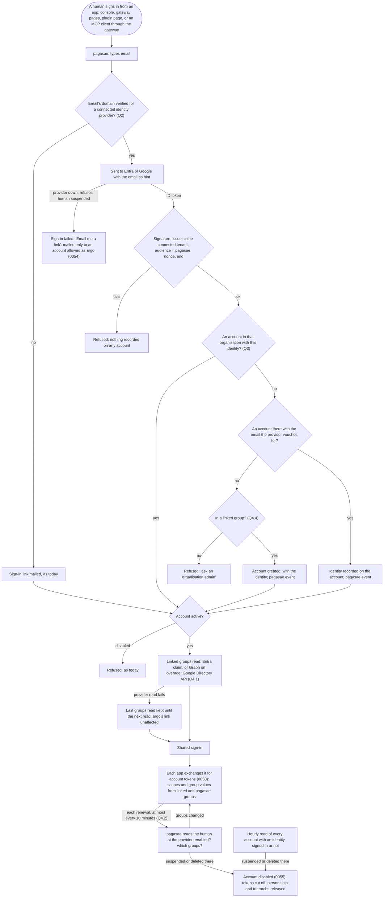

# Company sign-in: Entra ID and Google, and ID-JAG

Design by designer-identity, for Thomas. Phase 1: the purpose, the lessons to check against, the flow the picks give, and the questions, each with options and a pick. No detailed decisions before Thomas agrees the purpose. No code. Terms are the blueprint's Domain language (0050): account, identity, identity provider, directory, organisation, organisation admin, sign-in link.

Inputs: pagasae issue #78; decisions 0050 to 0058; [`accounts.md`](accounts.md) 1.3 and questions 8, 9, 14, 15; [`actors.md`](actors.md) 3; the interop design's slice 6 and I-4 (branch `design/interop`, `docs/design/interop/interop.md`); the pagasae and gateway READMEs.

## 1. Purpose

### 1.1 Today (built)

- pagasae signs every account in by a sign-in link mailed to its email, and keeps the shared sign-in (`aeolus_account_session`) every Aeolus app uses. Apps exchange it for account tokens of one fleet (0058); the gateway, the console, plugin pages and people's MCP clients through the gateway all sign in through pagasae (0054).
- An account is an email in one organisation. It has no identity: pagasae knows no identity provider.
- Disabling an account in pagasae ends its access within one token's life (0055).

### 1.2 The purpose

An organisation connects Entra ID or Google Workspace to pagasae as its identity provider, and its accounts sign in with their company identity. Nothing else changes for the apps: they already sign in through pagasae, so the console, the gateway, plugin pages and MCP clients get company sign-in by that one change.

Its groups plug in the same way: an organisation admin links a group of its Entra tenant or Google Workspace to what it gives in a fleet (scopes, and reach through network rules), and membership then comes from the provider alone. Nobody copies a group or its members by hand.

pagasae stays the account unit. The identity provider proves who the human is and which of its groups they are in; pagasae decides which account that is and what it may do (0051, 0052). The sign-in link stays the way in that never depends on an outside provider, for the accounts allowed to sign in as argo (0054). Entra and Google plug in; they are not the foundation (Thomas, 19 Oct).

### 1.3 The jobs

| # | Job |
| --- | --- |
| C1 | An organisation admin connects the organisation's Entra tenant or Google Workspace, and only an admin of that tenant or Workspace can make it so |
| C2 | A human signs in with their company identity and lands on their own account, never another's, without typing anything but their email |
| C3 | A human the company suspends in its identity provider loses access without anyone in pagasae remembering it |
| C4 | When the identity provider fails or is misconfigured, the accounts allowed as argo still sign in by link |
| C5 | An organisation admin links a provider group to what it gives in a fleet; joining or leaving that group in the provider changes the account's rights within minutes, with nothing changed by hand in pagasae |
| C6 | A person's MCP client that the company manages (enterprise-managed authorization, ID-JAG) reaches the gateway without a browser sign-in, where the identity provider supports it |

### 1.4 A good outcome

At Acme, Mathilde connects Acme's Entra tenant from the organisation's page; Entra asks her, a tenant admin, to consent once. She links Acme's Entra group "Sales" to `messages:send` and `group=sales` in Acme's fleet. Charlotte opens the console, types charlotte@acme.com, signs in at Microsoft as every morning, and is in her account with what "Sales" gives. Acme's IT moves her to "Finance" in Entra; minutes later her account tokens carry finance's rights. Burak is disabled in Entra when he leaves; minutes later he can no longer renew anything. One morning Entra refuses Acme's sign-ins; Mathilde, allowed as argo, signs in by link and acts.

### 1.5 Not this design's

- Pushed provisioning (SCIM, change notifications): question 4.2 asks whether reading the provider is enough without it.
- Identity providers besides Entra and Google (Okta, SAML).
- What an account may do once signed in (0052, 0057, 0058: unchanged).

## 2. Lessons to check against

### 2.1 From Aeolus

| Lesson | Source |
| --- | --- |
| pagasae is the one identity provider of every Aeolus app; nothing federates to a company identity provider but pagasae | 0054 |
| Once connected, every account signs in with its identity; only accounts allowed as argo keep the sign-in link | 0054, `accounts.md` 14 (a) |
| An email may hold accounts in several organisations; a sign-in asks which | 0051 |
| The organisation decides who is in it: an admin adds an account; no guests; a contractor is an account of the hiring organisation | 0051, `accounts.md` 11, 15 |
| Groups are pagasae's; a change lands at the next account token, within 10 minutes | 0052, 0058 |
| A leaver is out within one token's life of being disabled in pagasae | 0055, 0058 |
| Core stores no account and no email; the account token is the only thing core sees | 0058 |
| Every state change writes its event; pagasae keeps its own | architecture, 0057 |
| Thin designs for few people | 0013 |

### 2.2 From the field

| Lesson | What they do | Source |
| --- | --- | --- |
| One multi-tenant registration serves every tenant; the token says which | Entra's `organizations` endpoint signs in any tenant; the ID token's `tid` names it and the issuer carries it, so the app checks the issuer per tenant. A tenant admin consents once for the tenant | [multi-tenant apps](https://learn.microsoft.com/en-us/entra/identity-platform/howto-convert-app-to-be-multi-tenant), [admin consent](https://learn.microsoft.com/en-us/entra/identity-platform/v2-admin-consent) |
| Key an identity by its subject, never by a mutable email | Microsoft: use `oid` with `tid`; `email` can be changed by the user or an admin and is not proof of ownership unless from a verified domain (`xms_edov`). Google: `sub` is the stable id; trust `email` only with `email_verified`, and `hd` names the Workspace domain | [Entra claims](https://learn.microsoft.com/en-us/entra/identity-platform/id-token-claims-reference), [claims validation](https://learn.microsoft.com/en-us/entra/identity-platform/claims-validation), [Google OpenID Connect](https://developers.google.com/identity/openid-connect/openid-connect) |
| Route by verified domain | Home realm discovery sends an email to its tenant by domain, and trusts a domain only once verified | [home realm discovery](https://learn.microsoft.com/en-us/entra/identity/enterprise-apps/home-realm-discovery-policy) |
| Group claims are partial | Entra's `groups` claim carries group object ids, not names, set once on the app registration (security groups, or only groups assigned to the app); past 200 groups in a JWT it sends an overage marker instead, and the app reads the groups from Microsoft Graph (`getMemberObjects`, application permission `GroupMember.Read.All`, which a tenant admin consents to). Google's ID token carries no groups: the Admin SDK Directory API reads them, with a read-only groups scope a super admin grants to the app's service account (domain-wide delegation) or an admin role given to it | [group claims](https://learn.microsoft.com/en-us/entra/identity/hybrid/connect/how-to-connect-fed-group-claims), [overage](https://learn.microsoft.com/en-us/troubleshoot/entra/entra-id/app-integration/get-signed-in-users-groups-in-access-token), [getMemberObjects](https://learn.microsoft.com/graph/api/directoryobject-getmemberobjects), [Google domain-wide delegation](https://support.google.com/a/answer/162106) |
| A suspension at the provider stops new sign-ins, not sessions the app keeps | Most apps re-check at the provider on a timer or rely on a push (SCIM); see `accounts.md` 2.2 | `accounts.md` 2.2 |
| ID-JAG: the client asks the company identity provider, not the app, for access | The client signs the human in at the company identity provider, exchanges that for an ID-JAG whose audience is the app's authorization server (RFC 8693), and posts it there with the JWT bearer grant (RFC 7523); no browser reaches the app. The app trusts an issuer list per tenant, checks audience, issuer and end, needs pre-registered clients. MCP's extension is stable (June 2026); Okta issues ID-JAGs; no source found that Entra or Google do. Claude supports it | [MCP enterprise-managed authorization](https://modelcontextprotocol.io/extensions/auth/enterprise-managed-authorization), [WorkOS on its general availability](https://workos.com/blog/enterprise-managed-auth-ga-mcp-server-builders) |

## 3. The flow the picks give

A sign-in by identity, from any app. Shown so the questions can be read against it; it changes with the answers.

Unhappy paths:

| What goes wrong | What happens |
| --- | --- |
| The provider is down or misconfigured | Nobody signs in by identity; accounts allowed as argo sign in by link (C4). Account tokens already given work until they end (0058) |
| The tenant withdraws consent, or the organisation admin disconnects | Identity sign-ins fail at the provider or at pagasae's issuer check; every account of the organisation signs in by link again |
| An ID token from a tenant no organisation connected | Refused at the issuer check, even if the email matches an account |
| A linked group is deleted in the provider | Its link shows broken on the organisation's page; it gives nothing until the admin links another; its `group` value stays defined so rules do not move |
| A human is in more linked groups than one account may carry (20 values, 0031) | The token carries none of the excess and the account's page says which; the admin narrows the links |
| The human's email changes in the directory | The recorded identity still finds the account; the account's email stays what the admin set |
| The admin typed an email the provider does not vouch for (an alias) | No account found: refused, "ask an organisation admin"; the admin corrects the account's email |
| The email has accounts in several organisations | The organisation is the connected tenant's; the others are asked as today, each by its own way in |
| An unknown email | The same answer as today's link page, so the page never says whether an account exists; a connected domain is routed to its provider whatever the account |

## 4. Questions for Thomas

**1. One multi-tenant registration, or one per organisation?**

What it is: to sign people in, pagasae must be a registered app at Microsoft (an app registration) and at Google (an OAuth client).

- (1) **One per installation**: pagasae's own multi-tenant Entra app and one Google OAuth client; each organisation's admin consents. A self-hosted pagasae registers its own pair. Goes wrong: one credential serves every organisation, so it is a key, not a secret, and rotated; Entra shows an unverified publisher until Microsoft verifies the publisher.
- (2) **One per organisation**: the organisation registers an app in its own tenant and gives pagasae the client id and secret. Goes wrong: a secret per organisation for pagasae to keep; Entra secrets end after at most two years, and sign-in stops the day one does; each admin registers redirect addresses by hand.
- (3) **(1), and (2) for an organisation that wants its own.** Goes wrong: two paths to build and test for no customer asking.

Pick: (1). Connecting is one consent, the way Microsoft and Google built multi-tenant sign-in, and pagasae holds no secret of anyone's.

**2. What connects an identity provider, and what proves it is the organisation's?**

What it is: routing by domain (part 3) means one domain belongs to one organisation per installation. Anyone can sign up and create an organisation (0051), so the first to claim acme.com must not win by asking.

- (1) **The provider's own proof**: Entra, a tenant admin's consent, and the tenant's verified domains as Microsoft Graph lists them; Google, a sign-in of the Workspace domain (`hd`) and a DNS TXT record pagasae gives, on each domain. Goes wrong: two ways, one per provider; a Google admin must reach DNS.
- (2) **A DNS TXT record on every domain, for both.** Goes wrong: an Entra admin proves again what Microsoft verified already.
- (3) **A sign-in of the domain alone.** Goes wrong: any employee of acme.com connects Acme's domain to an organisation of their own, and Acme's people are routed there.

Pick: (1). Each provider already verified the domain; Aeolus asks only for proof it cannot read from the token. One identity provider per organisation, one organisation per domain.

**3. How does an identity find its account?**

Use case: Mathilde added charlotte@acme.com before Acme connected Entra. Charlotte signs in with Entra for the first time. Later Acme renames her charlotte.dubois@acme.com.

- (1) **The admin adds the account, as today; the first identity sign-in with the email the provider vouches for records the identity on the account; after that, the identity alone finds it.** Goes wrong: an account added with an alias never matches until the admin corrects its email.
- (2) **Just in time**: any identity of the connected tenant without an account gets one, in no group, so it reaches nothing until an admin gives it rights (0054 refuses it "ask an organisation admin"). Goes wrong: accounts the organisation never chose pile up. Question 4.4 narrows it to members of linked groups.
- (3) **An invitation**: the admin invites, and the account takes whichever identity follows the invitation's link. Goes wrong: a new record and mail for what the email match already does, since the admin typed the email.

Pick: (1). The organisation decides who is in (0051), and the identity, not a mutable email, keys every later sign-in, as Microsoft and Google advise. The email the provider vouches for: Google's with `email_verified`, Entra's from a verified domain.

**4. Provider groups giving rights: what it takes**

Thomas: "i want to challenge to see what would be needed to use groups as well from Entra and google. So linking groups to permissions / network would be enough." Four parts, each its own pick.

Use case: Acme's Entra has the groups "Sales" and "Finance". Mathilde links "Sales" to `messages:send` and the reach of `group=sales` in Acme's fleet. Charlotte moves from "Sales" to "Finance" while signed in at the gateway; Burak, in "Sales", leaves.

**4.1 How pagasae learns a human's groups**

- (1) **From the provider at sign-in, with an application permission behind it.** Entra: pagasae's app registration asks for the `groups` claim (security groups); on overage, or between sign-ins, pagasae reads Microsoft Graph (`getMemberObjects`) with `GroupMember.Read.All`, and `User.Read.All` for whether the user is enabled, both consented by the tenant admin when the organisation connects (question 2). Google: no claim; pagasae reads the Admin SDK Directory API with its service account, which the super admin grants the read-only group and user scopes (domain-wide delegation) when the organisation connects. Goes wrong: connecting asks for read access to the whole directory's users and groups; an Entra admin may refuse that consent.
- (2) **The token alone**: Entra's claim, with only groups assigned to pagasae's app so it stays under 200. Goes wrong: Google has no such claim, so Google organisations get no groups; group assignment to an app needs a paid Entra plan; read only at sign-in.
- (3) **The human's own delegated permission at each sign-in.** Goes wrong: nothing can be read once they are signed out, so a leaver is never seen.

Pick: (1). One shape for both providers, the claim only as a shortcut, and the same read that finds groups finds a suspended user.

**4.2 When groups are read, and a live sign-in**

- (1) **At each identity sign-in only.** A change lands at the next sign-in, up to question 5's life. Goes wrong: Charlotte keeps sales' rights for hours; against 0052's "within 10 minutes".
- (2) **At sign-in, again at each account token renewal at most every 10 minutes per account, and an hourly read of every account with an identity.** A changed membership lands in the next token (0058), so a live sign-in changes within about 20 minutes, with nothing rescoped in the fleet (0052). A user suspended or deleted in the provider disables the account (0055): tokens cut off, person ship and trierarchs released. This is `accounts.md` 14 (d)'s leaver half, by reading instead of a push. Goes wrong: provider calls per active account every 10 minutes (throttled per tenant by Graph, per project by Google); the hourly read grows with the organisation.
- (3) **Pushed**: Entra SCIM to an endpoint pagasae serves, or Graph change notifications; Google has no push of group membership to an app like pagasae, so Google is read as (2). Goes wrong: two mechanisms, one per provider, and subscriptions to renew; worth it only if (2)'s reads throttle.

Pick: (2). One mechanism, within 0052's time, and it closes C3 for leavers who never sign in again. Question 5 then only says how long a shared sign-in lasts without a sign-in at the provider; the re-read already ends a suspended one. If the provider cannot be read, the last groups read are kept until a read succeeds: a failing provider removes nobody's rights and adds none.

**4.3 Where the link lives**

- (1) **A pagasae group is linked to one provider group**: its members come from the provider only and cannot be edited by hand; everything else is 0052 as built (its scopes per fleet, its value of `group`, the default rule `group=#` to `group=#`, rules joining it to other labels). Hand-made groups stay beside linked ones. Goes wrong: an admin who wants "Sales plus two contractors" makes a second group for the two.
- (2) **A provider group linked straight to fleet scopes and `group` values**, with no pagasae group. Goes wrong: two things that give rights, and 0052's account page, label and limits need a second path.
- (3) **Every provider group mirrored into pagasae.** Goes wrong: hundreds of groups, all counting toward 50 per fleet (0031), and copying is what Thomas ruled out.

Pick: (1). Linking is the whole step Thomas named, and the rest of 0052, the account page's aggregate and the label limits hold unchanged: only linked groups count. A provider group is linked by its id, shown by its name, so a rename in the provider moves nothing.

**4.4 Who gets an account**

What it is: question 3 has the admin add each account. With linked groups the provider already says who is in.

- (1) **An admin still adds each account**; linked groups give it rights. Goes wrong: membership in the provider is not enough, the copy Thomas ruled out, one account at a time.
- (2) **A member of a linked group gets an account at their first identity sign-in**, found by identity after that (question 3); someone in no linked group is refused as today, "ask an organisation admin". An admin may still add accounts by hand (contractors, question 6). Goes wrong: accounts appear without an admin's step; the organisation's page must show where each came from.

Pick: (2). The organisation still decides who is in, in its provider, the place it decides for every other tool; nobody the organisation did not put in a linked group gets in.

**5. How long does a sign-in by identity last before the provider is asked again?**

What it is: suspending Burak in Entra stops his next sign-in there, but his shared sign-in at pagasae lives on after his last use, and every app renews his account tokens from it. Without an answer here, C3 holds only once an admin disables him in pagasae.

- (1) **A fixed life, 8 hours**: then the human signs in at the provider again, usually without a prompt; refused there, the shared sign-in ends and every renewal with it. Goes wrong: a leaver keeps access up to 8 hours and one token's life; a person signs in again once a working day.
- (2) **pagasae keeps the provider's refresh token and renews with it each hour**; a refusal ends the shared sign-in. Goes wrong: pagasae stores a refresh token per human, a secret of the company's, for one hour less exposure.
- (3) **Nothing until provisioning**: the admin disables in pagasae. Goes wrong: C3 fails.

Pick: (1) with 4.2 (2): the re-read ends a suspended human's sign-in within minutes; the 8 hours only bound how long pagasae trusts the provider's sign-in itself. Without 4.2 (2), the 8 hours are the leaver's bound.

**6. An account whose email the provider does not know**

Use case: Acme connects Entra for acme.com. Priya, the contractor, has the account priya@northwind.com in Acme's organisation (0051), and Acme's tenant does not know her.

- (1) **The identity rule of 0054 applies to emails in the connected domains; any other account keeps the sign-in link.** Goes wrong: Acme still disables Priya by hand, as today.
- (2) **Entra guests**: Acme invites Priya as a guest in its tenant and she signs in through it. Goes wrong: Google Workspace has no such guest, so it holds for Entra only; guests grow unseen (`accounts.md` 2.2).
- (3) **Refused**: once connected, only the tenant's members sign in, besides the accounts allowed as argo. Goes wrong: a contractor cannot work, against 0051.

Pick: (1). It reads 0054's rule by domain, which routing does already, and changes nothing for contractors.

**7. Where does ID-JAG apply?**

What it is: with ID-JAG the person's MCP client, managed by the company, gets access to the gateway from the company identity provider and posts it to the gateway's token endpoint; no browser reaches the gateway or pagasae. It applies only there: the console, plugin pages and the gateway's own pages are browsers and keep the redirect; outside parties are approved, not signed in (0056); core sees account tokens only (0058).

- (1) **The gateway takes the JWT bearer grant and hands the ID-JAG to pagasae (token exchange)**, which checks it against the organisation's connected provider and finds the account as in question 3, answering the account's grant. The gateway still federates only through pagasae (0054). Goes wrong: only Okta issues ID-JAGs today, so for Entra and Google it is built against nobody.
- (2) **pagasae becomes the authorization server the gateway's MCP endpoint names**, so the ID-JAG's audience is pagasae. Goes wrong: moves the gateway's OAuth server (its clients, requests and parties, 0056) into pagasae.
- (3) **Not yet: build (1) when a provider Aeolus connects issues ID-JAGs** (Entra or Google, or Okta added as a third). This work connects Entra and Google by OpenID Connect only. Goes wrong: an Acme on Claude Enterprise signs in once by browser per client, as today.

Pick: (3), with (1) as its shape. A grant nobody can issue to us cannot be tested end to end, and a guarantee without a test does not exist.
