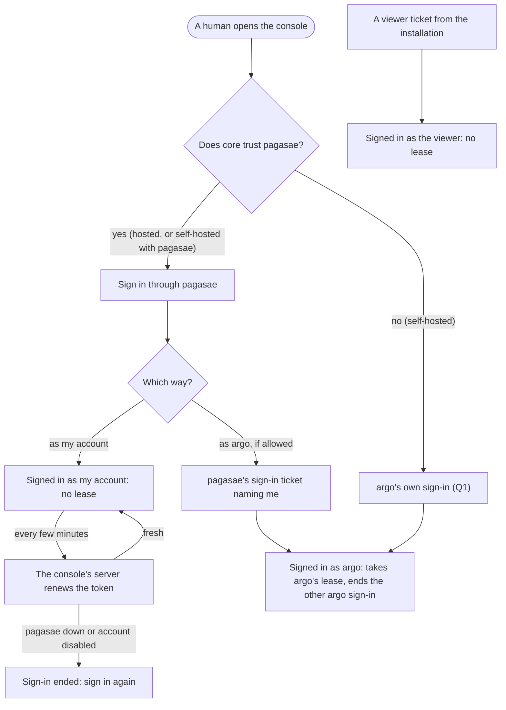
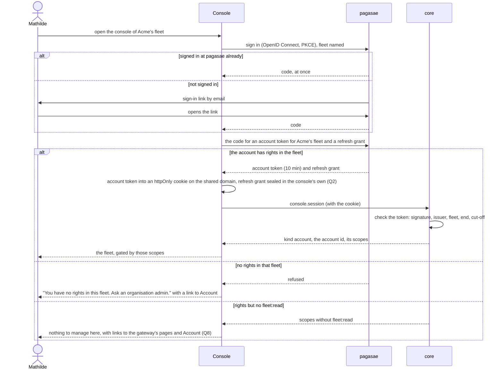
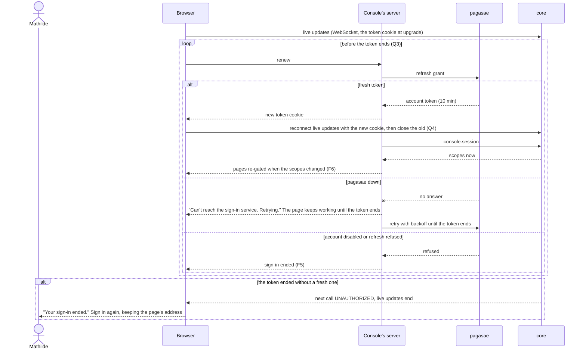
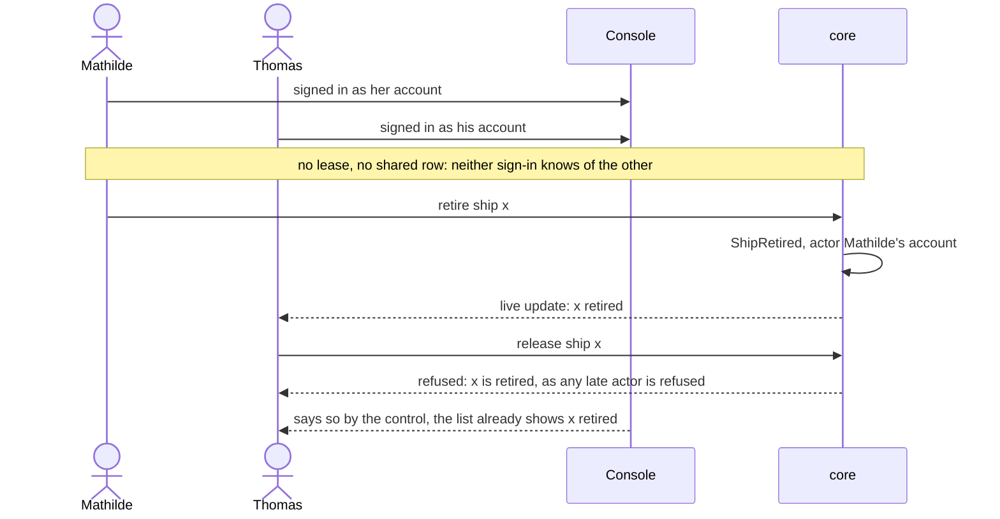
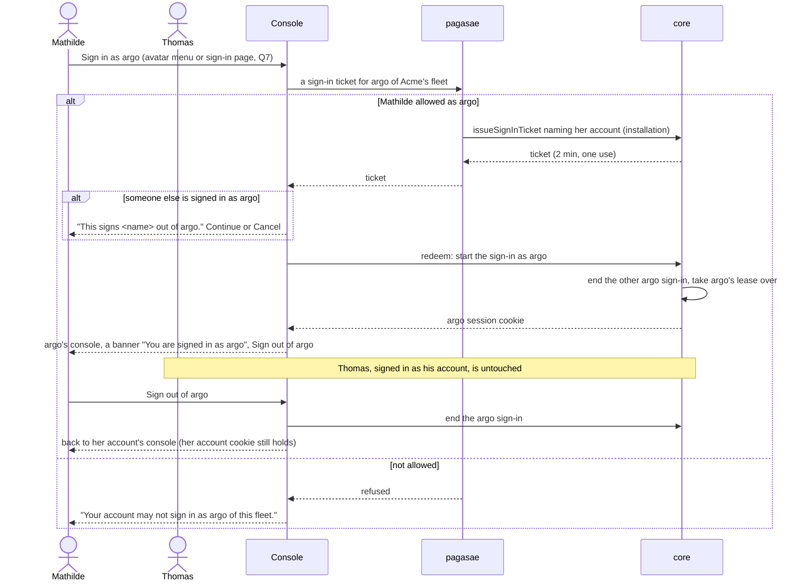
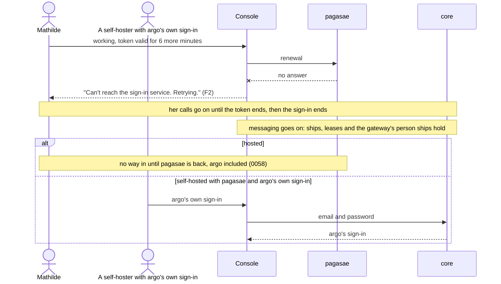
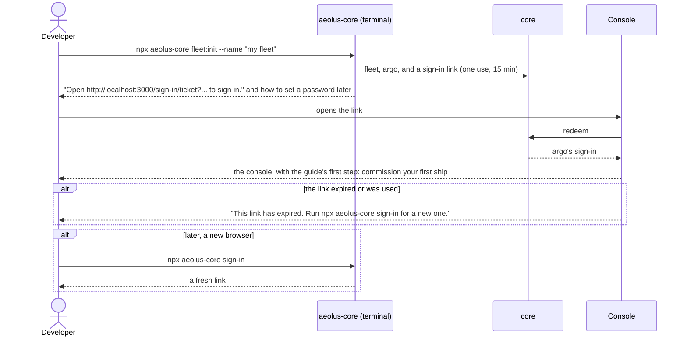

# Accounts in the console

The backbone design for signing humans in to a fleet's console as their own accounts, with argo as the break-glass sign-in. It comes from the header design's part 5 (PR #1039), whose questions C1 to C6 Thomas answered on 21 Oct, each with option 1. Purpose first, then the lessons, then the flows, then the questions. Nothing past the purpose is decided until Thomas agrees it. No code.

## 1. Purpose

Every human who manages a fleet signs in to its console as their own account. They act with that account's scopes and reach, and every event names them. Several humans use one fleet's console at once without ending each other's sign-in. argo stays the fleet's fail-safe: a sign-in taken only when the accounts cannot act, one at a time (0057).

Thomas, 21 Oct:
- On C1: "this is the exact 'legacy of decisions made' that i was refering to."
- On C2: "accounts is the login system for Aeolus completely (in our hosted setup)."
- On C4: "only a ship can send messages ... so this is a hard no."
- On C6: "We will need to take a look at the self running experience for the pure opensource variation. Making sure developers or founders trying it out have a great experience."

A good outcome:

1. **Hosted.** A human signs in once through pagasae and opens the console of any fleet where their account has `fleet:read`. The console shows what their scopes allow and nothing else.
2. **Two at once.** Mathilde and Thomas manage Acme's fleet together; neither one's sign-in touches the other's.
3. **Break-glass.** When accounts cannot act (pagasae misconfigured, a rule locking everyone out), an allowed account signs in as argo. That one sign-in takes argo's lease, as today, and the console makes it plain that this is argo.
4. **Self-hosted, first run.** A developer or founder who runs the open-source install has a signed-in console within minutes of `fleet:init`, with nothing else to install and nothing to configure first.
5. **Leavers and changed rights.** A disabled account loses the console within minutes (0055, 0058), and a change of rights lands within one token's life.

Not the purpose:
- Sending messages from the console as an account. Only a ship sends (C4, "a hard no"), so Compose stays argo's.
- A page per person (0043).
- Accounts in core. Core stores no account (0058).
- A new rights model.

## 2. What is true today

The full analysis, with file and line references, is the header design's part 5.2 and 5.3 (`docs/design/header/README.md` on PR #1039). In short:

- **Every console sign-in is a ship's.** Signing in as argo takes argo's one lease and ends every other argo sign-in (`start-console-session.ts:37-46`). A viewer sign-in holds no lease, and many run at once.
- **Core already checks account tokens on every call.** 31 fleet procedures take an account, and events record an account actor. About 18 procedures the console needs refuse an account today.
- **The console never presents an account token.** Its one call to pagasae is the account-name lookup.
- **Self-hosted without pagasae, the only way in is argo's own sign-in.** `fleet:init` asks for an email and password, and `operator:reset-password` resets them (README, "Running from npm"). Core trusts no account token without `ACCOUNT_TOKEN_ISSUER`. pagasae is private.

## 3. Lessons to check against

- **0057.** A human acts as their account. argo is never a normal path, but "where no pagasae runs, the way in". A self-hosted design that leaves argo as a lone founder's normal way in is within 0057; one that routes a team's daily work through argo is not.
- **0058.** Core checks the token on every call and stores no account, only its id. Tokens live 10 minutes. A cut-off is pushed for leavers, and a change of groups lands at the next token.
- **0054.** pagasae signs every account in. An allowed account signs in as argo with a ticket that names it. Hosted fleets have no argo's own sign-in (0020).
- **0012 and 0010.** One crew per ship. argo has no secret. The sign-in cookie is httpOnly, Secure and SameSite=Strict, with the browser calling core directly.
- **0033.** Tokens are fetched, renewed and parsed on the console's server. The browser holds only cookies it cannot read.
- **0043.** No page per person. The console shows the fleet, gated by scopes.
- **0022.** The viewer stays as it is.
- **0023, 0024, 0025.** Notices, the guide and analytics are keyed by the console sign-in and its kind.
- **0013.** No compatibility layer. argo's sign-in stays as it is; accounts are added beside it.
- **Interaction feedback (web-frontend).** A sign-in, a renewal, a refusal and a sign-out each show their state at once and end in a visible outcome. A failed renewal says so and offers to sign in again; it never leaves a page silently stale.
- **Thomas, C6.** A self-hosted first run is a first-class path, not an afterthought.

## 4. Flows

Actors: Mathilde and Thomas, accounts of Acme's fleet (Mathilde allowed as argo); P pagasae; K the console (its server and the browser); C core; I the installation (pagasae acting as it). Q numbers point to section 5.

### Every way in



### F1 An account signs in through pagasae



### F2 Renewal, its end, and live updates across it



### F3 Two people at once



### F4 Break-glass: an account signs in as argo



### F5 An account is disabled while signed in

```mermaid
sequenceDiagram
  actor A as Organisation admin
  actor B as Burak
  participant P as pagasae
  participant I as Installation
  participant C as core
  participant K as Console
  A->>P: disable Burak
  P->>I: cut off Burak's account tokens (issued before now)
  I->>C: cut-off; end his console sign-ins as argo; release his person ships
  B->>C: any call with his token
  C-->>K: UNAUTHORIZED
  K-->>B: "Your sign-in ended." (Q6)
  B->>P: sign in again
  P-->>B: refused: account disabled
  alt the cut-off did not reach core
    Note over P,C: his token ends within 10 minutes and the renewal is refused
  end
```

### F6 Rights change while signed in

```mermaid
sequenceDiagram
  actor A as Organisation admin
  actor T as Thomas
  participant P as pagasae
  participant K as Console
  participant C as core
  A->>P: Thomas leaves group ops (fleet:manage)
  Note over T,C: his current token still says fleet:manage until it ends (0058)
  T->>C: retire a ship, before the renewal
  C-->>T: allowed, by the token he holds
  K->>P: renewal
  P-->>K: token without fleet:manage
  K->>C: console.session
  C-->>K: scopes now
  K-->>T: manage actions go from the pages; a dialog left open says why on submit
  T->>C: retire, from a stale tab
  C-->>T: refused, the refusal shown by the control
```

### F7 pagasae down



### F8 The viewer

```mermaid
sequenceDiagram
  actor V as Visitor
  participant P as pagasae
  participant C as core
  participant K as Console
  V->>P: open the demo
  P->>C: viewer ticket (installation)
  C-->>P: ticket
  P-->>K: to the console with the ticket
  K->>C: redeem
  C-->>K: viewer sign-in, no lease, many at once (0022)
  K-->>V: read-only console; unchanged by this design
```

### F9 Self-hosted, first run

This shows Q1's pick. Without pagasae, there are no accounts, so the first human is argo.



## 5. Questions

**Q1. How does a self-hosted install with no pagasae let its first human in?**

1. **A sign-in link from the terminal.** `fleet:init` prints a one-use console link, and `aeolus-core sign-in` prints a fresh one at any time. A password is optional, set from the console. The developer signs in as argo, and the console says "Signed in as argo", plainly, with no break-glass warning when no pagasae is configured. This is the Jupyter way, with nothing to invent or remember at first run.
2. **Email and password, as today.** `fleet:init` asks for both. Familiar, but the terminal asks for a password before the human has seen anything.
3. **Local accounts in core.** Core keeps a small accounts table and signs tokens. Against 0058 (core stores no account), and a second account system beside pagasae.

**Pick: 1.** It is the fastest first run, needs no new system, and keeps argo's own sign-in (0054) as the self-hosted way in. Q2 covers a self-hosted team.

**Q2. How does a self-hosted team sign in as accounts?**

1. **The accounts app becomes open source and optional**: pagasae's account part, or a slimmed version of it, as its own release train, installed with one command and trusted by setting `ACCOUNT_TOKEN_ISSUER`. A team adds it when a second human arrives.
2. **Any OpenID Connect provider (GitHub, Google, Keycloak) straight into core**, with a config file mapping logins to scopes. That is a directory in a config file, and a second way accounts are made.
3. **Not supported.** A self-hosted team shares argo's sign-in; against 0057 for a team's daily work.

**Pick: 1, for Thomas.** It is a product and licence decision, and pagasae is private today. Until it is decided, a self-hosted install has one human, as argo.

**Q3. How does the console renew the account token?**

1. **The console's server renews.** It holds pagasae's refresh grant in its own sealed httpOnly cookie, so the console stays stateless. The browser asks a renewal route a minute or two before the token ends, and the proxy renews on any page load past that point.
2. **Core holds the refresh grant.** Core would keep account sign-ins: against 0058.
3. **A silent redirect to pagasae every 10 minutes.** Loses form input and live state.

**Pick: 1.** It is 0033's place for tokens, and nothing new is stored.

**Q4. What do live updates do across a renewal?**

1. **Reconnect right after each renewal**, before the old stream's token ends. The live status stays Live.
2. **Let the stream end with the token and reconnect.** It shows Reconnecting every 10 minutes.

**Pick: 1.** Live updates should not flicker on a schedule.

**Q5. How fast does a change of rights land?**

1. **At the next renewal, within 10 minutes**, as 0058 decided, with the pages re-gated after each renewal.
2. **At once, by a push from pagasae** as for a cut-off. A second push path for every group change.

**Pick: 1.** It is decided already; this design only re-gates the pages.

**Q6. What does a disabled account see?**

1. **"Your sign-in ended."** pagasae then says the account is disabled when they try again. Core tells nothing more than UNAUTHORIZED.
2. **"Your account was disabled"** in the console. Core would have to say why it refused.

**Pick: 1.** The reason is pagasae's to tell, and core stays silent about accounts.

**Q7. Where does an allowed account find "Sign in as argo"?**

1. **In the avatar menu and on the sign-in page**, only for accounts allowed as argo (pagasae says so in the header design's list, its Q1). It warns when someone else holds argo, shows a banner while signed in as argo, and Sign out of argo returns to the account.
2. **Only in pagasae**, as Open console is today.

**Pick: 1.** Break-glass must be easy to find when it is needed, and plain while it is in use.

**Q8. What does an account with rights but no `fleet:read` see?**

1. **"Nothing to manage here"**, with links to the gateway's pages (their messages) and Account.
2. **An empty fleet.**

**Pick: 1.** It says why and where to go.

**Q9. Notices and the guide for accounts** (0023, 0024)

1. **A new audience, `accounts`**, beside `operators` (argo's sign-ins), `viewers` and `everyone`. An account's dismissals and guide progress are kept by its id.
2. **`operators` covers accounts too.** Against 0050: an operator is the human signed in as argo.

**Pick: 1.**

## 6. Decisions that change

| Decision | Now | Becomes |
| --- | --- | --- |
| 0012 | The console is argo's crew; argo is always crewed; one operator console session | argo is always shown crewed. Its lease is taken only by a sign-in as argo: break-glass where accounts exist, the way in where none do (Q1). Accounts sign in to the console without a lease, many at once. argo's own sign-in: a one-use sign-in link from the terminal, a password optional (Q1). The rest stands: no secret, one argo sign-in at a time, the cookie's attributes, `console.session` answering an account too |
| 0043 | Core is the fleet server, its API and argo's admin console | Core is the fleet server, its API and the fleet's admin console, for every account its scopes allow and for argo. Still no page per person; the questions UI stays frozen |
| 0054 | pagasae signs accounts in to the gateway and plugin pages; the console takes argo tickets | Adds "Console sign-in as an account": through pagasae (OpenID Connect), the token in an httpOnly cookie the console's server renews. Open console signs in as the account. "Sign in as argo" stays for allowed accounts, as break-glass. Self-hosted first run per Q1 |
| 0057 | An actor is a ship by its crew token or a console sign-in as argo or the viewer; an account by its token | An account by its token, from a header or the console's cookie. "argo is never a normal path" stands, with Q1's self-hosted single human as the stated case |
| 0058 | Who presents the token: a plugin's page, the gateway, the trierarch plugin's page | Adds the console, through an httpOnly cookie core reads beside the header, with mutations origin-checked as for argo's cookie. What core records: the account id also keys notice dismissals and guide progress |
| 0023, 0024 | Audiences `everyone`, `operators`, `viewers`; state per console sign-in | Adds `accounts`; an account's state is kept by its id (Q9) |
| 0025 | Session kinds operator and viewer | Adds account |

0010, 0022 and 0055 stand.
