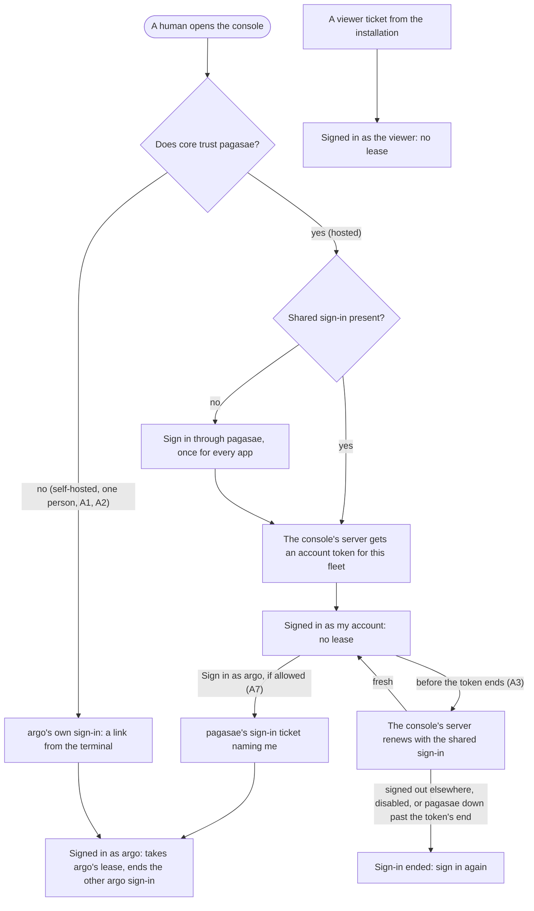
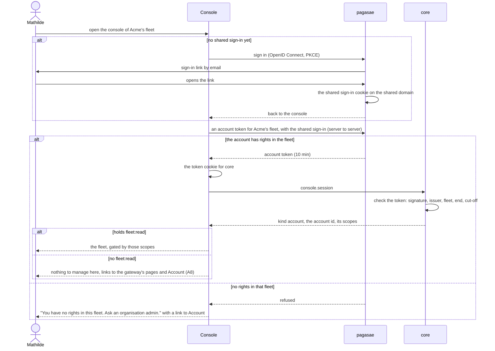
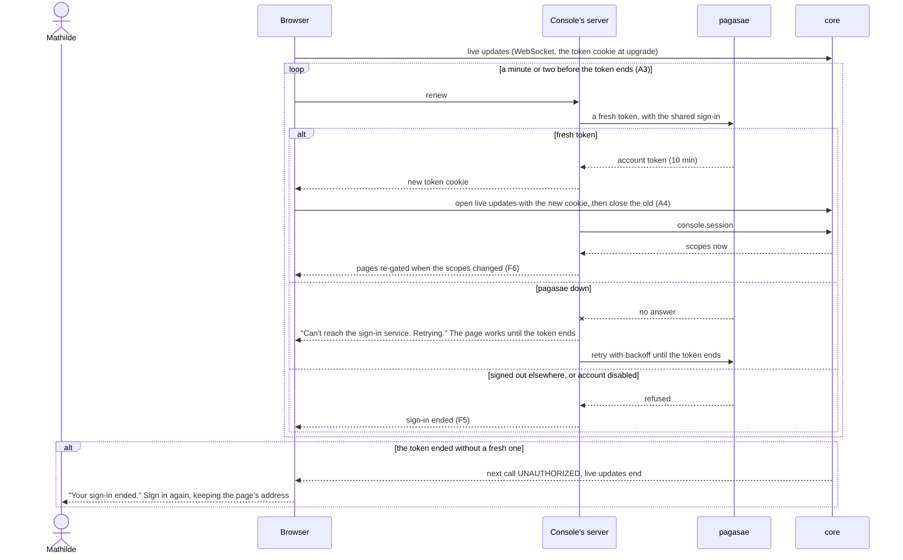
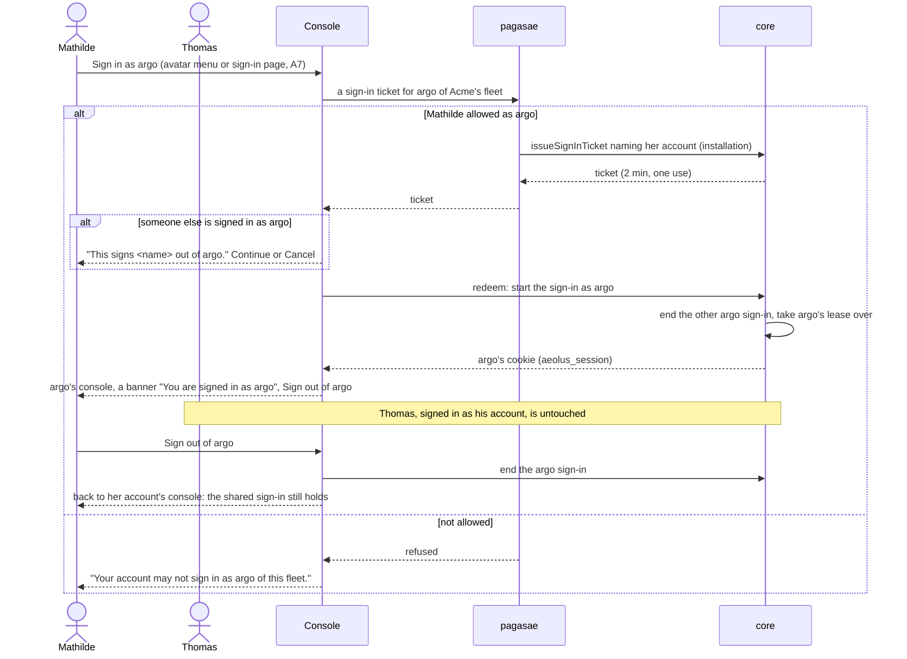
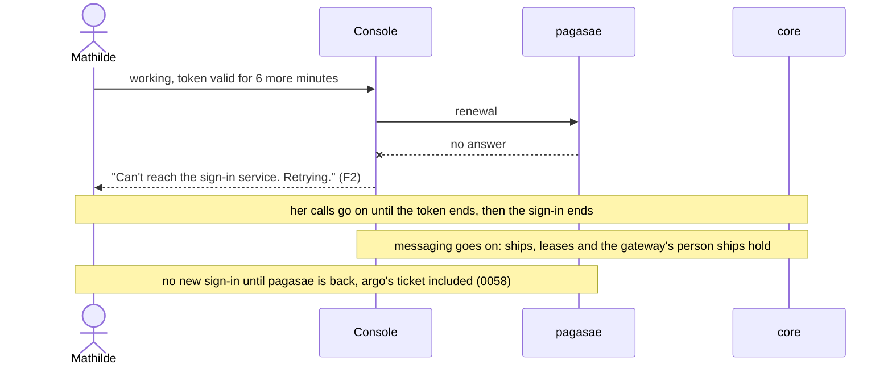
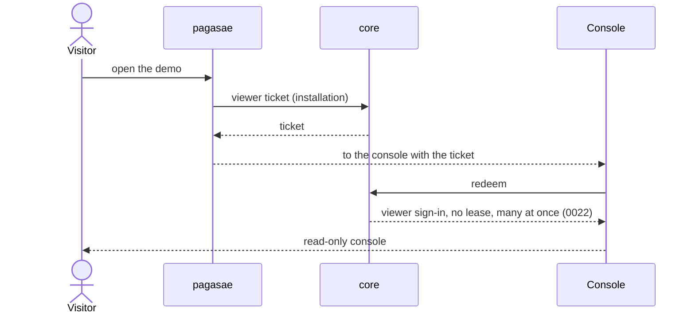

# Accounts in the console

This is the backbone design for signing humans in to a fleet's console as their own accounts, with argo as the break-glass sign-in. Thomas decided it on 21 Oct. It comes from the header design ([`docs/design/header/README.md`](../header/README.md), H7), whose questions C1 to C6 he answered with option 1 each. He then answered A0 to A9 below. No code.

## 1. Purpose (decided)

Every Fleet manager signs in to the console as their own account. They act with that account's scopes and reach, and every event names them. Several Fleet managers use one fleet's console at once without ending each other's sign-in. argo stays the fleet's fail-safe: a sign-in taken only when the accounts cannot act, one at a time, and in the console only (0057; header H5).

Names, as Thomas set them on 21 Oct:
- **App admin:** manages the Aeolus application and all fleets.
- **Fleet manager:** manages one fleet and its ships.
- **Ship owner:** owns one ship within a fleet.

Thomas's notes, 21 Oct:
- **C1:** "ok yep this is the exact 'legacy of decisions made' that i was refering to."
- **C2:** "accounts is the login system for Aeolus completely (in our hosted setup)."
- **C4:** "only a ship can send messages ... so this is a hard no."
- **C6:** "We will need to take a look at the self running experience for the pure opensource variation. Making sure developers or founders trying it out have a great experience."

The outcomes:

1. **Hosted.** A human signs in once, through pagasae, for every Aeolus app (header H5). They open the console of any fleet where their account holds `fleet:read`, and the console shows what their scopes allow, nothing else.
2. **Two at once.** Mathilde and Thomas manage Acme's fleet together. Neither one's sign-in touches the other's.
3. **Break-glass.** When accounts cannot act (pagasae misconfigured, or a rule locking everyone out), an allowed account signs in as argo in the console. That sign-in takes argo's lease, as today, and the console makes it plain that this is argo.
4. **Self-hosted, first run.** A developer or founder runs the open-source install and has a signed-in console within minutes of `fleet:init`, with nothing else to install. Self-hosted is one person (A2).
5. **Leavers and changed rights.** A disabled account loses the console within minutes (0055, 0058). A change of rights lands within one token's life.

Not the purpose:
- Sending messages from the console as an account (C4: only a ship sends). Compose stays argo's.
- A page per person (0043).
- Accounts in core (0058).
- A new rights model.

## 2. What is true today

### Why one console sign-in ends another

Every console sign-in today is a sign-in of a ship, argo or the viewer. A sign-in as argo is argo's crew.

- **The console is argo's crew (0012).** 0012 says "argo is always crewed: the console is its crew" and "One operator console session: sign-in ends the previous one and takes the lease over". Decision 0010 allows one open lease per ship, and argo is the one exception that may take a lease over.
- **The code that ends it.** `core/src/domain/identity/start-console-session.ts:37-46` does two things in one transaction:
  - `consoleSessions.endAll(...)`, with reason `takenOver`, ends every open sign-in on argo's ship (`adapters/prisma/identity.ts:164-170`);
  - `takeOverOperatorLease` (`domain/registry/leases.ts:30-56`) ends argo's lease (`LeaseRevoked`), returns each delivery it held in flight to pending (`DeliveryReturned`), and opens a new lease with no crew token (`ShipClaimed`).
- **The database backs it.**
  - `console_sessions_fleet_id_open_key` (`schema.prisma:816-817`): one open sign-in per fleet that holds a lease.
  - `leases_ship_id_open_key`: one open lease per ship.
- **What hangs on argo's lease.**
  - `fleet.markRead`, `fleet.markDone` and `fleet.reply` take only a crew caller (`trpc.ts:620-633`) whose ship is the operator (`mark-done.ts:38`, `reply-to-message.ts:41`).
  - `markDone` holds the lease while it runs (`mark-done.ts:41`).
  - Compose sends as argo.
- **The leftover.** `schema.prisma:759-760` reads "One account per fleet in v1". Decision 0057 made an account an actor of its own, but the console never followed. It presents no account token; its one call to pagasae is the account-name lookup.
- **The viewer is apart already.** Viewer sign-ins hold no lease, and many run at once (0022). They sit outside the unique index and outside `endAll`.

So a console sign-in ends another only because it is a sign-in as argo, and argo is one ship with one lease.

### What core has, and what it lacks

- **It checks account tokens on every call** (`domain/identity/authenticate-account.ts:35-68`): signature, fleet, end and cut-off.
- **31 fleet procedures already take an account:** the actor-scoped ones, among them list, commission, release, retire, labels, the network rules, explainReach and events.
- **Events already record an account actor** (`events.actor_account_id`).
- **25 fleet procedures refuse an account** (`shipOf`, `trpc.ts:470-475`). Of these, the console needs about 18:
  - ship, shipTimeline, shipMessages, message, shipWay;
  - needsAttention, health, dismiss, resend, inbox, ping, limits;
  - crewRequest, removeCrewRequest, explainCrewRequest, recrew, clearWorktree, assignCrew.

  The trierarch's own calls stay a ship's.
- **The WebSocket context takes only the console cookie** (`adapters/http/server.ts:247-268`). It resolves its caller again on each wake (`trpc.ts:437-446`).
- **Self-hosted** has no way in but argo's own sign-in: `fleet:init` asks for an email and password, and `operator:reset-password` resets them. Without `ACCOUNT_TOKEN_ISSUER`, core trusts no account token.

## 3. Lessons checked against

- **0057.** A human acts as their account, and argo is never a normal path. 0057 also says "where no pagasae runs, the way in", which is self-hosted's one person (A2).
- **0058.** Core checks the token on every call and stores no account, only its id. Tokens last 10 minutes. A cut-off is pushed, and a change of groups lands at the next token.
- **0054.** pagasae signs every account in. An allowed account signs in as argo with a ticket that names it. Hosted fleets have no argo's own sign-in (0020).
- **0012 and 0010.** One crew per ship. argo has no secret. Cookies are httpOnly, Secure and SameSite=Strict, and the browser calls core directly.
- **0033.** Tokens are fetched, renewed and parsed on the server. The browser holds only cookies it cannot read.
- **0043.** No page per person; the console is gated by scopes.
- **0022.** The viewer stays as it is.
- **0023, 0024, 0025.** Notices, the guide and analytics are keyed by the sign-in and its kind.
- **0013.** No compatibility layer: argo's sign-in stays, and accounts are added beside it.
- **Interaction feedback (web-frontend).** A sign-in, a renewal, a refusal and a sign-out each show their state at once and end in a visible outcome.

## 4. Flows

The people and parts:
- **Mathilde and Thomas** are accounts of Acme's fleet, both Fleet managers; Mathilde is also allowed as argo.
- **P** is pagasae; **K** is the console (its server and the browser); **C** is core; **I** is the installation (pagasae acting as it).
- **The shared sign-in** is pagasae's one sign-in cookie on the shared domain (header H5).
- **The token cookie** is the short httpOnly cookie holding the account token for the fleet in view, which core reads.

### Every way in



### F1 An account signs in



### F2 Renewal, its end, and live updates across it



### F3 Two people at once

```mermaid
sequenceDiagram
  actor M as Mathilde
  actor T as Thomas
  participant K as Console
  participant C as core
  M->>K: signed in as her account
  T->>K: signed in as his account
  Note over M,C: no lease, no shared row: neither sign-in knows of the other
  M->>C: retire ship x
  C->>C: ShipRetired, actor Mathilde's account
  C-->>T: live update: x retired
  T->>C: release ship x, from a dialog opened before
  C-->>T: refused: x is retired
  K-->>T: says so by the control; the list already shows x retired
```

### F4 Break-glass: an account signs in as argo



### F5 An account is disabled while signed in

```mermaid
sequenceDiagram
  actor A as Organisation admin
  actor B as Burak
  participant P as pagasae
  participant I as Installation
  participant C as core
  participant K as Console
  A->>P: disable Burak
  P->>P: end Burak's shared sign-in
  P->>I: cut off Burak's account tokens (issued before now)
  I->>C: cut-off; end his console sign-ins as argo; release his person ships
  B->>C: any call with his token
  C-->>K: UNAUTHORIZED
  K-->>B: "Your sign-in ended." (A6)
  B->>P: sign in again
  P-->>B: refused: account disabled
  alt the cut-off did not reach core
    Note over P,C: his token ends within 10 minutes and the renewal is refused
  end
```

### F6 Rights change while signed in

```mermaid
sequenceDiagram
  actor A as Organisation admin
  actor T as Thomas
  participant P as pagasae
  participant K as Console
  participant C as core
  A->>P: Thomas leaves group ops (fleet:manage)
  Note over T,C: his current token still says fleet:manage until it ends (0058)
  T->>C: retire a ship, before the renewal
  C-->>T: allowed, by the token he holds
  K->>P: renewal
  P-->>K: token without fleet:manage
  K->>C: console.session
  C-->>K: scopes now
  K-->>T: manage actions go from the pages; a dialog left open says why on submit
  T->>C: retire, from a stale tab
  C-->>T: refused, shown by the control
```

### F7 pagasae down (hosted)



### F8 The viewer (unchanged)



### F9 Self-hosted, first run (A1, A2)

```mermaid
sequenceDiagram
  actor D as Developer
  participant S as aeolus-core (terminal)
  participant C as core
  participant K as Console
  D->>S: npx aeolus-core fleet:init --name "my fleet"
  S->>C: fleet, argo, and a sign-in link (one use, 15 min)
  S-->>D: "Open http://localhost:3000/sign-in/ticket?... to sign in." and how to set a password later
  D->>K: opens the link
  K->>C: redeem
  C-->>K: argo's sign-in
  K-->>D: "Signed in as argo", no break-glass warning; the guide's first step: commission your first ship
  alt the link expired or was used
    K-->>D: "This link has expired. Run npx aeolus-core sign-in for a new one."
  end
  alt later, another browser
    D->>S: npx aeolus-core sign-in
    S-->>D: a fresh link
  end
```

## 5. Decisions

**A0. The purpose:** as section 1 (option 1).

**A1. Self-hosted first human: a sign-in link from the terminal (option 1).**
- `fleet:init` prints a one-use console link, and `aeolus-core sign-in` prints a fresh one at any time.
- A password is optional, set from the console.
- The console says "Signed in as argo", with no break-glass warning when no pagasae is configured.
- Rejected: email and password at `fleet:init`, as today; local accounts in core (against 0058).

**A2. Self-hosted is one person (option 3).** Thomas: "For now we keep it simple, teams then use 1 account to check console. They can still all have their own ship, it is like how I used aeolus intill now."
- A self-hosted install has argo's sign-in only.
- A team shares it to look at the console, and each member crews their own ships.
- Rejected for now: an open-source accounts app; any OpenID Connect provider straight into core.

**A3. The console's server renews the token (option 1).**
- It asks pagasae for a fresh account token with the shared sign-in (header H5), so the console holds no grant of its own and stays stateless.
- The browser asks a renewal route a minute or two before the token ends, and the proxy renews on any page load past that point.
- Core reads the token from the token cookie or the `aeolus-account-token` header, with mutations origin-checked as for argo's cookie.
- Rejected: core holding the grant (against 0058); a silent redirect every 10 minutes.

**A4. Live updates reconnect right after each renewal (option 1),** before the old stream's token ends, so the live status stays Live.

**A5. A change of rights lands at the next renewal (option 1),** within 10 minutes as 0058 decided, with the pages re-gated after each renewal.

**A6. A disabled account sees "Your sign-in ended." (option 1).** pagasae says the account is disabled when they try again; core tells nothing more than UNAUTHORIZED.

**A7. "Sign in as argo" is in the avatar menu and on the sign-in page (option 1).**
- It is shown only to accounts allowed as argo (header H1's list).
- It warns when someone else holds argo.
- A banner shows while signed in as argo.
- Sign out of argo returns to the account.

**A8. An account with rights but no `fleet:read` sees "Nothing to manage here" (option 1),** with links to the gateway's pages and Account.

**A9. Notices and the guide gain an audience, `accounts` (option 1),** beside `operators` (argo's sign-ins), `viewers` and `everyone`. An account's dismissals and guide progress are kept by its id.

From the header design, answered with option 1 each:
- **C3.** Accounts holding `fleet:read` read argo's inbox; Done and Reply stay argo's.
- **C4.** The console never sends for an account: only a ship sends.
- **C5.** The theme lives in a browser cookie; dismissals and guide progress are keyed by account id.

## 6. What changes

### Decisions

| Decision | Now | Becomes |
| --- | --- | --- |
| 0012 | The console is argo's crew; argo is always crewed; one operator console session | argo is always shown crewed. Its lease is taken only by a sign-in as argo, in the console only: break-glass where accounts exist, self-hosted's one way in otherwise. argo's own sign-in is a one-use link from the terminal, with a password optional (A1). Accounts sign in to the console without a lease, many at once. The rest stands: no secret, one argo sign-in at a time, the cookie's attributes, and `console.session` (which now also answers an account) |
| 0043 | Core is the fleet server, its API and argo's admin console | Core is the fleet server, its API and the fleet's admin console, for every Fleet manager its scopes allow and for argo. Still no page per person; the questions UI stays frozen |
| 0054 | pagasae signs accounts in to the gateway and plugin pages, each with its own sign-in; the console takes argo tickets | One account sign-in for every Aeolus app: pagasae's cookie on the shared domain, from which each app's server gets account tokens (header H5). The console signs in accounts; Open console signs in as the account. "Sign in as argo" stays for allowed accounts as break-glass, console only. Self-hosted is one person, as argo (A2) |
| 0057 | An actor is a ship by its crew token or a console sign-in as argo or the viewer; an account by its token | An account by its token, from a header or the token cookie. "argo is never a normal path" stands; self-hosted's one person is its stated case |
| 0058 | The token is presented by a plugin's page, the gateway or the trierarch plugin's page | The console presents it too, through an httpOnly cookie that core reads beside the header, with mutations origin-checked. What core records: the account id also keys notice dismissals and guide progress |
| 0050 | "installation admin", "organisation admin"; no fleet-level human name | Adds App admin (manages the Aeolus application and all fleets; replaces installation admin and installation owner), Fleet manager (manages one fleet and its ships) and Ship owner (owns one ship within a fleet) |
| 0023, 0024 | Audiences `everyone`, `operators`, `viewers`; state per console sign-in | Adds `accounts`; an account's state is kept by its id (A9) |
| 0025 | Session kinds operator and viewer | Adds account |

0010, 0022 and 0055 stand. In the gateway's repository, its page sign-in decision changes with header H5: `aeolus_gateway_session` goes.

### Parts and rough size

| Part | Change | Size |
| --- | --- | --- |
| Core | Account token from the token cookie; about 18 procedures to the actor check; `console.session` and `console.account` for an account; notices and guide keyed by account id; the terminal sign-in link (A1); tests per procedure for an account in and out of reach | M |
| Console | Sign-in through the shared sign-in; renewal route and proxy (A3, A4); the avatar menu for an account; argo-only parts (inbox actions, Compose) shown only to argo; Sign in as argo (A7); Nothing to manage here (A8) | M |
| pagasae | The shared sign-in cookie; account tokens for an app's server, from the shared sign-in; the console as an OpenID Connect client; Open console signs in as the account | S to M |
| Squadrons, trierarch plugin | Accept an account from the forwarded token cookie; raise the minimum core version | S each |
