# Accounts in the whole domain model of Aeolus

Design by designer-accounts, for Thomas. Thomas read phase 1 (`accounts.md`) and saw gaps behind its questions. Before he answers them, this places accounts in the whole high-level domain model:

1. today's model across every component, one block per concept;
2. the whole in the domain language (decision 0050): one overview and four flows of how organisation, accounts, fleets, ships of every kind, plugins, the gateway and outside parties act together;
3. the gaps: every place where the model has no answer or two answers, in the domain language, those 0050 closed marked, each open one tied to the questions of `accounts.md` it touches.

**Thomas decided (19 Oct): organisation is a concept Aeolus needs.**

1. Organisation is a concept of its own, in the domain model.
2. Organisation management (its humans, their accounts, who administers what, which fleets it has) works on its own, without the gateway and without an outside identity provider.
3. Entra and Google are outside management that plugs in later (the organisation connects its directory), not the foundation.
4. So, before Google sign-in is ready, people sign in at the gateway with the organisation's own accounts.

**And where it lives (Thomas, 19 Oct):** "an organisation manages the user accounts within the whole. Pagasae is the account management unit." The organisation and its accounts live in pagasae, signing in by email as pagasae's sign-in links already do; the gateway signs people in through those accounts until an outside directory is connected; core keeps ships, scopes and owners.

Today "organisation" is only prose: the principle "one organisation, one fleet, many actors" (blueprint Principles, 0043) and "Organisation rules belong to the organisation" (blueprint Purpose). The fleet stands in for it (0007: the fleet is the tenant). Part 1 shows what stands in; part 2 places it; part 3 marks what it answers.

Read from main of each repository on 19 Oct 2026: aeolus-fleet `0e2168ce`, aeolus-fleet-gateway `916d431`, aeolus-fleet-squadrons `870f745`, aeolus-fleet-networking-plugin `58365ca`, aeolus-fleet-trierarch-plugin `7eece35`, pagasae `2ea340a`. Paths below are in aeolus-fleet unless a repository is named. Names are the blueprint's and the code's; where the code's table name differs from the blueprint's word, the table says both.

## 1. Today

### 1.1 The components

| Component | What it is | Its own store |
| --- | --- | --- |
| core | The fleet server, its API and argo's console (0043). Every fleet's ships, messages, scopes, labels and rules | `packages/core/src/adapters/prisma/schema.prisma` |
| squadrons | A plugin: a ship of each fleet it serves, its own process and database (0017, 0021) | aeolus-fleet-squadrons, `packages/squadrons/src/adapters/prisma/schema.prisma` |
| networking plugin | A plugin: the fleet's one rule setter (0035, 0036) | aeolus-fleet-networking-plugin, `packages/networking-plugin/src/adapters/prisma/schema.prisma` |
| trierarch plugin | A plugin: brings computers in and assigns crew requests (0030) | aeolus-fleet-trierarch-plugin, `packages/trierarch-plugin/src/adapters/prisma/schema.prisma` |
| trierarch | A process per computer, crewing a ship of type trierarch and the sessions it starts (0026) | aeolus-fleet-trierarch; its state on the computer |
| gateway | Outside MCP servers and clients as proxy ships; OAuth server; the fleet's identity provider (interop; 0048) | aeolus-fleet-gateway, `src/adapters/prisma/schema.prisma` |
| pagasae | The account app for hosted Aeolus: sign-up, one fleet per account, the owner's pages (0020) | pagasae, `prisma/schema.prisma` |

### 1.2 Diagrams: today

One overview of the components and their main concepts, then one diagram per area. Relations across components are by id only: no component reads another's store (0017, gateway schema header). In the area diagrams a box drawn inside a component's frame lives there; a box outside every frame is core's unless it says otherwise.

#### Overview

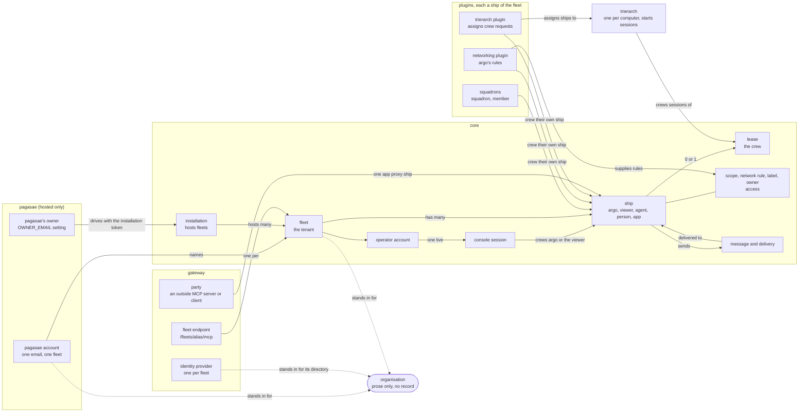

#### Fleet and ships

Ships and their kinds, who crews them, and what they send.

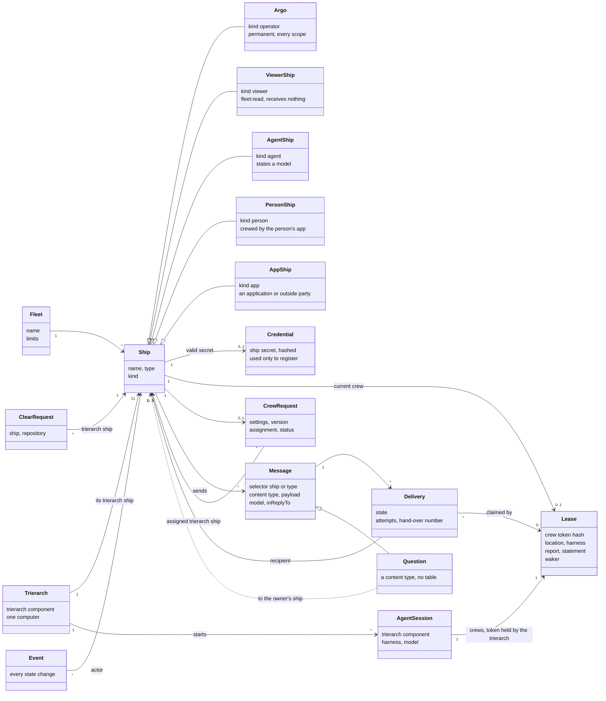

#### Access: scopes, rules, owners, labels

What a ship may do (scopes) and where (reach, from network rules over labels and owners).

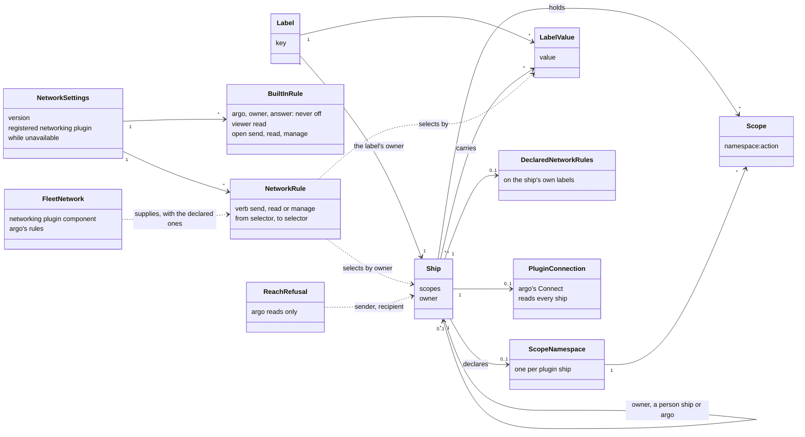

#### Humans and sign-in

Every way a human gets in today, and what stands in for the organisation.

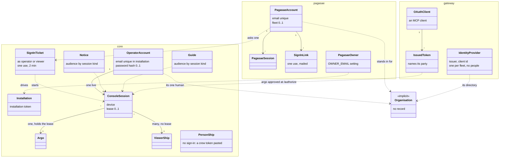

#### Plugins and the gateway

Each plugin is a ship of the fleet it serves, with its own store.

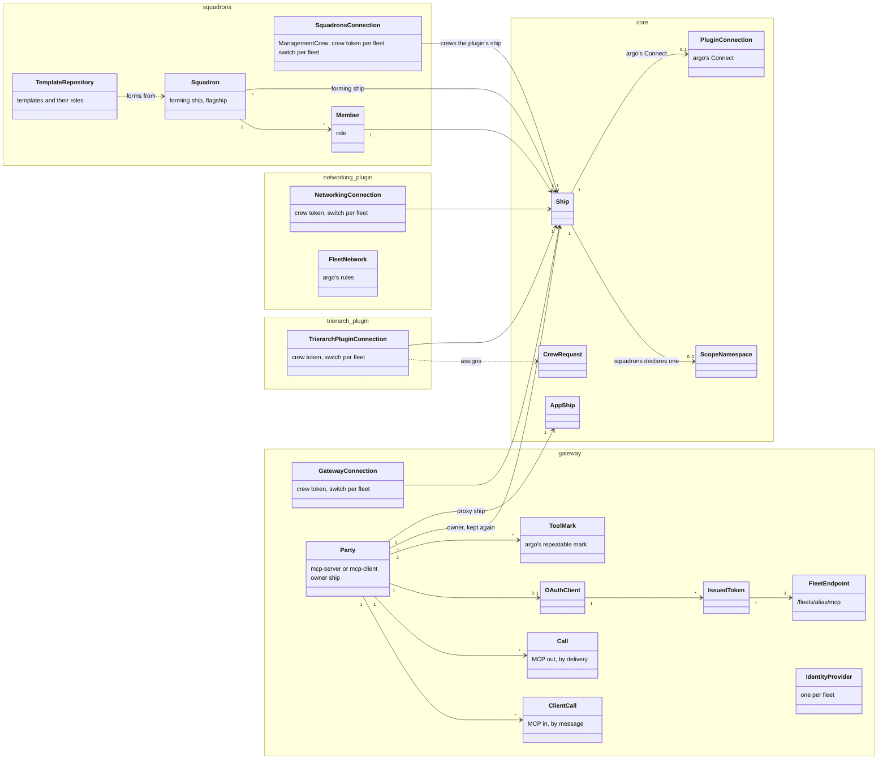

### 1.3 The concepts

| Concept | Lives in | What it is | Grounded in |
| --- | --- | --- | --- |
| Organisation | nowhere (prose) | Implicit. Stood in for by the fleet (the tenant), the pagasae account (one account, one fleet), the operator account (the fleet's one human) and the gateway's identity provider (the organisation's directory, kept per fleet) | blueprint Principles and Purpose, 0007, 0043; no table in any store |
| Installation | core | One server and the fleets it hosts; driven by a hosting service with the installation token; limits and the fleet cap | 0020; `InstallationSettings`, `InstallationRequest` |
| Sign-in ticket | core | One use, 2 minutes, signs in as the operator or the viewer | 0020, 0022; `SignInTicket`, `SignInAs` |
| Notice, guide | core | The installation's text and steps for console sessions of an audience: everyone, operators or viewers | 0023, 0024; `Notice`, `Guide`, `NoticeAudience` |
| pagasae account | pagasae | One email, signed in by email link, at most one fleet, whose operator it is; deletes its fleet with it | pagasae `prisma/schema.prisma` `Account`; `app/account/page.tsx` |
| pagasae session, sign-in link | pagasae | A signed-in browser; a mailed one-use link | pagasae `Session`, `SignInLink` |
| pagasae's owner | pagasae | The person who runs the hosting service, by the `OWNER_EMAIL` setting; sees and deletes every fleet | pagasae `lib/guards.ts` `requireOwner`, `lib/config.ts` |
| Fleet | core | The tenant; every record has `fleet_id` | 0007; `Fleet` |
| Operator account | core | The one human account of a fleet: email (unique in the installation), password hash (none when hosted), theme | 0012, 0020; `Operator` (`opr_`) |
| Console session | core | A browser signed in: argo's (one live, holding argo's lease) or a viewer's (many, no lease) | 0012, 0022; `ConsoleSession` (`ses_`) |
| Ship | core | A durable identity with an inbox: name, type, kind, scopes, owner | blueprint language; `Ship` |
| argo | core | The ship of kind operator: permanent, every scope, crewed only by the operator's console session | 0012; `ShipKind.operator` |
| The viewer | core | The ship of kind viewer: `fleet:read`, receives nothing, crewed by viewer sessions | 0022; `ShipKind.viewer` |
| Agent, person, app ship | core | The other kinds: an agent states a model; a person's app holds a person ship's lease; an app is an application or outside party. Plugin and trierarch ships are agents today | 0044, 0018; `ShipKind`; commission's kind defaults to agent (`packages/common/src/schemas/fleet.ts`) |
| Owner | core | A ship's one owner, a person ship or argo; a relation, not a record | 0045; `Ship.ownerShipId` |
| Ship secret | core | One valid at a time, used only to register | 0002; `Credential` (`crd_`) |
| Lease, crew | core | One session's right to crew a ship: crew token hash, location, harness, report, statement, who wakes it | 0010, 0015, 0028, 0040, 0047; `Lease` (`lse_`), `LeaseWaker` |
| Scope | core | `<namespace>:<action>` on the ship, on the server | 0046; `Ship.scopes` |
| Scope namespace | core | One plugin's declared namespace and scopes | 0046; `ScopeNamespace` |
| Label, label value | core | A key owned by the ship that defined it, values carried by ships | 0031; `Label`, `LabelValue`, `ShipLabel` |
| Crew request, clear request | core | Declared crew state on a ship; a trierarch's worktree to clear | 0029, 0032; `CrewRequest`, `WorktreeClearRequest` |
| Network settings | core | A fleet's rules, the built-ins' switches, the registered networking plugin, a version | 0034, 0035; `NetworkSettings` |
| Built-in rule | core | argo, the owner and an answer, never off; the viewer read; open per verb | 0034; `NetworkSettings.builtIn*` |
| Network rule | core (stored), networking plugin (set) | A verb from one selector to another, by labels or owner | 0034, 0036; `NetworkSettings.rules`, networking plugin `FleetNetwork` |
| Declared network rules | core | A label owner's own rules, supplied by the networking plugin | 0037; `DeclaredNetworkRules` |
| Plugin connection | core | argo's Connect: the plugin's ship reads every ship | 0034; `PluginConnection` |
| Reach refusal | core | A refused send's record, argo's only | 0034; `ReachRefusal` (`rfs_`) |
| Message, delivery | core | The envelope and one delivery per recipient | 0001, 0040; `Message`, `Delivery` |
| Question | core (a convention) | A message of `application/vnd.aeolus.question+json` to the owner's ship; no table | 0038 |
| Event | core | Every state change, with its actor ship | architecture; `Event` |
| A plugin's connection | each plugin | The plugin's ship's crew token per fleet, and its switch per fleet | 0017, 0021; squadrons `ManagementCrew`, `FleetSwitch`; networking plugin and trierarch plugin `Connection`, `FleetSwitch`; gateway `Connection`, `FleetSwitch` |
| Squadron, member, template | squadrons | A squadron formed from a template, its forming ship and flagship; each member a ship with a role | 0017; squadrons `Squadron`, `Member`, `TemplateRepository` |
| argo's network | networking plugin | The rules argo edits, and what holds while unavailable | 0036; `FleetNetwork` |
| Trierarch, agent session | trierarch | A computer's process and the sessions it starts, holding their crew tokens | 0026, 0039 |
| Party | gateway | An outside MCP server or client argo approved, with its app proxy ship and its owner | interop I-5; gateway `Party` |
| OAuth client, issued token | gateway | A pre-registered MCP client; an access and refresh pair naming a party, bound to one fleet endpoint | gateway `OAuthClient`, `IssuedToken`, `AuthorizationCode` |
| Fleet endpoint | gateway | Each fleet's own MCP URL, `/fleets/<alias>/mcp` | gateway `src/adapters/crypto/fleet-endpoints.ts`, commit `916d431` |
| Identity provider | gateway | The fleet's company IdP: issuer, client id and secret; set by argo; nothing signs in with it yet | interop I-4; gateway `IdentityProvider`, commits `4c0e685`, `f759919` |
| Tool mark | gateway | argo's repeatable mark on a tool | interop 5.2; gateway `ToolMark` |

The gateway's sign-in today is for MCP clients only: argo approves each client at `/authorize`, signed in to the console; the gateway checks the console session holds `fleet:manage`, which only argo's does (gateway `src/adapters/http/oauth-routes.ts`). No person signs in through the gateway yet.

## 2. The whole, in the domain language

Every word below is a term of the blueprint's [Domain language](../../blueprint.md#domain-language) (decision 0050, PR in review). Parts marked "to build" do not exist yet; where the answers to `accounts.md` will place them, the diagram follows its picks.

### 2.1 Overview

Each arrow is labelled with what one part does to the other.

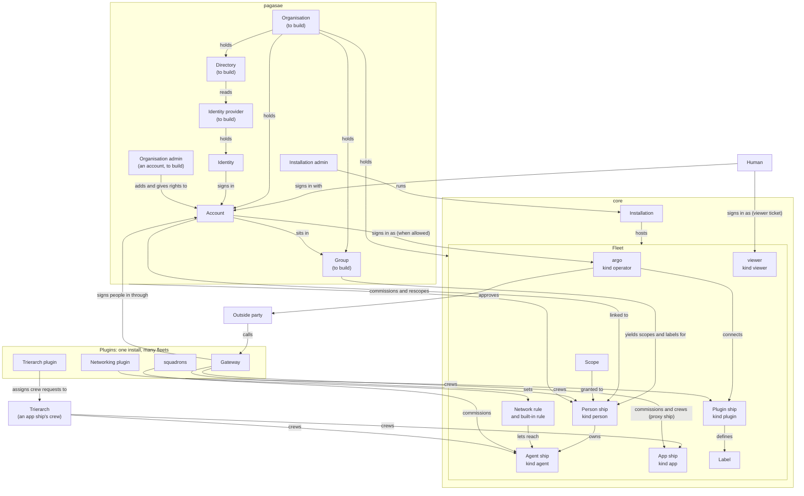

Read it as:

- **Humans.** A human signs in with their account, held by the organisation in pagasae, by email or later with an identity from the organisation's identity provider. The operator is the human whose account signs in as argo; a human with a viewer ticket signs in as the viewer.
- **People in a fleet.** An organisation admin adds an account and gives it rights, directly or through its groups; that commissions its person ship and links the account to it (`accounts.md` 1 and 11). In each fleet a group yields scopes and labels; network rules on those labels say where its people reach. The fleet sees only the person ship. A person ship owns ships, such as its agents. An account may also be allowed to sign in as argo: a second ship, not a second account.
- **Plugins.** The installation admin installs a plugin once; argo connects it to each fleet, and that commissions its plugin ship, which reads every ship by a built-in rule. The plugin crews its own plugin ship.
- **Crew.** The trierarch plugin assigns crew requests to trierarchs; a trierarch crews its own app ship and the agent ships it starts. squadrons commissions the agent ships of a squadron.
- **The gateway.** It signs people in through their accounts and crews their person ships; a ship holding the scope to approve (argo, or a person ship it was granted to, `accounts.md` 5) approves an outside party and the gateway commissions its proxy ship, an app ship it crews for that party.

### 2.2 A human signs in at the gateway and reaches their ship

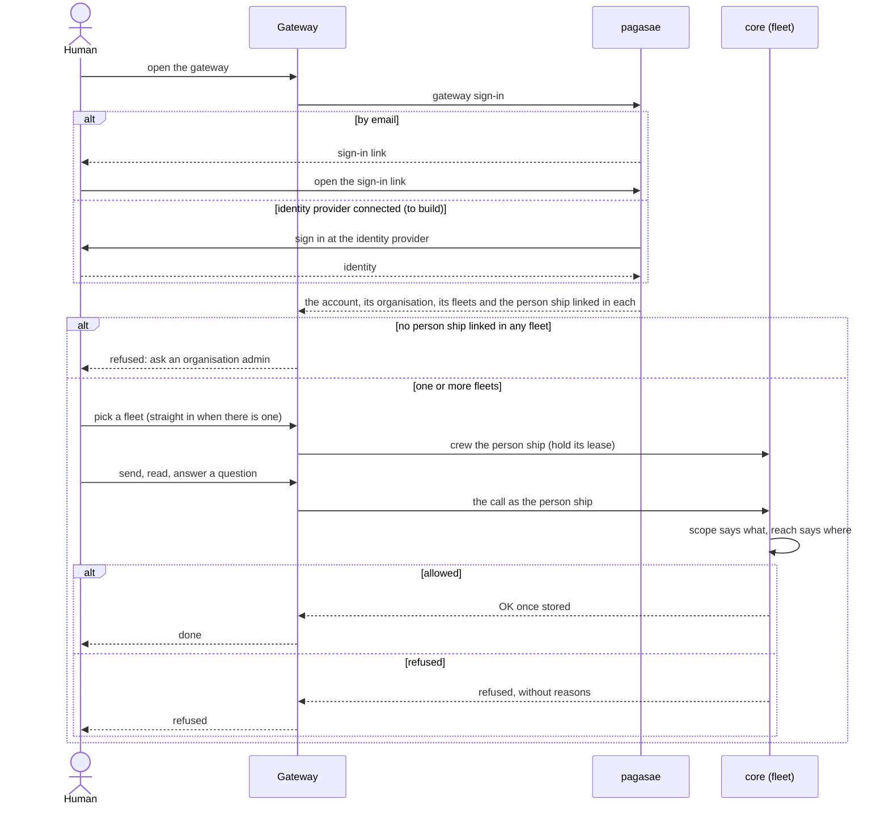

### 2.3 argo connects a plugin to a fleet

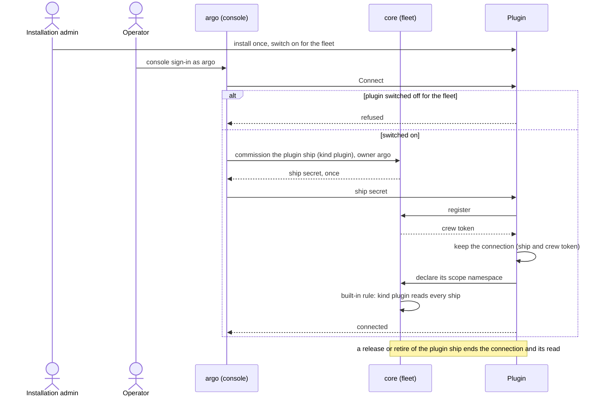

### 2.4 An organisation admin adds a person

Thomas's answer to question 11: an admin adds an account in pagasae and gives it rights; that commissions its person ship. A change of its groups later takes the first branch (question 4, pick (a)).

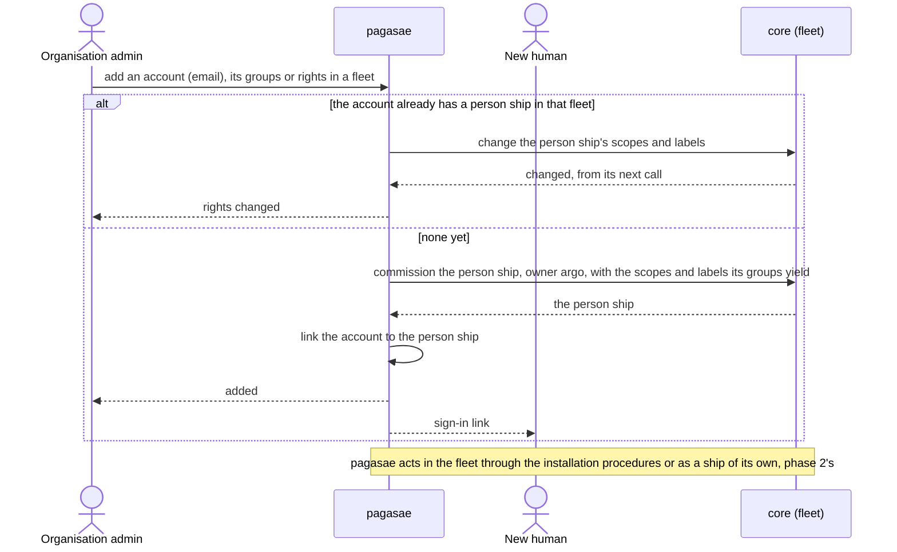

### 2.5a An outside MCP server is added and called (outbound)

The server never asks to join: argo, or an organisation admin given that grant (question 5), adds it on the gateway's page. Nothing waits on a human, so there is nothing to notify.

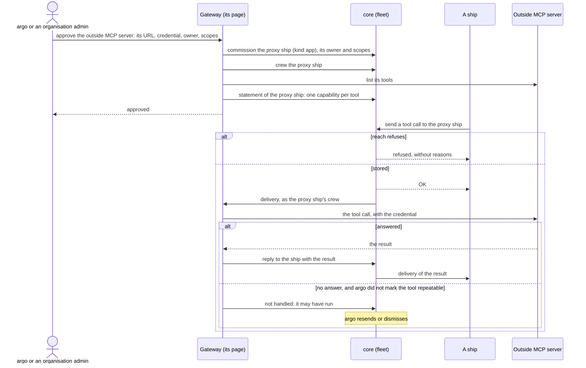

### 2.5b An outside MCP client asks, waits for approval and calls (inbound)

The client asks with the OAuth authorize request. Today that works only when argo is signed in to the console in the same browser at that moment (gap G32). Drawn here is the case where argo is away, with the pick of question 20: the gateway keeps the request, asks argo with a question (0038), and the human at the client connects again.

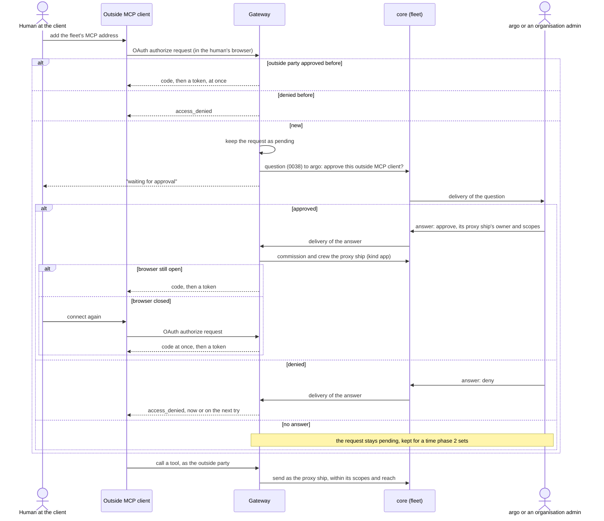

## 3. Gaps

Each gap is a place where the model has no answer or two answers, said in the domain language (decision 0050). "Closed or narrowed" says what 0050 and Thomas's answers of 19 Oct to the questions of `accounts.md` settle. "Questions" names the open questions that take up what is left.

| # | Gap | No answer or two answers | Closed or narrowed | Questions |
| --- | --- | --- | --- | --- |
| G1 | **What a human is.** A human appears as five unrelated things: the operator's email and password (core), pagasae's account (one email, one fleet), the installation admin (a setting), a person ship (no account), and the viewer's sign-ins (anonymous). Nothing links them | No answer | Closed: 0050 and question 1. An account is linked to one person ship per fleet; its groups give that ship's rights | none |
| G2 | **Account means three things.** The operator's login in core, pagasae's account, and a Google or Microsoft login; `console.account` also answers the viewer's sign-in | Two answers | Closed by 0050: account is only a human's in the organisation; a Google or Microsoft login is an identity. Questions 10 and 13 decided | none |
| G3 | **Owner means three things.** A ship's owner (0045), the ship that defined a label (0031), and pagasae's `OWNER_EMAIL` | Two answers | Closed by 0050: owner, definer, installation admin | none |
| G4 | **Role for humans.** A squadron member has a role (0017); a role for humans would be a second meaning, and 0046 rejected scope bundles | Two answers | Closed: 0050 gives humans no role; a group yields scopes and labels in each fleet (question 1). Left: how a change in a group reaches the ship | 4 |
| G5 | **Session means three things.** The agent run crewing a ship, the console's login (`ConsoleSession`, `ses_`), and pagasae's login; a gateway login would add a fourth | Two answers | Closed by 0050: session is only an agent run; every human login is a sign-in | none |
| G6 | **Connect means three things.** argo connecting a plugin (`PluginConnection`), each plugin's stored connection, and phase 1's "connect a person" | Two answers | Closed by 0050 and question 5: connecting a plugin becomes a scope | none |
| G7 | **Rights that sit on a sign-in, not on a ship.** Notices and the guide pick their audience by the kind of console sign-in, not by scope; the gateway decides "argo approves" by the console sign-in's `fleet:manage`, which works only because no other human signs in to the console; squadrons serves writes to argo's sign-in alone | Two answers: scopes and the kind of sign-in | Closed: admins act as their person ships (3), argo's sign-in names its account (10), plugin pages check scopes (5), notices stay argo's console's (18) | none |
| G8 | **Rights outside any fleet, held by no ship.** The installation token (the hosting service), the installation admin and pagasae's account (it deletes its fleet through the installation) act on fleets without being a ship. 0020 allows the hosting service as the one caller that is not a ship | Rights outside the model | Closed by question 2: organisation rights on the account, in pagasae; the installation token pagasae holds stays the one caller that is not a ship (0020) | none |
| G9 | **One human, several ships, unseen.** Several humans can share argo's password; many share the viewer; the events name only the ship | No answer for "who did it" | Closed by questions 3 and 10: each admin acts as their own person ship; argo's console sign-in names its account | none |
| G10 | **What only argo does.** Commission a person ship; change an owner; grant a plugin's scope; read refusals; explain reach; connect a plugin; edit the network (networking plugin); approve an outside party, register an OAuth client, set the identity provider and mark a tool (gateway); write on squadrons' pages; reset the password (a server command) | One holder for all of it | Closed by question 5: every one of these is a scope. Left: which ships an admin's scopes act on | 6 |
| G11 | **The outside party's owner is kept twice.** The gateway stores the owner argo picked (`Party.ownerShipId`); core stores the proxy ship's owner. `fleet.setOwner` changes only core's | Two answers | Closed by question 16: core's owner is the one | none |
| G12 | **One address against one endpoint per fleet.** Thomas decided one gateway address for all fleets; the gateway serves `/fleets/<alias>/mcp` per fleet and binds every token to it (`916d431`) | Two answers | Closed by question 9: gateway sign-in, the organisation, then the fleet | none |
| G13 | **The identity provider has no accounts.** The gateway keeps one identity provider per fleet, but nothing says which identity is which person ship, nor which directory the fleet is. I-4 says "by argo's mapping"; the mapping exists nowhere | No answer | Closed by question 8: pagasae is the gateway's identity provider, and an identity signs an account in. Left: email sign-in beside it | 14 |
| G14 | **A human's email lives in two places.** pagasae's account and core's operator login keep the same human's email | Two answers | Closed by 0050: both fold into the account, in pagasae | none |
| G15 | **argo approves an MCP client on the gateway's page; nobody links a human.** A client gets an outside party and a proxy ship at `/authorize`; a human's MCP client has no path to a person ship, though interop 3.2 lists that case | No answer | Closed by questions 8 and 11: a human's MCP client signs in as their account and acts as their person ship. Left: a person asking for an outside MCP server | 7 |
| G16 | **Plugin and trierarch ships are agents.** They are processes, not sessions with a model, yet a commission defaults to agent | No answer | Closed by 0050: kind plugin for plugins, kind app for the trierarch | none |
| G17 | **A leaver's computer.** A trierarch runs on a human's computer and crews ships there with crew tokens (0026), but nothing names whose computer it is, so disabling an account does not stop it | No answer | No (question 12 made it pressing) | 17 |
| G18 | **Where a human answers a question.** Questions go to the owner's ship (0038); argo answers in the console, whose questions UI is frozen (0043); no component shows a person their questions | No answer | Closed by question 18: a person's own app or chat, or the gateway's person tools | none |
| G19 | **A read-only look for a named human.** The viewer is "anyone with a viewer ticket" and reads every ship | Two answers | Closed by 0050: a named human gets a person ship with `fleet:read`; the viewer stays | none |
| G20 | **A leaver's ships.** A person ship's owned ships fall to argo only once it is retired (0045); nothing says who retires it, and the identity provider cannot tell the fleet | No answer | Closed by question 12: access ends at once, the ships stay. Left: a leaver's computer | 17 |
| G21 | **The first human of a fleet.** Self-hosted: a server command creates the operator's login. Hosted: pagasae's sign-up. With the gateway, the first human to sign in has no person ship until argo commissions one | No answer for who goes first | Closed for hosted by questions 10 and 13: sign-up creates the organisation, its first account and its first fleet. Left: self-hosted | 19 |
| G22 | **Outside people.** A supplier's employee has no place: outside parties are app ships, a person ship is the organisation's own | No answer | No | 15 |
| G23 | **Notices and the guide address argo's and the viewer's sign-ins only.** Humans signing in at the gateway are neither | No answer | Closed by question 18: notices and the guide stay argo's console's | none |
| G24 | **Organisation is prose only.** "Organisation rules belong to the organisation" (blueprint Purpose); no store holds it | No answer | Closed by 0050: pagasae's tenant (accounts, fleets, directory). Left: building it | none |
| G25 | **Two tenants.** The fleet is the tenant (0007); an organisation above its fleets is a second boundary, and an account is found before any fleet is | Two answers | Closed by 0050: the organisation is pagasae's tenant, the fleet core's | none |
| G26 | **The principle against several fleets.** "One organisation, one fleet, many actors" against an organisation that has fleets | Two answers | Closed by 0050: "one organisation, many actors, across its fleets" | none |
| G27 | **The directory sits in the gateway, per fleet.** The gateway keeps `IdentityProvider` per fleet; the directory belongs to the organisation and serves every fleet and argo's console | Two answers | Closed by question 8: the directory and the identity provider are pagasae's, the organisation's | none |
| G28 | **The installation knows fleets, not organisations.** Fleet create names the operator's email; limits are per fleet and per installation (0020); notices address sign-ins | No answer | Closed for hosted by question 13: pagasae creates the organisation's fleets through the installation. Left: self-hosted | 19 |
| G29 | **Rights on an account.** Managing the organisation happens above every fleet, where no ship is, so these rights sit on the account: the one place rights would not be scopes | Two answers: account and ship | Closed by question 2: organisation rights sit on the account, the one place a right is not a scope | none |
| G30 | **One human in two organisations.** A consultant works for two; Entra makes them a guest in the second | No answer | No | 15 |
| G31 | **pagasae is hosted only and private.** A self-hosted fleet has argo's email and password in core and no pagasae, so organisation management has no home there | No answer | No | 19 |
| G32 | **An outside MCP client waits for a human, and is never told.** Approving an outside party is a human step. An outside MCP server never asks (2.5a), but an MCP client asks with an OAuth authorize request, which today is answered only when argo is signed in to the console in that browser at that moment (gateway `oauth-routes.ts`). Nothing keeps the request while argo is away, nobody asks argo, and nothing tells the client the outcome; OAuth's code flow has no waiting approval | No answer | Closed by question 20: the gateway keeps the request, asks argo with a question, and the client connects again | none |
| G33 | **A group's change and a live ship.** A group yields scopes and labels in each fleet (question 1), but nothing says when a change of membership or of a group's rights reaches a person ship whose session is live | No answer | No | 4 |
| G34 | **The inbox principle's exceptions.** A ship is like an inbox whichever client reads it (Thomas, question 18), but a ship has one crew at a time (0010), argo opens only in core's console (0012), the viewer only with a viewer ticket (0022) | Two answers, kept on purpose | Listed in question 18; none blocks a job | none |
