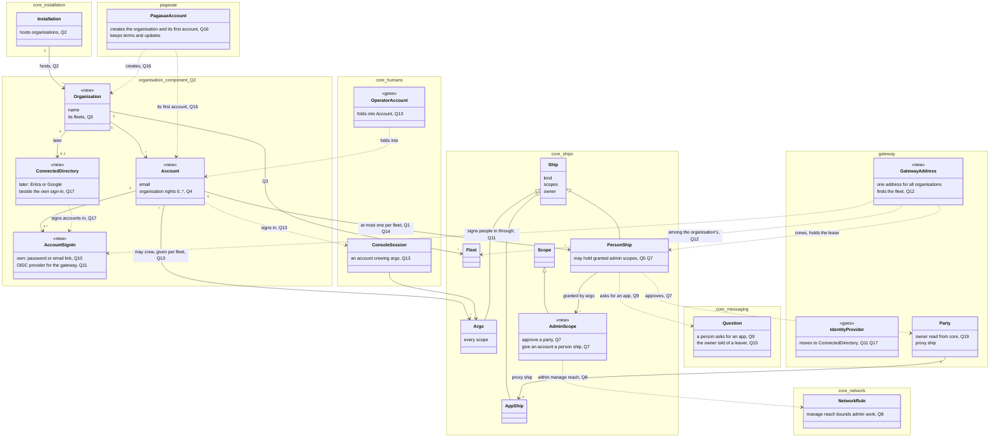

# Accounts in the whole domain model of Aeolus

Design by designer-accounts, for Thomas. Thomas read phase 1 (`accounts.md`) and saw gaps behind its questions. Before he answers them, this places accounts in the whole high-level domain model:

1. today's model across every component, one block per concept;
2. the same model with accounts as phase 1 proposes, the new parts marked;
3. the gaps: every place where the model has no answer or two answers, each tied to the questions of `accounts.md` it touches.

**Thomas decided (19 Oct): organisation is a concept Aeolus needs.**

1. Organisation is a concept of its own, in the domain model.
2. Organisation management (its humans, their accounts, who administers what, which fleets it has) works on its own, without the gateway and without an outside identity provider.
3. Entra and Google are outside management that plugs in later (the organisation connects its directory), not the foundation.
4. So, before Google sign-in is ready, people sign in at the gateway with the organisation's own accounts.

Today "organisation" is only prose: the principle "one organisation, one fleet, many actors" (blueprint Principles, 0043) and "Organisation rules belong to the organisation" (blueprint Purpose). The fleet stands in for it (0007: the fleet is the tenant). Diagram 1 shows what stands in; diagram 2 places it; part 3 marks what it answers.

Read from main of each repository on 19 Oct 2026: aeolus-fleet `0e2168ce`, aeolus-fleet-gateway `916d431`, aeolus-fleet-squadrons `870f745`, aeolus-fleet-networking-plugin `58365ca`, aeolus-fleet-trierarch-plugin `7eece35`, pagasae `2ea340a`. Paths below are in aeolus-fleet unless a repository is named. Names are the blueprint's and the code's; where the code's table name differs from the blueprint's word, the table says both.

## 1. Today

### 1.1 The components

| Component | What it is | Its own store |
| --- | --- | --- |
| core | The fleet server, its API and argo's console (0043). Every fleet's ships, messages, scopes, labels and rules | `packages/core/src/adapters/prisma/schema.prisma` |
| squadrons | A plugin: a ship of each fleet it serves, its own process and database (0017, 0021) | aeolus-fleet-squadrons, `packages/squadrons/src/adapters/prisma/schema.prisma` |
| networking plugin | A plugin: the fleet's one rule setter (0035, 0036) | aeolus-fleet-networking-plugin, `packages/networking-plugin/src/adapters/prisma/schema.prisma` |
| trierarch plugin | A plugin: brings machines in and assigns crew requests (0030) | aeolus-fleet-trierarch-plugin, `packages/trierarch-plugin/src/adapters/prisma/schema.prisma` |
| trierarch | A process per machine, crewing a ship of type trierarch and the sessions it starts (0026) | aeolus-fleet-trierarch; its state on the machine |
| gateway | Outside MCP servers and clients as proxy ships; OAuth server; the fleet's identity provider (interop; 0048) | aeolus-fleet-gateway, `src/adapters/prisma/schema.prisma` |
| pagasae | The account app for hosted Aeolus: sign-up, one fleet per account, the owner's pages (0020) | pagasae, `prisma/schema.prisma` |

### 1.2 Diagram: today

Each namespace is a component. Relations across components are by id only: no component reads another's store (0017, gateway schema header).

```mermaid
classDiagram
direction TB

namespace prose_only {
  class Organisation {
    <<implicit>>
    no record in any component
  }
}

namespace pagasae {
  class PagasaeAccount {
    email unique
    fleetId 0..1
  }
  class PagasaeSession {
    cookie hash
  }
  class SignInLink {
    one use, mailed
  }
  class PagasaeOwner {
    OWNER_EMAIL setting
  }
}

namespace core_installation {
  class Installation {
    installation token
    limits, fleet cap
  }
  class SignInTicket {
    signInAs operator or viewer
    one use, 2 min
  }
  class Notice {
    audience everyone, operators, viewers
  }
  class Guide {
    audience everyone, operators, viewers
  }
}

namespace core_humans {
  class OperatorAccount {
    email unique in installation
    password hash 0..1
    theme
  }
  class ConsoleSession {
    device
    lease 0..1
  }
}

namespace core_ships {
  class Fleet {
    name
    limits
  }
  class Ship {
    name, type
    kind
    scopes
    owner
  }
  class Argo {
    kind operator
    every scope
  }
  class ViewerShip {
    kind viewer
    fleet:read
  }
  class AgentShip {
    kind agent
    states a model
  }
  class PersonShip {
    kind person
  }
  class AppShip {
    kind app
  }
  class Credential {
    ship secret, hashed
  }
  class Lease {
    crew token hash
    location, harness
    report, statement
    waker
  }
  class Scope {
    namespace:action
  }
  class ScopeNamespace {
    declared by one plugin ship
  }
  class Label {
    key
  }
  class LabelValue {
    value
  }
  class CrewRequest {
    settings
    assignment
    status
  }
  class ClearRequest {
    ship, repository
  }
}

namespace core_network {
  class NetworkSettings {
    version
    registered networking plugin
  }
  class BuiltInRule {
    argo, owner, answer: never off
    viewer read
    open send, read, manage
  }
  class NetworkRule {
    verb send, read or manage
    from selector, to selector
  }
  class DeclaredNetworkRules {
    rules on the ship's own labels
  }
  class PluginConnection {
    connected plugin reads every ship
  }
  class ReachRefusal {
    argo reads only
  }
}

namespace core_messaging {
  class Message {
    selector ship or type
    payload, content type
    model
    inReplyTo
  }
  class Delivery {
    state
    attempts, hand-over number
  }
  class Question {
    content type, no table
  }
  class Event {
    actor ship
  }
}

namespace plugins {
  class PluginShipConnection {
    crew token per fleet
    switched per fleet
  }
  class Squadron {
    forming ship
    flagship
  }
  class Member {
    role
  }
  class TemplateRepository {
    templates and roles
  }
  class FleetNetwork {
    argo's rules
    while unavailable
  }
}

namespace trierarch {
  class Trierarch {
    one machine
    holds its sessions' crew tokens
  }
  class AgentSession {
    harness, model
  }
}

namespace gateway {
  class Party {
    kind mcp-server or mcp-client
    owner ship
    proxy ship
  }
  class OAuthClient {
    pre-registered by argo
  }
  class IssuedToken {
    names its party
    bound to one fleet endpoint
  }
  class FleetEndpoint {
    /fleets/alias/mcp
  }
  class IdentityProvider {
    issuer, client id
    one per fleet
  }
  class ToolMark {
    argo's repeatable mark
  }
}

Installation "1" --> "*" Fleet : hosts
Fleet ..> Organisation : stands in for, the tenant
PagasaeAccount ..> Organisation : stands in for, one account one fleet
OperatorAccount ..> Organisation : its one human
IdentityProvider ..> Organisation : its directory, kept per fleet
PagasaeOwner ..> Installation : drives with the token
PagasaeAccount "1" --> "0..1" Fleet : names
PagasaeAccount "1" --> "*" PagasaeSession
PagasaeAccount ..> SignInTicket : asks one for its operator
SignInTicket ..> ConsoleSession : redeemed, starts
Notice ..> ConsoleSession : shown by session kind
Guide ..> ConsoleSession : shown by session kind

Fleet "1" --> "1" OperatorAccount
Fleet "1" --> "1" Argo
Fleet "1" --> "0..1" ViewerShip
Fleet "1" --> "*" Ship
OperatorAccount "1" --> "0..1" ConsoleSession : one live, crews argo
ConsoleSession "*" --> "1" Ship : argo or the viewer
ConsoleSession "0..1" --> "0..1" Lease : argo's only

Ship <|-- Argo
Ship <|-- ViewerShip
Ship <|-- AgentShip
Ship <|-- PersonShip
Ship <|-- AppShip
Ship "*" --> "0..1" Ship : owner, a person ship or argo
Ship "1" --> "0..1" Credential : valid secret
Ship "1" --> "0..1" Lease : current crew
Ship "*" --> "*" Scope : holds
ScopeNamespace "1" --> "*" Scope : declares
Ship "1" --> "0..1" ScopeNamespace : declares
Label "*" --> "1" Ship : owner, its definer
Label "1" --> "*" LabelValue
Ship "*" --> "*" LabelValue : carries
Ship "1" --> "0..1" CrewRequest
CrewRequest "*" --> "0..1" Ship : assigned trierarch

Fleet "1" --> "1" NetworkSettings
NetworkSettings "1" --> "*" BuiltInRule
NetworkSettings "1" --> "*" NetworkRule : supplied by the plugin
Ship "1" --> "0..1" DeclaredNetworkRules
NetworkRule ..> LabelValue : selects by
NetworkRule ..> Ship : selects by owner
Ship "1" --> "0..1" PluginConnection : argo's Connect

Ship "1" --> "*" Message : sends
Message "1" --> "*" Delivery
Delivery "*" --> "1" Ship : recipient
Delivery "*" --> "0..1" Lease : claimed by
Message <|-- Question
Event "*" --> "1" Ship : actor

PluginShipConnection "*" --> "1" Ship : crews the plugin's ship
Squadron "*" --> "1" Ship : forming ship
Squadron "1" --> "*" Member
Member "1" --> "1" Ship
FleetNetwork ..> NetworkRule : supplies

Trierarch "1" --> "1" Ship : its trierarch ship
Trierarch "1" --> "*" AgentSession : starts
AgentSession "1" --> "1" Lease : crews, token held by the trierarch

Party "1" --> "1" AppShip : proxy ship
Party "*" --> "1" Ship : owner
Party "1" --> "0..1" OAuthClient : an MCP client's
IssuedToken "*" --> "1" Party
IssuedToken "*" --> "1" FleetEndpoint
FleetEndpoint "*" --> "1" Fleet
IdentityProvider "0..1" --> "1" Fleet
Party "1" --> "*" ToolMark
```

### 1.3 The concepts

| Concept | Lives in | What it is | Grounded in |
| --- | --- | --- | --- |
| Organisation | nowhere (prose) | Implicit. Stood in for by the fleet (the tenant), the pagasae account (one account, one fleet), the operator account (the fleet's one human) and the gateway's identity provider (the organisation's directory, kept per fleet) | blueprint Principles and Purpose, 0007, 0043; no table in any store |
| Installation | core | One server and the fleets it hosts; driven by a hosting service with the installation token; limits and the fleet cap | 0020; `InstallationSettings`, `InstallationRequest` |
| Sign-in ticket | core | One use, 2 minutes, signs in as the operator or the viewer | 0020, 0022; `SignInTicket`, `SignInAs` |
| Notice, guide | core | The installation's text and steps for console sessions of an audience: everyone, operators or viewers | 0023, 0024; `Notice`, `Guide`, `NoticeAudience` |
| pagasae account | pagasae | One email, signed in by email link, at most one fleet, whose operator it is; deletes its fleet with it | pagasae `prisma/schema.prisma` `Account`; `app/account/page.tsx` |
| pagasae session, sign-in link | pagasae | A signed-in browser; a mailed one-use link | pagasae `Session`, `SignInLink` |
| pagasae's owner | pagasae | The person who runs the hosting service, by the `OWNER_EMAIL` setting; sees and deletes every fleet | pagasae `lib/guards.ts` `requireOwner`, `lib/config.ts` |
| Fleet | core | The tenant; every record has `fleet_id` | 0007; `Fleet` |
| Operator account | core | The one human account of a fleet: email (unique in the installation), password hash (none when hosted), theme | 0012, 0020; `Operator` (`opr_`) |
| Console session | core | A browser signed in: argo's (one live, holding argo's lease) or a viewer's (many, no lease) | 0012, 0022; `ConsoleSession` (`ses_`) |
| Ship | core | A durable identity with an inbox: name, type, kind, scopes, owner | blueprint language; `Ship` |
| argo | core | The ship of kind operator: permanent, every scope, crewed only by the operator's console session | 0012; `ShipKind.operator` |
| The viewer | core | The ship of kind viewer: `fleet:read`, receives nothing, crewed by viewer sessions | 0022; `ShipKind.viewer` |
| Agent, person, app ship | core | The other kinds: an agent states a model; a person's app holds a person ship's lease; an app is an application or outside party. Plugin and trierarch ships are agents today | 0044, 0018; `ShipKind`; commission's kind defaults to agent (`packages/common/src/schemas/fleet.ts`) |
| Owner | core | A ship's one owner, a person ship or argo; a relation, not a record | 0045; `Ship.ownerShipId` |
| Ship secret | core | One valid at a time, used only to register | 0002; `Credential` (`crd_`) |
| Lease, crew | core | One session's right to crew a ship: crew token hash, location, harness, report, statement, who wakes it | 0010, 0015, 0028, 0040, 0047; `Lease` (`lse_`), `LeaseWaker` |
| Scope | core | `<namespace>:<action>` on the ship, on the server | 0046; `Ship.scopes` |
| Scope namespace | core | One plugin's declared namespace and scopes | 0046; `ScopeNamespace` |
| Label, label value | core | A key owned by the ship that defined it, values carried by ships | 0031; `Label`, `LabelValue`, `ShipLabel` |
| Crew request, clear request | core | Declared crew state on a ship; a trierarch's worktree to clear | 0029, 0032; `CrewRequest`, `WorktreeClearRequest` |
| Network settings | core | A fleet's rules, the built-ins' switches, the registered networking plugin, a version | 0034, 0035; `NetworkSettings` |
| Built-in rule | core | argo, the owner and an answer, never off; the viewer read; open per verb | 0034; `NetworkSettings.builtIn*` |
| Network rule | core (stored), networking plugin (set) | A verb from one selector to another, by labels or owner | 0034, 0036; `NetworkSettings.rules`, networking plugin `FleetNetwork` |
| Declared network rules | core | A label owner's own rules, supplied by the networking plugin | 0037; `DeclaredNetworkRules` |
| Plugin connection | core | argo's Connect: the plugin's ship reads every ship | 0034; `PluginConnection` |
| Reach refusal | core | A refused send's record, argo's only | 0034; `ReachRefusal` (`rfs_`) |
| Message, delivery | core | The envelope and one delivery per recipient | 0001, 0040; `Message`, `Delivery` |
| Question | core (a convention) | A message of `application/vnd.aeolus.question+json` to the owner's ship; no table | 0038 |
| Event | core | Every state change, with its actor ship | architecture; `Event` |
| A plugin's connection | each plugin | The plugin's ship's crew token per fleet, and its switch per fleet | 0017, 0021; squadrons `ManagementCrew`, `FleetSwitch`; networking plugin and trierarch plugin `Connection`, `FleetSwitch`; gateway `Connection`, `FleetSwitch` |
| Squadron, member, template | squadrons | A squadron formed from a template, its forming ship and flagship; each member a ship with a role | 0017; squadrons `Squadron`, `Member`, `TemplateRepository` |
| argo's network | networking plugin | The rules argo edits, and what holds while unavailable | 0036; `FleetNetwork` |
| Trierarch, agent session | trierarch | A machine's process and the sessions it starts, holding their crew tokens | 0026, 0039 |
| Party | gateway | An outside MCP server or client argo approved, with its app proxy ship and its owner | interop I-5; gateway `Party` |
| OAuth client, issued token | gateway | A pre-registered MCP client; an access and refresh pair naming a party, bound to one fleet endpoint | gateway `OAuthClient`, `IssuedToken`, `AuthorizationCode` |
| Fleet endpoint | gateway | Each fleet's own MCP URL, `/fleets/<alias>/mcp` | gateway `src/adapters/crypto/fleet-endpoints.ts`, commit `916d431` |
| Identity provider | gateway | The fleet's company IdP: issuer, client id and secret; set by argo; nothing signs in with it yet | interop I-4; gateway `IdentityProvider`, commits `4c0e685`, `f759919` |
| Tool mark | gateway | argo's repeatable mark on a tool | interop 5.2; gateway `ToolMark` |

The gateway's sign-in today is for MCP clients only: argo approves each client at `/authorize`, signed in to the console; the gateway checks the console session holds `fleet:manage`, which only argo's does (gateway `src/adapters/http/oauth-routes.ts`). No person signs in through the gateway yet.

## 2. With organisation and accounts, as the revised phase 1 proposes

New parts are marked `<<new>>`, and a part that goes is marked `<<goes>>`. Each part follows a pick in the revised question list of `accounts.md` (questions 1 to 24), named beside it. Parts that do not change are left out, so the diagram shows only where organisation and accounts attach. The organisation's component is question 2: my pick is a component of its own, shown here as one.

| New, changed or gone | Where | What | Pick |
| --- | --- | --- | --- |
| Organisation (new) | its own component | The organisation: its accounts, its fleets, who administers it, its connected directory later | Thomas's decision; Q2, Q3 |
| Account (new) | organisation | A human of the organisation: email, how it signs in, its organisation rights. In a fleet it acts as a ship, at most one person ship per fleet; its rights there are the ship's | Q1, Q4, Q14 |
| Account sign-in (new) | organisation | The organisation's own sign-in, with no outside IdP: password or email link. It is also the identity provider the gateway signs people in with | Q10, Q11 |
| Connected directory (new, later) | organisation | Entra or Google, connected by the organisation, signing its accounts in beside the own sign-in | Q17 |
| Identity provider (goes) | gateway | Moves to the organisation as the connected directory; the gateway then federates only to the organisation | Q11, Q17 |
| Operator account (goes) | core | Folds into the account: argo is crewed by an account given that right for a fleet, still one console session at a time | Q13 |
| pagasae account (changed) | pagasae | Hosted sign-up creates the organisation and its first account; pagasae keeps only what is hosted (terms, updates) | Q16 |
| Installation (changed) | core | Hosts organisations, each with its fleets | Q2, Q3 |
| Gateway address (new) | gateway | One address for all organisations: sign in, find the organisation, then the fleet (straight in when it has one, a choice among the account's fleets when several) | Thomas's decision; Q12 |
| Admin scopes (new) | core | Two of argo's alone jobs as scopes argo grants: approve a party, give an organisation's account a person ship in this fleet | Q5, Q6, Q7 |
| Party (changed) | gateway | Reads its owner from core instead of keeping its own | Q19 |
| Network rule, question (used) | core | Manage reach bounds admin work; a person asks for an app; a leaver's owner is told | Q8, Q9, Q15 |

## 3. Gaps

Each gap is a place where the model has no answer or two answers. "Organisation" says whether Thomas's decision of 19 Oct answers or narrows it. "Questions" names the questions of the revised list in `accounts.md` (1 to 24) that take it up; every gap has at least one.

| # | Gap | No answer or two answers | Organisation | Questions |
| --- | --- | --- | --- | --- |
| G1 | **What a human is.** A human appears as five unrelated things: an operator account (email), a pagasae account (email), pagasae's owner (a setting), a person ship (no identity at all), and a viewer session (anonymous). Nothing links them, and 0045 left "a person record beside the person's ship" out | No answer | Answers: a human is an account of the organisation | 1, 4, 14 |
| G2 | **"Account" is taken three times.** The operator account (core), the pagasae account (pagasae), and the company Google or Microsoft account people sign in with; `console.account` also answers a viewer's session, which has no account | Two answers, three meanings | Narrows: one account, the organisation's; the operator and pagasae accounts fold in | 13, 16, 20 |
| G3 | **"Owner" is taken three times.** A ship's owner (0045), a label's owner (0031: the ship that defined it, with rights to assign it), and pagasae's owner (the hosting service's runner). The first two are both ships but mean different things: answering for a ship, and holding rights over a label | Two answers, three meanings | No | 20 |
| G4 | **"Role" is already taken.** A squadron member has a role, from its template (squadrons `Member`, 0017). Thomas's "roles" for humans would be a second meaning; 0046 rejected roles as a scope bundle | Two answers | Narrows: a role may be the organisation's, a fleet keeps scopes | 4, 6 |
| G5 | **"Session" is taken three times.** The agent run crewing a ship (blueprint), the console session (core, `ses_`), and pagasae's session. A gateway sign-in will add a fourth | Two answers | No | 20 |
| G6 | **"Connection" and "connect" mean three things.** argo's Connect of a plugin in core (`PluginConnection`: the plugin reads every ship), each plugin's own connection (its ship's crew token, `Connection`, `ManagementCrew`), and phase 1's "connect a person" | Two answers | No | 7, 20 |
| G7 | **Rights that sit on a session, not on a ship.** The operator's way in is an account and a console session; the notices and the guide pick their audience by session kind (`operators`, `viewers`), not by scope; the gateway decides "argo approves" by the console session's `fleet:manage`, which works only because no other human has a console session; squadrons serves writes to the operator's session alone | Two answers: scopes and session kind | Narrows: argo's console session belongs to an account | 1, 5, 13, 24 |
| G8 | **Rights outside any fleet, held by no ship.** The installation token (the hosting service), pagasae's owner (by email setting) and the pagasae account (deletes its fleet through the installation) act on fleets without being a ship. 0020 allows the hosting service as the one non-ship caller; the account and owner ride on it | Rights outside the model | Narrows: organisation rights come inside the model; the installation token stays | 2, 4 |
| G9 | **One human, several ships, unseen.** Several humans can share argo's password; many humans share the one viewer ship; nothing tells them apart in the events, which name only the ship | No answer for "who did it" | Narrows: each account crews argo as itself | 5, 13 |
| G10 | **Things only argo can do.** Commission a person ship; change an owner; grant a plugin's scope; read refusals; explain reach; connect a plugin; edit the network (networking plugin); approve a party, register an OAuth client, set the identity provider and mark a tool (gateway); write in squadrons' pages; reset a password (a server command) | One holder for all of it | No | 5, 7 |
| G11 | **The party's owner is kept twice.** The gateway stores the owner argo picked on the party (`Party.ownerShipId`), and core stores the proxy ship's owner (`Ship.ownerShipId`). argo can change the second with `fleet.setOwner`; the first then disagrees | Two answers | No | 19 |
| G12 | **One address against one endpoint per fleet.** Thomas decided one gateway address for all fleets. The gateway serves one MCP endpoint per fleet, `/fleets/<alias>/mcp`, and binds every token to it (commit `916d431`, "one fleet URL", interop 1) | Two answers | Answers: sign in, find the organisation, then the fleet | 12 |
| G13 | **The identity provider has no people.** The gateway keeps one IdP per fleet (issuer, client id) but nothing that says which IdP subject is which person ship, nor which directory (tenant) the fleet is. I-4 says "by argo's mapping"; the mapping exists nowhere | No answer | Answers: the accounts are the organisation's; a directory signs them in later | 11, 17 |
| G14 | **A person's email lives in two places.** The pagasae account's email and the operator account's email are the same person, kept twice, in two stores; a change in one leaves the other | Two answers | Answers: one account | 16 |
| G15 | **Who approves an MCP client is argo, by a console session, in the gateway's page; who approves a person is nobody.** Clients get a party and an app proxy ship at `/authorize`; a person's MCP client has no path to a person ship, though the interop table lists that case (interop 3.2) | No answer | Narrows: a person is an account; their MCP client signs in as it | 7, 9, 11, 14 |
| G16 | **Plugin and trierarch ships are agents.** They are processes, not sessions with a model (squadrons states its package and version, 0018), yet their kind is agent because a commission defaults to it. "Be true to what a ship is" (0044) has no kind for them | No answer | No | 21 |
| G17 | **The machine's human.** A trierarch runs on a person's machine, and the trierarch plugin's placement is "across people's machines" (0030), but the trierarch ship is argo's and nothing names whose machine it is. Placement by person has no fact to select on | No answer | Narrows: a machine could name an account | 22 |
| G18 | **Where a person answers a question.** Questions go to the owner's ship (0038); argo answers in the console, whose questions UI is frozen (0043). A person ship's crew is "their app or a chat" or the gateway, but no component today shows a person their questions | No answer | No | 24 |
| G19 | **The viewer is a ship, its humans are not.** Many viewer sessions crew one ship with no lease; a viewer is "anyone the hosting service hands a ticket". If a person needs a read-only look (J6), the viewer cannot tell them apart and reads every ship | Two answers for read-only: the viewer ship, or a person ship with `fleet:read` | Narrows: a person's read-only look is their person ship with `fleet:read` | 23 |
| G20 | **A leaver's ships.** When a person leaves, their person ship's owned ships fall to argo only once the person ship is retired (0045). Nothing says who retires it, and the IdP has no way to tell the fleet | No answer | Narrows: the organisation disables the account | 15 |
| G21 | **The first human of a fleet.** Self-hosted: a server command creates the operator account. Hosted: pagasae's sign-up creates it. With the gateway, the first person to sign in with the company account has no ship until someone connects them, and only argo can | No answer for who goes first | Answers: the organisation's first account, from pagasae's sign-up or the server command | 13, 16 |
| G22 | **Outside people.** A supplier's employee has no place: outside parties are app ships, a person ship is the organisation's own | No answer | No | 18 |
| G23 | **Notices and the guide address operators and viewers only.** People signing in through the gateway are neither; their app shows its own (scope rework 0.6) | No answer | No | 24 |

New gaps, from organisation:

| # | Gap | No answer or two answers | Organisation | Questions |
| --- | --- | --- | --- | --- |
| G24 | **Organisation is prose only.** "One organisation, one fleet" (blueprint Principles, 0043) and "Organisation rules belong to the organisation" (blueprint Purpose) name it; no store holds it | No answer | Decided as a concept; where it lives is open | 2 |
| G25 | **Two tenants.** The fleet is the tenant: every record has `fleet_id` and lookups before the fleet is known are named exceptions (0007). An organisation above its fleets is a second boundary, and an account is found before any fleet is | Two answers | Raised | 2, 3 |
| G26 | **The principle against several fleets.** "One organisation, one fleet, many actors" against an organisation that "has fleets" (Thomas's words of 19 Oct) | Two answers | Raised | 3 |
| G27 | **The directory sits in the gateway, per fleet.** The gateway keeps one identity provider per fleet (`IdentityProvider`); the organisation's directory belongs to the organisation and serves every fleet and the console, not only the gateway | Two answers | Raised | 11, 17 |
| G28 | **The installation knows fleets, not organisations.** Fleet create names an operator email; limits and the fleet cap are per fleet and per installation (0020); notices address sessions. Who creates an organisation, and what is limited per organisation, has no place | No answer | Raised | 2, 3, 16 |
| G29 | **Rights on an account.** Managing the organisation (its accounts, its fleets, its directory) happens above every fleet, where no ship is, so these rights sit on the account. That is the one place rights would not be a ship's (0012: every caller is a ship) | Two answers: account and ship | Raised | 4 |
| G30 | **One human in two organisations.** A consultant works for two; Entra makes them a guest in the second. One account per organisation, or one human with accounts in several, has no answer | No answer | Raised | 18 |
