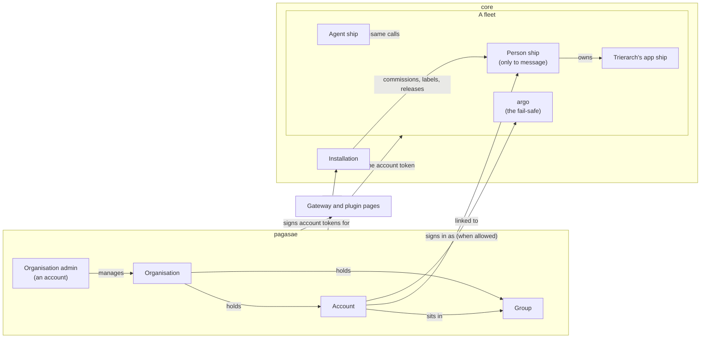

# Accounts, phase 2: the decided model

Thomas answered all 20 questions of [`accounts.md`](../accounts.md), then redesigned phase 2 with pagasae not a ship: the actor model of [`actors.md`](../actors.md), answered in round 4, and round 5 below. The model is decided: decisions 0051 to 0058 in [`docs/decisions`](../../../decisions/README.md), and the blueprint. This folder keeps the flows, happy and unhappy paths, and the questions they came from. No code.

| Part | Decision | Answers | Flows |
| --- | --- | --- | --- |
| 1 | [0057 Actors](../../../decisions/0057-actors.md) | `actors.md` 1, 2, 4 to 9 | [F4](flows.md#f4-an-admin-acts-as-their-account) |
| 2 | [0058 The link between pagasae and core](../../../decisions/0058-pagasae-core-link.md) | `actors.md` 3, 4 | [F11](flows.md#f11-an-account-token-is-checked) |
| 3 | [0051 Organisation](../../../decisions/0051-organisation.md) | `accounts.md` 2, 13, 15, 19 | [F1](flows.md#f1-sign-up) |
| 4 | [0052 Groups, an account's rights and its person ship](../../../decisions/0052-groups.md) | 1, 4, 11 | [F2](flows.md#f2-an-account-joins-a-group), [F3](flows.md#f3-a-groups-rights-change) |
| 5 | [0053 Nothing is argo's alone](../../../decisions/0053-nothing-is-argos-alone.md) | 3, 5, 6 | [F4](flows.md#f4-an-admin-acts-as-their-account) |
| 6 | [0054 Sign-in through pagasae](../../../decisions/0054-sign-in.md) | 8, 9, 10, 14, 18, 19 | [F5](flows.md#f5-gateway-sign-in), [F6](flows.md#f6-console-sign-in-as-argo) |
| 7 | [0055 Leavers and their computers](../../../decisions/0055-leavers.md) | 12, 17 | [F7](flows.md#f7-a-trierarch-joins-for-an-account), [F8](flows.md#f8-an-account-is-disabled) |
| 8 | [0056 Outside parties: requests and owner](../../../decisions/0056-outside-parties.md) | 7, 16, 20 | [F9](flows.md#f9-an-outside-mcp-client-waits), [F10](flows.md#f10-a-person-asks-for-an-outside-mcp-server) |
| 9 | [The blueprint](../../../blueprint.md): principles, users, access, domain language, installation | all | |

## The model in one picture

An account acts in a fleet with the scopes and `group` values its account token carries; a person ship exists only to message and to own, and owns itself. pagasae is no ship: it signs account tokens and acts as the installation. An agent ship can hold any scope and do every management job through the same calls. argo is the fail-safe.

## Round 3, rewritten for the actor model

What became of phase 2's design points P1 to P9 (round 3, on hold since 19 Oct):

| Point | Now |
| --- | --- |
| P1 pagasae as a plugin ship | Gone: pagasae acts as the installation (`actors.md` 4). What the installation may do in a fleet is question 8 |
| P2 the `group` label and its rules | Question 1, restated: values in account tokens and on person ships |
| P3 rights only through groups | Question 2 |
| P4 what a commission checks | Decided by `actors.md` 5: labels the actor defined or carries |
| P5 scope names | Question 3 |
| P6 widening `fleet:on-behalf` | Gone: the installation releases with its own scopes |
| P7 whom the gateway asks | Question 4 |
| P8 how long a request is kept | Question 5 |
| P9 the last organisation admin | Question 6 |
| New | Questions 7 (when an account has a person ship), 8 (what the installation may do in a fleet), 9 (what an event keeps about an account) |

## Questions for Thomas (round 5, answered)

Thomas answered all nine on 19 Oct; his answers and notes follow each pick.

The actors are Acme's: Mathilde (IT, organisation admin), Charlotte (sales), Thomas (engineering's team lead), Burak (who leaves), Priya (a contractor from Northwind), and an onboarding agent ship. Each option is tested against Thomas's principle that an agent ship can hold any scope any actor holds.

**1. How does a group give reach?** (was P2)

What it is: reach comes from network rules, which select by labels or owner (0034). An account carries its groups as values of the label `group` in its account token; its person ship carries the same values in the fleet.

Use case: "engineering sends to engineering", and "sales sends to the CRM" (`crm=app`).

- (a) **The installation defines `group`, one value per group, and declares each group's rules on it (0037)**; a rule joining a group to another label, such as sales to the CRM, is a rule in the networking plugin. Goes wrong: 50 groups giving anything per fleet and 20 per account (0031); a group's reach lives in two places. An agent ship can be given `group` values by the installation, their definer, or by an actor holding `labels:any`, so it can stand where a group does.
- (b) **A selector by group in network rules.** Goes wrong: core learns groups; a second way to select beside labels; an agent ship, in no group, could never match it.
- (c) **Groups give scopes only**; reach is set by hand with labels. Goes wrong: one human's rights change in two places, and the second is forgotten.

Pick: (a).

Decided (Thomas, round 5): (a). Thomas adds: the installation declares the default rule `group=#` reaches `group=#` (0034's `#`: a value the other side carries too), one rule so members of the same group reach each other without anyone writing a rule per group; rules across groups (sales to the CRM) stay in the networking plugin.

**2. May one account get rights of its own, beside its groups?** (was P3)

Use case: Priya needs `fleet:commission` for three months, which no other contractor has.

- (a) **Only groups; a group of one** ("priya-commission"). Goes wrong: small groups pile up and count toward the 50 per fleet.
- (b) **Rights on the account beside its groups.** Goes wrong: two places to look for what Priya may do.

Pick: (a). An agent ship gets its scopes by grant, as today, so neither option limits it.

Decided (Thomas, round 5): (b), not the pick. A group of one per person makes a mess, above all once groups come from a connected directory. The account's page in pagasae shows the aggregate, its groups' rights and its own, so what an account may do is seen in one place: that solves (b)'s "two places to look".

**3. The names of the scopes that replace argo's alone jobs** (was P5)

Use case: Mathilde's group "fleet admins" gets the right to change an owner, so she can hand a leaver's agent to a colleague; the onboarding agent gets the same scope by grant.

- (a) **`fleet:person`** (commission a person ship), **`fleet:owner`** (change an owner), **`fleet:explain`** (explain reach, read refusals), **`fleet:connect`** (connect a plugin), **`labels:any`** (assign any label's values). Goes wrong: `fleet:person` may read as "a person's rights" rather than "commission a person ship".
- (b) **Other names, in a note.**

Pick: (a).

Decided (Thomas, round 5): (a). The names are fine; documenting them matters most. Help pages in Aeolus come later, outside this design.

**4. Whom does the gateway ask about a pending request?** (was P7)

What it is: a question goes to the asker's owner (0038). The gateway's owner was argo, so every approval would reach argo; by Thomas's rule, a message that reaches argo is a failing made visible, so ordinary approvals must not go there.

Use case: Acme wants Mathilde asked about outside MCP clients.

- (a) **The gateway's owner is a person ship**, named when the gateway is connected (`fleet:connect`) and changed with `fleet:owner`: Mathilde's. Every actor holding the approving scope, the onboarding agent included, sees the list and may decide. A request reaches argo only if the gateway was left with no owner but argo, which is then a failing argo shows. Goes wrong: one person is asked; when Mathilde is away, the others must look at the list.
- (b) **A question to every holder of the approving scope.** Goes wrong: the gateway must find them all, accounts included, which core does not list; every other question withdrawn once one decides.
- (c) **argo, and the list.** Goes wrong: ordinary work routed to argo, which Thomas's rule calls wrong.

Pick: (a).

Decided (Thomas, round 5): (a). It follows the application-owner rule, in the industry's sense: the owner answers for the application and is asked about it.

**5. How long is a pending request kept?** (was P8)

Use case: a supplier's agent asks on Friday; Mathilde is away for a week.

- (a) **7 days**, then it expires and the next try asks anew. Goes wrong: a week's holiday lets it expire.
- (b) **30 days.** Goes wrong: stale requests pile up, and a client waits a month for a no.
- (c) **Never.** Goes wrong: the list only grows.

Pick: (a).

Decided (Thomas, round 5): (a). The decision says why 7 days and that Thomas decided it.

**6. The last organisation admin** (was P9)

What it is: organisation rights sit on the account (0051). If no account holds them, nobody manages the organisation, until pagasae's MCP server lets an agent ship hold them too.

Use case: Mathilde is Acme's only organisation admin, and she leaves.

- (a) **The last organisation admin cannot be disabled or lose the right**: Mathilde first makes someone else an admin. Goes wrong: if she is gone without doing so, the installation admin must help.
- (b) **Allowed; the installation admin restores an admin.** Goes wrong: Acme is unmanaged until then; self-hosted, the installation admin is the self-hoster.
- (c) **Allowed; the argo of any fleet may make an admin.** Goes wrong: organisation power in every fleet's argo, which question 2 of `accounts.md` rejected.

Pick: (a).

Decided (Thomas, round 5): (a).

**7. When does an account have a person ship?** (new)

What it is: under the actor model, rights need no ship; a person ship is for messaging, and for owning (`actors.md` 7).

Use case: Mathilde administers Acme's fleet and never messages. Charlotte sends to the CRM. Thomas commissions an agent, so he owns one, but never messages himself.

- (a) **When a group lets the account message in that fleet, or when it first owns a ship there**; the installation commissions it then, and releases it when neither holds any more. Mathilde has none; Charlotte and Thomas have one. Goes wrong: a person ship appears on two triggers, so an admin reading "who has a ship here" must know both.
- (b) **At the account's first message** in that fleet. Goes wrong: nobody can send to Charlotte before she sends once; her PRD agent's question has no inbox.
- (c) **Every account with any right in the fleet.** Goes wrong: Mathilde gets a ship she never uses, the cost the actor model removed.

Pick: (a).

Decided (Thomas, round 5): (a). Thomas's check: it is based on scopes. An organisation admin who manages accounts gets no fleet rights from that; without a group giving fleet scopes they cannot administer agents or message them, and have no person ship. Organisation rights never imply fleet scopes.

**8. What may the installation do in a fleet?** (new, replaces P1)

What it is: pagasae acts in a fleet as the installation, through the same calls as any actor, with the scopes argo gives it there (`actors.md` 4). Its jobs: define `group` and declare its rules, commission, label and release person ships, release a leaver's trierarch.

Use case: Burak is disabled; the installation releases his person ship and his laptop's trierarch in Acme's fleet.

- (a) **The scopes its jobs need**, given at fleet create (`fleet:person`, `fleet:manage`, `labels:define`, `labels:assign`, `labels:any`), **and a built-in manage rule over person ships and the ships they own**, never off, as argo's is. Goes wrong: a second actor besides argo with reach that is never off. An agent ship can be given the same scopes and a manage rule over the same ships, so nothing is the installation's alone.
- (b) **The scopes, and reach only by rules argo or the networking plugin sets.** Goes wrong: a fleet whose rules leave out person ships cannot have a leaver released, and pagasae cannot tell.
- (c) **Every scope and argo's reach.** Goes wrong: a second argo; pagasae's key would act as argo in every fleet.

Pick: (a).

Decided (Thomas, round 5): (a).

**9. What does an event keep about an account?** (new)

What it is: core stores no account (0058), but its events must say which human acted (`actors.md` A2), and the events outlive the account.

Use case: a year after Burak left, Mathilde reads who retired a finance agent.

- (a) **The account's id and its email at that time.** Goes wrong: core keeps an email per event, which a fleet's deletion removes but a leaver's does not.
- (b) **The id only**; pagasae turns it into an email when someone reads. Goes wrong: the history needs pagasae to be read, and says nothing once the account is gone or pagasae is down.
- (c) **The email only.** Goes wrong: an email reused by a new human in the organisation reads as the old one.

Pick: (a).

Decided (Thomas, round 5): (b), not the pick. Events keep the account's id only. An email is personal data, and Aeolus does not store it in core.
