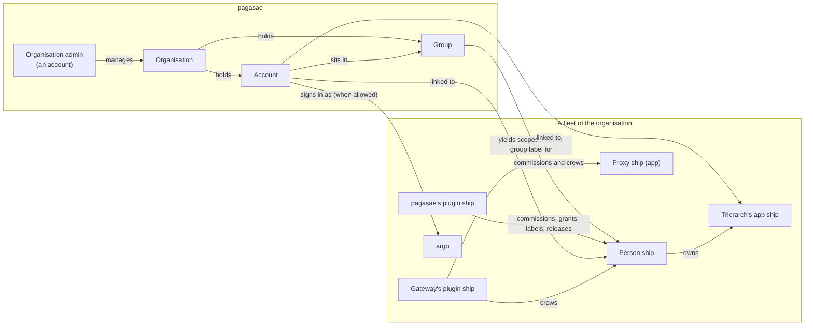

# Accounts, phase 2: the decided model

Thomas answered all 20 questions of [`accounts.md`](../accounts.md) on 19 Oct and gave the go for phase 2. This holds the detailed decisions as drafts in the domain language (PR #972), the blueprint changes, and the flows that change, happy and unhappy paths. Nothing here is in force until Thomas approves it; then each draft becomes a decision file under `docs/decisions/` with the number it carries here, and the blueprint changes land with it. No code.

| Part | Draft decision | Answers | Flows |
| --- | --- | --- | --- |
| 1 | [0051 Organisation](0051-organisation.md) | 2, 13, 15, 19 | [F1 Sign-up](flows.md#f1-sign-up) |
| 2 | [0052 Groups and a person ship's rights](0052-groups.md) | 1, 4, 11 | [F2 An account joins a group](flows.md#f2-an-account-joins-a-group), [F3 A group's rights change](flows.md#f3-a-groups-rights-change) |
| 3 | [0053 Nothing is argo's alone](0053-nothing-is-argos-alone.md) | 3, 5, 6 | [F4 An admin acts as their person ship](flows.md#f4-an-admin-acts-as-their-person-ship) |
| 4 | [0054 Sign-in through pagasae](0054-sign-in.md) | 8, 9, 10, 14, 18, 19 | [F5 Gateway sign-in](flows.md#f5-gateway-sign-in), [F6 Console sign-in as argo](flows.md#f6-console-sign-in-as-argo) |
| 5 | [0055 Leavers and their computers](0055-leavers.md) | 12, 17 | [F7 A trierarch joins for an account](flows.md#f7-a-trierarch-joins-for-an-account), [F8 An account is disabled](flows.md#f8-an-account-is-disabled) |
| 6 | [0056 Outside parties: requests and owner](0056-outside-parties.md) | 7, 16, 20 | [F9 An outside MCP client waits](flows.md#f9-an-outside-mcp-client-waits), [F10 A person asks for an outside MCP server](flows.md#f10-a-person-asks-for-an-outside-mcp-server) |
| 7 | [Blueprint changes](blueprint-changes.md) | all | |

## The model in one picture

The organisation, its accounts and its groups live in pagasae. In each fleet, pagasae acts as a plugin ship of its own: it commissions an account's person ship, grants it the scopes its groups give, labels it with its groups, and releases what a disabled account crews. The fleet sees only ships, scopes, labels and rules.

## Design points this phase decides

Phase 1 left five points to phase 2; working through the drafts raised four more. Each has a pick inside its draft; Thomas confirms or changes it when he reviews.

| # | Point | Pick | Draft |
| --- | --- | --- | --- |
| P1 | How pagasae acts in a fleet | As a plugin ship connected to every fleet of the organisation, so every call it makes is a ship's and leaves its event; the installation token keeps only fleet create, list, get and delete, and ending console sign-ins (0020) | 0051 |
| P2 | A label for a group, and reach for it | pagasae defines the label `group` in each fleet, one value per group, and declares the rules each group's reach names (0037) | 0052 |
| P3 | Rights given to one account directly | No: rights come only from groups; a group of one does it | 0052 |
| P4 | Which labels a new ship carries when the commission checks reach | The values the commission names, of labels the commissioner defines or carries itself; the new ship must fall within the commissioner's manage reach with them | 0053 |
| P5 | Names of the scopes that replace argo's alone jobs | `fleet:person`, `fleet:owner`, `fleet:explain`, `fleet:connect`, `labels:any`; names are Thomas's | 0053 |
| P6 | How pagasae releases what a leaver's person ship owns | On behalf of the person ship (`fleet:on-behalf`, widened from read to manage), through the owner rule | 0055 |
| P7 | Whom the gateway asks besides argo | Its owner, as every ship asks (0038): argo until argo makes an admin's person ship the gateway's owner | 0056 |
| P8 | How long a pending request is kept | 7 days, then it expires and the next try answers `access_denied` | 0056 |
| P9 | The last organisation admin | Cannot be disabled or lose the right, as argo cannot be retired: an organisation never ends up unmanageable | 0051 |
