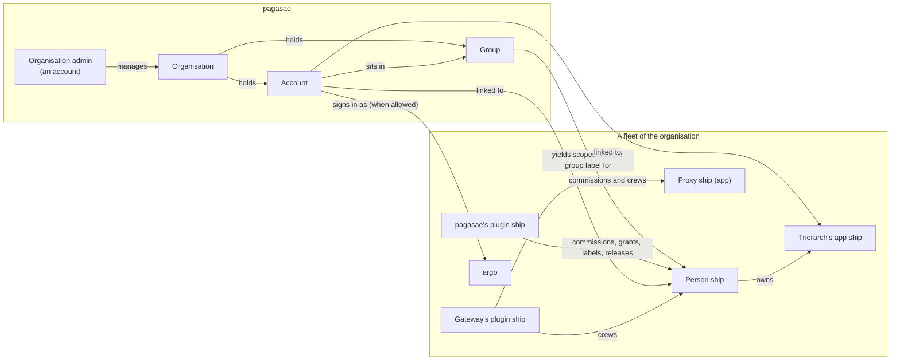

# Accounts, phase 2: the decided model

Thomas answered all 20 questions of [`accounts.md`](../accounts.md) on 19 Oct and gave the go for phase 2. This holds the detailed decisions as drafts in the domain language (PR #972), the blueprint changes, and the flows that change, happy and unhappy paths. Nothing here is in force until Thomas approves it; then each draft becomes a decision file under `docs/decisions/` with the number it carries here, and the blueprint changes land with it. No code.

| Part | Draft decision | Answers | Flows |
| --- | --- | --- | --- |
| 1 | [0051 Organisation](0051-organisation.md) | 2, 13, 15, 19 | [F1 Sign-up](flows.md#f1-sign-up) |
| 2 | [0052 Groups and a person ship's rights](0052-groups.md) | 1, 4, 11 | [F2 An account joins a group](flows.md#f2-an-account-joins-a-group), [F3 A group's rights change](flows.md#f3-a-groups-rights-change) |
| 3 | [0053 Nothing is argo's alone](0053-nothing-is-argos-alone.md) | 3, 5, 6 | [F4 An admin acts as their person ship](flows.md#f4-an-admin-acts-as-their-person-ship) |
| 4 | [0054 Sign-in through pagasae](0054-sign-in.md) | 8, 9, 10, 14, 18, 19 | [F5 Gateway sign-in](flows.md#f5-gateway-sign-in), [F6 Console sign-in as argo](flows.md#f6-console-sign-in-as-argo) |
| 5 | [0055 Leavers and their computers](0055-leavers.md) | 12, 17 | [F7 A trierarch joins for an account](flows.md#f7-a-trierarch-joins-for-an-account), [F8 An account is disabled](flows.md#f8-an-account-is-disabled) |
| 6 | [0056 Outside parties: requests and owner](0056-outside-parties.md) | 7, 16, 20 | [F9 An outside MCP client waits](flows.md#f9-an-outside-mcp-client-waits), [F10 A person asks for an outside MCP server](flows.md#f10-a-person-asks-for-an-outside-mcp-server) |
| 7 | [Blueprint changes](blueprint-changes.md) | all | |

## The model in one picture

The organisation, its accounts and its groups live in pagasae. In each fleet, pagasae acts as a plugin ship of its own: it commissions an account's person ship, grants it the scopes its groups give, labels it with its groups, and releases what a disabled account crews. The fleet sees only ships, scopes, labels and rules.

## Design points this phase decides

Phase 1 left five points to phase 2; working through the drafts raised four more. Each has a pick inside its draft; Thomas confirms or changes it when he reviews.

| # | Point | Pick | Draft |
| --- | --- | --- | --- |
| P1 | How pagasae acts in a fleet | As a plugin ship connected to every fleet of the organisation, so every call it makes is a ship's and leaves its event; the installation token keeps only fleet create, list, get and delete, and ending console sign-ins (0020) | 0051 |
| P2 | A label for a group, and reach for it | pagasae defines the label `group` in each fleet, one value per group, and declares the rules each group's reach names (0037) | 0052 |
| P3 | Rights given to one account directly | No: rights come only from groups; a group of one does it | 0052 |
| P4 | What a commission checks, since a new ship has no reach yet | Only label values of labels the commissioner defined or carries itself, and itself as owner when it is a person ship: the new ship never reaches further than its commissioner can make it | 0053 |
| P5 | Names of the scopes that replace argo's alone jobs | `fleet:person`, `fleet:owner`, `fleet:explain`, `fleet:connect`, `labels:any`; names are Thomas's | 0053 |
| P6 | How pagasae releases what a leaver's person ship owns | On behalf of the person ship (`fleet:on-behalf`, widened from read to manage), through the owner rule | 0055 |
| P7 | Whom the gateway asks besides argo | Its owner, as every ship asks (0038): argo until argo makes an admin's person ship the gateway's owner | 0056 |
| P8 | How long a pending request is kept | 7 days, then it expires and the next try answers `access_denied` | 0056 |
| P9 | The last organisation admin | Cannot be disabled or lose the right, as argo cannot be retired: an organisation never ends up unmanageable | 0051 |

## Questions for Thomas

**On hold (Thomas, 19 Oct): phase 2 is redesigned with pagasae not a ship; see [`actors.md`](../actors.md). These picks are not recorded.**

One question per design point above, each with what it is, a use case, what goes wrong under each option, and a pick. The actors are Acme's: Mathilde (IT, organisation admin), Charlotte (sales), Thomas (engineering's team lead), Burak (who leaves), Priya (a contractor from Northwind).

**1. How does pagasae act in a fleet? (P1)**

What it is: an organisation's accounts and groups live in pagasae, but scopes, labels and leases live in core, per fleet. Whenever an admin changes an account or a group, something must change the person ships in core.

Use case: Mathilde adds Charlotte to the group "sales". In Acme's fleet, Charlotte needs a person ship with sales' scopes and the label `group=sales`.

- (a) **pagasae as a plugin ship of its own in each fleet**, connected when the fleet is created, holding the scopes groups may give. Every change is a ship's call with its event. Goes wrong: that ship holds every scope a group may give (all of them on a fleet pagasae created), so a breach of pagasae acts widely; its security is pagasae's sign-in.
- (b) **Through the installation procedures, with the installation token.** Goes wrong: a caller that is not a ship, so the fleet's events name no acting ship; the installation, which knows fleets only (0020), learns person ships, scopes and labels; a self-hosted fleet needs the token set.
- (c) **Through argo**: pagasae asks argo with a question for each change. Goes wrong: every change waits on a human, so a leaver is not out at once (J2).

Pick: (a).

**2. How does a group give reach? (P2)**

What it is: reach comes from network rules, which select ships by labels or owner (0034). A group must turn into something rules can select.

Use case: "engineering sends to engineering", and "sales sends to the CRM" (`crm=app`).

- (a) **pagasae defines the label `group`**, one value per group, assigns it on person ships, and declares rules on it (0037); a rule joining a group to another label, such as sales to the CRM, is a rule in the networking plugin. Goes wrong: a label's limits cap the groups giving anything in one fleet at 50 and one account's at 20 (0031); a group's reach lives in two places (pagasae's declared rules, the networking plugin's).
- (b) **A selector by group in network rules**: core learns groups. Goes wrong: core knows ships, not accounts; a second way to select beside labels.
- (c) **Groups give scopes only**; argo or the networking plugin labels person ships by hand. Goes wrong: one human's rights change in two places, and the second is forgotten when Charlotte moves.

Pick: (a).

**3. May one account get rights of its own, beside its groups? (P3)**

What it is: whether rights can sit on one account directly, or only on groups.

Use case: Priya needs `fleet:commission` for her three months, which no other contractor has.

- (a) **Only groups; a group of one** ("priya-commission"). Goes wrong: small groups pile up and count toward the 50 per fleet.
- (b) **Rights on the account beside its groups.** Goes wrong: two places to look for what Priya may do; a group change does not show her real rights.

Pick: (a).

**4. What does a commission check? (P4)**

What it is: a new ship has no labels and no reach yet, so "within manage reach" cannot be checked against it. Labels give reach, so the labels a commission gives decide how far the new ship reaches.

Use case: Thomas commissions an agent for engineering. It should carry `group=engineering`, which pagasae defined, not Thomas. He must not be able to give it `group=finance`.

- (a) **Only label values the commissioner defined or carries itself**, the scopes it holds, and itself as owner when it is a person ship. Thomas gives `group=engineering` because his ship carries it; `group=finance` is refused. Goes wrong: Thomas cannot label a ship for a team he is not in, even when asked to; someone who carries that label must commission it.
- (b) **The new ship must fall within the commissioner's manage reach**, with its labels. Goes wrong: a rule check on a ship that does not exist, and Thomas needs a manage rule even for his own agent.
- (c) **Only labels it defined, as today (0031).** Goes wrong: Thomas's agent cannot carry `group=engineering`, so it gets none of engineering's reach unless pagasae labels it, and pagasae labels only person ships.

Pick: (a).

**5. The names of the scopes that replace argo's alone jobs (P5)**

What it is: 0053 turns each argo-only job into a scope, and each needs a name in the catalogue (0046).

Use case: Mathilde grants Thomas the right to change an owner, so he can hand a leaver's agent to a colleague.

- (a) **`fleet:person`** (commission a person ship), **`fleet:owner`** (change an owner), **`fleet:explain`** (explain reach, read refusals), **`fleet:connect`** (connect a plugin), **`labels:any`** (assign any label's values). Goes wrong: `fleet:person` may read as "a person's rights" rather than "commission a person ship".
- (b) **Other names, in a note.**

Pick: (a).

**6. How does pagasae release what a leaver's person ship owns? (P6)**

What it is: a trierarch's app ship is owned by its human's person ship (0055). When Burak is disabled, pagasae must release it, but pagasae did not commission it and cannot label it (0031).

Use case: Burak's laptop runs a trierarch for three of Acme's agent ships. Mathilde disables Burak.

- (a) **Widen `fleet:on-behalf`**: a plugin manages on behalf of a named ship within that ship's reach (today: reads only), and may name the asking ship itself as owner at commission. pagasae releases Burak's trierarch on behalf of his person ship, through the owner rule. Goes wrong: any plugin holding `fleet:on-behalf` can act with a named ship's reach; argo grants it only to plugins, but it is a wider right.
- (b) **The trierarch plugin releases them** when pagasae tells it. Goes wrong: two plugins must coordinate, and the trierarch plugin learns accounts.
- (c) **A label on trierarch ships pagasae can manage.** Goes wrong: only the definer assigns a label, on ships it commissioned (0031); the trierarch plugin commissions them.

Pick: (a).

**7. Whom does the gateway ask about a pending request? (P7)**

What it is: a question goes to the asker's owner (0038). The gateway's owner is argo today, so every request would go to argo.

Use case: Acme wants Mathilde asked about outside MCP clients, not whoever signs in as argo.

- (a) **The gateway's owner**, as every ship asks: argo, until a ship holding `fleet:owner` makes Mathilde's person ship the gateway's owner. Everyone holding the approving scope also sees the list on the gateway's page. Goes wrong: one person is asked; when Mathilde is away, the others must look at the page.
- (b) **A question to every holder of the approving scope.** Goes wrong: the gateway must find them all, and withdraw every other question once one decides.
- (c) **argo always, and the page.** Goes wrong: Mathilde is never told; requests wait until someone looks.

Pick: (a).

**8. How long is a pending request kept? (P8)**

What it is: an outside MCP client's request, or a person's request for an outside MCP server, waits for a human.

Use case: a supplier's agent asks on Friday; Mathilde is away for a week.

- (a) **7 days**, then it expires and the next try asks anew. Goes wrong: a week's holiday lets it expire, and the supplier connects again.
- (b) **30 days.** Goes wrong: stale requests pile up, and a client waits a month for a no.
- (c) **Never expire.** Goes wrong: the list only grows.

Pick: (a).

**9. The last organisation admin (P9)**

What it is: organisation rights sit on the account (0051). If no account holds them, nobody can manage the organisation.

Use case: Mathilde is Acme's only organisation admin, and she leaves.

- (a) **The last organisation admin cannot be disabled or lose the right**: Mathilde first makes someone else an admin. Goes wrong: if she is gone without doing so, the installation admin must help.
- (b) **Allowed; the installation admin restores an admin.** Goes wrong: Acme is unmanaged until then, and self-hosted the installation admin is the self-hoster.
- (c) **Allowed; the argo of any fleet may make an admin.** Goes wrong: organisation power sits in every fleet's argo, which question 2 rejected.

Pick: (a).
