# Accounts, phase 2: the flows that change

Each flow shows its happy path and its unhappy paths, in the domain language, on the actor model (0057): a ship, an account by its account token, or the installation. The drafts they follow are in this folder's [README](README.md).

## F1 Sign-up

Drafts 0051, 0058. Mathilde signs Acme up for hosted Aeolus.

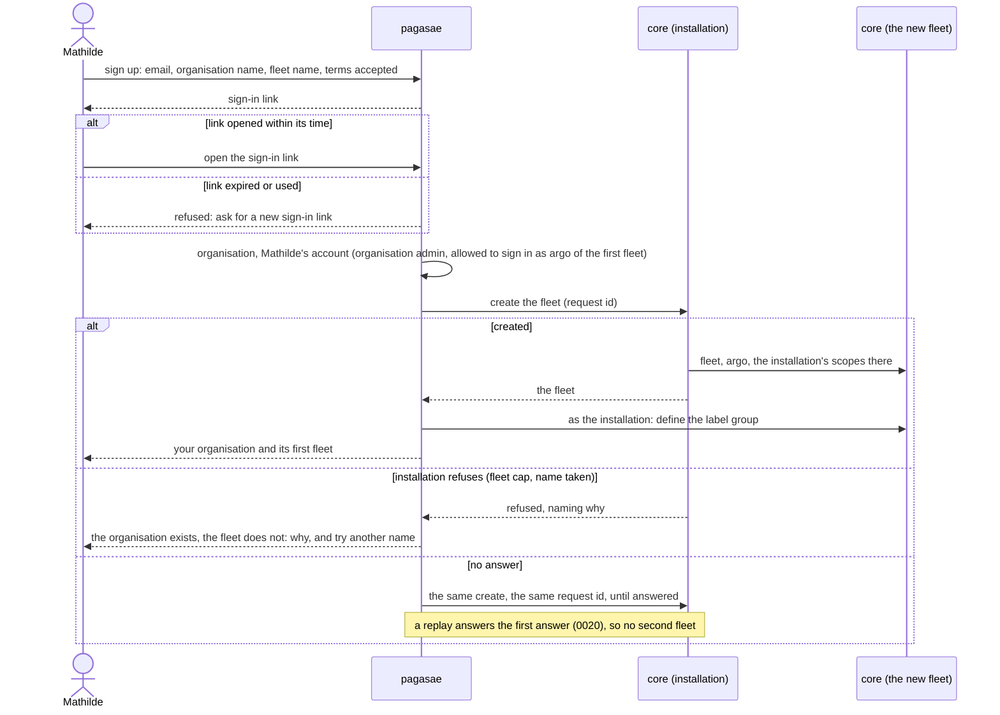

## F2 An account joins a group

Draft 0052. Mathilde adds Charlotte to Acme and to the group "sales", which in Acme's fleet gives `fleet:read`, messaging, and the reach "sales sends to sales".

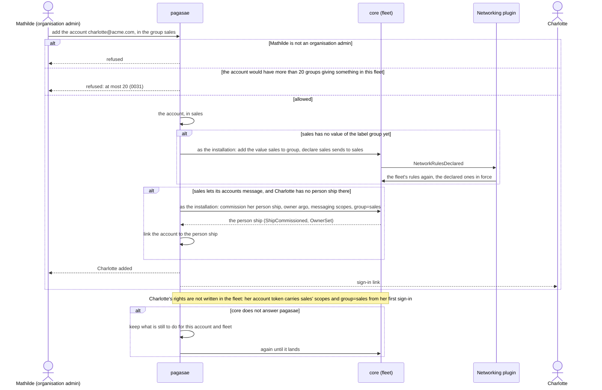

## F3 A group's rights change

Draft 0052. Charlotte moves from sales to finance while she is signed in at the gateway with a person ship.

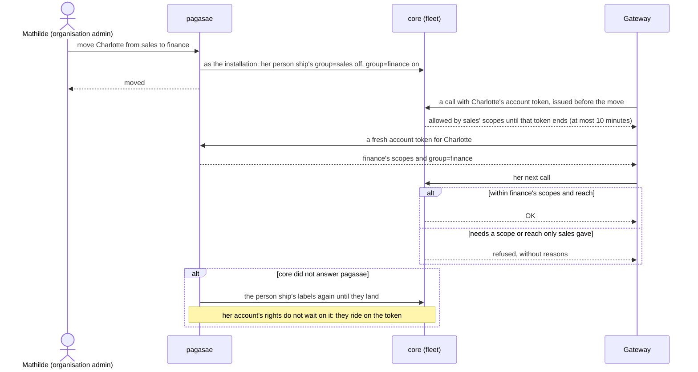

## F4 An admin acts as their account

Drafts 0053, 0057. Thomas is in "team leads" (`fleet:commission`, `fleet:manage`), with a rule letting `group=engineering` manage `group=engineering`. He works from his Claude through the gateway. Mathilde edits a rule on the networking plugin's page. An agent ship does the same by call.

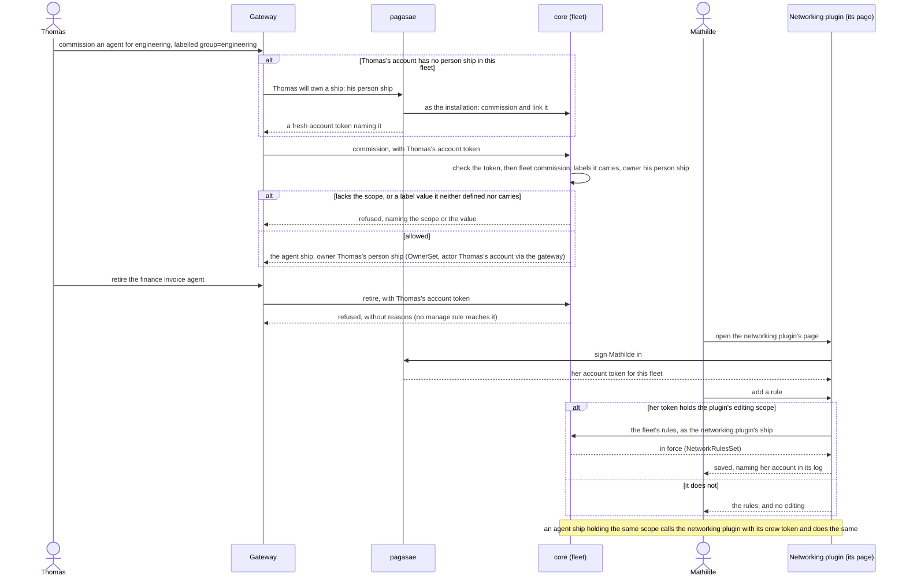

## F5 Gateway sign-in

Drafts 0054, 0058. Charlotte adds the gateway's one address to her Claude.

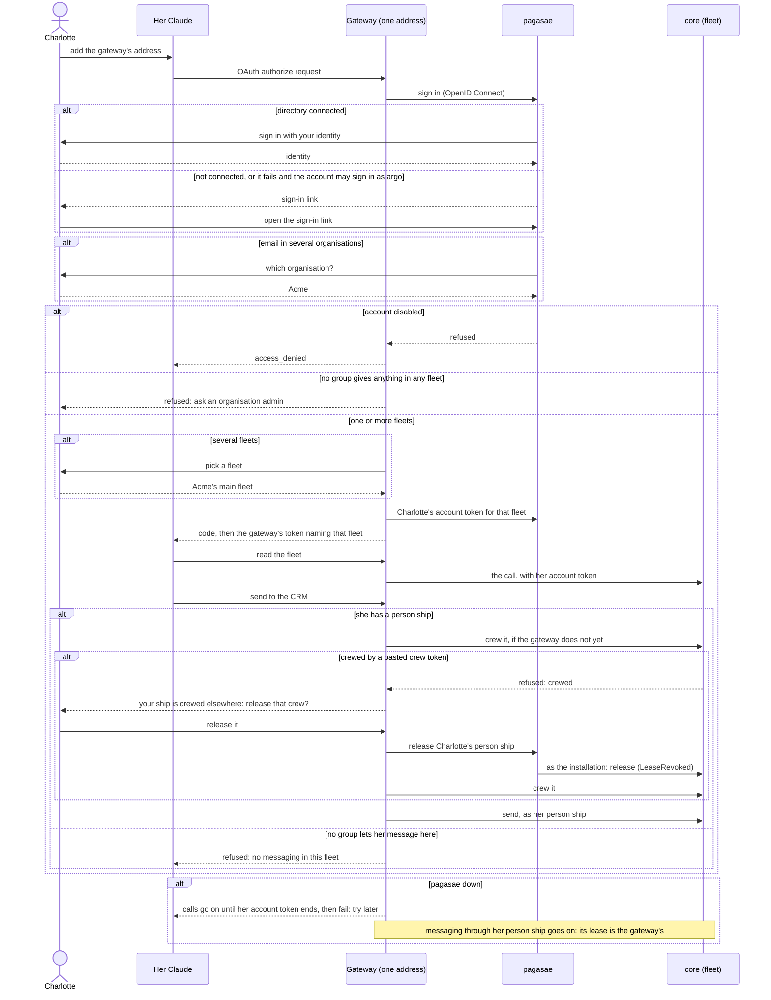

## F6 Console sign-in as argo

Draft 0054. Mathilde signs in as argo of Acme's fleet; Thomas tries without being allowed; a self-hoster uses argo's own sign-in.

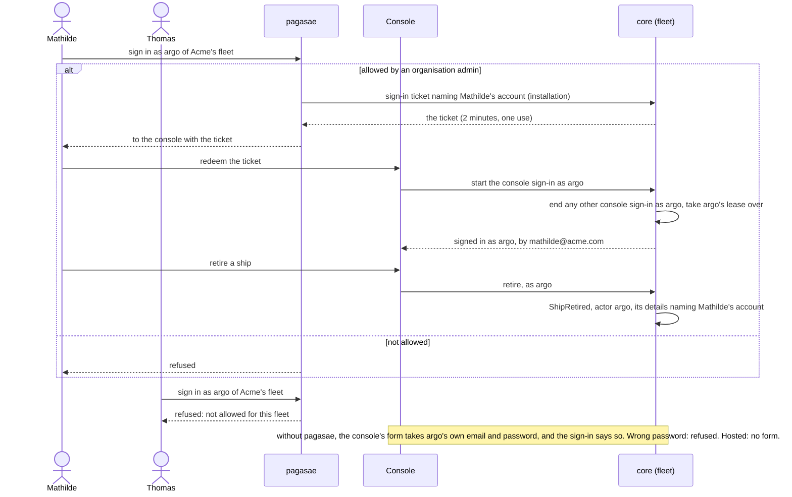

## F7 A trierarch joins for an account

Draft 0055. Burak adds his laptop.

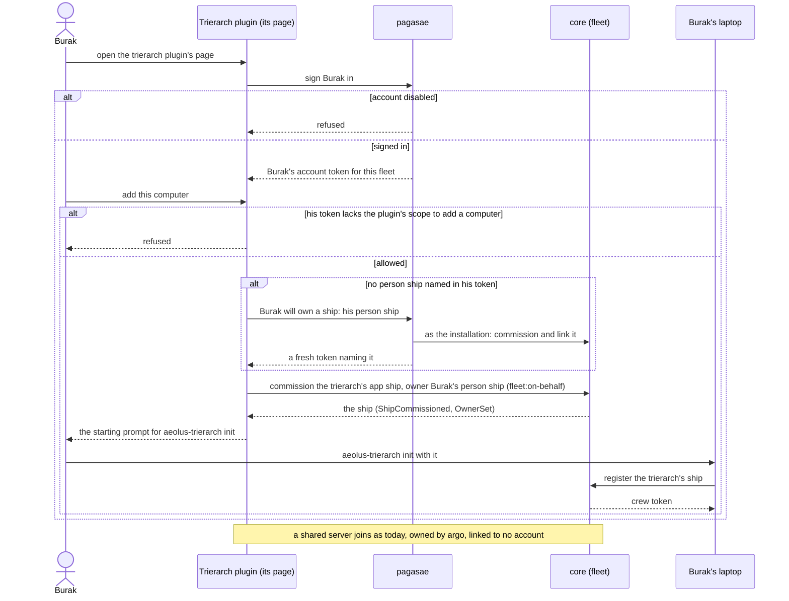

## F8 An account is disabled

Drafts 0055, 0058. Burak leaves Acme. He was signed in at the gateway, allowed to sign in as argo, and his laptop's trierarch crews three agent ships.

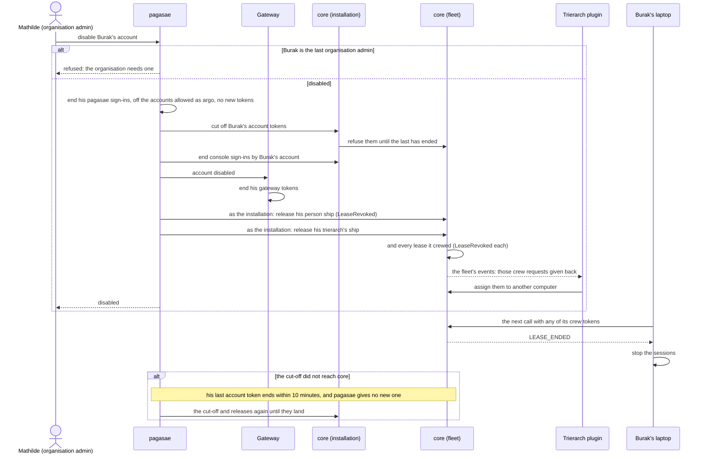

## F9 An outside MCP client waits

Draft 0056. A supplier's ordering agent asks to reach Acme's fleet. It replaces `domain-model.md` 2.5b.

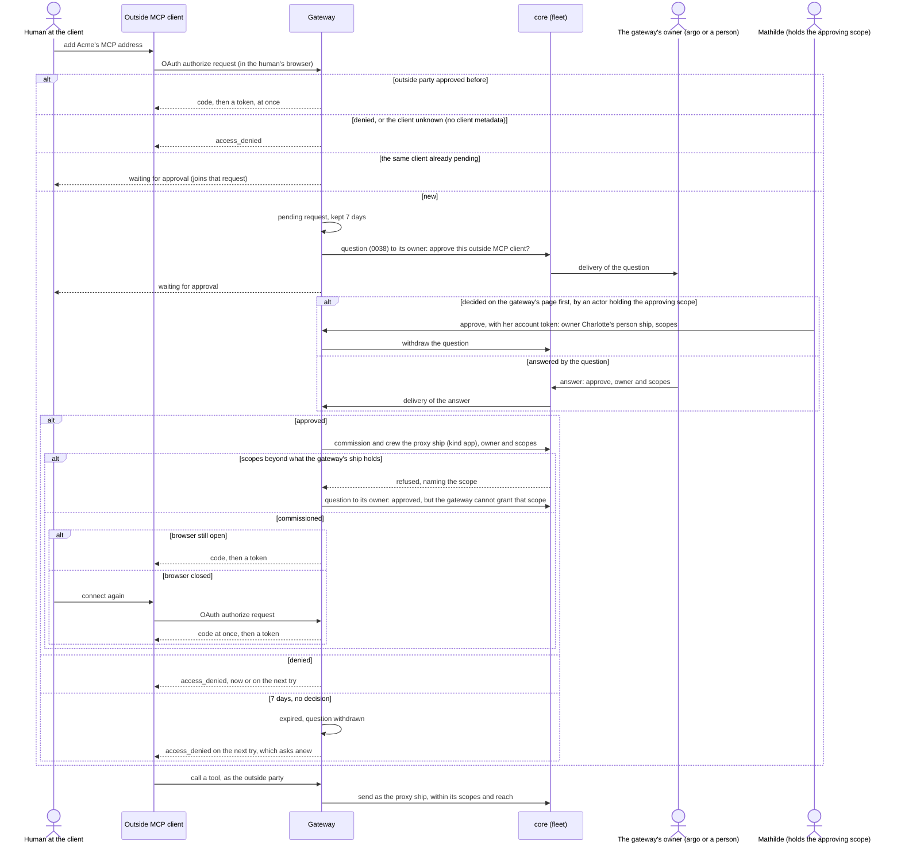

## F10 A person asks for an outside MCP server

Draft 0056. Charlotte wants her PRD agent to read tickets from Linear's MCP server.

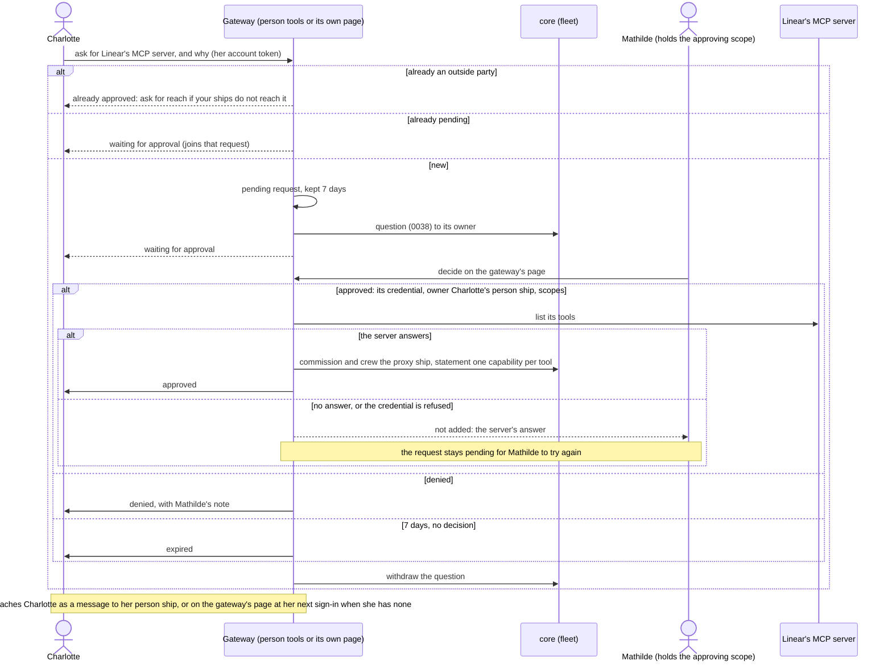

## F11 An account token is checked

Draft 0058. Every call with an account token, its unhappy paths, and pagasae rotating its key.

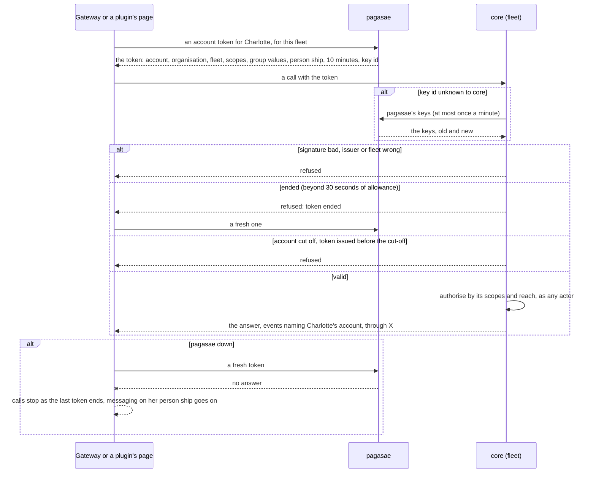
