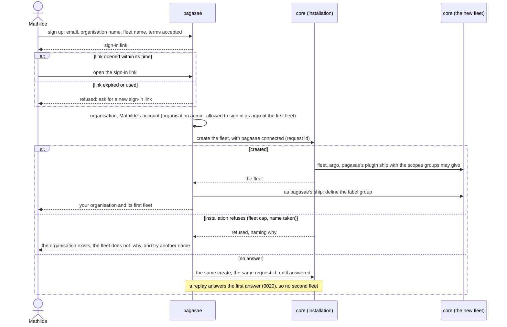
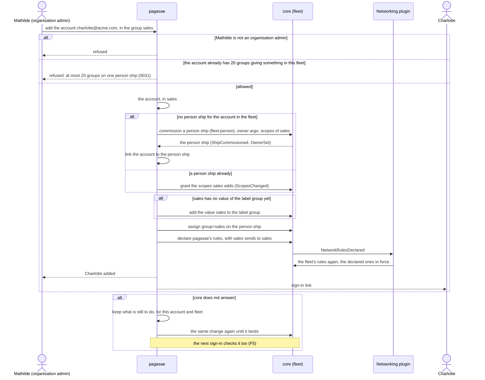
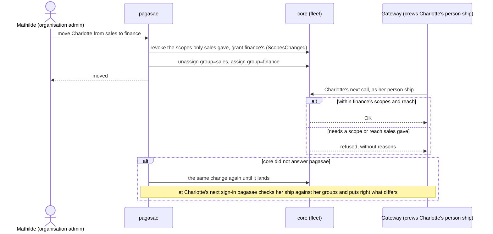
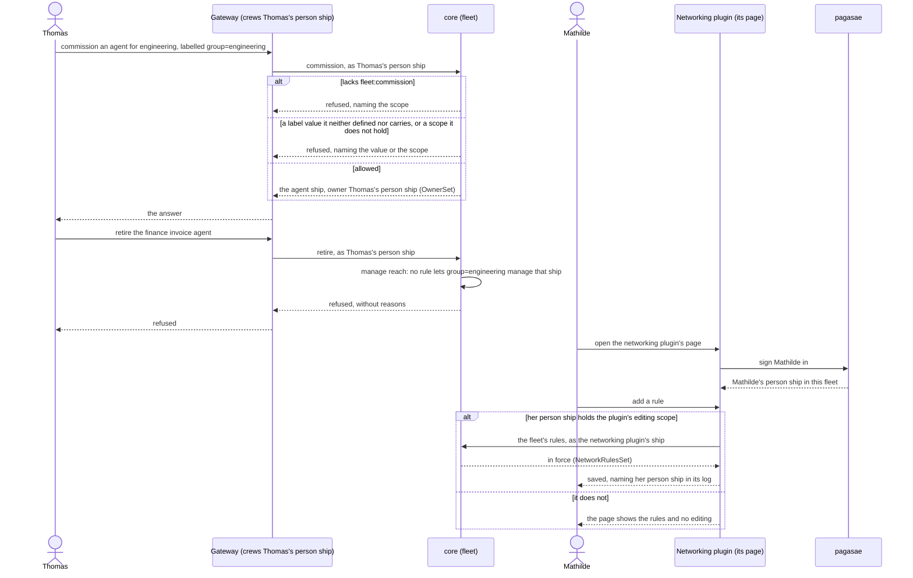
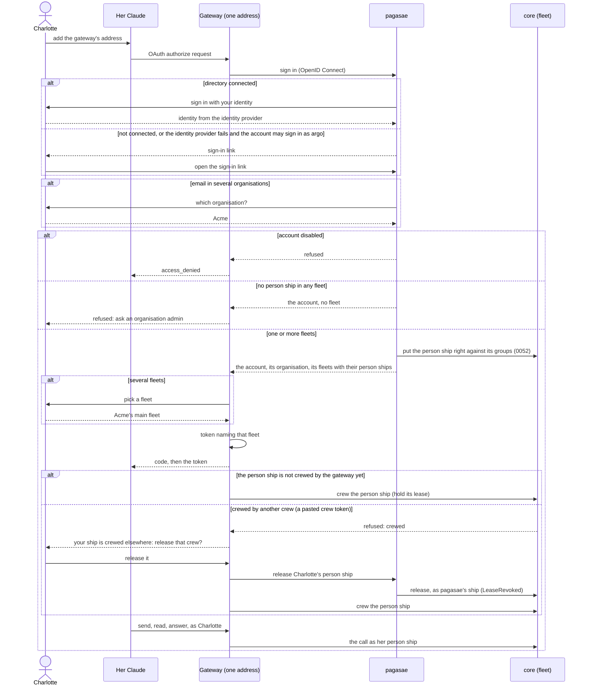
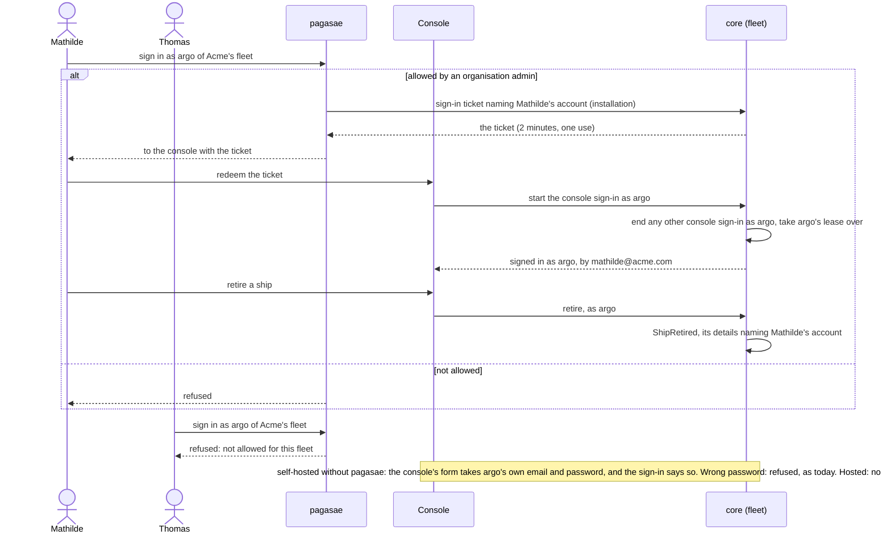

# Accounts, phase 2: the flows that change

Each flow shows its happy path and its unhappy paths, in the domain language. The drafts they follow are in this folder's [README](README.md).

## F1 Sign-up

Draft 0051. Mathilde signs Acme up for hosted Aeolus.

## F2 An account joins a group

Draft 0052. Mathilde adds Charlotte to Acme and to the group "sales", which gives `fleet:read` and the reach "sales sends to sales" in Acme's fleet.

## F3 A group's rights change

Draft 0052. Charlotte moves from sales to finance while she is signed in at the gateway and her agent is crewed.

## F4 An admin acts as their person ship

Draft 0053. Thomas, engineering's team lead, is in the group "team leads", which gives `fleet:commission` and `fleet:manage`; a rule lets `group=engineering` manage `group=engineering`. He works from his Claude, signed in at the gateway. Mathilde, in "fleet admins", edits a rule on the networking plugin's page, signed in through pagasae.

## F5 Gateway sign-in

Draft 0054. Charlotte adds the gateway's one address to her Claude.

The last unhappy path is a person ship still crewed by a pasted crew token, today's only way in. The gateway asks the human, and pagasae, which manages the person ships it commissioned (0052), releases the old crew.

## F6 Console sign-in as argo

Draft 0054. Mathilde signs in as argo of Acme's fleet; Thomas tries without being allowed; a self-hoster uses argo's own sign-in.

