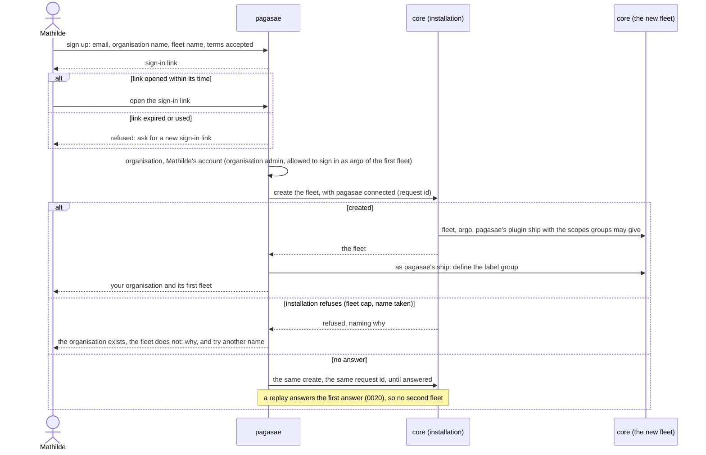
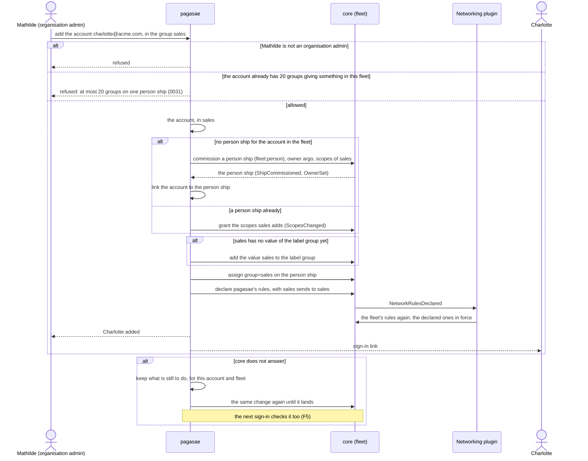
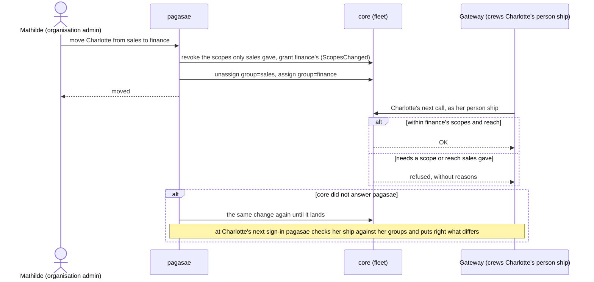

# Accounts, phase 2: the flows that change

Each flow shows its happy path and its unhappy paths, in the domain language. The drafts they follow are in this folder's [README](README.md).

## F1 Sign-up

Draft 0051. Mathilde signs Acme up for hosted Aeolus.

## F2 An account joins a group

Draft 0052. Mathilde adds Charlotte to Acme and to the group "sales", which gives `fleet:read` and the reach "sales sends to sales" in Acme's fleet.

## F3 A group's rights change

Draft 0052. Charlotte moves from sales to finance while she is signed in at the gateway and her agent is crewed.

