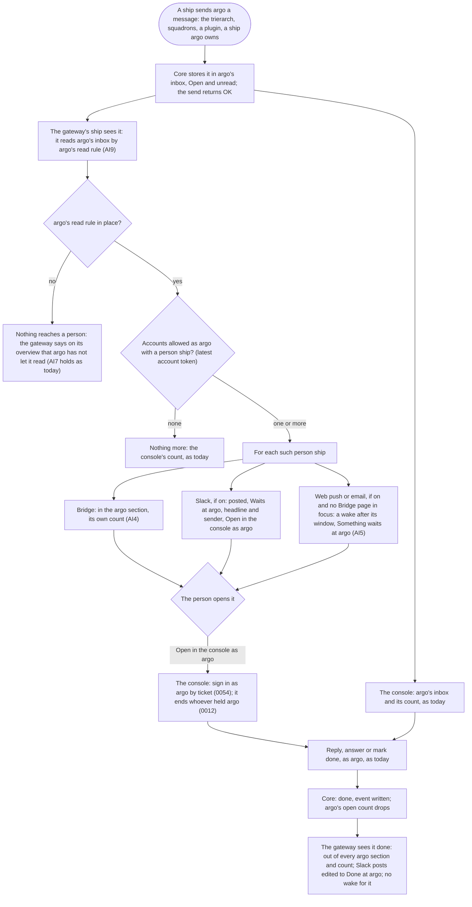

# argo's inbox: reaching the people who may act as argo

Design for [#1571](https://github.com/ThomasHendrickx/aeolus-fleet/issues/1571), from the investigation on [#1569](https://github.com/ThomasHendrickx/aeolus-fleet/issues/1569#issuecomment-6561940831). The purpose (section 1) is agreed and AI1 to AI9 are answered as picked (section 3); the flow is section 4 and the mockups are in [mockups/README.md](mockups/README.md).

Thomas, 1 Nov:
1. "now argo is just a hidden box of problems and the biggest issues are being send to argo. So this is a big incident waiting to happen that could have been prevented having read the messages of argo."
2. "But make sure that it is clear if it is for argo or just the person."

## 1. Purpose (agreed)

What goes wrong today: the trierarch, squadrons and the plugins send argo their biggest problems (a computer low on disk, an API key out of credit, session starts failing, a model refused, a flagship released, formation recovery given up), and ships whose owner retired fall to argo with their questions. All of it waits in the console's inbox and nowhere else. A person learns of it only with a console session open that reads argo's inbox, by the count in its navigation: no push, email or Slack carries it, and the gateway's wakes, Slack and Bridge cover person ships only. Only the one console sign-in as argo can mark read, reply or mark done, and nothing expires or escalates, so a message waits unseen until the trouble it reported arrives.

The purpose: what waits at argo reaches a person who may act as argo while it can still prevent the trouble, and that person can act on it.

Who must learn, and how fast: every account allowed to sign in as argo, through its own person ship, wherever that person ship shows (Bridge, Slack, a chat), as fast as a message to that person ship reaches them today. Opening the console is not the way they find out.

The outcomes:
1. A person who may act as argo learns that something waits at argo, and what it is from its headline, without the console open.
2. From there, acting on it as argo is one step away.
3. Wherever a person sees what waits at argo (Bridge, Slack, a chat), it is plainly marked as argo's, apart from what is for that person alone.
4. What one of them handled is handled for all of them, and nobody is told again of it.

Not the purpose:
- **No change to the delivery guarantee.** Core stores and delivers as it does; a message to argo stays argo's, in argo's inbox.
- **argo stays the fail-safe, never a normal path** (0057). This design does not send more to argo; what the trierarch, squadrons and the plugins send there, and whether they should, is a separate question.
- **A person ship never acts as argo.** What a person ship sends is its own; acting on argo's inbox stays argo's.

## 2. Lessons checked against

From running the fleet:
- **The biggest problems go to argo.** The trierarch sends straight to argo what is about its computer (low on disk, an API key out of credit, session starts failing) and what is about a ship (model refused, no identity, unpushed work discarded); squadrons send a released flagship and formation recovery given up (#1569, section 1). They are the messages that must not wait.
- **A headline is what a person reads first.** A message to argo opens with its headline (protocol rule 6); the console shows the first line as the headline. The trierarch plugin sends `text/plain` with no headline line (#1569, gap 6), so its messages show a sentence cut short.
- **Folding hides.** The console folds plugin senders into one row by sender type; a message from a ship of another type is not folded (#1569, gap 7). What is folded is easy to pass over.
- **Problems found only by asking or by looking.** As with Bridge (its section 3): awareness comes to the person, not the person to it.

From what is decided:
- **argo is the fail-safe** (0057): where a failure becomes visible and the way out, never a normal path. Reaching people must not make argo a place ships send to by default.
- **One console sign-in as argo at a time** (0012, 0054): a new sign-in as argo ends the last, whoever's. Acting today means taking argo from whoever holds it.
- **Only argo acts on argo's inbox**: mark read, reply and mark done refuse any ship but argo (`NOT_THE_OPERATOR_SHIP`); "Compose, Done and Reply stay argo's" (blueprint, Inbox).
- **An account already reads argo's inbox** by its read reach with `fleet:read` (0034, `read-inbox.ts`); a ship, a person ship included, reads argo only by a rule. The account token says whether the account is allowed as argo (0058).
- **Nothing is argo's alone** (0053): every argo job is a scope any actor can hold.
- **Bridge is not argo's console** (Bridge, section 1): one record, many views; the person ship is the identity; argo's inbox is not redesigned there.
- **Waking a person** (wake-a-person W1 to W10): web push and email say only that something waits, with a link; each delivery woken once, gathered per window; nothing on by default (W8). Slack shows what waits at a linked person ship (gateway-scopes 9.4, P-B5).
- **Core has no email, push or Slack** (0058): what reaches a person goes through the gateway.

## 3. Answers (Thomas, 1 Nov)

| | Rule | Why |
| --- | --- | --- |
| AI1 | **The gateway reads argo's inbox for every account allowed as argo** and shows it beside the person's own. One record, argo's inbox: no copy, no message from core. | What one person handled is handled for all with nothing to keep in step; core stays as it is |
| AI2 | **Acting stays in the console, signed in as argo.** Each item links to its message in the console; the sign-in as argo ends whoever held it (0012). | One step away with nothing reopened |
| AI3 | **Every open message to argo shows, questions included, plugin senders unfolded.** | The biggest problems come from plugin senders; folding hides them |
| AI4 | **argo's has its own section and count, named argo,** apart from the person's own; in Slack and the wakes each item says it waits at argo. | A separate place and count cannot be read as the person's own |
| AI5 | **Wakes for argo's follow the person's own rules** (W1 to W10): each message woken once per person, gathered per window, only on channels the person turned on (W8). | Consent stays first |
| AI6 | **Nothing more if nobody handles it:** it waits, shown and counted. | Reminders and escalation are a design of their own |
| AI7 | **A fleet with no account allowed as argo changes nothing:** the console's count stays the way to learn. | Core has no email (0058) and there is no person ship to reach |
| AI9 | **The gateway's own ship reads argo's inbox by a read rule argo adds** (0034), and shows it to the person ships of accounts whose latest account token says allowed as argo. Wakes carry no content and Slack posts only the headline, so an account no longer allowed sees no more than that until its next sign-in; disabling it releases its person ship (0055). | An account token lasts 10 minutes and the gateway holds one only while the person is signed in (0054, 0058); being allowed as argo already reads the whole inbox through the sign-in as argo, so nothing closed is opened, and core and pagasae stay as they are |

A message to argo without a headline line shows its first line, as the console does; the trierarch plugin's are [#1570](https://github.com/ThomasHendrickx/aeolus-fleet/issues/1570).

## 4. Flow

Happy, the trierarch: thomas-mac's disk is at 4%. The trierarch sends argo "thomas-mac is low on disk: 4% free". Core stores it. The gateway's ship sees it in argo's inbox; Thomas and Mathilde are allowed as argo. Bridge's argo section shows it to both, the argo count one higher; Thomas has Slack on and gets a post headed Waits at argo; Mathilde has web push on and, with no Bridge page in focus, gets "Aeolus fleet: something waits at argo" after the window. Mathilde opens it, presses Open in the console as argo, signs in as argo, frees disk and marks it done. The gateway sees it done: it leaves both argo sections, Thomas's Slack post is edited to "Done at argo", and nobody is woken for it again.

Happy, a question: builder-memory, owned by argo since its owner retired, asks argo which repository to use. It shows in the argo section with its pick and the button Answer in the console as argo. Thomas answers in the console; the question leaves the argo section for both.

Unhappy paths:
- **Nobody acts.** It stays Open, shown and counted in every argo section and the console; each person was woken once (AI5, AI6).
- **The gateway is down when the message arrives.** Core holds it in argo's inbox; on restart the gateway reads argo's open inbox again and shows what is open. A wake it had not sent goes out once; one it sent before stopping may go once more, as the wake design says. Nothing is lost.
- **argo has not added the read rule, or removed it.** The gateway reads nothing of argo's; its overview tells an account allowed as argo so, with where argo adds it. The console stays the way to learn.
- **Someone holds argo's sign-in when the person opens the console.** The sign-in as argo ends theirs (0012); the console says whose before the person confirms, as today.
- **Two people act at once.** The first reply or Done takes it; the second sees it done, as the console does today.
- **Handled in the console by someone not reached through Bridge** (argo's own sign-in). The gateway sees it done all the same: one record.
- **A question withdrawn or replaced.** It goes stale in the argo section as in the console, linked to its replacement; out of the count.
- **An account stops being allowed as argo.** Its next account token says so: the argo section and its posts and wakes stop. Until then it sees content-free wakes and headlines only (AI9).
- **An account is disabled.** Its person ship is released (0055): nothing reaches it.
- **A sender with no headline line.** Its first line shows, cut to fit (#1570).
- **A Slack post or push subscription fails.** That place drops out, as Slack and the wake design say; Bridge still has it.

## 5. Mockups

Before and after, desktop and phone, light and dark, in the Compact look: [mockups/README.md](mockups/README.md).
