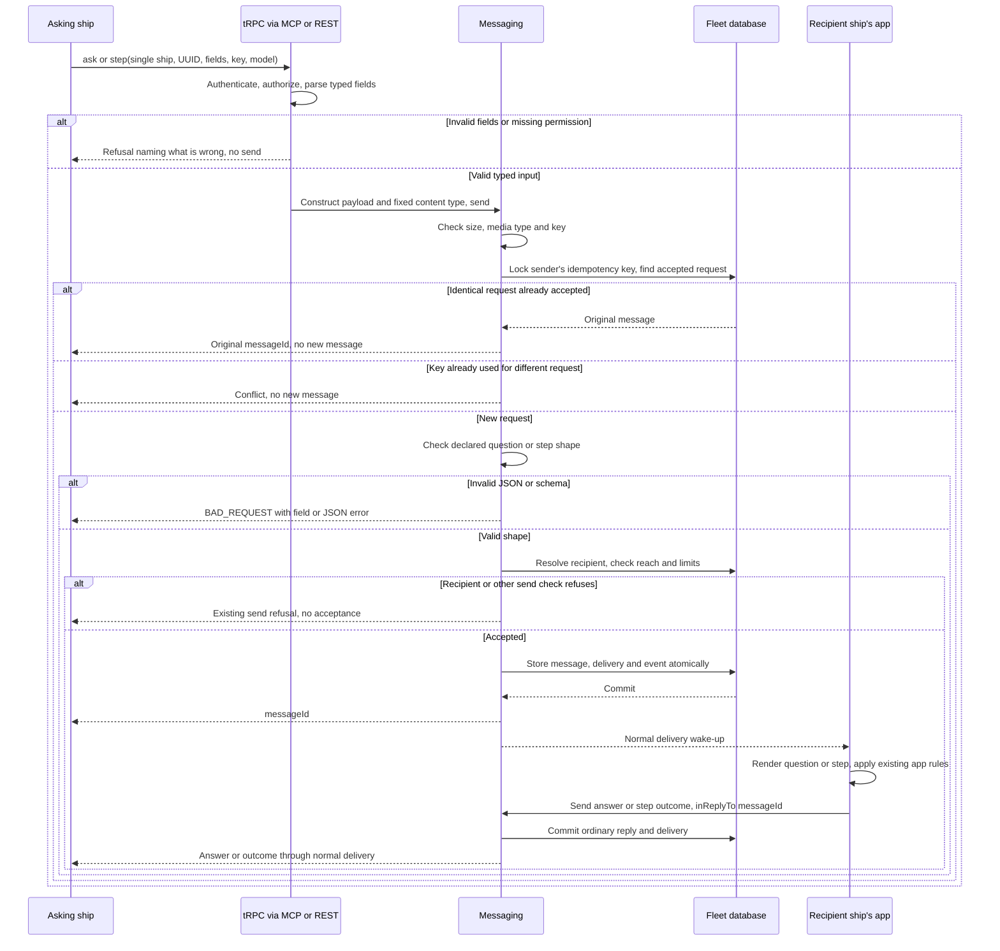
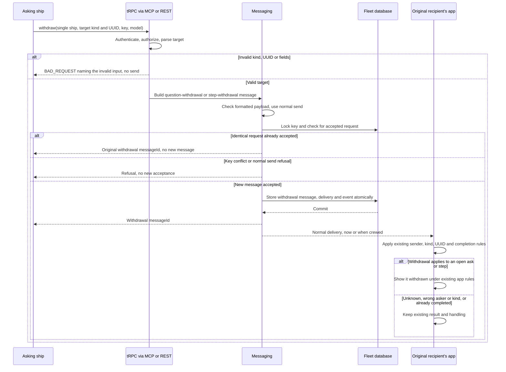

# Ask, step and withdraw

Status: awaiting Thomas's approval.

Refs #1734.

## Purpose

A ship asking a person to decide or do something must be able to give the fields of a question or step without constructing JSON or choosing a content type. Core's ship protocol offers `ask` and `step`, builds the payload with its content type, and accepts it durably through the fleet's normal messaging guarantees.

A send claiming to carry a question or step must be refused when its payload fails that schema, with an explanation of what is wrong. The sender can correct it before a person sees an unusable message. This is Thomas's selected direction in [#1734](https://github.com/ThomasHendrickx/aeolus-fleet/issues/1734).

The behaviour to preserve is in the blueprint's [Question and Step vocabulary](../../blueprint.md#domain-language) and [questions flow](../../blueprint.md#questions-to-argo), [decision 0038](../../decisions/0038-questions.md), and the [ship protocol](../../../packages/core/src/adapters/trpc/ship-protocol.ts). This purpose requires changing 0038's rule that core never reads these payloads. The decisions and flows below define the proposed change; implementation must align 0038 and the blueprint with them.

## Lessons to check against

- **One API door.** [Decision 0004](../../decisions/0004-trpc-single-api.md) and the [ship contract](../../../packages/core/src/adapters/trpc/ship-contract.ts) make ship procedures available through both [MCP](../../../packages/core/src/adapters/mcp/README.md) and [REST](../../../packages/core/src/adapters/rest/README.md). Building JSON in a shell helper alone leaves other crews exposed to the same mistake.
- **Reuse the actual schemas.** Common owns [questions and answers](../../../packages/common/src/schemas/question.ts) and [steps and outcomes](../../../packages/common/src/schemas/step.ts), including withdrawals and replacements. Questions already check UUIDs, nonempty titles and labels, positive unique option numbers, and a pick naming an option. Option detail defaults to empty; context may be empty. Keys need not be consecutive. Steps check UUID, title and an optional HTTP(S) link; why may be empty. Validation must not quietly invent stricter product rules.
- **Shape and intent are different.** The current [send use case](../../../packages/core/src/domain/messaging/send-message.ts) checks byte size, media-type syntax and idempotency, not question or step shape. Common's readers recognise content types without case or parameters. A valid question sent as text is still text; declared-type validation cannot infer the sender's intent. The typed calls and protocol guidance must address that failure too.
- **Distribution still owns the guarantee.** [Decisions 0001 and 0003](../../decisions/README.md) distinguish receipt from execution and require durable commit before OK. An accepted question remains open until answered, independently of acknowledgement. Payload validation must not make delivery acknowledgement mean answered, or turn core into the executor of a human step.
- **A retry must remain the same request.** Send serialises identical keys and returns the accepted message id, even after the recipient retires. Generating a different UUID or resolving a changed owner on a retry can instead produce a conflict or a second request. The typed calls need an explicit retry contract, including a lost successful response.
- **Check every acceptance path.** [Operator Reply](../../../packages/core/src/domain/messaging/reply-to-message.ts) uses `checkedSend` and `sendWithin`; [scheduled sends](../../../packages/core/src/domain/messaging/send-due-schedules.ts) construct a checked request directly; [resend](../../../packages/core/src/domain/messaging/resend-delivery.ts) has its own acceptance path. Checking only the public `ship.send` input would leave holes. Old invalid messages also exist, so read-time fallback and resend behaviour need explicit treatment.
- **Callers already own useful checks.** The plugin's `scripts/aeolus-ask.sh` constructs escaped JSON, sequential options, a UUID and a key; it checks required flags and the pick, resolves the owner, and keeps the asked recipient for later withdrawal or replacement. A failed send exits without recording a successful ask. The generic send path still allows hand-authored payloads. The [console answer action](../../../packages/console/lib/questions-actions.ts) checks input and the question's options and staleness on its server, then sends through Reply. Its [answer builder](../../../packages/console/lib/question-answer.ts) checks whether the question is answered or stale. The questions UI is frozen by [0043](../../decisions/0043-core-surface.md).
- **A permanent refusal can suppress a notification.** The gateway [asks owners](https://github.com/ThomasHendrickx/aeolus-fleet-gateway/blob/e4918d4832336bd187665dd41ba3083f97505e78/src/core/requests/ask-owners.ts) with question JSON and marks a permanent refusal asked rather than retrying. Its [Slack linking step](https://github.com/ThomasHendrickx/aeolus-fleet-gateway/blob/e4918d4832336bd187665dd41ba3083f97505e78/src/core/slack/ask-to-link-slack.ts) similarly marks a refused send told. [Sign-in steps](https://github.com/ThomasHendrickx/aeolus-fleet-gateway/blob/e4918d4832336bd187665dd41ba3083f97505e78/src/core/party-grants/tell-sign-in-needed.ts) also construct step payloads. Their generated payloads and refusal handling need checking against the agreed boundary before shipping validation.
- **Do not discard a person's unsent answer.** The gateway validates answers when [putting them in its basket](https://github.com/ThomasHendrickx/aeolus-fleet-gateway/blob/e4918d4832336bd187665dd41ba3083f97505e78/src/core/people/put-in-basket.ts) and retains refused entries in the [send flow](https://github.com/ThomasHendrickx/aeolus-fleet-gateway/blob/e4918d4832336bd187665dd41ba3083f97505e78/src/core/people/send-basket.ts). [Step completion](https://github.com/ThomasHendrickx/aeolus-fleet-gateway/blob/e4918d4832336bd187665dd41ba3083f97505e78/src/core/people/done-delivery.ts) sends an outcome before marking handled. Console Reply rolls back on refusal; the blueprint requires its unsent choice and note to remain. Broadening validation to answers, outcomes or lifecycle messages affects these paths as well as asking.
- **Keep validation bounded.** The fleet's limit is 256 KB in UTF-8 bytes (0006), including the generated JSON. At the performance skill's scale of 10 million messages and 3,000 ships per fleet, checking payload shape should depend on the bounded payload rather than scanning message history. Any proposed relation or lifecycle checks must state their lookup and concurrency requirements.

## Decisions

### Three formatted message calls

`ask`, `step` and `withdraw` are ship procedures, exposed as MCP tools of those names and REST POST routes `/api/v1/ship/ask`, `/api/v1/ship/step` and `/api/v1/ship/withdraw`. They construct ordinary messages and use the existing send acceptance path. They create no separate question or step record, queue, scope or execution state.

Each call names one ship explicitly, by name or id. It never resolves the owner implicitly. The protocol still tells a crew whom to ask; the caller keeps the recipient used for a later withdrawal. Ordinary send continues to support its existing selectors.

| Call | Fields supplied by the ship | Constructed payload | Content type |
| --- | --- | --- | --- |
| `ask` | `selector` for one ship; `id`, `title`, `context`, `options`, `pick`; `idempotencyKey`; model as send requires | The supplied question fields, parsed with common's question schema and serialised by core | `application/vnd.aeolus.question+json` |
| `step` | `selector` for one ship; `id`, `title`, `why`, optional `link`; `idempotencyKey`; model as send requires | The supplied step fields, parsed with common's step schema and serialised by core | `application/vnd.aeolus.step+json` |
| `withdraw` | `selector` for one ship; `target` as `{ kind: "question", questionId }` or `{ kind: "step", stepId }`; `idempotencyKey`; model as send requires | `{ questionId }` or `{ stepId }`, parsed with common's corresponding withdrawal schema | `application/vnd.aeolus.question-withdrawal+json` or `application/vnd.aeolus.step-withdrawal+json` |

The ship supplies the UUID for an ask or step. Core fixes its content type and constructs its JSON; the ship supplies neither a payload string nor a content-type field. Each accepted call returns `{ messageId }`, like send. The caller already has the UUID, which differs from the message id used by `inReplyTo`.

### Send-time checks

A newly accepted message with the question or step content type must contain valid JSON matching the corresponding common schema. Matching ignores case and content-type parameters. Typed calls and ordinary send apply the same payload-shape rule. Valid raw sends keep their supplied payload and content type; checking does not rewrite them.

The shape check runs on the plaintext payload before sealing.

The validation boundary is exactly Thomas's instruction: "Step and ask is a formatted message which gets checked, that is it." Core does not validate an answer against its question, enforce an open/answered state, or infer a question from JSON sent as text. Answers, step outcomes, replacements and withdrawals sent through ordinary send keep their existing handling. A typed withdrawal constructs its existing schema correctly; that does not extend raw-send validation to the rest of the family.

A shape refusal is `BAD_REQUEST` over tRPC, REST HTTP 400 with `{ code, message }`, and an MCP tool error. Its message names the declared kind and the failing field, for example `question.pick.option: The pick names one of the options`; invalid JSON is identified as such. It stores no message, delivery or acceptance event and wakes nobody. Existing refusals for size, model, authorization, reach, idempotency and sealing remain in force.

Validation applies at every path that accepts a new question or step message: send, typed calls, operator Reply, schedule execution and resend. A schedule's question or step is checked when the schedule is created as well as at each send time. A refused occurrence follows the schedule's configured refusal strategy. A refused resend leaves its original delivery available for dismissal. An operator Reply refusal must leave its input delivery unacknowledged by that reply.

No migrations. Existing stored payloads and their read-time fallbacks remain as they are. An identical retry of an already accepted request returns its original message id and creates nothing, including when the original predates validation. This preserves send's idempotency guarantee without admitting another malformed message.

### Delivery and retries

Typed calls need `messages:send` and use the calling ship, its server-read scopes and its existing send reach. They retain send's model rules and final UTF-8 byte limit, checked on the generated JSON, not just the visible field text. Payload sealing, daily limits, durable commit, events and recipient wake-up use the normal send path.

The ship keeps its UUID, recipient, fields and idempotency key until the result is known. A retry repeats those inputs. Concurrent identical calls with one key accept one message. Reusing that key for another request is a conflict. Typed calls serialise parsed fields deterministically before using send's request hashing, including schema defaults; they do not generate an id or re-resolve an owner between attempts.

A refused request has not consumed its key with a new acceptance. The ship may correct a shape error and send again. A timeout is different: acceptance may already have committed, so retry the identical request and key first. Never downgrade the same question to a text message to bypass a refusal.

Accepted means durably stored for delivery. It does not mean received, answered, withdrawn in a person's app, or carried out. A question's answer and a step's outcome continue to be ordinary replies, with their existing schemas and content types; acknowledgement still means receipt.

### Withdrawal boundary

Both withdrawal formats already exist in common and in ship protocol rules 5 and 19. The gateway reads step withdrawals, recognises the same asker and UUID, and shows an unanswered step stale: see its [stale-item rules](https://github.com/ThomasHendrickx/aeolus-fleet-gateway/blob/e4918d4832336bd187665dd41ba3083f97505e78/src/core/people/stale-item.ts) and [step withdrawal scenarios](https://github.com/ThomasHendrickx/aeolus-fleet-gateway/blob/e4918d4832336bd187665dd41ba3083f97505e78/src/core/people/read-bridge-home.test.ts). This needs a typed call over the existing message format, rather than a new cancellation format.

`withdraw` builds and checks a formatted message, like `ask` and `step`. Its `target` discriminates a question UUID from a step UUID; exactly one branch is accepted. Core selects the corresponding existing content type and serialises only `{ questionId }` or `{ stepId }`. There is no new UUID for the withdrawal payload. It returns `{ messageId }` once the withdrawal message is durably accepted, with the same authorization, model, size, sealing and idempotency rules as send.

The ship names the original recipient and UUID. Core checks input shape, not the original message, its sender or whether it remains open. The receiving side keeps deciding whether the withdrawal applies, including the existing same-asker and same-kind checks. Withdrawing does not retract an accepted delivery, undo a human action or promise that a question or step was cancelled. An answer or outcome already sent stays as it is. An unknown UUID, another asker's UUID or a withdrawal arriving after completion is not a new core lifecycle refusal.

The caller keeps the target, recipient and withdrawal key for an identical retry. A separate withdrawal has its own key, distinct from the ask or step's key. A missing target, invalid UUID or mismatched fields is a shape refusal before sending. There is no typed replacement in this slice.

## Flow

### Ask or step, acceptance and response

Ordinary send joins this flow with its supplied payload and content type rather than typed fields. Schedule execution and resend join before new acceptance and obey the same question/step check. A recognized idempotent replay creates no message and preserves the existing result. Refusals inside Reply roll its acknowledgement back. A reach refusal may retain its existing refusal record; it is never an accepted message.

A storage or sealing failure accepts nothing partial. If the response is lost after commit, the ship retries the same input and key and gets the original message id. A recipient without a running crew receives later through normal delivery. Receipt acknowledgement, a human answer and a step outcome remain separate actions.

### Withdraw an ask or step

A send refusal leaves the original ask or step unchanged. A response lost after commit is retried with the same target, recipient and key. An answer or outcome racing the withdrawal is interpreted by the recipient's existing rules; core does not arbitrate that race or add a cancellation state. A withdrawal waiting for delivery is not yet an applied withdrawal.

### Scenarios to prove when built

| Scenario | Required result |
| --- | --- |
| Ask through MCP and step through REST, valid typed fields | Correct JSON and fixed content type, normal committed message and delivery |
| Withdraw a question or step through either API mapping | Correct existing withdrawal payload and content type; normal committed message and delivery |
| Withdraw has no target, an invalid UUID or fields from the wrong target branch | Actionable shape refusal, no send |
| Identical withdrawal retried after response loss | Original withdrawal message id; no second acceptance |
| Withdrawal names another asker, another kind, an unknown or completed item | No core lifecycle lookup/refusal; recipient applies its existing rules |
| Answer or outcome races withdrawal | Normal messages retained; recipient determines applicability |
| Quotes, newlines and Unicode in typed text | Valid JSON; the generated UTF-8 payload obeys the 256 KB limit |
| Invalid raw JSON, duplicate option keys, pick naming no option, invalid step URL | Actionable shape refusal before new acceptance |
| Question/step content type with mixed case or parameters | Same validation; unrelated types and JSON sent as text keep ordinary-send behaviour |
| Empty context/why, omitted option detail, unique non-consecutive positive keys | Existing common schema rules retained |
| Concurrent identical typed requests, or retry after a lost successful response | One acceptance, same message id; another request with that key conflicts |
| Recipient retired after an accepted send, then identical retry | Existing accepted result returned without resolving a new recipient |
| Missing scope/model, unreachable or retired recipient, daily limit, unavailable sealing key | Existing refusal semantics; no partial acceptance |
| New malformed scheduled message or resend | Refused at acceptance; existing schedule strategy or original delivery state retained |
| Old malformed message read or accepted-request replay | No rewrite or migration; existing read behaviour or original accepted result |
| Reply or transaction fails | No partial new message, delivery, event or reply acknowledgement |
| Message accepted while recipient has no crew | Durable delivery waits; no operator recovery step |

## Implementation boundary

Implement the procedures and shared acceptance check in core; keep MCP and REST as mappings of those procedures. Use common's schemas and existing error mapping, and preserve ports and adapters. The protocol should direct crews to typed calls and describe refusal correction and identical retries instead of requiring hand-built JSON.

When built, update decision 0038 and its index line, the blueprint's questions flow and call catalogue, and schema comments that currently say core never reads these payloads. Keep the receiving apps' existing answer, outcome and staleness checks. No console UI work, historical migration, new lifecycle store, typed answer, typed outcome or typed replacement belongs to this slice.

Check the plugin's helpers and the gateway's question and step constructors against the accepted schemas before release. Valid ordinary sends remain supported, so callers need no compatibility layer. A helper switching to a typed call must preserve its already-kept UUID, recipient and key; a permanent refusal must remain visible rather than being reported as successful notification. Gateway notification suppression and answer retention are caller risks to verify, not new retry policy for core.
