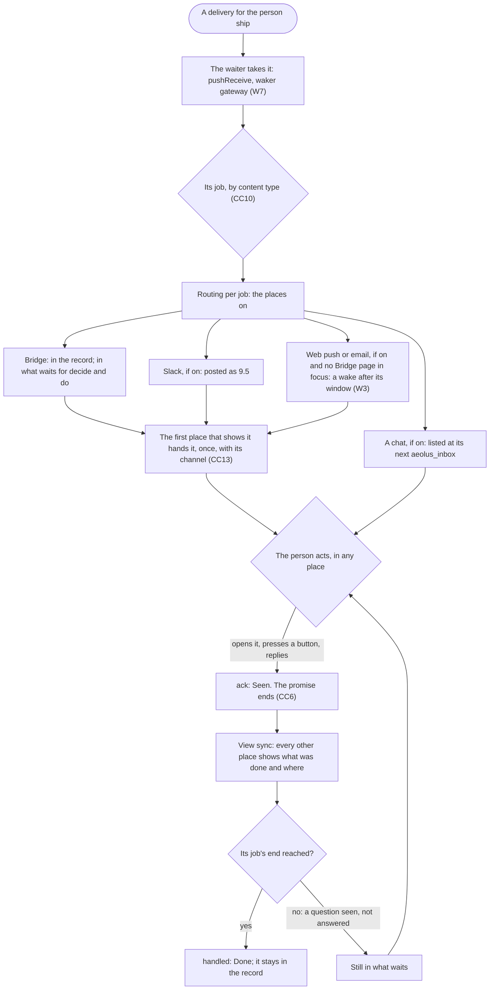

# Bridge: a person's one place to work with their fleet

Design for [#1494](https://github.com/ThomasHendrickx/aeolus-fleet/issues/1494). Stage 0 (purpose, jobs, lessons, how others do it) is answered (section 5). Stage 1, the structure (sections 6 to 9), is for Thomas to approve, with its questions in section 10. Mockups of the structure with the picks drawn: [mockups/README.md](mockups/README.md). The questions design ([#1495](https://github.com/ThomasHendrickx/aeolus-fleet/pull/1495)) resumes as the first slice of decide (CC11).

Thomas, 31 Oct:
1. "in essence that is a bit the command center for a user in aeolus.. like outlook is for emails or Gmail for Google ... But with different use cases and capabilities.. I don't want to make a choice now on this that I might regret so want to take a step back on what that interaction surface needs to be."
2. "I think the one we design is the default one. A user can choose where what gets routed to, or even to use multiple. As in the command center (needs a better name) or slack or a plain claude.ai chat... I like to give users options."
3. On places: "So places het a view of the thing. Same IMAP Vs pop principle".

## 1. Purpose (agreed, CC1)

A person works with their fleet from one place in Aeolus that holds everything their ships need from them and everything they should know, so nothing waits on them unseen and nothing they decided is lost. That place is **Bridge**, the default place; the person chooses, per job, whether Slack, a chat such as claude.ai, or several of them show it too, and every choice acts as the same person ship.

The outcomes:
1. What waits on the person (a question, an approval, a step only a human can take) is in one list with one count, each item saying what it asks and what pressing its button sends.
2. The person sees how their ships are doing without asking any of them.
3. Whatever the person decides or answers, wherever they did it, can be read back in Bridge.
4. The person chooses where each job shows, one place or several, and a change of mind loses nothing.
5. Every action is the person ship's, one identity whichever app or chat the person used.

Not the purpose:
- **No change to how core carries messages.** Core stores and delivers; it reads no payload and keeps no routing preference; choices live with the person ship's crew, as P-B5's do in the gateway (0038, 0043).
- **Not argo's console.** The console stays the fleet's admin console (0043); argo's inbox is not redesigned here.
- **Not executing.** Aeolus distributes; what a ship does with a person's answer is its own business.

## 2. The jobs a person has with their fleet

| Job | What it is | An example |
| --- | --- | --- |
| Decide | A ship cannot go on without the person's choice | The orchestrator asks which of three designs to build; a gate waits for approval |
| Do what only a human can | A step no ship can take for them | Sign in to an outside OAuth server (0067), approve an outside party (0056), link Slack, install a bot |
| Direct | The person sends work or changes course | Send a ship a task, ask a squadron to form, stop a ship, request crew |
| Stay aware without asking | The person learns state and trouble as it happens | A watch alert (0071), a ship stuck or silent, a PR opened, a release out |
| Converse | A back and forth with a ship or several | A thread with the orchestrator; a meeting (0061) |
| Review output | Judge what a ship made | A PR, a design doc, a report: a reference to where the content lives, never the content itself (256 KB, 0006) |

The first two wait on the person and block a ship; the next three are the person's own initiative or awareness; the last sits between (a review often ends in a decision).

## 3. Lessons checked against

From running the fleet:
- **State lost in conversations.** The orchestrator keeps Thomas's questions on a page outside Aeolus because a chat scrolls them away; a decision made in a chat is found again only by scrolling. Bridge holds the record, whatever else shows the item.
- **Problems found only by asking.** Thomas learns a ship is stuck when he asks "status?". Awareness comes to the person; monitoring already raises the facts (0071) and sends the owner an alert.
- **Actions buried in information.** An ask in the middle of a long report is missed. A message to argo opens with its headline (protocol rule 6); a question is its own content type (0038). What asks for action is apart from what informs.
- **The person ship is the identity.** A person acts as their account through their person ship (0052, 0057), one crew shared by every client the gateway serves (0015, 0054). Several places showing the same item are several clients of one crew, never several identities.

From what exists:
- **Person ships** (0044, 0045, 0052): own themselves and what they commission; questions, trouble and gates of their ships go to them.
- **The gateway's pages**: the Overview lists the inbox by titles only, opening one acknowledges it (the promise ends at opening, 0040), an open page in focus is the channel `page` (W6).
- **Slack** (gateway-scopes 9.4, 9.5): a linked person's messages go in as their person ship; what waits shows in Slack, a question with a button per option; each delivery handed with channel `slack`, then acknowledged.
- **Wake a person** (W1 to W10): web push and email say only that something waits, with a link; each delivery woken once, gathered per window; nothing on by default (consent first, W8).
- **P-B5**: the first per-person choice of where a delivery shows: Slack, the gateway page, or both, while a page is in focus. With both, Slack's acceptance acks it and the page shows only that Slack took it. One delivery is acknowledged once.
- **A chat such as claude.ai** (gateway MCP tools): it pulls (`aeolus_inbox`, `aeolus_open`); nothing pushes into it. Showing something there means keeping it for when the person asks, with a wake to tell them.
- **The console** (Questions to argo, the operator inbox): one count, open questions on top, the pick preselected, one tap naming what it sends, stale questions linked to their replacement. It is argo's and frozen for questions (0043); its rules are the tested ones to start from.

## 4. How others serve these jobs

| | Decide | Do what only a human can | Direct | Stay aware | Converse | Review output | What to take |
| --- | --- | --- | --- | --- | --- | --- | --- |
| **Outlook** | Actionable messages: approve in the mail | Flags and tasks the person keeps | New mail, meeting invites | Rules into folders, Focused and Other | Threads | Attachments, links | Rules per sender route mail; the person keeps state by flagging, so it is lost when they forget |
| **Gmail** | Little: reply | Snooze, follow-up nudges | New mail | Priority inbox, labels, filters | Threads | Links, Drive previews | Labels, not folders: one item in several views; snooze brings it back |
| **Slack** | Workflow and app buttons | Reminders, Later | Message a person or bot | Channels, Activity | Strong: DMs, threads, huddles | Links, unfurls | Conversation first; what was decided scrolls away, found by search |
| **Linear's inbox** | In place: change status, assign | Assigned to you | Create an issue | Notification per issue, subscriptions | Comments on the issue | The issue and its PRs | The item is the issue, not the message: state lives on it; snooze and done are the person's own |
| **GitHub notifications** | Review requested, approve in place | Review requested, assigned | Open an issue or PR | Per thread, with a reason (mention, assign, CI) | Comments on the thread | The PR itself | Each notification says why it reached you; the person picks web, email or both per kind of notification |

What carries over: the item is the thing that waits (a question, a request), not the message carrying it (Linear, GitHub); each item says why it reached the person (GitHub); actions happen in place (Outlook, Slack, Linear); one item can show in several places (Gmail labels); where each kind shows is the person's choice per kind (GitHub's web and email, P-B5). What not to carry over: state the person must keep by hand (Outlook's flags), and a conversation as the only record (Slack).

## 5. Stage 0 answered (Thomas, 31 Oct)

| # | Rule |
| --- | --- |
| CC1 | **The purpose is section 1.** |
| CC2 | **First jobs: decide, do what only a human can, and stay aware**, what reaches the person unasked. Direct, converse and review output later |
| CC3 | **Thomas first, built for every person ship**: one person owning a busy fleet, nothing that only fits one |
| CC4 | **Bridge always keeps the record.** Every item stays there with its outcome; other places show it too, and an answer in Slack or a chat shows in Bridge as answered |
| CC5 | **Routing per job.** Per job, the person turns each place on or off (Slack, a chat, web push, email), several at once, Bridge always on; defaults from configuration |
| CC6 | **Each place shows it; only the person's action acknowledges it.** A place showing an item is not the person receiving it |
| CC7 | **A chat is a pull place.** The item waits for the chat's `aeolus_inbox`, with a wake telling the person. Places are views of one record (IMAP), never copies that take the item away (POP) |
| CC8 | **The name is Bridge**, a blueprint term |
| CC9 | **Bridge lives in the gateway's web app**, which crews the person ship and holds the Slack link and the wakes |
| CC10 | **A job is known by content type**, as questions are (0038); a new fleet convention only where a job has none |
| CC11 | **The questions design resumes as the first slice of decide**, on Bridge |

## 6. Stage 1: one record, many views

**The record is core's.** Core already stores every delivery to the person ship and every message the person ship sends, durably. Bridge reads them (CC12); it keeps no copy of a payload (0040 rejected that copy). Every place, Bridge included, is a view of that one record: none takes an item away from the others (CC7).

**An item** is one delivery to the person ship. Its job comes from its content type (CC10), and its state from the delivery's state and the person ship's replies:

| Item state | Means | Delivery state | Set by |
| --- | --- | --- | --- |
| New | The person has not acted on it | pending, received or handed | Its arrival; each place on for its job shows it |
| Seen | The person acted on it in some place | acknowledged | The person's first action, in any place: opening it in Bridge or a chat, a button press or a thread reply in Slack (CC6) |
| Done | Nothing more waits on the person | handled | Its job's end, below |

| Job | Content type | Done when | In what waits (the count) |
| --- | --- | --- | --- |
| Decide | `application/vnd.aeolus.question+json` (0038) | Answered; or withdrawn or replaced, and seen | Yes, until done: open until answered, whatever the delivery's state (0038) |
| Do what only a human can | A step (CC14) | The person marks it done or that they cannot; or the gateway sees it complete | Yes, until done |
| Stay aware | `application/vnd.aeolus.alert+json` (0071) and a notice (CC15) | Seen (CC16) | No: marked unseen in the feed |
| Everything else | Any other type, such as a text reply in a thread | Seen, as today | No; in the record, shown as 9.5 shows it today |

**The places:**

| Place | Shows | The person's action there | Lives |
| --- | --- | --- | --- |
| Bridge, always on | Every item: what waits with its count, the stay-aware feed, the record with each outcome and where it was done | Open, answer, mark done | The gateway's web app (CC9) |
| Slack | The items of each job turned on, as 9.5 shows them | A button press, a thread reply; a Seen button where an item has no other | The gateway's Slack part |
| A chat (claude.ai or any MCP client of the gateway) | The items of each job turned on and not done, when the chat calls `aeolus_inbox` | `aeolus_open`, `aeolus_answer`, `aeolus_done` | The gateway's MCP tools |
| Web push, email | Only that something waits, with a link to Bridge (W4) | None: the link opens Bridge | The gateway's wakes; pagasae sends the email (W2) |

## 7. The parts and where each lives

| Part | Does | Lives |
| --- | --- | --- |
| Bridge's pages | What waits, the stay-aware feed, the record, an item with its actions, routing per job | Gateway `web/features/bridge/` (ui, state, hooks, services), parts from `@aeolus-fleet/ui` |
| Record reader | Reads the person ship's deliveries and its replies from core, paged; names each item's job and state | Gateway server, beside `people.inbox` |
| Routing per job | Per fleet, person ship, job and place: on or off; defaults from the gateway's configuration (CC19) | Gateway database, where W8's channels are |
| The waiter (W7) | For each new delivery: its job, the places on, shows it in each, one hand-over (CC13) | Gateway server, extended |
| View sync | After the person's action in one place, every other place shows what was done and where: Bridge's open pages through `NOTIFY gateway_changes` (topic `inbox`), Slack's post edited and its buttons removed, a chat at its next `aeolus_inbox` | Gateway server |
| Core | Stores and delivers as today; one read and one lease rule added (CC12) | Core, messaging context |
| Fleet conventions | A content type per job: question (0038), alert (0071), step (CC14), notice (CC15) | The ship protocol |

What it replaces in the gateway (CC17, CC18): the Overview's inbox moves into Bridge; Slack's switch (B5), the wake channels (W8) and P-B5 become places in routing per job; Slack posts and hands an item but no longer acks it on post (9.5 step 3, CC6).

## 8. Routing per job

| Job | Bridge | Slack | A chat | Web push | Email |
| --- | --- | --- | --- | --- | --- |
| Decide | Always | Off until turned on | On | Off until turned on | Off until turned on |
| Do what only a human can | Always | Off until turned on | On | Off until turned on | Off until turned on |
| Stay aware | Always | Off until turned on | On | Off until turned on | Off until turned on |
| Everything else | Always | As 9.5 today | On | Off until turned on | Off until turned on |

- Defaults come from the gateway's configuration (CC5); consent first for every place that pushes (W8).
- A change applies at once and loses nothing: Bridge holds every item whatever was on. A pull place turned on shows every item of that job not done; a push place only what arrives after (CC20).
- W6 holds: while a Bridge page is in focus, web push and email do not wake. Slack, when on, still posts: the person chose it, and views in sync make the double show cost nothing.

## 9. Flows

### The backbone

Unhappy paths:
- **The person never acts.** It stays New in every place. A person ship's lease runs no clocks (0040), so nothing is overdue; the wakes say it waits, once per delivery (W3).
- **The gateway stops after showing it, before `handed`.** On restart it is shown again: at most one duplicate post or wake, as 9.5 and the wake design say; nothing is lost.
- **Two places acted on at once.** The first ack takes it; the second answers acknowledged and changes nothing.
- **A place fails.** Slack's bot removed, a push subscription gone: that place drops out, as 9.5 and the wake design say, and Bridge says why. Bridge always has the item.
- **Core does not answer.** Bridge says the record cannot be read now and tries again; nothing was acked, so nothing is lost.
- **The lease ends** (the person ship released, the account disabled, 0055). Received and handed deliveries go back to pending and the next crew shows them again; seen ones not done are read and finished under the new lease (CC12).
- **Routing changes while an item is shown.** It stays where it is shown.

### Decide

Happy: orchestrator-1 asks Thomas which of three designs to build. Bridge lists it on top of what waits, the count one higher, the pick preselected, each button saying what it sends. Slack is on for decide: posted with a button per option. Thomas presses option 2 in Slack. The gateway acks it (Seen), sends the answer as the person ship (`inReplyTo` the question, the idempotency key from the question's uuid) and reports it handled (Done). Bridge shows "Answered in Slack: option 2" and the count drops; the Slack post is edited to show the answer, its buttons gone; the chat no longer lists it.

Unhappy paths:
- **Answered in two places.** The gateway keeps one answer per question; the later press shows "Already answered in Bridge: option 2" and sends nothing.
- **Opened, not answered.** Seen, still in what waits and in the count.
- **Core refuses the answer** (no reach, the asker retired): Seen, not Done; Bridge says why, and the person marks it done.
- **Core does not answer the send.** The same key again until core stores it; Bridge shows it as sending.
- **Withdrawn.** The withdrawal is shown on the question it names, in every place: stale, buttons gone, out of the count. The person's next look at it acks both, and it is done.
- **Replaced.** As withdrawn, linked to its replacement, which is a new item.

### Do what only a human can

Happy: a ship needs Thomas to sign in to an outside OAuth server (0067). It sends him a step (CC14): its title, why, and the link where it is done. Bridge lists it in what waits; Slack, if on, posts it with Open and Done. Thomas opens the link, signs in and presses Done: acked, the outcome sent to the asker as the person ship, handled. A step the gateway sees complete itself (an OAuth sign-in, a Slack link) is done when it sees it, with no press.

Unhappy paths:
- **The person cannot do it** (no right, not theirs): Cannot, with an optional note, sent as the outcome; done.
- **Done pressed, the step did not take.** The asker's business (Aeolus does not execute); it sends a new step.
- **The asker withdraws or replaces it.** As a question's.
- **The link leads outside Aeolus.** Shown with its host, never opened by itself.

### Stay aware

Happy: the watch finds a ship of Thomas's silent and sends his person ship an alert (0071). Bridge shows it in the stay-aware feed, unseen and outside the count; web push is on for stay aware, so a wake goes out after its window. Thomas opens Bridge and sees it: acked and handled at once (CC16); Slack's post, if on, is edited to Seen. A notice (CC15), such as a release out, goes the same way.

Unhappy paths:
- **Many at once.** The wakes gather them per window (W3); Bridge shows each.
- **The alert clears before it is seen.** Nothing is sent on clear (0071): the item stays, and Bridge links the ship's Health for its state now.
- **Never seen.** It stays unseen; no clock runs.

## 10. Stage 1 questions, each with my pick

| # | Question | Options | My pick |
| --- | --- | --- | --- |
| CC12 | Where does Bridge read the record from? | (a) Core: one new read of the crew's own ship's deliveries with their messages, in any state and across its leases, newest first, paged, within the fleet's retention; and a person ship's crew acks and reports handled on its ship's deliveries whatever lease took them. (b) The gateway copies each delivery into its own database. (c) Bridge keeps only what is open; the past is titles and outcomes the gateway keeps, no content | (a): IMAP, the server keeps the mailbox, and core already keeps both durably; a read changes nothing about carrying. (b) is the copy 0040 rejected; (c) breaks CC4. The lease rule is needed since a person ship's lease can end with items seen and not done, and re-read is per lease today |
| CC13 | With several places on, how is the hand-over recorded? | (a) Once, by the first place that shows it, with its channel; the gateway knows the others. (b) Once per place, and a person ship's lease counts no attempts (today the fifth hand-over makes it undeliverable) | (a): no change to core or 0040; the delivery's history names where it first showed, Bridge names every place |
| CC14 | What is the content type for do what only a human can? | (a) A new fleet convention, a step: `application/vnd.aeolus.step+json` (its uuid, title, why, the link where it is done), answered with `application/vnd.aeolus.step-outcome+json` (the step's uuid, done or cannot, an optional note), withdrawn and replaced as questions are; the gateway's own asks (an OAuth sign-in, linking Slack) sent as steps from its ship, so they are in the record too. (b) A question with the options Done and Cannot | (a): CC10 tells jobs apart by content type, so a question would make it decide; a step carries its link, and the gateway can finish one it sees complete, which it may not do for a question. "Step" becomes a blueprint term |
| CC15 | What does stay aware hold besides alerts? | (a) A new fleet convention, a notice: `application/vnd.aeolus.notice+json` (headline, Markdown body, an optional link), for what a ship tells without asking (a PR opened, a release out). (b) Alerts only; the rest is text, in everything else | (a): the lesson that actions get buried in information; a text message cannot be told apart from a conversation. "Notice" becomes a blueprint term |
| CC16 | Is a seen stay-aware item done? | (a) Yes: seeing it acks and handles it at once. (b) The person dismisses each one | (a): nothing more waits on the person, and the feed stays short |
| CC17 | What happens to P-B5, B5's switch and the Overview's wake settings? | (a) Routing per job replaces them: P-B5 retires, Slack and the wakes become places per job, and Slack posts and hands without acking. (b) P-B5 stays beside routing per job | (a): CC6 removes the ack on post that P-B5's Both rests on, and views in sync remove the double handling it guarded against; nothing kept for compatibility (0013) |
| CC18 | Is Bridge the person's home in the gateway's web app? | (a) Yes: signing in lands on Bridge; the Overview's inbox moves into it and its other parts (fleets, the Slack link) into Bridge's settings. (b) A page beside the Overview | (a): one place, the purpose; two homes would split what waits |
| CC19 | The defaults per job | (a) A chat on; Slack, web push and email off until turned on. (b) Everything off but Bridge, a chat included | (a): a chat lists what waits today, and it only pulls; consent first for what pushes (W8) |
| CC20 | When a place is turned on for a job, what does it show of what is already there? | (a) A pull place (a chat) every item of that job not done; a push place (Slack, wakes) only what arrives after. (b) Only what arrives after, everywhere. (c) Every item not done, everywhere | (a): a pull place is a view and costs nothing; posting a backlog into Slack is noise, and Bridge already holds it |
