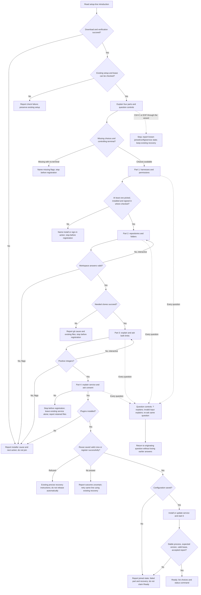

# Computer setup

## Purpose

A person running the setup line to join a computer to their fleet meets unexplained questions before knowing what will run on it. Setup should first explain that the trierarch runs agent sessions to crew ships on this computer, then ask only for choices it cannot reasonably make for the person. Each question explains its consequence and default, says how far through setup they are, and offers help, so they can finish without guessing what they have allowed.

Purpose, setup choices, and progress and help approved by Thomas for [#1243](https://github.com/ThomasHendrickx/aeolus-fleet/issues/1243).

## Lessons to check against

- [0050](../../decisions/0050-domain-language.md), [blueprint](../../blueprint.md): computer, trierarch, ship, session, repository and folder each mean one thing. Explain the concrete part before asking about it.
- [0026](../../decisions/README.md), [0049](../../decisions/0049-release-trains.md): the trierarch runs on the computer; the trierarch plugin brings it into the fleet. Their setup and the console are separate parts in separate repositories.
- [0027](../../decisions/0027-crew-settings.md), [ship repositories](../ship-repositories/README.md): a repository gets a new worktree per ship; a folder is used as it is. Explain that difference before asking for either.
- [Headless design](../headless/headless.md), H3 and H20: Remote Control is dropped. Do not design around keeping that audited question.
- [One-line setup](../one-line-setup.md): defaults shorten setup; preparing and joining a computer is a separate job from starting a self-hosted fleet.
- [0016](../../decisions/0016-no-policy.md): explain permissions and consequences; propose any change to defaults explicitly.

## Approved choices

Explain and ask every applicable setup question, including repositories or folders, permission choices, installing the service, the ship limit and the simultaneous-session limit. Explain both limits and their existing defaults before asking for their values. Permission values remain a question for the detailed design.

Introduce the parts of setup before it starts and mark progress through those parts. Explain each question's purpose, default and consequence beside it. Entering `?` gives help for that question and asks it again. The introduction accounts for npm's package-install confirmation before the trierarch starts; the trierarch does not control npm's prompt.

## Detailed design proposed for approval

[Before: real terminal output](before.md) and [after: exact terminal mockups A1 to A6](after.md) are part of this proposal. Purpose and the two high-level choices above are approved; these detailed screens and paths are not yet approved. Changes belong to the trierarch's Go installer and wizard, with the setup-line introduction owned by the part showing that line. No production code changes are included here.

### Existing design and remaining choices

The [join-machine design, trierarch #373](https://github.com/ThomasHendrickx/aeolus-fleet-trierarch/blob/7431adabdc1564027d682b0b9e7c51d153077002/docs/design/join-machine.md) sets harness selection, plugin installation, registration recovery and service readiness. Reuse those rules, rather than copying their implementation here. Its permission default is No; retain it. Current Go source uses these unattended flags:

| Harness | No | Yes |
| --- | --- | --- |
| Claude Code | Keep its normal permission controls | `--dangerously-skip-permissions`; accept its bypass warning for this user |
| Codex | Keep its normal approvals and sandbox | `--dangerously-bypass-approvals-and-sandbox` |
| Copilot | Leave the harness unselected | Select it with explicit explanation that headless sessions always run without tool permission questions |

No promises that the harness will ask a human interactively: without bypass it can refuse work or wait. Workspace selection is not an access boundary. Existing selected values are shown as current settings on rerun. Help explains their actual consequence before consent, not just a flag's spelling.

Three differences from #373 need explicit approval with the mockups:

- #373 makes limits flags only. Thomas's newer answer here requires both limits to be explained and asked when not supplied. Preserve supplied flags and `--yes`; a complete command still asks nothing.
- #373 starts the service automatically. A4 proposes an explicit Yes/No question, Yes by default, before plugin installation, registration and service changes. No stops the run; it does not mean a successfully joined computer without a running service. On rerun No leaves any existing service alone. Installer download and repository clones can already have happened.
- The Go wizard adds repositories but does not ask about folders used as they are. A2 proposes an optional folder loop using the existing folder name/path rules. A folder containing repositories and a folder used as it is remain distinct choices.

Permission defaults are settled by #373, not a new question here. Exact copy, the three integration differences and the paths below are submitted together for approval. They remain proposals until Thomas accepts the card.

### Parts and prompts

1. **Agent tools and permissions:** explain trierarch, ship, session and harness; show installed/sign-in state; select harnesses; explain and ask applicable permission choices. No Remote Control question. No extra bypass-warning question after consent: explain that consequence at the same permission prompt.
2. **Repositories and folders:** explain worktrees and shared folders before asking; use existing repository input modes and proposed folder loop. Show clone location before accepting a git URL. Reuse existing path/name validation. No workspace is allowed with an explicit cannot-crew-yet message.
3. **Ship and session limits:** explain and ask both limits with existing values, 4 ships and 2 simultaneous sessions on fresh setup. No additional relationship between them is imposed.
4. **Service and connection:** explain persistence, get consent, install plugins, join, save configuration, start service and verify readiness using #373. Each external operation says what is happening before it starts. Failure reports what succeeded, what failed and what to do next.

A supplied flag answers its corresponding question. Still show its value and consequence under its part as `From the setup line`; never echo a credential. With no controlling terminal, missing choices follow #373's explicit flags/defaults rules and exit with the missing flags. Do not invent unattended answers. Proposed additions are `--service yes|no`, repeated `--folder <name> <path>` pairs, and `--no-folders` (mutually exclusive with `--folder`). These are new proposed flags, not claims about the current binary. `--service no` stops before joining; it never stops an existing service. Without these flags, an interactive run asks the corresponding questions; without a terminal, folder omission keeps existing folders and adds none, and service consent uses the explained Yes default as the current automatic service setup does. `--yes` uses those same defaults. A later implementation must validate all supplied flags before registration.

Before a person runs the setup line, its introduction says: "This installs the trierarch, which runs agent sessions on this computer. Setup explains permissions, workspaces, limits and starting the background service. If your line uses npm, npm may first ask to download the trierarch package; that confirmation installs the package and does not answer the setup choices." The Go download line does not show an npm confirmation. npm's own prompt is not rewritten or claimed to support our `?` help.

### Happy and unhappy paths

Registration is not rolled back on a later failure. A lost registration response is not labelled "nothing changed". Ctrl+C does not promise rollback, stop unrelated sessions, release a ship or remove files. A failure after service startup can leave it running; name the observed state and the status command. Existing shared processes are never stopped merely to gather design evidence.

### Scenarios for implementation after approval

- Fresh interactive setup explains purpose before any wizard choice, asks every applicable choice and reaches Ready only after the existing readiness checks pass.
- Fresh Claude Code/Codex permission answers default No; Yes maps only to that selected harness and explains bypass before consent. Copilot selection explains its fixed headless behaviour, with no false No permission setting.
- Every wizard question accepts `?`, keeps earlier answers and its current default, then repeats itself without advancing the part. Invalid input names the accepted format at that question.
- Both numeric questions are asked unless answered by flags/default mode; reruns show configured defaults. No new cross-limit policy appears.
- A repository gets a worktree per ship; a folder used as it is does not. Repository scanning and folder-as-is input cannot be confused. Invalid paths and duplicate names identify the input to correct. Skipping preserves existing entries.
- Declining service setup stops before registration/service mutation and reports retained downloads/clones. An existing service is preserved and may still run.
- A complete command does not ask again. Missing required flags without a terminal stop before registration and list what is missing. Secret values never appear in status, help, mockups or recovery copy.
- Install, sign-in, clone, plugin, fleet, save and service failures each show cause, actual partial state and next action. Unknown registration outcome remains unknown until checked; rerun uses existing recovery without a second lease.

These are proposed acceptance scenarios, not passing tests or permission to implement. A full fresh capture of the current released Go wizard remains an evidence gap; [before.md](before.md) distinguishes the actual shared-computer output, historical full transcript and current-source observations.
