# End-to-end encryption: who can read a fleet's messages

Design run for Thomas's ask of 28 Oct 2026: "do a design run for end to end encryption". Backbone work. Docs only. Thomas agreed the purpose and answered Q1 to Q10 on 28 Oct (section 4). This part designs level B in detail (section 5), with its flows (section 6) and acceptance scenarios (section 7); Thomas answered the questions it raised, N1 to N5 (section 4). The screens that need mockups are section 8 and the slices section 9. Level C is a later design.

Why now: Aeolus is about to be demoed to Belgian digital platforms that handle regulated data (Doccle, Silverfin, Qover). The site's trust page says today that messages are stored readable on the server, that the maintainer could reach them, and that end-to-end encryption is not available. The blueprint lists payload encryption under Deferred on purpose, with "Payloads are already opaque to the fleet" as its hook.

## 1. Purpose (agreed by Thomas, 28 Oct)

A company that puts regulated data in its fleet's messages can show its auditors who is able to read them, and the answer leaves out everyone who does not act on a message: whoever hosts the fleet, a copy of its database, another tenant, and Aeolus's maintainer.

**Whom it protects from:**

| From | Today | What the purpose wants |
| --- | --- | --- |
| A copy of the database: a backup, a nightly dump on the Storage Box, a disk, a restored snapshot | Every payload in it is readable | A copy alone reveals no payload |
| Another tenant on the same installation (one server hosts many fleets, 0020) | Kept apart by `fleet_id` on every query (0007); a scoping bug would show payloads | A scoping bug shows only what the other fleet cannot read |
| The hosting operator: whoever runs the installation (pagasae for hosted Aeolus) and its provider (Hetzner) | Can read every payload with database access | Cannot read a payload without the company's consent |
| Aeolus's maintainer, as the person with production access | Can read every payload, as the trust page says | Cannot read a payload without the company's consent |

**For whom:**
- The company's admin (the organisation admin and the fleet manager, 0051), who answers a vendor assessment and holds whatever key the company holds.
- Its people, whose person ships send and receive client data.
- Its ships, whose payloads carry client data between agents, apps and outside parties.

**What is true after:**
1. A copy of a fleet's database or backup, taken by anyone, reveals no payload.
2. Neither the hosting operator nor the maintainer can read a payload of a fleet that turned this on, without a step the company takes and can see.
3. The company can cut off every read of its payloads at once, and can see when they were read where it holds the key.
4. Both promises hold unchanged: stored before OK, never lost, handed again until acknowledged, a new crew inheriting the inbox (blueprint, Purpose; 0003; 0040).
5. The trust page states exactly who can read what, per option the fleet uses, and nothing more.

**What cannot be hidden, whatever is chosen:**
- **The ship that acts on a message reads it.** Aeolus distributes; the receiving ship executes (0001). An agent ship's crew, a person reading through the gateway, an app ship, an outside party's proxy ship: each is an end, and each sees the payload.
- **A model provider sees what the session sends it.** An agent ship's session puts the payload in its context, so Anthropic, OpenAI or whoever serves the model sees it, under the company's contract with them. Which provider and region is the company's choice (model governance, 0063), not this design's.
- **Routing, scopes and network rules need metadata.** Core must read the sender, the selector, the recipient ships, times, states, attempts, the content type, the payload's size, idempotency keys, ship names, labels, owners, scopes, the meeting a message belongs to and the schedule it came from. Every network rule check (0034), every limit (0020) and every clock (0040) runs on them.
- **What sits beside the payload is not a payload.** Report notes and details (0028), statements (0047), meeting titles (0061), commission notes and verified facts are stored readable today and are read by discovery and the plugins.

**Not the purpose:**
- Hiding the metadata above, or who talks to whom.
- Protecting against a compromised end: a laptop running a trierarch, a session's transcript, the receiving app.
- Encrypting the content a message refers to. A payload carries a reference (0006): the repository, storage URL or document it points to keeps its own protection.
- Signing messages or proving who sent one (the blueprint's separate deferred item, per-message signing).
- Hiding a payload from the model provider of the session that handles it.
- A certification or a legal opinion on GDPR, DORA or NIS2.

## 2. Lessons to check against

### 2.1 How others did it

| # | Lesson: what it hides, from whom, and what it costs | Source |
| --- | --- | --- |
| L1 | **Signal** hides content from the server; every device holds its own keys and a sender encrypts once per recipient device. Costs: a new device starts without history unless moved from the old one, no server-side search, and the server still sees who talks to whom (sealed sender hides the sender only partly). Forward secrecy and recovery after compromise come from ratcheting keys per message. | [Signal specifications](https://signal.org/docs/) (Double Ratchet, X3DH, PQXDH, Sesame); [sealed sender](https://signal.org/blog/sealed-sender/) |
| L2 | **MLS** (RFC 9420) hides content from the delivery service for groups of up to thousands, adding and removing members in logarithmic cost through a ratchet tree. Costs: every member keeps group state per device, the delivery service must order commits per group, members publish key packages ahead, and a new member reads nothing sent before it joined, by design. | [RFC 9420](https://www.rfc-editor.org/rfc/rfc9420); [RFC 9750, MLS architecture](https://www.rfc-editor.org/rfc/rfc9750) |
| L3 | **Matrix Megolm** hides room content from homeservers: each sender's device ratchets one group session and shares it with every recipient device over Olm. Costs: a new or lost device misses keys ("unable to decrypt"), so history needs a server-side key backup encrypted with a recovery key, and device verification (cross-signing) becomes the user's chore. Matrix is moving towards MLS. | [Matrix spec, end-to-end encryption](https://spec.matrix.org/latest/client-server-api/#end-to-end-encryption); [Megolm](https://gitlab.matrix.org/matrix-org/olm/-/blob/master/docs/megolm.md) |
| L4 | **WhatsApp** runs the Signal protocol across companion devices, each with its own keys, and offers encrypted backups whose key sits in an HSM vault behind a password, or a 64-digit key the user keeps. A business on the Cloud API is an end that Meta hosts: the chat is end-to-end to the business's vendor, and WhatsApp says so to the user. | [WhatsApp security whitepaper](https://www.whatsapp.com/security/WhatsApp-Security-Whitepaper.pdf); [encrypted backups](https://www.whatsapp.com/security/WhatsApp_Security_Encrypted_Backups_Whitepaper.pdf) |
| L5 | **Slack Enterprise Key Management** encrypts messages and files with keys from the customer's AWS KMS; the customer revokes access per workspace, channel or time range and sees every key use in its own logs. Slack's running service still reads content, so search and every feature keep working. Costs: an Enterprise Grid feature, a KMS the customer runs, and revoked content gone for every user. | [Slack EKM](https://slack.com/enterprise-key-management) |
| L6 | **Customer-managed keys (AWS KMS, Azure Key Vault)** use envelope encryption: data keys encrypted by a key in the customer's account, which the service asks to unwrap. It hides data at rest and in backups, gives the customer a kill switch (revoke, or destroy the key to shred everything) and an audit trail of each use; it does not hide data from the running service. Costs: the KMS on the service's hot path (an outage stops reads), per-call charges, and data keys cached for speed. | [AWS KMS concepts](https://docs.aws.amazon.com/kms/latest/developerguide/concepts.html); [Azure data encryption models](https://learn.microsoft.com/azure/security/fundamentals/encryption-models) |
| L7 | **Microsoft Double Key Encryption** goes one step further: a second key held only by the customer, so Microsoft's services cannot read the content. Microsoft says to keep it for the few most sensitive items, since search, previews and its own assistants stop working on them. | [Double Key Encryption](https://learn.microsoft.com/purview/double-key-encryption) |
| L8 | **Proton** stores mail encrypted with the user's key (zero-access): mail from outside is readable on arrival and encrypted then; subjects, senders and recipients stay readable to Proton. The private key is protected by the user's password, so a reset without a recovery phrase or file loses old mail; search runs on the device. A business admin may hold an organisation key that resets members' keys. | [Zero-access encryption](https://proton.me/blog/zero-access-encryption); [Proton Mail encryption explained](https://proton.me/support/proton-mail-encryption-explained) |
| L9 | **Tresorit** encrypts files on the client and wraps each file key for each member, so the server holds nothing readable and cannot preview or search content. Business plans add an admin-controlled recovery so a lost password does not lose the company's files. | [Tresorit security](https://tresorit.com/security) |
| L10 | **Web apps that decrypt in the browser** trust the code the server sends each time: whoever serves the page can send code that reads the key. Proton and Tresorit live with it for the web and offer installed apps for those who will not. | L8, L9 |
| L11 | **Regulated buyers ask the vendor question first.** GDPR article 32 names encryption among the measures; DORA, in force for financial entities since 17 Jan 2025, makes them assess each ICT provider's access to their data. A vendor assessment asks "can your staff read our data, and can we cut you off". Not legal advice. | [GDPR art. 32](https://eur-lex.europa.eu/eli/reg/2016/679/oj); [DORA](https://eur-lex.europa.eu/eli/reg/2022/2554/oj) |

What the lessons share: every scheme that keeps the host out pays in recovery, new devices and server features; every scheme that keeps server features (L5, L6) keeps the running service in. Groups are solved (L2) but bring per-member state and an ordering service.

### 2.2 The fleet's own facts a design must keep

| # | Fact | Why it matters here | Source |
| --- | --- | --- | --- |
| F1 | **Stored before OK, never lost.** A send answers OK only once the message and its deliveries are committed. | Encryption happens before the send or inside it; a missing key must refuse the send, never store something no one can read. A lost key is a lost message, so recovery is part of the promise. | 0003; blueprint, Purpose |
| F2 | **Idempotent sends.** A repeat with the same key and the same request returns the original; a different request is refused. The request's hash covers the payload. | A client that encrypts with a fresh nonce on each retry sends a different request and is refused. A retry must resend the same ciphertext. | architecture, `messages` |
| F3 | **Redelivery and restart.** A delivery is handed again until acknowledged; a released lease returns it to pending; a new session, on any computer, inherits the inbox. | The key belongs to the ship, not to the session or the computer: whatever crews the ship next must read what waits. | 0010; 0040; blueprint, Crash recovery |
| F4 | **Recipients unknown at send.** A send to a type goes to whichever ship of the type takes it, a new one included (0041); a label resolves at send (0065); a schedule may send to a label later (0062); a meeting adds participants and lets them rejoin (0061). | Per-recipient encryption cannot work for a type or a later schedule; a meeting needs group keys that change as participants come and go (L2). | 0041; 0061; 0062; 0065 |
| F5 | **Resend.** An undeliverable or not handled delivery is resent, with read reach, as a new message naming the original (resend-of). | Core carries the original's content again without reading it; the recipient must still hold a key that opens it, even after a key rotation. | 0034; 0040; architecture, `messages` |
| F6 | **Retention and pruning.** Finished messages go hourly past the fleet's window; open deliveries and open questions never go. | Unchanged by any option: pruning reads states and times only. Destroying a key would shred a whole fleet at once, a second way of deleting. | 0066; retention design |
| F7 | **64 KB payloads, references not content.** `message_days` counts payload bytes for limits. | Encryption adds bytes, so 64 KB of plain text no longer fits; the limit must say whether it counts plain text or ciphertext. Most sensitive content may already live behind a reference, outside Aeolus. | 0006; architecture, `message_days` |
| F8 | **The gateway reads payloads.** As crew of person ships it shows messages in MCP clients and its pages (`aeolus_open`), and wakes people; as crew of proxy ships it turns a message into an outside MCP tool call or A2A message and replies back; it posts messages into Slack and turns Slack messages into sends, rendering Markdown and questions as buttons. | The gateway is an end for every person ship and every outside party. In hosted Aeolus it runs at the hosting operator, so it reads what reaches those ships, whatever core stores. Slack, an outside MCP server and an A2A agent then hold the content too. | 0054; 0056; 0060; gateway-scopes design, part B; re-read-delivery design |
| F9 | **The console and argo read messages.** The operator inbox renders `text/markdown` on the console's server; a message's page shows its thread; `fleet:read` reads a message through its sender or recipient within read reach; the viewer reads every ship. Console logic runs on the server, never in the browser. | A hosted console that renders payloads on its server reads them. Decrypting in the browser would reopen decision 0033 and bring L10's weakness. argo is the fail-safe and must be able to read what reaches it. | 0012; 0022; 0033; 0034; blueprint, Operator inbox |
| F10 | **Plugins read messages.** Squadrons, the trierarch plugin and the gateway read fleet-wide by the built-in plugin rule, and read on behalf of a person's ship (`Aeolus-On-Behalf-Of`); squadrons take check-ins and send roles as messages. | Each plugin that reads a payload is an end; in hosted Aeolus they run where core runs. | 0034; 0046; 0017 |
| F11 | **Crews that cannot hold a key.** A chat with no shell (Claude chat, ChatGPT) crews a ship over `/mcp` with the crew token in the conversation; a REST-only ship is whatever its builder wrote. | A session that only calls core's tools cannot decrypt anything core does not decrypt for it. | 0015; blueprint, Starting prompt |
| F12 | **No search, payloads never logged.** Core never parses a payload and pino never logs one. Audit is the event log, which carries no payload. | Nothing in core searches payloads, so sealing them breaks no search. Audit and the timelines keep working from events. | blueprint, Content-blind; architecture, Logging and Security baseline |
| F13 | **Support works from what the fleet stores.** Today a maintainer can read a payload to debug a stuck delivery. | After, support for a sealed fleet works from metadata and events, as stuck deliveries already do (0042). | 0041; 0042 |
| F14 | **Hosted and self-hosted.** One server hosts many fleets for pagasae; anyone may run their own fleet, where the company is its own hosting operator. | For a self-hosted company only the copy and the scoping bug remain as threats; for hosted, the host and maintainer are the threat the trust page names. | 0020; blueprint, Distribution |
| F15 | **The maintainer publishes the code.** core, the trierarch, the plugin and the gateway are released by Thomas's trains. | Against the maintainer, end-to-end holds only as far as the company runs code it pinned and can check, the web's L10 weakness in another form. | 0011; 0049 |

## 3. Options at a high level

Each option is a level, not a mechanism. They stack: B includes A, C includes B's reasons, D includes C's costs.

| Option | Who holds the key | Hides payloads from | Does not hide them from | Costs |
| --- | --- | --- | --- | --- |
| **A. Encryption at rest, host-managed key.** Disk, backup and dump encrypted with keys the hosting operator holds. | The hosting operator | A stolen disk, backup or dump (F6 unchanged) | The host, the maintainer, a scoping bug, the running service | Small: infra only, no product change. Does not change the trust page's sentence |
| **B. Per-fleet key in the company's KMS** (L5, L6). Core encrypts payloads per fleet with data keys that the company's own KMS wraps; core asks it to unwrap. | The company, in its KMS; core uses it while allowed | Copies and backups; another tenant (a different key per fleet); a host who has no live access; and it gives the company a kill switch and a log of every use | The running service: whoever controls core while the company's key is reachable, the maintainer included | Medium. A KMS on the send and receive path (an outage stops them, so F1 refuses, never loses); per-fleet setup; the company needs a KMS. Every feature keeps working: gateway, Slack, console, plugins. Self-hosted fleets gain little |
| **C. A fleet key the hosting cannot read.** Payloads encrypted and decrypted only by parts the company runs (its trierarchs, its gateway, its ships' clients); core stores ciphertext and never holds the key. | The company's own parts | Copies, other tenants, the host and the maintainer (up to F15) | Every ship in the fleet; whichever parts the company runs | High. Every end needs the key (F3, F11): chats with no shell cannot join; the hosted gateway, Slack, outside parties and the hosted console lose content unless the company runs its own gateway and console (F8, F9); key distribution, rotation for a leaver, recovery (F1); retries resend the same ciphertext (F2) |
| **D. End to end between ships** (L1, L2). Per-ship keys, group keys for types, labels and meetings; only the receiving ships can read. | Each ship's crew: trierarchs, person ships' apps | Everything in C, plus other ships in the same fleet, plus argo and `fleet:read` | The ships that receive | Highest. A ship's key must survive every crew change and computer (F3); types and later schedules have no recipient set at send (F4); meetings need MLS-style group state (L2); resend (F5), argo's fail-safe reading and the viewer stop working; L1 to L3's multi-device and recovery costs, in a fleet where crews come and go by design |

What stays readable in every option: the metadata in section 1, report notes and details, statements, meeting titles, and everything the receiving end and its model provider see.

## 4. Decisions

Thomas's answers. D1 to D10 answer Q1 to Q10 (28 Oct); N1 to N5 answer the questions level B raised.

| # | Decision |
| --- | --- |
| D1 | **The purpose is section 1 as written.** Keep out the host, a copy, another tenant and the maintainer; the ends, model providers and metadata stay readable. |
| D2 | **The threat first is the hosting operator and the maintainer**, with copies and other tenants as the floor every level meets. Ships and people inside one company are kept apart by scopes, network rules and read reach (0034), not by encryption. |
| D3 | **One mechanism per fleet**, the same for hosted and self-hosted, turned on per fleet. A self-hosted company gets copy and tenant protection from the same code. |
| D4 | **The gateway stays an end the company trusts.** It reads what reaches the ships it crews; the console marks each such ship as read by the gateway. A company may run its own gateway ([#1367](https://github.com/ThomasHendrickx/aeolus-fleet/issues/1367)). |
| D5 | **Recovery is the company's own**: its key vault (the KMS keeps and backs up the key), or an offline recovery key it holds. Aeolus never holds a copy of a key it can use on its own. |
| D6 | **Level B now**: a key per fleet in the company's own KMS (section 5). **Level C later**, for fleets that opt in ([#1363](https://github.com/ThomasHendrickx/aeolus-fleet/issues/1363)). |
| D7 | **The console shows a sealed payload as sealed** and never decrypts in the browser (0033 stands). What that means at level B is N1. |
| N1 | **The console renders a sealed fleet's payload as today, marked sealed**, and shows "sealed, key not reachable" in its place when the key is cut off. Showing only "sealed" waits for level C. Rejected: never rendering a sealed fleet's payload in the console, since argo, the fail-safe, could then read none there while the running service reads at B anyway. |
| N2 | **The data key cache holds an unwrapped data key for at most 5 minutes**, so a revoke bites within 5 minutes (B11). Rejected: 1 minute, and no cache with a KMS call on every send and receive, which puts the KMS's latency and charge on every message. |
| N3 | **AWS KMS first**: the most common, a full emulator for tests (LocalStack), and `ReEncrypt` for B13. Other key vaults are [#1364](https://github.com/ThomasHendrickx/aeolus-fleet/issues/1364). |
| N4 | **Deliveries whose key was destroyed with no recovery wait pending**, like a delivery to a type with no ship (B16). Rejected: making them undeliverable, which would end them while the key may still come back within the KMS's waiting period. |
| N5 | **A new scope `fleet:keys`** turns sealing on and changes keys; the fleet manager holds it (0051) and a group may give it. Rejected: `fleet:manage`, since changing a key is a company decision with its own blast radius, not ship management. |
| D8 | **A ship whose crew cannot hold a key cannot send or receive sealed messages.** At level B no crew holds a key (core seals and unseals), so every ship sends and receives as today; D8 takes effect with level C. |
| D9 | **Payloads only.** Report notes and details, statements, meeting titles, commission notes and verified facts stay readable, and the docs say so, so a crew keeps client data out of them. A schedule's payload is the payload of a message to be, so it is sealed too. |
| D10 | **The model provider is out of scope.** The trust page says so and points to model governance (0063) for choosing provider and region. |

## 5. Level B in detail

### 5.1 Words

Few new words, each for one thing:

- **Sealed fleet**: a fleet that turned sealing on. It stores no payload readable.
- **Company key**: the key in the company's own KMS that wraps the fleet's data keys. Core never sees it; it asks the KMS to wrap and unwrap. Named by its reference (an AWS KMS key ARN first, N3).
- **Data key**: a 256-bit AES key that seals payloads. Core keeps it only wrapped by the company key (and by the recovery key, when set), and holds it unwrapped only in memory for a short time.
- **Recovery key**: an optional offline key pair the company makes and keeps; core holds only its public half and wraps each data key to it too.
- **Seal / unseal**: encrypt / decrypt a payload with a data key.

### 5.2 What level B achieves of the purpose

| Truth (section 1) | At level B |
| --- | --- |
| 1. A copy reveals no payload | Yes, for everything sealed. A backup taken before the fleet turned sealing on keeps plain payloads until it ages out of the backup store. |
| Another tenant | Yes: each fleet has its own data keys under its own company key, bound to its fleet id (B4). A scoping bug shows ciphertext. |
| 2. Host and maintainer | Partly. While the company's grant stands, the running service can unwrap, so whoever controls core can read. The company sees every unwrap in its KMS log and can cut it off. Keeping them out fully is level C. |
| 3. Cut off, and see reads | Yes: revoke the grant or disable the key (B11). The KMS log shows each unwrap of a data key, at most once per cache period per server, not each payload; each delivery's receive is in the fleet's events as today. A finer audit is [#1366](https://github.com/ThomasHendrickx/aeolus-fleet/issues/1366). |
| 4. Both promises unchanged | Yes: a send that cannot seal is refused and stores nothing; a receive that cannot unseal claims nothing and counts no attempt (B8, B9). |
| 5. The trust page says exactly who reads | Yes, B16. |

### 5.3 The rules

| # | Rule |
| --- | --- |
| B1 | **Where it runs.** Core seals on the way in and unseals on the way out, inside the use cases that store or answer a payload. Ships, the gateway, plugins and the console send and receive plain text as today; no client changes, except handling one new refusal (B9). |
| B2 | **The key vault port.** A domain port, `KeyVault`: make a data key under a company key, unwrap one, wrap a given one, rewrap from one company key to another; every call carries the encryption context `aeolus:fleet = <fleet id>`. First adapter AWS KMS (`GenerateDataKey`, `Decrypt`, `Encrypt`, `ReEncrypt`), tested with LocalStack in Testcontainers. Others are [#1364](https://github.com/ThomasHendrickx/aeolus-fleet/issues/1364). |
| B3 | **The installation's identity in the KMS.** The installation configures one KMS principal and its credentials (environment, as core's other configuration); hosted Aeolus has pagasae's. The company grants that principal use of its key in the key policy, with a condition on the encryption context naming its fleet id. No company credential is stored in Aeolus. |
| B4 | **Turning sealing on** (`fleet.turnOnSealing`, scope `fleet:keys`, see N5): given a company key reference and optionally a recovery key (an `age` X25519 recipient). Core checks, in order: the caller holds `fleet:keys`; the fleet is not sealed; the KMS makes a data key under the company key for this fleet's context and unwraps it again; the KMS refuses a data key for the same key under another fleet's context (a key policy without the fleet condition is refused `KEY_NOT_BOUND_TO_FLEET`, so one tenant can never point at another's key). Then one transaction: the fleet marked sealed with its company key reference and recovery key fingerprint, the first data key, `FleetSealingTurnedOn`. A KMS refusal or timeout answers `KEY_UNAVAILABLE` with the KMS's reason and changes nothing. |
| B5 | **The sealing pass.** A fleet with stored plain payloads (messages and schedules from before) is sealed in batches by the 30 second pass, as the pruning pass runs (0066): one transaction per batch, rows locked `FOR UPDATE SKIP LOCKED`, under a per-fleet lock taken with try. Anything stored plain after turning on (a send that read the fleet before the switch) is caught by the same pass. When none is left: `FleetPayloadsSealed`. The fleet's sealing state reads `sealing` until then, `sealed` after. `fleet.sealing` (`fleet:read`) reads the state, the company key reference, the recovery key fingerprint, the key's availability and the data keys' ages, never a key. |
| B6 | **A data key** (`data_keys`, id `dky_`): fleet, wrapped by the company key, wrapped by the recovery key (when set), a check value (HMAC-SHA-256 of a fixed text under the key, to prove an unwrap or a recovery gives the right key), created at, current or not. One current key per fleet, a unique partial index. Old keys stay to unseal old payloads. |
| B7 | **Sealing a payload.** AES-256-GCM, a random 96-bit nonce, additional data `aeolus/v1`, the fleet id and the id of the row it belongs to (message or schedule), so a sealed payload moved to another row or fleet does not open. Stored beside the row as the data key id, the nonce and the ciphertext with its tag; the plain `payload` column is null. The row keeps the plain payload's UTF-8 byte count: the 64 KB limit, `message_days` and pruning count plain bytes, the same number whatever the fleet (F7). |
| B8 | **A send in a sealed fleet.** Core checks the request as today, takes the current data key (from its cache, or unwrapped through the KMS), seals with the new message's id, and stores message, deliveries, events and the day's counts in one transaction; OK after commit. No KMS call runs inside the transaction. A key that cannot be had refuses `KEY_UNAVAILABLE`: nothing stored, so nothing lost (F1). A data key retired meanwhile is fine: every old key keeps unsealing. |
| B9 | **A receive in a sealed fleet** (receive, push receive, `delivery`, `receiveReply`, and every read that answers a payload). Core unwraps the data keys of the deliveries it is about to claim before it commits the claim; a key that cannot be had rolls the claim back: nothing claimed, no attempt counted, `KEY_UNAVAILABLE`. The delivery stays pending for the next receive. A read that claims nothing (re-read, inbox, message page, thread, meeting read, sent message, schedules list) answers `KEY_UNAVAILABLE` for a payload it cannot unseal, or, where it lists several, marks that payload unreadable and lists the rest. |
| B10 | **Idempotent sends.** The request hash of a sealed message covers the selector, content type and in-reply-to, not the payload. A repeat with the same key unseals the stored payload and compares it with the repeat's: equal answers the original, different is refused as today (F2). The hash never holds a fingerprint of the payload, so a guessed payload cannot be confirmed from a copy. |
| B11 | **The data key cache and the kill switch.** Each server keeps an unwrapped data key in memory for at most 5 minutes from its unwrap (N2), never on disk, never logged. The company cuts off every read by disabling its key or removing the grant: within 5 minutes every server's cache runs out and every seal and unseal is refused (B8, B9). Core writes `FleetKeyUnavailable` (with the KMS's reason: access denied, disabled, not found, unreachable) on the first failure after a success, and `FleetKeyAvailable` on the first success after; one event per change, not per call. The fleet's sealing state and Health say so. Restoring the grant restores everything; nothing waiting is lost. |
| B12 | **What still works with the key cut off.** Everything that reads no payload: commission, release, leases, pings answered by pong, acknowledge, handled and not handled, the overdue clocks, network rules, labels, pruning (0066 reads states and times only). A due schedule's send is refused `KEY_UNAVAILABLE` and recorded as its refusal (0062). Resend is refused. The sealing pass and the data key rotation wait. |
| B13 | **Rotation.** (a) A new data key when the current one is 30 days old, made by the 30 second pass under the per-fleet lock, `FleetDataKeyCreated`; a KMS failure keeps the current one and tries next pass. (b) The company rotates its key's material inside its KMS (AWS automatic rotation): nothing changes in Aeolus. (c) Changing the company key (`fleet.changeCompanyKey`, `fleet:keys`): the new key checked as in B4, every data key rewrapped from the old company key to the new one in the KMS, then one transaction swaps every wrap and the reference, `FleetCompanyKeyChanged`. The old key must be reachable; if it is not, recovery (B15) is the way. (d) Changing the recovery key (`fleet.changeRecoveryKey`): every data key unwrapped and wrapped to the new public key, one transaction, `FleetRecoveryKeyChanged`. No payload is sealed again by any rotation. |
| B14 | **No person or ship holds a key.** A leaver (0055), a released crew or a retired ship needs no rotation: access stays scopes, reach and leases. |
| B15 | **Recovery** (D5). If the company key is lost and a recovery key was set: a recovery command in core's CLI, run on the company's computer with its offline private key and its own KMS credentials, reads the fleet's recovery set (`fleet.recoverySet`, `fleet:keys`: each data key wrapped to the recovery key, with its check value), opens each locally, wraps each under a new company key in the company's KMS for this fleet's context, and uploads them (`fleet.recoverKeys`). Core unwraps each through its own grant on the new key and compares the check value; one mismatch refuses all, changing nothing; else one transaction swaps the wraps and the reference, `FleetKeysRecovered`. No plain data key ever reaches Aeolus outside the KMS. Without a recovery key, recovery is the KMS's own (a key scheduled for deletion can be cancelled within its waiting period). |
| B16 | **A destroyed key** with no recovery: the fleet's sealed payloads are unreadable for good, the company's own step. Its deliveries wait pending, metadata and events stay, retention prunes only what is finished (N4). |
| B17 | **Every payload in a sealed fleet is sealed**, whoever wrote it: a ship's, a schedule's, a resend's (unsealed and sealed again for the new message id), a meeting contribution, and the ones core writes itself (pings, meeting notices). One rule for the trust page: a sealed fleet stores no payload readable. |
| B18 | **The question id moves out of the payload.** Core finds a question's withdrawals and replacements by the `questionId` in their payload, through an index on the payload. Core reads it at send, as now, and stores it in its own column for the protocol's question content types, so the lookup works on a sealed fleet; a uuid is metadata, not client data. |
| B19 | **The gateway mark** (D4). In a sealed fleet, the console's ship page says that the gateway reads a ship's payloads when the gateway crews it (its lease's waker is `gateway`, 0040) or it is a proxy ship (0056), naming the gateway's plugin ship. |
| B20 | **Proven by tests** (Testcontainers, LocalStack KMS): a send refused with the key disabled stores nothing; a receive refused leaves the delivery pending with its attempts unchanged, also for a push receive and a lease that ends meanwhile; a restart loses no sealed message and needs no state but the database; concurrent sends during a data key rotation all unseal; two servers rotating at once make one current key; a company key change rolled back mid-way leaves every wrap as it was; a recovery with one wrong wrap changes nothing; a sealing pass racing a send, a resend and a pruning pass; a sealed payload moved to another row or fleet does not open; no payload, data key or wrapped key in a log line. |

### 5.4 Changes to the data

| Table | Change |
| --- | --- |
| `fleets` | Sealing state (none, sealing, sealed), company key reference, recovery key public half and fingerprint, key availability and since when |
| `data_keys` (new) | B6 |
| `messages` | Sealed payload (data key, nonce, ciphertext), the plain payload's byte count, the question id (B18); `payload` null when sealed |
| `schedules` | Sealed payload as `messages` |

New id prefix `dky_` (0005). New scope `fleet:keys` (0046, N5). New refusals `KEY_UNAVAILABLE` and `KEY_NOT_BOUND_TO_FLEET`. New events `FleetSealingTurnedOn`, `FleetPayloadsSealed`, `FleetDataKeyCreated`, `FleetCompanyKeyChanged`, `FleetRecoveryKeyChanged`, `FleetKeysRecovered`, `FleetKeyUnavailable`, `FleetKeyAvailable`; none carries a payload or a key, wrapped or not.

### 5.5 Who reads a sealed fleet's payloads at level B

The trust page's statement (truth 5 of section 1):

- **Readable**: the ships that receive a message, and what they run (their crew's harness, its model provider, D10); the gateway for the ships it crews (D4); connected plugins as their rules allow (0034); and while the company's grant stands, the running Aeolus service, so whoever controls it.
- **Not readable**: a copy of the database or a backup taken after sealing; another tenant; anyone at all once the company cuts its grant.
- **Always readable**: the metadata of section 1, report notes and details, statements, meeting titles, commission notes and verified facts (D9).

## 6. Flows

### The whole of level B, happy and unhappy paths

```mermaid
flowchart TD
  subgraph setup["Key setup"]
    s1(["Fleet manager: turn sealing on, with a company key and optionally a recovery key"]) --> s2{"Holds fleet:keys?"}
    s2 -->|no| sx1["Refused FORBIDDEN; nothing changes"]
    s2 -->|yes| s3{"Fleet already sealed?"}
    s3 -->|yes| sx2["Refused; nothing changes"]
    s3 -->|no| s4["KMS: make a data key under the company key, context this fleet; unwrap it again"]
    s4 -->|"refused or timed out"| sx3["Refused KEY_UNAVAILABLE with the KMS's reason; nothing stored"]
    s4 -->|works| s5{"KMS refuses the same key for another fleet's context?"}
    s5 -->|"no, it allows it"| sx4["Refused KEY_NOT_BOUND_TO_FLEET; nothing stored"]
    s5 -->|yes| s6["Wrap the data key to the recovery key, if given"]
    s6 --> s7["One transaction: fleet sealing, data key, FleetSealingTurnedOn"]
    s7 --> s8["Sealing pass: a batch of plain payloads sealed, one transaction"]
    s8 --> s9{"Plain payloads left?"}
    s9 -->|yes| s8
    s9 -->|none| s10["FleetPayloadsSealed; the fleet stores no payload readable"]
  end

  subgraph send["A send"]
    a1(["A ship sends, a schedule is due, or a resend"]) --> a2{"Fleet sealed?"}
    a2 -->|no| a9["Stored plain, as today"]
    a2 -->|yes| a3{"Current data key in the cache, under 5 minutes old?"}
    a3 -->|no| a4["Unwrap through the KMS"]
    a4 -->|"refused or timed out"| ax1["Refused KEY_UNAVAILABLE; nothing stored; FleetKeyUnavailable on a change; a schedule records its refusal"]
    a4 -->|unwrapped| a5
    a3 -->|yes| a5{"Same sender and idempotency key already stored?"}
    a5 -->|yes| a6["Unseal the stored payload; compare it and the request hash"]
    a6 -->|same| a7["Answer the original"]
    a6 -->|different| ax2["Refused as today"]
    a5 -->|no| a8["Seal: AES-256-GCM, random nonce, bound to fleet and message id"]
    a8 --> a10["One transaction: message, deliveries, events, the day's plain bytes"]
    a9 --> a10
    a10 --> a11["Commit, then OK"]
  end

  subgraph receive["A receive, redelivery and restart"]
    r1(["Receive, push receive or re-read"]) --> r2["Pick the deliveries to claim"]
    r2 --> r3{"Their data keys unwrapped, from cache or KMS?"}
    r3 -->|no| rx1["Claim rolled back: nothing claimed, no attempt counted; KEY_UNAVAILABLE"]
    rx1 --> r1
    r3 -->|yes| r4["Unseal, commit the claim, answer the payload"]
    r4 --> r5{"Acknowledged?"}
    r5 -->|yes| r6["Done, as today"]
    r5 -->|"no, the lease ends"| r7["Back to pending, attempts kept; the next crew's receive unseals again from storage"]
    r7 --> r1
    r8(["Core restarts"]) --> r9["Cache empty; the first use unwraps again; a send or claim not committed never happened"]
    r9 --> r1
  end

  subgraph rotation["Key rotation"]
    t1(["30 second pass: the current data key is 30 days old"]) --> t2{"Per-fleet key lock, try"}
    t2 -->|"held elsewhere"| t0(["Next fleet"])
    t2 -->|taken| t3["KMS: a new data key; wrap it to the recovery key too"]
    t3 -->|"KMS fails"| tx1["Keep the current key; FleetKeyUnavailable on a change; next pass tries again"]
    t3 -->|works| t4["One transaction: new current key, FleetDataKeyCreated; old keys kept for old payloads"]
    c1(["Fleet manager: change the company key"]) --> c2["Check the new key as at setup"]
    c2 -->|fails| cx1["Refused; nothing changes"]
    c2 -->|works| c3{"KMS rewraps every data key from the old key to the new one?"}
    c3 -->|"old key not reachable"| cx2["Refused KEY_UNAVAILABLE: recovery is the way"]
    c3 -->|yes| c4["One transaction: every wrap swapped, FleetCompanyKeyChanged"]
  end

  subgraph kill["A revoked key: the kill switch"]
    k1(["The company disables its key or removes the grant"]) --> k2["Each server's cached data keys run out within 5 minutes"]
    k2 --> k3["Sends and resends refused, nothing stored; receives refused, nothing claimed, no attempt; the console shows payloads sealed, key not reachable; everything without a payload goes on"]
    k3 --> k4["FleetKeyUnavailable; the fleet's sealing page and Health say so"]
    k4 --> k5{"What the company does"}
    k5 -->|"restores the grant"| k6["Next use unwraps; FleetKeyAvailable; waiting deliveries flow; nothing lost"]
    k5 -->|"destroys the key, recovery key set"| recovery
    k5 -->|"destroys the key, no recovery key"| k7["Payloads unreadable for good; deliveries wait pending; metadata and events stay"]
  end

  subgraph recovery["Recovery"]
    v1(["The company key is lost; the company holds the offline recovery key"]) --> v2["Recovery command on the company's computer: read the recovery set"]
    v2 --> v3["Open each data key with the offline key, locally"]
    v3 --> v4["Wrap each under a new company key in its own KMS, context this fleet"]
    v4 --> v5["Upload the new reference and the wraps"]
    v5 --> v6{"Core unwraps each through its grant and every check value matches?"}
    v6 -->|no| vx1["Refused; nothing changes"]
    v6 -->|yes| v7["One transaction: wraps and reference swapped, FleetKeysRecovered"]
    v7 --> k6
  end
```

### What goes wrong

```mermaid
flowchart TD
  a(["KMS slow or down"]) --> a1["Calls time out; served from cache up to 5 minutes; then refused KEY_UNAVAILABLE, never stored half"]
  b(["Server dies after sealing, before commit"]) --> b1["Nothing stored; the sender's retry with the same key seals again with a new nonce and stores once"]
  c(["Server dies mid claim"]) --> c1["Rolled back; the delivery is pending with its attempts"]
  d(["Two servers make a new data key at once"]) --> d1["The second fails the try lock; one current key, unique by index"]
  e(["A send races a rotation"]) --> e1["Sealed under the old or the new key; both unseal"]
  f(["A send races turning sealing on"]) --> f1["Stored plain; the sealing pass seals it"]
  g(["Company key change dies mid way"]) --> g1["The swap is one transaction: every wrap old or every wrap new"]
  h(["A recovery uploads one wrong wrap"]) --> h1["Check value mismatch; refused whole"]
  i(["A database copy of a sealed fleet"]) --> i1["Ciphertext and wrapped keys only; opening needs the company's KMS grant or the offline key"]
  j(["Another tenant points at this fleet's company key"]) --> j1["The key policy binds the key to this fleet's id; the check refuses KEY_NOT_BOUND_TO_FLEET"]
  k(["A sealed payload copied into another row"]) --> k1["The additional data names its row; GCM refuses to open it"]
```

## 7. Acceptance scenarios

**Key setup**
1. Given a fleet without sealing and a company key whose policy grants the installation for this fleet's id, when the fleet manager turns sealing on, then the fleet reads sealing then sealed, has one current data key, and `FleetSealingTurnedOn` names the key reference and no key material.
2. Given a company key whose policy grants the installation without a fleet condition, when the fleet manager turns sealing on, then it is refused `KEY_NOT_BOUND_TO_FLEET` and the fleet is unchanged.
3. Given a company key the installation may not use, when the fleet manager turns sealing on, then it is refused `KEY_UNAVAILABLE` naming access denied, and nothing is stored.
4. Given an account without `fleet:keys`, when it turns sealing on, then it is refused and nothing changes.
5. Given a fleet with a thousand plain messages and ten schedules, when it turns sealing on, then the sealing pass seals every one in batches, `FleetPayloadsSealed` is written once, and the database holds no plain payload of the fleet.
6. Given a recovery key at turning on, then every data key is also wrapped to it, and the fleet shows its fingerprint.

**A send**
7. Given a sealed fleet, when a ship sends, then the stored row holds ciphertext, the plain byte count and no plain payload, and the sender gets OK only after commit.
8. Given a sealed fleet, when a ship sends a 64 KB payload, then it is accepted, as in a fleet without sealing.
9. Given a sealed fleet whose key is disabled and whose cache ran out, when a ship sends, then it is refused `KEY_UNAVAILABLE` and no message, delivery or event is stored.
10. Given a sealed message sent with key K, when the sender repeats the same request with K, then it answers the original; with a different payload, then it is refused as today.
11. Given a sealed fleet, when a ship sends a question and later a withdrawal, then the recipient's inbox finds the withdrawal by the question id.

**A receive, redelivery and restart**
12. Given a pending sealed delivery, when its ship receives, then it gets the plain payload, exactly as sent.
13. Given a pending sealed delivery and the key cut off, when its ship receives or push receives, then it is refused `KEY_UNAVAILABLE`, the delivery stays pending and its attempts are unchanged.
14. Given a sealed delivery received and not acknowledged, when the lease ends and a new crew receives, then the new crew gets the plain payload.
15. Given sealed deliveries waiting, when core restarts, then every one is received as sent after the restart.
16. Given a resend of a sealed undeliverable message, then the new message is sealed for its own id and its recipient reads the original's payload.
17. Given a sealed payload copied into another message's row, when that message is received, then it does not open.

**Rotation**
18. Given a current data key 30 days old, when the pass runs, then a new current key exists, the old one is kept, and messages sealed under both are received.
19. Given two servers, when both run the pass at once, then there is one current data key.
20. Given a reachable old and new company key, when the fleet manager changes the company key, then every data key is wrapped by the new one, `FleetCompanyKeyChanged` is written, no payload is rewritten, and every message is still received.
21. Given an old company key that is not reachable, when the fleet manager changes the company key, then it is refused `KEY_UNAVAILABLE` and nothing changes.

**The kill switch**
22. Given a sealed fleet, when the company disables its key, then within 5 minutes sends and receives are refused `KEY_UNAVAILABLE`, `FleetKeyUnavailable` is written once, and pong, acknowledge and pruning go on.
23. Given a disabled key with deliveries waiting, when the company enables it again, then `FleetKeyAvailable` is written once and every waiting delivery is received; none is lost or undeliverable for the outage.
24. Given a disabled key, when a schedule is due, then its send is recorded as refused `KEY_UNAVAILABLE`.
25. Given a disabled key, when the console shows a sealed message, then it shows its metadata and that its payload is sealed and the key not reachable.

**Recovery**
26. Given a lost company key and a recovery key, when the company runs the recovery command with its offline key and a new company key, then `FleetKeysRecovered` is written and every message is received again.
27. Given a recovery upload with one wrap that opens to another key, then it is refused whole and nothing changes.
28. Given the recovery set, then it holds no data key any Aeolus key can open.

**Leaks**
29. Given any of the above, then no log line holds a payload, a data key or a wrapped key, and no event holds a payload or key material.

## 8. Screens that need a before and after mockup for Thomas

1. **The fleet's sealing page** (new): state (none, sealing with progress, sealed), company key reference, recovery key fingerprint, key availability and since when, data keys and their ages; turn on, change company key, change recovery key.
2. **The fleet overview**: a notice when the company key is not reachable.
3. **A message's page, the operator inbox and a thread**: a payload marked sealed; "sealed, key not reachable" in its place when cut off (N1).
4. **The ship page**: the mark that the gateway reads this ship's payloads (B19).

## 9. Slices

Each one PR, in order. Every slice after S0 is built red, green, refactor from the scenarios it names.

| # | Repo | Slice | Done when |
| --- | --- | --- | --- |
| S0 | aeolus-fleet | **The decision record.** A decision for level B (D1 to D10, B1 to B20); the blueprint's deferred row replaced by the rule; architecture's tables, ports, refusals and events; 0005's prefix `dky_`; 0046's `fleet:keys` | Docs merged |
| S1 | aeolus-fleet | **The key vault.** The `KeyVault` port, its in-memory adapter, the AWS KMS adapter with the installation's principal from configuration, LocalStack in Testcontainers; `data_keys`; seal and unseal (B6, B7) as one unit | Wrap, unwrap, rewrap, a refused grant, a disabled key and the row binding (17) pass by name |
| S2 | aeolus-fleet | **Sealed sends and receives.** `fleet.turnOnSealing` with its checks (B4) for an empty fleet, callable by the installation only until S5; send (B8), receive, push receive, re-read and `receiveReply` (B9), idempotent repeat (B10), the question id column (B18), plain byte counts | Scenarios 1 to 4, 7, 8, 10 to 12, 14, 15 pass by name |
| S3 | aeolus-fleet | **Every other payload.** Resend, schedules, meeting contributions and reads, sent message, inbox, message page and thread reads, pings and meeting notices (B17) | Scenario 16 passes; a test for each procedure that stores or answers a payload |
| S4 | aeolus-fleet | **The kill switch.** The 5 minute cache (B11), `KEY_UNAVAILABLE` on every path without claiming or counting (B9, B12), `FleetKeyUnavailable` and `FleetKeyAvailable`, the sealing state read (`fleet.sealing`) and Health | Scenarios 9, 13, 22 to 24 pass by name |
| S5 | aeolus-fleet | **Sealing a fleet with history.** The sealing pass (B5), `FleetPayloadsSealed`; `fleet:keys` in the catalogue, held by the fleet manager | Scenario 5 passes; the pass racing a send, a resend and pruning passes by name |
| S6 | aeolus-fleet | **Rotation.** Data keys by age (B13a), changing the company key (B13c) | Scenarios 18 to 21 pass by name |
| S7 | aeolus-fleet | **The recovery key.** Set at turning on and changed (B13d), each data key wrapped to it | Scenario 6 passes |
| S8 | aeolus-fleet | **Recovery.** `fleet.recoverySet`, `fleet.recoverKeys`, the recovery command in core's CLI (B15) | Scenarios 26 to 28 pass by name |
| S9 | aeolus-fleet | **The console's sealing page** (screen 1), after Thomas approves its mockup | Walked on staging against LocalStack or a test AWS key |
| S10 | aeolus-fleet | **Sealed in the console** (screens 2 to 4), after Thomas approves their mockups | Scenario 25 walked on staging |
| S11 | aeolus-fleet-trierarch | **The trierarch and the Aeolus Fleet plugin wait on `KEY_UNAVAILABLE`**: push receive and the watcher back off and report, never spin, never mark the crew dead | Tested by name against a refusing core |
| S12 | aeolus-fleet-gateway | **The gateway waits on `KEY_UNAVAILABLE`**: its pages and Slack say the message is sealed and the key not reachable, and it backs off | Tested by name |
| S13 | aeolus-fleet-squadrons | **Squadrons waits on `KEY_UNAVAILABLE`**: a check-in it cannot read waits; no member marked late or silent for the outage | Tested by name |
| S14 | aeolus-fleet-infra | **Hosted Aeolus's KMS principal**: the installation's AWS identity and its credentials in core's configuration; the key policy a company adds, as a template | A test company key on staging seals and unseals |
| S15 | aeolus-site | **The trust page** states who reads what per level (5.5), with the key policy template | Published |

