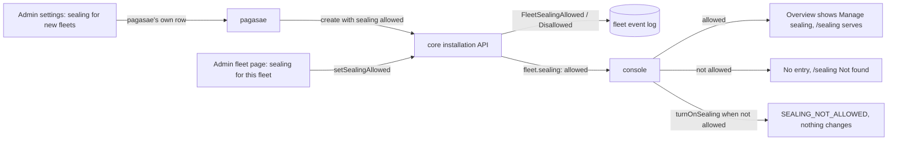

# Sealing, allowed per fleet by the installation

Design run for Thomas's ask of 30 Oct 2026: "saeling button make it conditional, it is a flag I can manage like I can turn on trierarch/squadrons for new fleets". Docs only, for Thomas to agree the purpose and answer the questions before anything is built. Sealing itself is decision 0068 and [the encryption design](e2e-encryption.md); this design adds only who may turn it on.

## 1. Purpose

Sealing ships in 0.34.0 with the console's 'Manage sealing' entry on the Fleet overview and its sealing page (S9). The ends that must wait on `KEY_UNAVAILABLE` (S11 to S13) and hosted Aeolus's KMS principal (S14) come later, so a fleet must not be able to turn sealing on before the app admin chooses to offer it.

**What is true after:**
1. The app admin allows sealing per fleet, on or off, from the fleet's page in pagasae Admin, as they switch squadrons and the trierarch per fleet (0021).
2. The app admin sets whether sealing is allowed for each fleet created from now on, in pagasae Admin settings, beside the plugins' defaults; fleets that exist keep theirs.
3. Pagasae sets it through core's installation API (0020); the switch lives in core, because sealing is core's.
4. A fleet without sealing allowed shows nothing of sealing in the console: no entry on the Fleet overview, no sealing page.
5. A fleet's reads say whether sealing is allowed, and turning sealing on is refused when it is not.

**Not the purpose:** turning sealing off (rejected in 0068, #1365); charging for sealing; a switch per ship; changing how sealing works once on.

## 2. Lessons to check against

- **The plugin switches (0021, pagasae#44).** Applies at once, no Save; a toast on success and failure, with Try again; while it saves, the switch is disabled with a spinner. A default for new fleets in pagasae's own database (`PluginDefault`), set on each fleet pagasae creates; an adopted fleet gets only the defaults that are on. Off keeps everything.
- **Every state change writes its event in the same transaction**, and every call is authorised for an actor (0057): here the installation.
- **Sealing never goes off (0068).** A sealed fleet's payloads need its keys; the sealing page is where the company sees key availability, changes its company key and its recovery key.
- **A server without an installation token has no installation procedures (0020)**, and squadrons without one is open to every fleet (0021).
- **Keep it minimal before 1.0.0 (0013).** One flag, no plan tiers.

## 3. The shape at a glance

| Part | What it does |
| --- | --- |
| core, `fleets` | A flag, sealing allowed, on or off. A fleet that exists starts off, a sealing or sealed one on (Q1); Q2 picks for a server without a token |
| core, `installation.fleets.setSealingAllowed` | Sets it for one fleet, with `FleetSealingAllowed` or `FleetSealingDisallowed` in the same transaction, by the installation |
| core, `installation.fleets.create` | Takes sealing allowed, so a new fleet comes with it in its one transaction |
| core, `installation.fleets.get` and `list` | Answer sealing allowed and the sealing state (none, sealing, sealed) |
| core, `fleet.sealing` | Answers sealing allowed beside the state it answers today |
| core, `fleet.turnOnSealing` | Refused `SEALING_NOT_ALLOWED` when the flag is off, changing nothing |
| pagasae, Admin settings | A Sealing card: one switch, sealing for new fleets |
| pagasae, an admin fleet page | A Sealing card: one switch, sealing for this fleet, with the fleet's sealing state |
| console, Fleet overview | 'Manage sealing' or 'View sealing' only when sealing is allowed |
| console, `/sealing` | The console's Not found when sealing is not allowed |

**Unhappy paths.** Core does not answer the switch: pagasae turns the switch back and shows the error toast with Try again, nothing changed. The fleet turned sealing on between the page loading and the switch going off: core refuses (Q1), pagasae turns it back on and says the fleet is sealed now. An operator on `/sealing` when the switch goes off: the next read answers not allowed and the page shows Not found; a turn on already sent is refused `SEALING_NOT_ALLOWED`.

## 4. Questions for Thomas

**Q1. May the flag go off while a fleet is sealing or sealed?**
1. No: core refuses `FLEET_SEALED`; pagasae shows the switch on and locked, "Sealed fleets keep sealing". So a sealed fleet is always an allowed one, and the sealing page, the key notice and every key procedure stay where the company needs them.
2. Yes, and off only stops turning on: a sealed fleet keeps sealing, its page and its key procedures; the overview entry stays for it.
3. Yes, and off hides the page and refuses key changes and recovery for a sealed fleet.

Pick 1. Option 3 would leave a company unable to change its key or recover, and option 2 makes off mean two things. With 1, "allowed" and "the console shows it" stay the same fact.

**Q2. A server without an installation token (self-hosted, no pagasae).** There is no installation API to set the flag.
1. Allowed for every fleet when the server has a KMS configured (`KMS_REGION`), not allowed without one: whoever runs the server turns it on by configuring the KMS.
2. Allowed for every fleet, always (as squadrons without a token, 0021); turning on fails at the KMS check without a KMS.
3. Not allowed unless a new setting says so (`SEALING=on`).

Pick 1: no new setting, and the console never offers what the server cannot do.

**Q3. Where does the default for new fleets live?**
1. In pagasae, a row beside `PluginDefault`, passed to core on create; adopted fleets switched only when it is on, as plugins are.
2. In core's installation settings beside the default limits; a fleet follows it or sets its own.

Pick 1: the same shape as the plugins, and a change to the default does not reach fleets that exist, which Thomas's wording ("for new fleets") asks.

**Q4. What do a fleet's reads answer when sealing is not allowed?**
1. `fleet.sealing` answers `allowed: false` with state none and nothing else; the console reads it to hide the entry and the page.
2. `fleet.sealing` is refused `SEALING_NOT_ALLOWED`.

Pick 1: a read that answers is simpler for the console and for a ship asking, and it names no key.

**Q5. The Fleets table in pagasae Admin.** Its Plugins column lists the plugins on per fleet.
1. Leave it; the fleet page shows sealing.
2. Add Sealed or Allowed to the column.

Pick 1: thin; the design does not change the table.

**Q6. With an installation token, a server without a KMS.** Pick: nothing extra; hosted Aeolus configures its KMS (S14), and turning on there fails at the KMS check as it does today.

## 5. Mockups

Before and after, desktop and phone, light and dark, every state, a dashed box on what changed:

- pagasae: Admin settings and the admin fleet page, in `docs/design/sealing-flag/` on pagasae's draft PR.
- console: [the Fleet overview and `/sealing`](mockups/sealing-flag-overview.html).

## 6. Slices, once agreed

F1 and F2 go out with 0.34.0, so the release offers sealing to no fleet the app admin did not allow.

| # | Repo | Slice | Done when |
| --- | --- | --- | --- |
| F1 | aeolus-fleet | The flag in core: the column, `setSealingAllowed` with its events, create, get and list, `fleet.sealing` and the refusal on turning on; Q2's rule without a token; the decision recorded | Tests by name for allowed, not allowed, the refusal changing nothing, Q1's refusal |
| F2 | aeolus-fleet | The console hides the entry and serves Not found on `/sealing` when not allowed | Walked on staging both ways |
| F3 | pagasae | The Sealing cards on Admin settings and the admin fleet page; new fleets get the default | Walked on staging |
