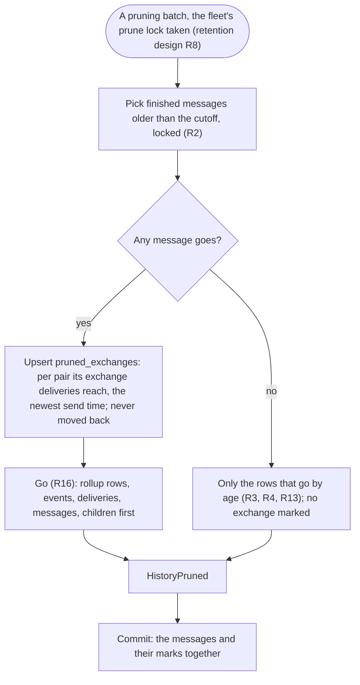

# Where an exchange's history ends

Design for [#1723](https://github.com/ThomasHendrickx/aeolus-fleet/issues/1723). New core fleet functionality, so it goes purpose first. Thomas's direction from [#1714](https://github.com/ThomasHendrickx/aeolus-fleet/issues/1714) (8 Nov) holds: no client behaviour in core; the smallest fact core holds that is true from its own point of view. Thomas approved the purpose and chose option 1 for H1 to H4 (9 Nov, on Bridge): build. Sections 5 to 10 complete the design for the build. No code.

## 1. Purpose (agreed)

A ship reading its exchange with another ship cannot tell, at the oldest message it gets, whether that is where the exchange began or where pruning (0066) took the older messages. Core pruned them; only core knows it did. Retention promises that nothing goes silently and that a timeline says where its history begins (the retention design, outcome 3 and R10). For an exchange it says nothing.

A person client shows why it matters: at the top of a chat it shows either that this is where the chat began or that older messages are no longer kept, and today it cannot choose.

The outcomes:
1. **A ship can tell, from the exchange read, whether pruning removed messages of that exchange, and up to where.** At the oldest end it tells the true start from a pruned edge.
2. **Core decides nothing for the client.** Core states what it removed; what a client shows, and where, stays the client's.
3. **True for every exchange and every reader**, whichever kind of ship reads it, and true when an older unfinished message survives a pruned stretch.
4. **No cost on the send path.** The fact is written where pruning already works, and read in the same call as the page.

Not the purpose:
- Bringing pruned messages back, or keeping them longer (0066, #1230).
- The fleet-wide `keptFrom` (`fleet.limits`): it stays as it is.
- Where the gateway's `people.exchange` passes it on, and what a person client shows: the gateway's train and the client's.
- A message count or a first-message read for its own sake.

## 2. What is true today

- **`exchange` answers `olderCursor` null both at the true start and at a pruned edge.** A cursor is a delivery id, so a page goes on from it even once its message is pruned.
- **The `exchanges` rollup** (`exchanges` table) is kept for person ships only (exchange read, E4): per other ship, the newest message and the count not yet acknowledged. No first message, start time or count. When pruning removes an exchange's newest message, the row points at the newest kept one, or goes when nothing of the exchange is kept (E10, `history-pruner.ts`).
- **Pruning is by message, not by exchange.** A finished message older than the cutoff goes; an unfinished one stays whatever its age (retention design R2). An old exchange can keep an unfinished message older than messages that went: a hole, not an edge.
- **Pruning records one `HistoryPruned` per batch**, with counts for the whole fleet, and moves the fleet's `kept_from` once a pass finishes. Nothing marks an exchange.
- **`kept_from` cannot decide it per exchange**: an exchange begun after it was never pruned; an old exchange with an unfinished survivor holds a message older than it.
- **A pruning batch already reads each pruned message's exchange deliveries** (`is_in_exchange`, sender and reached ship) to keep the rollup true.

## 3. Lessons to check against

- **0066 and the retention design, outcome 3 and R10.** Nothing goes silently; where history begins is shown. This is R10 for one exchange, so it is retention's fact, not a client's.
- **0016 and the blueprint's Purpose.** Core is content-blind and adds no rules of its own; it states what it did, never what to show.
- **#1714 and its design.** The smallest true fact on the read the client already makes; an explicit ask or a bit of data, never a client-shaped answer.
- **The exchange read, E1 to E4 and E10.** An exchange is every message one ship sent that reached the other; `exchange` serves every ship with `messages:receive`, the rollup only person ships. A fact kept on the rollup alone would be true for one kind of ship.
- **The retention design R8, R14 and R16.** A batch is one transaction; what goes is chosen as one set and goes in one step. A new write belongs in that batch, proven by the same tests: rollback, concurrency, restart.
- **0070.** A removed ship is a remnant whose id stays, so an exchange with it still reads by id.
- **0007, 0005.** Every row carries `fleet_id`; ids are time-ordered, so "up to where" can be a message's id or sent time.
- **0020, L13 of the retention design.** A fleet's delete removes every row, children first: any new table joins that list.
- **CLAUDE.md.** Every state change writes its event in the same transaction: pruning writes `HistoryPruned`.
- **0013.** No compatibility layer; the field is added and clients read it once core releases it.
- **The performance skill.** The read stays one indexed query plus a key lookup; the write is bounded by the batch (a pruned label send to 3,000 ships touches up to 3,000 exchanges in one batch).

## 4. Questions

Each has its options, the pick and Thomas's answer.

### H1 What core keeps

1. **Per exchange, how far pruning went: the newest of its messages that pruning removed** (its id or sent time). Why it belongs in core: pruning is core's own act, and this is the per-exchange form of `kept_from`. It tells the start (nothing removed) from a pruned edge, and it places a hole: a kept message older than it is a survivor with gaps after it.
2. **Per exchange, whether pruning removed any message of it.** Core's fact too, and smaller, but with a surviving older message the client cannot tell where the gap lies: it would mark the oldest end, above a message that may be the true start.
3. **Per exchange, its first message**, kept past pruning (the issue's alternative). A fact of the exchange, but written on the send path for every pair, and when the first message survives a pruned stretch it says "start" while a gap lies after it.
4. A message count per exchange. Rejected: written on every send and prune, more than the purpose.
5. The fleet's `keptFrom` on the page. Rejected: it cannot decide per exchange (section 2).

**Pick 1.** The smallest fact that stays true with holes, written only where pruning already runs.

**Thomas (9 Nov): option 1.**

### H2 For which exchanges, and where

1. **Every exchange, one row per pair of ships, written only by the pruning batch** for each pair whose messages it removes. Why it belongs in core: `exchange` is a read every ship makes, so its fact must hold for every reader; the cost falls on the hourly pass, none on send.
2. **On the `exchanges` rollup row**, person ships only, the row kept once nothing of its exchange is (newest message none, left out of the list). Reuses a table, but an agent ship's exchange would answer nothing, or a false start: a contract true for one client's kind of ship.

**Pick 1.** One meaning for every reader; option 2 shapes core's read to one client.

**Thomas (9 Nov): option 1.**

### H3 Which read answers it

1. **`exchange` answers it on every page, as kept** (none when nothing was pruned); `olderCursor` keeps its meaning. Why it belongs in core: the read already answers the exchange, and this is a fact of it; one key lookup more. What to show at the oldest end stays the client's.
2. **`exchange` answers an end, `start` or `pruned`, on the page with no older cursor.** Core's statement about its own page, but it folds a hole into one word (wrong when the true start survives) and reads the client's question into core.
3. Option 1, and each `exchanges` row too. Also a core fact, but the list does not need it for the purpose.

**Pick 1.** The raw fact, on the read the client makes; it can widen to the list when a need comes.

**Thomas (9 Nov): option 1.**

### H4 Exchanges pruned before it ships

Pruning so far left no trace per exchange, so what was removed before release cannot be known exactly.

1. **Check production first** (read-only: whether any fleet's `HistoryPruned` counted messages). None: nothing to mark. Some: Thomas chooses between 2 and 3 for those fleets.
2. **Mark every existing exchange in a fleet with a `kept_from` as pruned up to it.** Never says "start" falsely, but says "pruned" for an exchange begun after the cutoff.
3. **Mark nothing.** Such exchanges read as begun at their oldest kept message, a false start, against "nothing goes silently".

**Pick 1.** Retention is new; the likely answer is that nothing needs marking, and the choice between two untruths is Thomas's only if it does.

**Thomas (9 Nov): option 1.**

## 5. The fact, the record and the read

As answered in section 4.

**The fact (H1).** Per exchange, `prunedUpTo`: the send time of the newest message of that exchange that pruning removed, or null when pruning removed none. It only moves forward. Its meaning, true from core's side alone: messages of this exchange sent at or before it may no longer be kept, anywhere up to it; every message sent after it is kept or was never pruned. A kept message sent at or before it is one that was not finished when its neighbours went (retention design R2). Core says nothing about what a client shows.

**The record (H2).** A new table, `pruned_exchanges` (model `PrunedExchange`), in the shared context's pruning, one row per pair of ships:

| Column | Holds |
| --- | --- |
| `fleet_id` | The fleet (0007) |
| `ship_id`, `other_ship_id` | The two ships of the exchange, the lower id first, so one row per pair whichever ship reads; a ship's exchange with itself has both the same |
| `pruned_up_to` | `timestamptz`: the newest send time pruning removed of the pair's exchange |

Primary key `(fleet_id, ship_id, other_ship_id)`, the only lookup the read makes; no other index. Foreign keys to the fleet and to both ships, `Restrict`: a removed ship is a remnant whose row stays (0070), so nothing ever deletes a ship under it. No foreign key to a message: what it points at is gone.

**The write.** Only the pruning batch writes it, inside `go`, in the batch's one transaction and before the deliveries go: one `INSERT ... SELECT` over the batch's messages' deliveries `WHERE is_in_exchange AND reached_ship_id IS NOT NULL`, grouped by `least(sender_ship_id, reached_ship_id)`, `greatest(...)` with `max(messages.created_at)`, `ON CONFLICT DO UPDATE SET pruned_up_to = greatest(pruned_exchanges.pruned_up_to, excluded.pruned_up_to)`. Meetings and pings are not in an exchange (`is_in_exchange` false, exchange read E1), and a type delivery no ship claimed reaches no exchange, so none marks one. A label send pruned marks each pair it reached once. The fleet's prune lock (retention design R8) means one batch per fleet at a time and no other writer, so no lock order is needed. No new event: `HistoryPruned`, written in the same transaction, records the batch (CLAUDE.md, an event per change); the mark follows from the messages it counts.

**The read (H3).** `exchange` answers `prunedUpTo` (ISO 8601 in UTC, or null) beside `items`, `olderCursor` and `newerCursor`, on every page: the newest, older, newer and around pages alike. It reads the row by its primary key, with the pair in id order, in the same unit of work, **after** the page's rows. Read after, a page that a batch committed under can answer the messages and the mark (true: they are now gone) but never a page without the messages and without the mark. `olderCursor`, `newerCursor`, `exchanges` and `ackUpTo` keep their meaning. The common `exchangeOutputSchema` gains the field, required and nullable; the procedure's description states its meaning, so REST and MCP carry the same (0004).

**What a migration does (H4).** It creates the table and marks nothing. Before the release, the builder reports the step in section 8; if a fleet pruned messages, Thomas picks H4's option 2 or 3 for those fleets, and option 2 adds a data step to the same migration.

## 6. Flows

### A pruning batch marks the exchanges it prunes



### A ship reads its exchange

```mermaid
sequenceDiagram
    participant Crew as Crew of ship A
    participant Core as Core
    Crew->>Core: exchange(otherShipId B, cursor)
    Core->>Core: Hold lease, find B in the fleet (retired or a remnant too)
    Core->>Core: Page rows along deliveries_exchange_idx
    Core->>Core: Then pruned_exchanges by (fleet, least(A,B), greatest(A,B))
    Core-->>Crew: items, olderCursor, newerCursor, prunedUpTo
    Note over Crew: olderCursor null and prunedUpTo null: the oldest item is where the exchange began
    Note over Crew: prunedUpTo set: messages sent up to it may no longer be kept; items sent before it are survivors
```

### The cases

| Case | Answer |
| --- | --- |
| Never pruned | `prunedUpTo` null on every page; at the oldest end the exchange's true start |
| Old messages pruned, nothing older kept | At the oldest end, items all sent after `prunedUpTo`: older messages are no longer kept |
| A hole: an unfinished question from before the cutoff survives, finished messages around it went | `prunedUpTo` is the newest one that went; the question is an item sent before it, a survivor. Once answered and pruned in a later pass, the mark moves forward to it if newer, never back |
| An exchange begun after the cutoff, in a fleet that pruned | No row: null, its true start |
| Everything of the exchange pruned | `exchanges` no longer lists it (E10); `exchange` by id answers no items, `olderCursor` null and the mark |
| The other ship retired, then removed to a remnant | Read by id as before; the row names the remnant and stays |
| The other ship's name taken by a new ship | A new pair, a new exchange: by id, never by name (E2) |

## 7. Unhappy paths

| Path | Result |
| --- | --- |
| A batch fails midway, or the server dies in it | Rolled back whole: no message gone and no mark written; the next pass prunes and marks them together (retention design R14) |
| A read races a batch | The mark is read after the rows: it answers the messages with the mark, or neither gone nor marked, or gone with the mark; never gone without it |
| Two servers run the pass | The second fails the prune lock and skips the fleet; one writer |
| Retention raised, or set to none | Nothing comes back and no mark goes: what was pruned stays true |
| A label send to 3,000 ships pruned | Up to 3,000 rows upserted in that batch's one statement; bounded by the batch's messages and their deliveries |
| The fleet is deleted | Its rows go with it: `pruned_exchanges` joins the fleet delete's children-first list, before ships |
| A sealed fleet, its key revoked | The mark holds no payload: answered as ever, the items marked unreadable as today (0068) |
| Lease ended, scope missing, the other ship not in the fleet | The existing refusals, before any row is read |

## 8. Before the release: H4's step

The builder does not run it, and core never reads production. Before the migration is released, the builder sends orchestrator-1 this step for a read-only aggregate on production core by whoever holds read access there, and reports its answer in the build PR:

> Per fleet, the messages pruning removed: `SELECT fleet_id, sum((details->>'messages')::int) AS messages FROM events WHERE type = 'HistoryPruned' GROUP BY fleet_id HAVING sum((details->>'messages')::int) > 0;`

No row: nothing to mark, the migration as in section 5. Any row: the build waits for Thomas's choice of H4's option 2 or 3 for those fleets.

## 9. Tests

Built red, green, refactor per scenario (0014). Real Postgres (Testcontainers) wherever the mark is written, since only the adapter writes it.

| Scenario | Proof |
| --- | --- |
| A page answers the mark | In-memory `read-exchange.test.ts`: null with no row, the stored time with one, on the newest, older, newer and around pages, the pair found whichever ship reads |
| Pruning marks the exchange | `exchange-retention.integration.test.ts`: finished messages older than the cutoff pruned; `exchange` answers the newest pruned send time, at the oldest end no item older |
| Never pruned stays null | The same: an exchange begun after the cutoff in a fleet that pruned answers null |
| A hole | An unanswered question before the cutoff survives while finished messages around it go: the mark is newer than the question; answered and pruned later, the mark stays the newest pruned send time and never moves back |
| Only exchange deliveries mark | Meeting contributions and pings pruned mark nothing; a label send marks each pair it reached once; a type send claimed marks the claimer's pair |
| Rollback | `history-pruning.integration.test.ts`: a batch failing after the mark rolls back both, messages kept and no row; the next pass prunes and marks |
| A read racing a batch | A read and a batch in parallel, repeated: never a page with the messages gone and the mark null |
| Remnant and fleet delete | A removed other ship keeps its row and its read by id; a fleet's delete removes the rows (`delete-fleet` tests and the fleet delete integration test) |
| Every door | Common schema test: `prunedUpTo` required, nullable, ISO; tRPC, REST and MCP contract tests carry it |
| At scale | `exchange-scale.integration.test.ts`: the extra read is one primary key lookup in the page's plan; p95 and p99 stay within the exchange read's budget (exchange read, outcome 5), measured on staging after merge |

## 10. Documentation

- **Blueprint:** the `exchange` row of the ship contract states `prunedUpTo`, pointing here.
- **Architecture:** the `pruned_exchanges` table, and in operation 8 that a batch marks the exchanges whose messages it prunes.
- **The retention design R10:** where history begins is also answered per exchange, pointing here.
- **The ship protocol, rule 23** (`ship-protocol.ts`), and the `exchange` procedure's description: what `prunedUpTo` means.
- **compatibility.md:** the gateway's `exchange` line gains `prunedUpTo` with the core version, when the gateway reads it (its own train).
- No recorded decision changes.
