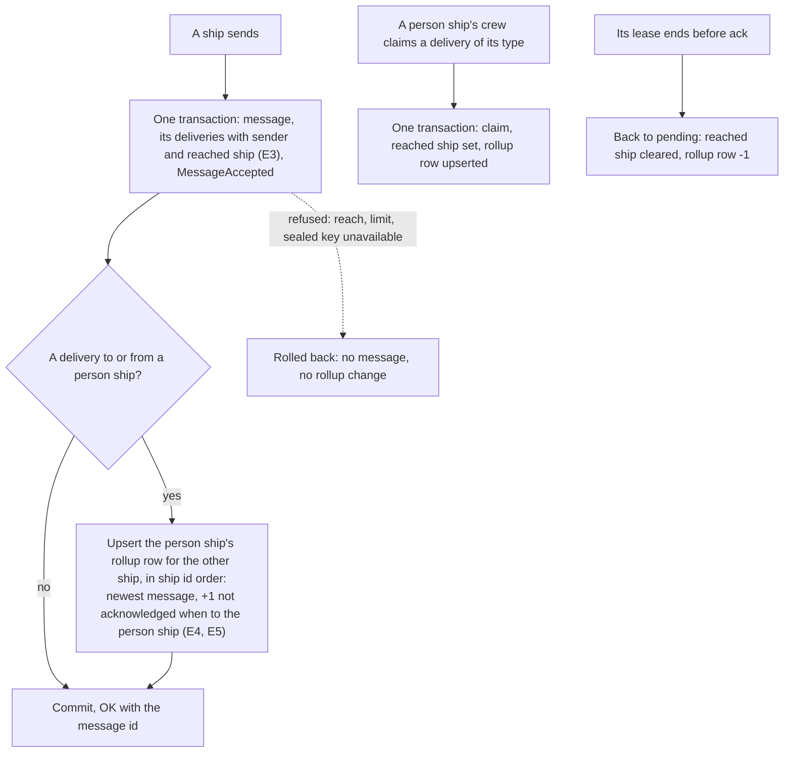
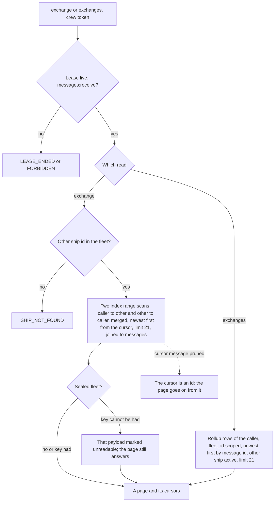
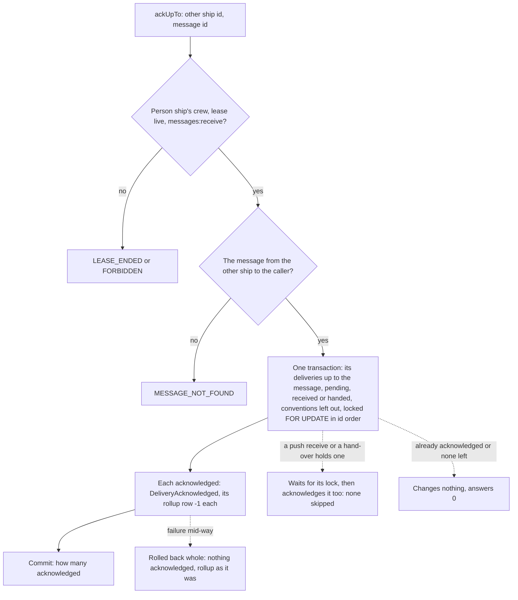

# A ship's exchange with one other ship

Design for [#1694](https://github.com/ThomasHendrickx/aeolus-fleet/issues/1694). New core fleet functionality, so it goes purpose first. Thomas approved the need, and one new core read rather than the gateway merging two reads (6 Nov). Thomas agreed the purpose (6 Nov). The questions below are for review; nothing past the purpose is decided until Thomas answers them. No code.

## 1. Purpose (agreed)

A person's client shows what their person ship and each other ship said to each other as one chat, the way a messaging app does: a list of the ships it talks with, newest first, each with what is still unseen, and per ship the messages both ways, a page at a time. The person marks a chat as seen up to where they read in one action. Core answers it; the client keeps no copy.

The outcomes:
1. **One exchange, both ways.** For the calling ship and one other ship: the messages the other ship sent that reached the caller, and the messages the caller sent that reached the other ship, each with its payload, content type, `inReplyTo` and sent time; on the caller's own, where the other ship's delivery of it stands. Newest first, 20 a page, older or newer from a cursor, or the page around one message.
2. **The list of exchanges.** Per other ship, the newest message between them and how many of the other ship's messages to the caller are not yet acknowledged. Newest first, 20 a page. Read from a rollup kept as messages are sent, delivered and acknowledged, never counted from history.
3. **Seen up to here, in one call.** The caller acknowledges the other ship's plain messages to it up to one message. Questions, steps, alerts and notices stay as they are: each has its own way to be done.
4. **Retention knows** whether a message acknowledged this way is finished (0066).
5. **At scale**, at 10,000,000 messages and 3,000 ships in a fleet: each read is one indexed query, p95 under 100 ms, p99 under 500 ms. Scoped to the calling ship and its fleet; no payload copied anywhere else.

Not the purpose:
- A meeting's contributions. A meeting is read with `meeting` (0061).
- A fleet-wide read of a ship's messages. That is `fleet.shipMessages` with `fleet:read` and read reach.
- Search, or a read of every exchange of every ship for a manager.
- The gateway's person API on top of it. That follows in the gateway, after its one-item read without acknowledging (ThomasHendrickx/aeolus-fleet-gateway#300).

## 2. What is true today

- **`record`** pages the deliveries to the crew's own ship and those of its type it claimed, whole, in every state, newest first by delivery id, 20 a page, at most 100. It has nothing the ship sent, and no filter by sender.
- **`sentMessage`** reads one message the caller sent by id: each delivery's state and recipient, no payload.
- **`fleet.shipMessages`** pages a ship's messages both ways, but needs `fleet:read` and read reach, which a person ship does not hold, and has no filter by the other ship.
- **Messages** are indexed by `(fleet_id, sender_ship_id, id)`; **deliveries** by `(fleet_id, recipient_ship_id, id)` and, for those of a type, `(fleet_id, claimed_by_ship_id, id)`. A delivery carries no sender, so no index covers sender and recipient together: a read of one exchange would join and filter, and scan as the fleet grows.
- **Who a message reaches**: one ship by name (a delivery to it), a type (one delivery, claimed later by one ship of it, and back to pending if its lease ends), a label selection (one delivery per ship, 0065) or a meeting (one per participant, 0061).
- **Ack** takes a received or handed delivery (0040). Nothing acknowledges a pending one: it is handed first. A person ship's crew acks and reports handled on its ship's deliveries whatever lease took them (the `record` design's lease rule).
- **Retention** (0066, the retention design R2) finishes a message when every delivery is final. An acknowledged delivery is final only where no re-read can come: its claiming lease ended, or it was never pushed. A person ship's gateway lease is pushed and long-lived, so what the person saw stays unfinished while that lease lasts.
- **Counts kept on write** already exist: the per fleet and UTC day counters added to in the send's transaction (performance design, decision 1).

## 3. Lessons to check against

- **Blueprint, promise 2; 0001, 0040.** Acknowledged means received: the promise ends at the person's action, in any place. Seen up to here is the person's action on many deliveries at once. Acknowledging a pending delivery skips the hand-over, a move 0040 does not have today, so it is a change to 0040 and must keep attempts, clocks and once more as they are.
- **0038 and the conventions** (question, step, alert, notice and their withdrawals, replacements, answers and outcomes). A question is open until answered whatever its delivery's state; a step until its outcome. Seen up to here leaves them alone, so the person's what-waits count stays true.
- **0034 and the read rules.** A ship reads a message as its sender or its recipient; a ship reading its own exchange needs no rule. The other ship need not be reachable now: history stays the caller's own.
- **0046, 0057.** Every call is authorised for the actor, here the person ship through its crew token, by scopes read from the server. `messages:receive` covers a crew's own deliveries; `messages:send` covers `sentMessage`.
- **0007.** Every query and every rollup row carries `fleet_id`.
- **0005, performance decision 4.** Ids are time-ordered, so a list pages by cursor on the id; no offset.
- **0006.** A payload is at most 256 KB, so a page of 20 whole payloads can reach about 5 MB. `record` answers the same today.
- **0068.** In a sealed fleet each payload is unsealed on the way out; a payload whose key cannot be had is marked unreadable, as `record` does, and the page still answers.
- **0066, the retention design.** Finished history goes hourly, with its deliveries and events. The rollup must stay true when an exchange's newest message is pruned.
- **0070.** Lists leave retired ships out; a name is unique only among active ships, and a retired ship's name is free at once, so a name does not name one exchange over time.
- **0061, 0065.** A meeting's messages are the meeting's; a label send reaches each ship with its own delivery.
- **CLAUDE.md.** Every state change writes its event in the same transaction, so the rollup is written in the send's, claim's and ack's transaction; locking queries are typed raw SQL in the Prisma adapter; tRPC is the one door, with REST and MCP mapped onto it.
- **The performance skill.** One resource and one need per call; paginate in the query; a rollup instead of recomputing; an index for every list query; measured on capped staging once the work is merged.

## 4. Questions

Each has options and my pick. Thomas answers each.

### E1 What belongs to the exchange of A and B?

1. **Every message one of them sent that reached the other**, by any selector: by name, by type when the other claimed it, by label. Meetings and pings left out.
2. Only messages sent to the other by name.

**Pick 1.** A chat shows what reached the person, however it was addressed; a type send claimed by the person ship is part of the talk.

**Thomas: 1** (6 Nov).

### E2 How the other ship is named

1. **By ship id**; the list of exchanges answers each other ship's id, current name, type and kind.
2. By name.

**Pick 1.** A retired ship's name is free at once (0070), so a name would merge two ships' history.

**Thomas: 1** (6 Nov).

### E3 How one indexed query reads both ways

1. **The sender's ship id on each delivery**, and the ship it reached (its recipient, or the ship of the type that claimed it), written when the delivery is made or claimed; one index on `(fleet_id, reached ship, sender ship, id)`. A page is two index range scans, one per direction, merged in one statement and limited to 21. The delivery row also holds the state the caller's own messages show.
2. A new table with one row per delivery to a ship, keyed by the pair of ships, written in the same transactions, joined to messages and deliveries.

**Pick 1.** No second record of the same fact, and the state comes with the row. Option 2 adds a table to keep in step with every delivery move.

**Thomas: 1** (6 Nov).

### E4 Whom the rollup is kept for

1. **Person ships**: one row per person ship and each ship it exchanged with, written in the transactions that make, claim, acknowledge, abandon or dismiss a delivery to or from it.
2. Every ship.

**Pick 1.** The need is a person's client. Every ship would add a row write per delivery fleet-wide, up to 6,000 for one label send to 3,000 ships, for a list no agent reads. It can widen later.

**Thomas: 1** (6 Nov).

### E5 What the rollup counts as not yet acknowledged

1. **Every delivery from the other ship to the caller that is pending, received or handed**, whatever its content type.
2. Plain messages only.

**Pick 1.** Unseen is unseen: a new question is the first thing the person must see. What waits on them is the gateway's count, not this one.

**Thomas: 1** (6 Nov).

### E6 Which deliveries seen up to here acknowledges

1. **The other ship's deliveries to the caller up to and including the named message, pending, received or handed, of every content type but the conventions** (question, step, alert, notice, and their withdrawals, replacements, answers and outcomes), in one transaction, each writing its `DeliveryAcknowledged`, the rollup in step. Again changes nothing. A message not from the other ship to the caller is refused as not found.
2. Option 1 with at most 500 deliveries a call, answering whether more remain.

**Pick 1.** One action, one transaction. At scale a backlog from one ship is thousands at most; I would measure it on staging rather than cap it now.

**Thomas: 1** (6 Nov).

### E7 Acknowledging a pending delivery

1. **Allowed only for a person ship's crew, in seen up to here**: pending to acknowledged directly, no attempt counted, no hand-over. A change to 0040.
2. Any crew may.

**Pick 1.** Only a person ship's crew acts for a person; an agent's ack must stay the agent's confirmation of what was handed (0040).

### E8 Is an acknowledged person-ship message finished for retention?

1. **Yes, for a plain message**: acknowledged at a person ship is final, since a chat message is never handled. Conventions stay as they are.
2. No: final only when handled or the lease ends, as today, so what a person saw stays while the gateway's lease lasts.

**Pick 1.** Under option 2 a person ship's history is never pruned in practice. Its re-read stays possible while it is kept, as in the exchange read.

### E9 The page around one message

1. **Up to 10 newer, the message and up to 9 older**, with cursors both ways; refused as not found if the message is not in the exchange.
2. The message on top, 19 older.

**Pick 1.** It opens a chat at a reply with its context both ways.

### E10 Page size, retired ships and pruning

1. **20 a page unless asked, at most 100**, as `record`. The list leaves retired ships out (0070); an exchange with a retired ship reads by id while it is kept. When pruning removes an exchange's newest message, its row goes too if nothing of the exchange is left, else points at the newest kept one.
2. 20 fixed; retired ships listed.

**Pick 1.** The same rules as `record` and every list.

### E11 Names and scope

1. **`exchanges`** (the list), **`exchange`** (a page of one), **`ackUpTo`** (seen up to here), with `messages:receive`; queries and one mutation on tRPC, REST and MCP like the other ship calls. "Exchange" goes into the blueprint's domain language: what one ship and one other ship said to each other.
2. Other names.

**Pick 1.** "Exchange" is the issue's word; "conversation" and "chat" are a client's words.

**Thomas: 1** (6 Nov).

## 5. Flows under the picks

For review with the questions; not decided.

### Send and claim keep the rollup

### Reads

### Seen up to here

### Unhappy paths, all

- **Two places acknowledge at once**: the second waits on the locks and acknowledges what the first left; the count never goes below zero.
- **A label send to 3,000 ships with person ships among them**: one rollup row per person ship, upserted in ship id order, so two such sends never deadlock.
- **The lease ends with deliveries received or handed**: back to pending (0040), still counted as not acknowledged.
- **The other ship retires**: its exchange leaves the list (E10), its history stays readable by id until pruned.
- **Pruning removes an exchange's newest message**: the row points at the newest kept one, or goes (E10), in the pruning batch's transaction.
- **A sealed fleet's key is revoked**: reads mark each payload unreadable; seen up to here needs no payload and still works.
- **A rollup proven true**: tests compare the rollup with a recount after concurrent sends, acks, claims, lease ends and a rolled back transaction.

## 6. Docs it would update

- **Blueprint:** the ship contract with `exchanges`, `exchange` and `ackUpTo`; "exchange" in the domain language.
- **Decision 0040:** acknowledging a pending delivery in seen up to here (E7).
- **Decision 0066 and the retention design R2:** a plain message acknowledged at a person ship is final (E8).
- **Architecture:** the delivery columns and index (E3), the rollup table.
- **Ship protocol and `ship-contract`:** the new calls.
