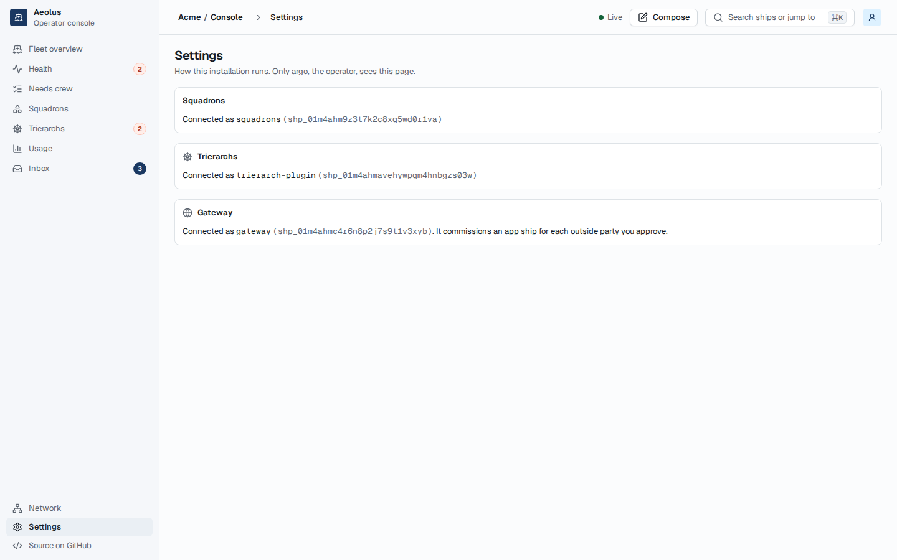
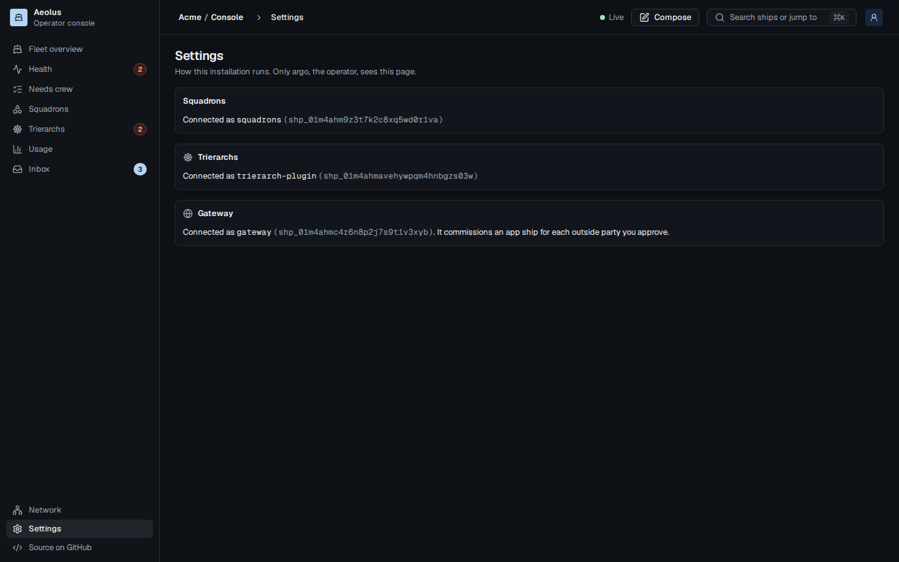
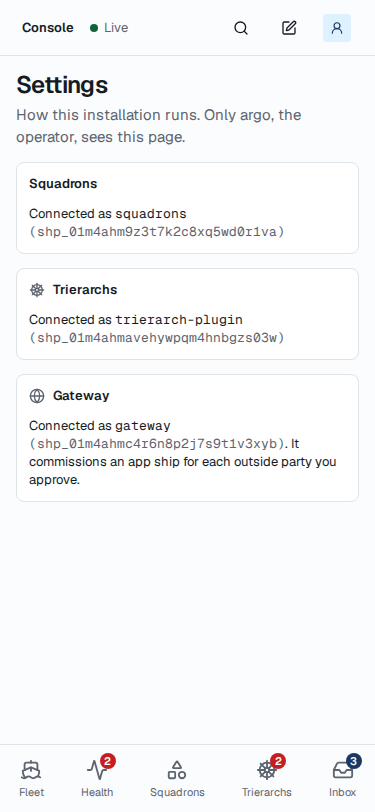
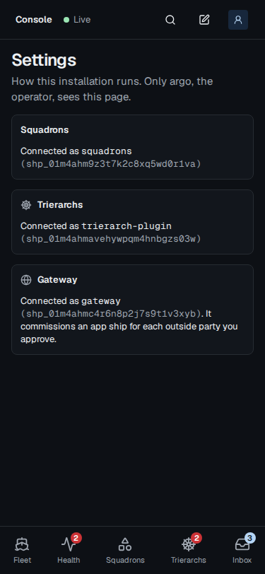
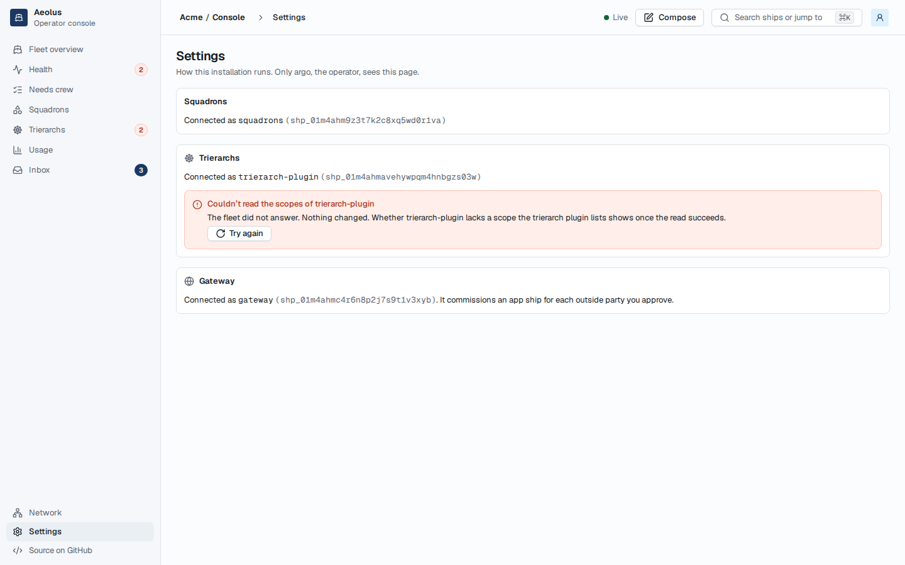
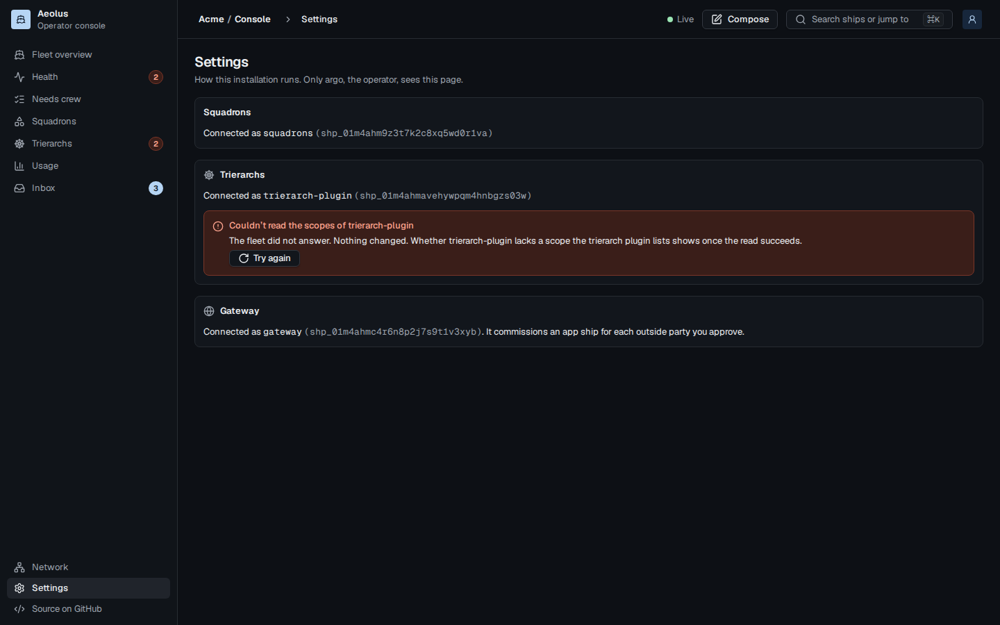
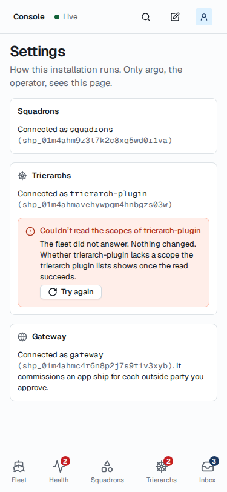
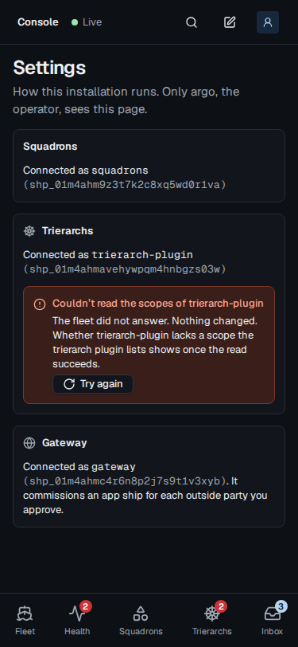

# Settings: a failed read of a plugin ship's scopes

Design, mockups for approval. Docs only. [Issue 1259](https://github.com/ThomasHendrickx/aeolus-fleet/issues/1259). Nothing is built until Thomas approves the before and after below; once approved, they are the acceptance criteria.

## 1. Purpose

When Settings cannot read a connected plugin ship's scopes, it says so and offers Try again, never "nothing missing".

## 2. Lessons to check against

### What the screen does today

Settings, as argo, shows one section per plugin (Squadrons, Trierarchs, Gateway). A connected one says "Connected as `<ship>`" and, when that ship lacks a scope its plugin lists, a notice naming them with **Grant missing scopes** ([#1226](https://github.com/ThomasHendrickx/aeolus-fleet/issues/1226), PR [#1252](https://github.com/ThomasHendrickx/aeolus-fleet/pull/1252)).

To know what is missing, the web app's server reads the plugin's connection, then the ship's scopes with `fleet.ship`. When that second read fails, it counts as "nothing missing": the section looks exactly like a ship that holds every scope. Below, the trierarch plugin's `fleet.ship` read failed; nothing on the page shows it.

| | Light | Dark |
| --- | --- | --- |
| 1440 |  |  |
| 375 |  |  |

| # | Lesson | Source |
| --- | --- | --- |
| L1 | A failed `fleet.ship` read is caught and answers no missing scope, on purpose: the connection gates the plugin's pages, so the read's failure must not fail the connection | `console/lib/connect-plugin.ts`, `missingScopesOf` |
| L2 | The fleet answering the ship without scopes (outside the reader's read reach) also answers no missing scope. Settings is argo's alone, and argo reads every ship | `missingScopesOf`; `console/lib/plugin-calls.ts`, `readShipScopes` |
| L3 | The same read runs for squadrons, the trierarch plugin and the gateway, on load and after Connect or Grant missing scopes | `plugin-calls.ts`, `shownConnection`; `*-reads.ts`, `*-actions.ts` |
| L4 | A failed read of the plugin's connection already shows as the section error with Try again, in place of the section | `trierarch-plugin-connection.tsx`, `loadError` |
| L5 | Errors say what failed, whether anything changed and what to do; the section variant is an attention panel with Try again | `components/molecules/inline-error.tsx`; `docs/design/png/InlineError.png`; `conventions.md` |
| L6 | A lacking scope makes the plugin's calls that need it fail until it is granted; hiding it moves the failure to somewhere the operator cannot trace back here | `missing-scopes.tsx`; issue 1259 |

## 3. After

The section keeps what it read ("Connected as `trierarch-plugin`"), and under it the console's section error says the scopes read failed, that nothing changed, and that whether the ship lacks a scope shows once the read succeeds, with **Try again**. Try again reads the section again. The same holds for Squadrons and Gateway.

| | Light | Dark |
| --- | --- | --- |
| 1440 |  |  |
| 375 |  |  |

Drawn with the console's own parts (ConsoleFrame, ListPage, SquadronsConnection, TrierarchPluginConnection, GatewayConnection, InlineError) and `@aeolus-fleet/ui`, rendered in the console's Storybook at 375 and 1440 wide, light and dark. Template repositories, shown under a connected squadrons, is left out of both: this change does not touch it.

## 4. Questions for Thomas

### Q1. Where the failed scopes read shows

1. **Under "Connected as", the section error with Try again (pick).** The connection was read and stays shown; only the scopes are unknown. The plugin's pages, which the connection gates, stay as they are (L1).
2. **The whole section turns into the error**, as a failed connection read does today (L4). One look for every failure, but it hides that the plugin is connected, and if the connection fails with it, the plugin's pages go too.
3. **As 1, with Grant missing scopes beside Try again.** A connect grants whatever the ship lacks, so it works without the read; but it offers a fix for a lack nobody saw.

Pick: 1. It says exactly what is unknown and keeps everything that is known.

### Q2. The fleet answers the ship without its scopes

1. **Leave it as today (pick).** Settings is argo's alone and argo reads every ship (L2), so it does not happen; the issue is about a failed read.
2. **Show it as the failed read** (Q1's error), with the reason "the fleet shows trierarch-plugin without its scopes".

Pick: 1. No screen for a state argo cannot reach; if Settings ever opens to other accounts, that change brings it.
