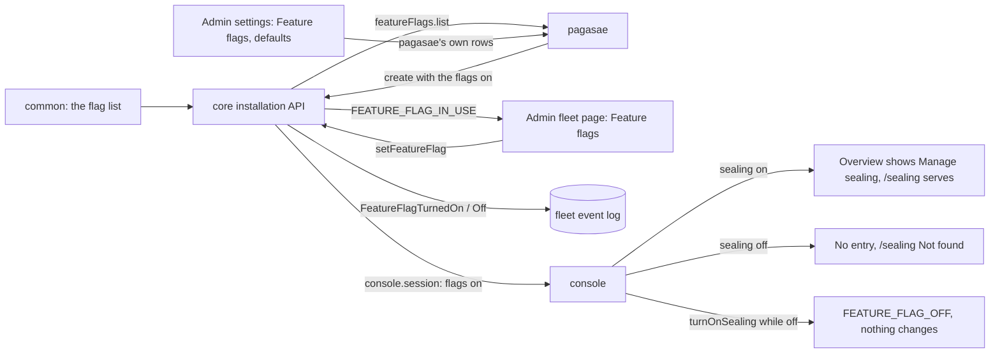

# Feature flags per fleet

Design run for Thomas's asks of 30 Oct 2026: "saeling button make it conditional, it is a flag I can manage like I can turn on trierarch/squadrons for new fleets", then "That is overkill, make the sealing section into a feature flag section. That way we can reuse the setup for future features". Docs only, for Thomas to agree the purpose and answer the questions before anything is built. Sealing itself is decision 0068 and [the encryption design](../e2e-encryption/e2e-encryption.md); this design adds one generic switch per feature, with sealing as its first and only flag today.

## 1. Purpose

Sealing ships in 0.34.0 with the console's 'Manage sealing' entry on the Fleet overview and its sealing page (S9). The ends that must wait on `KEY_UNAVAILABLE` (S11 to S13) and hosted Aeolus's KMS principal (S14) come later, so a fleet must not be able to turn sealing on before the app admin chooses to offer it. The next feature that needs the same gate gets it by adding one flag, not another design.

**What is true after:**
1. Core keeps each fleet's feature flags, each on or off. Core names the flags there are; today only `sealing`.
2. The app admin switches each flag per fleet from the fleet's page in pagasae Admin, in a Feature flags card, as they switch squadrons and the trierarch per fleet (0021).
3. The app admin sets each flag's default for fleets created from now on, in a Feature flags card on pagasae Admin settings; fleets that exist keep theirs.
4. Pagasae sets flags through core's installation API (0020) and lists the flags core names, so a new flag needs no pagasae change.
5. A feature whose flag is off shows nothing of itself in the console, and core refuses its procedures. For sealing: no entry on the Fleet overview, Not found on `/sealing`, `fleet.turnOnSealing` refused.

**Not the purpose:** per-flag custom UI in Admin; rollout percentages or a share of fleets; a flag service; flags per ship or per account; charging; turning sealing off (rejected in 0068, #1365).

## 2. Lessons to check against

- **The plugin switches (0021, pagasae#44).** Applies at once, no Save; a toast on success and failure, with Try again; while it saves, the switch is disabled with a spinner. A default for new fleets in pagasae's own database (`PluginDefault`), set on each fleet pagasae creates; an adopted fleet gets only the defaults that are on. Off keeps everything.
- **Every state change writes its event in the same transaction**, and every call is authorised for an actor (0057): here the installation.
- **Sealing never goes off (0068).** A sealed fleet's payloads need its keys; the sealing page is where the company sees key availability, changes its company key and its recovery key.
- **A server without an installation token has no installation procedures (0020)**, and squadrons without one is open to every fleet (0021).
- **Keep it minimal before 1.0.0 (0013).** On or off per fleet, nothing more.

## 3. The shape at a glance

| Part | What it does |
| --- | --- |
| common, the flag list | The flags there are, each a key, a name and one line saying what it turns on. Today `sealing` |
| core, `fleet_feature_flags` | A row per flag that is on for a fleet (`fleet_id`, `flag`); no row is off. A fleet that exists starts with none, a sealing or sealed one with `sealing` (Q1) |
| core, `installation.featureFlags.list` | The flag list, so pagasae renders what core names |
| core, `installation.fleets.setFeatureFlag` | Sets one flag on or off for one fleet, with `FeatureFlagTurnedOn` or `FeatureFlagTurnedOff` in the same transaction, by the installation; refused `FEATURE_FLAG_IN_USE` changing nothing when the feature cannot go off (Q1) |
| core, `installation.fleets.create` | Takes the flags that are on, so a new fleet comes with them in its one transaction |
| core, `installation.fleets.get` and `list` | Answer each flag on or off, and whether it can go off now (Q1) |
| core, `console.session` | Answers the flags that are on (Q4), so the console hides what is off |
| core, a feature's procedures | Refused `FEATURE_FLAG_OFF`, changing nothing, while its flag is off |
| pagasae, Admin settings | A Feature flags card: a switch per flag, its default for new fleets |
| pagasae, an admin fleet page | A Feature flags card: a switch per flag for this fleet; locked on, with core's line, when it cannot go off |
| console | A feature whose flag is off shows nothing: for sealing, no entry on the Fleet overview, Not found on `/sealing` |

**Unhappy paths.** Core does not answer the switch: pagasae turns the switch back and shows the error toast with Try again, nothing changed. The fleet started using the feature between the page loading and the switch going off: core refuses `FEATURE_FLAG_IN_USE`, pagasae turns the switch back on, locks it and shows core's line. Core does not answer the flag list on Admin settings: the card shows the page error in its place and the rest of the page loads. An operator on `/sealing` when the flag goes off: the next read answers it off and the page shows Not found; a turn on already sent is refused `FEATURE_FLAG_OFF`.

## 4. Questions for Thomas

**Q1. May a flag go off while the fleet uses the feature?** For sealing: while the fleet is sealing or sealed.
1. No: each flag in the list says when it is in use (sealing: sealing or sealed); core refuses `FEATURE_FLAG_IN_USE`, and pagasae shows the switch on and locked with core's one line ("Sealed fleets keep sealing"). Off then always means the console shows nothing and core refuses the feature.
2. Yes, and off only stops new use: a sealed fleet keeps sealing, its page and its key procedures.
3. Yes, and off hides the feature and refuses its procedures, even for a fleet using it.

Pick 1. Option 3 would leave a sealed company unable to change its key or recover, and option 2 makes off mean two things per flag. With 1 the Admin card stays generic: a switch, and a locked line core words.

**Q2. A server without an installation token (self-hosted, no pagasae).** There is no installation API to set flags.
1. Each flag in the list states its value without a token; sealing's is on when the server has a KMS configured (`KMS_REGION`), off without one.
2. Every flag on, always (as squadrons without a token, 0021); turning sealing on fails at the KMS check without a KMS.
3. Every flag off unless a new setting names it (`FEATURE_FLAGS=sealing`).

Pick 1: no new setting, and the console never offers what the server cannot do.

**Q3. Where do the defaults for new fleets live?**
1. In pagasae, a row per flag beside `PluginDefault` (no row is off), passed to core on create; an adopted fleet gets only the defaults that are on, as plugins do.
2. In core's installation settings; a fleet follows the default or sets its own.

Pick 1: the shape of the plugins, and a changed default does not reach fleets that exist, which "for new fleets" asks.

**Q4. How does the console learn a fleet's flags?**
1. `console.session` answers the flags that are on; every page already reads it.
2. Each feature's own read answers its flag (`fleet.sealing` answers `on: false`).

Pick 1: one place for every flag, so the next feature adds nothing to its reads.

**Q5. The Fleets table in pagasae Admin.** Its Plugins column lists the plugins on per fleet.
1. Leave it; the fleet page shows the flags.
2. Add the flags that are on to the column.

Pick 1: thin; the design does not change the table.

**Q6. With an installation token, a server without a KMS.** Pick: nothing extra; hosted Aeolus configures its KMS (S14), and turning sealing on there fails at the KMS check as it does today.

## 5. Mockups

Before and after, desktop and phone, light and dark, every state, a dashed box on what changed:

- pagasae: Admin settings and the admin fleet page, in `docs/design/feature-flags/` on pagasae's draft PR.
- console: [the Fleet overview and `/sealing`](mockups/console.html).

## 6. Slices, once agreed

F1 and F2 go out with 0.34.0, so the release offers sealing to no fleet the app admin did not turn it on for.

| # | Repo | Slice | Done when |
| --- | --- | --- | --- |
| F1 | aeolus-fleet | Feature flags in core: the flag list with `sealing`, the table, `featureFlags.list`, `setFeatureFlag` with its events and Q1's refusal, create, get and list, `console.session`, `FEATURE_FLAG_OFF` on sealing's procedures; Q2's rule without a token; the decision recorded | Tests by name for on, off, each refusal changing nothing |
| F2 | aeolus-fleet | The console hides the sealing entry and serves Not found on `/sealing` while the flag is off | Walked on staging both ways |
| F3 | pagasae | The Feature flags cards on Admin settings and the admin fleet page; new fleets get the defaults | Walked on staging |
