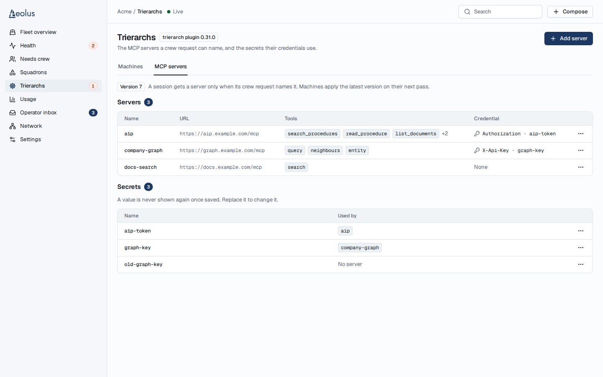

# A fleet manager sets the fleet's MCP servers on a console page

Design, mockups for approval. Docs only. [Issue 1735](https://github.com/ThomasHendrickx/aeolus-fleet/issues/1735), parent [1725](https://github.com/ThomasHendrickx/aeolus-fleet/issues/1725). The behaviour comes from the [fleet crew MCP design](../fleet-crew-mcp/README.md); this page adds no behaviour to it. Nothing is built until Thomas approves the mockups below; once approved, they are the acceptance criteria.

## 1. Purpose

A fleet manager sees and changes the fleet's crew-time MCP servers in the console, on phone and desktop, without a terminal: each server's name, URL, allowed tools and credential (secret name and header), and write-only secret values. The page shows the version it read; every save is one whole replacement from that version.

Thomas agreed the purpose on 9 Nov.

## 2. Lessons to check against

| # | Lesson | Source |
| --- | --- | --- |
| L1 | The page uses only the console route of #1732, `/api/trierarch-plugin/mcp.get` and `mcp.replace`. The plugin API and the distribution do not change | issue 1735; `console/lib/trierarch-plugin-mcp.ts` |
| L2 | `mcp.get` answers the version, the servers and the secret names only, never which machine applied which version: per-machine applied status is left out | aeolus-fleet-trierarch-plugin `adapters/trpc/router.ts`, `mcp.get` |
| L3 | A replacement is whole: every server, every secret kept by name, and the new values. A stale version answers CONFLICT, an invalid set BAD_REQUEST with a reason naming the server, no answer 502: whether it saved is then unknown | fleet crew MCP design, section 4; `trierarch-plugin-mcp.ts` |
| L4 | Secret values are write-only: never shown again once saved, kept only in the open dialog until its save | fleet crew MCP design, section 4 |
| L5 | Only a fleet:manage session, and only with the trierarch plugin: a viewer cannot read the set | fleet crew MCP design, section 4 |
| L6 | Saved is not applied: machines apply the latest version on their next pass; a running session keeps its selected names, follows URL, tool and credential changes once applied, and loses a removed server | fleet crew MCP design, sections 5 and 7 |
| L7 | Crew requests and templates choose servers by name; renaming or removing a server breaks the requests that name it | [crew-mcp-servers](../crew-mcp-servers/README.md) |
| L8 | The plugin's rules: a name in lowercase letters, digits, dots, hyphens and underscores; at least one tool; a URL with no credential in it; header rules; the whole set fits one 256 KB message once sealed | `mcp-configuration.ts`; `common/src/trierarch/names.ts` |

## 3. Questions for Thomas

Thomas answered Q1 to Q6 on 9 Nov, each option 1; the mockups draw every answer.

| # | Question | Answer |
| --- | --- | --- |
| Q1 | Where the page sits | Line tabs on Trierarchs, Machines and MCP servers, at its own route `/trierarchs/mcp-servers`. A session without fleet:manage sees no tabs. No new sidebar destination |
| Q2 | How servers and secrets show | A servers Table, then a Secrets section, the version beside them; phone list rows. Like GitHub, a secret value is never viewable again once saved |
| Q3 | Adding and editing a server | A form Dialog (phone full screen): Name, URL, Tools as chips with ×, then Add tool (pasting several adds them all), Send a credential with Header and Secret (an existing one or New secret with a write-only value). Save server is one `mcp.replace`; a refusal shows in the dialog with the input kept |
| Q4 | Secrets | Replace value… per secret (one write-only field, one `mcp.replace`). A new secret comes only from a server's credential. Remove… only when no server uses it, with a normal confirm |
| Q5 | Removing or renaming a server | Remove asks a normal confirm naming what it breaks. Renaming is allowed, with a line under Name naming what it breaks |
| Q6 | What a save says | Success: Toast Saved as version N, the page says machines apply the latest version on their next pass. Stale: the error in the dialog, the set read again, the input kept, Save again. No answer: may or may not be saved, Read again; never sent again by itself |

## 4. Mockups

Drawn with the console's own parts (ConsoleFrame, ListPage, Tabs, Table, Dialog, AlertDialog, Sheet, DropdownMenu, Input, Select, Checkbox, Badge, EmptyState, LoadingSkeleton, InlineError, Toast, MachineList, ModelsSection) and `@aeolus-fleet/ui`, rendered in the console's Storybook in Chromium at 375 × 812, 1440 × 900 and 1920 × 1080, light and dark. Pages are full length; a phone form is drawn 1300 high so every field shows. Hover and focus follow the parts as `docs/design/png` shows them. The server addresses are placeholders.

| Frame | What it shows | Files |
| --- | --- | --- |
| today | Before: Trierarchs today, the machine cards and Models. A session without fleet:manage keeps seeing exactly this after the change (no tabs). | [375 light](mockups/today-375-light.png) [375 dark](mockups/today-375-dark.png) [1440 light](mockups/today-1440-light.png) [1440 dark](mockups/today-1440-dark.png) [1920 light](mockups/today-1920-light.png) [1920 dark](mockups/today-1920-dark.png) |
| after-machines-tab | Trierarchs with the line tabs Machines and MCP servers; Machines holds today's content and Join a machine | [375 light](mockups/after-machines-tab-375-light.png) [375 dark](mockups/after-machines-tab-375-dark.png) [1440 light](mockups/after-machines-tab-1440-light.png) [1440 dark](mockups/after-machines-tab-1440-dark.png) [1920 light](mockups/after-machines-tab-1920-light.png) [1920 dark](mockups/after-machines-tab-1920-dark.png) |
| after-ready | MCP servers: the version line, Servers (Name, URL, Tools, Credential, row menu) and Secrets (Name, Used by, row menu); phone list rows | [375 light](mockups/after-ready-375-light.png) [375 dark](mockups/after-ready-375-dark.png) [1440 light](mockups/after-ready-1440-light.png) [1440 dark](mockups/after-ready-1440-dark.png) [1920 light](mockups/after-ready-1920-light.png) [1920 dark](mockups/after-ready-1920-dark.png) |
| after-empty | Version 0, nothing saved yet | [375 light](mockups/after-empty-375-light.png) [375 dark](mockups/after-empty-375-dark.png) [1440 light](mockups/after-empty-1440-light.png) [1440 dark](mockups/after-empty-1440-dark.png) [1920 light](mockups/after-empty-1920-light.png) [1920 dark](mockups/after-empty-1920-dark.png) |
| after-loading | Loading: skeletons in the shape of both sections | [375 light](mockups/after-loading-375-light.png) [375 dark](mockups/after-loading-375-dark.png) [1440 light](mockups/after-loading-1440-light.png) [1440 dark](mockups/after-loading-1440-dark.png) [1920 light](mockups/after-loading-1920-light.png) [1920 dark](mockups/after-loading-1920-dark.png) |
| after-error | The read failed: page error with the plugin's reason in mono and Try again | [375 light](mockups/after-error-375-light.png) [375 dark](mockups/after-error-375-dark.png) [1440 light](mockups/after-error-1440-light.png) [1440 dark](mockups/after-error-1440-dark.png) [1920 light](mockups/after-error-1920-light.png) [1920 dark](mockups/after-error-1920-dark.png) |
| after-server-menu | A server's row menu: Edit…, Remove… (phone: bottom Sheet) | [375 light](mockups/after-server-menu-375-light.png) [375 dark](mockups/after-server-menu-375-dark.png) [1440 light](mockups/after-server-menu-1440-light.png) [1440 dark](mockups/after-server-menu-1440-dark.png) [1920 light](mockups/after-server-menu-1920-light.png) [1920 dark](mockups/after-server-menu-1920-dark.png) |
| after-secret-menu | An unused secret's row menu: Replace value…, Remove…. A secret in use offers Replace value… only | [375 light](mockups/after-secret-menu-375-light.png) [375 dark](mockups/after-secret-menu-375-dark.png) [1440 light](mockups/after-secret-menu-1440-light.png) [1440 dark](mockups/after-secret-menu-1440-dark.png) [1920 light](mockups/after-secret-menu-1920-light.png) [1920 dark](mockups/after-secret-menu-1920-dark.png) |
| after-add | Add server: Name, URL, Tools (chips with ×, Add tool), Send a credential off | [375 light](mockups/after-add-375-light.png) [375 dark](mockups/after-add-375-dark.png) [1440 light](mockups/after-add-1440-light.png) [1440 dark](mockups/after-add-1440-dark.png) [1920 light](mockups/after-add-1920-light.png) [1920 dark](mockups/after-add-1920-dark.png) |
| after-add-new-secret | Add server with a credential: Header, Secret as New secret, its name and write-only value | [375 light](mockups/after-add-new-secret-375-light.png) [375 dark](mockups/after-add-new-secret-375-dark.png) [1440 light](mockups/after-add-new-secret-1440-light.png) [1440 dark](mockups/after-add-new-secret-1440-dark.png) [1920 light](mockups/after-add-new-secret-1920-light.png) [1920 dark](mockups/after-add-new-secret-1920-dark.png) |
| after-edit | Edit company-graph renamed to graph: the waiting-tone line on what the rename breaks | [375 light](mockups/after-edit-375-light.png) [375 dark](mockups/after-edit-375-dark.png) [1440 light](mockups/after-edit-1440-light.png) [1440 dark](mockups/after-edit-1440-dark.png) [1920 light](mockups/after-edit-1920-light.png) [1920 dark](mockups/after-edit-1920-dark.png) |
| after-invalid | A name that breaks the rule: the field error under Name | [375 light](mockups/after-invalid-375-light.png) [375 dark](mockups/after-invalid-375-dark.png) [1440 light](mockups/after-invalid-1440-light.png) [1440 dark](mockups/after-invalid-1440-dark.png) [1920 light](mockups/after-invalid-1920-light.png) [1920 dark](mockups/after-invalid-1920-dark.png) |
| after-saving | Saving: the action busy, every field and Cancel disabled | [375 light](mockups/after-saving-375-light.png) [375 dark](mockups/after-saving-375-dark.png) [1440 light](mockups/after-saving-1440-light.png) [1440 dark](mockups/after-saving-1440-dark.png) [1920 light](mockups/after-saving-1920-light.png) [1920 dark](mockups/after-saving-1920-dark.png) |
| after-refused | The plugin refused the replacement: its reason in the dialog, nothing changed, input kept | [375 light](mockups/after-refused-375-light.png) [375 dark](mockups/after-refused-375-dark.png) [1440 light](mockups/after-refused-1440-light.png) [1440 dark](mockups/after-refused-1440-dark.png) [1920 light](mockups/after-refused-1920-light.png) [1920 dark](mockups/after-refused-1920-dark.png) |
| after-stale | Someone else saved first: at version 8 now, not saved, the list read again, input kept, Save again | [375 light](mockups/after-stale-375-light.png) [375 dark](mockups/after-stale-375-dark.png) [1440 light](mockups/after-stale-1440-light.png) [1440 dark](mockups/after-stale-1440-dark.png) [1920 light](mockups/after-stale-1920-light.png) [1920 dark](mockups/after-stale-1920-dark.png) |
| after-no-answer | The plugin did not answer: may or may not be saved, Read again; never sent again by itself | [375 light](mockups/after-no-answer-375-light.png) [375 dark](mockups/after-no-answer-375-dark.png) [1440 light](mockups/after-no-answer-1440-light.png) [1440 dark](mockups/after-no-answer-1440-dark.png) [1920 light](mockups/after-no-answer-1920-light.png) [1920 dark](mockups/after-no-answer-1920-dark.png) |
| after-saved | Saved: the dialog closed, Toast Saved as version 8, the version line at 8 | [375 light](mockups/after-saved-375-light.png) [375 dark](mockups/after-saved-375-dark.png) [1440 light](mockups/after-saved-1440-light.png) [1440 dark](mockups/after-saved-1440-dark.png) [1920 light](mockups/after-saved-1920-light.png) [1920 dark](mockups/after-saved-1920-dark.png) |
| after-remove-server | Remove company-graph?: what it breaks, its secret stays (phone: bottom Sheet) | [375 light](mockups/after-remove-server-375-light.png) [375 dark](mockups/after-remove-server-375-dark.png) [1440 light](mockups/after-remove-server-1440-light.png) [1440 dark](mockups/after-remove-server-1440-dark.png) [1920 light](mockups/after-remove-server-1920-light.png) [1920 dark](mockups/after-remove-server-1920-dark.png) |
| after-replace-value | Replace aip-token's value: one write-only field, Save value | [375 light](mockups/after-replace-value-375-light.png) [375 dark](mockups/after-replace-value-375-dark.png) [1440 light](mockups/after-replace-value-1440-light.png) [1440 dark](mockups/after-replace-value-1440-dark.png) [1920 light](mockups/after-replace-value-1920-light.png) [1920 dark](mockups/after-replace-value-1920-dark.png) |
| after-remove-secret | Remove old-graph-key?: no server uses it, its value is deleted | [375 light](mockups/after-remove-secret-375-light.png) [375 dark](mockups/after-remove-secret-375-dark.png) [1440 light](mockups/after-remove-secret-1440-light.png) [1440 dark](mockups/after-remove-secret-1440-dark.png) [1920 light](mockups/after-remove-secret-1920-light.png) [1920 dark](mockups/after-remove-secret-1920-dark.png) |
