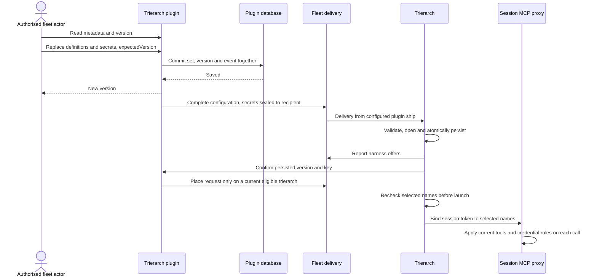

# Each fleet manages its crew-time MCP servers

Design for [#1725](https://github.com/ThomasHendrickx/aeolus-fleet/issues/1725). Purpose, API-only management, aip as ordinary MCP tools and live proxy updates approved. Remaining proposals await Thomas's approval. Design only.

## 1. Purpose

Each fleet manages its own named MCP servers and secrets. Its trierarchs receive only that fleet's configuration. A crew request selects the entries its session needs; the session receives their tools from its first turn, and a trierarch unable to provide them does not crew it.

aip is an ordinary optional MCP entry selected through the same crew settings. The trierarch supplies no aip CLI, skills or environment variables to sessions.

The trierarch plugin provides the management API. There is no new page in this slice, so there are no mockups. Core keeps the existing named `mcpServers` crew settings and their existing console presentation.

## 2. Lessons to check against

| Lesson | Source |
| --- | --- |
| Settings carry names, never server definitions, credentials, paths or flags. | [0027](../../decisions/0027-crew-settings.md) |
| Placement and launch both check every requested server against the harness's offer. | [Crew-time MCP design, M3 and M4](https://github.com/ThomasHendrickx/aeolus-fleet-trierarch/blob/main/docs/design/crew-mcp-servers.md) |
| Secrets reach a trierarch sealed to its own key. The session reaches remote tools through a proxy that holds the credential and restricts tools. | Same design, M5 to M7; [trierarch runtime](https://github.com/ThomasHendrickx/aeolus-fleet-trierarch/blob/main/docs/trierarch.md) |
| Acknowledgement means receipt. Sending a configuration is not proof that a trierarch applied it. | [0001](../../decisions/0001-ack-on-receipt.md) |
| The plugin owns its data and API; every call checks its actor, scopes and fleet. | [0043](../../decisions/0043-core-surface.md), [0057](../../decisions/0057-actors.md) |
| aip currently has special host installation, container image contents, skills and environment provisioning. All of those paths need removing for ordinary MCP-only access. | [Trierarch, aip and session runtime](https://github.com/ThomasHendrickx/aeolus-fleet-trierarch/blob/main/docs/trierarch.md) |
| The distribution pass currently remembers successful sends in process memory. Durable configuration updates need repeatable delivery after failures and restarts. | [Plugin README](https://github.com/ThomasHendrickx/aeolus-fleet-trierarch-plugin/blob/main/packages/trierarch-plugin/README.md) |
| A server list and its secrets must become usable together; independent arrival must not pair a new credential reference with an old store. | Existing separate MCP and secret messages in the two repositories |

## 3. Questions and approved choices

| Question | Choice |
| --- | --- |
| Purpose | Approved as in section 1. |
| Management surface | Plugin API only. Rejected for this slice: a new management page. |
| Optional aip | Ordinary remote MCP tools only. Rejected: trierarch-specific CLI, skills and environment provisioning when selected. |
| Changes during a session | Approved: preserve live proxy updates as in section 7. Rejected: freezing configuration until the next start. |
| API credential, metadata readers, placement gating and storage | Pending: console-session cookie only; fleet:manage for metadata; current-version placement gate; readable plugin database store. Each is a recommendation awaiting approval. |
| Remaining API, storage and delivery proposals | Sections 4 to 10 require approval as one design before implementation. |

## 4. Ownership and API proposal

The trierarch plugin stores one current configuration per fleet in its own database. All reads and writes derive the fleet from the authenticated actor; the input cannot choose it. This slice proposes the plugin's existing console-session door only: its `authenticate-operator` use case checks the supplied console session cookie through core's `console.session`, which answers the fleet, session kind and scopes. A manager signs in through the existing console and calls the plugin's tRPC API with that session cookie and the console's Origin. There is no ship-token or installation-token door for these calls. Holding a crew request or sending a message grants no configuration rights.

Proposed pending approval: `fleet:manage` reads definitions and secret names and replaces configuration. A viewer holding only `fleet:read` cannot read the set. Secret values are write-only. These calls belong to the plugin's tRPC router, not core's router and not its installation API.

| Procedure | Input | Result |
| --- | --- | --- |
| `mcp.get` | None | Current version, server definitions and secret names, never values. |
| `mcp.replace` | `expectedVersion`, complete server list, complete retained secret-name list and new or replacement secret values | Committed version. |

For API-only entry, use a local HTTP client on the manager's trusted computer. It reads the session cookie from a protected cookie file and the JSON request body from stdin or a mode-600 file prepared with an editor. Only file paths, never cookie contents or secret values, appear in command arguments. Disable request-body and header logging, shell tracing and verbose HTTP output; remove temporary credential files after use. `mcp.replace` requires the console Origin, checked server-side against the configured console origin before any write, in addition to the existing session and scope check. No new page or session-creation flow is introduced.

The first read answers version 0 with empty servers and secrets. A successful replacement increases the version by one, including clearing everything. A stale `expectedVersion` answers `CONFLICT` without a write. A retained secret must already exist or have a supplied value. Omission from the retained list deletes it; supplied values must appear in that list. Every server's credential must name a retained secret. Removing a referenced secret is refused until its servers are changed or removed in the same replacement.

One transaction validates and replaces the set, saves the new version and records the actor and changed names. Neither events nor errors hold secret values. Success follows commit and means saved, not applied everywhere. A caller unsure whether its write committed reads the version and metadata before trying another replacement.

Definitions keep the existing name, URL, Streamable HTTP transport, tool allowlist and optional credential reference and header rules. Secret values keep the existing byte and header-value limits. A server needs an explicit tool allowlist. There is no aip field or privileged server name.

Proposed pending approval: the plugin database is a credential store whose secret values are readable to the service and database administrators, including through its backups. Values are excluded from ordinary metadata projections, request logging, traces and errors. Deployment access and backups require the same protection as the plugin's kept fleet credentials. Sealing for transport remains separate from storage protection; it does not make the plugin database unable to read its own secrets. Introducing an external vault or a new encryption-key lifecycle is outside this proposal.

## 5. Delivery proposal

One trierarch state folder holds one fleet's configuration at a time. Use a versioned, complete configuration message from the connected trierarch plugin ship to each active trierarch of the fleet. It carries the version, server definitions, recipient public key and the complete secret store sealed to that key. Empty configurations are sent too. The encoded message, including sealing and JSON overhead, must fit core's 256 KB limit; an oversized replacement is refused before commit.

The new contract uses `application/vnd.aeolus.trierarch.mcp-configuration+json` with `{ fleetId, pluginShipId, version, publicKey, servers, secrets: [{ name, sealed }] }`; `application/vnd.aeolus.trierarch.mcp-configuration-request+json` with `{ fleetId, pluginShipId }`; and `application/vnd.aeolus.trierarch.mcp-configuration-applied+json` with `{ fleetId, pluginShipId, version, publicKey }`. Message delivery identifies the sender and current lease; payload identity must agree with them and the configured identity, never authorise itself. The trierarch repository documents these types, validation and replacement semantics in `docs/trierarch.md`.

The trierarch accepts it only from its configured plugin ship, for its current fleet and recipient key. It validates and opens the whole message before changing anything. It atomically replaces one persisted configuration file, mode 600, through a newly created file and rename, refusing symlink destinations as today. A malformed message leaves the current configuration untouched and records a value-free reason.

Versions only move forward. A duplicate of the applied version changes nothing. An older version cannot overwrite a newer one. A new key needs a freshly sealed copy even when the configuration version has not changed. A version is meaningful only with the current fleet and configured plugin ship; replacing that identity clears the held configuration before any launch.

After persisting, the trierarch sends an application confirmation to its configured plugin ship, naming the version and public key. The plugin records it against that trierarch and lease. This is a plugin message, not a new core report field. A duplicate configuration is confirmed again. The trierarch still reports its existing harness offers. Proposed pending approval: placement requires the confirmed version to match the plugin's current configuration before using those offers. A stale trierarch is not eligible for a request naming MCP servers; requests naming none need no MCP configuration. The launch check reads the complete applied set and keeps the existing give-back rules for a crew that is not final.

The plugin reconciles each trierarch's confirmed version and reported key on its normal passes. A send attempt has a persisted idempotency key: an uncertain send retries that key. When a known successful send still has no application confirmation on a later pass, a new attempt may send another copy; transport acknowledgement alone never suppresses later attempts. A new version, recipient key or lease requires a new attempt. A trierarch explicitly asking for configuration gets a new response even if its previous message was acknowledged. After a restart, the trierarch confirms its persisted version and asks for the current configuration. Confirmations are accepted only from the assigned trierarch ship on its current lease, for the expected version and key. A replacement committed during an older send leaves the newer version pending for the next pass.

This is convergence on the latest set, not execution through message acknowledgement. Confirmed application, not successful send, ends reconciliation. Off or disconnected, the plugin retains configuration and resumes reconciliation when enabled and connected. Deleting the fleet from the plugin deletes its configuration and secrets with its existing fleet data.

## 6. Flow

Failure paths:

| Failure | Result |
| --- | --- |
| Unauthorised, invalid, oversized or stale replacement | Refuse without a write or distribution. |
| Database transaction fails | Old set remains; no success returned. |
| Send fails or plugin restarts after commit | Persisted version remains; reconciliation sends it again. |
| Trierarch has no usable key | Send no secret values; it cannot offer credential-dependent servers. |
| Wrong sender, key or invalid sealed value | Reject whole message; keep applied set and application confirmation unchanged. |
| Configuration received but process stops before persistence or application confirmation | Startup asks again; latest set is applied and confirmed. |
| Out-of-order or duplicate message | Keep the newest complete applied configuration. |
| Selected server unavailable at launch | Give back before final crew; otherwise tell the owner once under the existing rule. |
| Server or secret removed while a proxy call starts | Refuse the later call after the update is applied; do not forward without its credential. |

## 7. Running sessions proposal

A running session's proxy binding records its fleet id and the plugin ship that supplied its configuration, together with its selected names and session token. Every call compares this binding with the currently applied identity. A mismatch refuses the call with `MCP_CONFIGURATION_IDENTITY_MISMATCH`, forwarding nothing. A configuration update or replacement carrying another identity is refused with the same reason. Clearing or replacing the configured identity never rebinds an existing session, including a hold surviving restart. An old binding stays refused even when a newly applied configuration uses the same server name.

Preserve the current proxy rule: the session's selected server names are fixed at start, while later proxy calls consult the current applied definitions and secrets. A changed URL, allowlist or credential takes effect after the trierarch applies the update. A removed entry is refused. A call already forwarded may complete. No automatic stop or restart is added.

A newly added server is offered to later crews; an existing session does not gain a name it did not select. The per-session proxy token continues to grant only its selected names and is never forwarded upstream. MCP credentials remain outside the harness environment and container. Tool listing and tool calls both use the allowlist, including batched calls and streamed results.

An offline trierarch retains its last complete configuration. This design makes no immediate revocation promise for a disconnected computer. Reconciliation updates it on return. Confirmations show application, not proof of a remote server's availability forever.

## 8. aip and migration

The fleet adds aip exactly as another remote MCP entry: name, endpoint, allowed tools and optional credential reference. It selects that name in the crew requests and templates that need it. No selection means no trierarch-provided aip access.

Before moving existing aip users, verify a Streamable HTTP MCP endpoint with the tools needed by the current procedures. The current runtime documentation establishes CLI access only. If the required MCP interface does not exist, it is a prerequisite to migration; this design does not silently substitute a CLI installer or broaden the entry format. Record that dependency in the implementation issues: this fleet's aip access waits for the MCP endpoint. Removing special aip provisioning does not wait for that endpoint and provides no CLI fallback.

Remove `AIP`, its message field and the trierarch's local aip override; remove host CLI installation, version and repair checks, PATH changes, aip skill plugin injection, aip environment provisioning and aip-specific container image contents and home preparation. Remove superseded local aip files through the trierarch's own known paths without touching user-managed installations. Update docs and tests for Claude Code, Codex and Copilot, host and supported container runtimes.

The new trierarch accepts only the new per-fleet configuration contract. It removes handlers for `mcp-servers+json`, `secrets+json`, their old request messages and the special `aip` field. It discards superseded local configuration instead of importing it. The plugin release that adds the per-fleet sender removes `MCP_SERVERS`, `MCP_SECRETS` and `AIP` and their old sends. Deploy that sender and receiver together; no deployment-wide set is applied during migration.

For this fleet, its manager provisions the company-graph and aip entries and their credentials directly through the authenticated API. No address or credential is put in an issue, template or crew request. Verify delivery, application and a selected session's tools, and verify an unselected session receives neither entry from the trierarch. Provision this fleet's entries immediately after the coordinated rollout. Unconfigured entries remain unavailable until saved and applied. Pre-1.0 breaking changes need no compatibility layer.

## 9. Scale and acceptance scenarios

Target: the existing fleet scale of 3,000 ships and 10,000,000 messages. Configuration reads use a fleet-key lookup and return only this bounded set, independent of message history. Index fleet configuration by fleet id. Distribution uses active trierarch reports already needed by assignment and reads the configuration once per fleet pass, never once per ship. Measure metadata reads at p95 under 100 ms, p99 under 500 ms and errors under 1% when the implementation is complete. Do not claim measurements for this document.

Implementation scenarios for approval:

1. An authorised actor saves a complete valid set; restart retains it and metadata contains no secret values. An actor lacking the required scope cannot read or change it.
2. Two writers replace the same version concurrently; exactly one commits. A transaction failure changes neither the version nor its event.
3. A missing referenced secret, invalid header, invalid URL or oversized sealed message refuses the whole replacement with no value in the result or log.
4. A trierarch receives the fleet's complete set sealed to its key. A wrong sender, wrong fleet or plugin identity, wrong key or one invalid entry changes nothing. An empty set clears it.
5. Duplicate and reordered deliveries cannot restore removed servers or secrets. Restart between receipt, persistence and confirmation converges on the latest version.
6. A plugin restart or send failure after a successful API write loses no configuration change. A recipient key or lease change gets a fresh delivery.
7. Placement waits for a current applied version for named MCP servers. Launch rechecks every selected name and refuses missing capabilities under the existing give-back rule.
8. A selected session sees only its named servers and allowed tools. Its upstream credential never enters its environment, command line or container. A request without selected names gets no trierarch-provided entry.
9. After application, a rotation affects later proxy calls; removing an entry blocks them. A call already forwarded may finish. Adding an entry gives no existing session a new selected name. A binding under a replaced identity refuses every call with `MCP_CONFIGURATION_IDENTITY_MISMATCH`, even for a matching server name, across hold and trierarch restarts.
10. aip behaves like another MCP entry on each supported harness and runtime. Sessions receive no automatic aip CLI, skills or variables. The verified MCP interface supports the migration's required procedures.

Prove domain behaviour with in-memory ports, database atomicity and concurrency with Testcontainers, and delivery/application and harness setup with the existing adapter suites. These are proposed scenarios, not passing test claims.

## 10. Repository parts

After approval, file these as sub-issues of #1725, each pointing here for behaviour:

| Repository | Part |
| --- | --- |
| `aeolus-fleet-trierarch-plugin` | Per-fleet configuration store, authorised metadata and replacement API, versioned sealed distribution and reconciliation, assignment check, value-free events and scenarios 1 to 7. Remove MCP_SERVERS, MCP_SECRETS and AIP and all old sends in the release introducing the new sender. |
| `aeolus-fleet-trierarch` | Complete atomic configuration persistence, application confirmations, current offers and launch checks, proxy update scenarios, removal of special aip provisioning across host and container runtimes, removal of old message handlers and local files, migration prerequisite verification and scenarios 4 to 10. Update docs/trierarch.md with the complete message contract and amend crew-mcp-servers.md M2 and M5 for fleet-owned configuration and the console-session management API. |

Core changes are documentation only: the design and its index pointer. Existing settings and console selection remain sufficient. No new screen, core setting or installation procedure is proposed.
