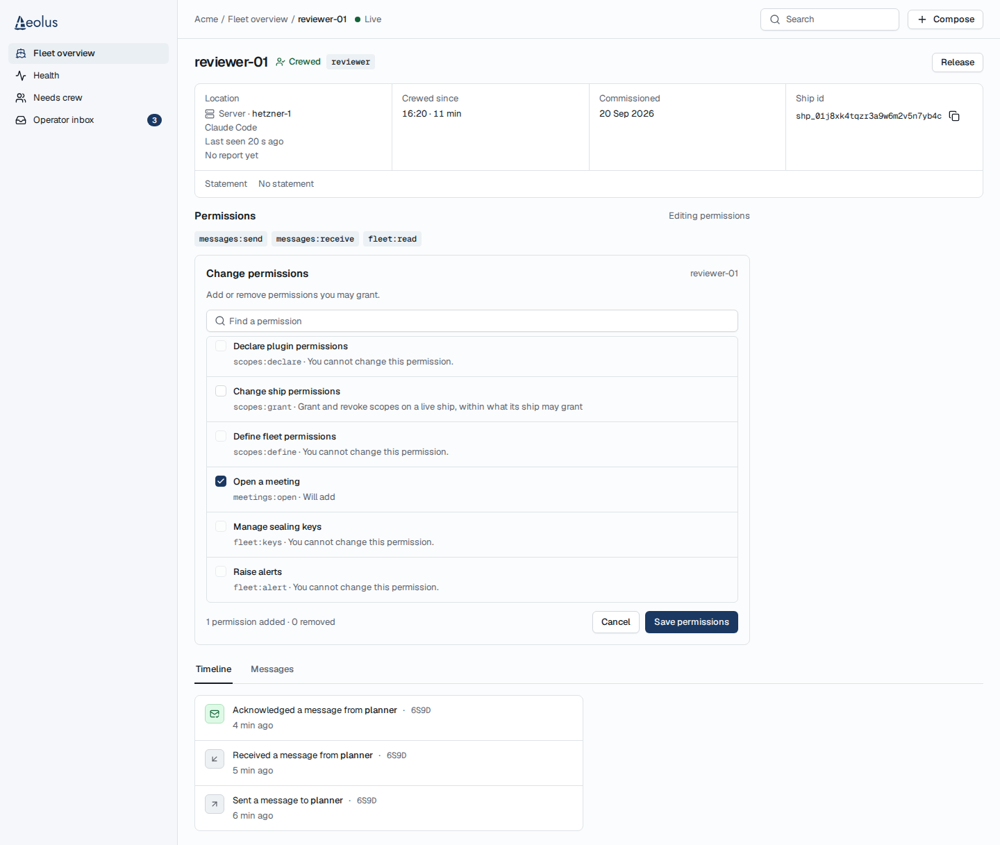
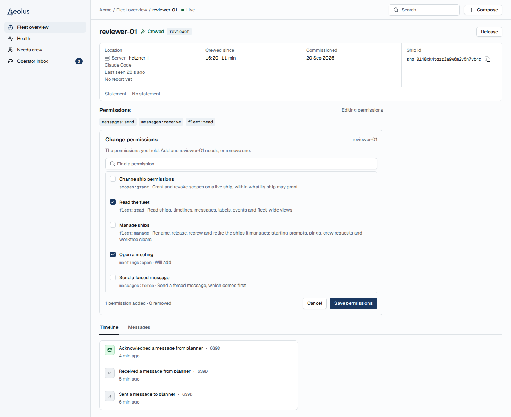

# Ship page: grant a running ship a permission

Design, mockups for approval. Docs only. [Issue 1304](https://github.com/ThomasHendrickx/aeolus-fleet/issues/1304). Nothing is built until Thomas approves the before and after below; once approved, they are the acceptance criteria.

## 1. Purpose

A fleet manager adds a permission a running ship turned out to need (a gateway tool, a meeting, a forced message) from that ship's page, without the fleet API. The page offers only permissions the manager holds, in plain words, and says why when it cannot.

## 2. Lessons to check against

| # | Lesson | Source |
| --- | --- | --- |
| L1 | Granting checks the granter: `scopes:grant`, each scope granted held by the granter, and manage reach on the ship. The server enforces it; the page adds no rule of its own | [0053](../../decisions/0053-nothing-is-argos-alone.md), [0046](../../decisions/0046-scope-catalogue.md), `core/src/domain/registry/scope-grant.ts` |
| L2 | Change a live ship's permissions on its page beside its permissions; add or remove only what the actor may grant; permissions in plain words | [0075](../../decisions/0075-commission-form-and-permissions.md) |
| L3 | The ship page already has the control: Permissions with **Change permissions**, an inline editor over `fleet.grantScopes`, Saving, a toast on save and the fleet's refusal under the list. It shows only when the actor holds `scopes:grant` and `fleet.checkManage` answers. Issue 1304 was filed before it | PR [#1899](https://github.com/ThomasHendrickx/aeolus-fleet/pull/1899); `features/ship/ui/organisms/ship-permissions.tsx`, `features/ship/services/ship-permissions.ts` |
| L4 | Today's editor lists every scope in the catalogue and locks the ones the actor does not hold, "You cannot change this permission.": a manager holding 5 of the 25 core scopes scrolls past 20 locked rows | `shipPermissionsOf`, `isLocked` |
| L5 | Out of manage reach, the button is simply absent: nothing says why | `use-ship-permissions.ts`, `checkManage` |
| L6 | The fleet's refusals name the reason: "You do not hold `<scope>`, so you cannot grant it"; "The network rules do not allow this manage" | `scope-grant.ts`, `check-reach.ts` |
| L7 | Errors say what failed, whether anything changed and what to do | [`conventions.md`](../conventions.md), InlineError |

## 3. The screens

The ship page at 1440 and 375 wide, light and dark, drawn with the console's own parts (ConsoleFrame, DetailPage, ShipHeader, ShipPermissions, PermissionChoices, InlineError, ShipTimeline, Toaster) in the console's Storybook at `bdb330b1b`. Today is the real ShipPermissions; after is ShipPermissions with the changes below. The example: `reviewer-01` holds sending, receiving and Read the fleet and turned out to need **Open a meeting**; the signed-in manager holds Change ship permissions, Read the fleet, Manage ships, Open a meeting and Send a forced message.

### What changes

1. **Choosing lists only what the actor holds** (L4): the rows are the manager's own scopes, sending and receiving left out (every ship holds them). The ship's other permissions stay as chips above the editor and are untouched. The line under the title says so: "The permissions you hold. Add one reviewer-01 needs, or remove one."
2. **Refused: not held** (L6, L7): the refusal names the permission in plain words and its scope, says nothing changed, and what to do. It still happens when the actor's scope was revoked while the editor was open.
3. **Refused: out of reach** (L5): in place of the button, one line says why: "You cannot change reviewer-01's permissions: the network rules do not let you manage it."
4. **Empty**: when the actor holds nothing the ship lacks, in place of the button: "You hold no permission reviewer-01 lacks, so you have none to give it."

Idle, saving and saved stay as they are today.

### Every state

| State | 1440 light | 1440 dark | 375 light | 375 dark |
| --- | --- | --- | --- | --- |
| Idle, today | [light](today-idle-1440-light.png) | [dark](today-idle-1440-dark.png) | [light](today-idle-375-light.png) | [dark](today-idle-375-dark.png) |
| Idle, after | [light](after-idle-1440-light.png) | [dark](after-idle-1440-dark.png) | [light](after-idle-375-light.png) | [dark](after-idle-375-dark.png) |
| Choosing, today | [light](today-choosing-1440-light.png) | [dark](today-choosing-1440-dark.png) | [light](today-choosing-375-light.png) | [dark](today-choosing-375-dark.png) |
| Choosing, after | [light](after-choosing-1440-light.png) | [dark](after-choosing-1440-dark.png) | [light](after-choosing-375-light.png) | [dark](after-choosing-375-dark.png) |
| Saving, today | [light](today-saving-1440-light.png) | [dark](today-saving-1440-dark.png) | [light](today-saving-375-light.png) | [dark](today-saving-375-dark.png) |
| Saving, after | [light](after-saving-1440-light.png) | [dark](after-saving-1440-dark.png) | [light](after-saving-375-light.png) | [dark](after-saving-375-dark.png) |
| Saved, today | [light](today-saved-1440-light.png) | [dark](today-saved-1440-dark.png) | [light](today-saved-375-light.png) | [dark](today-saved-375-dark.png) |
| Saved, after | [light](after-saved-1440-light.png) | [dark](after-saved-1440-dark.png) | [light](after-saved-375-light.png) | [dark](after-saved-375-dark.png) |
| Refused, not held, today | [light](today-not-held-1440-light.png) | [dark](today-not-held-1440-dark.png) | [light](today-not-held-375-light.png) | [dark](today-not-held-375-dark.png) |
| Refused, not held, after | [light](after-not-held-1440-light.png) | [dark](after-not-held-1440-dark.png) | [light](after-not-held-375-light.png) | [dark](after-not-held-375-dark.png) |
| Refused, out of reach, today | [light](today-out-of-reach-1440-light.png) | [dark](today-out-of-reach-1440-dark.png) | [light](today-out-of-reach-375-light.png) | [dark](today-out-of-reach-375-dark.png) |
| Refused, out of reach, after | [light](after-out-of-reach-1440-light.png) | [dark](after-out-of-reach-1440-dark.png) | [light](after-out-of-reach-375-light.png) | [dark](after-out-of-reach-375-dark.png) |
| Empty, today | [light](today-empty-1440-light.png) | [dark](today-empty-1440-dark.png) | [light](today-empty-375-light.png) | [dark](today-empty-375-dark.png) |
| Empty, after | [light](after-empty-1440-light.png) | [dark](after-empty-1440-dark.png) | [light](after-empty-375-light.png) | [dark](after-empty-375-dark.png) |

The key pair, choosing at 1440 light:

| Today | After |
| --- | --- |
|  |  |

## 4. Questions for Thomas

### Q1. Issue 1304 itself

1. **Keep #1899's control and change it as above (pick).** The control exists; the gateway Walk's step 6 is right once it ships, and this design closes the gaps the issue's walk would hit.
2. **Close 1304 as done by #1899** and drop the changes here.

Pick: 1. Out of reach and an empty list are silent or confusing today (L4, L5).

### Q2. Which permissions the editor lists

1. **Only the ones the actor holds (pick).** Everything listed can be ticked.
2. **Every scope, the ones not held locked** (today). Shows what exists, at the cost of a long list of rows nobody can tick.

Pick: 1, as the brief and 0075's "only what the actor may grant" read.

### Q3. Where out of reach shows

1. **One line in place of the button (pick).** The reason is there before anyone tries.
2. **The button, and the refusal after Save.** One more step to learn the same thing.
3. **Nothing** (today).

Pick: 1.

### Q4. An actor without `scopes:grant`

1. **Nothing, as today (pick).** Most people reading a ship never grant; a line on every ship page for them is noise.
2. **A line**: "Changing permissions needs Change ship permissions."

Pick: 1.

### Q5. Remove

1. **Keep removing in the same editor (pick).** 0075 says add or remove; the brief asks only for adding, and removing is already built.
2. **Add only.**

Pick: 1.
