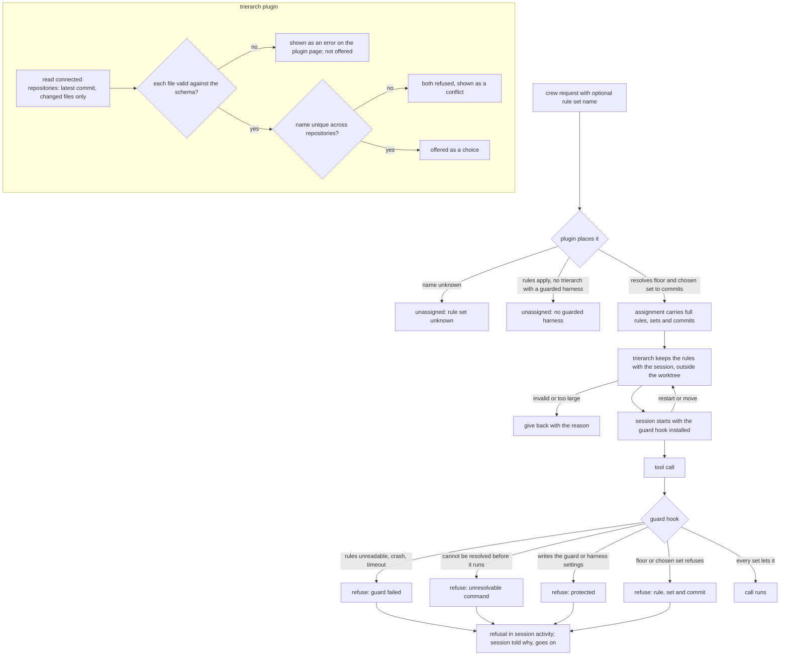

# The guard: every tool call of a crewed session checked against a rule set

Stage 1 for [#2069](https://github.com/ThomasHendrickx/aeolus-fleet/issues/2069): purpose approved by Thomas; lessons and questions Q2 to Q15 proposed. No detailed decision is taken here; the contracts, the rule set format and the console mockups follow once the purpose and the picks are agreed. Children: [#2070](https://github.com/ThomasHendrickx/aeolus-fleet/issues/2070) (the crew request setting), [aeolus-fleet-trierarch#617](https://github.com/ThomasHendrickx/aeolus-fleet-trierarch/issues/617) (the hook), [aeolus-fleet-trierarch-plugin#105](https://github.com/ThomasHendrickx/aeolus-fleet-trierarch-plugin/issues/105) (rule set repositories and the floor).

## 1. Purpose

A person who has a session crewed for them wants certain rules kept whatever the session decides: no push, no skipped git hooks, no writes outside its own repositories. Today those rules live only in skills and prompts, which a session can misread, forget or talk itself out of.

With the guard, the trierarch checks every tool call of a session it starts against a rule set before the call runs, and refuses a call a rule forbids. The session is told which rule refused it and goes on. The person chooses the rule set on the crew request, or none; the fleet's floor applies to every request and a request can only tighten it. The rules come from repositories the fleet connects, resolved to an exact commit when the request is assigned and carried with it, so a restart or a move to another computer applies the same rules. The session cannot change its own guard, and the person sees which version guards each ship and every refusal.

Aeolus provides the mechanism. The rules are the fleet's own: Aeolus writes none into the product (decision [0016](../../decisions/0016-no-policy.md)).

Not in it: what a session does inside an allowed call, rules for ships no trierarch crews, and a sandbox for the operating system (containers stay decision [0039](https://github.com/ThomasHendrickx/aeolus-fleet-trierarch/blob/main/docs/decisions/0039-container-sessions.md)'s).

## 2. Lessons to check against

| Lesson | Source |
| --- | --- |
| Aeolus adds no protective rules; risk is the operator's call. The guard is mechanism, like `--disallowedTools`: the fleet writes the rules. | [0016](../../decisions/0016-no-policy.md), [permission asks](https://github.com/ThomasHendrickx/aeolus-fleet-trierarch/blob/main/docs/design/permission-asks.md) |
| Crew settings carry names, never definitions, paths or flags, and are at most 16 KB. "Paths a session may touch" as a free setting breaks that rule. | [0027](../../decisions/0027-crew-settings.md), [0029](../../decisions/0029-crew-request.md) |
| Core never acts on crew settings; the plugin places, the trierarch executes and never picks. A place-only check with a written reason already exists for models. | [0029](../../decisions/0029-crew-request.md), [0030](https://github.com/ThomasHendrickx/aeolus-fleet-trierarch-plugin/blob/main/docs/decisions/0030-trierarch-plugin.md), [0063](https://github.com/ThomasHendrickx/aeolus-fleet-trierarch-plugin/blob/main/docs/decisions/0063-model-governance.md) |
| A session holds no fleet credential; the trierarch acts for it over the ship's socket. A guard that needs the fleet must ask the trierarch. | [0026](https://github.com/ThomasHendrickx/aeolus-fleet-trierarch/blob/main/docs/decisions/0026-trierarch.md) |
| Acknowledgement means receipt. Sending rules is no proof a trierarch applied them; configuration is versioned and confirmed, and an older version never replaces a newer one. | [0001](../../decisions/0001-ack-on-receipt.md), [trusted repositories](https://github.com/ThomasHendrickx/aeolus-fleet-trierarch/blob/main/docs/design/trusted-repositories.md) |
| Payloads are at most 256 KB; a message is the ticket, the reference is where content lives. Full rules in an assignment must fit. | [Architecture rules](../../../AGENTS.md) |
| The plugin owns its data, its pages and its API; every call checks actor, scopes and fleet; a message is never authority. | [0043](../../decisions/0043-core-surface.md), [0057](../../decisions/0057-actors.md) |
| Squadrons reads templates from repositories through the GitHub API; the issue asks rule sets to be read the same way. | [0017](https://github.com/ThomasHendrickx/aeolus-fleet-squadrons/blob/main/docs/decisions/0017-squadrons-package.md) |
| Claude Code runs hooks, then deny rules, then the permission tool. A hook that errors or times out lets the call run unless it answers a denial: a guard fails open by default. | [Permission asks](https://github.com/ThomasHendrickx/aeolus-fleet-trierarch/blob/main/docs/design/permission-asks.md), Claude Code hook behaviour |
| A check on the command text is bypassed by anything that builds the command at run time: `sh -c`, `eval`, variables, aliases, an interpreter's `-c`, a script written and then run, `git -c core.hooksPath=`, `--no-verify`, `GIT_*` variables. A path check is bypassed by `..`, symlinks, `cd` before a relative path, and tools other than the shell (Write, Edit, MCP tools). | General bypass classes of PreToolUse guards; the known bypasses of the prior art, an existing Claude Code PreToolUse guard, join them as regression cases ([aeolus-fleet-trierarch#617](https://github.com/ThomasHendrickx/aeolus-fleet-trierarch/issues/617)) |
| A session runs as the computer's user on the host: it can edit the harness's settings, the hook's files or its rules, unless the guard protects them or the session runs in a container that cannot reach them. | [0039](https://github.com/ThomasHendrickx/aeolus-fleet-trierarch/blob/main/docs/decisions/0039-container-sessions.md) |
| Nobody watches a session's pane; a refusal must never wait for a person. | [Trierarch runtime](https://github.com/ThomasHendrickx/aeolus-fleet-trierarch/blob/main/docs/trierarch.md) |
| Codex, Copilot and Cursor are harnesses too, each with different or no hooks. | [Trierarch harnesses](https://github.com/ThomasHendrickx/aeolus-fleet-trierarch/tree/main/docs/design/harnesses) |
| Before 1.0.0, keep the design minimal: no compatibility layers. | [0013](../../decisions/0013-breaking-changes-before-1-0.md) |
| A guarantee without a test does not exist: every known bypass becomes a regression test. | [0014](../../decisions/0014-tests-from-scenarios.md), [aeolus-fleet-trierarch#617](https://github.com/ThomasHendrickx/aeolus-fleet-trierarch/issues/617) |

## 3. Questions

Each question has its context, the options, the pick and why. Thomas answers them one by one; the detailed design follows the answers.

### Q1. Purpose

Context: section 1.
Options: 1 approve as written; 2 change it.
Pick: 1. It names the person's need, the mechanism and what stays out.
Answer: approved by Thomas, option 1, as written.

### Q2. Where the check runs

Context: Claude Code offers a PreToolUse hook (sees every tool call, the shell's and the file tools' and MCP's, before deny rules), deny rules (`--disallowedTools`, matching only by tool and prefix) and the permission tool (reached only for calls that would ask, so not for allowed calls).
Options: 1 a PreToolUse hook the trierarch installs in a settings file it writes per session, outside the session's folder; 2 deny rules only; 3 the permission tool.
Pick: 1. Only the hook sees every call with its whole input; deny rules cannot express paths or git actions, and the permission tool never sees an allowed call.
Answer: approved by Thomas, option 1, with his note: "This needs to work for all harnesses! PreToolUse is fine if all other supported harnesses are covered as well in the same or other ways." Decision: Claude Code is guarded by a PreToolUse hook the trierarch installs in a settings file it writes per session, outside the session's folder; every other supported harness (Codex, Copilot, Cursor) is guarded too, by its own hook where it has one or another way where it has none, worked out per harness in the detailed design.

### Q3. When the guard itself fails

Context: a hook that crashes, times out or cannot read its rules lets the call run by default.
Options: 1 fail closed: any error, timeout or missing rules refuses the call, naming the cause; 2 fail open, logged.
Pick: 1. A guard that lets calls through when it breaks guarantees nothing; a refused call is visible and the session goes on.
Answer: approved by Thomas, option 1, fail closed. Decision: any error, timeout or missing rules refuses the call, naming the cause.

### Q4. What a rule matches

Context: a rule that matches command text is defeated by every bypass class in section 2.
Options: 1 command text patterns; 2 the parsed command: the shell input is parsed into commands and their arguments, and what cannot be resolved before it runs (`eval`, `sh -c` or an interpreter's `-c` with input built at run time, a command name from a variable or substitution) is refused while a rule set applies; 3 an allow list of commands only.
Pick: 2. It closes the classes text matching leaves open, without forcing every fleet to list every command it allows.
Answer: approved by Thomas, option 2, the parsed command. Decision: the shell input is parsed into commands and their arguments, and what cannot be resolved before it runs is refused while a rule set applies.

### Q5. The rule types of the first version

Context: the issue names commands, paths and git actions.
Options: 1 commands, write paths and git actions; 2 those and the tools a session may call (MCP tools included); 3 those and read paths.
Pick: 2. A tool rule is cheap and closes the file-tool and MCP side; read paths add little against the issue's rules and cost a check on every read.
Answer: approved by Thomas, option 2. Decision: the first version has rules for commands, write paths, git actions and the tools a session may call, MCP tools included; read paths are not in it.

### Q6. Paths a session may touch

Context: the issue fills "paths a session may touch" from the crew request; 0027 forbids paths in crew settings.
Options: 1 no free paths: the guard's path boundary is the ship's own folder and the repositories the crew settings already name, which the trierarch knows; a rule set narrows it with globs relative to those repositories; 2 a new crew setting holding globs, changing 0027; 3 paths only inside rule sets.
Pick: 1. It keeps 0027 and needs no new setting: a session's own repositories are the boundary the issue's example wants.
Answer: approved by Thomas, option 1, no free paths. Decision: the guard's path boundary is the ship's own folder and the repositories its crew settings name; a rule set narrows it with globs relative to those repositories; crew settings get no path setting (0027 stands).

### Q7. Where a rule set's name is checked

Context: #2070 says an unknown name is refused on the crew request; core does not act on settings and does not know the plugin's rule sets.
Options: 1 the plugin at placement, as for models (0063): an unknown name leaves the request unassigned with the reason `rule set unknown: <name>`, and the console offers only the plugin's names; 2 core asks the plugin at request time and refuses.
Pick: 1. It keeps core free of plugin data and follows a recorded pattern; the console's choice list stops the common mistake.

### Q8. Floor and chosen set together

Context: the floor applies to every request; a request can only tighten it.
Options: 1 a call runs only when the floor and the chosen set both let it (each set refuses on its own); 2 the chosen set replaces the floor's allows but keeps its denies.
Pick: 1. Tightening then holds by construction: no chosen set can loosen anything the floor refuses.

### Q9. What travels with the assignment

Context: the trierarch holds no read token for private rule set repositories, and a moved session must apply the same rules.
Options: 1 the plugin sends the full resolved rules of the floor and the chosen set, each with its repository and commit, and the trierarch keeps them with the session, outside the worktree; 2 only repository and commit, the trierarch reading them itself.
Pick: 1. No token reaches a computer, and a crashed or moved session needs nothing but what it was given. A size limit well under 256 KB is set in the detailed design.

### Q10. A rule set that changes while a session runs

Context: the issue wants the same version on restart and move.
Options: 1 pinned for the crew request's settings version: a new request version resolves the latest commit again; 2 applied live at each new commit.
Pick: 1. What guards a session is then a fact of its request, as its model is under 0063; a live change mid-task surprises the session and the person.

### Q11. A session cannot change its own guard

Context: on the host a session can edit the harness's settings and the guard's files; in a container it cannot reach them.
Options: 1 the guard always refuses writes to its own files, its rules and the harness's settings, as part of the mechanism, and the docs state that only a container session cannot reach them at all; 2 guard only in containers; 3 host best effort, unstated.
Pick: 1. It protects the mechanism, not a policy (0016), and says plainly where the guarantee is complete.

### Q12. Harnesses without a guard

Context: Claude Code first; Codex's hooks may or may not allow it; Copilot and Cursor have none known. With a floor, every request has rules.
Options: 1 the plugin places a request with rules (the floor's or a chosen set) only on a trierarch that reports a guarded harness for it, else `no guarded harness: <harness>`; 2 crew it unguarded with a warning.
Pick: 1. An unguarded session under a floor breaks the floor's promise. The cost: while a floor is set, Codex, Copilot and Cursor requests wait until their guard exists.

### Q13. What is visible

Context: the issue asks every resolved version and every refusal to be visible.
Options: 1 the resolved sets and commits on the crew request's status, shown on the ship page; each refusal in the crew's session activity with its rule, set and commit, and a refusal count on the ship page; 2 a message to the owner per refusal; 3 logs on the computer only.
Pick: 1. It reuses the status and activity the trierarch already reports (0029); a message per refusal would flood the owner.

### Q14. Who manages rule set repositories and the floor

Context: the plugin owns this data; trusted repositories propose a plugin scope of their own.
Options: 1 a plugin scope `trierarch:guard` to add and remove repositories and mark the floor, read by fleet:read; choosing a set on a request stays fleet:manage like any crew setting; 2 fleet:manage for all.
Pick: 1. Weakening the floor is a different right from asking for a crew; with fleet:manage alone any requester could remove the floor.

### Q15. Where the console shows it

Context: before and after mockups follow these answers.
Options: 1 the plugin's own page lists the rule set repositories, their sets, errors and the floor; the crew request form gets a rule set choice (None means the floor only); the ship page shows the resolved sets and refusals; 2 a core Settings page for repositories and floor.
Pick: 1. The plugin owns its pages (0043); core shows only the setting and the request's status.

## 4. The flow these picks give

Proposed, to be redrawn with the answers.

