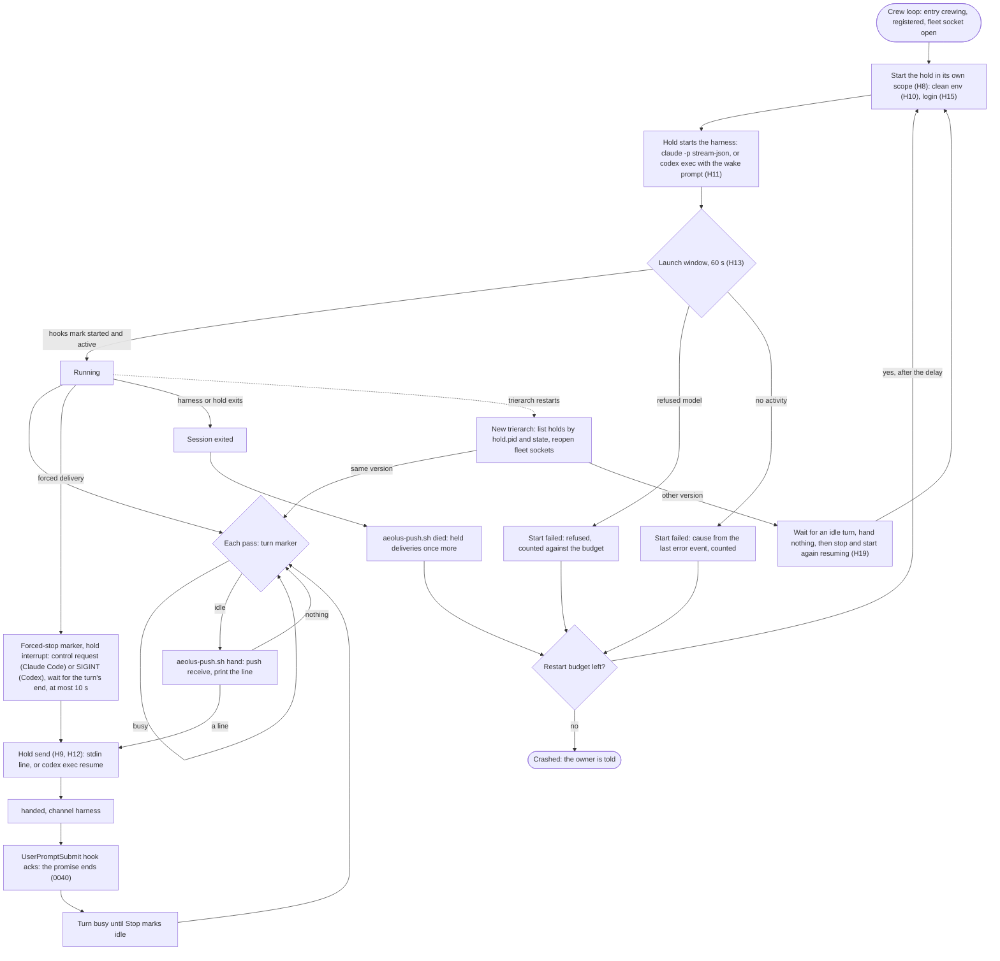

# The trierarch starts and talks to a session without a terminal

Design for [#882](https://github.com/ThomasHendrickx/aeolus-fleet/issues/882) and [#1085](https://github.com/ThomasHendrickx/aeolus-fleet/issues/1085), as one design for Aeolus 0.33.0: how the trierarch starts a session and talks to it. Approved by Thomas, 25 Oct: "headless --> approved". Docs only.

The trierarch lives in its own repository (0049); its docs, code and decisions cited below are in `aeolus-fleet-trierarch`.

## 1. Purpose (agreed by Thomas, 25 Oct)

The trierarch starts each session it crews as a program it talks to through the harness's own API (Claude Code in print mode with streamed JSON, `codex exec`), instead of a terminal program in its tmux server that it types into. A session signs in to its model with an API key (Anthropic Console, OpenAI) as well as with a subscription login.

For whom: the person who runs a trierarch on their computer or a server with no screen, and every ship it crews, whose deliveries must reach that ship's session and no other.

The outcomes:
1. Each session is handed only its own ship's deliveries, by how it is started, not by care. Restarting every session proves it (the test #881 asked for).
2. A machine needs no tmux, on the host and in containers.
3. A session outlives a trierarch restart or upgrade, and no delivery is lost or handed twice beyond what 0040 allows.
4. The operator sees what a session is doing without attaching to a screen.
5. A session works with an API key; the key never travels through the fleet or a crew request, and the session's model is not shown it.
6. Turn, hand-over, confirmation, force and once more work as 0040 says.

Not the purpose:
- Changing the delivery protocol (0040) or the plugin watcher for sessions a person crews by hand.
- A cloud runtime (#57).
- Spend limits, model governance or placement by cost (#375, the trierarch plugin).

## 2. What is true today

- **`SessionRuntime`** (`core/ports.ts:230`): `list`, `stop`, `start`, `type`, `interrupt`, `screen`. The host adapter runs every session in the tmux server `aeolus-trierarch`, started in a systemd scope of its own so it outlives the service (`tmux.ts:17`, #479). The container adapter runs one Podman container per ship with tmux inside; every `type`, `interrupt` and `screen` is a `podman exec` into it (`container.ts`).
- **Hand-over** (`trierarch.md:186`): each pass, while the turn marker says idle, the trierarch runs `aeolus-push.sh hand`, which push receives and prints a line, and types that line into the pane. The plugin's `UserPromptSubmit` hook acks the delivery and adds it to the turn. `Stop` marks the turn idle; `StopFailure` and Codex's `Interrupt` mark a death unless the forced-stop marker is set.
- **Force** (`stop-turn.ts`): Escape into the pane, then screen reads every 250 ms until the screen settles, then the line is typed.
- **Launch window** (`reconciler.ts:90`, 60 s): hook markers (`started`, `active`, `refused`), the screen for prompts that stop a session before its hooks run, and Codex's session log for a refused model.
- **Restart**: budget 5 in 60 minutes, delays 5 s to 10 min (`restart-policy.ts`); Claude Code gets `--continue` when its folder has a conversation, Codex `codex resume --last`.
- **Fleet socket**: `sockets/<shipId>/fleet.sock`, named in the folder's identity file; it answers only a caller under that ship's session root (`caller-check.ts`).
- **Logins**: host sessions use the machine's own login; containers get the one long-lived Claude token from `~/.aeolus/trierarch/model-token` as `CLAUDE_CODE_OAUTH_TOKEN` through an env file. Codex is not offered in containers. No API-key path exists.
- **Watching**: `tmux -L aeolus-trierarch attach`, or Remote Control on host Claude Code sessions (refused with containers).
- **Usage**: subscription windows read from a probe turn (Claude Code) or rollout logs (Codex); tokens from the harnesses' transcripts; `prices` in the configuration.

What the harnesses offer headless (vendor docs, 25 Oct):
- **Claude Code** `claude -p --input-format stream-json --output-format stream-json --verbose` is one long-lived process taking user messages on stdin, one JSON line each, and emitting `system/init` (with `session_id`), `assistant`, `user` and one `result` per turn. Plugins and hooks load as in an interactive session. No trust dialog. SIGINT ends the turn and then the process (proven on 2.1.306, 25 Oct: `result` with `error_during_execution`, exit 0); the stream-json control request `{"type":"control_request","request_id":"...","request":{"subtype":"interrupt"}}` on stdin, the one the Agent SDK sends for `interrupt()`, ends the turn the same way and keeps the process. Neither fires `Stop` for the interrupted turn. Credentials by precedence: `ANTHROPIC_AUTH_TOKEN`, `ANTHROPIC_API_KEY`, `apiKeyHelper`, `CLAUDE_CODE_OAUTH_TOKEN`, then the login. `ANTHROPIC_BASE_URL` points it at a gateway; it still needs a credential of its own. `result` carries `total_cost_usd`. Remote Control is interactive only and unavailable with a key or a base URL.
- **Codex** `codex exec --json "<prompt>"` runs one turn and emits `thread.started`, `turn.started`, `turn.completed` (with token usage), `turn.failed`, `item.*`, `error`; `codex exec resume <thread id> --json "<prompt>"` runs the next. `codex app-server` is long-lived but marked experimental and not for production. Hooks exist (`SessionStart`, `UserPromptSubmit`, `Stop`, `Interrupt` and more); the docs do not say whether they run in `exec`. A provider is set by `model_providers.<id>.base_url` with `env_key` naming the variable that holds its credential.

## 3. Lessons checked against

- **0026.** The trierarch owns wake and liveness; a session holds no fleet credential; each harness is one adapter. Kept: the hold process (H8) is part of the trierarch, and the adapters stay one per harness.
- **0040.** The hook's `ack` stays the confirmation (H5); `handed` names a channel; force is best effort; a stopped turn is not handed once more, and stopping is not dying.
- **0039.** Runtime is a machine choice behind `SessionRuntime`; tmux leaves both adapters (H4). Its rejected credential proxy, rejected for subscription logins, becomes the route for keys (H7).
- **0027, `trierarch.md:203`.** No credential and no flag in a crew request or the fleet (H6).
- **0013.** No compatibility layer: tmux goes in this release. Thomas on H4: "Ok let's do this, if this is irritating then we can always revert to tmux". The revert is git, not a second runtime kept in the code.
- **#881.** What a session inherits is the risk: the hold starts the harness with an environment it builds from nothing (H10), and S1 carries the restart-every-session test.
- **#880, #885.** No shared server a session can reach; the hold's socket answers only the trierarch (H9).
- **#479.** Sessions outlive the service: holds are started in their own scope, as the tmux server is (H8).
- **#846, #1016, #890.** Only `Stop` closes a turn; the text reaches the turn before the ack; an unforced delivery waits for an idle turn. Unchanged: the hooks still do this (H5).
- **#490, #888, #768, #995.** Documented signals, never the screen: the launch window and force read the harness's own events (H13, H12).
- **#852.** A refused login must say why: the cause comes from the harness's error event (H13). What the trierarch then does stays #852's open question.
- **`trierarch.md:279`.** A session must be a process that owns its work: a Codex turn is one `codex exec` process (H11).

## 4. Decisions

Thomas's answers (25 Oct):

| # | Rule |
| --- | --- |
| H1 | **A small process per session, started outside the service, holds the session's input and output; a restarted trierarch connects to it again** |
| H2 | **The trierarch keeps each session's streamed events on the machine, read with a trierarch command, and puts the session's latest activity in its report details** so the console shows it |
| H3 | **The operator talks to a ship by sending it a message; steering a busy turn is a forced delivery.** Remote Control is dropped |
| H4 | **Headless replaces tmux on the host and in containers in one release;** tmux leaves the machine requirements and the session image |
| H5 | **The plugin's hooks run inside the headless session and confirm, report the turn and handled, as today.** A harness whose hooks do not run headless is not offered until they do |
| H6 | **An API key is kept on the machine, in the trierarch's files beside the model token (mode 600), one login per harness, key or subscription,** set by the person who runs the trierarch and stated in its report details |
| H7 | **A model proxy on the machine holds the key; the session gets only the proxy's address** |

The detail that follows from them (approved with the design):

| # | Rule |
| --- | --- |
| H8 | **The hold process.** `aeolus-trierarch hold <shipId>` is the trierarch program run once per session, started through `systemd-run --user --scope` (launchd: its own job) so it outlives the service. It starts the harness as its child and is the only holder of its stdin and stdout; when one of the two ends, both end. Its files: `~/.aeolus/trierarch/sessions/<shipId>/` with `hold.sock`, `hold.pid`, `events.jsonl` and the harness's session or thread id |
| H9 | **The hold socket** answers only the trierarch's own process (peer credentials, as `caller-check.ts` does for the fleet socket), never a session. Its calls: `send <line>`, `interrupt`, `state` (running or exited, the harness's session id, the hold's version). `SessionRuntime` becomes `list`, `start`, `stop`, `send`, `interrupt`, `events`; `type` and `screen` go |
| H10 | **A clean environment.** The hold builds the harness's environment from a fixed list (`HOME`, `PATH`, `AEOLUS_LAUNCH`, the login of H15) and inherits nothing else from the trierarch |
| H11 | **Per harness.** Claude Code: one long-lived `claude -p --input-format stream-json --output-format stream-json --verbose`, with the configured flags (the bypass permission mode included, since print mode denies by default); a hand-over is one user line on stdin. Codex: the first prompt is `codex exec --json`, every later hand-over one `codex exec resume <thread id> --json`; between turns no Codex process runs, and the hold stays |
| H12 | **Hand-over and force.** The pass is unchanged: while the turn marker says idle, `aeolus-push.sh hand` prints the line and the trierarch calls the hold's `send` instead of typing; `handed` names channel `harness`. Force sets the forced-stop marker as today and calls `interrupt`: for Claude Code the stream-json interrupt control request on stdin, for Codex SIGINT; then the hold waits for the turn's `result` (Claude Code) or the `exec` process's end (Codex), at most 10 s, before the forced line is sent. When Claude Code refuses the control request, the hold sends SIGINT instead and starts it again with `--resume <session id>`, counted as no restart. Thomas, 25 Oct: "Headless option 2" |
| H13 | **Launch window from events.** The hook markers stay. The screen fallback becomes the harness's last error event in `events.jsonl` (`result` with `is_error`, `turn.failed`, `error`), carried as the cause of a start with no activity. Codex's refused model is read from that event, not its session log. Codex's hook trust is still written before every launch (`codex-setup.ts`) |
| H14 | **Watching.** The hold appends every event line the harness writes to `events.jsonl`, rotated at 10 MB with one previous file kept. `aeolus-trierarch watch <ship name>` prints it as readable lines (text, tool calls, results, errors) and follows it. The report details carry per ship `activity: { at, kind, tool? }` with `kind` one of `text`, `tool`, `result`, `error`: no content, since the fleet should hold none of a transcript. The console's Trierarchs page shows it |
| H15 | **Logins.** `aeolus-trierarch login <harness> --api-key` reads a key from stdin into `~/.aeolus/trierarch/keys/<harness>` (mode 600); `--subscription` removes it. A harness with a key file uses it; without one, the subscription login as today (the machine's login on the host, `model-token` in a container). The report details state each harness's login, `apiKey` or `subscription`, never the key |
| H16 | **The model proxy.** `aeolus-trierarch proxy` runs once per machine while any harness has a key, started in its own scope like a hold, listening on a loopback port; the trierarch starts it again when it is gone. Each session gets a random proxy token of its own: Claude Code as `ANTHROPIC_BASE_URL` plus `ANTHROPIC_AUTH_TOKEN`, Codex as `-c model_providers.aeolus.base_url=...` with `env_key` naming the token's variable. The proxy accepts only tokens of running sessions, replaces the token with the key, forwards only to that harness's vendor API, and knows each request's ship. Containers reach it at Podman's host address |
| H17 | **Usage with a key.** No subscription windows: `usage` states the login and the tokens per model from the transcripts as today; cost comes from Claude Code's `total_cost_usd` or the configured `prices` |
| H18 | **Containers.** The hold runs on the host for every runtime. With the container runtime it starts `podman run --rm -i` (no detach) with the harness command, so the container lives as long as the hold and SIGINT reaches the harness through `tini`. tmux leaves the image; `session-init` stays the entry before the harness. Codex in containers stays not offered (0039) |
| H19 | **An older hold after an upgrade.** A hold states its version. The trierarch speaks only its own hold protocol; a hold of another version is stopped and started again, resuming the conversation, as soon as its turn is idle, and is handed nothing until then |
| H20 | **Remote Control** in a harness's flags is refused by `config check` and at start, for every runtime |

## 5. Flow

The backbone: one hold per session; the trierarch's pass drives it.

Unhappy paths the diagram does not show:
- **Crash between `send` and `handed`.** The hook's ack may already have come; `handed` then answers `acknowledged`. If the session never took the line, the delivery comes back from `hand` as received and is sent again: one duplicate, nothing lost, as with a typed line today.
- **The hold dies mid-turn.** The harness ends with it; the session exited, so `died` marks held deliveries for once more, and the restart resumes the conversation.
- **Claude Code refuses the interrupt control request**: the hold sends SIGINT, which ends the process, starts it again with `--resume` and counts no restart (H12); the forced line then goes in.
- **Interrupt never ends the turn within 10 s.** The forced line is sent anyway; Claude Code queues it for the next turn, and for Codex the hold ends the `exec` process. Force stays best effort (0040).
- **A session writes to another ship's hold socket.** The socket refuses any caller that is not the trierarch (H9).
- **The machine restarts.** Holds are gone; entries still `running` are started again with no restart counted, as today.
- **The proxy is down.** Model requests fail and the harness retries; the trierarch starts the proxy again within a pass. A session that gives up shows the error as its activity and in `events.jsonl`.
- **A key is wrong or out of credit.** The vendor's error reaches the harness through the proxy; the start fails with that cause (H13), or a running session shows it as its activity.
- **A key is removed while sessions run.** The proxy refuses their tokens; they are started again on the subscription login at their next idle turn.
- **Codex's hooks do not run in `exec`.** Codex is not offered headless (H5) and S2 stops to ask Thomas.

## 6. Slices for 0.33.0

All in `aeolus-fleet-trierarch` except S4's console part. S1 first; S2, S3, S4 and S5 follow S1; S5's container part follows S3.

### S1 The hold and Claude Code headless on the host (H8 to H13, H19, H20)

- `aeolus-trierarch hold` with its socket, files and clean environment; `SessionRuntime` becomes `list`, `start`, `stop`, `send`, `interrupt`, `events`. The host adapter starts holds instead of tmux; the container adapter keeps tmux behind the new port until S3.
- The Claude Code adapter runs `claude -p` stream-json; hand-over by `send`, channel `harness`; force by `interrupt`; the launch window's cause from events; restart with `--continue` or `--resume`.
- The fleet socket's caller check takes the hold as the session root.
- An older hold is replaced at its next idle turn. Remote Control is refused.
- Tests: the restart-every-session test from #881, each session handed only its own ship's deliveries; a trierarch restart keeps every session running and handing; an upgrade with an older hold replaces it only when idle; an unforced delivery waits for `Stop`; a forced one interrupts and goes in; the hold's death marks once more and restarts; the hold socket refuses a session's process; the harness sees none of the trierarch's environment; a refused login names its cause. The session runtime contract test runs against both adapters.

### S2 Codex headless on the host (H11, H13)

- First prove that Codex's hooks run in `codex exec` and `codex exec resume`. If they do not, stop and ask Thomas (H5).
- The Codex adapter runs one `codex exec --json` per turn with the thread id the hold keeps; force ends the `exec` process; the refused model is read from its error event; the session log reader goes.
- Tests: a hand-over starts one `exec resume` and its `Stop` marks idle; force ends the turn and the forced line runs next; a refused model is reported from a captured event; no Codex process runs between turns.

### S3 Containers through the hold; tmux leaves (H4, H18)

- The container adapter starts `podman run --rm -i` from the hold; tmux leaves the image, the session script, the machine requirements and the code (`tmux.ts`, `stop-turn.ts`, the screen matchers, `held-command.ts`).
- Tests: a container session takes a hand-over and a forced delivery; stopping the hold removes the container; a trierarch restart keeps container sessions; `config check` no longer asks for tmux.

### S4 Watching (H2, H14)

- `events.jsonl` with rotation; `aeolus-trierarch watch <ship name>`; `activity` per ship in the report details.
- Core: the console's Trierarchs page shows each ship's latest activity and its age from the details.
- Tests: watch prints a session's text, tool calls and errors and follows new ones; rotation keeps one previous file; the details carry no event content; the page shows the activity.

### S5 API keys and the model proxy (H6, H7, H15 to H17)

- `aeolus-trierarch login`, the key files, the proxy with its per-session tokens, Claude Code and Codex wired to it, the login in the report details, usage without windows.
- Containers reach the proxy at Podman's host address (after S3); the model token stays for the subscription login.
- Tests: a session with a key works and its environment holds no key; a token of a stopped session is refused; a request to any host but the vendor's is refused; a wrong key fails the start with the vendor's cause; removing a key moves sessions back to the subscription login; the details state the login and never the key.

Docs each slice updates: `trierarch.md` (Crewing a ship, Unattended, Restart, Release, Session runtime, report details), `architecture.md` (adapters, files on the machine, the diagrams), decisions 0026 and 0039 and their lines in core's `docs/decisions/README.md`, `packages/trierarch/README.md` (requirements, attach), `timings-and-limits.md` (the 10 s interrupt wait, the 10 MB rotation).
