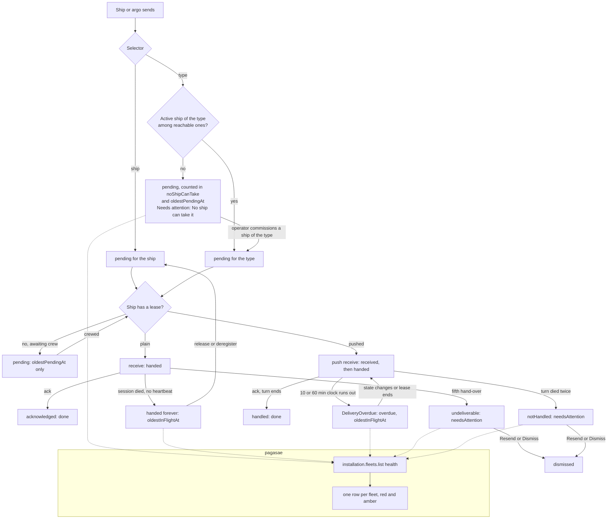

# Proposal: fleet health figures (#304, for pagasae #2)

Status: proposal, waiting for Thomas's approval. Not yet in the blueprint.

## Purpose

The operator of the hosted service (pagasae) runs many fleets on one server. Today the installation procedures answer how big and how busy each fleet is (ships, messages, last activity, storage), not whether it works. The hosting operator needs to see, across every fleet on one screen, whether messages are reaching their ships, and to tell three cases apart:

1. **Fine:** nothing waits longer than normal.
2. **Stalled, the fleet operator acts:** work waits that only the fleet's own operator can unblock (commission a ship of a type, crew a ship, resend or dismiss in Needs attention).
3. **Stalled, the server is at fault:** work waits although the fleet looks fine, which is a bug or an outage for the hosting operator to investigate.

What they do with it: look at the red rows, read which figure is red, and either tell the fleet's operator (case 2) or investigate the server (case 3). The hosting operator never acts inside a fleet: Aeolus has no policy (0016) and the fleet is its operator's.

## Lessons to check against

- **The operator is not the fail-safe** (CLAUDE.md promise 2). A figure only helps when someone looks at it; the console's Needs attention already tells the fleet operator about undeliverable, not handled and overdue deliveries. The new figures must not become a second place that silently fills up.
- **Leases have no heartbeats** (0010). A plain (not pushed) lease held by a dead session keeps its handed deliveries forever: no clock runs on it. Only age shows it.
- **The 0040 clocks cover pushed leases only.** A pushed lease whose computer died is caught by the 10 and 60 minute clocks (`DeliveryOverdue`); nothing else is.
- **Retire abandons only deliveries addressed to the ship itself** (blueprint, Retire). Deliveries to a type stay pending when the last ship of the type retires, and a type send under network rules (0034) keeps only the reachable ships as claimants: when they all retire, no ship can take it, even though ships of the type may exist.
- **One source of truth.** Overdue, undeliverable and not handled are already decided by core; the figures count them, they never recompute them.
- **Every query is scoped by fleet_id** (0007). The installation reads across fleets only through the installation token; each figure is a per-fleet subquery like the existing measures.
- **The server never looks into messages** (blueprint, Installation). The figures read states and times, never payloads.

## Where deliveries stall today (main at 0008a423)

| Where | State | What notices it now | Ends by itself |
|---|---|---|---|
| To a type with no active ship left (or none of its reachable ships, 0034) | pending | nothing | no |
| To a ship awaiting crew (no lease) | pending | nothing; the ship's page counts it | when it is crewed |
| To a crewed ship whose session does not receive (plain lease) | pending | nothing | no |
| In flight, plain lease, dead session | handed | nothing (no heartbeat, 0010) | no; only a release or deregister returns it |
| In flight, pushed lease, computer or agent died | received, handed | the 10 and 60 minute clocks: `DeliveryOverdue`, Needs attention | the entry clears when the state changes or the lease ends; the delivery itself still waits |
| Handed five times without an ack | undeliverable | Needs attention (Resend, Dismiss) | no |
| Turn died twice (pushed) | notHandled | Needs attention (Resend, Dismiss) | no |

What #756 changes: for a pushed ship (trierarch, plugin watcher) the hidden cases are now visible inside the fleet: received and handed have clocks, `notHandled` joins undeliverable. What it does not change: pending to a type nobody can take, and handed on a plain lease. And none of it reaches the hosting operator: Needs attention lives in each fleet's console only.

## The figures

A new `health` object on each fleet that `installation.fleets.list` and `installation.fleets.get` answer, beside the four measures. Five figures, all computed at read time from existing rows; no new table, no new event.

| Name | Meaning | How computed (per fleet_id) |
|---|---|---|
| `oldestPendingAt` | When the oldest delivery still pending was sent; null when none is pending | `min(d.created_at)` over `deliveries` with `state = 'pending'` |
| `oldestInFlightAt` | Since when the oldest delivery in flight (received or handed) has been in its state; null when none | `min(since)` over `deliveries` with `state IN ('received','handed')`, `since` as the overdue clocks read it: the latest `DeliveryHanded` (not `onceMore`), `DeliveryReceived` (not `again`) or `DeliveryReturned` of the delivery, else its `created_at` |
| `noShipCanTake` | Pending deliveries no ship can take: to a type with no active (not retired) ship, or whose reachable ships (0034) are all retired | count over pending `deliveries` with `recipient_type` set and no `ships` row of that type, not retired, and (`reachable_ship_ids` empty or containing its id) |
| `needsAttention` | Undeliverable and not handled deliveries waiting for Resend or Dismiss: what Needs attention lists | count over `deliveries` with `state IN ('undeliverable','notHandled')` |
| `overdue` | Overdue entries standing now: what Needs attention shows as overdue | count over `overdue_deliveries` on an open lease whose delivery is still in the told state, held by that lease when in flight (the rule of `history.overdue`) |

Times, not ages: the server answers instants like `lastActivityAt`, and pagasae measures the age with its own clock.

Not a figure: pending to a ship awaiting crew. It is waiting by design until the operator crews the ship; it shows in `oldestPendingAt` and the fleet's own console.

### Cost

Each figure is one correlated subquery in the existing `read` of `createPrismaInstallationFleets`, so list stays one round trip. The scans are over open deliveries only (pending, received, handed, undeliverable, notHandled), which stay small next to all deliveries; today's indexes start with `(fleet_id, recipient_*, state)` and do not serve a scan by state. The proposal adds one index `deliveries (fleet_id, state, created_at)`. `oldestInFlightAt` reads `events` by `(fleet_id, delivery_id)`, already indexed, once per in-flight delivery. `overdue` reads `overdue_deliveries` by fleet. No lock, read committed, so a figure can be one transaction behind a concurrent change, as the measures are.

## Console: Needs attention

Needs attention already shows undeliverable, not handled and overdue. What it lacks is `noShipCanTake`: the fleet operator never learns that a type send waits for a type that has no ship. The proposal adds those deliveries to Needs attention as their own group, "No ship can take it": the type, the message, when it was sent, and no action (commissioning a ship of the type lets one take it; the entry clears by itself). Whether it gets Dismiss is an open question below. `oldestPendingAt` and `oldestInFlightAt` stay out of the console: inside one fleet the ship pages already count each ship's waiting deliveries.

## pagasae's dashboard

One table, one row per fleet, the columns: fleet name (links to pagasae's own fleet page), operator email, Oldest pending (age), Oldest in flight (age), No ship can take, Needs attention, Overdue, Last activity. Sorted red first, then amber, then by name.

| Figure | Amber | Red |
|---|---|---|
| `noShipCanTake` | | above 0 |
| `overdue` | above 0 | |
| `needsAttention` | above 0 | |
| `oldestInFlightAt` | older than 60 minutes | older than 24 hours |
| `oldestPendingAt` | older than 60 minutes | older than 24 hours |

Thresholds are pagasae's configuration, not the server's (0016). A red row means case 2 or 3 of the purpose: the hosting operator tells the fleet's operator by the email in the row. The dashboard never links into the fleet's console: a sign-in ticket signs in as the fleet's operator and would end their session (0020, 0012).

## Flow

Unhappy paths of the read itself: without an installation token the procedures do not exist (0020); a fleet deleted between list and get answers not found as today; the figures are read in one statement, so a row is consistent with itself.

## Open questions, with my pick

1. **Does "No ship can take it" join the console's Needs attention?** Pick: yes, as its own group, no action, clears by itself when a ship of the type is commissioned. It is the one stall the fleet operator cannot see today.
2. **Does that entry get Dismiss?** Dismiss today takes undeliverable and not handled only; letting it take pending is a new transition. Pick: no Dismiss in this slice; the operator commissions a ship of the type, or the delivery waits.
3. **Should retiring the last ship of a type abandon its type's pending deliveries instead?** That would change the Retire rule. Pick: no; a new ship of the type takes them, and the figure shows the wait.
4. **Times or ages from the server?** Pick: times, as `lastActivityAt`; pagasae computes the age.
5. **Thresholds on the server or in pagasae?** Pick: pagasae's configuration; the server reports facts only (0016).
6. **Count pending to ships awaiting crew as its own figure?** Pick: no; it is a waiting the operator chose, and `oldestPendingAt` shows a long one.
7. **Slices.** Pick: aeolus-fleet first (figures on `installation.fleets.list` and `get`, the index), then the console group (questions 1 and 2), then pagasae's dashboard.
