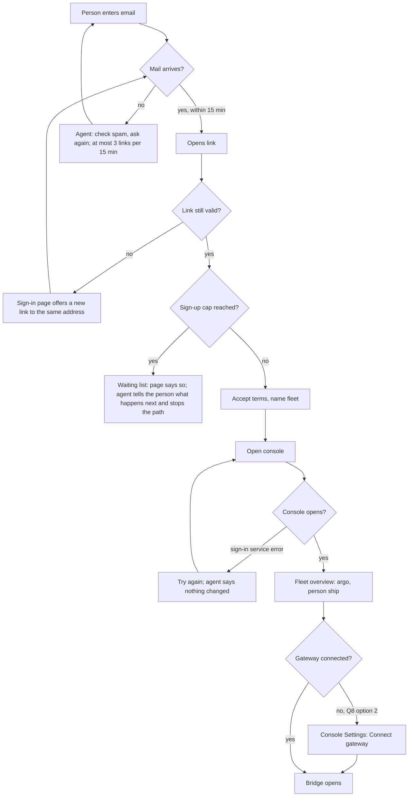
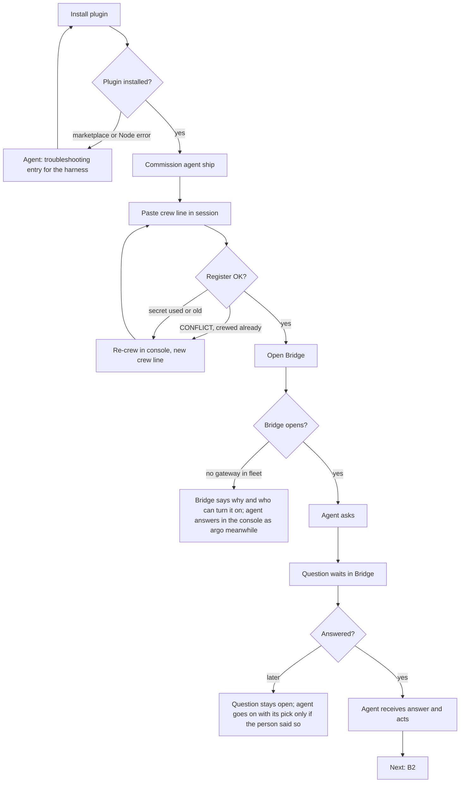
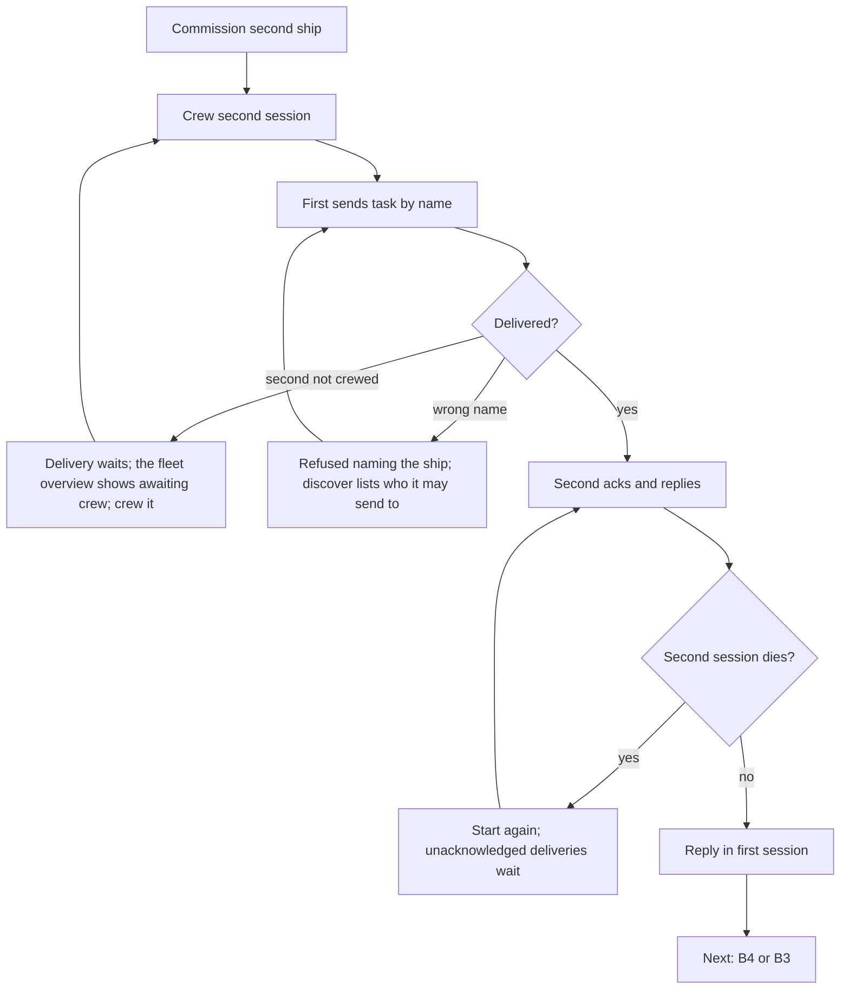
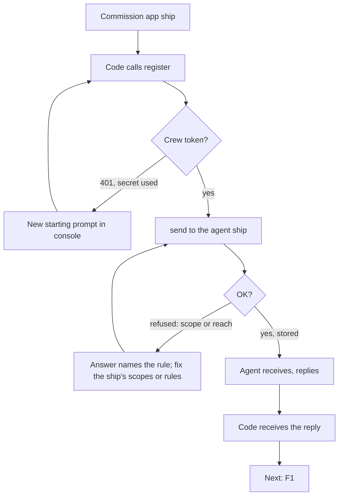
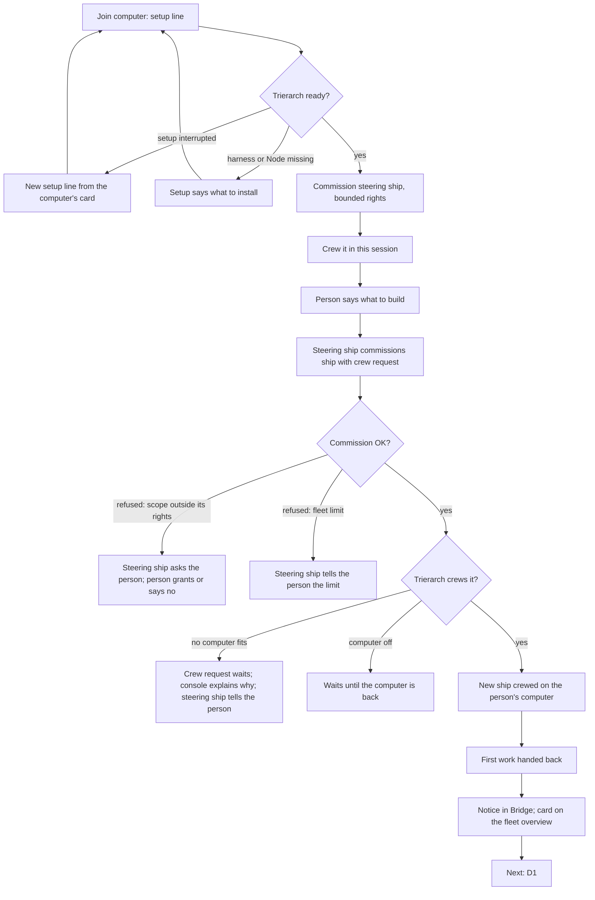
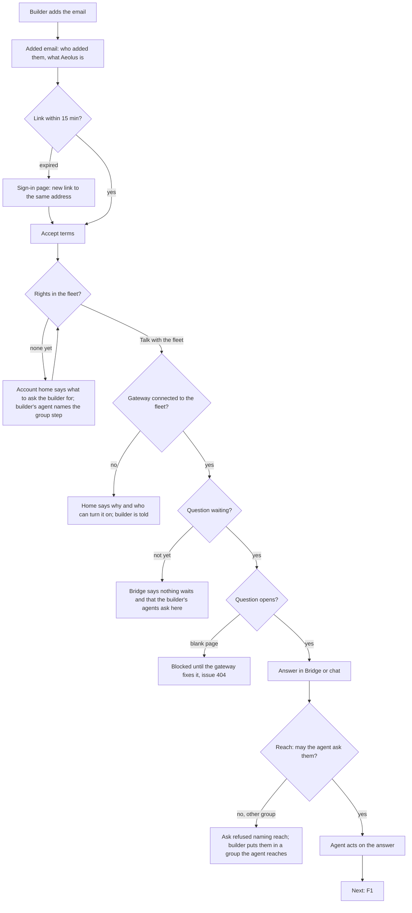
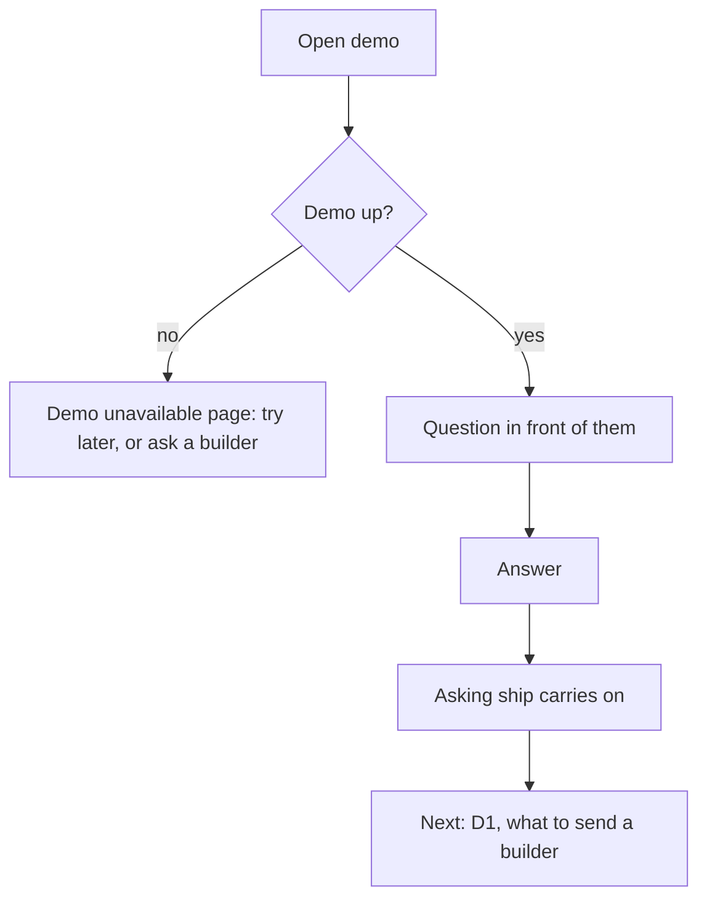
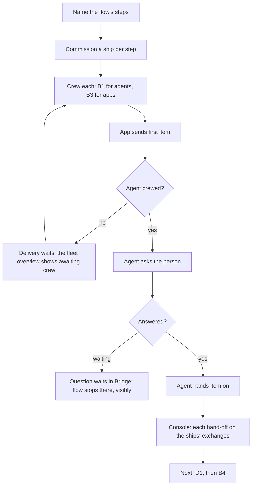
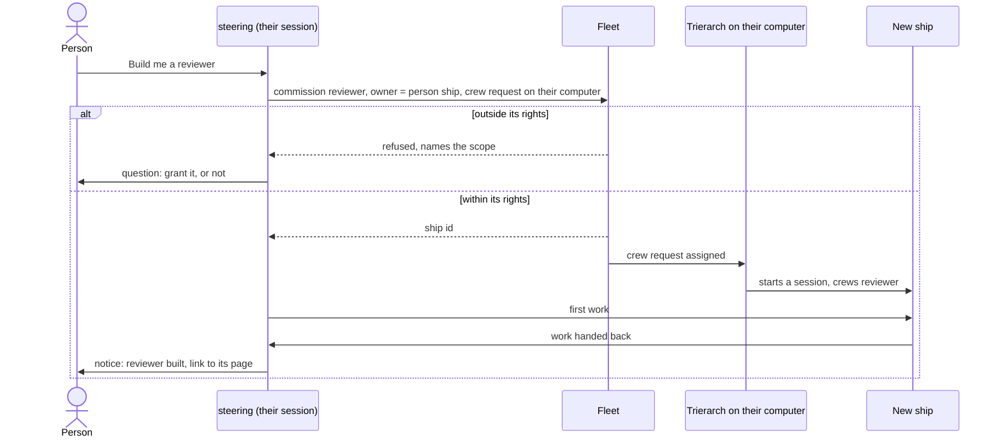

# Hosted onboarding: paths per persona

Detailed design for [#1228](https://github.com/ThomasHendrickx/aeolus-fleet/issues/1228), priority 1. Docs only: nothing here is built until Thomas approves it. Screens come later, as mockups for Thomas; this file names what each screen must do, never how it looks.

Status: purpose and five picks approved by Thomas on 17 Nov (#1228's latest comment). The detail below is proposed; the questions in section 10 are open. Today's paths were walked on staging on 17 Nov (gateway 0.40.2, core 0.40.0): [walk.md](walk.md).

## 1. Purpose (approved)

Anyone can learn Aeolus the way they want: they pick what to try, and their own AI agent guides them through it. Each path ends at a first value for that kind of person inside hosted Aeolus, quick and repeatable, and shows the next path.

Personas and first values:

- **Builder**: two agents hand work to each other; an agent asks them a question; their own app sends work; or the big path: build your fleet with a steering ship.
- **Decider**: answers real questions from a builder's agents in the app or a chat, never a terminal.
- **Flow owner**: one flow they run, connected, the hand-offs shown in the console.

The five picks:

1. Agents start at a start page written for agents (`/start`), linked first from llms.txt and the site's "point your agent here" line.
2. Personas: Builder, Decider, Flow owner.
3. A Decider coming alone: invited by a builder into a real fleet; the demo fleet as fallback.
4. Both agent-guided docs and a picker on the site, from one source.
5. A steering ship's new ships run on a trierarch on the person's computer, installed as an early step of that path.

Thomas, in his own words, before the purpose: "we don't need to force people into one path, let them pick and choose the one they want to try. Documentation is keyz especially LLM focused documentation (wanna learn aeolus? Point you ai agent <here> and they will help you through it)"; and "One ship that steers the whole seeing the magic of aeolus being build so any actor, agent or human, can change and grow aeolus. Any action is manageable by a human or agent".

Not the purpose: self-hosting (its own path, [one-line-setup](../one-line-setup.md)); the look of any screen; product metrics (#1228's priority 2); going public (priority 3).

## 2. Lessons to check against

| # | Lesson | Source |
| --- | --- | --- |
| L1 | Every first-time path was walked once already, at 0.31.0: 28 frictions, five of them blocks. Most blocks are fixed; the gateway missing from a new fleet (F1) and the sign-in service error on the first console open (F17) are open | Audit, [#1232](https://github.com/ThomasHendrickx/aeolus-fleet/pull/1232); [#1233](https://github.com/ThomasHendrickx/aeolus-fleet/issues/1233), [#1248](https://github.com/ThomasHendrickx/aeolus-fleet/issues/1248) |
| L2 | The earlier onboarding design ran one linear journey for a company (founder, Ada, Bea). Thomas rejected the linear, single file shape on 17 Nov: value differs per persona, and the person picks | [#1317](https://github.com/ThomasHendrickx/aeolus-fleet/pull/1317); #1228 |
| L3 | Sign-up creates the organisation, its first account and its first fleet; the first account is organisation admin, fleet manager and allowed as argo. A colleague comes in only when an organisation admin adds their account, by email | 0051, 0052, 0054 |
| L4 | A question goes to one ship by name with `ask`; the owner's ship is the default, any ship the asker reaches is allowed. A person answers in Bridge, a chat through the gateway, or Slack | 0038, blueprint "Questions to argo", [answer-your-agents](../../guide/answer-your-agents.md) |
| L5 | A secret (crew line, starting prompt, setup line) is shown once, and a new one ends the old. An agent guiding a person must never ask for one in a chat that is not the session it crews | 0010 |
| L6 | Argo is the fail-safe, never a normal step. Every argo job is a scope any actor can hold | 0012, 0053, 0057 |
| L7 | A trierarch runs on the person's computer and keeps ships crewed from crew requests; the computer setup's questions, defaults and help are approved | [computer-setup](../computer-setup/README.md), 0055 |
| L8 | Scopes are the only source of rights; a ship grants only scopes it holds. A commissioned agent ship's scopes are picked at commission, and `scopes:grant` changes them on a live ship | [scopes](../../guide/scopes.md), [commission-ship](../commission-ship/README.md) |
| L9 | The site's docs are pulled from each repository at a pinned commit, never copied; llms.txt is built from the same list and never names a page that is not built | aeolus-site `src/data/docs.ts`, `src/pages/llms.txt.ts` |
| L10 | The live demo is a read-only fleet opened with a viewer ticket: a visitor sees, and cannot answer or send | pagasae `demo/`; [words](../../guide/words.md#viewer) |
| L11 | Email wakes are off by default: "off by default or it is a violation of peoples rights" | [#1242](https://github.com/ThomasHendrickx/aeolus-fleet/issues/1242) |
| L12 | One meaning per term; invent no word. Persona, path and first value are the purpose's own words; every product word is the [Words](../../guide/words.md) page's | 0050 |
| L13 | Before 1.0.0, keep designs minimal: no compatibility layers and no polish for zero customers | 0013 |
| L14 | A fix in core can pass and still fail on hosted while another train lags; a path's acceptance is walked on staging with every train at its release | [#1303](https://github.com/ThomasHendrickx/aeolus-fleet/issues/1303) |

## 3. Today's paths and where people get stuck

Walked on staging as brand-new people, one per persona path that exists today. The walk, step by step with what each person and their agent met, is in [walk.md](walk.md). What exists today, read from the live site, llms.txt and the repositories, and how far the walk got:

| Persona | Path today | Where it starts | Walked: first value reached? |
| --- | --- | --- | --- |
| Builder | An agent asks them a question | aeolus-fleet.dev Quick start (5 steps, "about 5 minutes") | Yes, after connecting the gateway by hand in the console's Settings, which nothing points to (S8, S15) |
| Builder | Two agents hand work to each other | [Hand work between agents](https://aeolus-fleet.dev/docs/hand-work-between-agents/); the start-to-finish [two sessions](../../guide/two-sessions.md) guide is in the repository, not on the site | Yes |
| Builder | Their own app sends work | [Ship contract](https://aeolus-fleet.dev/docs/ship-contract/) and the home page's REST snippet | Only from Ship contract: the snippet fails as written (S11) |
| Builder | Build your fleet with a steering ship | None | No path (S13) |
| Decider | Invited by a builder | The added email from the account app | No: no rights until the builder finds groups (S18), then the question's page stays blank (S19) |
| Decider | Alone | The live demo, read-only | No: nothing to answer (S10) |
| Flow owner | One flow, connected | aeolus-fleet.com: "Discuss a flow that gets stuck"; no self-serve path | No path (S12) |
| Any, through an agent | The agent is pointed at Aeolus | llms.txt: about 40 links in one list, no start page; `/start` answers 404 | No start (S1) |

Where a person or their agent gets stuck, as the walk found it (S1 to S14 named before the walk and checked on it, S15 to S20 found on it; each step in walk.md):

| # | Where | Who is stuck | What happens | On the walk |
| --- | --- | --- | --- | --- |
| S1 | llms.txt | Agent | No page says where to begin or asks which path; the agent picks Quick start or reads everything | Confirmed |
| S2 | Site | Person | One path (Quick start) for every persona; nothing for a Decider or a Flow owner | Confirmed |
| S3 | Sign-up | Both | The agent cannot open the mailed link; the person must, within 15 minutes, at most 3 links per 15 minutes. A sign-up cap puts a new organisation on the waiting list with no time given | Confirmed: link works, cap not reached on staging |
| S4 | First console open | Person | "Can't reach the sign-in service" once in two sign-ups (#1248) | Not met; #1248 stays open |
| S5 | Plugin install | Agent | `/plugin` commands are typed by the person; an agent in the session cannot run them for them | Not walked (shared computer) |
| S6 | Commission | Person | 17 scope switches and an owner to pick before the first ship (#1245) | Gone: one dialog, scopes picked from a list (#1245 closed) |
| S7 | Crew line | Both | Shown once; an agent guiding from a chat cannot receive it safely (L5) | Confirmed; a new prompt is one click on the ship page |
| S8 | Bridge | Builder, Decider | A new fleet may have no gateway, so Bridge and the chat connector do not open, and nobody in the organisation can switch it on (#1233) | Blocks B1: Bridge says "the fleet did not answer" ([gateway#405](https://github.com/ThomasHendrickx/aeolus-fleet-gateway/issues/405)); the fleet manager can connect it in the console's Settings |
| S9 | Added email | Decider | Does not name who added them; the link lasts 15 minutes (#1247) | Half: says what Aeolus is, "An admin of" the organisation, not who |
| S10 | Decider alone | Decider | The demo is read-only: there is no question to answer | Confirmed |
| S11 | REST snippet | Builder | Shows `send` with `$CREW_TOKEN` and skips `register`, where the crew token comes from | Worse: fails as written, no `model` and no JSON content type (filed on the site's repository, 17 Nov) |
| S12 | Flow owner | Flow owner | No path to connect one flow alone; where hand-offs show in the console is not said anywhere | Confirmed |
| S13 | Steering ship | Builder | No starter ship, no list of the rights it needs, no step that joins the computer first | Confirmed |
| S14 | Every path | Both | No path ends by naming the next one, except Quick start's "Next" cards | Confirmed |
| S15 | New fleet | Builder, Flow owner | The fleet starts with the gateway and the trierarch plugin switched on and not connected; the account app says "Needs a look" and not what to do. Connecting each is a button in the console's Settings | Found |
| S16 | Fleet overview | Person | Their own person ship shows "awaiting crew" until Bridge first opens | Found, minor |
| S17 | Ship page | Person | The timeline says "Owner set: argo by default" while the owner shown is the person ship | Found, minor |
| S18 | Added Decider | Decider, Builder | "You have no rights here yet"; the builder must make a group, switch the Decider in, tick "Talk with the fleet" and press Save rights, and nothing says so | Found, blocks D1 |
| S19 | Decider's Bridge | Decider | With only the "Talk with the fleet" rights, the question's page stays blank ([gateway#404](https://github.com/ThomasHendrickx/aeolus-fleet-gateway/issues/404)) | Found, blocks D1 |
| S20 | Commission dialog | Builder | Says the rights "cannot be changed later" | Fixed on main (#1899), unreleased |

## 4. The paths

Each path: who it is for, what the person needs, its steps with who does each, the first value, and the next path. "Agent" is the person's own agent guiding them from `/start`; it may be the session that will crew a ship, or a chat that only guides.

Every Builder and Flow owner path begins with **Get a fleet** (G): sign up at the account app, accept the terms, name the fleet, open the console. A person who has a fleet skips it. A Decider never signs up on their own: they are added (D1) or use the demo (D2).

| Path | Persona | First value | Next path |
| --- | --- | --- | --- |
| B1 | Builder | An agent asks them a question; they answer in Bridge and the agent carries on with the answer | B2 |
| B2 | Builder | Two agents hand work to each other: one sends, the other answers, and a restart of either loses nothing | B4, or B3 |
| B3 | Builder | Their own app sends work, and an agent acts on it and answers the app | F1 |
| B4 | Builder | Their steering ship builds a second ship, which runs on their computer and hands its first work back, shown on the fleet overview | Add a Decider (D1) |
| D1 | Decider | Added by a builder, they answer a real question from the builder's agent in Bridge or their chat | F1, with the builder |
| D2 | Decider | Alone, they answer a question in the demo fleet | Ask a builder to add them (D1) |
| F1 | Flow owner | One flow they run, with an app, an agent and a person, connected; each hand-off shown in the console | Add a Decider (D1), then B4 |

### G. Get a fleet

1. Person opens the account app from the site or the link the agent gives, enters their email. Agent waits: it cannot open mail.
2. Person opens the mailed link within 15 minutes, accepts the terms, names the fleet.
3. Person opens the console. Agent checks with them that the fleet overview shows argo and their person ship.
4. Until Q8 is settled: person connects the gateway in the console's Settings (and the trierarch plugin, for B4). Agent checks the account app no longer says "Needs a look".

### B1. An agent asks them a question

Needs: Claude Code or Codex on their computer; a fleet (G).

1. Person installs the plugin in their harness; the agent gives the exact lines from `/start`.
2. Person commissions an agent ship in the console, owned by their person ship.
3. Person pastes the crew line into the session. Agent (that session) calls `whoami` and confirms it crews the ship.
4. Person opens Bridge.
5. Agent asks the person's ship a question with `ask`. Person answers in Bridge. Agent receives the answer and acts on it.

First value: the answer they gave in Bridge is what the agent does next. Next path: B2.

### B2. Two agents hand work to each other

Needs: B1's plugin; two folders. Codex as the second harness needs its one-time setup.

1. Person commissions a second agent ship.
2. Person opens a second session in the second folder and crews it with its line.
3. Agent (first session) sends the second ship a task by name. The second session receives it, acks, and answers with `inReplyTo`.
4. Person closes the second session and starts it again; it finds anything not acknowledged waiting.

First value: the reply arrives in the first session without the person copying text, and survives a restart. Next path: B4, or B3 for a builder whose own code should send.

### B3. Their own app sends work

Needs: their own code that can make an HTTP call; one agent ship crewed (B1).

1. Person commissions an app ship for their code and copies its starting prompt.
2. Their code calls `register` once with the ship id and secret and keeps the crew token.
3. Their code sends the agent ship work with `send`; the agent acts and replies; their code receives the reply.

First value: their own code's message reaches an agent that acts on it, and the answer comes back to their code. Next path: F1.

### B4. Build your fleet with a steering ship

Needs: a computer that stays on while it works; Claude Code; a repository or folder for the new ships.

1. Person joins their computer: the console's setup line, run on the computer, installs and starts a trierarch (approved [computer setup](../computer-setup/README.md)). Agent checks the computer's card says ready.
2. Person commissions the steering ship with its bounded rights (Q1, Q2) and crews it in the session they are talking to. That session is now the steering ship.
3. Person tells the steering ship what to build. The steering ship commissions a ship for it, owned by the person's ship, with a crew request on their computer.
4. The trierarch crews the new ship on their computer. The steering ship sends it its first work; the new ship hands it back.
5. The steering ship sends the person a notice per ship it built; questions that need them go to their person ship.

First value: a ship they did not commission by hand runs on their computer and hands work back, and they see it on the fleet overview with who commissioned it. Next path: add a Decider (D1).

Where its ships run, how the person sees and steers what it built: section 6.

### D1. A Decider, added by a builder

Needs: nothing installed. A builder (B1 to B4) or a Flow owner with an organisation admin's right.

1. The builder adds the Decider's email to the organisation, puts them in a group and gives the group "Talk with the fleet from Claude or ChatGPT" (`messages:send`, `messages:receive`), then saves; their agent names each of these from `/start#d1` (S18).
2. The Decider opens the added email's link, accepts the terms, and lands where their question waits.
3. The builder's agent finds the Decider's person ship with `discover` and asks it a question with `ask`.
4. The Decider answers in Bridge, or in their own chat (claude.ai, ChatGPT) through the gateway's connector, their agent guiding them from `/start`.

First value: their answer changes what the builder's agent does next, and they never saw a terminal. Next path: F1, with the builder.

### D2. A Decider, alone

Needs: nothing. Fallback when no builder has added them.

1. The Decider opens the demo from the site's picker, or their agent sends them there from `/start`.
2. The demo puts a question in front of them (Q4) and they answer it.
3. The demo shows the asking ship carry on with their answer.

First value: they answered an agent's question and saw the work continue. Next path: ask a builder to add them (D1); the page says what to send the builder.

### F1. One flow, connected

Needs: a fleet (G); one step of their flow that is software they can call (an app ship, B3), one agent (B1), and one person who decides (themselves, or a Decider added by D1).

1. Person names the flow's steps to their agent: which step is an app, which an agent, which a person.
2. Person commissions a ship per step that is not a person, owned by their person ship; the agent guides each crew as in B1 and B3.
3. The app sends the first item to the agent; the agent asks the person; the person answers; the agent hands it on.
4. Person opens the console and follows the item hand-off by hand-off on each ship's page and exchange.

First value: one real item passes through their flow without anyone copying, forwarding or chasing it, and they read each hand-off in the console. Next path: add a Decider (D1), then B4 to let a steering ship grow it.

## 5. The start page for agents and the site picker

### `/start`

`aeolus-fleet.dev/start`, a page written for an AI agent helping one person try Aeolus. Served as Markdown (`text/markdown`) at `/start` for agents, and as the same text rendered as HTML at `/start/` for a person who opens it.

It holds, in this order:

1. **Who reads this.** "You are an AI agent helping a person try Aeolus. Guide them through one path. Do the steps marked Agent yourself; tell them the steps marked Person, one at a time."
2. **Rules for the agent.** Never sign up for the person or open their mail. Never ask for a crew line, starting prompt or setup line in a chat: it is pasted only into the session that crews the ship (L5). Check each step before the next. When a step fails, follow that step's "If it fails"; when none fits, send the person to Discussions with what happened.
3. **Pick a path.** The three personas, each in one sentence, and their paths with first value, time and what the person needs: the table of section 4. Ask the person which they want; suggest by what they said, never decide.
4. **One section per path** (`#b1` to `#f1`, and `#g`): needs, steps marked Agent or Person, the check for each step, "If it fails" per step (the unhappy branches of the flows above), the first value and how the agent confirms it, and the next path.
5. **Words.** A link to [Words](https://aeolus-fleet.dev/docs/words/), and the six words every path uses (fleet, ship, crew, crew line, person ship, Bridge) in one line each, taken from that page.

### llms.txt

- Its first line under the summary: "An AI agent helping a person try Aeolus starts at [/start](https://aeolus-fleet.dev/start): pick a path with them, then guide them step by step."
- `/start` is the first entry of Pages, before Home.
- The rest stays as it is.

### The site's "point your agent here" line

On Home and Quick start, above the fold: "Point your agent here: aeolus-fleet.dev/start", with a copy button for a ready prompt: "Read https://aeolus-fleet.dev/start and help me try Aeolus."

### The picker

On Home and Quick start: the three personas, each with its paths as cards: first value in one line, time, what you need, and two actions: "Copy prompt for your agent" (the ready prompt, with the path: `/start#b4`) and "Do it yourself" (the path's section of `/start` as HTML). Quick start today becomes B1 in the picker.

### One source

Every path's persona, first value, time, needs, steps, checks, "If it fails" and next path live in one data file (Q3). `/start`, `/start/`, the picker and llms.txt's line are built from it when the site builds; a commit changes all four. The commands in a step come from their repository's README or guide, as the site's install tabs do today (`src/lib/source.ts`), never typed. `npm run check` fails when a path names a next path, a guide or an anchor that does not exist.

## 6. The steering-ship path

### Its starter ship

An agent ship named `steering`, owned by the person's ship, commissioned with the bounded rights Thomas picks (Q1) and made as Q2 picks. Its charter (the first message the person gives it, or its ship template's charter with Q2 option 1) says what it is for: build and grow this fleet with the person, ask them before anything their rights do not cover, and tell them what it built.

The person crews it in the session they are already talking to, so the agent guiding them becomes the steering ship. It holds the lease like any session (0010); recrewed, a new session takes over with its inbox waiting.

### Where its ships run

On the trierarch on the person's own computer (pick 5), joined in step 1 of B4 before the steering ship exists. Each ship the steering ship commissions carries a crew request with a workspace on that computer: the repository or folder the person chose at computer setup. The trierarch plugin assigns it; the trierarch starts its session, wakes it when work arrives and starts it again when it dies. Aeolus never runs the person's agents (aeolus-fleet.com: "Never hosts your agents"). With the computer off, crew requests wait, and the console says why.

### How the person sees what it built

- **The fleet overview**: each new ship shows as a card the moment it is commissioned, awaiting crew, then crewed; its page names who commissioned it (the event's actor) and its owner (the person's ship).
- **Bridge**: one notice from the steering ship per ship it built, and per change to one (release, retire, rights), with a link to the ship's page. Questions come there too.
- **The ship's timeline**: every event names whether the steering ship or the person did it.

### Any action manageable by a human or agent

Every action the steering ship takes is one the person can take or undo in the console with their own scopes: release, re-crew or retire a ship it built, change its rights with grant and revoke, remove a crew request. The person can release the steering ship itself at any time; the ships it built stay theirs. No action is the steering ship's alone.

## 7. Acceptance scenarios

Each is walked on staging by a brand-new person with their own agent pointed at `/start`, every train at its release (L14), as the release gate of the slice that closes it.

| # | Scenario |
| --- | --- |
| A1 | Given an agent that is told only "Read aeolus-fleet.dev/llms.txt and help me try Aeolus", when it reads llms.txt, then it opens `/start` next and asks the person which path, naming the three personas |
| A2 | Given the site's Home, when a person picks a persona and a path in the picker, then they can copy a prompt naming that path's section of `/start`, and the path's steps on the page are the same text `/start` holds |
| A3 | Given a path's step changed in the one source, when the site builds, then `/start`, the picker and the HTML page show the change, and `npm run check` fails on a next path or anchor that does not exist |
| A4 | Given a new person with Claude Code and no fleet, when their agent guides them through G and B1, then within 15 minutes they answer a question in Bridge and the agent acts on the answer, with no step done by argo and no secret pasted outside the session it crews |
| A5 | Given B1 done, when they follow B2, then a reply from the second session arrives in the first, and after the second session is closed and started again a message sent meanwhile is received |
| A6 | Given B1 done, when they follow B3 with a curl or a short script, then their code registers, sends, and receives the agent's reply |
| A7 | Given a new person with Claude Code and a computer that stays on, when they follow B4, then their computer is joined, `steering` is crewed in their session, and a ship that `steering` commissioned runs on their computer and hands work back; the fleet overview shows it with `steering` as its commissioner and a notice waits in Bridge |
| A8 | Given B4 under way, when the steering ship tries something outside its rights, then the fleet refuses naming the scope, nothing changes, and the person gets a question rather than an error in a terminal |
| A9 | Given B4 done, when the person releases or retires a ship the steering ship built, or revokes one of its rights, from the console, then it takes effect and the steering ship is told as any ship is |
| A10 | Given a builder who adds a Decider's email, when the Decider opens the added email and answers the builder agent's question in Bridge, then the email named who added them, they met no terminal, no id and no JSON, and the agent acts on the answer |
| A11 | Given a Decider using their own chat (claude.ai) through the gateway connector, when their agent guides them from `/start#d1`, then they answer the same question from the chat |
| A12 | Given a Decider with no builder, when they open the demo from the picker, then they answer a question and see the asking ship carry on, and the page says what to send a builder |
| A13 | Given a Flow owner with a fleet, when they follow F1, then one item goes app, agent, person, agent with nobody copying it, and they find each hand-off on the ships' exchanges in the console |
| A14 | Given any path's first value reached, then `/start` and the site name the next path, and the agent offers it |
| A15 | Given each step's unhappy branch in section 4 (link expired, cap reached, no gateway, crew line used, ship not crewed, refused by scope or reach, no computer fits), when it happens on the walk, then the page or the agent says what happened, whether anything changed, and the next step |

## 8. Thin slices

In order; each its own PR in the repository named, each closing its scenarios. A slice that needs a product change the walk does not yet prove needed waits for the walk's finding.

| Slice | Repository | What | Closes |
| --- | --- | --- | --- |
| 1 | aeolus-site | The one source for paths G, B1, B2, B3 (paths that work today); `/start` built from it; llms.txt's first line and entry; the "point your agent here" line. Pulls the two sessions guide onto the site for B2 | A1, A4, A5, A6, A14 for B paths |
| 2 | aeolus-site | The picker on Home and Quick start from the same source; Quick start becomes B1 | A2, A3 |
| 3 | per finding | The blocks the walk found on G and B1 to B3, each its own issue and PR: the gateway not connected in a new fleet as Q8 picks (#1233), Bridge naming it ([gateway#405](https://github.com/ThomasHendrickx/aeolus-fleet-gateway/issues/405)), the REST snippet (filed on the site's repository, 17 Nov); #1248 if the next walk meets it | A4 to A6, A15 |
| 4 | aeolus-fleet-gateway, the account app, the site | D1: a Decider with the "Talk with the fleet" rights opens and answers a question ([gateway#404](https://github.com/ThomasHendrickx/aeolus-fleet-gateway/issues/404)); the welcome names who added them; their account home says what to ask the builder for while they have no rights (S18); `/start#d1` for the builder's agent and a chat-guided Decider | A10, A11 |
| 5 | aeolus-site, aeolus-fleet docs | F1 in the source; a guide for connecting one flow and where its hand-offs show in the console | A13 |
| 6 | per Q1, Q2, Q8 | B4's starter ship as Thomas picks, with the trierarch plugin connected as Q8 picks; `/start#b4`. Needs core 0.41.0's live permission editing (#1899) on staging for A9 | A7, A8, A9 |
| 7 | pagasae | D2 as Q4 picks | A12 |

Later, as issues once this design is approved: a single view of one flow's hand-offs across its ships (if F1's walk shows the exchanges are not enough); `/start` in the console for a person already signed in; the product metrics of #1228's priority 2 at each path's first value.

## 9. What this design does not change

The sign-in, the account app's organisation and rights model, scopes, reach, crew requests and the trierarch: every path uses them as they are. A change any path needs is a slice above with its own issue.

## 10. Questions

### Q1. The steering ship's bounded rights (Thomas's call)

Context: the steering ship commissions and manages ships for the person. Scopes are its only rights (L8). Reach is decided by network rules; a new fleet has none of its own, so every ship reaches every ship until it does. What the fleet's limits allow (ships, messages per day) bounds it in any option.

Options:
1. **Build and manage what it builds:** `fleet:read`, `fleet:commission`, `fleet:manage`, plus `messages:send` and `messages:receive`. It commissions agent ships that hold only send and receive, asks for crew requests on the person's computer, and releases, re-crews and retires. No grant, no network rules, no owners, no plugins. Anything more is a question to the person.
2. **Option 1 plus teams:** adds `meetings:open` and `scopes:grant`, so it can run a meeting of its ships and give a ship it built a scope it holds itself.
3. **Everything the person holds as fleet manager:** the fastest magic, the way Thomas set up Aeolus; bounded only by the fleet's limits and the person's own scopes.
4. **Commission only:** `fleet:read`, `fleet:commission`, send and receive. The person releases and retires by hand.

Pick: 1. It shows the magic (a ship it built runs and hands work back) with every action one the person can undo, and nothing it does changes who reaches whom. Note: `fleet:manage` reaches every ship it reaches, not only the ones it built; bounding it to its own ships needs a network rule or a later change, raised as an issue if Thomas wants that bound.

### Q2. How the starter ship is made

Context: the commission dialog lets the person pick any scope beyond send and receive from a searchable list (walk, B4); the steering ship needs several at once, picked right.

Options:
1. **A ship template the hosted fleet starts with** (`steering`, its charter and scopes), offered when commissioning; needs squadrons' templates in every new fleet.
2. **The person commissions it by hand,** `/start#b4` naming each scope to switch on.
3. **A button on the fleet overview, "Commission a steering ship",** with the rights preset.

Pick: 2 for slice 6, no product change, and 1 as the issue that follows once the walk shows how long step 2 of B4 takes. Option 3 adds a console part for one path.

### Q3. Where the one source lives

Options:
1. **A data file in aeolus-site** (`src/data/paths.ts`), as Home's copy already is; commands pulled from the repositories at build.
2. **A Markdown file in aeolus-fleet** (`docs/guide/start.md`), pulled by the site as the docs are, and parsed for the picker.

Pick: 1. The paths cross every repository and the site already keeps copy as data and pulls commands; a parsed Markdown file makes the picker depend on headings.

### Q4. What the demo gives a Decider alone

Context: the demo is read-only (L10); pick 3 makes it the Decider's fallback, and their first value is answering.

Options:
1. **The demo asks the visitor:** a demo question per visit, answered on the demo page with no account, the scripted ship carrying on; needs a change to pagasae's demo runner and its viewer ticket.
2. **The demo shows a question answered by its scripted person,** and says what to send a builder; the first value then waits for D1.
3. **No demo step:** the picker sends a Decider alone to ask a builder.

Pick: 1. It is the only option where a Decider alone reaches the first value; slice 7 is last, so the paths that work today come first.

### Q5. The earlier onboarding PRs

Context: [#1317](https://github.com/ThomasHendrickx/aeolus-fleet/pull/1317) holds the earlier purpose (one company's linear journey) and its questions R1 to R7; [#1232](https://github.com/ThomasHendrickx/aeolus-fleet/pull/1232) the 0.31.0 audit.

Options:
1. **Close #1317;** its lessons are cited here and its first-round answers stay readable on it. Merge #1232 as the record of the 0.31.0 walk.
2. **Keep #1317 open** for its screen questions, mockups following this design.

Pick: 1. The approved purpose replaces #1317's; the mockups for this design follow from section 4.

### Q6. Harnesses on the paths

Options:
1. **The guiding agent is any agent that reads the web; the crewing steps are written and walked for Claude Code and Codex,** Copilot and Cursor named where their crew lines exist.
2. **Claude Code only** walked, the others named.

Pick: 1. Codex is on the site's install tabs and Quick start today; a Builder who uses it must not fall off at step 1.

### Q7. The sign-up cap

Context: the account app caps how many organisations have access; above it, sign-up goes to a waiting list (S3). Every Builder and Flow owner path stops there.

Options:
1. **Keep the cap;** `/start` and the waiting list page say what happens next and when.
2. **No cap during early access** while each path is walked.

Pick: 1 until Thomas says otherwise; the cap is his to set.

### Q8. The plugins a new hosted fleet starts with

Context: a new fleet starts with the gateway and the trierarch plugin switched on and not connected (S15). Until the gateway is connected Bridge does not open, so B1 and D1 stop; until the trierarch plugin is, no computer joins, so B4 stops. The fleet manager connects each with one button in the console's Settings. #1233 asks the same for a colleague.

Options:
1. **Connected when the fleet is made:** sign-up connects every plugin it switches on, as the staging seed does by hand. G stays three steps.
2. **One step on the path:** G gets step 4, "Connect the gateway in Settings", and B4 a step for the trierarch plugin; `/start` names them, and Bridge and the account app say where (gateway#405).
3. **Switched off until connected:** nothing shows "Needs a look" for a plugin nobody connected; the path connects it when it needs it.

Pick: 1. Every path stops at it, a new person cannot know it, and the person who could press the button is the one signing up. Option 2 is what slice 1 writes until option 1 ships; gateway#405 is needed either way, for a fleet whose gateway was disconnected.

### Q9. How a Decider gets the gateway rights

Context: an added account has no rights in a fleet until a group or their own give them (S18). A builder makes a group, switches the Decider in, ticks "Talk with the fleet from Claude or ChatGPT" and saves; nothing on the add step says so, and the Decider sees "You have no rights here yet".

Options:
1. **`/start#d1` names the steps** for the builder's agent, and the Decider's account home says what to ask the builder for; no product change beyond that line.
2. **The add step offers the "Talk with the fleet" rights:** adding an account asks whether they may talk with the fleet, and gives it to that account.
3. **Every new account in an organisation gets the "Talk with the fleet" rights** in its organisation's fleets.

Pick: 1 for slice 4, and 2 as an issue once the D1 walk shows how many builders miss it. Option 3 gives rights nobody chose, against "Scopes say what" ([blueprint](../../blueprint.md)).
