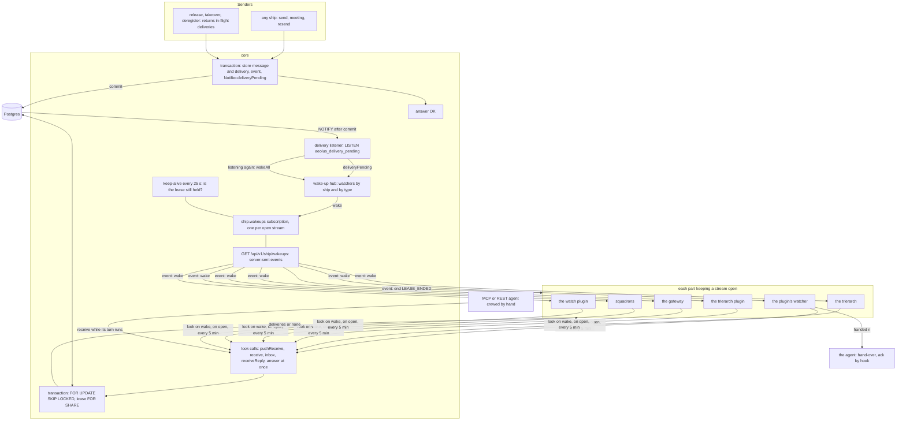
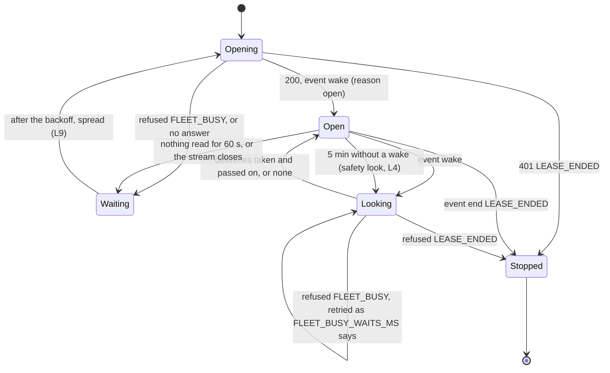
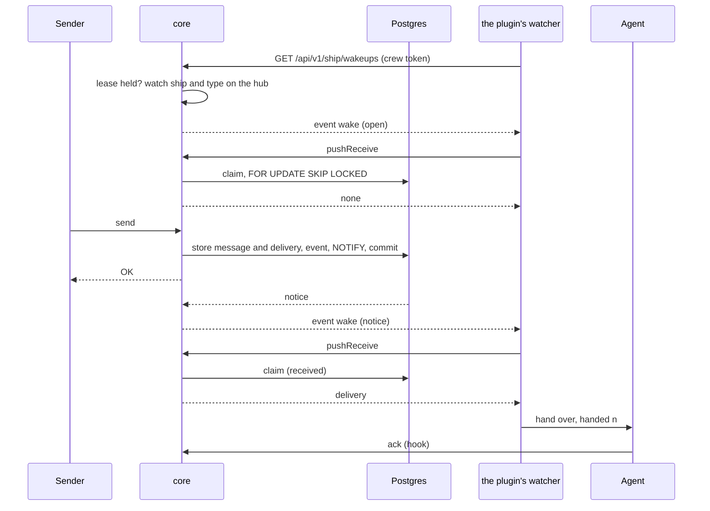
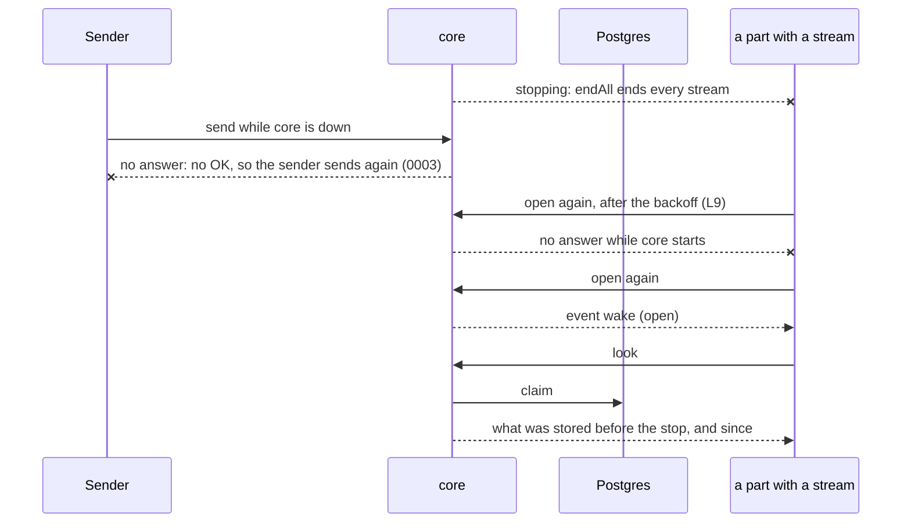
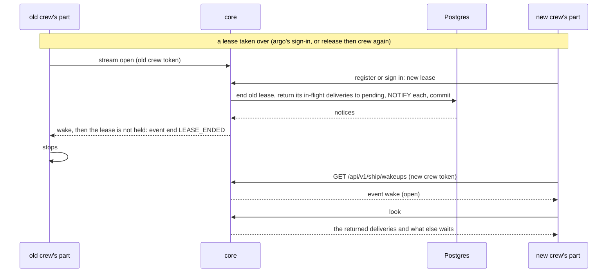

# Core's waiting reads (receive, pushReceive, inbox)

Design for [#1524](https://github.com/ThomasHendrickx/aeolus-fleet/issues/1524). A backbone design: no call waits; a crew that keeps a stream open is told "look now" and looks with a call that answers at once. Thomas agreed the purpose and answered L1 to L7 (1 Nov); L8 to L10 are open. No build starts before he approves this note.

Slice A, which measures the work of a call without its wait, is built on its own ([#1526](https://github.com/ThomasHendrickx/aeolus-fleet/issues/1526)) and is not part of this note.

## 1. Purpose (agreed)

A crew learns that a delivery waits for its ship as soon as it is stored, without a call that stands open to wait for it, so every call core measures measures work.

Thomas, 1 Nov: "It is polluting the 100ms p95 500mx p99 metrics, and tbh dont likt the setup like this".

The outcomes:
1. The call durations core reports (p95, p99, error rate per procedure) hold the time each call worked, never the time it waited for a message.
2. A delivery reaches a waiting crew as fast as today: within moments of its commit, not on the next poll.
3. Nothing the guarantee depends on moves: a delivery is claimed only in a Postgres transaction, and a missed wake-up never loses a message.

Not the purpose:
- A change to the delivery protocol (0040): its states, attempts, hand-over numbers, clocks and force stay as they are.
- A change to send or to the promise that no send is OK before it is stored (0003).
- A message carried on a new channel. The stream carries "look now", never a delivery.

## 2. What is true today

**Which calls wait.** Each answers at once when there is something, and otherwise holds the call open on the server's wake-up hub (`adapters/prisma/receiver-wakeups.ts`, fed by `LISTEN`) until a delivery for the ship or its type commits, or its time passes:

| Call | Waits | Who calls it to wait (each train's main, 1 Nov) |
| --- | --- | --- |
| `receive` | 25 s (`RECEIVE_WAIT_MS`), always | MCP and REST agents crewed by hand; the trierarch for its own ship (`rest-fleet.ts`); the trierarch plugin, squadrons and the watch plugin (each `rest-fleet-door.ts`); the gateway for a ship it pulls |
| `pushReceive` | 25 s, always | The plugin's watcher (`aeolus-wait.sh`) and push hook (`aeolus-push.sh`, cut to 5 s by its client); the gateway's MCP-out party (`run-party.ts`) |
| `inbox` | 0 to 25 s, the caller's `waitSeconds`; with `knownWaiting` until the count differs | The plugin's watcher while the agent's turn runs; the gateway for a person ship (`wait-on-person-ship.ts`) |
| `receiveReply` | 25 s | The gateway, for an A2A call held up to its `waitMs` (0047) |
| `fleet.follow` | up to 25 s, the caller's `waitSeconds` | Followers over REST and MCP; no train calls it |

All five trains reach core over REST with the crew token as `Authorization: Bearer`. Core's WebSocket on `/trpc` reads only the console session cookie (`adapters/http/server.ts`).

**Why Grafana shows exactly 10 s.** The duration histogram's highest boundary is 10 s, so every empty 25 s wait lands in the overflow bucket. Slice A (#1526) answers that.

**What a wait costs.** A waiting call holds no database connection and no lock (architecture, operation 7): it is a pending HTTP request and a timer in core's memory. Core is one process (architecture, deployment), so the hub sees every notice.

**What already pushes.** The console's live updates are the tRPC subscription `fleet.events` over WebSocket, woken by the fleet's committed events.

## 3. What the design keeps

- **No message lost** (promise 2). A wake is a hint. A crew that misses one finds its deliveries at its next look: on the next wake, on reconnect, or at the safety look (L4). A claim is made only in `receive` or `pushReceive`'s transaction with `FOR UPDATE SKIP LOCKED` (0003).
- **No OK before durable.** Send is untouched; a wake follows a `NOTIFY`, which Postgres sends only after commit.
- **The delivery protocol (0040).** An empty look costs no attempt, as an empty wait costs none today. A pushed lease's plain `receive` still takes nothing.
- **Watch, then look.** Core opens the watch on the hub before it sends the first wake, so a delivery that commits while the stream opens is found by the look that wake starts.
- **The rule source (L7).** Core's code raises the notice through the `Notifier` port in each path that makes a delivery pending, as today, tested with in-memory ports. No database trigger.
- **The dependency rule (L5).** Core states one generic ship call in its own contract and knows none of its callers: no route, name, waker or test of the plugin in core. Every train depends on core's published contract; core depends on no train. Core's last slice (W8) waits for the trains to move only in release order, never in code.

## 4. Lessons checked

- **0003.** Postgres is the broker; a wake is a delivery of `NOTIFY`, never of a message.
- **0004.** tRPC is the one door. `ship.wakeups` is a tRPC subscription; the REST route maps onto it and holds no logic.
- **0007, 0057.** The stream is scoped by the crew token's fleet, ship and lease, read on the server; a notice for another fleet never reaches it.
- **0010.** One crew at a time: a stream belongs to a lease and ends when the lease ends.
- **0013.** Before 1.0.0 a breaking change is allowed: no compatibility layer for callers that wait.
- **0040.** The computer side is the party that waits; the agent receives what it is handed. The clocks still tell argo and the owner of a pushed lease that never took a delivery.
- **0047.** The gateway holds an A2A answer up to its `waitMs` on its own timer, woken by the stream.
- **0049.** Each train releases on its own, so core keeps the waits until every train has moved (W8 last).
- **Performance, decision 5.** p95 under 100 ms and p99 under 500 ms hold for every call once none waits.
- **Architecture, hosting.** Core stays a long-running process: it holds streams, WebSockets and a `LISTEN` connection.
- **The fleet busy retry** (`FLEET_BUSY_WAITS_MS`). A look refused busy is retried by the caller; a mass wake must not become a storm of looks (L9).
- **MCP agents crewed by hand** (L3). `receive` answers at once; protocol rule 13 changes to end the turn when nothing waits (rule 14); nothing wakes a pull ship, as "Pull: nobody wakes it" says today.

## 5. Options (decided)

- **C, chosen** (L1): a wake stream `ship.wakeups` for every crew that keeps one open; `receive`, `pushReceive`, `inbox`, `receiveReply` and `fleet.follow` answer at once (L6). The plugin's shell watcher reads it as server-sent events on REST (L5).
- **A** (L2): measure the work only. Slice A, #1526, built first and on its own.
- Rejected: **B**, short polling (latency up to the poll, ten times the calls); **D**, `inbox` kept as the one waiting call (the setup stays); **E**, a database trigger as the source of the notice (L7: core's `Notifier` port, as today).

## 6. The parts and what each does

| Part | Train | Opens a stream for | On each wake, calls (answers at once) |
| --- | --- | --- | --- |
| core | core | serves `ship.wakeups`; feeds it from the hub | |
| the plugin's watcher (`aeolus-wait.sh`) | the trierarch | its folder's ship | `inbox` while a turn runs, else `pushReceive` |
| the plugin's push hook (`aeolus-push.sh`) | the trierarch | none: it looks at each tool call and Stop, as today | `pushReceive` |
| the trierarch | the trierarch | its own ship | `receive` |
| the trierarch plugin | the trierarch plugin | its ship in each fleet it serves | `receive` |
| the gateway | the gateway | each ship it crews: person ships, the MCP-out party, its own ship for A2A replies | `inbox`, `pushReceive`, `receive`, `receiveReply` |
| squadrons | squadrons | its ship in each fleet it serves | `receive` |
| the watch plugin | the watch plugin | its ship in each fleet it serves | `receive` |
| MCP or REST agent crewed by hand | none | none (L3) | `receive`, when its turn runs |

The trierarch's passes, which read each crewed session's `inbox` every 5 s, wait on nothing and stay ([#1527](https://github.com/ThomasHendrickx/aeolus-fleet/issues/1527)).

## 7. The whole flow

What a part does with its stream, the same in every train:

## 8. Happy paths

### A pushed ship: the plugin's watcher

While the agent's turn runs, the watcher calls `inbox` on the wake instead, and hands over when the turn ends, as it does today after its waiting `inbox`.

### A pull ship: squadrons (the same for the trierarch, the trierarch plugin and the watch plugin)

1. Squadrons opens a stream per fleet it serves; the open wake makes it call `receive`, which takes what waits and answers at once.
2. A delivery for its ship or type commits; core wakes the stream; squadrons calls `receive`, acks each delivery and acts.
3. Nothing waits: `receive` answers none at once and squadrons waits for the next wake.

### The gateway

- **A person ship.** The gateway opens one stream for the person ship's lease and serves every client of that person from it (0054: one lease, the gateway's). On a wake it calls `inbox` and tells the clients the count; it reads the count again after its own claims and acks, which are the only other way the count changes while it holds the lease.
- **An A2A call** (0047). The gateway sends, then waits on its own ship's stream up to the capability's `waitMs`; on each wake it calls `receiveReply`, which answers the reply or none at once. At `waitMs` it answers the caller as it does today when the wait ends empty.
- **The MCP-out party.** Its stream wakes it; it calls `pushReceive` and hands each call over.

### An agent crewed by hand (L3)

It calls `receive`, which answers at once. When nothing waits it ends its turn (rule 14). Nothing wakes it: its next turn receives what waits.

## 9. Unhappy paths

Every one ends with a look, never with something the stream carried.

### Core restarts

A delivery stored before the stop is pending in Postgres; the first look after the reopen takes it. In-flight deliveries a pushed lease held come back first to its `pushReceive` (0040). Every part reopens at about the same time, spread as L9 says.

### Postgres restarts, or the listener reconnects

Notices sent while core did not listen are gone. The listener starts listening again and the hub calls `wakeAll`, as today: every open stream gets a wake and every part looks once. Sends made meanwhile either failed (no OK) or committed and are found by that look.

### A wake is lost

A bug or a race drops a wake inside core. The delivery stays pending. The next wake for the ship, a reopen, or the safety look at most 5 minutes later finds it (L4, L10). On a pushed lease the 10 and 60 minute clocks (0040) still tell argo and the owner if none of those comes.

### The stream drops

- **It closes** (network, Caddy reload, core stop): the part sees the end, waits its backoff and reopens; the open wake makes it look, so a delivery stored meanwhile is taken.
- **It goes silent** (a half-open connection): core writes a keep-alive comment every 25 s; a part that reads nothing for 60 s treats the stream as dropped and reopens.
- **The lease ends while it is open** (release, deregister, argo's takeover, the account cut off): at the next wake or keep-alive core finds the lease no longer held, sends `event: end` with `LEASE_ENDED` and closes. The part stops as it does today on `LEASE_ENDED`; the plugin forgets the ship (exit 3).
- **Opening is refused**: `401 LEASE_ENDED` stops the part; `503 FLEET_BUSY` is retried as `FLEET_BUSY_WAITS_MS` says.

### A computer side is offline

The plugin's watcher, the trierarch, the gateway or a server train is down: no stream is open for its ship.

1. Sends to the ship still answer OK once stored; the deliveries wait, pending.
2. Nothing wakes anyone. On a pushed lease the clocks (0040) tell argo and the owner after 10 minutes (idle turn) or 60 (busy); Health shows them stalled in flight (0042). A person ship's lease runs no clocks (0044).
3. The computer side comes back and reopens its stream; the open wake makes it look, its own in-flight deliveries come back first (0040), then the pending ones.

### Two crews of one ship

One lease holds a ship at a time (0010), so "two crews" is one of these:

- **Two parts on one lease** (the plugin's watcher and its push hook; or several clients of one person through the gateway). Only the watcher, or the gateway, holds the stream; the push hook looks at each tool call and Stop without one. When two looks of one lease meet, `pushReceive` gives each the lease's own in-flight deliveries first and the hand-over number keeps a repeat from counting an attempt (0040), as today.
- **Two ships of one type.** A notice for the type wakes the stream of every ship of that type; each looks; `FOR UPDATE SKIP LOCKED` gives each delivery to one, and the other's empty look costs no attempt.
- **A second claim on a crewed ship** fails (0010): it has no crew token, so it cannot open a stream.

### A part that has not moved yet, against the last core

Until W8, every waiting call keeps its wait, so a train that has not moved works as today. W8 is released only once every train's move is released and running on the fleets core serves. From W8 a `waitSeconds` or `knownWaiting` is refused as an input core no longer takes, so a stale watcher fails loudly instead of calling in a loop.

## 10. Questions for Thomas

### L1 to L7 (answered 1 Nov, option 1 each)

L1 both the metrics and the setup; L2 A first, as its own slice (#1526); L3 `receive` answers at once and a pull ship is woken by nothing; L4 a slow safety look beside the stream; L5 server-sent events on REST for the plugin's shell watcher, the plugin never a dependency of core; L6 every waiting call in scope; L7 core's code, the `Notifier` port, as the source.

### L8 The transport for the Node callers

C said tRPC over WebSocket for the Node callers. Today the trierarch, the trierarch plugin, the gateway, squadrons and the watch plugin all call core over REST with the crew token as Bearer, and core's WebSocket reads only the console session.

1. **Server-sent events on REST for every caller**: the same `GET /api/v1/ship/wakeups` the plugin reads, read in Node with `fetch` and a line reader.
2. tRPC over WebSocket for the Node callers: core's WebSocket also takes a crew token (in the connection's first message), and each train adds the tRPC client.

**Pick 1.** One transport, one route to test and measure, and every train keeps its one REST door; option 2 adds a second way to present a crew token for no gain.

### L9 How the looks are spread when every part wakes at once

A core restart reopens every stream; a listener reconnect wakes every stream.

1. **Each part spreads its own**: it reopens after a random 1 to 5 s, doubling to at most 60 s while it fails, and its first look follows the open wake.
2. core spreads them: it sends the open wake, and `wakeAll`'s wakes, over a random 0 to 5 s per stream.
3. Neither: the busy retry is enough.

**Pick 1.** The parts need a backoff anyway for a core that is down, and it keeps a delivery to a stream that was already open from waiting on a spread. `wakeAll` is rare (a Postgres restart), and the busy retry covers it.

### L10 How often the safety look runs

1. Every 2 minutes.
2. **Every 5 minutes**.
3. Every 10 minutes.

**Pick 2.** "Every few minutes" (L4): a lost wake costs at most 5 minutes, half the shortest clock (0040), at one cheap call per stream per 5 minutes.

## 11. Slices in build order

W1 first; W2 at any time before W8; W3 to W7 in any order once W1 is released, each on its own train; W8 last, once W2 to W7 are released and running.

### W1 core: the wake stream

- `ship.wakeups`, a tRPC subscription of the ship contract (`messages:receive`), and its REST mapping `GET /api/v1/ship/wakeups` as server-sent events, listed in `openapi.json` and the protocol text.
- Done when:
  - Opening it with a held crew token watches the ship and its type on the hub, then sends `event: wake` (reason `open`).
  - A delivery made pending for the ship or its type (send, a meeting's notice, resend, a lease's end returning deliveries) wakes it once per notice, after commit; a rolled-back send wakes nothing.
  - `wakeAll` wakes every open stream (reason `reconnect`); `endAll` closes every one and refuses new ones while core stops.
  - A keep-alive comment every 25 s; at each keep-alive and wake core checks the lease, and an ended one gets `event: end` with `LEASE_ENDED` and the stream closes.
  - Opening without a held lease answers `401 LEASE_ENDED`; a stream never wakes for another fleet, ship or type.
  - Streams open and wakes sent are measured apart (by reason); no stream lands in the call duration histogram.
  - Unit tests with in-memory ports for the use case; a Testcontainers test from send's commit to the wake, through the listener; a test of the REST mapping read as a client reads it.
  - A decision records the rule (no call waits; a stream wakes, a call takes); architecture's hosting and live update rows name the stream.
  - The waiting calls still wait: nothing else changes.

### W2 core: fleet events for REST followers (L6)

- `fleet.events` mapped to REST as `GET /api/v1/fleet/events` (server-sent events, `fleet:read`), with `Last-Event-ID` as the console's `lastEventId`.
- Done when: a REST follower reads the fleet's committed events live and misses none across a reopen with `Last-Event-ID`; `resync` when too far behind; a revoked scope or ended session hears no more; listed in `openapi.json`; tests at the adapter as for W1.

### W3 the trierarch: the plugin's watcher and the trierarch's own receive

- Done when:
  - `aeolus-wait.sh` holds the stream with `curl -N`; on each wake, at open and every 5 minutes without one it calls `inbox` (while a turn runs) or `pushReceive` with no wait, and hands over as today; it reopens on a drop or 60 s of silence with L9's backoff; `event: end` or `401 LEASE_ENDED` exits 3 as today.
  - `aeolus-push.sh` calls `pushReceive` with a plain call's time limit, not a wait's.
  - The trierarch holds a stream for its own ship and calls `receive` on each wake, at open and every 5 minutes.
  - The plugin's and the trierarch's tests cover a wake, a drop and reopen, silence, the safety look and the lease's end, against a fake stream.
  - Requires a core with W1; works against a core before W8.

### W4 the trierarch plugin

- Done when: it holds a stream for its ship in each fleet it serves and calls `receive` on each wake, at open and every 5 minutes; reopens and stops as in W3; tested with in-memory ports and a fake stream.

### W5 the gateway

- Done when:
  - It holds one stream per lease it crews: each person ship, the MCP-out party, its own ship.
  - A person ship's count is read with `inbox` on each wake and after the gateway's own claims and acks, never with `waitSeconds` or `knownWaiting`.
  - An A2A call waits on its own timer up to `waitMs`, calling `receiveReply` on each wake; the answer at `waitMs` is unchanged.
  - The MCP-out party calls `pushReceive` on each wake, at open and every 5 minutes.
  - Reopens and stops as in W3; tested with in-memory ports and a fake stream.

### W6 squadrons

- Done when: it holds a stream for its ship in each fleet it serves and calls `receive` on each wake, at open and every 5 minutes; reopens and stops as in W3; tested with in-memory ports and a fake stream.

### W7 the watch plugin

- Done when: as W6, for the watch plugin's ship in each fleet it serves.

### W8 core: no call waits

- Released only once W2 to W7 are released and running on the fleets core serves.
- Done when:
  - `receive`, `pushReceive`, `inbox`, `receiveReply` and `fleet.follow` answer at once; `RECEIVE_WAIT_MS`, `INBOX_WAIT_MAX_SECONDS` and the use cases' waits are gone; `waitSeconds` and `knownWaiting` are refused as unknown input.
  - The hub feeds only the streams (and `fleet.events`).
  - Protocol rule 13 says to end the turn when nothing waits (L3); the ship procedures' descriptions, `openapi.json`, architecture's operation 2 and the decision say no call waits.
  - Slice A's wait histogram (#1526) records nothing, and goes in this slice if nothing else uses it.
  - Every call's p95 and p99 on the dashboard are its work.
