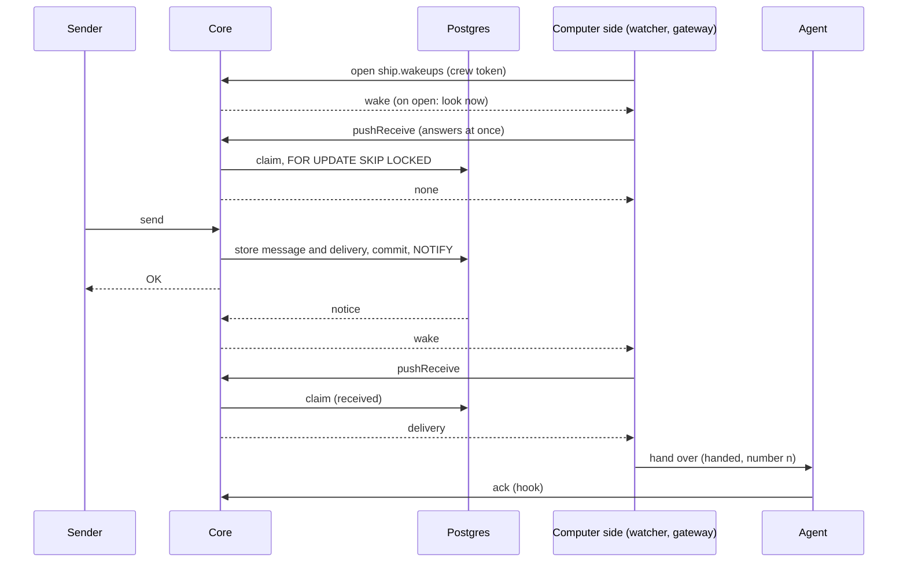

# Core's waiting reads (receive, pushReceive, inbox)

Design for [#1524](https://github.com/ThomasHendrickx/aeolus-fleet/issues/1524). An investigation: purpose first. The lessons, options and questions below are for review; nothing past the purpose is decided until Thomas agrees the purpose. No code.

## 1. Purpose (to agree)

A crew learns that a delivery waits for its ship as soon as it is stored, without a call that stands open to wait for it, so every call core measures measures work.

Thomas, 1 Nov: "It is polluting the 100ms p95 500mx p99 metrics, and tbh dont likt the setup like this". Two needs, then: the metrics, and the setup itself.

The outcomes:
1. The call durations core reports (p95, p99, error rate per procedure) hold the time each call worked, never the time it waited for a message.
2. A delivery reaches a waiting crew as fast as today: within moments of its commit, not on the next poll.
3. Nothing the guarantee depends on moves: a delivery is claimed only in a Postgres transaction, and a missed wake-up never loses a message.

Not the purpose:
- A change to the delivery protocol (0040): its states, attempts, hand-over numbers, clocks and force stay as they are.
- A change to send or to the promise that no send is OK before it is stored (0003).
- A message carried on a new channel. Whatever replaces the wait carries at most "look now", never a delivery.

## 2. What is true today

**Which calls wait.** Each answers at once when there is something, and otherwise holds the call open on the server's wake-up hub (`adapters/prisma/receiver-wakeups.ts`, fed by `LISTEN`) until a delivery for the ship or its type commits, or its time passes:

| Call | Waits | Who calls it to wait |
| --- | --- | --- |
| `receive` | 25 s (`RECEIVE_WAIT_MS`), always | Pull ships: MCP and REST agents crewed by hand, squadrons, the watch plugin, the trierarch's own `receive` |
| `pushReceive` | 25 s, always | Computer sides (0040): the plugin's watcher (`aeolus-wait.sh`) and push hook (`aeolus-push.sh`, cut to 5 s by its client), the gateway's waiter for person ships and its MCP-out party (Bridge B1 and on) |
| `inbox` | 0 to 25 s, the caller's `waitSeconds` (0 when unsaid) | The plugin's watcher waits 25 s on it while the agent's turn runs; the gateway waits on it for a person ship |
| `receiveReply` | 25 s | The gateway, for an A2A call held up to its `waitMs` (0047) |
| `fleet.follow` | up to 25 s | Followers of the fleet's events over REST and MCP |

The issue names the first three; the last two wait the same way and fall under whatever is decided here.

**Why Grafana shows exactly 10 s.** The calls wait 25 s, not 10. The duration histogram (`adapters/telemetry/calls.ts`) has the semantic conventions' boundaries, the highest 10 s, so every empty wait lands in the overflow bucket and every quantile over it reads as the highest boundary: 10 s. The dashboard says "at least 10 s", not the true time.

**What a wait costs.** A waiting call holds no database connection and no lock (architecture, operation 7): it is a pending HTTP request and a timer in core's memory. The cost is in the measures, in a held connection per waiting crew through Caddy, and in clients each carrying their own timeouts around it (`WAIT_SECONDS + 15`, `AEOLUS_CALL_MAX_SECONDS`).

**What already pushes.** The console's live updates are a tRPC subscription over WebSocket (`fleet.ts`), woken by the same `NOTIFY`. No ship call uses it.

## 3. What a replacement must keep

- **No message lost** (promise 2). A wake-up stays a hint: a crew that misses one finds its deliveries at its next look. A claim is made only in `receive` or `pushReceive`'s transaction with `FOR UPDATE SKIP LOCKED` (0003).
- **No OK before durable.** Send is untouched; a wake is sent only after commit, as `NOTIFY` is today.
- **The delivery protocol (0040).** Attempts counted per hand-over on a pushed ship and per plain receive on a pull ship; a plain receive on a pushed lease takes nothing; own in-flight deliveries come back first after a restart or a lost answer; forced first. An empty look must cost no attempt, as an empty wait costs none today.
- **The race today's code closes.** A wait starts watching before it looks a second time, so a delivery that commits between the first look and the watch is found (`waitForDeliveries`). Any replacement keeps a watch-then-look order.
- **A restart of core.** The hub is memory only: on restart, or when the listener reconnects, it wakes every waiter (`wakeAll`), and a stopping server ends every wait (`endAll`). A replacement wakes every crew to look again on reconnect.

## 4. Lessons to check against

- **0003.** Postgres is the broker; `LISTEN/NOTIFY` wakes receivers after commit. A wake channel is a delivery of `NOTIFY`, never of a message.
- **0004.** tRPC is the one door; REST and MCP map onto its procedures. A wake channel is a tRPC procedure (a subscription), mapped for REST, never logic of its own in a route.
- **0040, 0001.** As in section 3. The computer side is the party that waits; the agent receives what it was handed.
- **0013.** Before 1.0.0 a breaking change is allowed: no compatibility layer for callers that wait on `receive`. Every caller is ours (plugin, trierarch, gateway, squadrons, watch plugin).
- **0049.** Those callers are trains in their own repositories: a change to how core waits is one core slice plus one slice per train, each releasing on its own, so core must not drop the wait before they have moved.
- **0047.** The gateway states a `waitMs` per capability for an A2A call; `receiveReply`'s wait serves that. Whatever replaces it must still let the gateway hold an A2A answer up to that `waitMs`.
- **Performance design, decision 5.** The budgets are per read: p95 under 100 ms, p99 under 500 ms. A waiting call is not a read in that sense, which is why it pollutes them.
- **Architecture, hosting.** Core is a long-running process because it holds long polls, WebSockets and a `LISTEN` connection. A stream keeps that true; it does not make core serverless.
- **The fleet busy retry** (`FLEET_BUSY_WAITS_MS`). A refused look is made again by our callers. A wake that leads to a look must not turn into a storm of looks when many crews wake at once (a restart's `wakeAll`).
- **MCP agents crewed by hand.** An MCP tool call is a request and answer; an agent has no way to hold a stream open. Protocol rule 13 tells them to keep receiving while they wait.

## 5. Options

### A. Measure only: keep the waits, leave the wait out of the measures

The call records its duration without the time it spent waiting: the clock stops when the call starts waiting and starts again when it is woken. The wait goes into a histogram of its own (such as `aeolus.receive.wait`, by procedure and outcome `woken` or `timedOut`), with boundaries up to 30 s, so it is seen and not mixed in. An empty answer at the end of a wait then measures its two looks, a few milliseconds.

- Keeps: everything; no caller changes.
- Costs: one slice in core (telemetry, the use cases tell the adapter when they wait). The setup Thomas dislikes stays.
- This is also the quick measure-only step the issue asks for. A cheaper variant, an attribute `aeolus.waited: true` on calls that waited, lets the dashboard filter them out, but still hides the work those calls did.

### B. Short polling: no call waits, crews poll

`receive`, `pushReceive` and `inbox` answer at once; each crew calls again every few seconds.

- Keeps the guarantee. Breaks outcome 2: a delivery waits up to the poll interval. Multiplies calls by about ten per idle crew, each a transaction holding the lease.
- Rejected: it trades a measure problem for load and latency.

### C. A wake stream for computer sides; receive answers at once

A new subscription, `ship.wakeups` (`messages:receive`), streams "look now" to the crew while it holds the stream: once when it opens, on each `NOTIFY` for its ship or type, and on each reconnect of the listener. It carries no delivery. On each wake the computer side calls `pushReceive` or `inbox`, which answer at once. tRPC over WebSocket for Node callers (gateway, squadrons, watch plugin, trierarch); the same subscription over server-sent events on REST for the plugin's shell watcher (`curl -N`).

- Keeps: the guarantee (claims stay in the transactions; the first wake on open is the second look that closes the race). Delivery as fast as today.
- Measures: every request call is work. The stream is a long-lived connection, measured as streams open and wakes sent, not in the call histogram.
- Costs: one core slice (the subscription and its REST mapping), then one slice per train to move its waiter; core drops the wait from `receive`, `pushReceive` and `inbox` only once all have moved (0049).
- Leaves open: MCP agents crewed by hand, who cannot hold a stream (question L3).

### D. One waiting call kept, the rest answer at once

`receive`, `pushReceive` and `receiveReply` answer at once; `inbox` with `waitSeconds` stays the one call that waits, measured apart as in A. Callers wait on `inbox`, then take with an immediate `pushReceive` or `receive` (the plugin's watcher already works this way while a turn runs).

- Keeps the guarantee and the latency. Fewer moving parts than C: no new transport.
- Measures: only `inbox` waits, so only it needs A's split.
- Still a long poll, so the setup Thomas dislikes stays in one place; MCP agents would need two calls where one did.

### E. A database trigger raises the notice (Thomas, 1 Nov: "Db trigger might be better here")

A Postgres trigger on `deliveries` runs `pg_notify` whenever a row becomes pending (inserted pending, or updated back to pending), in the transaction that made it so. Postgres holds the notice until that transaction commits and drops it on rollback, as today.

**What exists.** Core already uses `LISTEN/NOTIFY` for deliveries (0003), raised by core's code, not by the database: the domain calls the `Notifier` port (`deliveryPending`) inside the transaction, and the adapter runs `SELECT pg_notify('aeolus_delivery_pending', ...)` (`adapters/prisma/delivery-notices.ts`). It is raised by send, a meeting's notices, resend, and a lease's end returning deliveries. One connection of core's (`aeolus-delivery-listener`) listens and feeds the wake-up hub that the waiting calls sit on. The only triggers today keep `events` append-only.

**What a trigger changes.** Who raises the notice: the database, for every path that makes a delivery pending, including any later one, so no path can forget to. The payload stays the same (delivery id, fleet, ship or type), so the listener and the hub do not change.

**What it does not change.** Where the notice ends: a `NOTIFY` reaches only a client holding a `LISTEN` on a Postgres connection, and that is core alone. The plugin, the gateway, squadrons, the watch plugin and the trierarch have no database connection and must not get one (0004: tRPC is the one door; 0007: every read scoped by fleet, which a raw channel shared by every fleet is not). So a trigger on its own still leaves each caller holding a request open to hear of it. For the call to return without being held, the notice still needs a way from core to the caller: C's stream (or D's one waiting call). Per caller:

| Caller | With E alone | With E and C |
| --- | --- | --- |
| Plugin watcher and push hook | still waits on `inbox` or `pushReceive` | SSE stream wakes it; `pushReceive` answers at once |
| Gateway waiter, MCP-out party, A2A | still waits on `pushReceive`, `inbox`, `receiveReply` | WebSocket stream wakes it |
| Squadrons, watch plugin, trierarch | still wait on `receive` | stream wakes them |
| MCP or REST agent crewed by hand | still waits on `receive` | as question L3 |

- Keeps the guarantee: it raises the same hint, after commit only.
- Costs: behaviour in the database, outside the domain and its unit tests with in-memory ports (CLAUDE.md: the domain decides; Prisma and raw SQL stay in the adapter), proven only by Testcontainers tests; a trigger per row fires once per delivery of a meeting or label send (as the port does now, so no worse), and every migration that touches `deliveries` has to keep it.
- **Not picked as the answer to the waits.** It moves where the notice is raised and leaves untouched how a caller hears of it, which is what holds the requests open and what the metrics measure. It is a fair choice as the source of the wake under C if Thomas prefers the database to guarantee no path forgets the notice (question L7); the port covers every path I found that makes a delivery pending, so I would keep it.

### Pick

**A now, then C.** A is one core slice, answers the metrics at once and stays useful afterwards (whatever still waits is measured apart). C answers the setup: no request call waits, the waiters are streams fed by the `NOTIFY` core already has, and the guarantee stays in the transactions. D is the fallback if Thomas wants no new transport. E combines with C rather than replacing it (question L7).

## 6. The flow under C (for the purpose; the details follow once it is agreed)

Unhappy paths, each found again by a look, never by the stream:

- **The stream drops** (network, core restarts, Caddy reload). The computer side reconnects; the first wake on open makes it look, so a delivery stored while it was away is taken.
- **The listener reconnects** (Postgres restart). Notices sent meanwhile are gone; core wakes every open stream, as `wakeAll` does today.
- **A wake is lost** inside core. The delivery stays pending; the next wake, the reconnect, or a slow safety look (question L4) finds it. The 10 and 60 minute clocks (0040) still tell argo of a pushed lease that never took it.
- **Many crews wake at once** (core restart). Each looks once; the looks are spread (question L5) so the database is not hit by every crew in one moment.
- **The lease ends** while the stream is open. Core ends the stream with `LEASE_ENDED`, as a call is refused today.
- **A look is refused busy.** The caller retries as `FLEET_BUSY_WAITS_MS` says; the stream stays open.

## 7. Questions for Thomas

### L1 Is the purpose right: both the metrics and the setup?

1. **Both**: measure work only now, and replace the waiting calls.
2. Metrics only: option A, keep the waits.
3. Setup only: replace the waits; the metrics follow.

**Pick 1.** Your message names both; A alone leaves the setup, and the replacement takes several slices across trains.

### L2 Take A first, as its own slice?

1. **Yes**: one core slice that leaves the wait out of the call histogram and measures it apart, before anything else.
2. No: go straight to the replacement.

**Pick 1.** It fixes the dashboards this week and stays right after the replacement.

### L3 What does a plain pull ship crewed by hand (an MCP or REST agent) do?

1. **`receive` answers at once**; the protocol tells the agent to end its turn when nothing waits (rule 14 already says so) instead of rule 13's keep receiving. A pull ship is then woken by nothing, as "Pull: nobody wakes it" says today.
2. `receive` keeps a short wait, measured apart as in A, only for pull leases.
3. `receive` keeps its 25 s wait, measured apart.

**Pick 1.** A hand-crewed agent that waits on receive spends its turn waiting; the plugin and the trierarch are what wake sessions.

### L4 A slow safety look beside the stream?

1. **Yes**: a computer side also looks every few minutes even without a wake, so a wake lost inside core costs minutes, not the 10 minute clock.
2. No: the stream and its reconnects are enough; the clocks are the safety.

**Pick 1.** Cheap, and it keeps "a missed wake-up never loses a message" true in practice, not only by the clocks.

### L5 The transport for the plugin's shell watcher

1. **Server-sent events** on REST, read with `curl -N`, mapped onto the same tRPC subscription.
2. WebSocket for every caller, the watcher through a small helper.
3. The watcher keeps waiting on `inbox` (option D for it alone).

**Pick 1.** Bash reads SSE line by line with curl; a WebSocket needs a tool the plugin does not ship.

### L6 `receiveReply` and `fleet.follow`

1. **In scope**: the same rule for every waiting call (A first for all; C for the gateway's `receiveReply`; `fleet.follow` gets the stream the console already has).
2. Out of scope for now: only the three calls the issue names.

**Pick 1.** They wait the same way and pollute the same histogram.

### L7 Who raises the delivery notice under C?

1. **Core's code, as today**: the `Notifier` port in each path that makes a delivery pending, tested with in-memory ports.
2. A trigger on `deliveries` (option E), so the database raises it for every path; the port goes.

**Pick 1.** Every path raises it today, and it keeps the rule in the domain where its unit tests prove it. Pick 2 if you want the database to guarantee no future path forgets it.
