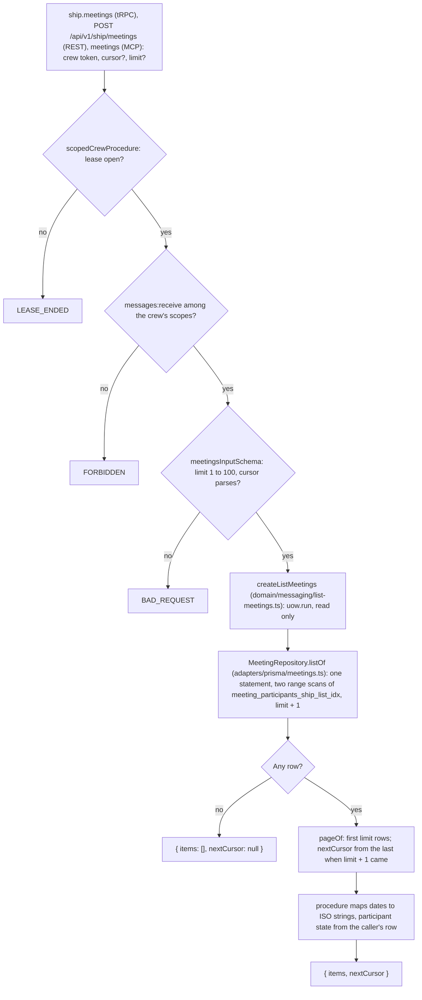
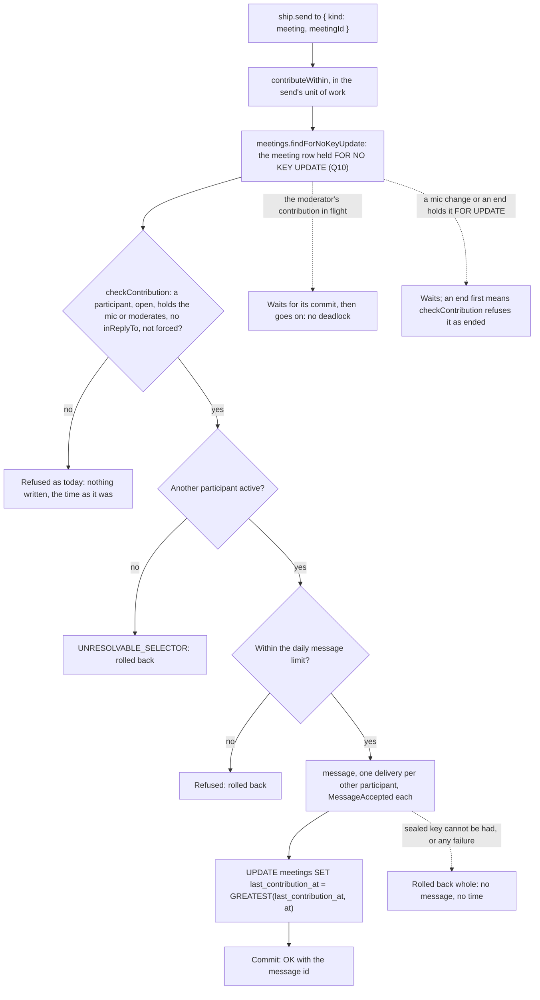
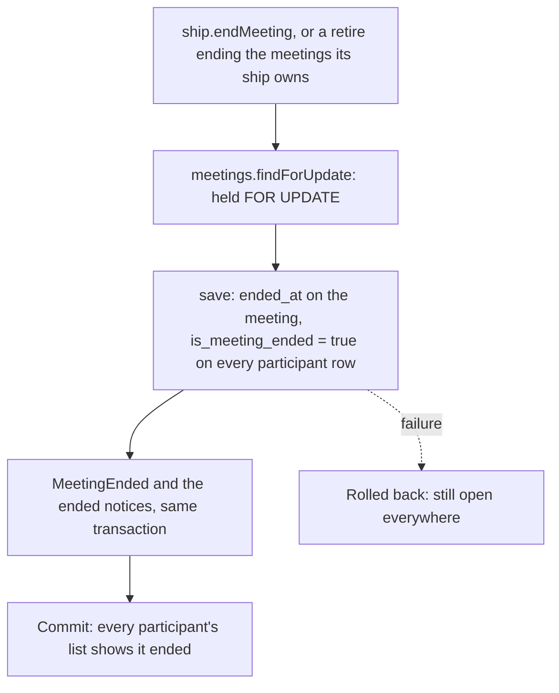

# A ship lists the meetings it takes part in

Design for [#1981](https://github.com/ThomasHendrickx/aeolus-fleet/issues/1981). Docs only. Thomas approved the purpose (20 Nov) and answered Q1 to Q11, each option 1 (20 Nov). Sections 4 to 10 are the detailed stage built on those answers.

## 1. Purpose (agreed)

**Decision.** Thomas approved the purpose as written below (20 Nov).

**Who it is for.** A ship that takes part in meetings: first a person ship's crew, the gateway reading for a person or an agent acting as the person through the gateway's MCP; and every agent ship, crewed again after a restart or a cleared session, that holds no meeting id any more.

**The job.** The ship asks core which meetings it takes part in and gets a bounded page of them, open ones first, with enough per meeting to see where it stands without opening each one: the meeting's id and title, open or ended and when, its owner and moderator, how many participants it has, who holds the mic, the ship's own place in line for the mic, and when the last contribution was made. From there it opens one with the existing `meeting` read. Today a ship finds a meeting only through the added notice it received, or an id someone passes it (decision 0061): a notice acknowledged and gone, and the meeting is out of sight.

**What it is not.**
- No contributions or payloads: content-blind, as the meeting's envelope is. Reading what was said stays `meeting`.
- No list of meetings a ship takes no part in: no fleet-wide meeting list for argo, a fleet manager or the console.
- No change to a meeting: no join, leave or mic call from the list.
- No count of unread contributions and no wake: a contribution still arrives as a delivery.
- No gateway page or Aeolus Fleet plugin script in this design's core build: those are their own trains' work on top of the call.
- No room: rooms are not built (meetings design, M20).

## 2. Lessons to check against

| # | Lesson | Source |
| --- | --- | --- |
| L1 | A participant reads a meeting with `meeting` (`messages:receive`); a meeting it takes no part in and one that does not exist are one refusal; a former participant, left or revoked, still reads it | Decision 0061; `packages/core/src/domain/messaging/read-meeting.ts` |
| L2 | "A participant crewed again, late or after a crash, gets what it missed with no human passing ids." Today that holds only while the ship still has the meeting's id | Meetings design, purpose outcome 4 and M12 |
| L3 | Where a person stands on the mic was missing: the gateway's meeting page kept "number 1 in line" after the mic was given, and `requestMic` over MCP answered no place in line | Onboarding audit, 25 Oct, [#1240](https://github.com/ThomasHendrickx/aeolus-fleet/issues/1240) |
| L4 | Content-blind: what Aeolus keeps and shows sits on the envelope. Meeting titles stay readable in a sealed fleet, so a list without payloads needs no data key | Blueprint, not an orchestrator; blueprint, sealed fleets (item 5); decision 0068 |
| L5 | A person's paged list already exists: `exchanges`, 20 a page unless asked, at most 100, read from a rollup written in the delivery transactions, "never counted from history", retired ships left out | Blueprint, `exchanges`; [exchange read design](../exchange-read/README.md) |
| L6 | A list page asks the database for the page plus one row, by an opaque cursor, with no totals, the permission in the query; the target is 3,000 ships and 10,000,000 retained messages per fleet, p95 below 100 ms and p99 below 500 ms | [Person ship reads](../person-ship-reads/README.md); performance skill |
| L7 | `meeting` reads each participant's ship and lease one at a time. Done per meeting in a list of 20, that is a query per participant per row | `read-meeting.ts` |
| L8 | Participants are indexed by fleet and ship (`MeetingParticipant @@index([fleetId, shipId])`); the meeting row holds owner, moderator, mic holder, opened and ended, but no last contribution time | `packages/core/src/adapters/prisma/schema.prisma` |
| L9 | Retention takes finished contributions once their meeting ended, so a time read from messages changes as history goes | Decision 0066 |
| L10 | A retired ship leaves every open meeting, and a meeting it owns ends; a removed ship is a remnant that keeps its id and name | Decisions 0061, 0070 |
| L11 | No call waits: a read answers at once; a ship looks again on a wake | Decision 0072 |
| L12 | One procedure; REST and MCP map onto it; a package of another train names each call it uses in compatibility.md with the core version that brings it | Decision 0004; [compatibility.md](../../compatibility.md) |
| L13 | Pre-1: breaking changes allowed, no compatibility layers, keep the design minimal | Decision 0013; AGENTS.md |

## 3. Questions

Each is one decision, with the options, the pick and Thomas's answer.

**Q1. Whose meetings the call lists.**
1. The calling ship's own only, as a ship call with `messages:receive`, the scope `meeting` takes.
2. Also another ship's, for a holder of `fleet:read` within read reach.

Pick 1. The job is a ship finding its own meetings; a list for others is an audit read the purpose leaves out, and it would show who meets with whom to readers `meeting` never lets in (L1).

**Decision. Thomas: 1** (20 Nov). The calling ship's own meetings only, a ship call under `messages:receive`.

**Q2. Which of its meetings are listed.**
1. Every meeting it can read with `meeting`: present, left and revoked, open and ended, each with the ship's own state.
2. Present and left only, revoked left out.
3. Present only.

Pick 1. The list then matches what `meeting` answers (L1), so nothing listed refuses on open and nothing readable is hidden; the ship's own state says which it is.

**Decision. Thomas: 1** (20 Nov). Every meeting the ship can read with `meeting`: present, left and revoked, open and ended, each with the ship's own state.

**Q3. The order of a page.**
1. Open meetings first, then ended; within each, newest opened first, the id breaking a tie.
2. Open first, then ended; within each, the newest last contribution first.

Pick 1. Its key never moves, so a cursor continues from the ship's place and no meeting shows twice or is skipped between pages (L6). Option 2 moves a meeting on every contribution while a ship pages.

**Decision. Thomas: 1** (20 Nov). Open first, then ended; within each, newest opened first; the id breaks a tie.

**Q4. The page size.**
1. 20 a page unless asked, at most 100, as `exchanges`.
2. 20 a page, fixed.

Pick 1. One rule for a ship's paged lists (L5); an agent crewed again may want its open meetings in one call.

**Decision. Thomas: 1** (20 Nov). 20 a page unless asked, at most 100.

**Q5. Where the last contribution's time comes from.**
1. Kept on the meeting, written in the contribution's own transaction.
2. Read from the meeting's messages at each list.

Pick 1. A list of 20 then reads no history (L5, L6), and the time stays when retention takes the contributions of an ended meeting (L9). The cost is one more write in each contribution's transaction, on the meeting row the contribution already reads.

**Decision. Thomas: 1** (20 Nov). The last contribution's time is kept on the meeting, written in the contribution's own transaction.

**Q6. What each listed meeting carries.**
1. The issue's set: id, title, open or ended and when it opened and ended, owner and moderator by id and name, how many participants are present, the mic holder by id and name, the ship's own place in line for the mic (none when it holds the mic or has not asked), and the last contribution's time; plus the ship's own state (present, left or revoked).
2. Option 1 without the ship's own state.
3. Option 1 with every participant by id and name.

Pick 1. It answers where the ship stands (L3) from the meeting row, the ship's participant row and the mic requests, with no ship or lease read per participant (L7). Option 3 grows each row with the meeting and repeats what `meeting` reads.

**Decision. Thomas: 1** (20 Nov). The issue's set plus the ship's own state.

**Q7. The call and its surface in core.**
1. A new ship call, `meetings`, on tRPC with REST and MCP over the same procedure, a ship protocol line and a compatibility row for the gateway; the gateway page and the Aeolus Fleet plugin script follow in their own trains.
2. `meeting` called with no id answers the list.

Pick 1. One call, one answer shape (L12); option 2 gives one call two answers and two refusal sets.

**Decision. Thomas: 1** (20 Nov). A new ship call `meetings` on tRPC, with REST and MCP over the same procedure, a ship protocol line and a compatibility row for the gateway.

**Q8. Where the list's order key lives.**
1. Copied onto each participant row (`meeting_opened_at`, `is_meeting_ended`) with one index in list order, written by the open, the add and the end, which already write those rows.
2. Read from the meeting row through the existing `(fleet_id, ship_id)` index, joined and sorted at each list.

Pick 1. A page then reads at most `2 x (limit + 1)` index entries whatever the ship's history (L6); option 2 sorts every meeting the ship was ever in on every page, so its cost grows with that history.

**Decision. Thomas: 1** (20 Nov). The order key is copied onto each participant row (`meeting_opened_at`, `is_meeting_ended`) with one index in list order.

**Q9. Existing meetings' last contribution time at migration.**
1. Backfilled from the newest kept contribution of each meeting; a meeting whose contributions retention already took stays null.
2. Null for every existing meeting; only new contributions set it.

Pick 1. Open meetings then show a true time from the first release, and the backfill is one grouped statement over messages with a meeting, run once.

**Decision. Thomas: 1** (20 Nov). The last contribution's time is backfilled from each meeting's newest kept contribution; null where retention took them.

**Q10. How a contribution holds the meeting it now writes.**
1. `FOR NO KEY UPDATE` in place of `FOR SHARE`, so two contributions to one meeting take turns.
2. `FOR SHARE` kept, and a deadlock between two contributions retried.

Pick 1. Two shared holders that both update deadlock; at most two ships contribute at once (the holder and the moderator), so taking turns costs little, and changes still wait for contributions in flight as decision 0061 says.

**Decision. Thomas: 1** (20 Nov). A contribution holds the meeting `FOR NO KEY UPDATE` in place of `FOR SHARE`, so two contributions take turns.

**Q11. A meeting that ends while a ship pages.**
1. Accepted: it may show twice, open then ended; the client keeps the later row by id. None is skipped.
2. The cursor holds the time of the first page, and later pages leave out what changed after it.

Pick 1. It keeps the cursor a position and the query unchanged; a list read again from the top shows each once.

**Decision. Thomas: 1** (20 Nov). A meeting that ends while a ship pages may show twice, open then ended; the client keeps the later row by id. None is skipped.

## 4. What is true today

- **The meeting row** (`meetings`) holds title, owner, moderator, opener, `opened_at`, `ended_at`, the mic holder and the mic pattern. No last contribution time.
- **The participant row** (`meeting_participants`) holds `joined_at`, its join `place`, `left_at` and `is_revoked`, keyed `(fleet_id, meeting_id, ship_id)`, with `meeting_participants_fleet_id_ship_id_idx` on `(fleet_id, ship_id)`. Every change to a meeting (`MeetingRepository.save`) upserts every participant row, an end included.
- **The mic requests** (`meeting_mic_requests`) are written again on every change with `place` 0, 1, 2 in request order, so a ship's place in line is its `place` plus 1, as `requestMic` answers it today (`change-mic.ts`).
- **A contribution** holds the meeting `FOR SHARE` (`findForShare`) for its whole transaction, so changes, which hold it `FOR UPDATE`, wait for contributions in flight; two contributions to one meeting (the mic holder's and the moderator's) run side by side.
- **Retention** (0066) prunes a meeting's contributions once it ended; the meeting row and its participant rows stay until the fleet is removed.

## 5. The call

`ship.meetings`, a tRPC query under `scopedCrewProcedure('messages:receive')`; REST `POST /api/v1/ship/meetings` and the MCP tool `meetings` map onto the same procedure (Q7). It reads only and writes nothing.

### Input

```ts
// @aeolus-fleet/common, schemas/meeting.ts
export const MEETINGS_PAGE_SIZE_DEFAULT = 20; // Q4
export const MEETINGS_PAGE_SIZE_MAX = 100;    // Q4
export const meetingsInputSchema = z
  .object({
    cursor: meetingsCursorSchema.optional(), // the nextCursor the last page answered; none for the first page
    limit: z.int().min(1).max(MEETINGS_PAGE_SIZE_MAX).optional(),
  })
  .optional();
```

### Answer

```ts
export const meetingPartySchema = z.object({ id: idSchema('ship'), name: z.string() });
export const meetingListEntrySchema = z.object({
  meetingId: idSchema('meeting'),
  title: z.string().nullable(),
  openedAt: z.iso.datetime(),
  endedAt: z.iso.datetime().nullable(),         // null while open: open or ended is this field (Q6)
  owner: meetingPartySchema,
  moderator: meetingPartySchema,
  presentParticipants: z.int().min(1),          // participants neither left nor revoked; the owner is always one
  micHolder: meetingPartySchema.nullable(),     // null while the mic is free
  placeInLine: z.int().min(1).nullable(),       // the caller's place among mic requests, 1 first; null when it holds the mic or has not asked
  lastContributionAt: z.iso.datetime().nullable(), // null when nothing was said yet (Q5)
  participantState: participantStateSchema,     // the caller's own: present, left or revoked (Q2, Q6)
});
export const meetingsOutputSchema = z.object({
  items: z.array(meetingListEntrySchema),
  nextCursor: meetingsCursorSchema.nullable(),  // null on the last page
});
```

A name is the ship's current name, a removed ship's remnant name included (0070). Titles are envelope facts and stay readable in a sealed fleet (L4): the call needs no data key and never refuses `KEY_UNAVAILABLE`. A ship in no meeting gets `{ items: [], nextCursor: null }`.

### The cursor

The order is open first, then ended; within each, `opened_at` newest first, then `meeting_id` descending (Q3). The cursor names the last row of the page by that key: `<section>.<opened_at in epoch milliseconds>.<meeting id>`, the section `o` (open) or `e` (ended), for example `o.1763640000000.mtg_01m7...`. `meetingsCursorSchema` checks the three parts. It is opaque to callers: the call's description says to pass `nextCursor` back as it came. It carries a position, never a permission: the query still reads only the caller's own participant rows, so a made-up cursor only moves where the caller's own list starts.

The page asks for `limit + 1` rows to know whether another follows (`pageOf`), with no totals (L6).

### Refusals

| Code | When |
| --- | --- |
| `LEASE_ENDED` | The crew token's lease ended. |
| `FORBIDDEN` | The crew token lacks `messages:receive`. |
| `BAD_REQUEST` | `limit` outside 1 to 100, or a cursor that does not parse. |

No other refusal: a meeting the caller takes no part in is simply not on its list, so the list leaks nothing `meeting` does not (L1).

## 6. The schema change and migration

Forward only (0013), one migration, `<timestamp>_meeting_list`:

```sql
-- Q5: the last contribution's time, kept on the meeting.
ALTER TABLE meetings ADD COLUMN last_contribution_at timestamptz(3);

-- The list's order key, copied onto each participant row (Q8).
ALTER TABLE meeting_participants
  ADD COLUMN meeting_opened_at timestamptz(3),
  ADD COLUMN is_meeting_ended boolean NOT NULL DEFAULT false;
UPDATE meeting_participants p
  SET meeting_opened_at = m.opened_at, is_meeting_ended = m.ended_at IS NOT NULL
  FROM meetings m WHERE m.fleet_id = p.fleet_id AND m.id = p.meeting_id;
ALTER TABLE meeting_participants ALTER COLUMN meeting_opened_at SET NOT NULL;

-- Existing meetings' last contribution (Q9).
UPDATE meetings m SET last_contribution_at = c.at
  FROM (SELECT fleet_id, meeting_id, max(created_at) AS at FROM messages
        WHERE meeting_id IS NOT NULL GROUP BY fleet_id, meeting_id) c
  WHERE c.fleet_id = m.fleet_id AND c.meeting_id = m.id;

-- A ship's meetings in list order. It leads with (fleet_id, ship_id), so it also serves
-- the participant foreign key to ships (#331) and the retire's lookup: the old index goes.
CREATE INDEX meeting_participants_ship_list_idx
  ON meeting_participants (fleet_id, ship_id, is_meeting_ended, meeting_opened_at DESC, meeting_id DESC);
DROP INDEX meeting_participants_fleet_id_ship_id_idx;
```

In `schema.prisma`: `Meeting.lastContributionAt DateTime? @map("last_contribution_at") @db.Timestamptz(3)`; `MeetingParticipant.meetingOpenedAt` and `isMeetingEnded`, and `@@index([fleetId, shipId, isMeetingEnded, meetingOpenedAt(sort: Desc), meetingId(sort: Desc)], map: "meeting_participants_ship_list_idx")` in place of `@@index([fleetId, shipId])`. The retire's open meetings query (`meetings.ts`, "found through meeting_participants_fleet_id_ship_id_idx") then uses the new index; its comment names it.

The copied columns are the adapter's, not the domain's: `Participant` in `meeting.ts` gains nothing. `create` writes them from the meeting; `save`, which already upserts every participant row, writes `is_meeting_ended` from the meeting's `endedAt`. `opened_at` never changes, so `meeting_opened_at` is written once.

### Writes, and their events

Every write rides in a transaction that already changes state and already writes its event; the call itself writes nothing and records no event.

- **A contribution** (`contributeWithin` in `send-message.ts`, through a new port method `MeetingRepository.contributed`): `UPDATE meetings SET last_contribution_at = GREATEST(last_contribution_at, $at)` in the send's transaction, after the deliveries are made, beside the `MessageAccepted` per delivery it writes today. A rolled back send leaves the time as it was. `GREATEST` keeps the newest when two contributions commit out of clock order. The meeting is then held `FOR NO KEY UPDATE` instead of `FOR SHARE` (Q10): an update needs that lock anyway, and taking it from the start keeps two contributions that both hold `FOR SHARE` from deadlocking on their updates. Changes still wait for contributions in flight, since `FOR UPDATE` conflicts with it; message inserts take only `FOR KEY SHARE` through the foreign key, which it allows.
- **An end** (`endMeeting`, and a retire ending the meetings its ship owns): `save` writes `ended_at` and `is_meeting_ended` on every participant row in the transaction that writes `MeetingEnded`.
- **An open and an add**: `create` and `save` write the participant rows with `meeting_opened_at` and `is_meeting_ended = false`, in the transaction that writes `MeetingOpened` and `ParticipantAdded`.

No new event type: the time is a fact of the contribution `MessageAccepted` records, and the copied order key a fact of `MeetingOpened`, `ParticipantAdded` and `MeetingEnded`.

## 7. The query and its plan

One statement, typed raw SQL in the Prisma adapter (`meetings.ts`, `listOf`). Two index range scans on `meeting_participants_ship_list_idx`, one per section, joined to the rest by primary key:

```sql
WITH page AS (
  (SELECT p.meeting_id, p.is_meeting_ended, p.meeting_opened_at, p.left_at, p.is_revoked
     FROM meeting_participants p
    WHERE p.fleet_id = $fleet AND p.ship_id = $ship AND p.is_meeting_ended = false
      AND ($cursor_section IS NULL OR ($cursor_section = 'o' AND (p.meeting_opened_at, p.meeting_id) < ($cursor_at, $cursor_id)))
    ORDER BY p.meeting_opened_at DESC, p.meeting_id DESC
    LIMIT $limit_plus_one)
  UNION ALL
  (SELECT p.meeting_id, p.is_meeting_ended, p.meeting_opened_at, p.left_at, p.is_revoked
     FROM meeting_participants p
    WHERE p.fleet_id = $fleet AND p.ship_id = $ship AND p.is_meeting_ended = true
      AND ($cursor_section IS DISTINCT FROM 'e' OR (p.meeting_opened_at, p.meeting_id) < ($cursor_at, $cursor_id))
    ORDER BY p.meeting_opened_at DESC, p.meeting_id DESC
    LIMIT $limit_plus_one)
  ORDER BY is_meeting_ended, meeting_opened_at DESC, meeting_id DESC
  LIMIT $limit_plus_one
)
SELECT page.*, m.title, m.opened_at, m.ended_at, m.last_contribution_at,
       m.owner_ship_id, o.name AS owner_name, m.moderator_ship_id, d.name AS moderator_name,
       m.mic_holder_ship_id, h.name AS mic_holder_name,
       (SELECT count(*) FROM meeting_participants q
         WHERE q.fleet_id = m.fleet_id AND q.meeting_id = m.id AND q.left_at IS NULL) AS present_participants,
       (SELECT r.place + 1 FROM meeting_mic_requests r
         WHERE r.fleet_id = m.fleet_id AND r.meeting_id = m.id AND r.ship_id = $ship) AS place_in_line
  FROM page
  JOIN meetings m ON m.fleet_id = $fleet AND m.id = page.meeting_id
  JOIN ships o ON o.fleet_id = m.fleet_id AND o.id = m.owner_ship_id
  JOIN ships d ON d.fleet_id = m.fleet_id AND d.id = m.moderator_ship_id
  LEFT JOIN ships h ON h.fleet_id = m.fleet_id AND h.id = m.mic_holder_ship_id
 ORDER BY page.is_meeting_ended, page.meeting_opened_at DESC, page.meeting_id DESC;
```

When the cursor is in the ended section, the open half's condition is false for every row and it reads none. The participant state comes from the caller's own row (`is_revoked`, then `left_at`), as `participantState` in `read-meeting.ts` does. A revoked participant has `left_at` set (M13), so `present_participants` never counts it. A mic holder has no request (M8), so `place_in_line` is null for it.

**The plan for a ship in many meetings**, 10,000 participant rows of one ship, 9,980 ended: each half is an `Index Scan` on `meeting_participants_ship_list_idx` with an equality on its first three columns and the row comparison on the next two, stopping at `limit + 1` rows, so at most 42 index entries read whatever the ship's history; then `limit + 1` primary key lookups each on `meetings` and on `ships` three times, one primary key probe on `meeting_mic_requests`, and one prefix scan of the meeting's participants for the present count. No `Sort` node over the ship's participant rows: only the merge of at most 42 rows. The cost grows with the page and each listed meeting's participants, never with the number of meetings the ship took part in.

An integration test (`meeting-list-plan.integration.test.ts`, as `exchange-plan.integration.test.ts`) seeds a ship in 10,000 meetings, 20 of them open, and asserts with `EXPLAIN (FORMAT JSON)`: both halves use `meeting_participants_ship_list_idx`, no `Seq Scan` on `meeting_participants` or `meetings`, and no `Sort` whose input is not the two limited halves.

## 8. Flows

From the code each step runs in, happy and unhappy paths.

### The list



### A contribution keeps the time



### An end keeps the order key



### Unhappy paths, all

- **The lease ends, or the token lacks `messages:receive`**: `LEASE_ENDED` or `FORBIDDEN` before any read.
- **A cursor that does not parse, or a limit outside 1 to 100**: `BAD_REQUEST`.
- **A ship in no meeting**: an empty page, `nextCursor` null.
- **A meeting ends while a ship pages**: it moves from the open section to the ended one. Seen already while open, it may show again under ended, and the client keeps the later row by id; not seen yet, it shows under ended. None is skipped (Q11).
- **The ship is added to a meeting while it pages**: a meeting opened after the first page is newer than the cursor in the open section, so it shows on the next first page, not this paging.
- **The ship leaves, is revoked or rejoins**: the row stays; its `participantState` says which, read when the page is read.
- **Two contributions at once** (the holder's and the moderator's): they take turns on the meeting row; `GREATEST` keeps the newest time.
- **A rolled back contribution**: no time written.
- **Retention prunes an ended meeting's contributions**: `lastContributionAt` stays (L9).
- **The owner, moderator or mic holder retired or removed**: listed by its current or remnant name (0070). A retire ends the meetings it owns, so an open meeting never has a retired owner.
- **The caller is a participant of a meeting in another fleet**: not possible; every row and join is scoped by `fleet_id` (0007).
- **A sealed fleet with its key revoked**: the call reads no payload and answers as usual.

## 9. Performance targets

At the fleet scale of L6 (3,000 ships, 10,000,000 retained messages) and a ship in 10,000 meetings:

- `meetings`: p95 below 100 ms, p99 below 500 ms per page of 20, and per page of 100; one statement per call; at most `2 x (limit + 1)` index entries read on `meeting_participants`.
- A contribution: one more single-row update on the meeting row it already holds; its p95 stays within 5 ms of today's on staging.
- An end: no new statement; the participant upserts it does today carry one more column.
- Measured on capped staging once the slices are merged, as the performance skill asks; the plan test of section 7 guards the shape in CI.

## 10. Slices, in build order

Core first, each its own PR; then the gateway and the app in their own repositories.

1. **Core: the kept facts.** The migration of section 6; `MeetingRepository.findForNoKeyUpdate` in place of `findForShare` and `MeetingRepository.contributed(fleetId, meetingId, at)` for the contribution's update, both called from `contributeWithin`; the copied order key in `create` and `save`. Done when: Testcontainers tests show a contribution sets the time and a rolled back one does not; two concurrent contributions to one meeting both commit with no deadlock and the newer time kept; an end sets `is_meeting_ended` on every participant row and a failed end leaves them; the migration on a database with meetings, ended ones and contributions backfills both as picked; the existing meeting and send tests pass.
2. **Core: the read.** `meetingsInputSchema`, `meetingListEntrySchema`, `meetingsOutputSchema` and the cursor in `@aeolus-fleet/common`; `createListMeetings` with `MeetingRepository.listOf` as its port; the statement of section 7. Done when: unit tests with in-memory ports cover the order (open first, newest opened first, the id on a tie), paging with no row twice or skipped on a still list, 20 unless asked and at most 100, each field of the entry, each participant state, place in line for a waiting ship and null for the holder and for one that has not asked, and a removed owner by its remnant name; the Postgres adapter test covers the same; the plan test of section 7 passes.
3. **Core: the call.** `ship.meetings` on tRPC, REST `ship/meetings` and the MCP tool `meetings`; the ship protocol line (rule 18: "Call meetings to list the meetings you take part in, open first, each with where you stand."); the blueprint's ship contract row and decision 0061's read line; the architecture's meeting tables; the compatibility row for the gateway (`ship/meetings`, the core release carrying aeolus-fleet#1981, aeolus-fleet-gateway#428). Done when: the tRPC, REST and MCP door tests answer a page and refuse `LEASE_ENDED`, `FORBIDDEN` and `BAD_REQUEST`; `rest-api.test.ts` and `mcp-endpoint.test.ts` list the call; `ship-protocol.test.ts` has the line; a person ship's crew token reads its list end to end.
4. **Gateway** (ThomasHendrickx/aeolus-fleet-gateway#428): reads `ship/meetings` for a person ship and forwards it as core answers it, raising its minimum core to the release of slice 3. Done when as its issue says.
5. **App** (app #285): the person's list of their meetings through the gateway, each opening the meeting it names. Done when as its issue says.
