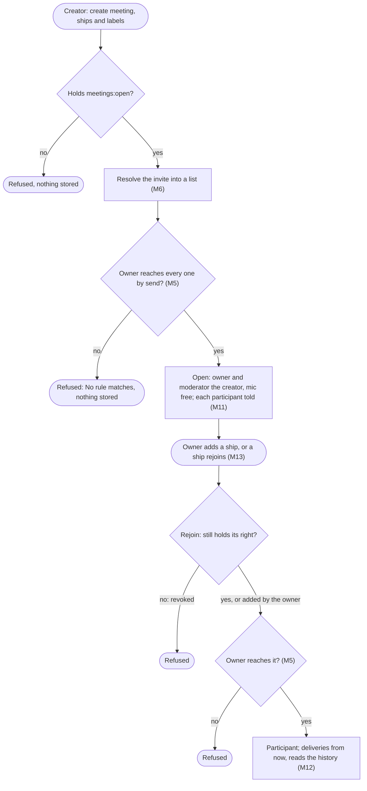
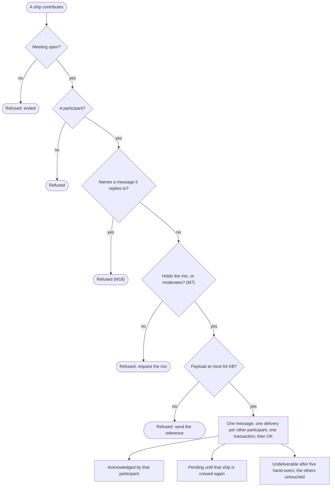
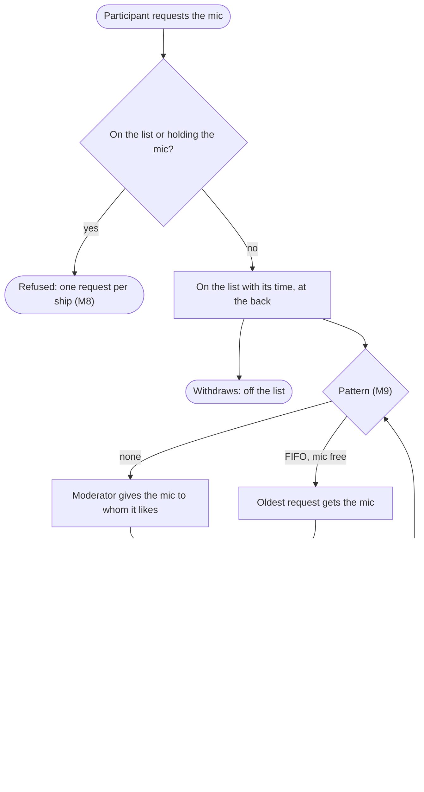
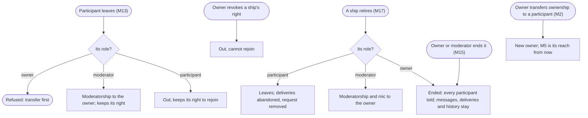
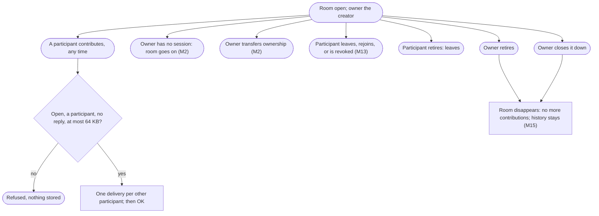

# Meetings: ships and people in one moderated conversation

Design for [#1168](https://github.com/ThomasHendrickx/aeolus-fleet/issues/1168), Aeolus 0.31.0. Docs only. Purpose, lessons, Thomas's decisions, the flows, the gaps and the slices.

## 1. Purpose (agreed by Thomas)

Several ships, people's ships among them, hold one shared conversation: everything one participant says reaches every other participant under the delivery promise, and one participant, the moderator, decides who speaks, while Aeolus refuses anyone else. Two parts share most of their logic (Thomas, Q1): a meeting, finite in time with everyone present at once, and a lasting, async conversation of many participants (its name is Q1). No recurrence now.

The first use case: Thomas (his person ship), four heads of agents (marketing, commercial, product, engineering) and a chief of staff agent that moderates and holds the mic. Round robin first: the chief of staff gives the mic to each head in turn; a head with nothing to say passes and is skipped; a head may ask for the mic.

The outcomes:
1. Each contribution is stored once and delivered to every other participant, each delivery with its own state; the sender gets OK only once every delivery is stored.
2. In a meeting, only the participant holding the mic, and the moderator, contribute; anyone else is refused and may request the mic.
3. The moderator decides who speaks next. Aeolus carries the conversation and enforces the mic; it never picks a speaker.
4. A participant crewed again, late or after a crash, gets what it missed with no human passing ids.
5. Who may open a meeting, and whom it may invite, is scope and reach, visible like every other rule.

Not the purpose: Aeolus choosing speakers, summarising or reading payloads; outside parties (0060) in a meeting; meetings across fleets.

## 2. Lessons to check against

From other multi-agent group chats:

| # | Lesson | Source |
| --- | --- | --- |
| L1 | If every participant answers every message the chat floods or loops; working setups have a moderator or a turn rule | AutoGen [teams](https://microsoft.github.io/autogen/stable/user-guide/agentchat-user-guide/tutorial/teams.html) (round robin) and [SelectorGroupChat](https://microsoft.github.io/autogen/stable/user-guide/agentchat-user-guide/selector-group-chat.html); CrewAI [hierarchical process](https://docs.crewai.com/concepts/processes) (a manager agent); Slack [bot_message](https://api.slack.com/events/message/bot_message), which bots skip to avoid answering each other |
| L2 | Cost grows with the square: every message is read by every participant | MetaGPT's shared message pool with subscriptions ([arXiv 2308.00352](https://arxiv.org/abs/2308.00352)) |
| L3 | An outcome-aimed meeting needs a stop condition and an owned result | AutoGen [termination conditions](https://microsoft.github.io/autogen/stable/user-guide/agentchat-user-guide/tutorial/termination.html); "Why do multi-agent LLM systems fail?" ([arXiv 2503.13657](https://arxiv.org/abs/2503.13657)): missing termination and unverified results among the top failures |
| L4 | One participant's message is another's input: who may join and speak stays under scopes and network rules | arXiv 2503.13657 (role disobedience, one agent steering another); 0034, 0046 |
| L5 | Sessions come and go: a late or restarted participant needs what was said, and the promise holds per participant | arXiv 2503.13657 (conversation reset, lost history); 0001, 0040 |

From Aeolus:

- **Promise (blueprint, 0001, 0040).** No message lost, OK only once stored, acknowledged means received; per participant, so one participant's undeliverable, overdue or stuck delivery never touches another's.
- **Not an orchestrator, no policy (blueprint, 0016).** The moderator, a ship, decides; the mic is state an actor sets, not a rule Aeolus invents. Content-blind: whatever Aeolus enforces sits on the envelope, never in the payload.
- **The fleet never speaks for a ship (wake-a-person, I-1).** Giving the mic, passing and asking are sent by a ship.
- **Scope says what, reach says where (0034, 0046, 0057).** Opening needs a scope, inviting needs reach (Thomas, on #1168: "It requires to send an invite only to those in reach"). No hidden behaviour: any reach a meeting gives shows as a rule. No rights travel with a message.
- **A person reads slower than agents speak (Thomas, on #1172).** Agents go back and forth fast; a person in the loop must not miss the mic because they need more time to read.
- **Person ships (0044, 0052, 0054).** Thomas takes part as his person ship through the gateway, never as argo: ordinary work never routes to argo (0053). A person ship runs no clocks (0040).
- **Addressing today.** A selector is `ship` or `type`; a type is one delivery that one ship of the type claims, not a fan-out. The blueprint defers n-to-n addressing with its hook: "Selector with a kind, one delivery row per recipient". #976: the name for a set of ships is chosen here; Thomas: "Maybe call by label?".
- **Terms taken.** `turn` is a pushed session's idle or busy (0040); `channel` is what a hand-over went through (0040, wake-a-person W6); `group` is pagasae's group of accounts (0052). This design uses meeting, participant, moderator and mic, Thomas's words.
- **Pre-1 (0013).** Breaking changes allowed, no compatibility work.

## 3. Decisions (Thomas, 24 Oct, on #1172)

| # | Rule |
| --- | --- |
| M1 | **Two parts, sharing most logic.** A meeting: finite in time, everyone present at once, moderated with the mic. A room: lasting and async, no mic and no moderator. No recurrence now |
| M2 | **Owner.** A meeting or room has one owner, always one ship: its creator at first; the owner transfers ownership to a participant. An owner without a session changes nothing: the meeting or room goes on |
| M3 | **Moderator** (meeting only). Always one, the creator at first; the owner names another participant |
| M4 | **Opening takes a scope, `meetings:open` or `rooms:open`; joining takes none.** An organisation may allow rooms widely and meetings to a few |
| M5 | **Reach is the owner's.** The owner must reach each participant by send whenever it is added or rejoins; inside, participants talk to each other whatever their own reach ("If the owner ship X can reach ship A and B, but ship A cant reach ship B, they both can still be in the same meeting"), shown as a built-in rule |
| M6 | **Invite** by a list of ships, a label selection resolved into the list, or both. A type is never a participant |
| M7 | **The mic** (meeting only). Aeolus refuses a contribution from a participant without the mic, storing nothing; the moderator always contributes |
| M8 | **Mic requests live on the meeting, never as messages.** A request keeps its time; one per ship; a ship withdraws its own and leaves the list; a new request goes to the back |
| M9 | **Pattern.** The moderator gives the mic to whom it likes, or sets FIFO, which gives a free mic to the oldest request. A ship that requests again after speaking makes FIFO a round robin |
| M10 | **Releasing the mic.** The holder says it no longer needs it (a person done reading, say). A mic never released stays held, with no time limit; the moderator takes it back |
| M11 | **Told by a delivery from the ship that caused it**, with an Aeolus content type and the meeting's id on the envelope: an added participant by the owner, the new mic holder alone by the moderator (FIFO included, since the moderator set it), every participant of an ended meeting by whoever ended it |
| M12 | **A late or rejoining participant** gets deliveries from joining on and reads the meeting's messages so far |
| M13 | **Leaving and rejoining.** A participant may leave by itself and keeps its right to the meeting, so it rejoins by itself; only the owner revokes that right. An owner transfers before it leaves; a moderator leaving gives moderatorship to the owner |
| M14 | **Presence is not checked.** The meeting read shows each participant's status (crewed or awaiting crew); "Like real life, if someone does not show up it is a choice what to do" |
| M15 | **Ending.** The owner or the moderator ends a meeting; the owner closes a room down. A retired owner ends a meeting, and a room whose owner retired disappears. Ended or disappeared: no more contributions or participants; messages, their deliveries (pending ones still delivered) and the history stay, read by former participants |
| M16 | **No outcome required.** The moderator may contribute one before the meeting ends |
| M17 | **Retired ships.** A retired participant leaves, its deliveries abandoned and its request removed. A retired moderator's moderatorship and mic go to the owner |
| M18 | **No replies.** A contribution names no message it replies to, and gives no one-to-one answer reach: the answer rule does not cover it, or M5 would become reach no rule shows |
| M19 | **A person** takes part under the same rules through the gateway. An agent acting as the person through the gateway's MCP may request the mic after each of the person's contributions. This answers the reading-time flag: a request stays on the list until it is served or withdrawn, so a slow reader loses no place |
| M20 | **0.31.0 ships the meeting only**, with both invites (M6) and the gateway view; the room comes in the next minor. "get to prod asap (not with quality skips, but by not adding scope)" |

## 4. Flows

Each diagram covers one part of the way; together they are the whole of it.

### Meeting: create and add

### Meeting: contribute

### Meeting: the mic

### Meeting: leave, retire and end

### Room (next minor)

The meeting's create, add and contribute, without the mic and the moderator: `rooms:open`, any participant contributes at any time.

## 5. Gaps in today's fleet

| Today | Gap |
| --- | --- |
| Selector `ship` or `type`; one message, one delivery (or one claimed delivery for a type) | A meeting as the selector; one message to many deliveries in one transaction |
| Send reach checked sender to recipient at send time | Owner to participant when added or rejoining (M5), shown as a built-in rule |
| Answer rule: a ship can always answer its sender | Not for a contribution (M18) |
| No meeting, participant, right, mic or request list | New in core, with `fleet_id`, an id prefix and events |
| Scopes: messages, fleet, crew, labels, scopes | `meetings:open` (M4) |
| A ship reads its own inbox and sent | A participant reading the meeting's messages and its participants' status (M12, M14) |
| Label selection exact and AND, in the fleet list | Resolving one at invite (M6) |
| Ship protocol, core MCP tools and REST, aeolus plugin scripts: send to ship or type | Contribute, join and leave, request, withdraw and release the mic |
| Gateway: inbox per delivery | A meeting view and the meeting calls for a person (gateway train) |
| Pushed sessions: each delivery wakes the session | Every contribution wakes every participant (L2); accepted at six |

## 6. Slices for 0.31.0

Meeting only (M20). One PR each, in order; S4 and S5 start once S3 is merged.

| # | Slice | Builds | Done when |
| --- | --- | --- | --- |
| S1 | Core: open and contribute | Decision record and blueprint terms (meeting, participant, owner, moderator, mic, mic request); the meeting with owner and moderator; `meetings:open`; invite by list and label (M6) with the owner's reach (M5) and its built-in rule; the meeting selector with one delivery per other participant; the added notice (M11); refusals of the contribute flow except the mic; the history read with participants' status | Two of three ships created into a meeting by a third exchange contributions though neither reaches the other; each delivery acknowledged on its own; an unreachable invitee refuses the create; rollback and concurrency tests on the fan-out |
| S2 | Core: the mic | Mic enforcement with the moderator excepted (M7); the request list (M8); give, take, release (M10); FIFO (M9); the mic notice (M11) | The first use case's round robin runs in a test: five agents and a person ship, FIFO, requests again after speaking; an off-mic contribution stores nothing |
| S3 | Core: the meeting's life | Add later and rejoin (M5, M13); leave, revoke; transfer of owner and moderator (M2, M3); ending by owner or moderator and the ended notice (M15); retire effects (M17); events for each | Every path of "leave, retire and end" has a test; an ended meeting refuses contributions and still delivers its pending deliveries |
| S4 | Ships: the surface | Ship protocol rules for a participant; MCP tools and REST over the same procedures; the aeolus plugin's scripts (trierarch train) | A Claude Code session crewing a ship takes part in a meeting through the plugin |
| S5 | Gateway: a person in a meeting | The meeting view and calls on the gateway's pages and MCP, so an agent acting as the person may request the mic after each contribution (M19) (gateway train) | Thomas contributes, requests and releases the mic from his phone |

## 7. Core or plugin (open)

Thomas: "One thing that needs a think is, if this is a plugin or core. Depends on what is NEEDED for this to work". The plugin read: a meetings ship like squadrons, connected by argo, with its own store, holding meetings, participants and the request list. A participant sends its contribution to that ship; the plugin checks it and sends one message per other participant, as itself, through core's public contract only.

What the plugin loses against core, and the least core would add to close it:

| # | Lost as a plugin | Least core addition |
| --- | --- | --- |
| P1 | **The true sender.** Every recipient, timeline, Health entry and refusal names the plugin; the real sender travels in the payload, a claim core never checks | A send on behalf: a plugin with `fleet:on-behalf` sends with a named ship as the sender (0046 allows on-behalf reads and commissions, not sends) |
| P2 | **A refusal at once.** The sender's OK means the plugin stored it; off the mic, not a participant, ended or replying is refused later, by a message back, after the sender moved on (M7 says "storing nothing") | None short of core asking the plugin inside the send, a call out of core's transaction: in effect the meeting back in core |
| P3 | **One-transaction fan-out.** The OK covers only the hop to the plugin; the relay is n sends, made safe by idempotency keys and an outbox but never all or none | A send to a list of ships, one message and n deliveries in one transaction (the blueprint's n-to-n hook) |
| P4 | **Reach between participants (M5).** The plugin must send to every participant and every participant to the plugin, so fleet rules or rules the plugin declares must allow it; declared rules work on labels, and a label is never membership (0031) | A built-in send rule between a connected plugin and every ship, both ways, shown first |
| P5 | **The envelope.** The meeting's id, the real sender and the notices ride inside a wrapped payload, the wrapper counting against 64 KB; recipients unwrap | Envelope fields a plugin may set, which core carries without reading |
| P6 | **Two hops, two deliveries a contribution.** The contribution to the plugin can itself go stuck or undeliverable, holding up the whole meeting | None: inherent to a relay |

What the plugin keeps: each relayed message is an ordinary delivery, so the promise per participant (L5) holds; core stays as it is.

| # | Option | Pick and why |
| --- | --- | --- |
| 1 | **Core**, as sections 3 to 6: the meeting, participants, the request list, the mic and the fan-out | **Pick.** Against 2 to 4: P2 has no core addition short of the meeting itself, and P1, P3, P4 and P5 together are most of the core build anyway, plus a plugin. Against 5: see below |
| 2 | **Plugin on today's contract**, P1 to P6 accepted | Smallest core change, but the sender sees OK for a contribution later refused, and every recipient sees the plugin as the speaker: the meeting would not be true to who said what |
| 3 | **Plugin plus P1, P3, P4 and P5 in core** | Closes everything but P2 and P6, at the cost of on-behalf sends, a list selector, a plugin send rule and plugin envelope fields: four core changes with wider reach than a meeting needs |
| 4 | **Split:** core holds the meeting, participants, the mic holder, enforcement and fan-out; a plugin holds the request list and FIFO and gives the mic as the moderator would | Keeps P1 to P6 closed and moves only the queue out; but the queue is a small table beside the mic, and a second process to run and connect costs more than it saves for 0.31.0 |
| 5 | **A plugin with its own API and MCP**, which ships call directly with their own identity; contributions in the plugin's store; core carries only a wake-up per participant from the plugin | See below |

### Option 5 against P1 to P6

Thomas: "That would mean the ship would never know about meetings .. it could be that it is a distinct different api or mcp for the ship to use."

| # | With option 5 |
| --- | --- |
| P1 | Closed in the plugin: it checks the caller and stores the true sender. Core's timelines and Health see only the plugin's wake-ups |
| P2 | Closed: the plugin's API refuses before it stores |
| P3 | Closed: one row a contribution in the plugin's own transaction. The wake-ups are n sends after it, safe by keys and an outbox; a lost one loses no content, but a participant may not learn in time |
| P4 | Participants reach the plugin outside core's rules. The plugin needs send reach to every participant for its wake-ups, and a check that the owner reaches each participant (M5): `explainReach` with `fleet:explain` answers it, but reveals the rules to the plugin |
| P5 | Closed: the plugin's own shape |
| P6 | Changed: a stuck wake-up delays one participant, never the meeting |

**The delivery promise splits in two.** "No message is lost" lives in the plugin's store: OK only after its commit, and per participant a read position, so a restarted session reads on from what it last read. Core's promise covers the wake-up only: its acknowledgement means "told", never "read the contribution". The plugin must prove its own half with its own concurrency, rollback and restart tests, and show its own stuck state, since core's Health sees wake-ups alone.

**What core must add.**
- A ship's identity for a plugin: a short-lived token core issues to a ship for one plugin, which the plugin checks with core. Passing the crew token itself would let the plugin act as the ship.
- A built-in send rule from the meetings plugin to every ship, for its wake-ups, shown first; today a connected plugin's built-in rule is read only.

**The cost for ships.** A second door to learn and to be authorised for: the ship protocol, the aeolus plugin's scripts and the trierarch's socket (0026 forwards a session's calls to core only, with the crew token added) all gain the plugin's API and the token exchange; a chat crew needs a second connector; the gateway calls the plugin for a person. Today every ship call goes through core's one door (0004), and squadrons, the precedent for a plugin, is reached by message for that reason (0017).

**The pick stays 1.** Option 5 keeps core what the blueprint says it is ("it knows which ships exist and it makes sure every message reaches its ship. Nothing else"), as squadrons does, and that is its real strength. But for 0.31.0 it adds more than it saves: a second home for the promise, proven twice; a new identity path through every crew (trierarch, aeolus plugin, chat, gateway), larger than the meeting itself; a new train, store and connect flow. "get to prod asap ... by not adding scope" weighs for 1. Option 5 becomes the better shape once ships call plugins with their own identity for another reason; pre-1, moving meetings out then is allowed (0013).
