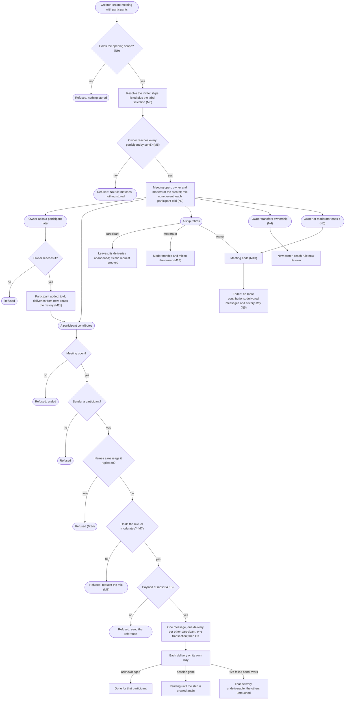
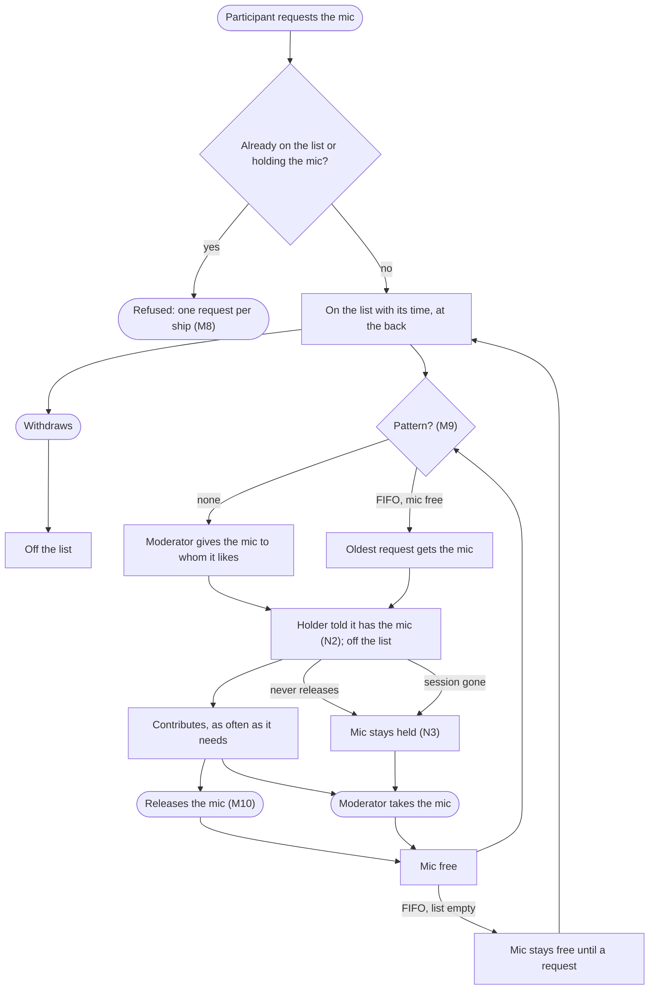
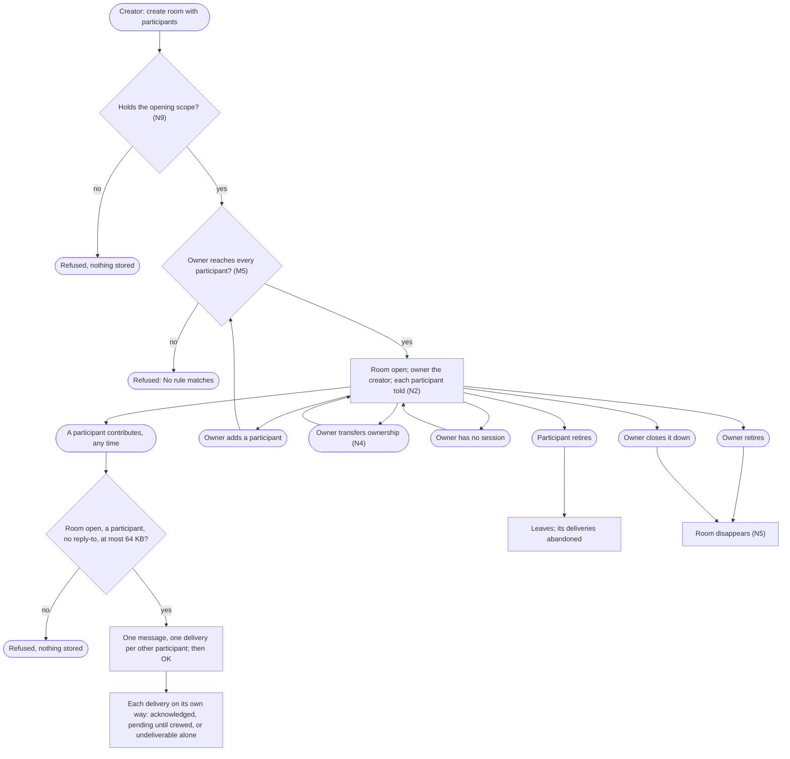

# Meetings: ships and people in one moderated conversation

Design for [#1168](https://github.com/ThomasHendrickx/aeolus-fleet/issues/1168), Aeolus 0.31.0. Docs only. Purpose, lessons, Thomas's decisions, the flows, the gaps and the open questions.

## 1. Purpose (agreed by Thomas)

Several ships, people's ships among them, hold one shared conversation: everything one participant says reaches every other participant under the delivery promise, and one participant, the moderator, decides who speaks, while Aeolus refuses anyone else. Two parts share most of their logic (Thomas, Q1): a meeting, finite in time with everyone present at once, and a lasting, async conversation of many participants (its name is Q1). No recurrence now.

The first use case: Thomas (his person ship), four heads of agents (marketing, commercial, product, engineering) and a chief of staff agent that moderates and holds the mic. Round robin first: the chief of staff gives the mic to each head in turn; a head with nothing to say passes and is skipped; a head may ask for the mic.

The outcomes:
1. Each contribution is stored once and delivered to every other participant, each delivery with its own state; the sender gets OK only once every delivery is stored.
2. In a meeting, only the participant holding the mic, and the moderator, contribute; anyone else is refused and may request the mic.
3. The moderator decides who speaks next. Aeolus carries the conversation and enforces the mic; it never picks a speaker.
4. A participant crewed again, late or after a crash, gets what it missed with no human passing ids.
5. Who may open a meeting, and whom it may invite, is scope and reach, visible like every other rule.

Not the purpose: Aeolus choosing speakers, summarising or reading payloads; outside parties (0060) in a meeting; meetings across fleets.

## 2. Lessons to check against

From other multi-agent group chats:

| # | Lesson | Source |
| --- | --- | --- |
| L1 | If every participant answers every message the chat floods or loops; working setups have a moderator or a turn rule | AutoGen [teams](https://microsoft.github.io/autogen/stable/user-guide/agentchat-user-guide/tutorial/teams.html) (round robin) and [SelectorGroupChat](https://microsoft.github.io/autogen/stable/user-guide/agentchat-user-guide/selector-group-chat.html); CrewAI [hierarchical process](https://docs.crewai.com/concepts/processes) (a manager agent); Slack [bot_message](https://api.slack.com/events/message/bot_message), which bots skip to avoid answering each other |
| L2 | Cost grows with the square: every message is read by every participant | MetaGPT's shared message pool with subscriptions ([arXiv 2308.00352](https://arxiv.org/abs/2308.00352)) |
| L3 | An outcome-aimed meeting needs a stop condition and an owned result | AutoGen [termination conditions](https://microsoft.github.io/autogen/stable/user-guide/agentchat-user-guide/tutorial/termination.html); "Why do multi-agent LLM systems fail?" ([arXiv 2503.13657](https://arxiv.org/abs/2503.13657)): missing termination and unverified results among the top failures |
| L4 | One participant's message is another's input: who may join and speak stays under scopes and network rules | arXiv 2503.13657 (role disobedience, one agent steering another); 0034, 0046 |
| L5 | Sessions come and go: a late or restarted participant needs what was said, and the promise holds per participant | arXiv 2503.13657 (conversation reset, lost history); 0001, 0040 |

From Aeolus:

- **Promise (blueprint, 0001, 0040).** No message lost, OK only once stored, acknowledged means received; per participant, so one participant's undeliverable, overdue or stuck delivery never touches another's.
- **Not an orchestrator, no policy (blueprint, 0016).** The moderator, a ship, decides; the mic is state an actor sets, not a rule Aeolus invents. Content-blind: whatever Aeolus enforces sits on the envelope, never in the payload.
- **The fleet never speaks for a ship (wake-a-person, I-1).** Giving the mic, passing and asking are sent by a ship.
- **Scope says what, reach says where (0034, 0046, 0057).** Opening needs a scope, inviting needs reach (Thomas, on #1168: "It requires to send an invite only to those in reach"). No hidden behaviour: any reach a meeting gives shows as a rule. No rights travel with a message.
- **A person reads slower than agents speak (Thomas, on #1172).** Agents go back and forth fast; a person in the loop must not miss the mic because they need more time to read.
- **Person ships (0044, 0052, 0054).** Thomas takes part as his person ship through the gateway, never as argo: ordinary work never routes to argo (0053). A person ship runs no clocks (0040).
- **Addressing today.** A selector is `ship` or `type`; a type is one delivery that one ship of the type claims, not a fan-out. The blueprint defers n-to-n addressing with its hook: "Selector with a kind, one delivery row per recipient". #976: the name for a set of ships is chosen here; Thomas: "Maybe call by label?".
- **Terms taken.** `turn` is a pushed session's idle or busy (0040); `channel` is what a hand-over went through (0040, wake-a-person W6); `group` is pagasae's group of accounts (0052). This design uses meeting, participant, moderator and mic, Thomas's words.
- **Pre-1 (0013).** Breaking changes allowed, no compatibility work.

## 3. Decisions (Thomas, 24 Oct, on #1172)

| # | Rule |
| --- | --- |
| M1 | **Two parts, sharing most logic.** A meeting: finite in time, everyone present at once, moderated with the mic. A room: lasting and async, no mic and no moderator. No recurrence now |
| M2 | **Owner.** A meeting or room has one owner, always one ship: its creator at first; the owner transfers ownership to another ship. An owner without a session changes nothing: the meeting or room goes on |
| M3 | **Moderator** (meeting only). Always one, the creator at first; it may change while the owner stays another ship |
| M4 | **Opening takes a scope; joining takes none** |
| M5 | **Reach is the owner's.** The owner must reach each participant when it is added, always; inside, participants talk to each other whatever their own reach ("If the owner ship X can reach ship A and B, but ship A cant reach ship B, they both can still be in the same meeting") |
| M6 | **Invite** by a list of ships, a label selection resolved into the list, or both |
| M7 | **The mic** (meeting only). Aeolus refuses a contribution from a participant without the mic, storing nothing |
| M8 | **Mic requests live on the meeting, never as messages.** A request keeps its time; one per ship; a ship withdraws its own and leaves the list; a new request goes to the back |
| M9 | **Pattern.** The moderator gives the mic to whom it likes, or sets a pattern so it does not become the bottleneck: FIFO gives it to the oldest request. A ship that requests again after speaking makes FIFO a round robin |
| M10 | **Releasing the mic.** The holder says it no longer needs it (a person done reading, say) |
| M11 | **A late participant** gets deliveries from joining on and reads the meeting's messages so far |
| M12 | **No outcome required.** The moderator may contribute one before the meeting ends |
| M13 | **Retired ships.** A participant leaves. A retired moderator's moderatorship and mic go to the owner. A retired owner stops the meeting; a room whose owner retired disappears. The room's owner closes it down |
| M14 | **No replies to a specific message** in a meeting or room, not today |
| M15 | **A person** takes part under the same rules through the gateway. An agent acting as the person through the gateway's MCP may request the mic after each of the person's contributions. This answers the reading-time flag: a request stays on the list until it is served or withdrawn, so a slow reader loses no place |
| M16 | **0.31.0** ships both invites (M6) and the gateway view |

## 4. Flows

A meeting, from creation to its end.

The mic, inside an open meeting.

A room: no mic and no moderator.

## 5. Gaps in today's fleet

| Today | Gap |
| --- | --- |
| Selector `ship` or `type`; one message, one delivery (or one claimed delivery for a type) | A meeting or room as the selector; one message to many deliveries in one transaction. A type is never a participant |
| Send reach checked sender to recipient at send time | Reach checked owner to participant when added (M5), shown as a built-in rule |
| Answer rule: a ship can always answer its sender | Whether it covers a contribution (N7) |
| No meeting, room, participant, mic or request list | New in core, with `fleet_id`, an id prefix and events |
| Scopes: messages, fleet, crew, labels, scopes | The opening scope (N9) |
| A ship reads its own inbox and sent | A participant reading the meeting's or room's messages (M11) |
| Label selection exact and AND, in the fleet list | Resolving one at invite (M6) |
| Ship protocol, plugin scripts, core MCP tools: send to ship or type | Contribute, request, withdraw and release the mic |
| Gateway: inbox per delivery | A meeting and room view, and the mic calls for a person (gateway train) |
| Pushed sessions: each delivery wakes the session | Every contribution wakes every participant (L2); accepted at six |

## 6. Questions

| # | Question | Options | Pick and why |
| --- | --- | --- | --- |
| N1 | Does the moderator contribute without the mic | 1. Yes, always. 2. Only with the mic, like anyone | **1.** It runs the meeting (opening, closing, an outcome, M12) without queueing behind the list |
| N2 | How a ship learns it was added, got the mic, or the meeting ended | 1. A delivery to that ship (all participants for an end), from the ship that caused it: the owner for added and ended, the moderator for the mic, FIFO included since the moderator set it; Aeolus content types, the meeting's id on the envelope. 2. Nothing pushed: participants read the meeting | **1.** A pushed session wakes only on a delivery; without one an agent never learns it holds the mic. Sent as the causing ship, so the fleet never speaks for a ship. Only the holder hears a mic change (L2) |
| N3 | A held mic never released (holder busy, session gone) | 1. No limit; the moderator takes it. 2. A time limit in the pattern | **1.** Small; the moderator is told nothing, so it watches; a limit comes when a meeting shows the need |
| N4 | Transfers | 1. Owner and moderator both name a participant; the owner names the moderator; a meeting's owner transfers as a room's does. 2. Any ship, participant or not | **1.** Shared logic for both parts; an owner outside its meeting is odd, and the new owner must reach the participants it adds from then on |
| N5 | What ended and disappeared keep | 1. No more contributions or participants; messages, their deliveries (pending ones still delivered) and the history stay, read by former participants. 2. Deleted | **1.** A stored message is delivered whatever changes later (0034); nothing in Aeolus deletes history but a fleet's deletion |
| N6 | Who ends a meeting | 1. Owner or moderator. 2. Owner only | **1.** The moderator knows when the outcome is reached (M12); the owner keeps the last word |
| N7 | The answer rule on a contribution | 1. Off: a contribution gives no one-to-one answer reach. 2. On, as for any message | **1.** M5 lets A and B talk in a meeting though A cannot reach B; the answer rule would turn that into one-to-one reach no rule shows |
| N8 | A participant leaving by itself | 1. It may; an owner transfers first; a moderator leaving gives moderatorship to the owner. 2. Only the owner removes | **1.** A ship released for good should not hold deliveries open in a meeting it no longer serves |
| N9 | The opening scope | 1. `meetings:open` and `rooms:open`. 2. One for both | **1.** Two parts; an organisation may allow rooms widely and meetings to a few |
| N10 | Presence in a meeting ("everyone present at once") | 1. Not checked; the meeting read shows each participant's status (crewed or awaiting crew). 2. Opening refused until all are crewed | **1.** Who must be there is the moderator's call; status is what any ship sees outside read reach (0034) |
| N11 | What 0.31.0 ships first | 1. Meeting only; the room in the next minor. 2. Both | **1.** The first use case is a meeting and 0.31.0 stays small; the room reuses its parts minus the mic |
