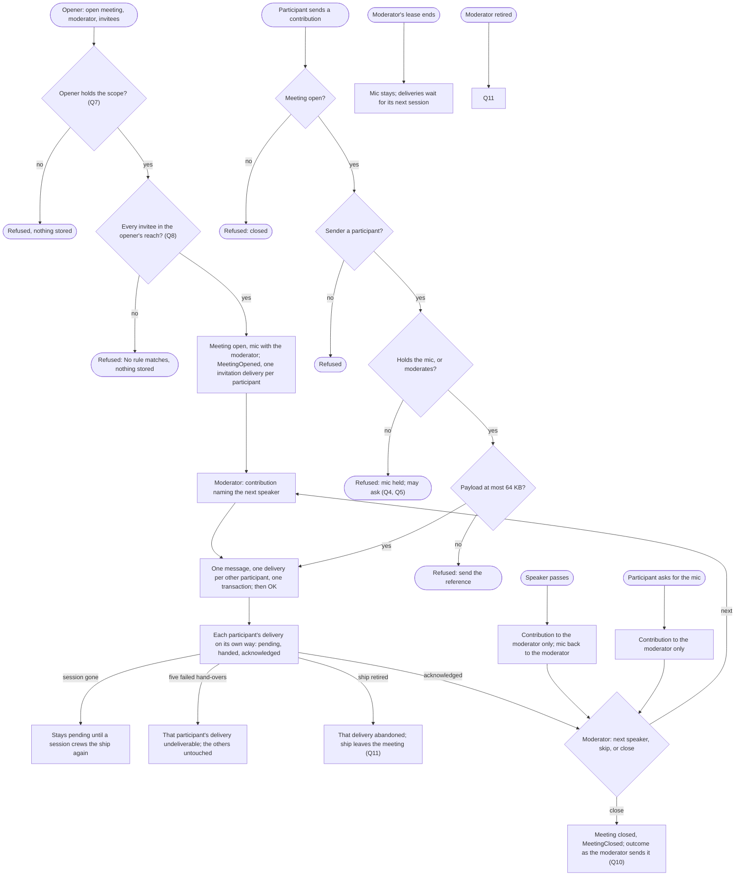

# Meetings: ships and people in one moderated conversation

Design for [#1168](https://github.com/ThomasHendrickx/aeolus-fleet/issues/1168), Aeolus 0.31.0. Docs only. Step one: purpose, lessons, a greenfield sketch, the gaps and the questions. No detailed decisions before Thomas agrees the purpose.

## 1. Purpose (to agree)

Several ships, people's ships among them, hold one shared conversation: everything one participant says reaches every other participant under the delivery promise, and one participant, the moderator, decides who speaks, while Aeolus refuses anyone else. A meeting is aimed at an outcome and ends, or is permanent; that is the only difference between the two.

The first use case: Thomas (his person ship), four heads of agents (marketing, commercial, product, engineering) and a chief of staff agent that moderates and holds the mic. Round robin first: the chief of staff gives the mic to each head in turn; a head with nothing to say passes and is skipped; a head may ask for the mic.

The outcomes:
1. Each contribution is stored once and delivered to every other participant, each delivery with its own state; the sender gets OK only once every delivery is stored.
2. Only the participant holding the mic, and the moderator, contribute; anyone else is refused and may ask for the mic.
3. The moderator decides who speaks next. Aeolus carries the conversation and enforces the mic; it never picks a speaker.
4. A participant crewed again, late or after a crash, gets what it missed with no human passing ids.
5. Who may open a meeting, and whom it may invite, is scope and reach, visible like every other rule.

Not the purpose: Aeolus choosing speakers, summarising or reading payloads; outside parties (0060) in a meeting; meetings across fleets.

## 2. Lessons to check against

From other multi-agent group chats:

| # | Lesson | Source |
| --- | --- | --- |
| L1 | If every participant answers every message the chat floods or loops; working setups have a moderator or a turn rule | AutoGen [teams](https://microsoft.github.io/autogen/stable/user-guide/agentchat-user-guide/tutorial/teams.html) (round robin) and [SelectorGroupChat](https://microsoft.github.io/autogen/stable/user-guide/agentchat-user-guide/selector-group-chat.html); CrewAI [hierarchical process](https://docs.crewai.com/concepts/processes) (a manager agent); Slack [bot_message](https://api.slack.com/events/message/bot_message), which bots skip to avoid answering each other |
| L2 | Cost grows with the square: every message is read by every participant | MetaGPT's shared message pool with subscriptions ([arXiv 2308.00352](https://arxiv.org/abs/2308.00352)) |
| L3 | An outcome-aimed meeting needs a stop condition and an owned result | AutoGen [termination conditions](https://microsoft.github.io/autogen/stable/user-guide/agentchat-user-guide/tutorial/termination.html); "Why do multi-agent LLM systems fail?" ([arXiv 2503.13657](https://arxiv.org/abs/2503.13657)): missing termination and unverified results among the top failures |
| L4 | One participant's message is another's input: who may join and speak stays under scopes and network rules | arXiv 2503.13657 (role disobedience, one agent steering another); 0034, 0046 |
| L5 | Sessions come and go: a late or restarted participant needs what was said, and the promise holds per participant | arXiv 2503.13657 (conversation reset, lost history); 0001, 0040 |

From Aeolus:

- **Promise (blueprint, 0001, 0040).** No message lost, OK only once stored, acknowledged means received; per participant, so one participant's undeliverable, overdue or stuck delivery never touches another's.
- **Not an orchestrator, no policy (blueprint, 0016).** The moderator, a ship, decides; the mic is state an actor sets, not a rule Aeolus invents. Content-blind: whatever Aeolus enforces sits on the envelope, never in the payload.
- **The fleet never speaks for a ship (wake-a-person, I-1).** Giving the mic, passing and asking are sent by a ship.
- **Scope says what, reach says where (0034, 0046, 0057).** Opening needs a scope, inviting needs reach (Thomas, on #1168: "It requires to send an invite only to those in reach"). No hidden behaviour: any reach a meeting gives shows as a rule. No rights travel with a message.
- **Person ships (0044, 0052, 0054).** Thomas takes part as his person ship through the gateway, never as argo: ordinary work never routes to argo (0053). A person ship runs no clocks (0040).
- **Addressing today.** A selector is `ship` or `type`; a type is one delivery that one ship of the type claims, not a fan-out. The blueprint defers n-to-n addressing with its hook: "Selector with a kind, one delivery row per recipient". #976: the name for a set of ships is chosen here; Thomas: "Maybe call by label?".
- **Terms taken.** `turn` is a pushed session's idle or busy (0040); `channel` is what a hand-over went through (0040, wake-a-person W6); `group` is pagasae's group of accounts (0052). This design uses meeting, participant, moderator and mic, Thomas's words.
- **Pre-1 (0013).** Breaking changes allowed, no compatibility work.

## 3. Greenfield sketch

As if nothing existed. Parts:

- **Meeting** (core). Fleet, id, moderator, participants, who holds the mic, open or closed, aimed at an outcome or permanent. Every change an event in its transaction.
- **Participant** (core). A ship of the meeting: agent, person or app. Each has its own deliveries.
- **Contribution** (core). A message whose selector is the meeting: stored once, one delivery per other participant, all in one transaction.
- **Mic** (core). On the meeting: one participant, or none. The moderator gives and takes it by a contribution whose envelope names the next speaker, so every participant hears the change and the speaker is woken by an ordinary delivery. A pass or an ask is a contribution from a participant, to the moderator only.
- **Moderator** (a ship). Decides the order (round robin first), whom to skip, when to close and what the outcome is. Aeolus only checks that a contribution's sender holds the mic or moderates.
- **Gateway pages** (gateway train). A person sees the meeting and contributes, passes or asks from it.

Who does what: the opener opens and invites; the moderator gives and takes the mic and closes; a participant contributes while it holds the mic, passes, or asks; Aeolus stores, fans out, enforces the mic and keeps the history.

The backbone: one contribution, happy and unhappy paths.

## 4. Gaps in today's fleet

| Today | Gap for the sketch |
| --- | --- |
| Selector `ship` or `type`; one message, one delivery (or one claimed delivery for a type) | A meeting selector; one message to many deliveries in one transaction. Type stays competing, never a participant |
| Send reach checked sender to recipient at send time | The reach between participants inside a meeting (Q8), shown as a rule |
| Answer rule: a ship can always answer its sender | An answer inside a meeting goes to the meeting or stays one to one (Q12) |
| No meeting, participant or mic; no events for them | All new in core: table with `fleet_id`, id prefix, events |
| Scope catalogue: messages, fleet, crew, labels, scopes | A scope to open and moderate (Q7) |
| Threads only by `inReplyTo`; a ship reads its own inbox and sent | A participant reading the meeting's history (Q9) |
| Label selection exact and AND, in the fleet list | Inviting by label (Q6, #976) |
| Ship protocol: answer by senderName | Rules for a participant: contribute only with the mic, pass when there is nothing to say |
| aeolus plugin scripts and core MCP tools: send to ship or type | A meeting selector, pass and ask |
| Gateway: inbox per delivery, `aeolus_send` to a ship | A meeting view and contribute, pass, ask for a person (gateway train) |
| Console: Health, stuck and Needs attention per delivery | Unchanged per delivery; a meeting's deliveries count once per participant. A meeting page for argo is not needed for the first use case |
| Pushed sessions (trierarch): each delivery wakes the session | Every contribution wakes every participant (L2); accepted for six participants |

## 5. Questions

| # | Question | Options | Pick and why |
| --- | --- | --- | --- |
| Q1 | One term or two | 1. Meeting, aimed at an outcome or permanent. 2. Meeting and channel | **1.** Thomas: "it can be both aimed for outcome but also permanent": one part. `channel` is 0040's hand-over channel |
| Q2 | Name for the right to speak | 1. Mic. 2. Turn. 3. Floor | **1.** Thomas's word ("holds the mic"); `turn` is 0040's |
| Q3 | Who enforces the mic | 1. Aeolus refuses a contribution without the mic; the moderator sets it. 2. A ship convention, Aeolus carries only. 3. Aeolus picks the speaker | **1.** A convention fails exactly when an agent floods (L1). The mic is state a ship sets, visible as events, so no policy (0016). 3 makes Aeolus an orchestrator |
| Q4 | A contribution without the mic | 1. Refused, nothing stored. 2. Stored and held for the moderator | **1.** Nothing half-sent; asking is its own contribution (Q5) |
| Q5 | Asking and passing | 1. Both a contribution to the moderator only; a pass gives the mic back. 2. To every participant. 3. A flag on the participant, no message | **1.** The moderator is woken by an ordinary delivery and the others are not paid for it (L2); a flag alone wakes no one. Thomas: "A ship key flag request to speak" read as the ask |
| Q6 | How a meeting invites (#976) | 1. A list of ships. 2. A label selection resolved into a list at invite. 3. A label selection kept live (joins as ships gain the label). 4. A new selector kind for a set of ships | **1 and 2.** The participants stay a list, every change an event; a label saves typing the four heads. 3 waits for a permanent meeting that needs it; 4 adds a second way to name a set beside labels |
| Q7 | Who may open | 1. A new core scope `meetings:open` (moderating with it). 2. `messages:send` alone. 3. Under `messages` | **1.** Thomas: "Scope allow to start a meeting?". Its own namespace keeps meeting calls apart from messages |
| Q8 | Reach inside a meeting | 1. Invite checked on the opener's send reach; participants then reach each other in the meeting by a built-in rule, shown first. 2. Every contribution checked sender to each participant | **1.** Thomas: "send an invite only to those in reach". 2 refuses a whole meeting for one pair and maps the rules. A built-in rule keeps it visible (0034) |
| Q9 | A participant who joins late | 1. Deliveries from joining on, and a read of the meeting's messages for participants. 2. Every earlier message delivered. 3. Nothing earlier | **1.** Restarts are covered by pending deliveries already (L5); history is a cheap pull, not n more deliveries |
| Q10 | What an outcome-aimed meeting leaves | 1. Nothing required; the moderator may send an outcome contribution of its own content type before closing. 2. Close requires an outcome reference | **1.** Thomas: "No idea if a meeting needs to leave behind someone by definition". The moderator owns it (L3) without Aeolus reading it |
| Q11 | The moderator or a participant retired | 1. A retired participant leaves; a retired moderator's meeting stays open with the mic taken, and the opener's owner is told and may name a new moderator. 2. The meeting closes | **1.** A permanent meeting outlives one ship; the owner answers for trouble (0045) |
| Q12 | `inReplyTo` a contribution | 1. To the meeting it is a contribution (mic needed); to a ship it is one to one as today. 2. Always to the meeting | **1.** Side conversations stay possible and today's answer rule unchanged |
| Q13 | A person in a meeting | 1. Same rules as any participant, through the gateway's pages. 2. A person may always contribute | **1.** One rule; Thomas can still message the chief of staff one to one, or moderate himself |
| Q14 | What 0.31.0 ships | 1. Q1 to Q13 for a list invite, with the gateway view. 2. Agents only first, gateway later | **1.** The first use case has Thomas in it; label invite (Q6.2) only if it stays small |

