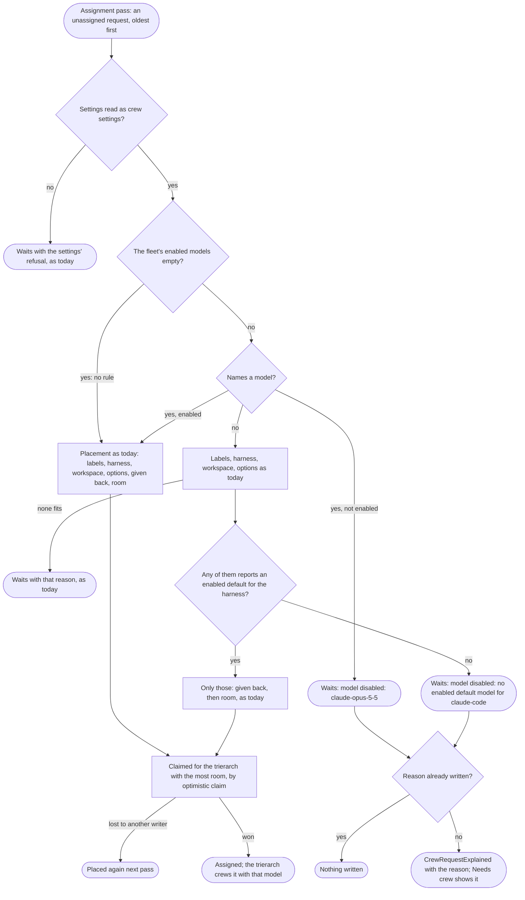

# Model governance: the models a fleet may run

Design for [#375](https://github.com/ThomasHendrickx/aeolus-fleet/issues/375), Aeolus 0.32.0. Docs only. Stage 2: purpose and lessons as agreed, Thomas's answers as rules, the flows and the slices.

## 1. Purpose (agreed by Thomas, 25 Oct)

A fleet's operator says, in one place, which models the fleet's agent ships may be crewed with. Machines keep saying what they can run (#365); the fleet's choice of what it may run sits on top of that, held by the trierarch plugin, never by the machines (Thomas, #375).

For whom: the operator and the fleet managers who answer for what the fleet's sessions cost and which vendors' models they use. Second: everyone who requests a crew, who should only be offered what they may pick.

A good outcome:
1. A fleet that sets nothing behaves exactly as today (opt-in, empty by default, #375).
2. No new session starts on a model the fleet disabled, whichever door the crew request came through (console, MCP, REST, a squadron's template).
3. A crew request held back for it says so: the reason "model disabled" in the operator's needs-crew to-do, as any placement reason.
4. The console's crew forms (request a crew, commission, form a squadron) leave disabled models out.
5. Nothing running is stopped (#375).

Not the purpose: proving which model a session really runs (self-reported, 0018); limits or budgets per model; choosing models across fleets (that would be policy for everyone, #365 investigation); changing what a machine reports.

## 2. Lessons to check against

| # | Lesson | Source |
| --- | --- | --- |
| L1 | Aeolus adds no protective rules unless the operator asks. So this is the operator's own rule, opt-in, empty by default. | [0016](../../decisions/0016-no-policy.md); #375 |
| L2 | What a machine can run is detected and never filled in by hand; a model the harness refuses is dropped for that harness version. Governance filters on top of the report, never edits it. | #365, #382, #392; aeolus-fleet-trierarch `docs/trierarch.md`, "Detected options" |
| L3 | The plugin's database holds per fleet only its connection and switch. Storing the fleet's choice there amends 0030; Thomas picked that over a fleet setting in core. | [0030](https://github.com/ThomasHendrickx/aeolus-fleet-trierarch-plugin/blob/main/docs/decisions/0030-trierarch-plugin.md); #365 investigation, section 4, pick (a); #375 |
| L4 | Core never acts on crew settings: a request naming any model is accepted. Why it waits is placement's to write, a reason of at most 200 characters (`CrewRequestExplained`), rewritten only when it changes. So the plugin is the one guard; the console forms are a convenience. | [0029](../../decisions/0029-crew-request.md); trierarch plugin `core/assignment/placement.ts` |
| L5 | A declared option with a value the harness does not offer does not fit: "running another model silently would be wrong". | [0027](../../decisions/0027-crew-settings.md); #366 |
| L6 | A request may name no model. Claude Code's model option has no default, so the session runs whatever the harness picks; Codex's default is the model in its `config.toml`, else the first confirmed one. | `docs/trierarch.md`, "Detected options" |
| L7 | Model ids change with each harness release: Claude Code's aliases (`fable`, `opus`, `sonnet`) resolve to the latest exact id of their family, and machines on different versions report different ids. | `docs/trierarch.md`, "Detected options"; #383 |
| L8 | The model a ship states is self-reported. The plugin already compares it with the request's model and tells argo once, observing only. | 0018; trierarch plugin `core/assignment/tell-model-mismatches.ts` |
| L9 | A final assignment is never moved; a request given back before then is placed again, leaving out the trierarchs that gave it back. | 0030; 0029 |
| L10 | Requests reach the fleet through more than the console: `fleet_crewRequest` over MCP and REST, and squadron templates with `crew.model`. | 0004; #387 |
| L11 | The three crew forms build their model list from the machines' reports alone, as the union of each harness's `model` values (`offersOf`). | `packages/console/lib/crew-settings-form.ts` |
| L12 | The plugin's state-changing calls take `fleet:manage`, through the console session checked against the fleet. | trierarch plugin `adapters/trpc/router.ts` (`managing`) |
| L13 | Before 1.0.0, keep it minimal: no compatibility work. | [0013](../../decisions/0013-breaking-changes-before-1-0.md) |

## 3. Rules (Thomas, 25 Oct: Q1 2, Q2 1, Q3 2, Q4 1, Q5 1)

| # | Rule |
| --- | --- |
| M1 | **The fleet's enabled models.** Per fleet, a set of exact model ids (Q1, Q2), each taken by common's `modelSchema`, the rule a send's model meets. An empty set is no rule: placement and the forms are as today. A set with one id or more is the rule: only its models are placed. An id no trierarch reports may be in it |
| M2 | **Stored in the trierarch plugin's database**, a table `enabled_models` (`fleet_id`, `model`), amending 0030's "only each fleet's connection and switch". Deleting the fleet from the plugin forgets them with its connection and switch; switching the plugin off keeps them |
| M3 | **Placement.** In a fleet with a rule, a request that names a model (`options.model`) not in the set waits with the reason `model disabled: <id>`, checked first, before any trierarch. A request that names none fits only a trierarch whose reported default for that harness (`options.properties.model.default`) is in the set; a harness with no default or no model option does not fit; when no trierarch is left, it waits with `model disabled: no enabled default model for <harness>` (Q3). The rest of placement is unchanged |
| M4 | **The check before a request** (#245) answers by the same rules, refused with the field `options` and the same reason, so the forms show it before anything is requested |
| M5 | **Only placing is checked** (Q4). An assigned request, a restart after a crash, and a ship its trierarch crews again keep their model; a request given back is placed under the rule. A change takes effect at the plugin's next assignment pass; requests waiting for another reason get the new one then, and a request waiting on `model disabled` is placed once its model is enabled |
| M6 | **Who.** Reading the set: every signed-in operator of the fleet, viewer included. Enabling and disabling a model: `fleet:manage`, through the plugin's `managing` procedures (Q5). Both answer the same set; enabling an enabled id or disabling one not in the set changes nothing |
| M7 | **The Models section on the Trierarchs page** (Q5). One row per model id that a trierarch reports or the set holds: ModelTag, the harnesses that report it, how many machines report it ("no trierarch reports it" when none), and a Switch. With no rule the section says "Every model is allowed. Enable a model to allow only the enabled ones."; with one, "Only enabled models are placed. Crews already running keep their model." Turning on the first model and turning off the last change the whole fleet, so each asks in a confirm Dialog first; every other Switch is instant. A viewer sees the Switches disabled |
| M8 | **The crew forms** (request a crew, commission, form a squadron) offer, in a fleet with a rule, only enabled models; the default is the reported default when it is enabled, else the first enabled value; a harness with no enabled model is left out. Editing a request whose model is now disabled offers the enabled ones |
| M9 | **What the stated model does** is unchanged: it is self-reported (0018) and the mismatch tell (L8) still compares it with the request's model. A session that switches to a disabled model is not stopped or told |
| M10 | **Docs.** A decision "Model governance" with the next free number in the plugin repository (rule, why, rejected: a deny list, families, a fleet setting in core, taking back assigned requests), its line in both decision indexes, 0030's database sentence amended, the trierarch plugin's glossary line in the blueprint naming the fleet's enabled models, the reasons in aeolus-fleet-trierarch's `docs/trierarch.md`, "Assignment", and the console's minimum plugin version in `docs/compatibility.md` |

Not in 0.32.0: who changed the set and when (the plugin keeps no events); a tell to argo when a model is disabled while requests name it (the needs-crew to-do already lists them with the reason).

## 4. Flows

### Placing a request (one assignment pass)



### Enabling or disabling a model

```mermaid
flowchart TD
  op(["Operator flips a model's Switch on the Trierarchs page"]) --> edge{"First enabled, or last disabled?"}
  edge -->|yes| confirm{"Confirm Dialog"}
  confirm -->|Cancel| none(["Nothing changes"])
  confirm -->|confirmed| call
  edge -->|no| call["models.enable or models.disable with the exact id"]
  call --> served{"Plugin serves and is connected to the fleet?"}
  served -->|"off"| f1(["FORBIDDEN; Switch returns; inline error"])
  served -->|"not connected"| f2(["PRECONDITION_FAILED; inline error"])
  served -->|yes| scope{"fleet:manage?"}
  scope -->|no| f3(["FORBIDDEN; viewer never gets here, the Switch is disabled"])
  scope -->|yes| valid{"An id modelSchema takes?"}
  valid -->|no| f4(["BAD_REQUEST, nothing stored"])
  valid -->|yes| store["Row inserted or deleted in one statement; already so changes nothing"]
  store -->|"database fails"| f5(["Error, nothing stored; Switch returns; Try again"])
  store -->|stored| answer(["Answers the fleet's set; the next assignment pass places by it"])
```

### A harness update changes an id

A trierarch's Claude Code moves `opus` from `claude-opus-5-5` to `claude-opus-5-6`. The new id shows in the Models section with its Switch off, and `claude-opus-5-5` shows "no trierarch reports it" once every machine moved. Requests naming `claude-opus-5-5` wait, as today, with "no trierarch takes these options"; requests naming `claude-opus-5-6` wait with `model disabled: claude-opus-5-6` until the operator enables it. Running crews keep going (M5).

## 5. Slices (0.32.0)

Each slice ends on its tests, by name.

1. **The trierarch plugin applies the fleet's enabled models** (aeolus-fleet-trierarch-plugin). M1 to M6 and M10's plugin docs: the `enabled_models` table and migration, forgotten with the fleet, `models.list`, `models.enable` and `models.disable`, placement and the check before a request. Tests: placement units for no rule, a named disabled model, a named enabled one, no model with an enabled default, no default, no model option, a request given back; the check answering the same reason; the Testcontainers test of the table, including forgetting the fleet; the procedures refusing a viewer, a plugin switched off and one not connected.
2. **The console: the Models section and the crew forms** (aeolus-fleet). M7, M8 and M10's core docs, after slice 1's release: the section on the Trierarchs page with its two confirm Dialogs, desktop and phone, and the forms' offers filtered. Tests: the offers with and without a rule (default enabled, default disabled, a harness left out); the section's states (no rule, a rule, an id no trierarch reports, a viewer); a Playwright walk enabling the first model and seeing a form offer only it.
