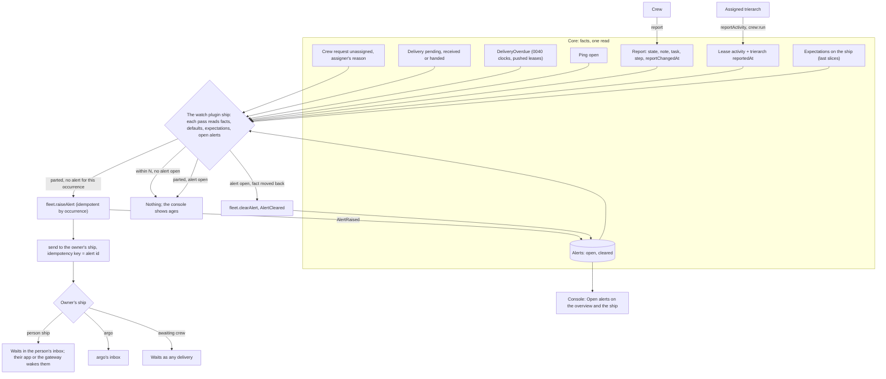

# Monitoring: the owner sees when distribution or progress stops

Design run for Thomas's "Go" of 30 Oct 2026 to monitoring in Aeolus: not handling execution, monitoring it. Stage 3: Thomas approved the screens and answered stage 2's questions (section 3); the task is a typed reference (4.2), expectations are set through the ship API (4.7) and every message the design sends has its contract (4.9). No question is open.

## 1. Purpose (agreed)

Aeolus is responsible for distribution, not execution (blueprint, Purpose; 0001). Monitoring keeps that line: Aeolus shows facts that ships declare or the trierarch observes, the owner of a ship sets what they expect of it, and Aeolus tells the owner when a fact and an expectation part. It never decides what a ship does next, never retries work and never steps in.

For whom: the owner of a ship (a person's ship, or argo where argo owns it, 0045), who answers for it and today learns that something stopped only by looking.

**What is true after:**

1. **Distribution signals.** The owner of a ship is told, once per occurrence, when:
   - its crew request has been unassigned for N minutes (no trierarch took it, and why, as the assigner wrote it);
   - a delivery to it has gone unacknowledged for N minutes, the ship awaiting crew included;
   - its crewed ship has not answered a ping for N minutes.
2. **Progress, declared.** A crew's report gains a task reference (the issue or PR it works on, or the message that asked) and an optional step x of y. The ship shows when its report last changed, apart from when its crew last called the fleet (last seen).
3. **Progress, observed.** The activity the trierarch already observes per session (headless design, S4, H14: the latest event's time and kind, no content) reaches the ship's own progress, beside what the crew declares.
4. **Expectations, if possible.** The owner, or a ship the fleet's rules let manage it, sets per ship through the ship API (tRPC, REST, MCP), never needing the console, what they expect: its report changes within N minutes, its task is done by T. A breach tells the owner, once, and clears by itself when the fact moves. Expectations come last and never block points 1, 2, 3 and 5: if they prove too hard, the rest ships without them.
5. **Shown where work is looked at.** The fleet overview shows each ship's task, step, report changed and activity ages, and any open alert. A sent message shows, per recipient, the progress of the crew whose task is that message.

**Not the purpose:**
- Acting on a signal: no retry, release, recrew, reassignment or escalation by Aeolus (0016). What the owner does is theirs.
- Reading or judging payloads, transcripts or what the work produced: Aeolus stays content-blind (sealed fleets included, 0068).
- Heartbeats that end a lease on their own (still an open decision in the blueprint).
- Charts, history of progress, or dashboards beyond the overview and the sent message.
- Reminders, quiet hours, escalation chains or channels beyond what already reaches an owner's ship.

## 2. Lessons to check against

This week's:
- **A review crew request stayed unclaimed 10 hours** (an invalid model option). The assigner wrote why (0029, 0063); nobody was told. Checked by: the unassigned signal carries the assigner's reason (4.4).
- **A deploy message went to an uncrewed ship.** The send was right to answer OK (the second promise); nobody was told. Checked by: the unacknowledged signal counts a ship awaiting crew (4.4).
- **A failed merge went unseen 3 hours.** Today `reportedAt` moves on every report call, even an unchanged one. Checked by: report changed at moves only on a change (4.1), observed activity beside it (4.3), and "report changes within N" (4.7).
- **A ship looked alive by pings while its work had stopped.** Checked by: last seen, report changed and activity are three facts, shown apart (5).

From the decisions: 0001 and 0040 (ack means received; progress stays outside the delivery promise), 0016, 0041 and 0042 (no thresholds of Aeolus's own: the owner's or a configured default), 0040 (the fleet does not speak for a ship), 0045, 0053 and 0057 (trouble to the owner, argo only as owner or fail-safe), 0028 (details stay without meaning), 0029 and 0026 (the trierarch observes, with crew:run), 0023 and 0050 (one meaning per term), 0043 (core is the fleet server and its console), 0013 (minimal), and the performance design (one paged read for the overview).

## 3. Thomas's answers

| # | Answer |
| --- | --- |
| M0 | Purpose right. Expectations "if possible yes, but this may not block the rest from being done when this would be to hard to do", and in the purpose: point 4 says so, and they are the last slices (7). |
| M1 | 3: core keeps every fact and shows it; a plugin ship, the watch, compares and tells. |
| M2 | 3: an alert message to the owner's ship, and the open alerts listed on the ship and the overview until they clear. |
| M3 | 1: alert, with expectation, breach and cleared. |
| M4 | 1: a default N per signal in configuration. "Default and we can investigate what is possible to make this more per ship later on": filed as #1407. |
| M5 | 2: an open ping unanswered for N is the signal; 0040's overdue event reaches the owner too. 0040 is changed on this PR. |
| M6 | 1: `task` and `step` are report fields core checks. |
| M7 | 1: the report changed when state, note, task or step changed; details do not count. |
| M8 | 2: activity is a lease field the assigned trierarch writes with crew:run, with the trierarch's own last report, so a trierarch that is down reads as unknown. |
| M9 | 1: expectations on the ship, standing, set by its owner. |
| M10 | 2: a working report on an idle turn is covered by "report changes within N". |
| M11 | 1: a sent message shows the recipients whose crew's task names that message. |
| MM0 | The screens approved (the mockups before the typed task, M12, and M13). |
| MM1 | The changed mockups approved: task per kind state, the optional expectations dialog with its dashed button and chip, the PR labels. |
| N1 | 1: open alerts in core, written by the watch with `fleet:alert`, read in the fleet's one read. |
| N2 | 1: a new watch plugin with its own repository and train (0049), its ship owned by argo. |
| N3 | 1: no message when an alert clears; the lists show it gone. |
| N4 | 1: activity reads unknown past twice the report interval the trierarch states with each write. |
| N5 | 1: "report changes within N" counts only while the report says working or blocked. |
| M14 | "For the design of monitoring I want to see that messages contract in all specs": every message the design sends has its full contract (4.9). |
| M12 | The task needs to say what type it is: "gh link can be full url, but message needs also to know which fleet for example, and there maybe more". A typed reference per kind (4.2). |
| M13 | "expectations setting through console needs to be something that is possible but will not be core. If a user needs to go to console for this we failed." Set through the ship API and MCP, by the owner's ship, the ship that sent the work or a template; the console dialog is optional and last (4.7, 7). |
| N6 | 1: core checks the shape of the ids only, for every fleet; no lookup of a message task. |
| N7 | 2: a task kind core does not know is taken unchecked and shown as a task of unknown type. "It is accepted but the type then just is unknown. Else this would be a blocking for potential upgrades which is against the no policy if not needed concept." |
| N8 | 1: a ship with `fleet:manage` within its manage reach may set expectations; no new scope. |
| N9 | 1: when an expectation another ship set breaks, the owner and the ship that set it are told. |
| N10 | 1: the console shows an alert message's `headline` and its `body` as markdown; other apps read the same two fields. |

## 4. The design

### 4.1 Report: task, step, changed at (core)

- A report gains `task`, optional: a typed reference, a `kind` and that kind's fields (4.2); and `step`, optional: `{ at, of }`, whole numbers with 1 ≤ at ≤ of ≤ 1000. Core checks both; a bad one is refused with nothing changed. Omitted keeps the held value, `null` clears it, as `note` does.
- `reportChangedAt` on the lease: set when state, note, task or step differs from what the lease held; details alone do not move it (M7). `reportedAt` keeps moving on every call (last seen stays its own fact).
- `ShipReported` keeps its rule (any change, details included) and carries task, step and whether the report changed, so a details-only change is told apart without a second event.
- Task and step belong to the lease, as the report does (0028): a release or recrew drops them.

### 4.2 The task: a typed reference (core)

The task is a reference to where the work lives, never its content. It is one kind with that kind's fields, so a reader knows what it points at without parsing a string, and a new kind is added beside the others without changing them.

| Kind | Fields | Core checks | Console shows | Console links to |
| --- | --- | --- | --- | --- |
| `url` | `url` | an absolute `https` URL, at most 512 characters; core never fetches it | a GitHub pull request or issue as `PR #1391` or `#1407` with its icon; any other URL as its host and path, cut to fit | the URL, in a new tab |
| `message` | `fleetId`, `messageId` | `flt_` and `msg_` ids of the right shape (common/src/ids), for every fleet; the message need not be one the crew received, and core does not look it up (N6) | `a message` when `fleetId` is the viewer's fleet; `a message in <fleet name>` for another fleet the viewer belongs to; otherwise `a message in flt_…` as text | the message sheet, in its fleet, when the viewer may open the message; nothing otherwise |

- A kind core does not know is taken unchecked, so a newer plugin never blocks on an older core (N7). The console shows it as `a task of unknown type`, as text with no link; its title holds the kind. A kind core holds is a core change that adds one row here, its check and its console part.
- Whether the viewer may open a `message` task is read on the server for the viewer (scopes and reach, 0057), in the same read that carries the report, as `canOpen`; the console never guesses it from the ids. A message the viewer may not open, in a fleet they do not belong to or outside their reach, shows as text: no link, no 404.
- Two tasks are the same task when their kind and every field are equal. The sent message joins on that (4.8: `message` with this fleet and this message), and `taskDoneBy` keeps the task it was set for the same way (4.7).
- Wherever the task shows, its title holds the full URL or the ids.

### 4.3 Observed activity (core, written by the trierarch)

- The lease gains `activity`: `{ at, kind, tool? }`, `kind` one of `text`, `tool`, `result`, `error` (H14's shape, no content), and `reportedAt`, when the trierarch wrote it.
- `fleet.reportActivity` (crew:run): the assigned trierarch writes the activity of the crewed ships it runs, many in one call, each only for a ship whose crew request is assigned to it (0029); any other ship is refused for that entry and the rest are taken. No event (a session's activity is not a fleet change, as turns are not events beside `TurnReported`).
- Unknown: the console and the watch read activity as unknown when its `reportedAt` is older than the trierarch's own report interval twice over, the interval the trierarch states with it (N4). Unknown is shown as "Activity unknown, trierarch last reported 25 min ago", never as stopped work.
- A ship crewed by hand has no activity: the field stays empty and the console shows nothing for it.

### 4.4 Signals and defaults (the watch)

Each signal is one fact the watch reads from core on each pass, with its default N from the watch's configuration, each fleet following it or its own value there (M4; per ship later, #1407):

| Signal | Occurrence | Default N | Clears when |
| --- | --- | --- | --- |
| Crew request unassigned | the request's settings version | 15 min | assigned, removed, or a new version |
| Delivery unacknowledged, pull lease or awaiting crew | the delivery | 15 min | acknowledged, dismissed or abandoned |
| Delivery overdue, pushed lease | the `DeliveryOverdue` (0040's clock, its own times) | none: 0040's | 0040's clear |
| Ping unanswered | the ping delivery | 10 min | answered, undeliverable, dismissed |
| Report unchanged (expectation) | the ship and its `reportChangedAt` | the owner's N | the report changes |
| Task not done (expectation) | the ship, the task and T | the owner's T | the task changes or clears |

- One alert per occurrence: a ping on a pushed lease that 0040 marks overdue is the same occurrence as its ping signal, raised once.
- The unassigned alert names the assigner's reason when one is written (0029), such as `model disabled: ...` (0063).
- The watch tells the owner of the ship at the time it raises the alert. A ship argo owns tells argo; a person ship (its own owner) is never watched for deliveries, since a person away is not stuck (0044).

### 4.5 Alerts (core holds them, the watch writes them)

- An alert: `alt_` id, the ship, the signal, the occurrence key, the owner told, the facts at raise (signal, since, N, the reason or the task), raised at, cleared at. One open per ship, signal and occurrence (unique).
- `fleet:alert` (new core scope): raise and clear alerts on the ships its ship reads. `fleet.raiseAlert` is idempotent by occurrence key (the same key answers the alert already held); `fleet.clearAlert` clears an open one; both write `AlertRaised` and `AlertCleared` in the same transaction.
- Read: each ship in the overview's one read (`fleet.list`) carries its open alert count; the fleet's open alerts, newest first, paged, are `fleet.openAlerts` (fleet:read, read reach), which the overview reads beside `fleet.list` and the watch each pass; the ship page (`fleet.ship`) carries its open ones. Cleared alerts leave the lists and stay in the ship's timeline as their events.
- A retire clears the ship's open alerts (`AlertCleared`, reason retired). A release does not: an unacknowledged delivery waits on.

### 4.6 Telling the owner (the watch)

- Raise first, then send: the watch raises the alert in core, then sends the owner's ship the alert message (4.9) (and, for an expectation another ship set, that ship one too, question N9), with the idempotency key 4.9 gives. A restart between the two sends it then, once, since the same key gives the same message.
- The watch sends nothing on clear (N3); the lists show it gone.
- A tell that goes unacknowledged is a delivery like any other; the watch raises no alert on a delivery it sent itself, so there is no loop.

### 4.7 Expectations (core holds them, the watch compares; last)

- On the ship, standing, at most one of each: `reportChangesWithin` (minutes, 5 to 10080) and `taskDoneBy` (a time, with the task it was set for, kind and fields), each with the actor that set it.
- **Set through the ship API, the normal way** (M13): `fleet.setExpectations`, one tRPC procedure that REST and MCP map onto (0004), so a ship sets them from its own session with no console. `ExpectationsSet` names the actor. Three callers, one procedure:
  - the owner's ship, for the ships it owns;
  - the ship that sends the work, such as an orchestrator setting `taskDoneBy` beside the message it sends;
  - a ship template: squadrons sets the template's expectations on each ship it commissions, as its squadrons ship with `fleet:manage` (0017).
- Who may: an actor with `fleet:manage` within manage reach (0034: the built-in owner rule gives the owner's ship its own ships; any other ship needs a manage rule that reaches the ship). No new scope (N8).
- Read back with the ship (`fleet.ship` and its MCP tool `fleet_ship`), so the setter checks what holds without the console.
- `reportChangesWithin` applies while the ship is crewed and its report is working or blocked (N5). `taskDoneBy` applies while the report names the task it was set for; once the task changes it lapses, shown as lapsed, and a new one is set.
- A breach tells the ship's owner, as every alert does (4.4), and the ship that set the expectation when it is another ship (N9).
- Expectations stay through release and recrew; a retire removes them. The crew is not told of them: they are the setter's, not instructions.
- **The console dialog is optional**: "Set expectations…" on the ship page calls the same procedure and is the last slice (W9). Without it the ship page still shows the Expectations row, read only.

### 4.8 Shown in the console (core)

- **Fleet overview.** The Report cell shows the task's label per kind (4.2), the step and the note; its title gives report changed and reported times. The Seen cell gains activity beside last seen. A ship with an open alert shows an alert badge after its status. Above the table, Open alerts: one line each, the ship, what parted, since when, "clears by itself", while any is open; nothing when none.
- **Ship page.** The report cell shows the task's label per kind, a link where the viewer may open it (4.2), the step, and "changed 42 min ago" apart from "seen 1 min ago"; an Activity line under it. Open alerts above the meta strip. Expectations as a read-only row of the meta strip; "Set expectations…" only with the optional W9.
- **Sent message.** In the message sheet's deliveries, under each recipient whose crew's task is `message` with this fleet and this message: the report state, step, note and changed age (M11). No line for a recipient working on something else.
- **Inbox.** An alert message (4.9) shows by its `headline` and its `body` as markdown, from the watch's ship, as a `text/markdown` message does (N10); a payload that is no alert shows as a plain message.

### 4.9 Message contracts

Every message the design sends, with its full contract, as 0038 gives the question's. Core sends none: it holds facts and alerts and never speaks for a ship (0040). The watch sends one kind, the alert. Nothing is sent on clear (N3), the watch asks no question of its own and expects no reply. Schemas in `@aeolus-fleet/common` (`schemas/alert.ts`), so the watch and every reader share them; content types compare without case and parameters.

#### The alert: `application/vnd.aeolus.alert+json`

- **From** the watch's ship (owned by argo, N2). **To** the ship's owner's ship (argo when argo owns the ship, 0045), and, for an expectation another ship set, that ship too (N9): one message each, never a meeting or a type selector.
- **When** the watch raises an alert in core (4.6): after `fleet.raiseAlert` answers, once per alert and recipient.
- **Idempotency key** `<alertId>` to the owner, `<alertId>:setter` to the setter: a restart or a second pass sends the same message, never a second one.
- **Headline**: the payload's `headline`, at most 80 characters, naming ships and never their ids (instruction 6), such as `merger-1: report unchanged 3 h 10 min, expected within 60 min`.
- **Payload** (JSON, at most 8 KB):

| Field | Type | Required | Meaning |
| --- | --- | --- | --- |
| `alertId` | string, `alt_` id | yes | The alert in core; read it back with the ship (`fleet.ship`) to see whether it is still open |
| `headline` | string, 1 to 80 characters | yes | The line an inbox shows first |
| `body` | string, markdown, at most 2 KB | yes | The facts in words and the ship's page link, for a reader that shows text |
| `signal` | `crew-request-unassigned`, `delivery-unacknowledged`, `delivery-overdue`, `ping-unanswered`, `report-unchanged` or `task-not-done` | yes | What parted (4.4) |
| `ship` | object: `id` (`shp_`), `name` (string) | yes | The ship the alert is on |
| `fleetId` | string, `flt_` id | yes | The fleet the ship is in |
| `toldAs` | `owner` or `setter` | yes | Why this recipient is told |
| `since` | string, ISO 8601 time | yes | When the fact parted: the request's version, the delivery, the ping, the last report change or `doneBy` |
| `raisedAt` | string, ISO 8601 time | yes | When the watch raised it |
| `facts` | object, by `signal` (below) | yes | The facts at raise |

`facts` per signal:

| `signal` | Fields (all required unless marked) |
| --- | --- |
| `crew-request-unassigned` | `settingsVersion` (integer ≥ 1), `minutes` (integer, the N), `reason` (string or `null`: the assigner's, 0029) |
| `delivery-unacknowledged` | `deliveryId` (`dlv_`), `messageId` (`msg_`), `state` (`pending`, `received` or `handed`), `awaitingCrew` (boolean), `minutes` (integer) |
| `delivery-overdue` | `deliveryId` (`dlv_`), `messageId` (`msg_`), `overdueEventId` (`evt_`, the `DeliveryOverdue`, 0040) |
| `ping-unanswered` | `deliveryId` (`dlv_`), `messageId` (`msg_`, the ping), `minutes` (integer) |
| `report-unchanged` | `reportChangedAt` (ISO 8601), `state` (`working` or `blocked`), `minutes` (integer, the expectation), `setBy` (`shp_`) |
| `task-not-done` | `task` (the typed reference, 4.2), `doneBy` (ISO 8601), `setBy` (`shp_`) |

- **Example** (to the owner):

```json
{
  "alertId": "alt_01m66p4k2v9qz8f7x3n5c1b0td",
  "headline": "merger-1: report unchanged 3 h 10 min, expected within 60 min",
  "body": "merger-1 reports **working**, *Merging to main*, PR #1391 step 2 of 3, unchanged since 12:05.\n\nExpected within 60 min, set by orchestrator-1. Clears by itself when the report changes.\n\n[merger-1](https://fleet.aeolus-fleet.dev/ships/shp_01m6...4ftc)",
  "signal": "report-unchanged",
  "ship": { "id": "shp_01m6...4ftc", "name": "merger-1" },
  "fleetId": "flt_01m6...7acm",
  "toldAs": "owner",
  "since": "2026-10-30T12:05:00Z",
  "raisedAt": "2026-10-30T13:05:20Z",
  "facts": {
    "reportChangedAt": "2026-10-30T12:05:00Z",
    "state": "working",
    "minutes": 60,
    "setBy": "shp_01m6...or1x"
  }
}
```

- **How a receiving ship handles it**:
  1. Ack on receipt, as any delivery (ack means received, 0040).
  2. It is a fact, not an instruction: what to do is the owner's call (0016), by the receiving ship's own prompt or its person. Aeolus retries, releases and recrews nothing on it.
  3. Before acting, read the alert back with the ship (`fleet.ship`): a cleared alert needs nothing, since no message says so (N3).
  4. Send no reply: the watch reads none. A reply to the watch's ship is acknowledged and dropped.
  5. A message of this type whose payload is no alert is a plain message; an unknown `signal` is shown by its `headline` and `body` and otherwise left alone, so a new signal changes no reader.
- **Sealed fleets** (0068): the payload is sealed like any other. The console's Open alerts read core's alert record, never the message.

## 5. The flow



Unhappy paths:

| What fails | What happens |
| --- | --- |
| The watch is down | No alert is raised or cleared; the console still shows every fact and its age, and the open alerts as they were. 0040's overdue still reaches argo by its event. Back up, it reads the facts anew: what parted meanwhile is raised once, what moved back is cleared. |
| The watch restarts between raise and send | The open alert has no message yet; the next pass sends with the alert id as key, so at most one message. |
| The send is refused (the watch cannot reach the owner) | The alert stays open and shows in the console; the watch retries on the next pass with the same key. Its refusal is in the watch's own log. |
| Core refuses `fleet.raiseAlert` (the ship retired meanwhile) | Nothing is sent. |
| The owner changes after the alert | The alert names the owner it told; a new occurrence goes to the new owner. A retired owner's ships fall to argo (0045). |
| The tell itself goes unacknowledged | It is a delivery; the watch never alerts on its own messages. |
| A fact flaps | Each occurrence has its own key: one alert each; a cleared one is never raised again. |
| Two watch passes at once | `fleet.raiseAlert` is unique per occurrence and the send idempotent: one alert, one message. |
| The trierarch is down | Activity reads as unknown (4.3), not as stopped; no activity alert exists, so nothing is told on it. |
| The ship is released or recrewed | Task, step and activity go with the lease; open delivery alerts stay; a report-unchanged alert clears (no crew to report). |
| The ship is retired | Its open alerts clear and its expectations go. |
| A sealed fleet | Task, step and note are metadata, readable; payloads stay sealed and the alert names no payload. |
| Expectations not built | Points 1, 2, 3 and 5 hold without them: their slices are last. |

## 6. Decisions to record on approval

- **0071 Monitoring** (new): the facts core keeps (report task, step, `reportChangedAt`; lease activity; expectations; alerts with `fleet:alert`), the watch plugin that compares and tells, one alert per occurrence, raise then send with the alert id as key, the alert message's contract (4.9) as a fleet convention in the ship protocol, no message on clear, defaults in the watch's configuration with each fleet's own value, never an action.
- **0028 Report details**, changed: the report gains checked `task` (a typed reference: a kind and its fields, 4.2) and `step`; `reportChangedAt` moves on a change of state, note, task or step, not of details.
- **0040 Delivery protocol**, changed on this PR (M5): `DeliveryOverdue` names the ship's owner and reaches the owner through the watch's alert as well as argo.
- **0029 Crew request**, changed: the assigned trierarch writes its ships' activity with crew:run.
- **Blueprint**: Alert, Expectation, Breach, Cleared and Activity in the domain language; Report changed beside Last seen; the events `AlertRaised`, `AlertCleared`, `ExpectationsSet`.
- **Watch plugin**: its own train (0049, N2), its decisions in its repository.

## 7. Slices, once approved

Expectations last (M0): W1 to W5 stand without them. Their API path (W6 to W8) comes before the console dialog (W9), which is optional (M13).

| # | Repo | Slice | Done when |
| --- | --- | --- | --- |
| W1 | aeolus-fleet | Report `task`, `step`, `reportChangedAt` in core and the ship contract; ReportLine shows them on the overview and the ship page; 0028 and 0071 recorded | Tests by name: a refused bad task or step changes nothing, details alone keep `reportChangedAt` |
| W2 | aeolus-fleet | The sent message shows each recipient whose task names it | Walked on staging |
| W3 | aeolus-fleet | Lease activity, `fleet.reportActivity` (crew:run), unknown past the stated interval; the overview's Seen and the ship's Activity line | Tests by name for an unassigned ship refused, the rest taken |
| W3b | aeolus-fleet-trierarch | The trierarch writes activity each pass with its interval | Walked on staging, trierarch stopped reads unknown |
| W4 | aeolus-fleet | Alerts in core: table, `fleet:alert`, `fleet.raiseAlert` and `fleet.clearAlert` with events, unique per occurrence, retire clears; Open alerts on the overview and the ship page; `DeliveryOverdue` names the owner; the alert message's schema in common and the inbox showing it by headline and body (4.9) | Testcontainers: two raises at once give one alert; rollback leaves no event |
| W5 | the watch plugin | The plugin ship: the four distribution signals, defaults in configuration, raise then send the alert message (4.9), clear; a restart sends nothing twice | Tests by name per signal, restart and flap; walked on staging with an uncrewed ship |
| W6 | aeolus-fleet | Expectations on the ship through the ship API: `fleet.setExpectations` over tRPC, REST and MCP, `ExpectationsSet`, read back with the ship; the ship page's read-only Expectations row | Tests by name for reach refused, a non-owner with a manage rule allowed, and retire removes; set from a Claude Code session over MCP on staging |
| W7 | the watch plugin | Report unchanged and task not done by T, told to the owner and the setter | Tests by name for breach, clear and a lapsed task |
| W8 | aeolus-fleet-squadrons | A ship template carries expectations; squadrons sets them on each ship it commissions | Tests by name; walked on staging |
| W9 | aeolus-fleet | Optional, last: the console's "Set expectations…" dialog on the same procedure | Walked on staging |

## 8. Mockups

Before and after, desktop and phone, light and dark, every state, a dashed box on what changed: [the fleet overview, the ship page and the sent message](mockups/console.html).
