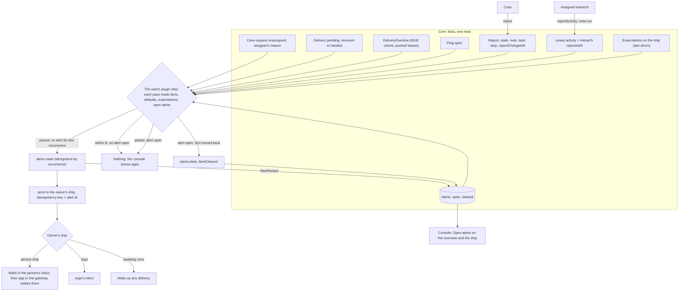

# Monitoring: the owner sees when distribution or progress stops

Design run for Thomas's "Go" of 30 Oct 2026 to monitoring in Aeolus: not handling execution, monitoring it. Stage 2: Thomas's answers to stage 1 folded in, the flow, the decisions to record, the slices and the mockups, for Thomas to approve. Section 8 holds the questions stage 2 raised.

## 1. Purpose (agreed)

Aeolus is responsible for distribution, not execution (blueprint, Purpose; 0001). Monitoring keeps that line: Aeolus shows facts that ships declare or the trierarch observes, the owner of a ship sets what they expect of it, and Aeolus tells the owner when a fact and an expectation part. It never decides what a ship does next, never retries work and never steps in.

For whom: the owner of a ship (a person's ship, or argo where argo owns it, 0045), who answers for it and today learns that something stopped only by looking.

**What is true after:**

1. **Distribution signals.** The owner of a ship is told, once per occurrence, when:
   - its crew request has been unassigned for N minutes (no trierarch took it, and why, as the assigner wrote it);
   - a delivery to it has gone unacknowledged for N minutes, the ship awaiting crew included;
   - its crewed ship has not answered a ping for N minutes.
2. **Progress, declared.** A crew's report gains a task reference (the issue or PR it works on, or the message that asked) and an optional step x of y. The ship shows when its report last changed, apart from when its crew last called the fleet (last seen).
3. **Progress, observed.** The activity the trierarch already observes per session (headless design, S4, H14: the latest event's time and kind, no content) reaches the ship's own progress, beside what the crew declares.
4. **Expectations, if possible.** The owner sets, per ship, what they expect: its report changes within N minutes, its task is done by T. A breach tells the owner, once, and clears by itself when the fact moves. Expectations come last and never block points 1, 2, 3 and 5: if they prove too hard, the rest ships without them.
5. **Shown where work is looked at.** The fleet overview shows each ship's task, step, report changed and activity ages, and any open alert. A sent message shows, per recipient, the progress of the crew whose task is that message.

**Not the purpose:**
- Acting on a signal: no retry, release, recrew, reassignment or escalation by Aeolus (0016). What the owner does is theirs.
- Reading or judging payloads, transcripts or what the work produced: Aeolus stays content-blind (sealed fleets included, 0068).
- Heartbeats that end a lease on their own (still an open decision in the blueprint).
- Charts, history of progress, or dashboards beyond the overview and the sent message.
- Reminders, quiet hours, escalation chains or channels beyond what already reaches an owner's ship.

## 2. Lessons to check against

This week's:
- **A review crew request stayed unclaimed 10 hours** (an invalid model option). The assigner wrote why (0029, 0063); nobody was told. Checked by: the unassigned signal carries the assigner's reason (4.3).
- **A deploy message went to an uncrewed ship.** The send was right to answer OK (the second promise); nobody was told. Checked by: the unacknowledged signal counts a ship awaiting crew (4.3).
- **A failed merge went unseen 3 hours.** Today `reportedAt` moves on every report call, even an unchanged one. Checked by: report changed at moves only on a change (4.1), observed activity beside it (4.2), and "report changes within N" (4.6).
- **A ship looked alive by pings while its work had stopped.** Checked by: last seen, report changed and activity are three facts, shown apart (5).

From the decisions: 0001 and 0040 (ack means received; progress stays outside the delivery promise), 0016, 0041 and 0042 (no thresholds of Aeolus's own: the owner's or a configured default), 0040 (the fleet does not speak for a ship), 0045, 0053 and 0057 (trouble to the owner, argo only as owner or fail-safe), 0028 (details stay without meaning), 0029 and 0026 (the trierarch observes, with crew:run), 0023 and 0050 (one meaning per term), 0043 (core is the fleet server and its console), 0013 (minimal), and the performance design (one paged read for the overview).

## 3. Thomas's answers

| # | Answer |
| --- | --- |
| M0 | Purpose right. Expectations "if possible yes, but this may not block the rest from being done when this would be to hard to do", and in the purpose: point 4 says so, and they are the last slices (7). |
| M1 | 3: core keeps every fact and shows it; a plugin ship, the watch, compares and tells. |
| M2 | 3: an alert message to the owner's ship, and the open alerts listed on the ship and the overview until they clear. |
| M3 | 1: alert, with expectation, breach and cleared. |
| M4 | 1: a default N per signal in configuration. "Default and we can investigate what is possible to make this more per ship later on": filed as #1407. |
| M5 | 2: an open ping unanswered for N is the signal; 0040's overdue event reaches the owner too. 0040 is changed on this PR. |
| M6 | 1: `task` and `step` are report fields core checks. |
| M7 | 1: the report changed when state, note, task or step changed; details do not count. |
| M8 | 2: activity is a lease field the assigned trierarch writes with crew:run, with the trierarch's own last report, so a trierarch that is down reads as unknown. |
| M9 | 1: expectations on the ship, standing, set by its owner. |
| M10 | 2: a working report on an idle turn is covered by "report changes within N". |
| M11 | 1: a sent message shows the recipients whose crew's task names that message. |

## 4. The design

### 4.1 Report: task, step, changed at (core)

- A report gains `task`, optional: one of an `https` URL (an issue or PR) or a message id of the fleet (`msg_`), at most 512 characters; and `step`, optional: `{ at, of }`, whole numbers with 1 ≤ at ≤ of ≤ 1000. Core checks both; a bad one is refused with nothing changed. Omitted keeps the held value, `null` clears it, as `note` does.
- `reportChangedAt` on the lease: set when state, note, task or step differs from what the lease held; details alone do not move it (M7). `reportedAt` keeps moving on every call (last seen stays its own fact).
- `ShipReported` keeps its rule (any change, details included) and carries task, step and whether the report changed, so a details-only change is told apart without a second event.
- Task and step belong to the lease, as the report does (0028): a release or recrew drops them.
- A message id as task need not be one the crew received; core checks only its shape and that it is of this fleet. The sent message joins on it (4.7).

### 4.2 Observed activity (core, written by the trierarch)

- The lease gains `activity`: `{ at, kind, tool? }`, `kind` one of `text`, `tool`, `result`, `error` (H14's shape, no content), and `reportedAt`, when the trierarch wrote it.
- `fleet.reportActivity` (crew:run): the assigned trierarch writes the activity of the crewed ships it runs, many in one call, each only for a ship whose crew request is assigned to it (0029); any other ship is refused for that entry and the rest are taken. No event (a session's activity is not a fleet change, as turns are not events beside `TurnReported`).
- Unknown: the console and the watch read activity as unknown when its `reportedAt` is older than the trierarch's own report interval twice over, the interval the trierarch states with it (question N4). Unknown is shown as "Activity unknown, trierarch last reported 25 min ago", never as stopped work.
- A ship crewed by hand has no activity: the field stays empty and the console shows nothing for it.

### 4.3 Signals and defaults (the watch)

Each signal is one fact the watch reads from core on each pass, with its default N from the watch's configuration, each fleet following it or its own value there (M4; per ship later, #1407):

| Signal | Occurrence | Default N | Clears when |
| --- | --- | --- | --- |
| Crew request unassigned | the request's settings version | 15 min | assigned, removed, or a new version |
| Delivery unacknowledged, pull lease or awaiting crew | the delivery | 15 min | acknowledged, dismissed or abandoned |
| Delivery overdue, pushed lease | the `DeliveryOverdue` (0040's clock, its own times) | none: 0040's | 0040's clear |
| Ping unanswered | the ping delivery | 10 min | answered, undeliverable, dismissed |
| Report unchanged (expectation) | the ship and its `reportChangedAt` | the owner's N | the report changes |
| Task not done (expectation) | the ship, the task and T | the owner's T | the task changes or clears |

- One alert per occurrence: a ping on a pushed lease that 0040 marks overdue is the same occurrence as its ping signal, raised once.
- The unassigned alert names the assigner's reason when one is written (0029), such as `model disabled: ...` (0063).
- The watch tells the owner of the ship at the time it raises the alert. A ship argo owns tells argo; a person ship (its own owner) is never watched for deliveries, since a person away is not stuck (0044).

### 4.4 Alerts (core holds them, the watch writes them)

- An alert: `alt_` id, the ship, the signal, the occurrence key, the owner told, the facts at raise (signal, since, N, the reason or the task), raised at, cleared at. One open per ship, signal and occurrence (unique).
- `fleet:alert` (new core scope): raise and clear alerts on the ships its ship reads. `alerts.raise` is idempotent by occurrence key (the same key answers the alert already held); `alerts.clear` clears an open one; both write `AlertRaised` and `AlertCleared` in the same transaction.
- Read: the overview's one read carries each ship's open alert count and the fleet's open alerts, newest first, paged; the ship page carries its open ones. Cleared alerts leave the lists and stay in the ship's timeline as their events.
- A retire clears the ship's open alerts (`AlertCleared`, reason retired). A release does not: an unacknowledged delivery waits on.

### 4.5 Telling the owner (the watch)

- Raise first, then send: the watch raises the alert in core, then sends the owner's ship one message, `text/markdown`, with the alert id as idempotency key, headline first (instruction 6), the facts and the ship's page link. A restart between the two sends it then, once, since the same key gives the same message.
- The watch sends nothing on clear (question N3); the lists show it gone.
- A tell that goes unacknowledged is a delivery like any other; the watch raises no alert on a delivery it sent itself, so there is no loop.

### 4.6 Expectations (core holds them, the watch compares; last)

- On the ship, standing, at most one of each: `reportChangesWithin` (minutes, 5 to 10080) and `taskDoneBy` (a time, with the task it was set for).
- Set and cleared by an actor with `fleet:manage` within manage reach (the owner's ship reaches the ships it owns, 0045, 0053), `ships.setExpectations`, `ExpectationsSet` naming the actor.
- `reportChangesWithin` applies while the ship is crewed and its report is working or blocked (question N5). `taskDoneBy` applies while the report names the task it was set for; once the task changes it lapses, shown as lapsed, and the owner sets a new one.
- Expectations stay through release and recrew; a retire removes them. The crew is not told of them: they are the owner's, not instructions.

### 4.7 Shown in the console (core)

- **Fleet overview.** The Report cell shows the task (a PR or issue number, or "a message"), the step and the note; its title gives report changed and reported times. The Seen cell gains activity beside last seen. A ship with an open alert shows an alert badge after its status. Above the table, Open alerts: one line each, the ship, what parted, since when, "clears by itself", while any is open; nothing when none.
- **Ship page.** The report cell shows the task as a link, the step, and "changed 42 min ago" apart from "seen 1 min ago"; an Activity line under it. Open alerts above the meta strip. Expectations as a row of the meta strip with "Set expectations…" (last slices).
- **Sent message.** In the message sheet's deliveries, under each recipient whose crew's report names this message as its task: the report state, step, note and changed age (M11). No line for a recipient working on something else.
- **Inbox.** An alert is an ordinary markdown message from the watch's ship: no change.

## 5. The flow

Unhappy paths:

| What fails | What happens |
| --- | --- |
| The watch is down | No alert is raised or cleared; the console still shows every fact and its age, and the open alerts as they were. 0040's overdue still reaches argo by its event. Back up, it reads the facts anew: what parted meanwhile is raised once, what moved back is cleared. |
| The watch restarts between raise and send | The open alert has no message yet; the next pass sends with the alert id as key, so at most one message. |
| The send is refused (the watch cannot reach the owner) | The alert stays open and shows in the console; the watch retries on the next pass with the same key. Its refusal is in the watch's own log. |
| Core refuses `alerts.raise` (the ship retired meanwhile) | Nothing is sent. |
| The owner changes after the alert | The alert names the owner it told; a new occurrence goes to the new owner. A retired owner's ships fall to argo (0045). |
| The tell itself goes unacknowledged | It is a delivery; the watch never alerts on its own messages. |
| A fact flaps | Each occurrence has its own key: one alert each; a cleared one is never raised again. |
| Two watch passes at once | `alerts.raise` is unique per occurrence and the send idempotent: one alert, one message. |
| The trierarch is down | Activity reads as unknown (4.2), not as stopped; no activity alert exists, so nothing is told on it. |
| The ship is released or recrewed | Task, step and activity go with the lease; open delivery alerts stay; a report-unchanged alert clears (no crew to report). |
| The ship is retired | Its open alerts clear and its expectations go. |
| A sealed fleet | Task, step and note are metadata, readable; payloads stay sealed and the alert names no payload. |
| Expectations not built | Points 1, 2, 3 and 5 hold without them: their slices are last. |

## 6. Decisions to record on approval

- **0070 Monitoring** (new): the facts core keeps (report task, step, `reportChangedAt`; lease activity; expectations; alerts with `fleet:alert`), the watch plugin that compares and tells, one alert per occurrence, raise then send with the alert id as key, no message on clear, defaults in the watch's configuration with each fleet's own value, never an action.
- **0028 Report details**, changed: the report gains checked `task` and `step`; `reportChangedAt` moves on a change of state, note, task or step, not of details.
- **0040 Delivery protocol**, changed on this PR (M5): `DeliveryOverdue` names the ship's owner and reaches the owner through the watch's alert as well as argo.
- **0029 Crew request**, changed: the assigned trierarch writes its ships' activity with crew:run.
- **Blueprint**: Alert, Expectation, Breach, Cleared and Activity in the domain language; Report changed beside Last seen; the events `AlertRaised`, `AlertCleared`, `ExpectationsSet`.
- **Watch plugin**: its own train (0049, question N2), its decisions in its repository.

## 7. Slices, once approved

Expectations last (M0): W1 to W5 stand without them.

| # | Repo | Slice | Done when |
| --- | --- | --- | --- |
| W1 | aeolus-fleet | Report `task`, `step`, `reportChangedAt` in core and the ship contract; ReportLine shows them on the overview and the ship page; 0028 and 0070 recorded | Tests by name: a refused bad task or step changes nothing, details alone keep `reportChangedAt` |
| W2 | aeolus-fleet | The sent message shows each recipient whose task names it | Walked on staging |
| W3 | aeolus-fleet | Lease activity, `fleet.reportActivity` (crew:run), unknown past the stated interval; the overview's Seen and the ship's Activity line | Tests by name for an unassigned ship refused, the rest taken |
| W3b | aeolus-fleet-trierarch | The trierarch writes activity each pass with its interval | Walked on staging, trierarch stopped reads unknown |
| W4 | aeolus-fleet | Alerts in core: table, `fleet:alert`, `alerts.raise` and `alerts.clear` with events, unique per occurrence, retire clears; Open alerts on the overview and the ship page; `DeliveryOverdue` names the owner | Testcontainers: two raises at once give one alert; rollback leaves no event |
| W5 | the watch plugin | The plugin ship: the four distribution signals, defaults in configuration, raise then send, clear; a restart sends nothing twice | Tests by name per signal, restart and flap; walked on staging with an uncrewed ship |
| W6 | aeolus-fleet | Expectations on the ship: `ships.setExpectations`, `ExpectationsSet`, the Expectations row and dialog | Tests by name for reach refused and retire removes |
| W7 | the watch plugin | Report unchanged and task not done by T | Tests by name for breach, clear and a lapsed task |

## 8. Mockups

Before and after, desktop and phone, light and dark, every state, a dashed box on what changed: [the fleet overview, the ship page and the sent message](mockups/console.html).

## 9. Questions from stage 2

**N1. Where do open alerts live?** The overview and the ship page list them (M2), in core's console.
1. In core, written by the watch with a new scope `fleet:alert`, read in the fleet's one read.
2. In the watch plugin's own table, shown on a page the plugin serves (0043).
3. Derived by core from facts and expectations, with no writer.

Pick 1: the overview must show them from its one read (performance design); 3 would put the comparing in core, against M1.

**N2. Which plugin is the watch?**
1. A new plugin with its own repository and train (0049), its ship owned by argo, as squadrons.
2. Inside the trierarch plugin, which already assigns crew requests and sees their reasons.

Pick 1: a fleet without trierarchs (ships crewed by hand) needs alerts too, and monitoring is not crewing.

**N3. Is the owner told when an alert clears?**
1. No: the lists show it gone; one message per occurrence.
2. Yes: a short second message, "cleared".

Pick 1: a cleared message is a second item in an inbox for what needs no action; M2 asked for a list that clears by itself.

**N4. When does activity read as unknown?** M8 says a trierarch that is down reads as unknown.
1. Past twice the report interval the trierarch states with each activity write.
2. When the trierarch plugin reads that trierarch as not answering (the Trierarchs page's rule).
3. A fixed age in core.

Pick 1: the trierarch states its own rhythm, so Aeolus holds no threshold (0041), and core's one read decides it without asking the plugin.

**N5. "Report changes within N" while the report says idle?**
1. Applies only while the report says working or blocked: an idle crew has nothing to move.
2. Applies whatever the state.

Pick 1: idle is a true report of no work; the failed merge's report said working (M10).
