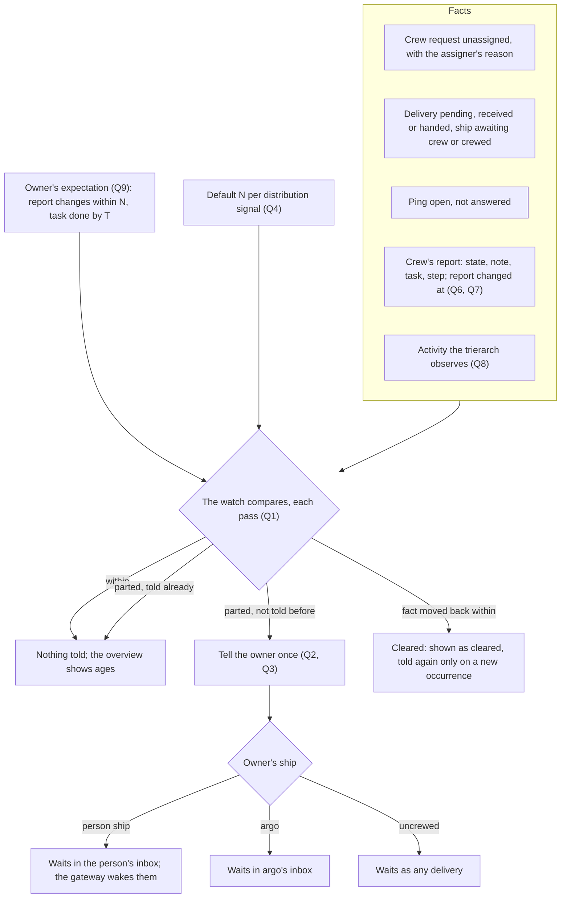

# Monitoring: the owner sees when distribution or progress stops

Design run for Thomas's "Go" of 30 Oct 2026 to monitoring in Aeolus: not handling execution, monitoring it. Stage 1: purpose, lessons and questions, for Thomas to agree the purpose and answer the questions. No decisions, mockups or slices yet; those follow the answers.

## 1. Purpose (to agree)

Aeolus is responsible for distribution, not execution (blueprint, Purpose; 0001). Monitoring keeps that line: Aeolus shows facts that ships declare or the trierarch observes, the owner of a ship sets what they expect of it, and Aeolus tells the owner when a fact and an expectation part. It never decides what a ship does next, never retries work and never steps in.

For whom: the owner of a ship (a person's ship, or argo where argo owns it, 0045), who answers for it and today learns that something stopped only by looking.

**What is true after:**

1. **Distribution signals.** The owner of a ship is told, once per occurrence, when:
   - its crew request has been unassigned for N minutes (no trierarch took it, and why, as the assigner wrote it);
   - a delivery to it has gone unacknowledged for N minutes, the ship awaiting crew included;
   - its crewed ship has not answered a ping for N minutes.
2. **Progress, declared.** A crew's report gains a task reference (the issue or PR it works on, or the message that asked) and an optional step x of y. The ship shows when its report last changed, apart from when its crew last called the fleet (last seen).
3. **Progress, observed.** The activity the trierarch already observes per session (headless design, S4, H14: the latest event's time and kind, no content) reaches the ship's own progress, beside what the crew declares.
4. **Expectations.** The owner sets, per ship, what they expect: its report changes within N minutes, its task is done by T. A breach tells the owner, once, and clears by itself when the fact moves.
5. **Shown where work is looked at.** The fleet overview shows each ship's task, step, report changed and activity ages, and any breach. A sent message shows, per recipient, the progress of the crew whose task is that message.

**Not the purpose:**
- Acting on a signal: no retry, release, recrew, reassignment or escalation by Aeolus (0016). What the owner does is theirs.
- Reading or judging payloads, transcripts or what the work produced: Aeolus stays content-blind (sealed fleets included, 0068).
- Heartbeats that end a lease on their own (still an open decision in the blueprint).
- Charts, history of progress, or dashboards beyond the overview and the sent message.
- Reminders, quiet hours, escalation chains or channels beyond what already reaches an owner's ship.

## 2. Lessons to check against

This week's:
- **A review crew request stayed unclaimed 10 hours** (an invalid model option). The assigner can already write why no trierarch takes a request (0029), and model governance writes `model disabled: ...` (0063); the reason sat in the operator's needs-crew to-do, and nobody was told. A fact nobody is told is not monitoring.
- **A deploy message went to an uncrewed ship.** The send was right to answer OK: the message waits until a crew picks it up (the second promise). Health shows it as waiting for crew with its age (0042), with no threshold and no one told; the sender learned nothing.
- **A failed merge went unseen 3 hours.** Aeolus cannot see execution; only the crew's report, its silence, or the activity the trierarch observes can show it. Today `reportedAt` moves on every report call, even an unchanged one (`ship-report.ts`), so a stale report can look fresh.
- **A ship looked alive by pings while its work had stopped.** A ping proves the model reads (blueprint, Ping a ship), and last seen moves on any call. Neither says the work moves: liveness and progress are two facts and must be shown as two.

From the decisions:
- **0001, 0040.** Ack means received. Monitoring may show progress after the ack but must not make it part of the delivery promise.
- **0016, 0041, 0042.** No policy: Aeolus adds no rules and runs no thresholds of its own; health shows facts with ages, thresholds are someone else's. Here the owner's (expectations) or a configured default (the distribution signals), never Aeolus's guess.
- **0040.** The fleet does not speak for a ship: overdue deliveries tell argo by an event, not an inbox message, and an inbox message to argo was rejected. Telling an owner by message must come from a ship that speaks for itself.
- **0045, 0053, 0057.** Trouble goes to the owner; argo is the fail-safe, never the normal path. Signals go to the owner, argo only where argo owns the ship.
- **0028.** Report details are stored without meaning; core reads nothing from them. A task reference that the overview and the sent message join on cannot live in the details alone.
- **0029, 0026.** The trierarch plugin assigns, the trierarch crews and reports crew status on assigned ships (`crew:run`); neither picks or retires. Observed activity comes from there.
- **Headless H2, H14.** The trierarch keeps events on the computer and puts per-ship `activity` in its own report details; the Trierarchs page shows it.
- **Squadrons check-in.** A member reports each interval, late after one missed, silent after three: an expectation that already exists, inside a plugin, for members only.
- **0043.** Core is the fleet server, its API and the admin console, nothing more.
- **0023, 0050.** "Notice" already means the installation's console banner; one meaning per term.
- **0013.** Minimal before 1.0.0.
- **Performance design.** The overview is a paged read; whatever it shows must come from that one read.

## 3. The shape at a glance

The flow every signal and expectation follows, whatever the answers place where. The question numbers mark the open branches.

Unhappy paths the shape must hold:
- **The watch is down or restarts.** It reads the facts anew and tells only what it has not told; what it told is stored, as 0040's overdue clocks store theirs.
- **The owner changes or retires.** The next tell goes to the owner at that time; a retired owner's ships fall to argo (0045).
- **The tell itself goes unacknowledged.** It is a delivery like any other; the watch sends nothing about its own tells, so there is no loop.
- **The ship is released, recrewed or retired.** Report, task and step belong to the lease (0028) and go with it; expectations belong to the ship and stay (Q9); a retired ship's are gone.
- **A fact flaps** (a delivery acknowledged, then a new one waits). Each occurrence is its own: one tell each, and a cleared one is not told again.
- **The trierarch is down.** Observed activity stops; it reads as stale, not as stopped work, and says which (Q8).
- **The owner sets an expectation the crew cannot know.** The crew is not told of it; the expectation is the owner's, not an instruction (Q9).
- **A sealed fleet.** Task, step and note are metadata like the note today, readable; payloads stay sealed.

## 4. Questions

Each with options and my pick. Answers become the decisions of stage 2.

**Q1. Where does the watch run?**
1. In core, as 0040's overdue clocks do: a pass every 30 seconds over the fleet's facts.
2. In a new plugin with its own ship, as squadrons: it follows the fleet's events and sends as itself.
3. Split: core holds every fact (task, step, report changed, observed activity, expectations) and shows it; the watch that compares and tells is a plugin ship.

Pick 3: the facts are distribution facts and belong in the fleet's one read; telling someone is speaking, and 0040 says the fleet does not speak for a ship. A plugin speaks as its own ship, as the trierarch and squadrons already do to argo.

**Q2. How is the owner told?**
1. A message to the owner's ship from the watch's ship, a headline and short facts as the trierarch sends argo; a person is woken by the gateway as for any delivery.
2. An event and a list of the owner's open breaches, no message: seen only when someone looks.
3. Both: the message, and the open ones listed on the ship and the overview until they clear.

Pick 3: the lessons are all "nobody was told", so a message; and a list that clears by itself, as Health's causes do (0041), so a cleared one does not linger in an inbox as work.

**Q3. What do we call it?** "Notice" is taken (0023).
1. Alert.
2. Warning.
3. A word of Thomas's.

Pick 1, one meaning: a message telling a ship's owner that a fact and an expectation parted. Expectation, breach and cleared as the other new terms.

**Q4. Who sets N for the distribution signals?**
1. A default per signal in configuration, as the limits are (0020), each fleet following it or its own.
2. The owner per ship, with no default: no expectation, no signal.
3. 1, and the owner may set their own per ship.

Pick 1 for now: the lessons happened on ships nobody had set anything on, so a default must exist; per-ship overrides wait until a need shows (0045, "no process due to process").

**Q5. "Stops answering pings": who pings?** Today a ping is argo's, pressed by hand, with no timeout (blueprint, Ping a ship).
1. The watch pings each crewed ship on a rhythm and tells the owner when one stays unanswered for N.
2. No new pings: an open ping (pressed by anyone) unanswered for N is the signal, and a pushed ship's unanswered ping is already overdue (0040), which then tells the owner too.
3. Drop the ping signal: last seen, turn and observed activity already say whether the crew is there.

Pick 2: a rhythm of pings is a heartbeat, still an open decision; and the lesson says pings prove little about work. It needs 0040's overdue tell to reach the owner as well as argo, which is a question for Thomas, not a change made here.

**Q6. Where do the task reference and step live?**
1. Fields on the report: `task` (an issue or PR URL, or a message id) and `step` (x of y), checked by core, beside state and note.
2. A shape in common for agent ships' details (0028), read by the console.
3. The task derived, not declared: the message the turn took, from 0040's hand-over.

Pick 1: the overview and the sent message join on it, and 0028 keeps details without meaning. A message id as task lets a sent message find the crews working on it.

**Q7. What moves "report changed at"?**
1. A change of state, note, task or step; details not.
2. Any change, details included (as `ShipReported` is written today).
3. Only state, task or step: a new note is chatter.

Pick 2: the event already marks exactly that; keeping one rule for "changed" avoids a second.

**Q8. How does observed activity reach the ship?**
1. Left in the trierarch's report details (H14) and joined by the console; core reads no meaning from it.
2. A field on the crewed ship's lease, written by its assigned trierarch with `crew:run`, as crew status is (0029): the latest activity's time and kind, with the time the trierarch last reported, so a trierarch that is down reads as unknown, not stopped.
3. Reported by the session's own hooks as the crew.

Pick 2: the watch and the overview need it as a fact, not as opaque details, and only the trierarch observes it without the session's help.

**Q9. Expectations: their shape and who sets them.**
1. On the ship, standing, set by its owner (and any actor with manage reach): report changes within N minutes; task done by T, held until the task changes.
2. On the message: the sender sets "done by T" when it sends.
3. On the crew request, with the crew settings.

Pick 1, with "done by T" tied to the task it was set for: the brief names the owner; a sender's deadline (2) is the natural next one, kept out until asked.

**Q10. A working report while the turn is idle.** The failed merge likely ended its turn with the report still saying working.
1. A signal of its own: report says working, turn idle for N (pushed ships only).
2. Covered by "report changes within N".
3. Leave it out.

Pick 2: one expectation catches it without a rule about what idle with working means; the overview shows turn and activity beside it.

**Q11. Progress on the sent message: whose?**
1. Each recipient whose crew's task names this message: its state, step, note and changed age.
2. Each recipient's current report, whatever it works on.

Pick 1: a report about other work beside a message would mislead.
