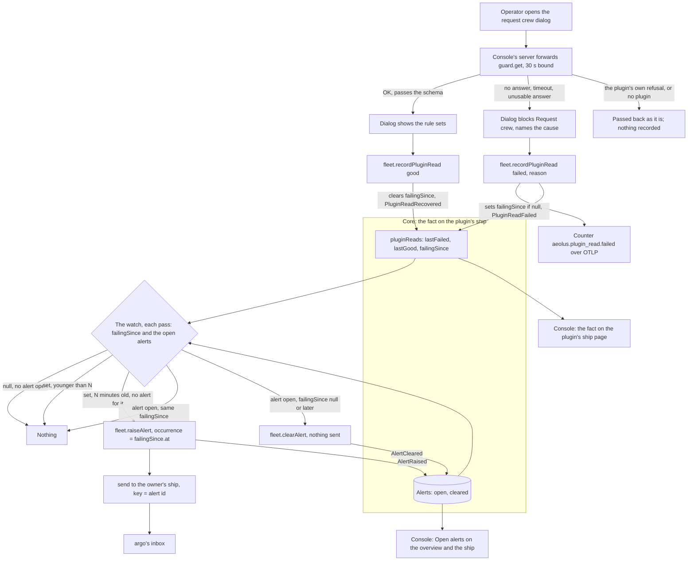

# Plugin read failed: argo is told when the console cannot read a plugin it needs

Design for [watch plugin #22](https://github.com/ThomasHendrickx/aeolus-fleet-watch-plugin/issues/22). Thomas agreed the purpose and answered its nine questions on 25 Nov 2026 (section 2). It adds one signal to [monitoring](monitoring.md) and changes none of its rules (0071).

## 1. Purpose (agreed)

The console needs answers from plugins to let an operator act. The first case: the request crew dialog reads the trierarch plugin's rule sets (`guard.get`) and blocks Request crew when that read fails ([guard design](../guard/README.md)). Only the operator at the dialog sees it. Thomas: "This means there is an issue with Aeolus, this is something that suits deeper than just the guards in a crew request. So creating is blocked and argo should be notified".

For whom: the owner of the plugin's ship, argo for every plugin ship (0045).

**What is true after:**

1. When a counted read fails and no good read follows within N minutes, the owner of the plugin's ship is told once per outage: which plugin, which read, since when and why.
2. The open alert shows on the overview and on the plugin's ship until it clears, and it clears by itself on the next good read. Nothing is sent on clear.
3. The operator stays blocked exactly as now.
4. Every failed read is counted in core's telemetry, outside the product too.

**Not the purpose:** acting on it (no retry, restart or unblocking, 0016, 0071); a refusal that is the viewer's own; a plugin that is not installed or is switched off; checking what a plugin answered; a health page for plugins.

## 2. Thomas's answers

| # | Question | Answer |
| --- | --- | --- |
| Q1 | Where the fact comes from | The console's server records it in core, on the plugin's ship: the last failed read (when, which read, reason) and the last good read. The watch reads it with the ship |
| Q2 | Which reads count | A read whose failure blocks an operator's action. Today: `guard.get` in the request crew dialog |
| Q3 | Which failures count | No answer, a timeout, or an answer the console cannot use. Not a viewer's own refusal, not a plugin that is not installed |
| Q4 | What is raised | One alert on the plugin's ship per outage, signal `plugin-read-failed`. Thomas's note, verbatim: "And we should also add this to the telemetry that goes to grafana or so ... not pure within product but also outside of it." |
| Q5 | When | When no good read follows within N minutes; N a default in the watch's settings, 5 to start, each fleet may set its own |
| Q6 | Who is told | The owner of the plugin's ship: argo |
| Q7 | When it clears | On the next good counted read, by anyone. Retiring the plugin's ship clears it too |
| Q8 | The crew dialog | Unchanged |
| Q9 | Without the watch | Nothing is told; the fact still shows in the console |

## 3. Lessons it keeps

- The watch sees only core's facts, as its ship, and depends on common only ([watch plugin](https://github.com/ThomasHendrickx/aeolus-fleet-watch-plugin/blob/main/docs/watch-plugin.md)). Its new core read joins [compatibility.md](../../compatibility.md)'s watch plugin row and raises its minimum core version.
- Raise, tell, clear; never act. One open alert per ship, signal and occurrence; raise first, then send with the alert id as key; nothing on clear (monitoring 4.5, 4.6).
- No read is not "failed" and not "works again": only a recorded read moves the fact.
- Core knows a plugin only as its ship (0043): the fact is a plugin ship's read by name, with no guard meaning in core.
- Content-blind: the fact, the alert and the metric name the plugin, the read and a reason kind, never what the plugin answered, a cookie or a token.
- The watch never alerts on itself.

## 4. The design

### 4.1 The fact (core)

A ship of kind `plugin` carries `pluginReads`, null on every other ship:

| Field | Meaning |
| --- | --- |
| `lastFailed` | The last failed read: `at`, `read`, `reason`. Null before any |
| `lastGood` | The last good read: `at`, `read`. Null before any |
| `failingSince` | The first failed read since the last good one: `at`, `read`, `reason`. Null when the last recorded read was good, or none was recorded. It is Q4's occurrence |

- `read` is the read's name as the console calls it (`guard.get`); core checks its shape only.
- `reason` is `no-answer`, `timeout` or `unusable-answer` (Q3).
- `at` is core's clock when it records, never a time from the request.
- Read: `fleet.ship` and `fleet.list` carry it on the ship (`fleet:read`, read reach), so the console and the watch read it with the ship.
- A retire leaves nothing to read: the fact goes with the ship's page, and its open alert clears (monitoring 4.5).

### 4.2 Recording a read (core, called by the console's server)

`fleet.recordPluginRead`: input `pluginShipId`, `read`, `outcome` (`good` or `failed`) and, when failed, `reason`. The actor and scope: section 8.

- Failed: sets `lastFailed`; sets `failingSince` when it is null. `PluginReadFailed` when `failingSince` was set by this call.
- Good: sets `lastGood`, clears `failingSince`. `PluginReadRecovered` when it cleared one.
- A repeat of the same outcome moves only its time and writes no event. Each event is written in the call's transaction and names the actor, the read and the reason, never a payload.
- Refused `PLUGIN_NOT_FOUND` for a ship that is no active plugin ship of the fleet.
- Core compares nothing and tells nobody (0071).

### 4.3 The metric (core)

Each recorded failed read adds 1 to the counter `aeolus.plugin_read.failed` (unit `{read}`), with `plugin` (the plugin ship's type, such as `trierarch-plugin`), `read` and `reason`. No fleet or ship id. It is sent as the rest of core's telemetry, only when the `OTEL_*` settings name an endpoint ([core README, Telemetry](../../../packages/core/README.md#telemetry)), and joins that section's list.

### 4.4 The console's server records (console)

The forward of a counted read (Q2; today `guard.get` in `lib/trierarch-plugin-mcp.ts`) records its outcome after it has its answer:

| What the forward saw | Recorded |
| --- | --- |
| An OK answer that passes the schema | good |
| No answer (the call threw) | failed, `no-answer` |
| No answer within the 30 s bound | failed, `timeout` |
| An OK answer that is no JSON or fails the schema | failed, `unusable-answer` |
| The plugin's own refusal, passed back as it is | nothing |
| No plugin configured (404) | nothing |

- The console's server finds the plugin's ship in core (the fleet's active ship of kind `plugin` and that plugin's type), never by asking the plugin. No such ship: nothing is recorded.
- The record never changes or delays what the dialog gets (Q8). A record core refuses or does not answer is dropped.
- The plugin ship's page shows the fact (Q9): the last failed read with its reason, since when it fails, and the last good read.

### 4.5 The signal (common, the watch)

| Signal | Occurrence | Default N | Clears when |
| --- | --- | --- | --- |
| `plugin-read-failed` | the plugin's ship and `failingSince.at` | 5 min | `failingSince` is null or names a later time, or the ship retired |

- Each pass, for every active plugin ship: `failingSince` set and at least N minutes old, with no alert for this occurrence, raises (`fleet.raiseAlert`, occurrence key `failingSince.at`, `since` the same), then sends the owner's ship the alert message, as every signal (monitoring 4.6).
- An open alert whose occurrence is no longer the ship's `failingSince` is cleared (`fleet.clearAlert`). Nothing is sent.
- A failure followed by a good read within N raises nothing.
- N is the watch's default for this signal, each fleet following it or its own value; it joins the watch's README and its `timings-and-limits.md`.
- `facts` in `schemas/alert.ts`: `read` (string), `reason` (`no-answer`, `timeout` or `unusable-answer`), both of the first failure, and `minutes` (integer, the N). `toldAs` is `owner`.
- Headline, such as `trierarch-plugin: guard.get not read since 14:02, no answer`. The body says what it blocks is the operator's action in the console, and "Clears by itself on the next good read".
- Readers show an unknown signal by headline and body (monitoring 4.9), so no reader changes.

## 5. The flow

Unhappy paths:

| What fails | What happens |
| --- | --- |
| The plugin restarts during a deploy: one read fails, the retry works within N | `failingSince` is set, then cleared; the metric counts one; nothing is raised |
| The read keeps failing, or nobody reads again | Raised once N minutes after the first failure; the alert stays open until a good read. No read is not "works again" |
| Many operators hit the same outage | One `failingSince`, one alert; the metric counts every failed read |
| The read flaps | Each run of failures has its own `failingSince.at`: one alert each, and only for a run still failing after N; a cleared one is never raised again |
| Good, then failing again between two passes, with an alert open | The open alert clears; the new occurrence waits its own N |
| Core does not answer or refuses the record | The dialog answers as now; nothing is recorded, counted or told for that read |
| The plugin has no ship in the fleet, or is switched off there | Nothing is recorded (Q3) |
| The viewer is refused by the plugin | Passed back as it is; nothing is recorded, so it neither raises nor clears |
| The watch is down, or the fleet has none | Nothing is raised or cleared; the fact shows on the ship's page and the metric still counts (Q9) |
| The watch restarts between raise and send, the send is refused, two passes at once | As monitoring section 5: one alert, one message |
| The plugin's ship is retired | Its open alert clears, reason retired |
| No OTLP endpoint set | No metric; the fact and the alert are unchanged |

## 6. Docs that change with the slices

- Blueprint: `PluginReadFailed` and `PluginReadRecovered` in the events; the fact in the plugin ship's language.
- Architecture: the fact in the `ships` table row.
- [monitoring.md](monitoring.md) 4.4 and 4.9: the signal's rows point here.
- Core README, Telemetry: the counter.
- compatibility.md: the watch plugin's row and minimum core.
- The watch's README, `watch-plugin.md` and `timings-and-limits.md`: the signal and its N.

## 7. Slices, in order

| # | Repo | Slice | Done when |
| --- | --- | --- | --- |
| P1 | aeolus-fleet (core, common) | The fact on the plugin's ship, `fleet.recordPluginRead` with its two events, carried by `fleet.ship` and `fleet.list`; the counter | Tests by name: first failure sets `failingSince`, a second keeps it, a good read clears it, a ship that is no plugin is refused, rollback leaves no event; the counter adds one per failed read |
| P2 | aeolus-fleet (common) | `plugin-read-failed` and its facts in `schemas/alert.ts`; monitoring 4.4 and 4.9 point here | Tests by name: the facts parse, another signal's facts are refused |
| P3 | aeolus-fleet (console) | The forward of `guard.get` records each outcome of 4.4; the plugin ship's page shows the fact | Tests by name per row of 4.4, and a refused record leaves the dialog's answer unchanged; walked on staging with the plugin stopped |
| P4 | the watch plugin | The signal in the pass (after monitoring's W5), default 5 min, raise then send, clear; compatibility row and minimum core | Tests by name: within N nothing, after N one alert and one message, a good read clears, flap, restart; walked on staging with the plugin stopped |

## 8. Who records the fact

The operator's own console session records the fact with `fleet:read` and read reach on the plugin's ship. Each event names who recorded it.

The read that failed is the operator's: the console's server forwards the caller's cookie and the plugin authorises `fleet:read`. This records every counted failure on every installation without a new credential or scope. A `fleet:read` holder can record a false failure or good read, causing at most one alert to argo per outage or clearing one early; the event attributes the record to its actor.

Rejected:

- A new core scope: an operator without it could hit the failure without recording it, and every fleet manager would need another grant.
- The installation token: the console's server would hold a token with broad installation permissions, and installations without one would record nothing.
