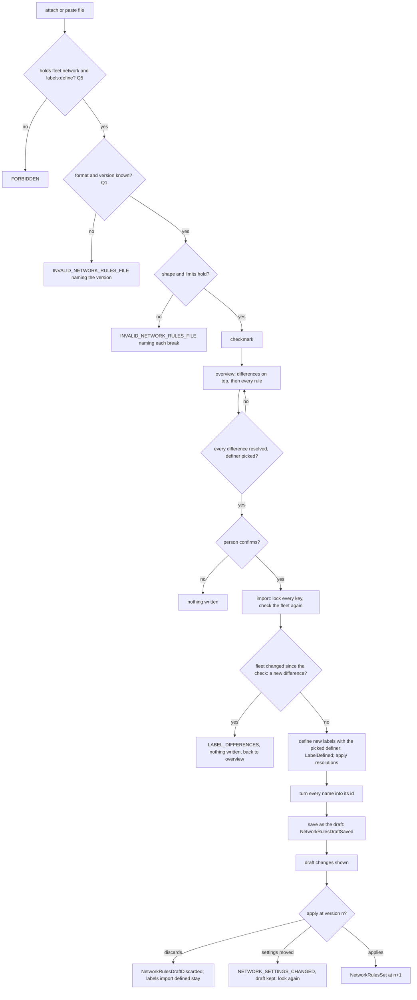

# Network rules: export and import

Design for [#1155](https://github.com/ThomasHendrickx/aeolus-fleet/issues/1155). New core fleet functionality, so it goes purpose first. The direction is the issue's, agreed by Thomas on 23 Oct; his answers to Q1 to Q11 are in section 6. The design is final. No code.

## 1. Purpose

A fleet's own rules (0035) leave the fleet as one file, with the labels they use, and come back from it into the same fleet or another, so a rule set is written and tested once.

The outcomes:
1. Export writes a fleet's applied rules and the labels they use as one readable file, by name, with the metadata to tell two files apart. The same file is what a person reviews or keeps under version control.
2. Backup and restore, the main use: a person exports, tries other rules, then imports the file into the same fleet and is back where they were.
3. A new fleet gets its rules before any ship exists: import creates the labels, and ships are labelled as they are commissioned.
4. A rule set tested on staging lands on production unchanged (#1154).
5. Import shows every rule before anything changes, with what it cannot apply as is at the top and ways to resolve each. Nothing goes in force without the person confirming.
6. A rule never silently stops matching because a ship retired: the labels import creates are defined by argo unless the person importing picks another definer.

Not the purpose:
- Moving label assignments, ships or the built-in rules' state.
- Moving declared rules (0037): each declarer declares its own again.
- A rule set library, merging two rule sets, or a diff between fleets.

## 2. What is true today

- **Rules are stored by ids.** A term is a label value id, a label id with `*` or `#`, or an owner term with a ship id, `*` or `#` (`selectorTermSchema`, common `schemas/network.ts`). Ids differ between fleets, so a rule list does not travel.
- **An unknown id is accepted and matches no ship** (`invalidRules`, core `registry/network-settings.ts`). A rule on a label whose definer retired keeps the retired ids and stops matching, with nothing shown.
- **The draft** (0035): `saveNetworkRulesDraft` replaces it whole, `networkRulesDraftChanges` previews gained and lost reach, `applyNetworkRules` puts it in force at the version looked at. Network in the console already does all three.
- **A label is defined by its caller** (`labelOwnerOf`, core `registry/label.ts`): a ship or the installation. An account defines none. Nothing defines a label for another actor.
- **A ship name** is unique among active ships and reusable after retirement (blueprint, Ship name).
- **Export and import** do not exist.

## 3. Lessons to check against

- **0031.** A key is unique per fleet; defining a taken key is refused, naming its definer. A label retires with its definer. Only the definer changes values and assigns; `labels:any` assigns any label within manage reach. 0031 stays (issue point 4): import only picks the definer of the labels it creates.
- **0034.** A term is a label or the owner, never a type. Allow-only. An unknown id matches no ship.
- **0035.** Rules change only through the one draft; nothing is checked against it; apply names the version looked at.
- **0037.** Declared rules belong to their declarer; copying them into the fleet's own was rejected. At most 200 of the fleet's own.
- **0016.** No policy: a rule naming one ship travels if the person wants it to (Thomas on Q4).
- **0012, 0053, 0057.** argo is permanent, so a label it defines never retires. Nothing is argo's alone: import is a scope, not an argo-only call.
- **0050 and the blueprint's domain language.** A label has a *definer*, not an owner; the issue's "owned by argo" is "defined by argo" here. *Role* is only a squadron member's, so "which roles may import" is asked as which scopes.
- **0004, 0033.** One API door; the console parses no file in the browser and holds no logic. Export and import are core procedures; REST and MCP map onto them.
- **0006.** 200 rules of at most 40 terms, plus labels of 50 values, fit within 64 KB, so a file can be a payload too.
- **0013.** Before 1.0.0, no compatibility work: a file of another version is refused, never migrated.
- **Every state change writes its event in the same transaction.**

## 4. Export

Reads only, `fleet:network`. Always the applied rules, never the draft. Every id becomes its name: a label value its key and value, a label its key, an owner's ship its name. The file:

```json
{
  "format": "aeolus.network-rules",
  "version": 1,
  "exportedAt": "2026-10-23T14:02:11Z",
  "fleet": { "id": "flt_...", "name": "staging" },
  "rulesVersion": 42,
  "labels": [{ "key": "crm", "values": ["app", "user"], "definer": "argo" }],
  "rules": [
    { "verb": "send", "from": [{ "label": "crm", "value": "user" }], "to": [{ "label": "crm", "value": "app" }] },
    { "verb": "manage", "from": [{ "owner": "thomas" }], "to": [{ "owner": "*" }] }
  ]
}
```

`exportedAt` is ISO 8601 in UTC. `fleet` and `rulesVersion` (the settings version of the applied rules) tell two files apart. A label's `definer` is its definer's ship name, or `installation`. A term's value is a value text, `*` or `#`; an owner term's is a ship name, `*` or `#`.

## 5. Import

Four steps (Thomas on Q3), each a core call the console shows.

1. **Attach or paste** the file.
2. **Check** (`fleet.checkNetworkRulesFile`, reads only): format, version, shape and limits (0031, 0034, 0037). A pass shows a checkmark; a fail names each break.
3. **Overview** (same call's answer): every rule in the file, with a difference list at the top. Each difference offers the ways Q9 names. The person resolves every difference and picks the definer of the labels import creates (Q6, Q10).
4. **Import** (`fleet.importNetworkRules`, after a confirmation): the file and the resolutions, in one unit of work under the keys' locks; the rules land in the draft, and apply puts them in force (Q11).

Differences:
- A key the fleet has with another definer than the file's.
- A key the fleet has with values other than the file's.
- An owner term's ship name no active ship has.



## 6. Thomas's answers

- **Q1 File format:** JSON with a format name and an integer version, rules in the API's shape by name; other versions refused. Plus `exportedAt` in UTC and top-level metadata to tell two files apart (section 4).
- **Q2 Which rules:** always the applied rules, never the draft.
- **Q3 A key with another definer:** a difference, but import does not stop on it: the overview shows it at the top with ways to resolve it; using the existing label is one, so backup and restore work. Four steps (section 5), apply asks for a confirmation.
- **Q4 A rule naming one ship:** export keeps it with the ship by name; import finds that ship by name. "no policy ... Copying dumb rules from one to another is a choice, not mine."
- **Q5 Scopes:** export `fleet:network`; import `fleet:network` and `labels:define`, any actor. "it does make fleet:network a very dangerous scope".
- **Q6 Definer of created labels:** import defines them for another actor than the caller, and the import screen picks that definer.
- **Q7 Declared rules:** left out of export and import.
- **Q8 Where:** core procedures on tRPC, REST and MCP; the console uploads, downloads and shows.
- **Q9 Ways to resolve a difference:** another definer: use the existing label, or drop the rules on it. Other values: use the existing label when it has every value the rules name, else drop the rules naming a missing value. Ship name not found: pick an active ship, or drop the rule. No renaming a key and no adding values to an existing label (0031 leaves values to the definer).
- **Q10 Definers offered:** argo, preselected, or any active ship within the caller's manage reach (0053: defining for a ship is managing it).
- **Q11 What a confirmed import ends in:** the draft, then the draft changes shown, then apply as today (0035) with its own confirmation.

## 7. Docs it would update

- **Decision 0035:** one line on export and import filling the draft.
- **Decision 0031:** one line that import defines labels for a definer it picks.
- **Blueprint:** the fleet API table and LabelDefined's details.
- **Console design:** Export and Import on Network, the four import steps and the difference list.
