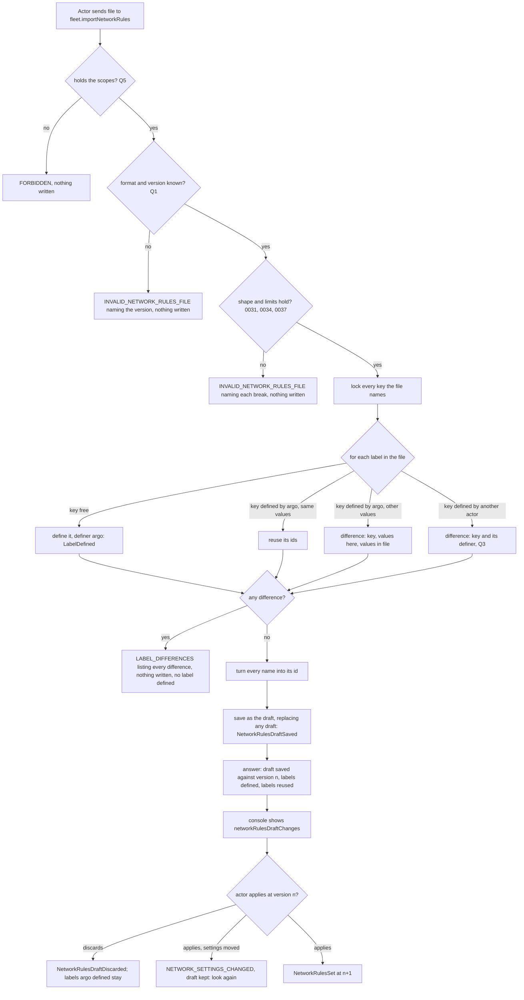

# Network rules: export and import

Design for [#1155](https://github.com/ThomasHendrickx/aeolus-fleet/issues/1155). New core fleet functionality, so it goes purpose first. The direction is the issue's, agreed by Thomas on 23 Oct. Nothing past the purpose is decided until Thomas agrees the purpose. No code.

## 1. Purpose (to agree)

A fleet's own rules (0035) move to another fleet as one file, with the labels they use, so a rule set is written and tested once.

The outcomes:
1. A new fleet gets its rules before any ship exists: import creates the labels, and ships are labelled as they are commissioned.
2. A rule set tested on staging lands on production unchanged (#1154).
3. Import never puts rules in force. The rules land in the draft; an actor holding `fleet:network` looks at the draft changes and applies them (0035).
4. A rule never silently stops matching because a ship retired: the labels import creates are defined by argo, which never retires (0012).

Not the purpose:
- Moving label assignments, ships or the built-in rules' state.
- Moving declared rules (0037): each declarer declares its own again.
- A rule set library, merging two rule sets, or a diff between fleets.

## 2. What is true today

- **Rules are stored by ids.** A term is a label value id, a label id with `*` or `#`, or an owner term with a ship id, `*` or `#` (`selectorTermSchema`, common `schemas/network.ts`). Ids differ between fleets, so a rule list does not travel.
- **An unknown id is accepted and matches no ship** (`invalidRules`, core `registry/network-settings.ts`). A rule on a label whose definer retired keeps the retired ids and stops matching, with nothing shown.
- **The draft** (0035): `saveNetworkRulesDraft` replaces it whole, `networkRulesDraftChanges` previews gained and lost reach, `applyNetworkRules` puts it in force at the version looked at. Network in the console already does all three.
- **A label is defined by its caller** (`labelOwnerOf`, core `registry/label.ts`): a ship or the installation. An account defines none. Nothing defines a label for another actor.
- **Export and import** do not exist.

## 3. Lessons to check against

- **0031.** A key is unique per fleet; defining a taken key is refused, naming its definer. A label retires with its definer. Only the definer assigns its values; `labels:any` assigns any label within manage reach. 0031 stays (issue point 4): import only chooses argo as the definer.
- **0034.** A term is a label or the owner, never a type. Allow-only. An unknown id matches no ship.
- **0035.** Rules change only through the one draft; nothing is checked against it; apply names the version looked at. Import is one more way to fill the draft, not a way around it.
- **0037.** Declared rules belong to their declarer; copying them into the fleet's own was rejected. At most 200 of the fleet's own.
- **0012, 0053, 0057.** argo is permanent, so a label it defines never retires. Nothing is argo's alone: import is a scope, not an argo-only call.
- **0050 and the blueprint's domain language.** A label has a *definer*, not an owner; the issue's "owned by argo" is "defined by argo" here. *Role* is only a squadron member's, so "which roles may import" is asked as which scopes.
- **0004, 0033.** One API door; the console parses no file in the browser and holds no logic. Export and import are core procedures; REST and MCP map onto them.
- **0006.** 200 rules of at most 40 terms, plus labels of 50 values, fit within 64 KB, so a file can be a payload too.
- **0013.** Before 1.0.0, no compatibility work: a file of another version is refused, never migrated.
- **Every state change writes its event in the same transaction.**

## 4. Import flow

One unit of work, under the label keys' locks and the shared settings lock. A refusal writes nothing.

Export reads only: the fleet's rules (Q2) with every id turned into its key and value, and the labels they use. A rule with a term the file cannot carry is handled as Q4 says.

## 5. Questions

Each has options and my pick. They follow once the purpose is agreed.

### Q1 File format and version field

1. **JSON with a format name and an integer version:** `{"format":"aeolus.network-rules","version":1,"labels":[{"key":"crm","values":["app","user"]}],"rules":[{"verb":"send","from":[{"label":"crm","value":"user"}],"to":[{"label":"crm","value":"app"},{"owner":"#"}]}]}`. A term is `{"label","value"}` with a value text, `*` or `#`, or `{"owner"}` with `*` or `#`. Import refuses any other format or version; no migration (0013).
2. The same, with core's release version in place of the integer.
3. YAML.

**Pick 1.** The rule shape stays the API's, with names in place of ids, so there is one shape to learn. An integer moves only when the file's shape does; a release version would refuse files across releases that changed nothing.

### Q2 Which rules export takes

1. **The applied rules**, with the version they are at.
2. The draft.
3. Either, as the caller chooses.

**Pick 1.** The use case is a rule set tested on staging; the applied rules are what was tested. A draft can be applied first.

### Q3 A key the fleet already has, defined by another actor

1. **A difference:** import stops and lists it with its definer's name, like differing values. The actor renames or retires that label, or edits the file.
2. Reuse it when the values match, whoever defines it. The rules then retire with that definer.
3. Make argo its definer, moving it from its ship.

**Pick 1.** Only 1 keeps outcome 4 for every label import lands. 3 takes a label from a ship that assigns it, which 0031 forbids.

### Q4 A rule import cannot carry

A term with an owner's ship id names one ship (issue point 3). The same holds for a term on a label whose definer is not argo, by Q3.

1. **Export leaves the rule out and lists it in the file's `notExported`** with the ship's or definer's name and why. Import ignores that list. The console shows it after export.
2. Export keeps it with the ship by name; import finds that ship by name.
3. Export is refused while any such rule exists.

**Pick 1.** The rest of the set still moves, and the actor sees what to rebuild. A ship of the same name in another fleet is not the same ship, so 2 guesses. 3 blocks a fleet with one personal rule.

### Q5 Which scopes export and import

1. **Export `fleet:network`; import `fleet:network` and `labels:define`.** Any actor holding them, an account included, since import defines for argo, not the caller.
2. Both `fleet:network` only.
3. argo alone.

**Pick 1.** Export reads only the rules, as `fleet.networkRules` does. Import defines labels, which today takes `labels:define`. 3 is ruled out by 0053.

### Q6 How argo defines a label created on import

1. **Import defines it with argo as definer, whoever calls.** LabelDefined names the caller as actor and argo as definer. Only import does this.
2. Only argo may import, so the caller is the definer.
3. Any `labels:define` call may name argo as definer.

**Pick 1.** It keeps import open to any actor with the scopes (Q5) and adds no general way to define for another actor. Assigning those labels later takes argo or `labels:any`, as 0031 says today.

### Q7 Declared rules

1. **Left out of export and import entirely.** Each declarer declares its own in the new fleet (0037).
2. Exported as a list for reading, never imported.

**Pick 1.** 0037 rejected copying declared rules into the fleet's own, and a plugin declares again when connected.

### Q8 Where export and import run

1. **Two core procedures, `fleet.exportNetworkRules` and `fleet.importNetworkRules`,** on tRPC, REST and MCP. The console's buttons upload and download only.
2. In the console's server: it reads labels and rules, defines labels, then saves the draft.

**Pick 1.** Import must be one unit of work: a failure after some labels were defined would leave them behind. Agents get it too (0004, 0033).

## 6. Docs it would update

- **Decision 0035:** one line on export and import filling the draft.
- **Decision 0031:** one line that import defines labels for argo.
- **Blueprint:** the fleet API table and LabelDefined's details.
- **Console design:** Export and Import on Network, and the differences list.
