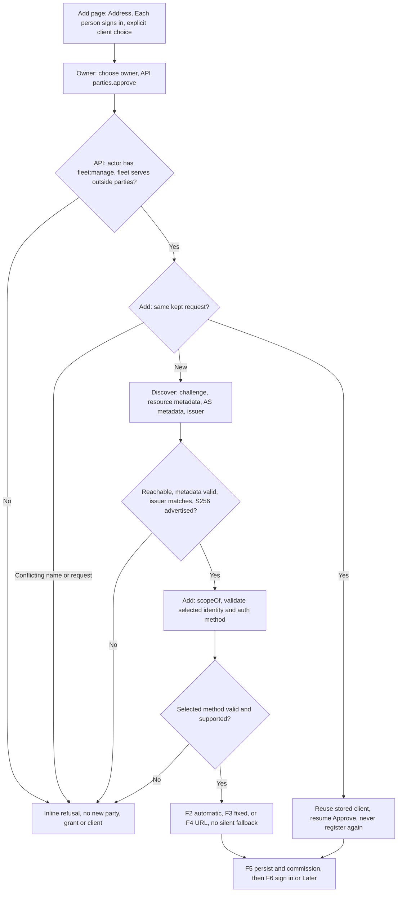
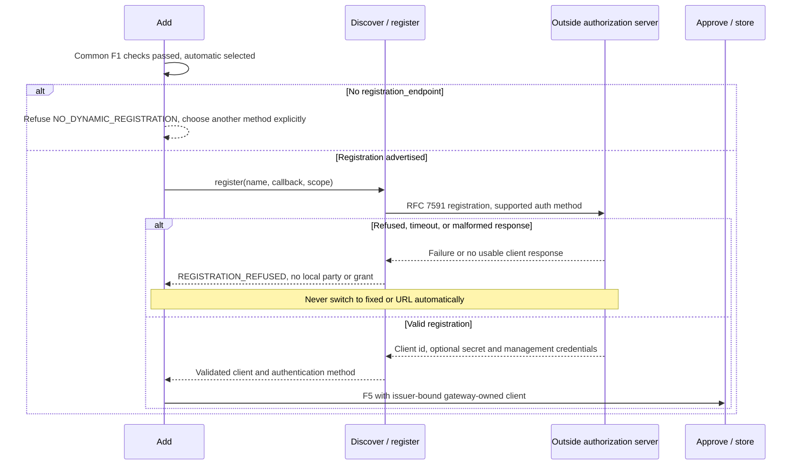
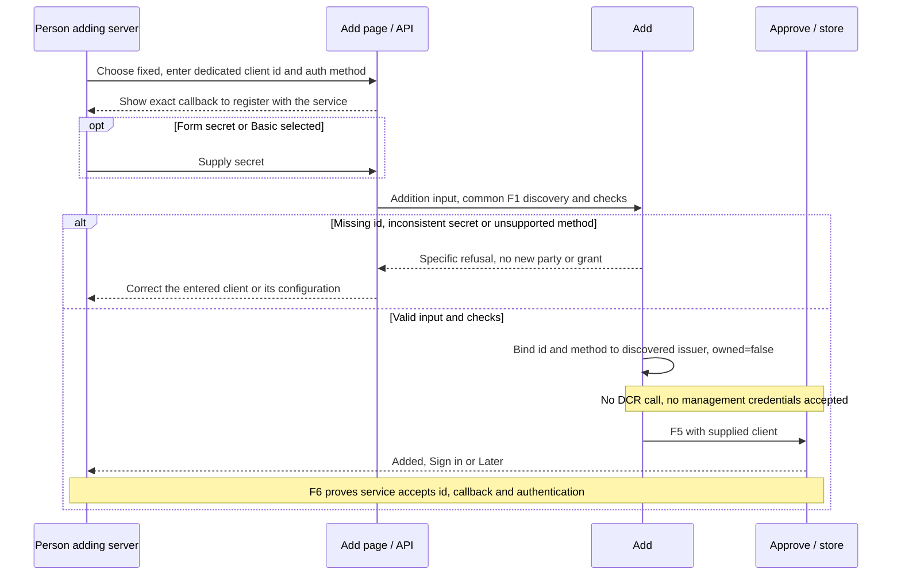
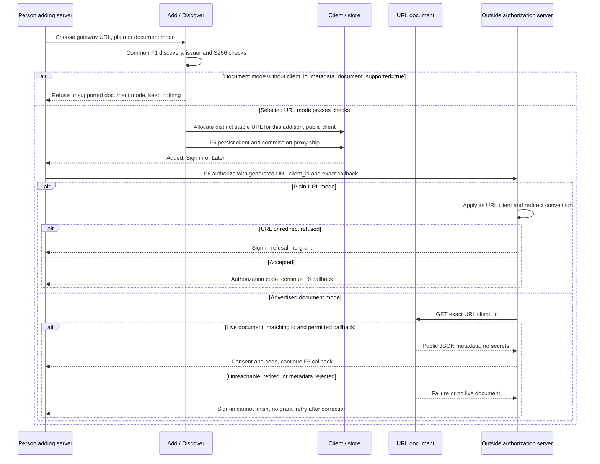
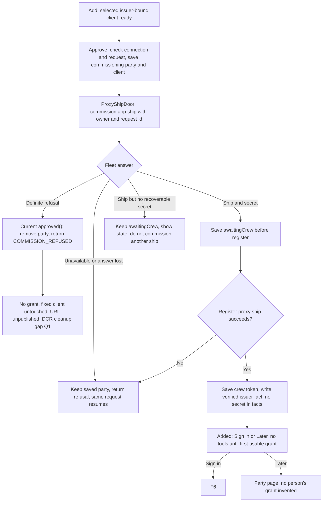
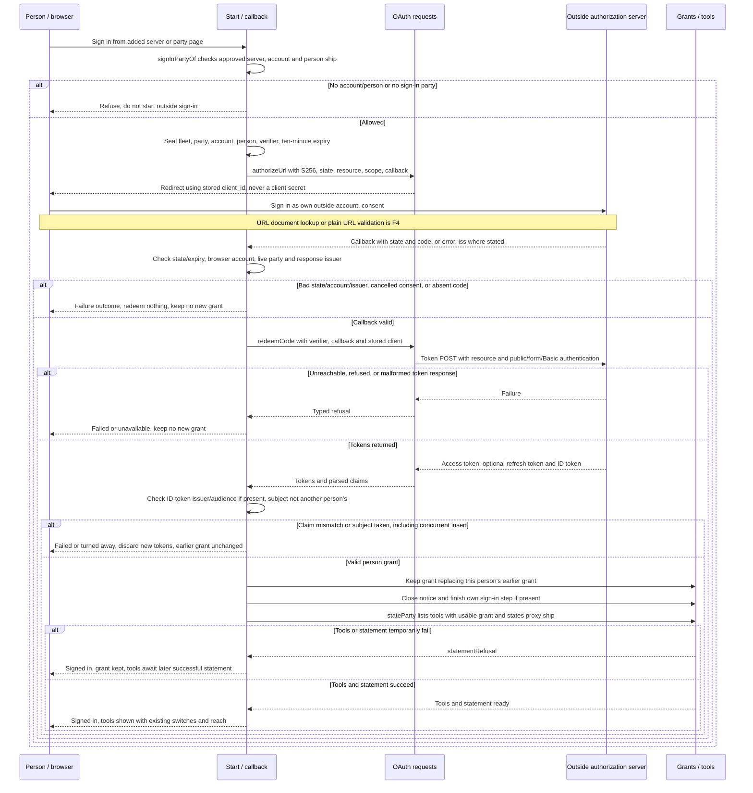
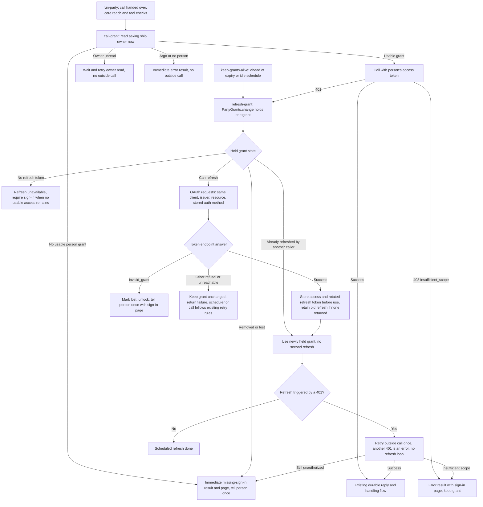
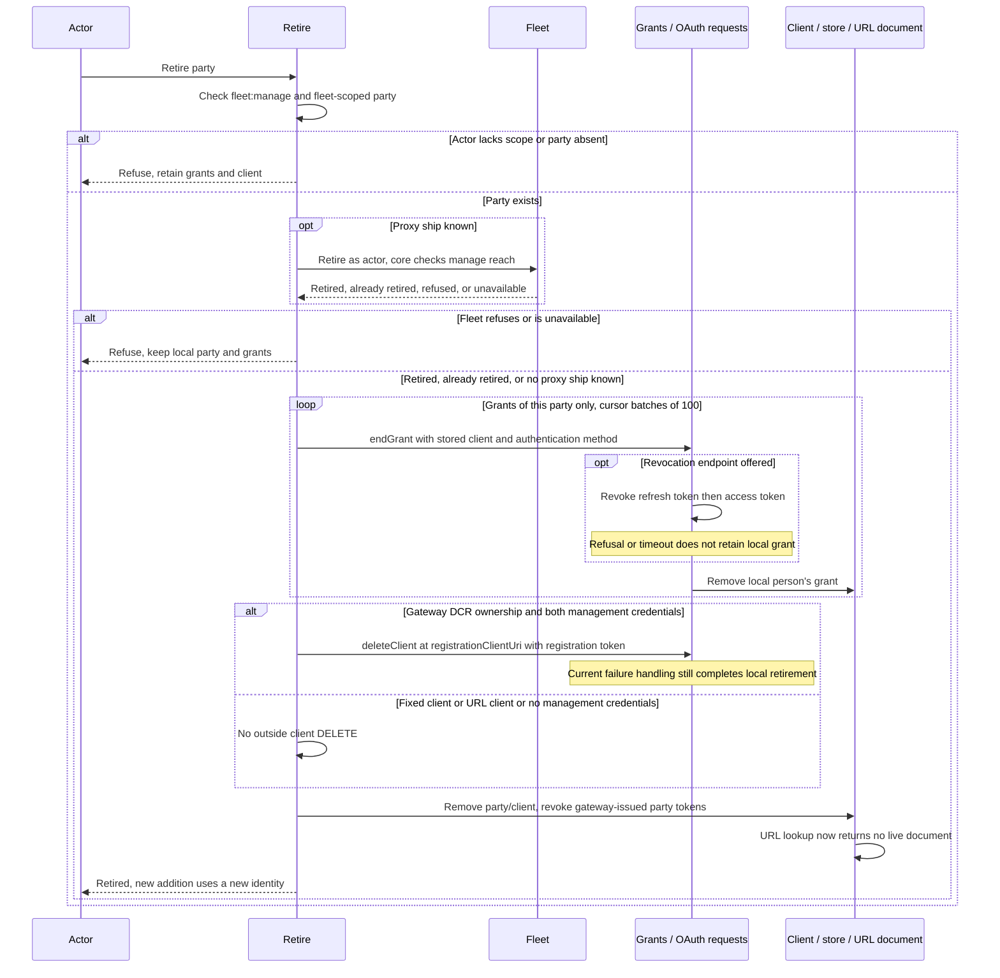

# Outside OAuth servers without automatic client registration

## Purpose agreed by Thomas

Let a fleet add an outside MCP server whose OAuth service does not register clients automatically, so each person signs in as their own outside account and their ships use that sign-in. Support an existing client id, with a secret where needed, and a gateway-controlled URL client id where the service accepts it. Preserve discovery, issuer checks, PKCE S256, grants per person, and tool and reach checks. Absence of automatic registration alone must no longer prevent addition. This does not promise compatibility with every OAuth service or a particular Home Assistant installation.

Authority: [gateway issue 348, first pass and Thomas's answers](https://github.com/ThomasHendrickx/aeolus-fleet-gateway/issues/348#issuecomment-6880173708). This design proposes the detailed flows below for approval. It contains no implementation slices.

## Lessons to check against

- [0067](../../decisions/0067-outside-oauth-sign-ins.md) requires dynamic client registration (DCR) and defers entered clients and client metadata documents (CIMD). Those are the clauses this design changes; whose grant a call uses is unchanged. Its client-per-party rationale is isolation between fleets, separate consent and client retirement.
- The gateway's [approved addition guide](https://github.com/ThomasHendrickx/aeolus-fleet-gateway/blob/main/docs/guide/add-an-outside-mcp-server.md) keeps Address, Owner, Sign in, with Later allowed and tools shown after the first sign-in. Direct addition requires `fleet:manage`; tool switches require `gateway:approve`. Request approval does not offer Each person signs in. The older OAuth design's use of “approver” does not change these permissions.
- [0016](../../decisions/0016-no-policy.md), [0056](../../decisions/0056-outside-parties.md) and [0057](../../decisions/0057-actors.md) leave permission to core's scopes and reach. Outside credentials stay in the gateway, never ship messages, statements or verified facts. Normal addition does not go through argo.
- `createAddSignInServer` currently checks discovery and S256, then requires `registration_endpoint`; a repeat of a kept request reuses its client. Discovery, obtaining a client and commissioning a proxy ship are separate operations.
- `createAuthorizationServers` discovers protected-resource and authorization-server metadata and checks the issuer through the MCP SDK. It currently drops CIMD and token-authentication capability information. Missing DCR does not mean missing discovery.
- `SignInClient` allows a null secret and null registration-management fields; `clientAuthenticationOf` currently infers public versus form-secret authentication from the secret alone. Basic authentication needs an explicit method carried through code redemption, refresh and revocation.
- `createCompletePartySignIn` checks the sealed ten-minute state, browser account, response issuer and returned ID-token issuer/audience, then stores a per-person grant. Owner selection, refresh locking, first tool reading and sign-in-needed notices already exist.
- `createEndPartyGrants` currently deletes a client if both registration-management fields exist. A supplied client is outside the gateway's ownership; a URL client has no DCR registration to delete. Ownership must remain explicit throughout retirement.
- `src/adapters/oauth/client-metadata-documents.ts` reads inbound clients' documents. An outbound gateway document is a new publisher, not that reader with its direction reversed.
- [Home Assistant authentication](https://contributors.home-assistant.io/core/internals/auth-api/) distinguishes website URL client ids from metadata documents and applies redirect-address constraints. Its authentication documentation does not establish that a target MCP installation passes the gateway's protected-resource discovery checks.
- [MCP authorization](https://modelcontextprotocol.io/specification/2026-07-28/basic/authorization) supports several client identity mechanisms. The explicit default here follows Thomas's answer; it is not an automatic retry ladder inferred from the spec. [0013](../../decisions/0013-breaking-changes-before-1-0.md) calls for a minimal design without a compatibility framework.

## Decisions answered by Thomas

- D1: Remove only the client-registration blocker; retain discovery and all existing sign-in, grant, tool and reach checks.
- D2: Keep automatic registration as the default and offer explicit fixed-client and URL-client choices; a refusal never silently switches identity.
- D3: Generate one gateway-controlled URL client id per server added; ask for a fixed client dedicated to that server, without adding an unapproved uniqueness prohibition.
- D4: Support plain URL client ids and gateway metadata documents when the authorization server advertises CIMD support.
- D5: Support public clients (`none`), form secrets (`client_secret_post`) and Basic headers (`client_secret_basic`).

## Draft superseding decision text for Thomas's approval

Proposed replacement for 0067's **Registration** paragraph:

> **Client identity.** Every party has one OAuth client bound to its discovered issuer; every person's grant of the party uses that client. Automatic dynamic registration (RFC 7591) remains the default. The person adding the server may instead enter an existing client id, with a secret and its authentication method where required, or choose a gateway-controlled URL client id unique to that addition. Ask for an entered client dedicated to that server. URL ids support the service's plain URL convention or a gateway-owned client metadata document when the service advertises support. A failed or refused selected method never silently selects another. Public, client_secret_post and client_secret_basic clients are supported. Discovery from the protected resource, issuer binding, PKCE S256 or refusal, resource in authorization and token requests, state and issuer checks, and the existing outside-scope selection remain required.

Proposed replacement for the client clause in **Ending a grant**:

> Retiring the party ends all its grants, revoking their tokens where offered and dropping them locally regardless of revocation success. Delete an outside client only when the gateway dynamically registered it for this party and holds its registration-management credentials. Never delete an entered client. A gateway URL document is withdrawn when its party is retired; there is no outside registration to delete.

Proposed replacement for the relevant **Rejected** clause:

> Rejected: requiring pre-registered clients as the only method; silently falling back after registration refusal; one gateway URL client id shared across parties. Entered clients and client metadata documents are supported as explicit choices.

The rest of 0067, including per-person ownership, consent, grants and call handling, remains in force. On approval, update 0067 and its index line together, replacing the entered-client/CIMD deferral and DCR-only refusal. This file is the draft; it does not mark that decision approved or allocate a new decision number.

## Flow vocabulary and code ownership

All code paths below are in `ThomasHendrickx/aeolus-fleet-gateway`. Names are existing code unless explicitly marked proposed. Diagrams describe the intended behavior, including unchanged steps, rather than claiming it already exists.

| Diagram name | Code touched by that step |
| --- | --- |
| Add page | `web/features/add-server/actions.ts` (`checkServer`, `approveServer`), `web/features/forms/server-credential.ts`, `web/features/add-server/ui/`, `web/features/add-server/ui/sign-in-step.tsx` |
| API | `src/adapters/trpc/router.ts`: `serverCredentialInputSchema`, `parties.approve`, existing actor and scope checks |
| Add | `src/core/parties/add-sign-in-server.ts`: `createAddSignInServer`, `scopeOf`; `src/core/parties/ports.ts`: `AuthorizationServers`, `DiscoveredSignIn` |
| Discover / register | `src/adapters/oauth/authorization-servers.ts`: `createAuthorizationServers`, `discover`, `register` |
| Client / store | `src/core/vault/credential.ts`: `SignInClient`; `src/adapters/prisma/party-store.ts`, `src/adapters/prisma/schema.prisma`: party credential persistence |
| Approve / fleet | `src/core/parties/approve-party.ts`: `createApproveParty`, `approved`; `ProxyShipDoor` in `src/core/parties/ports.ts`; `src/app.ts` wiring |
| URL document | Proposed outbound HTTP publisher wired in `src/app.ts` beside `src/adapters/http/party-sign-in-routes.ts`; proposed persisted URL identity lookup in `PartyStore` and `party-store.ts`; no existing outbound publisher |
| Start / callback | `src/core/party-grants/start-party-sign-in.ts`: `createStartPartySignIn`; `src/core/party-grants/complete-party-sign-in.ts`: `createCompletePartySignIn`; `src/adapters/http/party-sign-in-routes.ts`: `registerPartySignInRoutes` |
| OAuth requests | `src/adapters/oauth/party-sign-ins.ts`: `createPartySignIns`, `clientAuthenticationOf`, `posted`, `redeemCode`, `refresh`, `revoke`, `deleteClient` |
| Grants / tools | `src/adapters/prisma/party-grants.ts`; `src/core/party-grants/ports.ts`; `src/core/mcp-out/state-party.ts`; `src/core/party-grants/listing-connection.ts`; `src/core/parties/read-party-tools.ts` |
| Calls / refresh | `src/core/party-grants/call-grant.ts`, `refresh-grant.ts`, `keep-grants-alive.ts`, `tell-sign-in-needed.ts`; `src/core/mcp-out/run-party.ts`, `hand-call.ts`, `grant-calls.ts` (`createGrantCalls`) |
| Retire | `src/core/parties/retire-party.ts`, `src/core/party-grants/end-party-grants.ts`, `end-grant.ts`; party and grant stores above |

### Client information carried between the steps

Proposed: keep the selected source (automatic, fixed or URL), token authentication method and gateway ownership with the issuer-bound `SignInClient`. Only automatic registration can supply registration-management credentials. Never accept those management credentials through the fixed-client form. URL clients are public. Fixed clients explicitly select public, form secret or Basic; secrets are required for the latter two and absent for public clients. Reject unsupported methods rather than guessing from a supplied secret. Check discovered capabilities, applying the OAuth metadata defaults when omitted; registration responses must agree with the supported selected authentication method.

Use `client_id` without a secret for public token requests; put the secret in the form only for `client_secret_post`; for `client_secret_basic`, encode the client id and secret as OAuth requires and send them in `Authorization: Basic`, with no secret in the form. Code redemption and refresh use the same stored method. Revocation uses the endpoint's advertised methods where given, otherwise its OAuth defaults; do not change identity to work around refusal. The authorize URL always uses the client id and never its secret. Preserve `resource`, PKCE and scope calculation. Client secrets and registration tokens do not enter logs or ordinary party output.

Each generated URL uses an opaque, stable identity for the addition, not just the party name or issuer. A repeat of that addition reuses it; retiring and adding the same name again gets a new URL. Proposed path: `https://<gateway>/outside-oauth/clients/<opaque-id>`. Keep its fleet association in the gateway; do not expose fleet credentials. The URL is public identity information, not a bearer credential.

In document mode, serve JSON at that exact URL, without account sign-in, containing matching `client_id`, a client name, the exact gateway callback in `redirect_uris`, `grant_types` for authorization code and refresh, `response_types: ["code"]`, and `token_endpoint_auth_method: "none"`. No person, grant, token or management credential belongs in it. Plain mode uses the distinct URL as the client id without claiming CIMD support. An explicit plain choice supplies the service-specific intent; missing DCR alone is not evidence it accepts URL ids. A service whose redirect rules cannot accept the gateway callback remains incompatible.

The proposed publisher does one indexed lookup by opaque identity, scoped internally to its owning fleet/party, and returns only the public document of a live party. It does not scan all fleets or grants. At the fleet's design scale of 3,000 ships and 10 million messages, that read is independent of message count; apply the repository's p95 <100 ms and p99 <500 ms local-read budgets, excluding outside-service latency. No cache is needed initially, so retirement takes effect on the next gateway read; an authorization server's cached document may outlive that response but cannot restore local grants or the retired proxy ship.

## Full flows

### F1: common addition and checks, including refusal

The sign-in credential still bypasses pre-sign-in tool reading in `checkServer`. Discovery checks occur in `createAddSignInServer` on addition. A discovery timeout, absent protected-resource/AS metadata, issuer mismatch, missing S256, unsupported authentication or absent CIMD advertisement for document mode returns a specific reason at the addition step. It keeps no new local party or grant and sends no secret to an unvalidated issuer. Fixed-client acceptance and the person's consent cannot be proven by discovery: token or redirect refusal appears during F6. Success adding a server therefore does not falsely claim a working sign-in.

### F2: automatic registration

The current registration request asks for `client_secret_post`; retain that request rather than inventing a preference ladder. Validate the returned method, including the applicable registration default when omitted, against supported public/form/Basic handling and discovered capabilities. Missing DCR remains an error for the automatic choice alone. If the outside service registers a client but its response is lost, the gateway has no id or management token to delete it; this is an existing remote-registration uncertainty, not permission to repeat under a different identity. See open question 1 for the post-registration commission-refusal gap.

### F3: fixed client id

A fixed client can itself have a URL-shaped id; this remains the fixed choice when the person supplies it. Do not confuse OAuth client authentication with the existing `clientCredentials` server credential: every person still completes authorization code sign-in.

### F4: gateway URL client id, plain and metadata document

The document must be available before redirecting the first person to consent. Publish only the kept live party, and keep the callback identical to `PARTY_SIGN_IN_DONE_PATH` under the configured public gateway address. Retrying an addition after F5 has kept it reuses its URL; it does not publish another identity. A refused URL sign-in does not fall back to DCR or a fixed id.

### F5: keep the party, commission and crew the proxy ship

`approved` persists before each fleet step and reuses the same request. A verified-fact refusal does not undo addition; a repeat retries facts. The diagrams preserve these existing outcomes. No part of a failed check authorizes deletion of a supplied client. Outside client registration and fleet commission are not one transaction.

### F6: first sign-in and first tool reading, all client choices

`registerPartySignInRoutes` maps typed outcomes to the party page and logs statement failure without tokens. Later statements can use another usable grant, most recently used first. A new client mechanism does not allow one person to sign in for another, nor argo to supply a grant for its ships.

### F7: refresh and calls

`createGrantCalls` in `src/core/mcp-out/grant-calls.ts` also refreshes a near-expiry grant before hand-over. If that refresh fails while the held access token remains usable, the call can still use it; `invalid_grant` or a removed grant cannot. An unreachable refresh after expiry stays on the existing not-sent retry path. The refresh lock and persistence are `createRefreshGrant` and the Prisma `PartyGrants.change` implementation. Never send a fixed client secret to an issuer newly inferred from a failed call. The stored client remains bound to the checked issuer. No calls wait for a person to sign in; the existing durable result and notice behavior remains. Client authentication changes apply equally to scheduled refresh and 401-triggered refresh.

### F8: retire without deleting a client the gateway does not own

Only the retired party's grants are traversed, scoped by fleet and party; unrelated grants are untouched. Failure to revoke tokens or delete an owned DCR client cannot be reported as successful remote cleanup, even though current code completes local retirement. Revocation removes grants, not the supplied client. A retired document cannot start a new local sign-in: both start and callback require the live party. Outside caches do not give a retired proxy ship permission to act.

## Open questions

1. After DCR succeeds but fleet commission is definitely refused, should the gateway best-effort delete the client it just registered, or retain a recoverable addition until cleanup succeeds? `approved()` currently removes the party on definite commission refusal and has no client-cleanup hook; Thomas's answers choose client identities but do not settle this failure boundary. Proposed answer: best-effort deletion only for this addition's gateway-owned DCR client, with an explicit cleanup failure report; never touch a supplied client. A lost registration response remains unrecoverable without a client id or management credentials. This question does not change pre-registration check failures or the explicit no-fallback decision.
