# Outside MCP servers that take only an OAuth sign-in

Design for the gateway calling outside MCP servers that accept only the authorization code flow, where a human signs in and consents in a browser, such as Attio's hosted server `https://mcp.attio.com/mcp` ("Authentication is OAuth only", no API key). Docs only: purpose, lessons, decisions, the flow, acceptance scenarios and the build slices.

Approved by Thomas on 28 Oct 2026, with his answers to Q14 to Q17 below as the approval. The build starts from its slices.

## 1. Purpose

In Thomas's words (28 Oct 2026): "I would make a dedicated Aeolus account in attio ... problem is tracking, but this is core of our setups. We connect your apps, so this needs to work".

Today an outside MCP server's credential is none, a static bearer or OAuth client credentials (gateway README, `parties.approve`; `McpServerCredential`). A server that only takes a browser sign-in cannot be added, so it cannot join a fleet.

For whom: the approver who adds an outside MCP server to a fleet (an actor holding `gateway:approve`, 0056), and every ship that calls it through its proxy ship.

After this, they can:
1. Add an OAuth-only server such as Attio, where each person signs in to it once in a browser, as their own outside account, and consents.
2. Have every ship within reach call its tools as today, by a message to the proxy ship, with no session holding the outside credential.
3. Keep calling it for as long as the outside service allows, without a human signing in again while the grant holds.
4. Learn, as the right human, when the grant is lost, and sign in again; no call is lost meanwhile.
5. See which ship made which call, while the outside service sees which person each call is for.

Not the purpose:
- Outside MCP clients signing in to the gateway: built (gateway README, "MCP clients sign in").
- Passing a ship's or a person's own token to the outside server: MCP forbids token passthrough (L4).
- Outside A2A agents behind an OAuth sign-in: the same question, a later design once this one holds.
- Changing what the outside service records in its own audit log: the gateway cannot.
- Rights travelling with a message: the outside account's rights never become fleet scopes, and fleet scopes never widen the outside account's (interop, "No rights travel with a message").

## 2. Lessons to check against

### The MCP authorization spec, client side (2026-07-28)

| # | Lesson | Source |
| --- | --- | --- |
| L1 | A client finds the authorization server from the 401's `WWW-Authenticate` `resource_metadata`, else `/.well-known/oauth-protected-resource`, then RFC 8414 or OIDC metadata, and checks the `issuer` matches. | [Authorization server discovery](https://modelcontextprotocol.io/specification/2026-07-28/basic/authorization/authorization-server-discovery) |
| L2 | A client gets a client id in this order: pre-registered, then a client ID metadata document (CIMD) where `client_id_metadata_document_supported`, then dynamic registration (RFC 7591, MAY and marked deprecated), then ask the user. | [Client registration](https://modelcontextprotocol.io/specification/2026-07-28/basic/authorization/client-registration) |
| L3 | Client credentials are bound to the issuer that issued them and never used with another. | Client registration, "Authorization Server Binding" |
| L4 | A client never sends a server a token not issued for it; a server never passes its inbound token on. | [Authorization](https://modelcontextprotocol.io/specification/2026-07-28/basic/authorization), "Token Handling"; security considerations, "Access Token Privilege Restriction" |
| L5 | PKCE with S256 is required, and a client refuses an authorization server that does not state it. `resource` (RFC 8707) goes in both the authorize and the token request. The client checks `iss` (RFC 9207) before redeeming the code, and uses and checks `state`. | Authorization, "Resource Parameter Implementation", "Authorization Response Validation"; security considerations |
| L6 | Scopes: the 401's `scope` if given, else all of `scopes_supported`. On `insufficient_scope` a client acting for a user asks again for the union, with retry limits. | Authorization, "Scope Selection Strategy", "Step-Up Authorization Flow" |
| L7 | Refresh tokens are kept confidential in storage and transit, never assumed to be issued; `offline_access` may be asked when listed. The authorization server must rotate them for public clients. | Authorization, "Refresh Tokens"; security considerations, "Token Theft" |
| L8 | The spec neither allows nor forbids a long-running server using a grant a human gave once; a confidential client holding a refresh token is the fit. Client credentials and enterprise-managed authorization (ID-JAG) are the non-interactive extensions, and need the outside service to support them. | Authorization, "Refresh Tokens"; [ext-auth](https://github.com/modelcontextprotocol/ext-auth) |
| L9 | A proxy using one static client id for many users must get consent per client before forwarding to a third-party authorization server (confused deputy). | Security considerations, "Confused Deputy Problem" |

### Attio, the first such server (read 28 Oct 2026)

| # | Lesson | Source |
| --- | --- | --- |
| L10 | Attio's protected resource names `https://app.attio.com` as authorization server, scopes `mcp`, `offline_access`, `openid`. Its metadata offers dynamic registration (`https://app.attio.com/oauth/register`), no CIMD, `authorization_code` and `refresh_token`, PKCE S256, client auth `none` or `client_secret_post`, and no `iss` in the response. | [PRM](https://mcp.attio.com/.well-known/oauth-protected-resource); [AS metadata](https://mcp.attio.com/.well-known/oauth-authorization-server) |
| L11 | Attio MCP acts with "the same permissions as your Attio user account"; sessions are revoked in the account's settings. | [Attio MCP overview](https://docs.attio.com/mcp/overview.md) |
| L12 | Attio's actors are `workspace-member`, `api-token` and `system`; every MCP call of a shared account records that one member. Whether it says "via" an app is not documented. | [Actors](https://docs.attio.com/docs/actors.md) |
| L13 | Attio's REST tokens "do not currently expire"; refresh token lifetime and rotation for MCP are not documented, so the gateway cannot rely on either. | [Identify](https://docs.attio.com/rest-api/endpoint-reference/meta/identify.md); [Token](https://docs.attio.com/docs/oauth/token.md) |

### Comparable products

| # | Lesson | Source |
| --- | --- | --- |
| L14 | Products split into one shared grant owned by one human (Zapier, Make, n8n, Workato's parent connection, Copilot Studio's "agent author authentication") and a grant per user (Claude and ChatGPT org connectors, Copilot Studio's "user authentication", Composio, Arcade, Pipedream Connect). Only per-user grants show the causing person in the outside service's own audit. | [Claude connectors](https://support.claude.com/en/articles/11175166-get-started-with-custom-connectors-using-remote-mcp); [Copilot Studio](https://learn.microsoft.com/en-us/microsoft-copilot-studio/configure-enduser-authentication); [Zapier](https://help.zapier.com/hc/en-us/articles/8496290788109); [Composio](https://docs.composio.dev/docs/authentication) |
| L15 | No shared-grant product documents tracing a call to the agent or user that caused it; that trace is the caller's own log. | Same sources (absence) |
| L16 | Lost grant: Zapier's owner clicks Reconnect and keeps the same outside account; Composio marks the account `EXPIRED`, fires a webhook and sends a new link; Copilot Studio shows a Connect card and retries after consent; Claude Code refreshes on 401, retries once, then asks for re-authentication. | Zapier; Composio; Copilot Studio; [Claude Code MCP](https://code.claude.com/docs/en/mcp) |
| L17 | Headless agents cannot run the browser step: Claude Code's `-p` and Agent SDK sessions must sign in from an interactive session first. The human step is always outside the agent. | Claude Code MCP |
| L18 | Re-consenting must need a right to change the grant, not read it: n8n's CVE-2026-45732 let a read-only user reconnect a shared OAuth credential. | [OSV CVE-2026-45732](https://osv.dev/vulnerability/CVE-2026-45732) |
| L19 | Rotating refresh tokens (Slack, Salesforce RTR) invalidate the old token on use: a client stores the newest one before using it and refreshes one at a time, or loses the grant in a race. | [Slack token rotation](https://docs.slack.dev/authentication/using-token-rotation); [Salesforce ECA](https://developer.salesforce.com/docs/atlas.en-us.packagingGuide.meta/packagingGuide/secure_code_ac_eca.htm) |
| L20 | Grants die by policy, not only by revocation: Google's refresh tokens end after 7 days for an app in Testing, after 6 months unused, and the oldest goes silently past 100 per account and client. | [Google OAuth](https://developers.google.com/identity/protocols/oauth2) |
| L21 | OAuth security BCP: public clients' refresh tokens must be rotated or sender-constrained; a confidential client's are bound to its client authentication. | [RFC 9700](https://datatracker.ietf.org/doc/html/rfc9700), 2.2.2 |

### The fleet's own rules

| # | Lesson | Source |
| --- | --- | --- |
| L22 | An outside MCP server is an outside party with a proxy ship of kind `app`, whose owner is a person ship and core's alone; an actor holding `gateway:approve` adds it, granting only scopes it holds. | [0056](../../decisions/0056-outside-parties.md); [0044](../../decisions/0044-ship-kinds.md); [0045](../../decisions/0045-owners.md) |
| L23 | A server never asks: an approver adds it, also when a person asked for it with `aeolus_ask_for_server`. Approving is ordinary work and never goes to argo; argo is the fail-safe, never a normal path. | 0056; [0057](../../decisions/0057-actors.md); [0012](../../decisions/0012-operator-is-a-ship.md) |
| L24 | No rights travel with a message; the outside server sees the gateway's credential, never the asker's. The gateway holds outside credentials and proxy ships' crew tokens; no session does. | interop, "No rights travel with a message", "Contained access" (branch `design/interop`); gateway `src/core/vault/credential.ts` |
| L25 | The gateway keeps outside credentials as they are in its own database: a key on the same server would protect only backups. | gateway README, "Parties" |
| L26 | Every call is a message from the asking ship to the proxy ship, stored before the send returns OK, with its sender in core's history; the gateway keeps each call, so a restart never calls again what may have run. | blueprint, "Guaranteed communication"; gateway README, "MCP out" |
| L27 | A call the server never got, unreachable or refusing the credential, is handed again after a wait and stopped at the fifth attempt; one that may have run is reported not handled for a human. | gateway README, "MCP out"; [0040](../../decisions/0040-delivery-protocol.md) |
| L28 | A question for a human goes to a ship's owner (0038); the person who asked for a server hears the outcome as a message to their person ship. | [0038](../../decisions/0038-questions.md); 0056 |
| L29 | Each tool of a server has a switch per party; what the outside account may do is wider than what the fleet switches on. | gateway README, tool switches (aeolus-fleet#1151) |
| L30 | The gateway writes what it checked about a proxy ship as verified facts (`tlsHost`, an issuer for an OAuth subject), never a credential. | [0059](../../decisions/0059-verified-facts.md) |
| L31 | Every event names its actor; events and messages go with the fleet's retention. | 0057; [0066](../../decisions/0066-retention.md) |
| L32 | Domain language: "connect" is only argo connecting a plugin; a human logs in with a sign-in; an IdP login is an identity. | [0050](../../decisions/0050-domain-language.md) |
| L33 | Before 1.0.0: minimal designs, no paid-product polish for zero customers. | [0013](../../decisions/0013-breaking-changes-before-1-0.md) |

## 3. Decisions (Thomas, 28 Oct)

Every ship has an owner, a person ship or argo, and a person ship owns itself (0045). "The person" for a call is the owner of the asking ship. A grant is one person's sign-in to one party: the outside account it names, its access token and its refresh token, kept by the gateway (L24, L25).

- **Q1 Whose identity the calls carry: a grant per person.** Each person signs in to the outside service as their own outside account, and a ship's call goes out under the grant of the person who answers for it. Why: "This is the building block type of work that would allow us to sell actual value pieces" (Thomas); it is the per-user model of L14, the only one where the outside service's own audit shows the causing person. Rejected: one shared grant owned by one human.
- **Q2 Tracking: one outside account per person.** The outside service records each call as the person's own outside account, so its own audit names them (L12, L14); core's history still names the asking ship (L26). Rejected: the fleet's own record as the only trace; stamping the asking ship's name into the outside call.
- **Q3 Where a person signs in: on the gateway's page for the server.** The page that adds a server is also where each person signs in for themselves, sent to the outside service and back. Rejected: a link to a human the approver names; argo only.
- **Q4 Registration: a client per party, by dynamic registration.** The gateway registers once per party with the outside authorization server (RFC 7591), and every person's grant for that party is under that party's client, bound to its issuer (L3). Why: one fleet's grants stay apart from another's when a party is retired or its client revoked, and the consent screen each person sees names the party; each person consenting to the client is the per-client consent L9 asks for. Rejected: one client per issuer per gateway installation; pre-registered only. CIMD comes when the first server offers it.
- **Q5 A call whose person has no usable grant: answered at once with an error result.** No sign-in yet, a refresh answered `invalid_grant`, a revoked grant or one ended unused: the gateway answers the call with an error result naming the missing sign-in and the page to sign in on, then reports it handled; the server never sees the call. Why: every call is answered, so none is lost, and the asking ship learns the cause at once. Rejected: keeping the call until the person signs in (holds it for a human who may never come); today's five attempts (fails late for a cause no retry fixes).
- **Q6 Who is told, who signs in or removes.** The person is told once per party, by a text message from the gateway's ship to their person ship with the page's link, and again only after a sign-in in between. Only the person signs in, and removes their own grant. An actor holding `gateway:approve` within manage reach of the proxy ship may also remove any person's grant. A person's grants go when their person ship is retired. Why: the person is the only one who can act; an approver removing a grant cuts a party off for one person without retiring it (L18). Rejected: only the person ever removes a grant; telling the proxy ship's owner too (work they cannot do).
- **Q7 Keeping a grant alive: refresh ahead and while idle.** The gateway refreshes ahead of the access token's expiry and on a schedule while the grant is idle, one refresh at a time per grant, storing the new refresh token before it is used (L19, L20). Why: a person who calls rarely stays signed in, and a failed refresh is found before a call needs it, so Q6's message comes early. Rejected: refreshing only when a call needs it.
- **Q8 Outside scopes: the spec's default.** The 401's `scope`, else all `scopes_supported`, adding `offline_access` and `openid` when listed (L6, L10). The tool switches narrow what ships reach (L29). Rejected: the approver picking scopes.
- **Q9 When a person signs in: on the page, and told at first need.** The page is the one place to sign in, whenever the person chooses; the first call without a usable grant also sends the person Q6's message. Why: the right person learns at the moment it matters, and nobody who never uses the server is messaged. Rejected: the page only; inviting every person in reach when the server is added.
- **Q10 A ship owned by argo: refused.** Its call is answered with an error result saying the ship has no person who can sign in; it calls once a person owns it (`fleet.setOwner`). Why: every call carries a real person's outside account, as Q2 decided. Rejected: argo signing in once for every ship it owns (ordinary work through argo, and the shared account back); a person the approver names per party (their outside rights acting for ships they never answer for).
- **Q11 A grant serves every ship its person owns.** Every ship the person owns, their person ship included, calls under their grant, within reach and the tool switches; a change of owner moves a ship to the new owner's grant from its next call. Why: ownership already says who answers for a ship (L33). Rejected: the person picking which of their ships may use their grant.
- **Q12 Who sees grants.** Each person sees their own grant on the page: the outside account, when signed in, last used, and its state. Every actor holding `gateway:approve` within manage reach of the proxy ship sees the list of all of them, never a token. The proxy ship's verified facts keep the issuer only (0059). Why: an approver must see who is set up to remove a leaver's or a wrong grant. Rejected: each person seeing only their own.
- **Q13 Two persons, one outside account: refused where the gateway can tell.** Where the server gives an `openid` subject, a second person's sign-in as an outside account another person's grant already names is turned away with why; where it gives none, the list (Q12) shows what the gateway knows. Why: a shared outside account is the shared grant Q1 turned away. Rejected: allowed and shown; allowed without a word.
- **Q14 A leaver's grants: removed when the account is disabled.** When pagasae tells the gateway an account was disabled, as it stops a Slack link, the gateway removes every grant of that account; the account's ships then answer as Q5 until a new owner signs in (Q11). Why: a leaver's outside account must stop acting for the fleet when their access does; disabling an account keeps their ships (0055), which would otherwise still call as the leaver. Rejected: grants going only when the person ship is retired.
- **Q15 Whose grant reads the server's tools: the approver's, then any usable grant.** Adding a server ends with the approver signing in for themselves; their grant reads `tools/list` for the proxy ship's statement and the tool switches. Later statements use any usable grant, the most recently used first. Why: the approver who adds a server is a person too and is the one who checks its tools. Rejected: the proxy ship unstated, and its tools unswitched, until any person signs in (a party no ship can see until someone happens to sign in).
- **Q16 Who may sign in on the server's page: every account of the fleet with a person ship.** Each sees the server's page with their own sign-in; changing the party still needs its scopes. Why: who reaches the server changes with labels and rules, and tying the page to it would hide the sign-in from a person whose ship gets reach tomorrow; a grant alone calls nothing, as reach, the switches and the scope check gate every call (L29). Rejected: only accounts whose owned ships may reach the proxy ship.
- **Q17 A server without dynamic registration: refused, for now.** Adding a server whose authorization server offers no `registration_endpoint` is refused saying so, and nothing is kept. Why: Q4 registers a client per party by dynamic registration, and the first server, Attio, offers it (L10). Rejected for now: a pre-registered client id the approver enters; CIMD comes when the first server offers it (Q4).

## 4. Flow

```mermaid
flowchart TD
  subgraph ADD["Add a server"]
    A1["Approver enters the server's URL on /outside-parties/add, credential: each person signs in"] --> A2{"401 with resource_metadata, or /.well-known/oauth-protected-resource?"}
    A2 -- no --> AX1["Refused: the server states no authorization server. Nothing kept"]
    A2 -- yes --> A3{"Authorization server metadata found, issuer matches, PKCE S256 stated?"}
    A3 -- no --> AX2["Refused, naming the failed check. Nothing kept"]
    A3 -- yes --> A4{"registration_endpoint offered?"}
    A4 -- no --> AX3["Refused: the server offers no dynamic registration (Q17). Nothing kept"]
    A4 -- yes --> A5["Dynamic registration for this party: redirect URI, client name naming the party (Q4)"]
    A5 -- refused or no answer --> AX4["Refused with the server's error. Nothing kept"]
    A5 -- client id and secret --> A6["Party kept with its client, bound to its issuer; proxy ship commissioned and crewed"]
    A6 --> A7["Approver signs in for themselves, as a person signs in (Q15)"]
    A7 --> A8["tools/list under the approver's grant; approver switches tools; proxy ship stated; issuer written as a verified fact"]
  end

  subgraph SIGN["A person signs in"]
    S1["Person opens the server's page, signed in through pagasae (Q16)"] --> S2["Sign in: gateway keeps state, PKCE verifier, resource; browser to authorize with Q8's scopes"]
    S2 --> S3{"Person consents at the outside service?"}
    S3 -- denies or closes --> SX1["Back on the page: not signed in, why. Nothing kept"]
    S3 -- consents --> S4{"Callback: state matches this browser, iss matches where stated?"}
    S4 -- no --> SX2["Sign-in failed page. Code never redeemed"]
    S4 -- yes --> S5["Code redeemed at the token endpoint with the party's client"]
    S5 -- refused --> SX3["Sign-in failed page with the server's error"]
    S5 -- tokens --> S6{"openid subject already another person's grant? (Q13)"}
    S6 -- yes --> SX4["Turned away: that outside account is another person's. Tokens dropped"]
    S6 -- no --> S7["Grant kept for this person and party, replacing their earlier one; page shows it signed in"]
  end

  subgraph CALL["A ship calls a tool"]
    C1["Ship sends the proxy ship a tool call; core stores it"] --> C2["Gateway takes the delivery: switch on? scopes held? (today's checks)"]
    C2 -- no --> CX0["Error result as today"]
    C2 -- yes --> C3["Read the asking ship's owner from core"]
    C3 -- core does not answer --> CX1["Handed again after a wait; never called unchecked"]
    C3 -- argo --> CX2["Error result: no person can sign in for this ship (Q10). Handled"]
    C3 -- a person --> C4{"That person holds a usable grant for this party?"}
    C4 -- no --> CX3["Error result naming the missing sign-in and the page (Q5); the person told once (Q6, Q9). Handled"]
    C4 -- yes --> C5{"Access token near its end?"}
    C5 -- yes --> R1
    C5 -- no --> C6["tools/call with the person's access token"]
    C6 -- result --> C7["Reply with the result; ack; handled; grant's last used set"]
    C6 -- 401 --> C8{"Refreshed for this call already?"}
    C8 -- no --> R1
    C8 -- yes --> CX3
    C6 -- 403 insufficient_scope --> CX5["Error result: sign in again on the page. Grant kept. Handled"]
    C6 -- unreachable, or no answer --> CX4["Today's rules: handed again, or not handled if it may have run"]
  end

  subgraph REFRESH["Refresh, one at a time per grant (Q7)"]
    R1["Take the grant's lock; another refresh under way: wait for it"] --> R2["Refresh token request with the party's client"]
    R2 -- new tokens --> R3["Store the new pair, then release the lock; the call goes on with C6"]
    R2 -- invalid_grant --> R4["Grant lost; the person told once (Q6)"] --> CX3
    R2 -- unreachable --> R5["Grant kept; the call is handed again after a wait; idle refresh tried again later"]
    RS["Schedule: idle grant or access token near its end"] --> R1
  end

  subgraph ENDING["Removal, owner change, retire"]
    E1["Person removes their grant, or an approver removes anyone's (Q6)"] --> E9
    E2["Asking ship's owner changes"] --> E3["Next call reads the new owner at C3 (Q11); grants unchanged"]
    E4["Proxy ship's owner changes"] --> E5["Grants unchanged; nobody is told about grants"]
    E6["Person ship retired, or account disabled (Q14)"] --> E9
    E7["Party retired"] --> E8["Every grant of the party revoked and dropped; the client deleted where the server offers it; party forgotten"]
    E9["Grant revoked at the server where it offers revocation, then dropped; the next call goes to CX3"]
  end
```

A call checks the grant when it is handed over, never earlier: a grant removed while a call waits refuses it, and one signed in while it waits lets it through. A call already made when its grant is removed completes.

## 5. Acceptance scenarios

### Add a server

1. **Given** an approver and Attio's metadata (L10), **when** they add `https://mcp.attio.com/mcp` with each person signing in, **then** the gateway registers one client for the party, keeps it bound to `https://app.attio.com`, commissions the proxy ship and sends the approver to sign in.
2. **Given** a server whose authorization server does not state PKCE S256, **when** an approver adds it, **then** it is refused naming PKCE S256, and nothing is kept.
3. **Given** a server that offers no dynamic registration, **when** an approver adds it, **then** it is refused saying so, and nothing is kept (Q17).
4. **Given** the approver just added Attio, **when** they sign in for themselves, **then** the gateway lists the tools under their grant, they switch tools, and the proxy ship is stated with the issuer as its verified fact (Q15).
5. **Given** two fleets that each add Attio, **when** both are added, **then** each party has its own client, and retiring one leaves the other's grants working (Q4).

### A person signs in

6. **Given** a person signed in to the gateway, **when** they press Sign in on Attio's page and consent, **then** their grant is kept with their outside account, and the page shows signed in.
7. **Given** a sign-in under way, **when** the callback comes with a `state` not this browser's, **then** the code is never redeemed and the sign-in failed page says why.
8. **Given** Mathilde's grant names outside account `sub-1`, **when** Joris signs in as `sub-1`, **then** Joris is turned away with why, and Mathilde's grant is untouched (Q13).
9. **Given** a person who already holds a grant, **when** they sign in again, **then** the new grant replaces the old one, and the message about a lost grant may be sent again after a later loss (Q6).
10. **Given** a person who denies consent at the outside service, **when** they come back, **then** the page says they are not signed in, and nothing is kept.

### A ship calls a tool

11. **Given** `lead-scout`, owned by Mathilde, who holds a grant, **when** it calls `search_records`, **then** the call goes out with Mathilde's access token, the result comes back as the reply, and Attio records Mathilde's outside account.
12. **Given** `lead-scout`, owned by Joris, who never signed in, **when** it calls a tool, **then** it gets at once an error result naming Joris's missing sign-in and the page, Joris's person ship gets one message with the link, and Attio never sees the call.
13. **Given** Joris was told and has not signed in, **when** another of his ships calls, **then** it gets the same error result and no second message is sent.
14. **Given** a ship owned by argo, **when** it calls a tool, **then** it gets an error result saying no person can sign in for it, and nobody is messaged (Q10).
15. **Given** a call waiting while its person signs in, **when** it is handed over, **then** it goes out under the new grant.
16. **Given** core does not answer the owner read, **when** a call is handed over, **then** it is handed again after a wait and never made without its person's grant.

### Refresh

17. **Given** a grant whose access token has expired, **when** two calls under it are handed over at once, **then** one refresh runs, both calls use the new token, and the old refresh token is never used again.
18. **Given** the server answers a call 401, **when** the refresh succeeds, **then** the call is made again once; a second 401 answers Q5's error result.
19. **Given** a refresh that answers `invalid_grant`, **when** it fails, **then** the grant is lost, the call gets Q5's error result, and the person is told once.
20. **Given** the authorization server is unreachable, **when** a refresh fails, **then** the grant is kept, the call is handed again after a wait as today (L27), and the idle refresh is tried again later.
21. **Given** a grant idle for longer than its refresh schedule, **when** the schedule passes, **then** the gateway refreshes it without a call, storing the new refresh token before it is used (Q7).
22. **Given** the gateway stops after the server rotated a refresh token and before it stored the new one, **when** it starts again, **then** the next refresh answers `invalid_grant`, the grant is lost and the person is told; no call is lost.
23. **Given** a call answered 403 `insufficient_scope`, **when** the reply is written, **then** it is an error result naming the page to sign in again on, which asks the scopes Q8 names, and the grant is kept.

### A lost or missing sign-in, removal, owner change, retire

24. **Given** Mathilde removes her grant, **when** her ship calls next, **then** it gets Q5's error result; the gateway revoked the tokens at Attio where Attio offers revocation.
25. **Given** an approver within manage reach of Attio's proxy ship, **when** they remove Joris's grant from the list, **then** it is dropped; an approver outside that reach is refused.
26. **Given** a person without `gateway:approve`, **when** they open Attio's page, **then** they see only their own grant, never the list (Q12).
27. **Given** `lead-scout` owned by Mathilde, **when** its owner changes to Joris, **then** its next call goes out under Joris's grant, or gets Q5's error result naming Joris (Q11).
28. **Given** the proxy ship's owner changes, **when** it changes, **then** every grant is unchanged.
29. **Given** Mathilde's person ship is retired, **when** the gateway learns it, **then** every grant of hers is revoked and dropped (Q6).
30. **Given** Mathilde's account is disabled, **when** pagasae tells the gateway, **then** every grant of hers is revoked and dropped, and her ships' calls get Q5's error result (Q14).
31. **Given** Attio's party is retired, **when** it is retired, **then** every grant of the party is revoked and dropped, and the client is deleted where Attio offers it.

## 6. Screens

Each needs a before and after mockup Thomas approves before its slice starts.

- **M1 Add a server** (`/outside-parties/add`): a third credential, "Each person signs in", beside none, static bearer and client credentials; the refusals of scenarios 2 and 3 inline; on success, the approver's own Sign in as the next step (Q15).
- **M2 A server's page, your sign-in** (`/outside-parties/<name>`, for every account of the fleet with a person ship, Q16): not signed in, with Sign in; signed in as an outside account, when, last used, Sign in again and Remove; lost, with why and Sign in again; the sign-in failed and turned away states (scenarios 7, 8, 10).
- **M3 A server's page, everyone's sign-ins** (for `gateway:approve` within manage reach): each person, their outside account, state, last used, and Remove; empty, loading and refusal states.

## 7. Slices

Each one PR. S1 first; each page slice after its API slice and its mockup.

| # | Slice | Repository | Done when |
| --- | --- | --- | --- |
| S1 | The decision file for outside OAuth sign-ins per person, Q1 to Q17 as rules, and its index line | aeolus-fleet | The index names it; no open question left in the design |
| S2 | Add an OAuth sign-in server, API: discovery (L1), the checks, dynamic registration per party (Q4), the party and its client kept, the proxy ship commissioned unstated | aeolus-fleet-gateway | Scenarios 1 (to the sign-in), 2, 3, 5 against an authorization server double shaped as Attio's |
| S3 | A person signs in, API and callback: state, PKCE, `resource`, `iss` where stated, the token exchange, the grant, the `openid` subject and Q13, remove your own grant, the proxy ship stated from the first grant (Q15) | aeolus-fleet-gateway | Scenarios 4, 6 to 10, 24 against the double |
| S4 | A call under its owner's grant: the owner read at hand-over, Q10, Q5's error result, Q6 and Q9's message once, 401 refresh once, 403 `insufficient_scope` | aeolus-fleet-gateway | Scenarios 11 to 16, 18, 23; a restart replies again and never calls again |
| S5 | Keeping grants alive: refresh ahead and idle, one at a time per grant, new token stored first, `invalid_grant` loses the grant | aeolus-fleet-gateway | Scenarios 17, 19 to 22, the concurrency one with two workers on one Postgres |
| S6 | Grants ending: an approver removes any grant (Q6), the list for approvers (Q12), person ship retired, account disabled (Q14), party retired with revocation and client deletion where offered | aeolus-fleet-gateway | Scenarios 25, 26, 28 to 31 |
| S7 | Page M1: adding a server with each person signing in | aeolus-fleet-gateway | M1 approved; each state shown |
| S8 | Page M2: your sign-in on a server's page | aeolus-fleet-gateway | M2 approved; each state shown |
| S9 | Page M3: everyone's sign-ins for approvers | aeolus-fleet-gateway | M3 approved; each state shown |

Order: S1, S2, S3, S4, S5, S6; S7 after S2, S8 after S3, S9 after S6. Core and pagasae are unchanged: the gateway reads owners as it reads scopes today, and learns of disabled accounts as it does for Slack links. The staging walk adds Attio's hosted server with two real Attio accounts.

