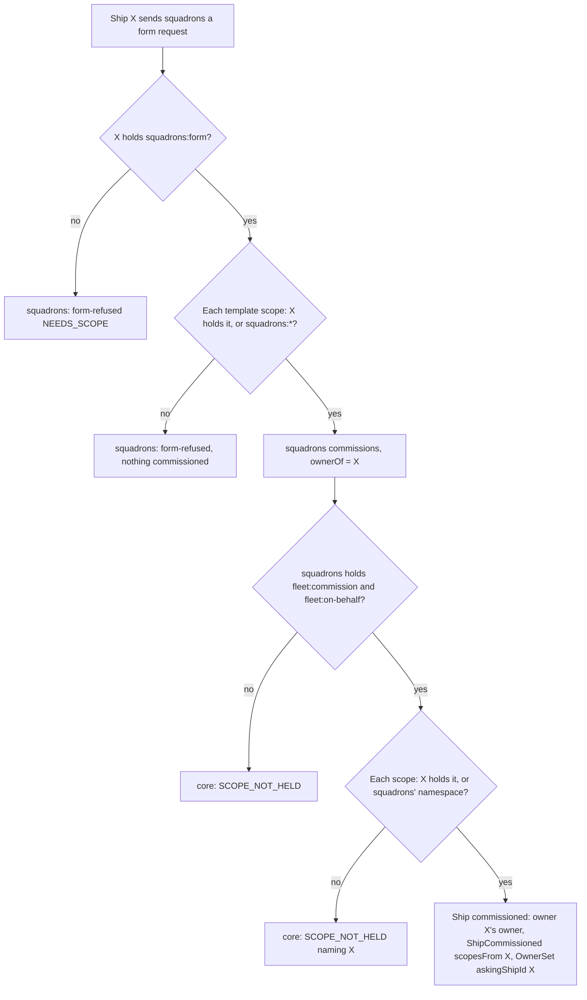

# Scopes granted on behalf of the asking ship

New core fleet functionality, so it goes purpose first. Nothing past the purpose is decided until Thomas agrees it. No code.

## 1. Purpose

Thomas, 27 Oct 2026: "templates/squadrons are pretty useless if they dont work with scopes". Choosing between the options: "option 1 --> indeed the caller to create the squadron's scopes is checked".

Today a squadron's members get only scopes squadrons' own ship holds (`fleet:read`, `fleet:commission`, `fleet:manage`, `labels:define`, `labels:assign`, `fleet:on-behalf`, `scopes:declare`) and `squadrons:*`. A template naming `meetings:open` is refused, even when the ship that asked to form the squadron holds it.

The outcome: when a plugin ship commissions a ship on behalf of the ship that asked it (`ownerOf`, 0045), core checks the scopes to grant against that asking ship. A squadron formed by a ship holding `meetings:open` may give its members `meetings:open`; one formed by a ship without it may not.

Not the purpose: the gateway's app ships (it names `owner`, not `ownerOf`, and its approver's check stays its own, 0056); granting on a live ship (`scopes:grant`); labels at commission.

## 2. Lessons to check against

- **The current rule (0046, 0053).** A commissioner grants only scopes it holds, plus the scopes of the plugin namespace it declared (`mayGrant` in `packages/core/src/domain/registry/scope-grant.ts`). Why: "a ship grants only what it holds, so nothing widens itself"; a new ship never reaches further than its commissioner can make it. The rule below keeps that: the asking ship is the one being widened for, and it only passes on what it holds.
- **No rights travel with a message (0046, 0017).** squadrons reads the asking ship's scopes from the fleet, never from the request. Core does the same here: it reads the asking ship's scopes from its own tables at commission.
- **`fleet:on-behalf` is already trust in the plugin (0045, 0034).** Holding it, a plugin reads with a named ship's read reach and gives a named ship's owner. Lending that ship's scopes at commission is the same trust: core cannot see who asked, so the plugin must name only the ship that did.
- **Kubernetes RBAC escalation prevention.** A user creates or updates a Role or binding only with every permission it grants already held (or the `escalate` and `bind` verbs). Our rule today. The on-behalf case matches Kubernetes impersonation: a holder of `impersonate` acts with another user's permissions, never more, and the audit log names both the real user and the impersonated one. So: the asking ship's scopes, never more, and the event names both ships.
- **No policy (0016).** Core adds no guard beyond the scopes; it records.

## 3. The rule (decision draft)

**Checked against which ship.**

| What | Checked against |
| --- | --- |
| The commission itself: `fleet:commission`, `fleet:on-behalf` | The commissioner (unchanged) |
| Each scope to grant, without `ownerOf` | The commissioner (unchanged) |
| Each scope to grant, with `ownerOf` | The asking ship: a scope it holds, or argo's every scope |
| A scope of the commissioner's own plugin namespace (`squadrons:*`) | Granted by its declarer, as now, whatever the asking ship holds |
| Label values | The commissioner (unchanged, 0053) |
| The owner | The asking ship's owner (unchanged, 0045) |

**Stays refused.** A scope the asking ship does not hold (`SCOPE_NOT_HELD`, naming the asking ship), even when the commissioner holds it; `ownerOf` from a ship without `fleet:on-behalf` (unchanged); a scope neither declared nor defined.

**What squadrons guarantees.** `ownerOf` is the sender of the request it acts on, as the fleet names it: the forming ship on a form or add-member, argo for a console form, the forming ship's owner once the forming ship is retired (squadrons docs/squadrons.md, forming step 8). Never a name from a payload. squadrons checks a template's scopes against that ship before commissioning anything, as it checks the subset rule now.

**Recorded.** `ShipCommissioned` names the ship the scopes were checked against (`scopesFrom: <shipId>`), beside `OwnerSet`'s `askingShipId`. A wrong `ownerOf` then shows on the new ship's timeline.

## 4. Flow

## 5. Scenarios

- **Asking ship holds it.** Given ship X holds `meetings:open` and squadrons does not, when squadrons commissions with `ownerOf` X and scope `meetings:open`, then the ship holds `meetings:open` and `ShipCommissioned` names `scopesFrom` X.
- **Asking ship lacks it.** Given X lacks `fleet:manage` and squadrons holds it, when squadrons commissions with `ownerOf` X and scope `fleet:manage`, then core refuses `SCOPE_NOT_HELD` naming X and commissions nothing.
- **Own namespace.** Given X lacks `squadrons:scale`, when squadrons commissions with `ownerOf` X and scope `squadrons:scale`, then the ship holds it.
- **argo asks.** Given argo formed in the console, when squadrons commissions with `ownerOf` argo and any declared or core scope, then it is granted.
- **No on-behalf.** Given ship Y holds `fleet:commission` but not `fleet:on-behalf`, when Y commissions with `ownerOf` X, then core refuses `SCOPE_NOT_HELD` and commissions nothing (unchanged).
- **Without ownerOf.** Given squadrons commissions with no `ownerOf` and scope `meetings:open`, then core refuses `SCOPE_NOT_HELD` (unchanged).
- **squadrons names a ship that did not ask** (squadrons). Given X sends a form request whose payload names argo, when squadrons commissions, then `ownerOf` is X, never argo.
- **squadrons names a ship that did not ask** (core). Given squadrons commissions with `ownerOf` argo though X asked, then core grants as argo and records `scopesFrom` argo: core cannot tell (question 1).

## 6. Questions

1. **How is "`ownerOf` asked" enforced?**
   - a. squadrons guarantees it; core trusts the `fleet:on-behalf` holder and records `scopesFrom` (as Kubernetes impersonation, and as 0045 already trusts it for the owner).
   - b. Core proves it: the commission names the asking message's id, and core checks that `ownerOf` sent it to the commissioner. Needs every path to be a message; a console form by argo and an add-member to the flagship are not messages to squadrons' ship today.
   - Pick a: no new surface, same trust `fleet:on-behalf` already carries, and the event makes a wrong name visible.
2. **What the event records.**
   - a. `scopesFrom` on `ShipCommissioned`, only with `ownerOf`.
   - b. Nothing new: `OwnerSet` already names `askingShipId`.
   - Pick a: the scopes and where they came from read in one event.
3. **A retired asking ship.**
   - a. Refused (`SHIP_ALREADY_RETIRED`): squadrons names its owner instead, as it already proxies to it.
   - b. Allowed, checked against its scopes as they stood.
   - Pick a: a retired ship grants nothing.
4. **The same rule for `scopes:grant` on a live ship on behalf** (a member's scopes changed later)?
   - a. Not now: squadrons never changes a member's scopes (a squadron never changes, 0017).
   - b. Yes, with an `onBehalfOf` input.
   - Pick a.
