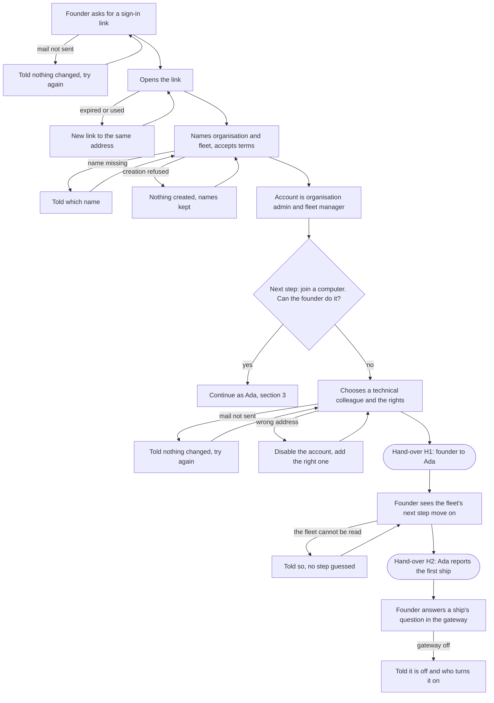
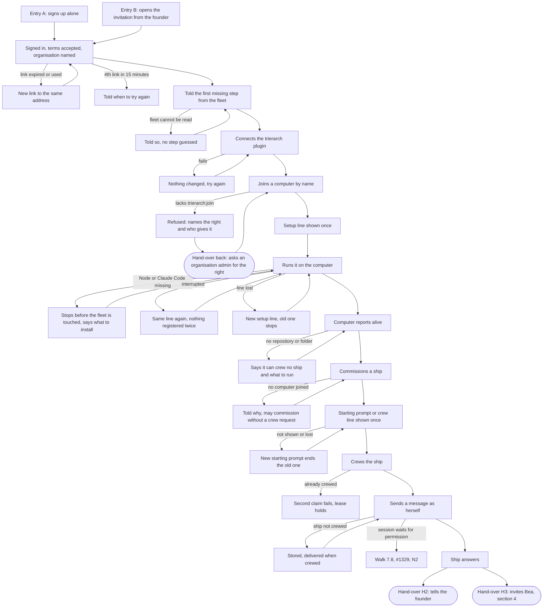
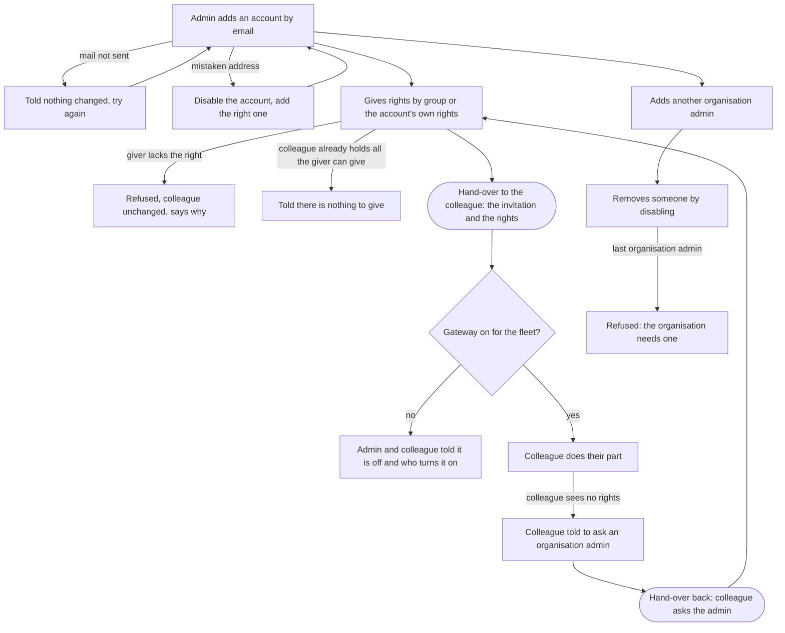
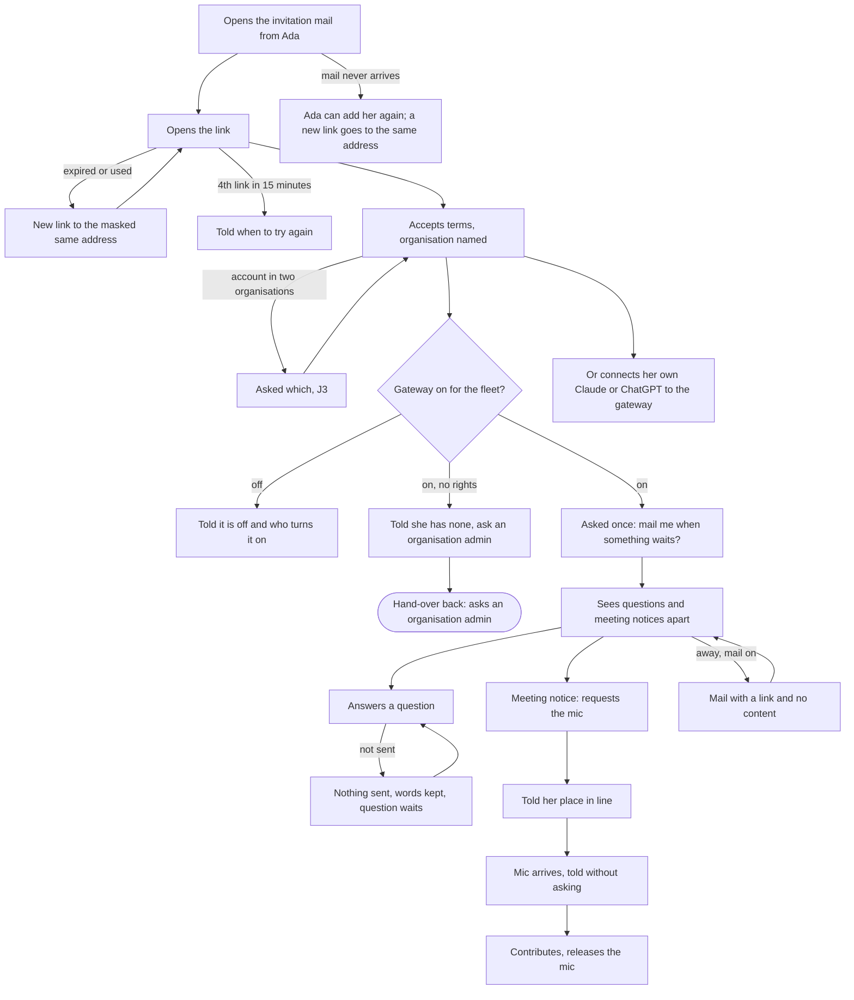

# Onboarding: the user journeys

Part of [#1228](https://github.com/ThomasHendrickx/aeolus-fleet/issues/1228), docs only. The user journeys, conceptually, loose from the design system: this file names no screen, layout or component. [onboarding.md](onboarding.md) holds the purpose, the lessons (L1 to L16) and the questions; the screens come in its stage 2 and must meet this file's scenarios (section 7).

Terms are the blueprint's: organisation, organisation admin, account, fleet, fleet manager, person ship, gateway, trierarch, computer, join, commission, crew, crew line, starting prompt, lease, scope, group. Where the docs do not say how something works, it is a question for Thomas, not a guess. Section 8 holds what he decided.

## 1. The people and what each needs

| Person | Who | Starts with | Ends when |
| --- | --- | --- | --- |
| Founder | Non-technical. Signs up first, so is the first organisation admin and the fleet manager | "I was told to try Aeolus" | The fleet is set up by a colleague and the founder has had a ship answer them |
| Ada | Technical. Sets the fleet up, alone or when the founder hands it over | A sign-up, or an invite from the founder | Her first ship answers her message |
| Organisation admin | Holds the organisation: its accounts, groups and fleets. The founder is the first; others can be given the right (0051) | An organisation with one account | Everyone who should be in is in, with the rights their part needs |
| Bea | Non-technical colleague. Never sees a terminal | An invite mail | Her first question is answered |

What holds for all four:
- A secret (starting prompt, crew line, setup line) is shown once, and a new one ends the old one (L5).
- Argo is never part of a normal journey (0012, 0053).
- A step that fails says what happened, whether anything changed, and what to do next (L10).
- A sign-in link works once, for 15 minutes, and signs in only the address it was sent to. A new link goes to the same address, at most 3 in 15 minutes (as today).
- An account has no fleet rights until a group or its own rights give some (0052). With none, the person is told to ask an organisation admin.

## 2. The founder

The founder wants to try Aeolus for their company and cannot set up a computer. Their part is to start the organisation, decide who sets it up, and later use the fleet like any colleague.

### 2.1 Steps

| # | Goal | Needs to know or decide | The product | Where it fails, and the way out |
| --- | --- | --- | --- | --- |
| F1 | Get in | Their work email. Nothing else; they know nothing of ships, scopes or trierarchs | Mails a sign-in link to the address | Mail not sent: says so, nothing changed, try again. Link expired or used: a new link to the same address |
| F2 | Start the organisation | The organisation's name, the fleet's name, the terms | Creates the organisation, its first account (organisation admin), and its first fleet. The account is the fleet manager and holds every scope the fleet offers, with no step | A name missing: says which. Creation refused: nothing was created, the names are kept, try again |
| F3 | Know what comes next | That the fleet needs a computer joined, and that a person with a computer does that | Says what the fleet still lacks, from its own state: no trierarch plugin connected, no computer joined, no ship commissioned. For a founder with no computer to hand, says a technical colleague does this and offers to invite one | Cannot read the fleet: says so and guesses no step |
| F4 | Hand the setup to a technical colleague | Whom. Which rights that person needs (join a computer, commission and crew ships) | Adds the account and mails the colleague a link that names the founder and the organisation and says what is asked of them. Gives the account the rights, by group or by its own rights (0052) | Mail not sent: says so, nothing changed. Wrong address: the mail goes to someone else, but a link signs in only that address and expires in 15 minutes. The account is disabled and added again (0055). Right missing for the colleague: the colleague's refusal names the right and says an organisation admin or fleet manager gives it (see H1) |
| F5 | Wait without being stranded | Whether the colleague has started | Shows the fleet's next step, which moves on as the colleague joins a computer and commissions a ship | Colleague never starts: the founder sees only the fleet's next step, which stays where it is; nothing shows whether the colleague signed in (J4) |
| F6 | Use the fleet | That ships ask them questions, and where they answer | The founder's account has a person ship. They answer through the gateway as Bea does (section 5) | No gateway for the fleet: says it is off and who turns it on (Q3) |

### 2.2 Diagram



### 2.3 Hand-over H1: founder to Ada

| | |
| --- | --- |
| From, to | The founder, an organisation admin and the fleet manager, to a technical colleague whose account is new |
| What passes | The invitation (a link that names the founder and the organisation and says what is asked), and the rights: to join a computer and to commission and crew ships, given through a group or the account's own rights (0052) |
| What stays with the founder | The fleet, as fleet manager (the only one; Ada is given rights, not made a second manager, J2); the decision which ships exist and what they are for, said when handing over |
| Who commissions | Ada commissions and crews the first ship herself, with the rights the founder gave (J1). The secret is shown once, to her |
| What the colleague must not need | To ask the founder what to do. The invitation says it. To ask the hosting service for a right: the founder gives it |
| If the right is missing | The colleague is refused when joining a computer; the refusal names the right and says a fleet manager or organisation admin gives it. Nothing changed. The colleague tells the founder, the founder gives it, the colleague tries again |
| Who owns the computer | The computer joined by the colleague is owned by the colleague's person ship (L3, 0030), not by the founder |

### 2.4 Hand-over H2: Ada reports back

| | |
| --- | --- |
| From, to | Ada to the founder |
| What passes | Knowledge that the first ship is crewed and answers, and where the founder asks it something |
| How | The founder sees it in the fleet's state (a ship crewed and alive), and Ada can say so in the fleet: the founder's person ship receives a message from Ada's |
| If it never happens | The founder's next step still reads from the fleet: it does not wait on Ada saying it |

## 3. Ada

Ada is technical and can reach a computer with Node and Claude Code. She comes in one of two ways, and both end the same.

- **Entry A, alone.** She signs up. Her steps A1 to A2 are the founder's F1 and F2, and she then has all rights.
- **Entry B, invited.** The founder or another organisation admin added her (H1). She opens the invitation link, accepts the terms, and the mail already told her who added her and what is asked.

### 3.1 Steps

| # | Goal | Needs to know or decide | The product | Where it fails, and the way out |
| --- | --- | --- | --- | --- |
| A1 | Be in the organisation | Nothing new. Entry B: the invitation names who invited her and the organisation | Signs her in, shows the terms, names the organisation | Link expired or used: a new link to the same address. Fourth link within 15 minutes: refused, says when to try again |
| A2 | Know what the fleet needs first | That the fleet lacks, in order, the trierarch plugin connected, a computer joined, a ship commissioned | Says the first missing one. Offers the action only if she holds the right; otherwise says who gives it | Fleet cannot be read: says so, guesses nothing |
| A3 | Connect the trierarch plugin | That the trierarch plugin does the joining | Connects it | Fails: nothing changed, try again |
| A4 | Join her computer | A name for the computer. What a trierarch is, in one sentence. What the computer needs: Node 26 and Claude Code, signed in | Checks she holds `trierarch:join`. Issues a setup line, shown once | No right: refused, names the right and who gives it, nothing changed (H1). Name taken by an active ship, or over 100 characters: says which |
| A5 | Run the setup line on the computer | Nothing to decide | Checks Node and Claude Code before touching the fleet. Asks no question. Sets safe defaults and says what they are and how to change them later: by the command on the computer (N3) | Node too old or Claude Code missing or not signed in: stops, says what to install, says the fleet does not know the computer yet, nothing changed. Interrupted after joining: the same line runs again and registers nothing twice. Line lost: a new setup line is issued, the old one stops |
| A6 | See the computer is alive | Whether setup finished | The computer reports alive. A computer that joined and has not reported reads as setup not finished, with the way to get a new setup line | Computer has no repository or folder: says it can crew no ship yet and what to run |
| A7 | Commission her first ship | Its name, what it may do, whether to ask the computer for a crew | Shows each right as a sentence, by group, with its scope name beside it. Says why commissioning cannot proceed when it cannot | Nothing joined yet: says so and offers to commission without asking for a crew. Prompt not shown: nothing is lost, a new starting prompt ends the old one |
| A8 | Crew the ship | The crew line or the starting prompt, from the one place it shows | Shows the secret once | Lost: a new starting prompt ends the old one. A second claim on a ship already crewed fails (lease) |
| A9 | Send the ship a message and get an answer | Nothing: she sends as herself (N1) | Stores the message before it answers OK. Delivers it when the ship is crewed, now or later | Ship not yet crewed: the message is stored and waits. A session that waits for a permission nobody gives: sessions run headless, the walk (7.8) runs in auto permission mode, and the route of a permission to the owner is [#1329](https://github.com/ThomasHendrickx/aeolus-fleet/issues/1329) (N2) |
| A10 | Bring in the people the ship asks | Whom, and which rights | Same as the organisation admin (section 4) | As section 4 |

### 3.2 Diagram



### 3.3 Hand-over back: Ada to an organisation admin

When Ada is refused for a right (A4, A7, giving rights later), the way out is a person, not a screen: the refusal names the right and says a fleet manager or an organisation admin gives it. Ada tells that person, they give the right by group or by its own right, and Ada tries again. Nothing Ada did was lost.

## 4. The organisation admin

The organisation admin decides who is in and with which rights. The founder is the first. This journey is the same for the founder at F4 and for Ada when she invites Bea (H3), and for any admin later.

An organisation admin's right sits on the account and implies no fleet scope (0051, 0052). To act in a fleet, they need to be its fleet manager or hold rights from a group or their own.

### 4.1 Steps

| # | Goal | Needs to know or decide | The product | Where it fails, and the way out |
| --- | --- | --- | --- | --- |
| O1 | Let a colleague in | Their work email; which part they will play (set the fleet up, answer ships) | Adds the account and mails a link naming the admin and the organisation, with two sentences on what Aeolus is and what the person will be asked | Mail not sent: says so, nothing changed, try again. A mistaken address: disable the account (0055), add the right one |
| O2 | Give the colleague what their part needs | Which rights. Answering ships needs the gateway and messaging. Setting up needs joining a computer and commissioning | Gives them through a group, or an account's own rights in a fleet (0052). The rights read as sentences, not as scope names alone | Admin tries to give a right they do not hold: refused, the colleague is unchanged, the message says so. Nothing to give: says the colleague already holds every right the admin may give |
| O3 | Know it worked | That the colleague can now do their part | The gateway is on for the fleet, so a colleague with the rights can use it. If the gateway is off, says who turns it on | Gateway off: the colleague is told, the admin is told (Q3, F1 in the audit) |
| O4 | Fix a colleague who is stuck | Why the colleague sees nothing | A colleague with no rights is told that, and to ask an organisation admin | The admin gives a right (O2); nothing else changes |
| O5 | Add another organisation admin | Whom | Grants the organisation admin right | Cannot remove the last one: refused, the organisation needs one (0051) |
| O6 | Remove someone | Whom | Disables the account: ends its tokens and sign-ins, releases its person ship and the trierarchs it owns, and their leases. Ships stay | Last organisation admin: refused. Fleet manager: the design names no second one (J2) |

### 4.2 Diagram



### 4.3 Hand-over H3: an admin to a colleague

| | |
| --- | --- |
| What passes | The invitation (a link, the inviter and the organisation named, what Aeolus is, what the person will be asked), and the rights the part needs |
| What the colleague must not need | To ask the admin what to do (the invitation says it), or the hosting service for a right (the admin gives it) |
| If the colleague has an account in another organisation too | A sign-in with that email asks which organisation (0051). The invitation names the organisation, and the choice lists organisations by name with the invited one marked (J3) |

## 5. Bea

Bea is non-technical and never sees a terminal. Her part is to answer what ships ask, join meetings, and be told when something waits while she is away. She may also use Claude or ChatGPT through the gateway.

### 5.1 Steps

| # | Goal | Needs to know or decide | The product | Where it fails, and the way out |
| --- | --- | --- | --- | --- |
| B1 | Understand why she got a mail | Who invited her, to what, and what she is asked | The mail names the inviter and the organisation, says what Aeolus is and what she will do, in plain words. It holds one link | Link expired or used: a new link to the same address, which shows only a masked address. Fourth link in 15 minutes: says when to try again. Mail not sent: says so |
| B2 | Be signed in | The terms | Signs her in as the address the link was sent to, and no other. Names the organisation | An account in two organisations: she is asked which, from organisation names with the invited one marked (J3) |
| B3 | Reach the gateway | Nothing about fleets or scopes | Takes her to the gateway, the one address. Finds her fleet from her account and crews her person ship | Gateway off for the fleet: says so and who turns it on, and does not silently send her elsewhere. No rights: says she has none there and to ask an organisation admin |
| B4 | Choose how to be told | Whether to be mailed when something waits | Asks once, never turned on by default. A mail holds a link and no content | Declines by not answering: it does not ask again, and email stays off. Mail service cannot send: it does not ask |
| B5 | Answer a question | What is asked, from whom | Lists what waits on her and what is only a notice, apart. Stores her answer before it says sent | Answer not sent: says nothing was sent, keeps her words, the question still waits, try again |
| B6 | Take part in a meeting | That she was added; whose meeting it is | Reads the notice as a sentence. She requests the mic and is told her place in line. When the mic arrives she is told, without asking again | Mic never comes: she remains in the line and can withdraw. Meeting ended: no more to say |
| B7 | Be reached when away | That mail is on | Mails a link, no content, when something waits and nothing of hers is in focus | Mail off: nothing is sent; what waits is still there when she returns |
| B8 | Use her own Claude or ChatGPT | The gateway's address | The same gateway, the same person ship | Cannot connect: the gateway's pages remain her way in |

### 5.2 Diagram



### 5.3 Hand-over H3 from Bea's side

Bea is on the receiving end of H3 (section 4.3). What she has when she arrives is what the invitation says and what the admin gave. If either is missing she is not stranded: she is told who to ask, and the admin's fix (O2) reaches her without her doing anything.

## 6. All hand-overs

| # | From, to | What passes | The break to guard against |
| --- | --- | --- | --- |
| H1 | Founder to Ada | Invitation and the rights to set up | Ada refused for a right nobody told the founder to give |
| H2 | Ada to the founder | News that the first ship answers | The founder waits on a message that never comes: the fleet's state tells it too |
| H3 | An admin to a colleague | Invitation and the rights for the part | The colleague arrives with nothing, or with a gateway that is off |
| Back | A refused person to an organisation admin | The name of the right and who gives it | The refusal does not say who to ask |

## 7. Acceptance criteria

Scenarios state behaviour. Numbers marked (proposed) are mine; Thomas signs them. Scenarios name no screen wording.

### 7.1 Sign-in and sign-up (Founder F1 to F2, Ada entry A, Bea B1 to B2)

```gherkin
Scenario: a sign-in link works up to its last minute and not after
  Given a sign-in link was sent at 14:00:00
  When it is opened at 14:14:59
  Then the person is signed in
  When another link, sent at 14:00:00, is opened at 14:15:01
  Then the person is told the link no longer works and is not signed in

Scenario: a link signs in only the address it was sent to
  Given a link for bea@northwind.example
  When anyone opens it
  Then the session is bea@northwind.example's and no other account's

Scenario: an expired link is replaced by a new link to the same address
  Given a link has expired
  When the person asks for a new one
  Then a new link is mailed to the same address
  And the person is shown only the masked address

Scenario: the limit of new links
  Given a person asked for 2 links in the last 15 minutes
  When they ask for a third
  Then it is sent
  When they ask for a fourth within the same 15 minutes
  Then they are told when to try again and no mail is sent

Scenario: what when it fails: the mail cannot be sent
  Given the mail service refuses
  When a person asks for a link
  Then they are told the mail was not sent, that nothing changed, and may try again
  And the attempt is not counted against their limit

Scenario: the founder creates the organisation and the fleet
  Given a founder signed in with a new address
  When they give an organisation name and a fleet name and accept the terms
  Then the organisation, its first account and its fleet exist
  And the account is an organisation admin and the fleet manager
  And the account holds every scope the fleet offers

Scenario: a name is missing
  Given a founder gave only one of the two names
  When they ask to create
  Then nothing is created and they are told which name is missing

Scenario: what when it fails: creation is refused
  Given the server refuses the fleet
  When the founder asks to create
  Then they are told nothing was created, the names they gave are kept, and they may try again

Scenario: a colleague in two organisations is asked which, and the invited one is marked
  Given bea@northwind.example has accounts in Northwind Onboarding and Contoso
  And she was invited to Northwind Onboarding
  When she signs in with that address
  Then she is asked which organisation, listed by name
  And Northwind Onboarding is marked as the one she was invited to
```

### 7.2 What comes next (Founder F3, F5; Ada A2)

```gherkin
Scenario: the first missing step is told, from the fleet's own state
  Given a new fleet with no trierarch plugin connected
  When its fleet manager asks what comes next
  Then the answer is to connect the plugin
  When the plugin is connected and no computer has joined
  Then the answer is to join a computer
  When a computer reports alive and no ship besides argo and the person ships exists
  Then the answer is to commission a ship

Scenario: a person who may not do the step is told who can
  Given the plugin is not connected and Cleo holds fleet:read only
  When Cleo asks what comes next
  Then she is told a fleet manager connects the plugin
  And she is offered no action

Scenario: the answer follows the fleet when it changes
  Given Ada is told to join a computer
  When a computer joins and reports
  Then the answer becomes commissioning a ship within 5 seconds (proposed)

Scenario: what when it fails: the fleet cannot be read
  Given the fleet server does not answer
  When anyone asks what comes next
  Then they are told it could not be read and no step is guessed

Scenario: a non-technical founder is told a technical colleague does the next step
  Given a founder whose next step is to join a computer
  When they ask what comes next
  Then they are told what a computer is needed for and that a technical colleague does it
  And they are offered to add that colleague

Scenario: another fleet is never read
  Given fleet A has no computer and fleet B has one
  When Ada asks what comes next in fleet A
  Then the answer is to join a computer, whatever fleet B holds

Scenario: the founder is not shown whether the colleague has signed in
  Given the founder added ada@northwind.example and she has not signed in
  When the founder asks what comes next
  Then the answer is the fleet's next step
  And nothing says whether ada@northwind.example signed in
```

### 7.3 Hand-over H1: founder to Ada, and any admin to a colleague (O1 to O4)

```gherkin
Scenario: the invitation names who invited and what is asked
  Given ada@northwind.example is an organisation admin of Northwind Onboarding
  When she adds bea@northwind.example
  Then bea@northwind.example is mailed an invitation naming ada@northwind.example and Northwind Onboarding
  And it says in two sentences what Aeolus is and what Bea will be asked
  And it holds one link that works once and expires 15 minutes after it was sent
  And the mail is sent within 5 seconds (proposed)

Scenario: the welcome names the organisation and who added the person
  Given Bea opened her invitation link
  Then she is told ada@northwind.example added her to Northwind Onboarding
  And she is asked for the terms

Scenario: rights are given by group or by an account's own rights
  Given an organisation admin and a colleague with no fleet rights
  When the admin gives the colleague trierarch:join through a group or as the colleague's own right
  Then the colleague holds it from their next call

Scenario: who may: only rights the giver holds
  Given Cleo does not hold meetings:open
  When she tries to give it to helper
  Then she is refused, helper is unchanged, and she is told she does not hold it

Scenario: nothing to give
  Given the colleague already holds every right the admin may give
  When the admin gives rights
  Then the admin is told there is nothing left to give

Scenario: a colleague with no rights is told whom to ask
  Given an account with no group and no own rights in northwind
  When the account asks for anything in the fleet
  Then it is told it has no rights there and to ask an organisation admin
  And it sees no ship of the fleet

Scenario: the last organisation admin stays
  Given one account holds the organisation admin right
  When anyone tries to disable it or take the right away
  Then it is refused and the organisation keeps an admin

Scenario: removing someone releases what they held
  Given a colleague owns a person ship, a trierarch and the leases they crewed
  When an organisation admin disables the account
  Then its tokens and sign-ins end
  And the person ship, the trierarch and their leases are released
  And the ships stay

Scenario: every call is scoped to its fleet
  Given Ada manages fleets A and B
  When she gives a right in fleet A
  Then nothing in fleet B changes
```

### 7.4 Ada: joining, setting up, commissioning, first answer (A3 to A9)

```gherkin
Scenario: the fleet's creator joins a computer without being argo
  Given Ada created the fleet and holds trierarch:join as its fleet manager
  When she joins "ada-laptop"
  Then a setup line is shown once, with what the computer needs: Node 26 and Claude Code, signed in
  And she is told what a trierarch is, in one sentence
  And she never signs in as argo

Scenario: who may: joining is refused without the right and says who gives it
  Given Cleo does not hold trierarch:join
  When she joins "cleo-laptop"
  Then she is refused, told that trierarch:join is the right, and that a fleet manager or an organisation admin gives it, and that a group can carry it
  And nothing is created

Scenario: the limits of a computer name
  Given a name of 100 characters
  When Ada joins it
  Then it joins
  When the name has 101 characters
  Then she is told it is too long and nothing joins
  When an active ship already has the name
  Then she is told the name is used by an active ship

Scenario: hosted: the join works on every train at its version (release gate)
  Given staging runs core, gateway, trierarch plugin and common at the versions of the release
  When Ada, who created the fleet, joins a computer
  Then it is accepted

Scenario: setup asks no question and says what it set
  Given Node 26 and a signed-in Claude Code on the computer
  When Ada runs the setup line
  Then it prints its checks, the defaults it set, whether Claude Code asks before it runs a tool, and how to change them later
  And it says the change is the command on the computer, not the console
  And it waits for no answer
  And the checks end within 10 seconds (proposed)

Scenario: Node too old stops before the fleet is touched
  Given Node 22.11.0
  When Ada runs the setup line
  Then it says Node 26 or newer is needed and where to get it
  And it says nothing was changed because the fleet does not know the computer yet
  And no ship is crewed

Scenario: Claude Code missing or not signed in stops the same way
  Given Node 26 and no Claude Code
  When Ada runs the setup line
  Then it names Claude Code and where to get it, and nothing is crewed

Scenario: what when it fails: interrupted after joining, run again
  Given the setup was interrupted after the ship was crewed
  When Ada runs the same line again
  Then it goes on with the rest and registers nothing again

Scenario: what when it fails: the line is lost, a new one finishes the setup
  Given the setup was interrupted and the line is lost
  When Ada asks for a new setup line for ada-laptop and confirms
  Then a new line is shown once and the old one stops working
  And running the new line finishes the setup
  And a new line is issued within 10 seconds (proposed)

Scenario: a computer is told to be unfinished only when it is
  Given a computer joined and has not reported
  Then it is shown as setup not finished, with the way to get a new setup line
  When the trierarch reports
  Then it is shown alive and the way to get a new line is gone

Scenario: a computer with no repository or folder says what to run
  Given ada-laptop is set up and reports with no repository and no folder
  Then it is told it can crew no ship and is given the command to add one
  And a repository and a folder are each explained in one sentence

Scenario: a new setup line needs the right to join, in the same fleet
  Given Cleo lacks trierarch:join, and Ada manages fleet B only
  When Cleo asks for a new setup line, or Ada asks for one for a computer in fleet A
  Then each is refused and nothing changes

Scenario: commissioning shows each right in plain words
  When Ada commissions a ship
  Then each right is described in a sentence with its scope name beside it
  And the rights are grouped by what the ship does
  And every right the fleet offers can be chosen

Scenario: commissioning that cannot proceed says why
  Given no computer is joined and a crew is asked for
  Then commissioning does not proceed and she is told no computer is joined, and that she may commission without asking for a crew
  When the name is empty
  Then she is told the ship needs a name

Scenario: commissioning without a crew gives the starting prompt once
  Given no computer is joined
  When Ada commissions "helper" without asking for a crew
  Then the starting prompt and the crew line are shown once

Scenario: what when it fails: the prompt cannot be shown
  Given "helper" was commissioned and no secret can be shown
  Then Ada is told the prompt could not be shown and that nothing is lost
  And a new starting prompt can be issued; it ends the old one

Scenario: giving a right later
  Given helper lacks meetings:open and Ada holds it
  When she gives it to helper
  Then helper holds it from its next call and the ship lists it
  And an event records who gave which right to which ship, in the same transaction

Scenario: Ada messages her ship as herself
  Given helper is crewed and Ada holds messages:send
  When Ada sends it "Say hello"
  Then the message is sent as Ada's person ship, not as argo
  And no send returns before the message is stored

Scenario: how big: the first answer
  Given helper's crew line ran in Claude Code
  When Ada sends "Say hello"
  Then the reply reaches her within 2 minutes of the crew line starting (proposed)

Scenario: what when it fails: the ship is not crewed yet
  Given helper awaits crew
  When Ada sends it a message
  Then the message is stored and delivered when helper is crewed
  And Ada is told it waits for crew
```

### 7.5 Founder and the first answer (H2)

```gherkin
Scenario: the founder sees the setup move on without Ada telling them
  Given the founder handed the setup to Ada
  When Ada's computer reports alive and a ship is crewed
  Then the founder's next step changes to using the ship, with no message from Ada needed

Scenario: the founder's ship asks and they answer
  Given a crewed ship asks the founder a question
  When the founder opens the gateway
  Then the question waits for them, and they answer it as Bea does
```

### 7.6 Bea (B1 to B8)

```gherkin
Scenario: an invitation leads to the gateway
  Given the gateway is on for northwind and Bea holds the right to use it
  When she is signed in
  Then she is taken to the gateway as her one next step
  And she sees no fleet health and no scope names

Scenario: the gateway is off, and she is told
  Given the gateway is off for northwind
  When Bea signs in or opens the gateway's address
  Then she is told the gateway is off for this fleet and who can turn it on
  And she is not silently sent elsewhere

Scenario: no rights, no gateway
  Given Bea holds no right in northwind
  When she opens the gateway
  Then she is told she has no rights there and to ask an organisation admin
  And she sees no ship of the fleet

Scenario: the first visit asks once about email
  Given Bea has never opened the gateway and email is off
  When she opens it
  Then she is asked once whether to be mailed when something waits
  When she does not answer and opens it again
  Then she is not asked again and email stays off

Scenario: saying yes turns email on and sends no content
  Given Bea was asked
  When she says yes
  Then a mail is sent when something waits and none of her pages is in focus
  And the mail holds a link and no content

Scenario: another colleague's choice is not hers
  Given Bea said yes
  When Cleo opens the gateway for the first time
  Then Cleo is asked, and Cleo's email is off

Scenario: the gateway cannot send mail, so it asks nothing
  Given the gateway cannot ask pagasae to send mail
  When Bea opens the gateway
  Then she is not asked

Scenario: questions and notices are told apart
  Given 2 questions and 1 meeting notice wait for Bea
  Then what waits on her counts 2
  And the notice is listed apart, with the way into the meeting

Scenario: a meeting notice reads as a sentence
  Given Bea was added to the meeting "Launch week" moderated by planning-lead
  Then the notice says she was added to it, who moderates, and who takes part
  And it shows no id and no JSON
  And it offers the way into the meeting and to mark it done, and no answer

Scenario: a notice that asks nothing is done by taking part
  Given a notice that Bea holds the mic of a meeting
  When she releases the mic
  Then the notice is gone

Scenario: the mic request tells her place
  Given copywriter holds the mic and Bea is first in line
  When Bea requests the mic, from the gateway or from Claude
  Then the answer says she is number 1 in line and that copywriter holds the mic

Scenario: the mic arrives and she is told
  Given Bea is number 1 in line and has the meeting open
  When the moderator gives her the mic
  Then she is told she holds it within 5 seconds (proposed), without asking again

Scenario: the list at its maximum
  Given 10 questions wait for Bea
  When she opens the gateway
  Then all 10 show within 1 second (proposed)

Scenario: times are in her zone
  Given a message sent at 12:05 UTC and Bea in Brussels in winter
  When she reads it
  Then it shows "27 Oct, 13:05" and no "GMT"

Scenario: what when it fails: an answer is not sent
  Given the fleet does not answer
  When Bea answers a question
  Then she is told nothing was sent, her words are kept, and she may try again
  And the question still waits

Scenario: she sees only what she may use
  Given Bea may not approve outside parties
  When she opens the gateway
  Then she is offered only the overview
```

### 7.7 Words and guarantees (every journey)

```gherkin
Scenario: Bea's journey holds no fleet-management word
  Given Bea manages nothing
  When she reads her invitation, her welcome and the gateway
  Then none of them says scope, commission, crew, harness, trierarch or lease
  And ship is explained once on her way in and once in the invitation

Scenario: each term is explained once where Ada first meets it
  Given Ada has not seen "trierarch" before
  When she first meets it
  Then one plain sentence explains it, in the text and not only in a hint
  And the same sentence is not repeated

Scenario: no term is renamed
  Then every term a journey uses is one the blueprint defines
  And a trierarch runs on a computer, never a machine

Scenario: a secret shown once is never shown again
  Given a setup line, a starting prompt or a crew line was shown
  When the person asks for it again
  Then no secret is shown, only that one was issued

Scenario: a new secret ends the old one
  Given a setup line was issued for ada-laptop
  When Ada gets a new one
  Then the first no longer registers or crews

Scenario: no message is lost when a ship is not crewed yet
  Given helper awaits crew and Ada sends it a message
  When helper is crewed an hour later
  Then it receives the message once

Scenario: a send returns only after the message is stored
  When Ada sends a message and the store fails
  Then the send answers an error and no message exists

Scenario: the operator is not the fail-safe
  Given Ada holds the rights she needs as fleet manager
  When she goes from sign-up to her first answered message
  Then she never signs in as argo
```

### 7.8 The release gate

```gherkin
Scenario: a walk of both people on staging, no help
  Given staging runs every train at the release's version
  And the sessions run headless in auto permission mode
  And a technical person and a non-technical person, new to Aeolus, with no help
  When the technical person goes from the sign-up mail to her first ship answering
  And the non-technical person goes from the invitation mail to her first answered question
  Then no step is a Block or a Hurt
  And every Rough step is listed for Thomas

Scenario: a walk of the hand-over on staging
  Given a non-technical founder who signs up, and a technical colleague on their own computer
  When the founder hands the setup to the colleague
  Then the colleague reaches a ship answering without asking the founder or the hosting service anything
  And the founder reaches an answered question
```

## 8. Decisions on the questions

Thomas decided these on 28 Oct. Q1 to Q10 are in [onboarding.md](onboarding.md) section 2.4.

| # | Decision | Where it shows |
| --- | --- | --- |
| N1 | Compose sends as the signed-in account's person ship when it holds `messages:send`; as argo only for argo | A9, scenario 7.4 "Ada messages her ship as herself" |
| N2 | The first ship's permission wait is walked first. Sessions run headless, so the walk runs headless in auto permission mode. The route of a permission to the owner is [#1329](https://github.com/ThomasHendrickx/aeolus-fleet/issues/1329) | A9, 7.8 |
| N3 | The setup choices change by the command on the computer only, said in the terminal's last lines and on the computer card | A5, 7.4 "setup asks no question and says what it set" |
| N4 | Help stays as it is. A guide for colleagues, possibly at docs.aeolus-fleet.com, belongs to the marketing plan, long term and not part of this design | Bea B3 to B8 |
| N5 | A person who may do nothing is told "a fleet manager", with no name | A2, F3, scenario 7.2 "a person who may not do the step is told who can" |
| J1 | Ada commissions and crews the first ship herself, with the rights the founder gave; the founder says what the ship is for when handing over | H1 |
| J2 | Ada is given the rights she needs through a group or the account's own rights; the founder stays the fleet manager. No second fleet manager is named | H1, O6 |
| J3 | The invitation names the organisation; the choice lists organisations by name and marks the invited one | H3, B2, scenario 7.1 |
| J4 | The account shows nothing of whether an invited colleague has signed in; the founder sees only the fleet's next step | F5, scenario 7.2 |
